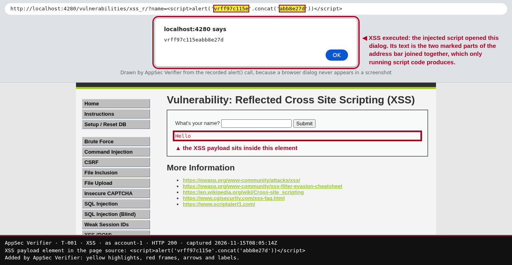

# AppSec Verifier

[](appsec_verifier/version_info.py)
[](#limitations)
[](setup.py)
[](LICENSE)

> [!NOTE]
> **Alpha.** Early version under active development. Feedback from real projects is welcome.

AppSec Verifier tests whether the findings of a static security assessment hold up in the running application. It reads the `appsec-assessment.yaml` written by [AppSec Analyzer](https://github.com/appsec-foundry/appsec-analyzer), tests the selected findings against a target you are authorised to test, and reports for each finding whether the weakness can be reproduced.

An AI agent plans the test steps. The Verifier sends every request itself and stays within the scope you define. A finding counts as confirmed only if its proof passes a check in the Verifier's code. The Verifier tests the findings it is given and does not look for new weaknesses, chain exploits or extract data.

[](examples/juice-shop/result/console.log.md)

The [console log](examples/juice-shop/result/console.log.md) and the [report](examples/juice-shop/result/verification.md) of this run against OWASP Juice Shop are in the examples.

## Quick start

You need Python 3.10 or later, [pipx](https://pipx.pypa.io/stable/), an assessment from AppSec Analyzer and the Claude CLI (`claude`) with a login. Other models are listed under [Model profiles](#model-profiles).

```sh
pipx install git+https://github.com/appsec-foundry/appsec-verifier.git
appsec-verifier ./out/appsec-assessment.yaml
```

The guided run asks for the target URL, shows which findings it can test and what the others still need, and starts after you confirm. By default it tests findings of severity high and above with the `claude` profile. Each run writes its report to a new private directory and prints its path at the start and at the end ([Output](#output)).

XSS findings also need the proof browser ([Install](#install)), and access-control tests usually need test accounts ([Scope and test accounts](#scope-and-test-accounts)). To try the Verifier, start OWASP Juice Shop locally with `docker run --rm -p 3000:3000 bkimminich/juice-shop` and use the files in [`examples/juice-shop/`](examples/juice-shop/).

## What it verifies

Where the assessment leaves a request or its details open, the agent looks them up in the source code and in the forms and links of the target ([test planning](docs/cli.md#test-planning-by-the-agent-ver-043), [request derivation](docs/cli.md#continuous-control-ver-036)). A finding counts as `confirmed` only with the proof in the table below; the model's verdict is never enough on its own. [How verification works](docs/how-verification-works.md) follows one finding through every step.

| Weakness | Confirmed when |
| --- | --- |
| Cross-site scripting | a marker script runs in the proof browser; reflected text does not count |
| Access control: IDOR, missing authorisation or authentication, exposed information and files | a checked access comparison breaks an independently declared restriction; matching responses are not enough |
| SQL, NoSQL and LDAP injection | the response follows true and false conditions the Verifier generates (in a field, a page text or a login), an injected marker comes back (SQL), or a malformed input causes a database error (SQL, NoSQL); a delay is never enough |
| Command, code, template and XPath injection | the target returns the result of a calculation the Verifier generates, a malformed input causes an engine error (not for commands), or, for code and template injection, the payload makes the target call a callback listener |
| Path traversal | the target returns the scope's marker file, or a file from an uploaded ZIP can be read outside the directory it is unpacked to |
| Open redirect | the target redirects to a random host under `.invalid` |
| SSRF | the target calls a callback listener |
| Session cookie without Secure, HttpOnly or SameSite | the session cookie repeatedly lacks the attribute (SameSite: Lax or Strict) |

Some classes need preparation. XSS needs the proof browser. Access-control tests need test accounts and an access restriction, declared in the scope or taken from the findings with `--accept-finding-restrictions`; a declared anonymous exposure needs no account. SSRF and blind injection need a listener the target can reach, which starts automatically for a `localhost` target. Path traversal needs a marker file. Session-cookie checks need the cookie's name in the scope, and login-bypass injection a protected resource to try the obtained login on. The guided run can collect access declarations for the run; `preflight` reports what is still missing. The exact rules are in [Proof per class](docs/cli.md#proof-per-class-ver-009-to-ver-013), the CWEs of each class in [`data/verifiable-cwes.yaml`](data/verifiable-cwes.yaml).

The report shows the requests each verdict rests on. The evidence images show the recorded requests and responses and mark the parts the proof depends on. In this SQL injection in Juice Shop, a single quote in the search parameter `q` causes a database error and two quotes do not:


The two images of a reflected XSS in DVWA come from separate runs. The first is the proof browser's screenshot. The injected script opened a dialog, which the Verifier draws in from the recorded `alert()` call because browser dialogs do not appear in screenshots. The second shows the request with the script in the `name` parameter and the response that contains it unescaped.




Each finding gets one of these verdicts. A negative verdict applies only to the request and variant that were tested. After one variant of a finding is confirmed, its other variants are still tested within the run's limits.

| Verdict | Meaning |
| --- | --- |
| `confirmed` | The weakness was reproduced and the proof checked. |
| `not-reproducible` | Tested, but the weakness did not show. |
| `blocked-by-control` | A protection the static analysis could not see stopped the attack. |
| `inconclusive` | No decision, for example because a request failed, a limit was reached or the proof did not hold. |
| `not-attempted` | Not testable against a running system (such as a hard-coded secret), or not reached because of a limit or an interruption. |

## Safety

`verify` sends attack requests to a running system. The Verifier's code enforces the following rules, and the model cannot change them:

- The Verifier contacts only the hosts, ports, paths and schemes in the scope, only during its test period, and never cloud metadata addresses.
- The run shows its test plan and waits for your confirmation before the first request.
- By default only GET, HEAD and OPTIONS are sent. Write requests, which stored XSS and some access-control tests need, require `--allow-intrusive` or your yes in the terminal. DELETE is never sent. Records the Verifier creates stay on the target, so allow writes only on an instance you can reset.
- Requests, request rate, model calls, cost and run time have limits ([defaults](data/limits.yaml)). The variants and reviews of a finding share one cost allowance.
- Passwords and tokens come from environment variables or hidden input. They are not stored and never reach the model, the logs or the report.
- The agent proposes one step at a time, and the Verifier checks each step before running it. The agent has no shell and cannot write files. With `--source` it reads the target's source code, except `.env` files, keys and `.git/`. It does see the target's responses and screenshots, which can contain target data.

## Scope and test accounts

Without a scope file the Verifier tests only the scheme, host and port of the target URL, read-only. A scope file allows more, such as several hosts, private networks or a proxy, and records the test period and who is responsible. The guided run uses a `scope.yaml` next to the assessment or in the working directory; `--scope` points to a different one.

```yaml
# scope.yaml
schema_version: 1
base_url: http://localhost:3000
window: {from: "2026-11-01T00:00:00Z", until: "2026-11-30T23:59:59Z"}
owner: {name: Your Name}
```

If the target has an HTML login form or a login that returns a token for a JSON POST, name the accounts on the command line, for example `--account jim@juice-sh.op --account bender@juice-sh.op`. The Verifier asks for the passwords with hidden input. Without `--login-url` it signs in at the login the assessment names or at the login form the target URL leads to. Other kinds of login go into an `identities.yaml`, which names environment variables and never contains the passwords themselves. It supports bearer tokens, basic authentication, form login, headers copied from the browser, OIDC (sign-in in your browser, device code, client credentials, password grant) and login programs.

Details: [scope file](docs/cli.md#scope-file--scopeyaml-authorisation-ver-001), [identities file](docs/cli.md#identities-file--identitiesyaml-sessions-ver-016028040), [accounts on the command line](docs/cli.md#test-accounts-on-the-command-line-ver-041). Examples: [`juice-shop/`](examples/juice-shop/) (local target, form login), [`sso-proxy/`](examples/sso-proxy/) (target behind a company proxy, SSO sign-in in the browser), [`login-program/`](examples/login-program/) (form with a CSRF token).

## Model profiles

Choose the model with `--profile`, as in AppSec Analyzer.

| Profile | Uses | Limited by |
| --- | --- | --- |
| `claude` (default) | Claude CLI with its login or `ANTHROPIC_API_KEY` | cost, calls, time |
| `codex-cli` | Codex CLI 0.163.0 or later with a ChatGPT login | calls, time |
| `copilot-cli` | GitHub Copilot CLI 1.0.101 with its login | calls, time |
| `codex` | OpenAI API with `OPENAI_API_KEY` | cost, calls, time |
| `anthropic-api` | Anthropic API with `ANTHROPIC_API_KEY`, no CLI needed | cost, calls, time |

The CLIs run without tools, MCP servers, settings or session history. Using a subscription is subject to the provider's terms for that plan.

With API billing the console shows the model costs, including the prompt-cache reads and writes the provider reports ([caching and costs](docs/cli.md#output-mode-and-run-mode)). With a Claude subscription, `--show-costs` shows what the calls would cost at API prices; it does not change the cost limit. The prices are in [`data/model-catalog.yaml`](data/model-catalog.yaml) for OpenAI and in [`data/anthropic-model-catalog.yaml`](data/anthropic-model-catalog.yaml) for the Anthropic API.

## Commands

| Command | Does |
| --- | --- |
| `appsec-verifier ASSESSMENT` | Guided run: asks for the settings, then runs `verify`. |
| `verify` | Tests the selected findings against the target. |
| `preflight` | Checks assessment, scope, target, logins and model, and shows which findings a run can test; tests no finding. `--offline` contacts nothing. |
| `scope` | Validates a scope file and shows whether a URL is inside it. Offline. |
| `export` | Converts a `verification.yaml` into a file for AppSec Analyzer. The Analyzer does not read this file. |
| `runs` | Lists earlier runs written without `--output` and removes the ones you name or older ones after you confirm. |
| `update` | Updates a pipx installation after you confirm. |

Select findings with `--category` (for example `xss`, `idor`, `sqli`), `--severity`, `--min-severity` or `--only <id>`. A severity selection also includes some findings below it that are cheap to confirm, such as XSS and SQL injection ([details](docs/cli.md#select-what-to-verify-ver-026)); `--strict-severity` leaves them out. The run tests one category at a time, for example all XSS findings and then all SQL injection findings, and the console and the report are grouped the same way. All options are in [`docs/cli.md`](docs/cli.md) and in `appsec-verifier <command> --help`.

### Run without questions (CI)

The guided run prints the matching `verify` command before it asks for confirmation. With `--non-interactive`, or without a terminal, nothing is asked: `--yes` gives the confirmation and `--profile` is required. Run `preflight` with the same files first to check them.

```sh
appsec-verifier verify --non-interactive --yes --profile claude \
  --assessment ./out/appsec-assessment.yaml \
  --scope ./scope.yaml --identities ./identities.yaml \
  --min-severity high --cost-limit 5 --output ./verification
```

## Output

`verify` writes to `--output` or, without it, to a new private directory for each run, e.g. `~/.local/share/appsec-verifier/runs/<project>/<start time>/` on Linux ([details](docs/cli.md#outputs)):

- `verification.md`: the report. For each finding it gives the verdict, the confidence, the evidence and a proof of concept. The proof of concept shows the requests the verdict rests on as raw HTTP. The test agent picks the parts that show what the attacker sent and got back, and the Verifier checks each of them against the record. UI findings also get a screenshot of the exploit or its effect.
- `verification.yaml`: the same results as data ([schema](schemas/verification.schema.yaml)).
- `agent-log.jsonl`: every step of the agent, refused steps included.
- `failed-findings.json`, only when the test of a finding failed: its model calls and the error, to find the cause yourself or with a model.
- `evidence/`: the recorded requests and responses of each finding (`<finding>-poc.har`), the screenshots and the evidence images; `--screenshots` chooses the classes that get images. They can show target data, so check them before sharing.
- `console.log`, with `--console-log`: what the run printed ([console output](docs/cli.md#console-output)).

Ctrl-C stops the run and still writes the report. `--resume` continues a run that did not finish; without `--output` it takes the newest run for the same assessment and target. A report already in `--output` is replaced only with `--overwrite`. `--annotate` also writes copies of the assessment and of the Analyzer's Markdown report that add the verdict, the rating after verification and the proof of concept of each tested finding.

## Install

```sh
pipx install git+https://github.com/appsec-foundry/appsec-verifier.git
pipx inject appsec-verifier playwright==1.64.1    # proof browser, needed for XSS
pipx inject appsec-verifier 'anthropic>=0.87,<1'   # only for --profile anthropic-api
```

The proof browser uses the installed Google Chrome and starts it without network access, which needs Linux with `unshare` (util-linux) and unprivileged user namespaces. Elsewhere XSS findings cannot be confirmed. For the CLI profiles, install the CLI and log in (`claude`, `codex login`, `copilot login`).

After you confirm, `appsec-verifier update` reinstalls from the source you installed from. Like a fresh install, it takes the newest dependency versions allowed ([details](docs/cli.md#update--update-the-installed-verifier-ver-033)). To install from a checkout with every package pinned and hash-checked in [`requirements.lock`](requirements.lock), including the proof browser and the `anthropic` SDK:

```sh
python3 -m venv .venv
.venv/bin/pip install --require-hashes -r requirements.lock
.venv/bin/pip install --no-deps --no-build-isolation .
```

The [Dockerfile](Dockerfile) builds an image that runs a single Verifier command. It includes the API profiles and the Claude CLI, but not the proof browser; see [Run the Verifier in a container](docs/container.md).

## Limitations

- A confirmed finding shows that the tested step works, not that a complete attack chain does.
- Live runs, the proof browser included, have been made only against local instances of OWASP Juice Shop and DVWA with the `claude` profile. The `codex-cli` and `copilot-cli` profiles have been tested only with simulated answers.
- Boolean injection checks need a response field or page text that differs between the true and the false condition. If the agent picked the wrong one, it can choose another from the recorded responses. Very large pages can exceed the recording limit, and such findings stay inconclusive.
- Custom request headers and browser interactions such as clicks are not supported; findings that need them are shown as untestable.
- Path-traversal and SSRF checks decode percent-encoding, but no other encodings.
- A sign-in in the browser works when the application's API accepts the identity provider's token. An application that keeps its own session cookie after SSO needs a copied session or a login program. Copied sessions are not renewed during a run.

## Development

Setup, checks and repository layout: [`AGENTS.md`](AGENTS.md). Requirements and their VER-IDs: [`requirements.md`](requirements.md).

## License

AppSec Verifier is distributed under the [Apache 2.0 license](LICENSE).
