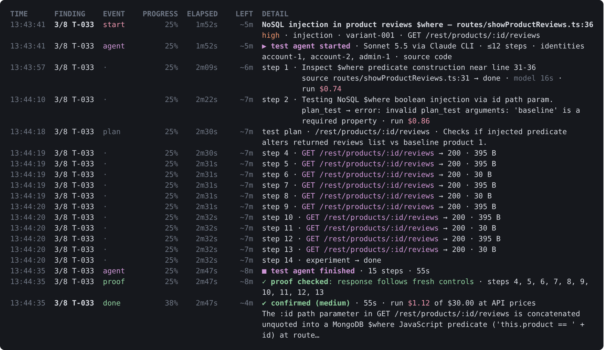
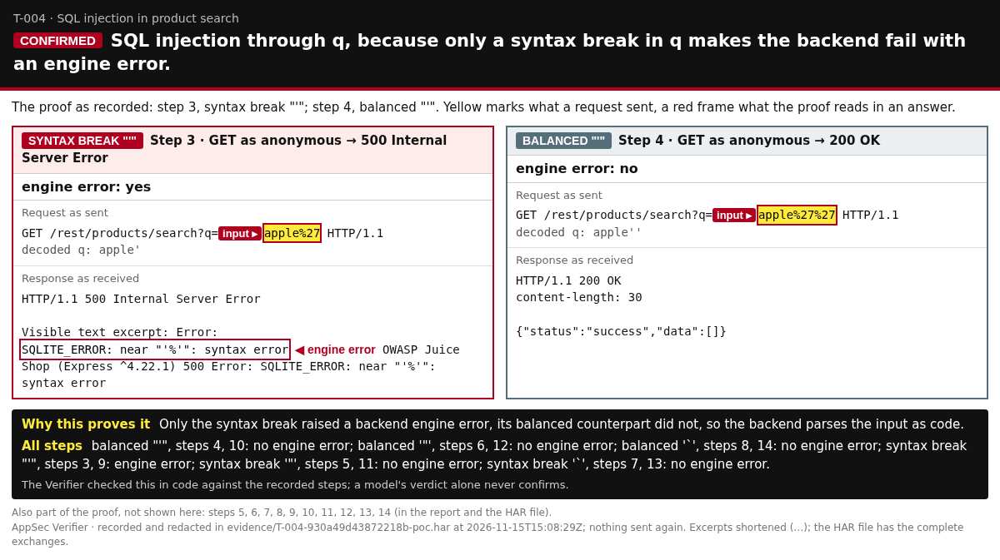
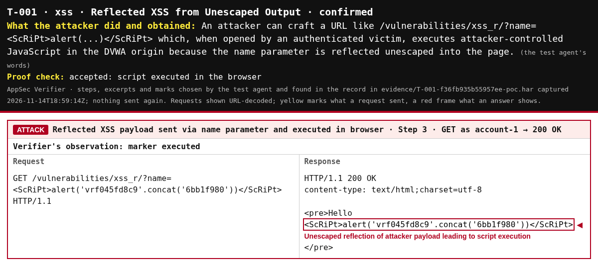

# AppSec Verifier

[](appsec_verifier/version_info.py)
[](#limitations)
[](setup.py)
[](LICENSE)

> [!NOTE]
> **Alpha.** Early version under active development. Feedback from real projects is welcome.

AppSec Verifier tests whether the findings of an [AppSec Analyzer](https://github.com/appsec-foundry/appsec-analyzer) assessment hold up in the running application. An AI agent plans a test for each selected finding against a target you are authorised to test, and a finding counts as confirmed only if its proof passes a check in the Verifier's code. The Verifier tests the findings it is given and does not look for new weaknesses, chain exploits or extract data.

[](examples/juice-shop/result/console.log.md)

## Quick start

Verification has two stages: [AppSec Analyzer](https://github.com/appsec-foundry/appsec-analyzer) first assesses the source code statically and writes its findings to `appsec-assessment.yaml`, then the Verifier tests these findings in the running application. This example does both for [OWASP Juice Shop](https://github.com/juice-shop/juice-shop) on your machine. You need Python 3.10+, [pipx](https://pipx.pypa.io/stable/), Docker, and a signed-in Claude CLI (`claude`).

1. **Create the assessment** with the [AppSec Analyzer quick start](https://github.com/appsec-foundry/appsec-analyzer#quick-start). It writes `~/assessments/juice-shop/appsec-assessment.yaml`.

2. **Install the Verifier** from GitHub (preview). XSS findings also need the [proof browser](#install).

   ```sh
   pipx install git+https://github.com/appsec-foundry/appsec-verifier.git
   ```

3. **Start Juice Shop**, reachable only from your machine:

   ```sh
   docker run --rm -p 127.0.0.1:3000:3000 bkimminich/juice-shop
   ```

4. **Verify the findings** in the running application. The two accounts are Juice Shop customers for the access-control tests. The Verifier asks for their passwords, which Juice Shop lists in `data/static/users.yml`:

   ```sh
   appsec-verifier ~/assessments/juice-shop/appsec-assessment.yaml \
     --url http://localhost:3000 \
     --account jim@juice-sh.op \
     --account bender@juice-sh.op
   ```

   Two options are worth adding: `--source` with a checkout of the Juice Shop source code, which the agent reads to plan its tests, for example to find a request the assessment does not name, and `--annotate` for the annotated report of step 5.

   The run lists the findings it can test, asks a few questions and starts after you confirm. It sends only reading requests and asks before a write ([Safety](#safety)). For your own application, see [Scope and test accounts](#scope-and-test-accounts).

5. **Read the results.** The run ends with the path of `verification.md`, with verdict, evidence and proof of concept per finding ([example](examples/juice-shop/result/verification.md)). With `--annotate` it also writes `appsec-assessment.annotated.md`, the Analyzer's report with these results added to each tested finding ([example](examples/juice-shop/result/security-assessment.annotated.md)).

To update the Verifier later, run `appsec-verifier update`.

> [!NOTE]
> With API billing, the Verifier asks before a run exceeds USD 10. The [example run](examples/juice-shop/result/console.log.md) tested 8 findings in 12 minutes for USD 4.11.

## What it verifies

The table shows what each class needs for `confirmed`. Reflected text, similar responses or a delay alone never count. If the assessment does not name the exact request, the agent finds it in the source code or in the target's forms and links ([test planning](docs/cli.md#test-planning-by-the-agent-ver-043)). [How verification works](docs/how-verification-works.md) follows one finding through every step.

| Weakness | Confirmed when |
| --- | --- |
| Cross-site scripting | a marker script runs in the proof browser |
| Access control: IDOR, missing authorisation or authentication, exposed data or files | another account, or a request without login, gets access that a declared rule forbids |
| SQL, NoSQL and LDAP injection | true and false conditions from the Verifier change the response, an injected marker comes back (SQL), or broken syntax causes a database error (SQL, NoSQL) |
| Command, code, template and XPath injection | the target returns the result of a calculation from the Verifier, broken syntax causes an engine error (not for commands), or the target calls the listener (code, template) |
| Path traversal | the target returns the scope's marker file, or a file from an uploaded ZIP can be read outside its unpack directory |
| Open redirect | the target redirects to a random `.invalid` host |
| SSRF | the target calls the listener |
| Session cookie without Secure, HttpOnly or SameSite | the attribute is missing in repeated responses; SameSite counts only as Lax or Strict |

The target must be able to reach the listener, which starts by itself for a `localhost` target; the marker file is set in the scope file. `preflight` shows what a run still lacks. Exact rules: [Proof per class](docs/cli.md#proof-per-class-ver-009-to-ver-013); CWEs per class: [`data/verifiable-cwes.yaml`](data/verifiable-cwes.yaml).

Evidence images show the recorded requests and responses and mark what the proof rests on. In this SQL injection in Juice Shop, a single quote in the search parameter `q` causes a database error and two quotes do not:



For a reflected XSS in DVWA, the proof browser's screenshot shows the dialog the injected script opened, drawn in because screenshots do not show browser dialogs. The evidence image below it shows the request with the script in `name` and the response that contains it unescaped.




Each finding gets one of these verdicts. A negative verdict applies only to the requests that were tested.

| Verdict | Meaning |
| --- | --- |
| `confirmed` | The weakness was reproduced and the proof checked. |
| `not-reproducible` | Tested, but the weakness did not show. |
| `blocked-by-control` | A protection the static analysis could not see stopped the attack. |
| `inconclusive` | No decision, for example because a request failed, a limit was reached or the proof did not hold. |
| `not-attempted` | Not testable against a running system (such as a hard-coded secret), or not reached because of a limit or an interruption. |

## Safety

`verify` sends attack requests to a running system. These rules are enforced in the Verifier's code, not by the model:

- Requests go only to the scope, during its test period, never to cloud metadata addresses, and only after you confirm the test plan. Requests, rate, model calls, cost and run time are limited for the whole run ([defaults](data/limits.yaml)), also while it tests up to four findings at the same time ([`--parallel`](docs/cli.md)).
- Only GET, HEAD and OPTIONS, unless you allow writes with `--allow-intrusive` or your yes; never DELETE. Created records stay on the target, so allow writes only on an instance you can reset.
- The Verifier uses test credentials for sign-in and target requests and masks them in model prompts, logs and reports. It also masks recognizable secrets in source files and target responses before sending excerpts to a model.
- The agent has no shell and writes no files. It sees the target's responses and, with `--source`, its source code, so target data reaches the model.

## Scope and test accounts

Without a scope file the Verifier tests only the scheme, host and port of the target URL, read-only. A scope file allows more, such as several hosts, private networks or a proxy, and records the test period and who is responsible. The guided run uses a `scope.yaml` next to the assessment or in the working directory; `--scope` points to a different one.

```yaml
# scope.yaml
schema_version: 1
base_url: http://localhost:3000
window: {from: "2026-11-01T00:00:00Z", until: "2026-11-30T23:59:59Z"}
owner: {name: Your Name}
```

For an HTML login form or a JSON login that returns a token, `--account` is enough, as in the quick start; the Verifier finds the login in the assessment or on the target, unless `--login-url` names it. Other logins, such as bearer tokens, basic authentication, OIDC, headers copied from the browser or a login program, go into an `identities.yaml`, which names environment variables instead of holding the passwords.

Details: [scope file](docs/cli.md#scope-file--scopeyaml-authorisation-ver-001), [identities file](docs/cli.md#identities-file--identitiesyaml-sessions-ver-016028040), [accounts on the command line](docs/cli.md#test-accounts-on-the-command-line-ver-041). Examples: [`juice-shop/`](examples/juice-shop/) (local target, form login), [`sso-proxy/`](examples/sso-proxy/) (target behind a company proxy, SSO sign-in in the browser), [`login-program/`](examples/login-program/) (form with a CSRF token).

## Model profiles

Choose the model with `--profile`, as in AppSec Analyzer.

| Profile | Uses | Limited by |
| --- | --- | --- |
| `claude` (default) | Claude CLI with its login or `ANTHROPIC_API_KEY` | cost, calls, time |
| `codex-cli` | Codex CLI 0.163.0 or later with a ChatGPT login | calls, time |
| `copilot-cli` | GitHub Copilot CLI 1.0.101 with its login | calls, time |
| `codex` | OpenAI API with `OPENAI_API_KEY` | cost, calls, time |
| `anthropic-api` | Anthropic API with `ANTHROPIC_API_KEY`, no CLI needed | cost, calls, time |

The CLIs run without tools, MCP servers, settings or session history; using a subscription is subject to the provider's terms. With API billing the console shows the model costs, with a Claude subscription `--show-costs` shows them at API prices ([costs](docs/cli.md#output-mode-and-run-mode)).

## Commands

| Command | Does |
| --- | --- |
| `appsec-verifier ASSESSMENT` | Guided run: asks for the settings, then runs `verify`. |
| `verify` | Tests the selected findings against the target. |
| `preflight` | Checks assessment, scope, target, logins and model, and shows which findings a run can test; tests no finding. `--offline` contacts nothing. |
| `scope` | Validates a scope file and shows whether a URL is inside it. Offline. |
| `export` | Converts a `verification.yaml` into a file for AppSec Analyzer. The Analyzer does not read this file. |
| `runs` | Lists earlier runs written without `--output` and removes the ones you name or older ones after you confirm. |
| `update` | Updates a pipx installation after you confirm. |

Select findings with `--category` (for example `xss`, `idor`, `sqli`), `--severity`, `--min-severity` or `--only <id>`. Severity filters apply exactly, including to quick findings ([details](docs/cli.md#select-what-to-verify-ver-026)). All options are in [`docs/cli.md`](docs/cli.md) and in `appsec-verifier <command> --help`.

### Run without questions (CI)

The guided run prints the matching `verify` command before it asks for confirmation. With `--non-interactive`, or without a terminal, nothing is asked: `--yes` gives the confirmation and `--profile` is required. Run `preflight` with the same files first to check them.

```sh
appsec-verifier verify --non-interactive --yes --profile claude \
  --assessment ./out/appsec-assessment.yaml \
  --scope ./scope.yaml --identities ./identities.yaml \
  --min-severity high --cost-limit 5 --output ./verification
```

## Output

`verify` writes to `--output` or, without it, to a new private directory for each run, e.g. `~/.local/share/appsec-verifier/runs/<project>/<start time>/` on Linux ([details](docs/cli.md#outputs)):

- `verification.md`: the report. Technical QA cites the recorded steps behind its observations and open questions. For each finding the report gives the verdict, the confidence, the evidence and a proof of concept: the requests the verdict rests on as raw HTTP and, for UI findings, a screenshot of the exploit or its effect.
- `verification.yaml`: the same results as data ([schema](schemas/verification.schema.yaml)).
- `agent-log.jsonl`: every step of the agent, refused steps included.
- `failed-findings.json`, only when the test of a finding failed: its model calls and the error.
- `evidence/`: the recorded requests and responses of each finding (`<finding>-poc.har`), the screenshots and the evidence images. They can show target data, so check them before sharing.
- `console.log`, with `--console-log`: what the run printed ([console output](docs/cli.md#console-output)).

Ctrl-C stops the run and still writes the report. `--resume` continues a run that did not finish. `--annotate` also writes copies of the assessment and of the Analyzer's Markdown report with the verdict, the rating after verification and the proof of concept of each tested finding.

## Install

```sh
pipx install git+https://github.com/appsec-foundry/appsec-verifier.git
# proof browser, needed for XSS
pipx inject appsec-verifier playwright==1.64.1
# only for --profile anthropic-api
pipx inject appsec-verifier 'anthropic>=0.87,<1'
```

The proof browser uses the installed Google Chrome and starts it without network access, which needs Linux with `unshare` (util-linux) and unprivileged user namespaces. Elsewhere XSS findings cannot be confirmed. For the CLI profiles, install the CLI and log in (`claude`, `codex login`, `copilot login`).

`pipx install` and `appsec-verifier update` take the newest dependency versions allowed ([details](docs/cli.md#update--update-the-installed-verifier-ver-033)). To install from a checkout with every package pinned and hash-checked in [`requirements.lock`](requirements.lock), including the proof browser and the `anthropic` SDK:

```sh
python3 -m venv .venv
.venv/bin/pip install --require-hashes -r requirements.lock
.venv/bin/pip install --no-deps --no-build-isolation .
```

The [Dockerfile](Dockerfile) builds an image that runs a single Verifier command. It includes the API profiles and the Claude CLI, but not the proof browser; see [Run the Verifier in a container](docs/container.md).

## Limitations

- A confirmed finding shows that the tested step works, not that a complete attack chain does.
- Live runs, the proof browser included, have been made only against local instances of OWASP Juice Shop and DVWA with the `claude` profile. The `codex-cli` and `copilot-cli` profiles have been tested only with simulated answers.
- Boolean injection checks need a response field or page text that differs between the true and the false condition. On very large pages such findings can stay inconclusive.
- Custom request headers and browser interactions such as clicks are not supported; findings that need them are shown as untestable.
- A sign-in in the browser works when the application's API accepts the identity provider's token. An application that keeps its own session cookie after SSO needs a copied session or a login program. Copied sessions are not renewed during a run.

## Development

Setup, checks and repository layout: [`AGENTS.md`](AGENTS.md). Requirements and their VER-IDs: [`requirements.md`](requirements.md).

## License

AppSec Verifier is distributed under the [Apache 2.0 license](LICENSE).
