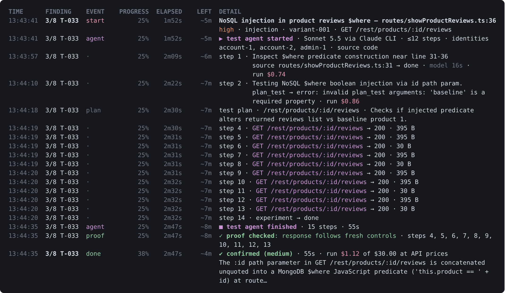
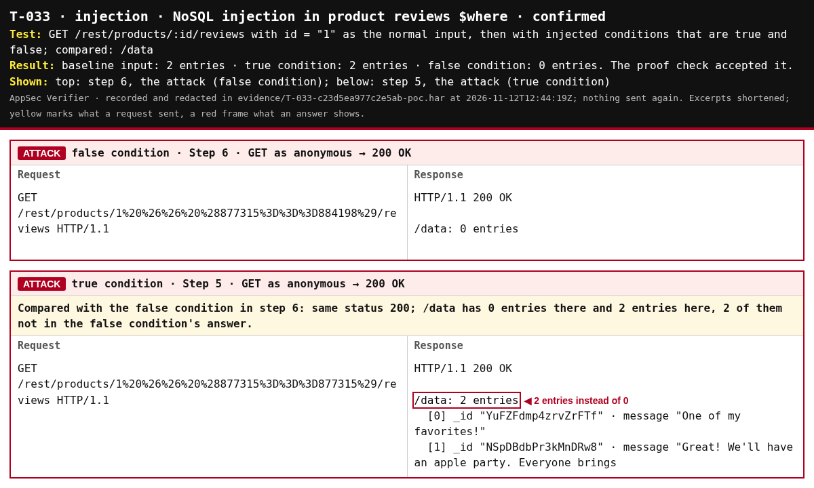

# AppSec Verifier

[](appsec_verifier/version_info.py)
[](#limitations)
[](setup.py)
[](LICENSE)

> [!NOTE]
> **Alpha.** Early version, actively developed. Feedback from real-world projects welcome.

AppSec Verifier tests whether the findings of a static security assessment hold up in the running application. It reads the `security-assessment.yaml` written by [AppSec Analyzer](https://github.com/appsec-foundry/appsec-analyzer), tests the selected findings against a target you are authorised to test, and reports for each finding whether the weakness can be reproduced.

An AI agent plans the test steps. The Verifier sends every request itself, only within the scope you define, and counts a finding as confirmed only when the proof passes a check in code. It tests only the findings it is given: it does not search for new weaknesses, chain exploits or extract data.

[](examples/juice-shop/result/console.log.md)

A run against OWASP Juice Shop: [console log](examples/juice-shop/result/console.log.md), [report](examples/juice-shop/result/verification.md).

## Quick start

You need Python 3.10 or later, [pipx](https://pipx.pypa.io/stable/), an assessment from AppSec Analyzer, and the Claude CLI (`claude`), installed and logged in. Other models are listed under [Model profiles](#model-profiles).

```sh
pipx install git+https://github.com/appsec-foundry/appsec-verifier.git
appsec-verifier ./out/security-assessment.yaml
```

The guided run asks for the target URL, shows which findings it can test and what the others still need, and starts after your confirmation. By default it tests findings of severity high and above with the `claude` profile. Each run writes its report to a new private directory, which the run names at its start and end ([Output](#output)).

XSS findings also need the proof browser ([Install](#install)), access-control comparisons usually need test accounts ([Scope and test accounts](#scope-and-test-accounts)). To try the Verifier, run OWASP Juice Shop locally (`docker run --rm -p 3000:3000 bkimminich/juice-shop`) and use the files in [`examples/juice-shop/`](examples/juice-shop/).

## What it verifies

The agent takes request details the assessment leaves open from the source code and from forms and links on the target ([test planning](docs/cli.md#test-planning-by-the-agent-ver-043)). A finding counts as `confirmed` only with the proof below; the model's verdict alone never suffices. [How verification works](docs/how-verification-works.md) follows one finding through every step.

| Weakness | Confirmed when |
| --- | --- |
| Cross-site scripting | a marker script runs in the proof browser; reflected text does not count |
| Access control: IDOR, missing authorisation or authentication, exposed information and files | a checked access comparison violates an independently declared restriction; matching responses alone do not suffice |
| SQL, NoSQL and LDAP injection | the response follows true and false conditions the Verifier generates (a field, a page text or a login), an injected marker comes back (SQL), or a malformed input provokes a database error (SQL, NoSQL); a delay alone never counts |
| Command, code, template and XPath injection | the target returns the result of arithmetic the Verifier generates, a malformed input provokes an engine error (not for commands), or, for code and template injection, the payload makes the target call a callback listener |
| Path traversal | the target returns the scope's marker file, or a file from an uploaded ZIP can be read outside the directory it is unpacked to |
| Open redirect | the target redirects to a random host under `.invalid` |
| SSRF | the target calls a callback listener |
| Session cookie without Secure, HttpOnly or SameSite | the session cookie repeatedly lacks the attribute (SameSite: Lax or Strict) |

Some classes need preparation: XSS the proof browser, access control test accounts and an established access restriction in the scope, SSRF and blind injection a listener the target can reach (started automatically for a `localhost` target), path traversal a marker file, session cookies the cookie's name in the scope. The guided run can collect access declarations for this run; `preflight` names missing preparation. Declared anonymous exposure needs no reference account, cookie checks can observe form-login responses, and login-bypass injection needs a protected follow-up resource. The exact rules are in [Proof per class](docs/cli.md#proof-per-class-ver-009-to-ver-013), the CWEs of each class in [`data/verifiable-cwes.yaml`](data/verifiable-cwes.yaml).

The agent can resolve missing requests from recorded source and application evidence, including browser request workflows and literal page includes ([request derivation](docs/cli.md#continuous-control-ver-036)); the report shows the requests each verdict rests on. The evidence image of the NoSQL injection above:



Each finding ends with one of these verdicts. A negative verdict covers only the request and variant that were tested; different variants continue after a confirmation.

| Verdict | Meaning |
| --- | --- |
| `confirmed` | The weakness was reproduced and the proof checked. |
| `not-reproducible` | Tested, but the weakness did not show. |
| `blocked-by-control` | A protection the static analysis could not see stopped the attack. |
| `inconclusive` | No decision, for example because a request failed, a limit was reached or the proof did not hold. |
| `not-attempted` | Not testable against a running system (such as a hard-coded secret), or not reached because of a limit or an interruption. |

## Safety

`verify` sends attack requests to a running system. These rules are enforced in code, not left to the model:

- Only the hosts, ports, paths and schemes in the scope are contacted, only within its test period, and never cloud metadata addresses.
- The run shows its test plan and waits for your confirmation before the first request.
- Only GET, HEAD and OPTIONS by default. Write requests, needed for stored XSS and some access-control tests, require `--allow-intrusive` or your yes in the terminal; DELETE is never sent. Records the Verifier creates stay on the target, so allow writes only on an instance you can reset.
- Requests, request rate, model calls, cost and run time are capped ([defaults](data/limits.yaml)).
- Passwords and tokens come from environment variables or hidden input. They are not stored and never reach the model, the logs or the report.
- The agent proposes one step at a time, and the Verifier checks each step before it runs it. The agent has no shell and cannot write files; with `--source` it reads the target's source code, but not `.env` files, keys or `.git/`. It sees the target's responses and screenshots, which can contain target data.

## Scope and test accounts

Without a scope file the Verifier tests only the scheme, host and port of the target URL, read-only. A scope file allows more, such as several hosts, private networks or a proxy, and records the test period and who is responsible. The guided run uses a `scope.yaml` next to the assessment or in the working directory; `--scope` names another.

```yaml
# scope.yaml
schema_version: 1
base_url: http://localhost:3000
window: {from: "2026-11-01T00:00:00Z", until: "2026-11-30T23:59:59Z"}
owner: {name: Your Name}
```

For an HTML login form or a login that answers a JSON POST with a token, name the accounts on the command line, for example `--account jim@juice-sh.op --account bender@juice-sh.op`; the Verifier asks for the passwords with hidden input and, without `--login-url`, signs in at the login the assessment names or the login form the target URL leads to. Other logins go into an `identities.yaml` that names environment variables, never the passwords themselves: bearer token, basic, form login, headers copied from the browser, OIDC (sign-in in your browser, device code, client credentials, password grant) or a login program.

Reference: [scope file](docs/cli.md#scope-file--scopeyaml-authorisation-ver-001), [identities file](docs/cli.md#identities-file--identitiesyaml-sessions-ver-016028040), [accounts on the command line](docs/cli.md#test-accounts-on-the-command-line-ver-041). Examples: [`juice-shop/`](examples/juice-shop/) (local target, form login), [`sso-proxy/`](examples/sso-proxy/) (target behind a company proxy, SSO sign-in in the browser), [`login-program/`](examples/login-program/) (form with a CSRF token).

## Model profiles

Choose the model with `--profile`, as in AppSec Analyzer.

| Profile | Uses | Limited by |
| --- | --- | --- |
| `claude` (default) | Claude CLI with its login or `ANTHROPIC_API_KEY` | cost, calls, time |
| `codex-cli` | Codex CLI 0.163.0 or later with a ChatGPT login | calls, time |
| `copilot-cli` | GitHub Copilot CLI 1.0.101 with its login | calls, time |
| `codex` | OpenAI API with `OPENAI_API_KEY` | cost, calls, time |
| `anthropic-api` | Anthropic API with `ANTHROPIC_API_KEY`, no CLI needed | cost, calls, time |

The CLIs run without tools, MCP servers, settings or session history. Using a subscription is subject to the provider's terms for that plan.

The console shows model costs with API billing, including reported prompt-cache reads and writes; see [caching and costs](docs/cli.md#output-mode-and-run-mode). With a Claude subscription, `--show-costs` shows what the calls would cost at API prices; this does not change the cost limit. Prices: [`data/model-catalog.yaml`](data/model-catalog.yaml) (OpenAI), [`data/anthropic-model-catalog.yaml`](data/anthropic-model-catalog.yaml) (Anthropic API).

## Commands

| Command | Does |
| --- | --- |
| `appsec-verifier ASSESSMENT` | Guided run: asks for the settings, then runs `verify`. |
| `verify` | Tests the selected findings against the target. |
| `preflight` | Checks assessment, scope, target, logins and model, and shows which findings a run can test; tests no finding. `--offline` contacts nothing. |
| `scope` | Validates a scope file and shows whether a URL is inside it. Offline. |
| `export` | Converts a `verification.yaml` into a file for AppSec Analyzer. The Analyzer does not read this file. |
| `update` | Updates a pipx installation after you confirm. |

Select findings with `--category` (for example `xss`, `idor`, `sqli`), `--severity`, `--min-severity` or `--only <id>`. A severity selection also tests some findings below it, such as XSS and SQL injection findings that are cheap to confirm ([details](docs/cli.md#select-what-to-verify-ver-026)); `--strict-severity` leaves them out. All options are in [`docs/cli.md`](docs/cli.md) and in `appsec-verifier <command> --help`.

### Run without questions (CI)

The guided run prints the matching `verify` command before it asks for confirmation. With `--non-interactive`, or without a terminal, nothing is asked: `--yes` gives the confirmation and `--profile` is required. Run `preflight` with the same files first to check them.

```sh
appsec-verifier verify --non-interactive --yes --profile claude \
  --assessment ./out/security-assessment.yaml \
  --scope ./scope.yaml --identities ./identities.yaml \
  --min-severity high --cost-limit 5 --output ./verification
```

## Output

`verify` writes to `--output` or, without it, to a new private directory for each run, e.g. `~/.local/share/appsec-verifier/runs/<project>/<start time>/` on Linux ([details](docs/cli.md#outputs)):

- `verification.md`: the report, with verdict, confidence and evidence per finding, and the proof of concept: the requests the verdict rests on as raw HTTP, with the parts the test agent chose to show what the attacker sent and obtained, each checked against the record, and for UI findings a screenshot of the exploit or its effect.
- `verification.yaml`: the same results as data ([schema](schemas/verification.schema.yaml)).
- `agent-log.jsonl`: every step of the agent, refused steps included.
- `evidence/`: the recorded requests and responses of each finding (`<finding>-poc.har`) and the screenshots; `--screenshots` chooses the classes. They can show target data, so check them before sharing.
- `console.log`, with `--console-log`: what the run printed ([console output](docs/cli.md#console-output)).

Ctrl-C stops the run and still writes the report. `--resume` continues a run that did not finish, without `--output` the newest one for the same assessment and target, and a report already in `--output` is replaced only with `--overwrite`. `--annotate` also writes copies of the assessment and of the Analyzer's Markdown report with the verdict, the rating after verification and the proof of concept of each tested finding.

## Install

```sh
pipx install git+https://github.com/appsec-foundry/appsec-verifier.git
pipx inject appsec-verifier playwright==1.64.1    # proof browser, needed for XSS
pipx inject appsec-verifier 'anthropic>=0.87,<1'   # only for --profile anthropic-api
```

The proof browser uses the installed Google Chrome and starts it without network access, which needs Linux with `unshare` (util-linux) and unprivileged user namespaces. Elsewhere XSS findings cannot be confirmed. For the CLI profiles, install the CLI and log in (`claude`, `codex login`, `copilot login`).

`appsec-verifier update` reinstalls from the source you installed from after you confirm. Like a new install, it takes the newest dependency versions allowed ([details](docs/cli.md#update--update-the-installed-verifier-ver-033)). To install from a checkout with every package pinned and hash-checked in [`requirements.lock`](requirements.lock), the proof browser and the `anthropic` SDK included:

```sh
python3 -m venv .venv
.venv/bin/pip install --require-hashes -r requirements.lock
.venv/bin/pip install --no-deps --no-build-isolation .
```

The [Dockerfile](Dockerfile) builds an image that runs one command with Docker, with the API profiles and Claude CLI but without the proof browser. See [Run the Verifier in a container](docs/container.md).

## Limitations

- A confirmed finding shows that the tested step works, not that a complete attack chain does.
- Live runs, the proof browser included, have been made only against a local OWASP Juice Shop with the `claude` profile. The `codex-cli` and `copilot-cli` profiles have been tested only with simulated answers.
- Boolean injection checks need a response field or page text that differs between the true and false condition. The agent can correct the selected observation using recorded answers; very large pages can exceed the recording limit and stay inconclusive.
- Custom request headers and browser interactions such as clicks are not supported; findings that need them are shown as untestable.
- Path-traversal and SSRF checks decode percent-encoding, but no other encodings.
- A sign-in in the browser works when the application's API accepts the identity provider's token. An application that keeps its own session cookie after SSO needs a copied session or a login program. Copied sessions are not renewed during a run.

## Development

Setup, checks and repository layout: [`AGENTS.md`](AGENTS.md). Requirements and their VER-IDs: [`requirements.md`](requirements.md).

## License

AppSec Verifier is distributed under the [Apache 2.0 license](LICENSE).
