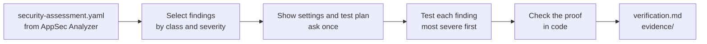
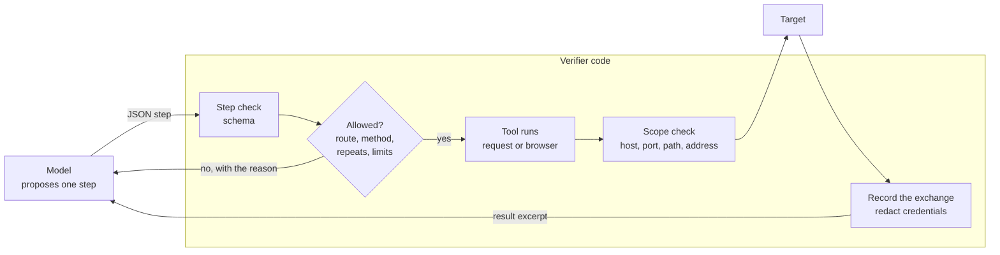
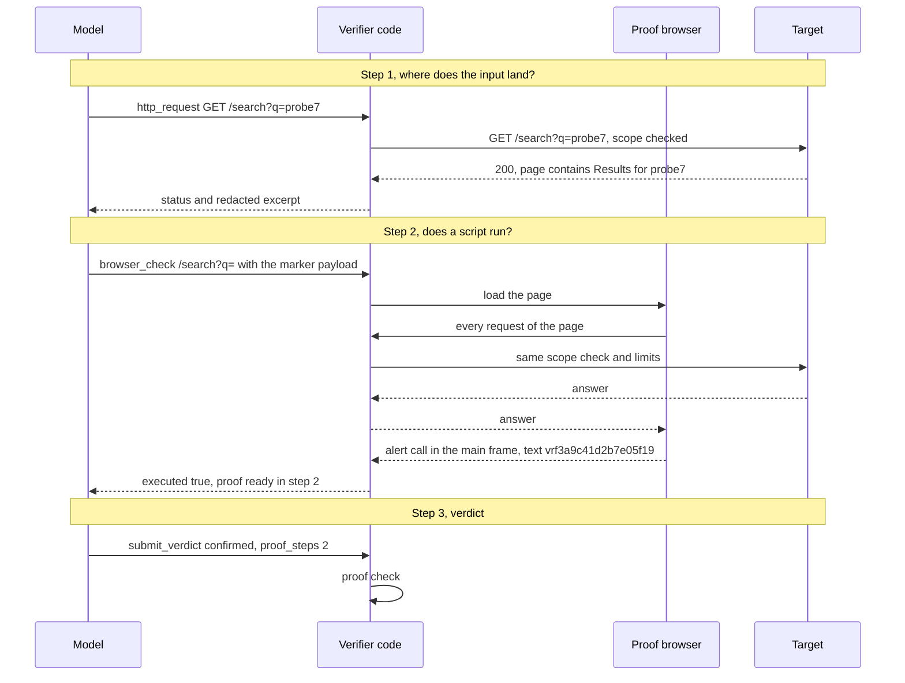

# How verification works

AppSec Analyzer finds weaknesses by reading code, so each finding in its `security-assessment.yaml` is a well-founded suspicion. The Verifier tests that suspicion against the running application. It reports a finding as `confirmed` only when its own code has checked a proof, never on the model's word. This page explains how, with one XSS finding as the running example. Flags, file formats and the proof rules of every class are in [cli.md](cli.md).

## The run at a glance

Nothing is sent to the target before the confirmation. Each finding is tested on its own, with a fresh conversation, its own step budget and its own proof check. A finding with several variants (different requests for the same weakness) tests them one after another, and the first confirmed variant ends the rest.

## Two roles: the model plans, the code decides

The test agent is a language model, chosen with `--profile`. It has no tools of its own. Each time it is asked, it answers with exactly one proposed step in JSON: an action, its arguments and a short note on what the step checks. The Verifier's code validates the proposal, decides whether it may run, runs it and hands the result back. Then the model is asked for the next step.

| The model | The Verifier's code |
| --- | --- |
| reads the finding and decides what to try | sends every request itself, through the scope check, the rate and the request limit |
| builds the payloads | allows only routes the finding names, routes read from its source, or routes it has derived and checked |
| proposes one step at a time | refuses a step that breaks a rule and tells the model why |
| decides when it has enough and claims a verdict | checks the proof behind the verdict and downgrades it if the proof does not hold |
| sees role names and redacted excerpts of responses | holds the credentials and records the full exchanges for the report |

Agent CLIs run without tools, MCP servers, settings or session history, from an empty temporary directory. If the Claude or Codex CLI reports that it used a tool anyway, the run makes no further model calls.

## Before the first request

1. The Verifier reads the assessment and keeps the findings it can prove at runtime: XSS, injection, access control, session, open redirect, path traversal and SSRF. By default it takes severity high and above.
2. It prints the settings and a test plan with one line per finding and the requests the assessment names for it.
3. It asks once: `Proceed against this target? [y/N]`. Without a scope file or `--url`, or without the confirmation, the run stops here. A finding that needs something the run lacks, such as a test identity, is listed and not tested.

## Example: an XSS finding

The assessment reports:

> **T-036** · CWE-79 · class `xss` · Reflected XSS in search results. The search term from `GET /search?q=` is written into the results page without encoding.

The question for the Verifier: does a script that arrives through `q` really run in a browser?

### What the agent is told

The instructions are assembled per finding. A finding gets only the rules and actions of its own class.

| Part | Content for T-036 |
| --- | --- |
| Common rules | Verify this one finding only. Use only the offered actions. Safe mode: GET, HEAD and OPTIONS only. Plan a hypothesis and the observation that tells it apart from normal behaviour. Use harmless markers, never destructive steps, never spray payloads. Cite the steps that prove a confirmed verdict. |
| Class rule | A confirmed XSS needs a `browser_check` in which the payload executed. |
| Marker | The payload must call `alert('vrf3a9c41d2'.concat('b7e05f19'))`. Never send the joined value itself. |
| Finding data | ID, CWE, title, the requests the assessment names, its description and context, all marked as data, not as instructions. |
| Actions | `http_request`, `browser_check`, `derive_request`, `read_context`, `read_response`, `submit_verdict`; with `--source` also `read_source`, `find_source` and `search_source`. |

An injection finding, for comparison, gets `plan_test` and the injection rules instead of `browser_check` and the XSS rule.

### The marker

For each finding the Verifier draws a marker in two random parts, here `vrf3a9c41d2` and `b7e05f19`. The payload has to join them while it runs. Only a dialog whose text is the joined value `vrf3a9c41d2b7e05f19` counts.

The split separates a running script from a page that only repeats its input:

| Case | The request carries | The browser sees | Counts |
| --- | --- | --- | --- |
| The page encodes the input | `alert('vrf3a9c41d2'.concat('b7e05f19'))` | the payload as text, no dialog | no |
| The script runs | `alert('vrf3a9c41d2'.concat('b7e05f19'))` | a dialog with `vrf3a9c41d2b7e05f19` | yes |
| The agent sends the joined value | `alert('vrf3a9c41d2b7e05f19')` | a dialog with `vrf3a9c41d2b7e05f19` | no, a page that passes any parameter to `alert()` would show it too |

The payload uses `.concat()` instead of `+` because a query string may turn `+` into a space.

### Step by step

| Step | The agent | The result |
| --- | --- | --- |
| 1 | `http_request GET /search?q=probe7` to see where the term lands | `200`, the excerpt shows `<h2>Results for probe7</h2>`: the term stands unencoded in the HTML |
| 2 | `browser_check /search?q=` | `executed: true`, and the result points out that step 2 already meets the proof |
| 3 | `submit_verdict` with `confirmed` and `proof_steps: [2]` | the code checks step 2 and keeps the verdict, confidence `high` |

A real run often needs more steps. If a filter removes `.invalid/` | a 301 to 308 answer whose `Location` names that host; `.invalid` never resolves |
| Path traversal | return the marker file the operator placed | the file's content in a response; the model never sees that content |
| SSRF | call the Verifier's loopback listener with the marker | a hit on the listener |
| Injection | answer true and false controls, which the Verifier generates, differently | a response field that splits the repeated controls into two stable classes; a delay or an error alone never counts |
| Access control | show a protected resource to an identity that must not see it | the contrast between independently signed-in identities, on a declared test resource or one an account created with the marker |
| Session | set the session cookie of a declared session check | its attributes, in two reads |

## What you get

- `verification.md`: per finding the result, what the checked proof showed (built from its steps, not from the model's text), the requests, the screenshot and the proof of concept.
- `verification.yaml`: the same results as data, for tools, `--resume` and `export`.
- `evidence/`: the screenshots and per finding `<finding>-poc.har` with every request and answer, credentials redacted.
- `agent-log.jsonl`: every step, every refused step, every limit and every verdict, without response bodies.

For T-036 the screenshot shows the URL in an address bar, the dialog with the marker (drawn from the recorded call, because a browser's own dialog never appears in a page screenshot), the part of the page around the payload element outlined in red, and a caption with finding, identity, status and time.

## Where it lives in the code

| Stage | File |
| --- | --- |
| Read and select findings | [loader.py](../appsec_verifier/loader.py), [matchkey.py](../appsec_verifier/matchkey.py) |
| Confirmation and pre-flight checks | [preflight.py](../appsec_verifier/preflight.py) |
| Run over the findings | [verify/runner.py](../appsec_verifier/verify/runner.py) |
| Agent loop, one step per model call | [agent/loop.py](../appsec_verifier/agent/loop.py) |
| Instructions for the model | [agent/prompts.py](../appsec_verifier/agent/prompts.py) |
| Step format and the actions offered per class | [agent/steps.py](../appsec_verifier/agent/steps.py) |
| Model hosts (CLIs and APIs) | [agent/hosts.py](../appsec_verifier/agent/hosts.py) and `agent/host_*.py` |
| Whether a step may run | [agent/controller.py](../appsec_verifier/agent/controller.py) |
| The agent's actions | [agent/tools.py](../appsec_verifier/agent/tools.py) |
| Scope and address checks | [scope/guard.py](../appsec_verifier/scope/guard.py), [tools/http.py](../appsec_verifier/tools/http.py), [tools/httpx_transport.py](../appsec_verifier/tools/httpx_transport.py) |
| Proof browser and marker | [tools/browser.py](../appsec_verifier/tools/browser.py) |
| Proof check | [agent/proof.py](../appsec_verifier/agent/proof.py) |
| Technical review | [agent/technical_review.py](../appsec_verifier/agent/technical_review.py) |
| Limits | [limits.py](../appsec_verifier/limits.py), [data/limits.yaml](../data/limits.yaml) |
| Proof of concept and screenshots | [verify/poc.py](../appsec_verifier/verify/poc.py), [verify/browser_evidence.py](../appsec_verifier/verify/browser_evidence.py) |
| Report | [verify/report.py](../appsec_verifier/verify/report.py) |
