# Security Assessment Report - .assessment-work

_Analysis of security architecture and threats_

_Generated by AppSec Analyzer v0.1.0a0 (analysis v6)_


---

> | | |
> |---|---|
> | **Project** | DVWA |
> | **Repository** | `https://github.com/digininja/DVWA` |
> | **Homepage** | `https://github.com/digininja/DVWA` |

---

## Changelog

_Append-only history of assessment runs. Most recent first._
| Version | Date | Scan | Model | Δ Threats | Note |
|--------|--------------------|---------------|--------------|----------------|---------------|
| v1 | 2026-11-12 21:50 CET | full · standard | sonnet-economy | 60 total | first full scan |

---

## Table of Contents

- [Management Summary](#management-summary)
1. [System Overview](#1-system-overview)
   - [Scope](#scope)
   - [Identified Actors](#identified-actors)
   - [Trust Boundaries](#trust-boundaries)
   - [Platform Security Settings](#platform-security-settings)
2. [Architecture Diagrams](#2-architecture-diagrams)
   - [2.1 System Context](#21-system-context)
   - [2.2 Container Architecture](#22-container-architecture)
   - [2.3 Components](#23-components)
3. [Attack Walkthroughs](#3-attack-walkthroughs)
   - [3.1 OS command injection in shell commands built from request input](#31-os-command-injection-in-shell-commands-built-from-request-input)
   - [3.2 Unauthenticated user endpoints allow mass assignment of level](#32-unauthenticated-user-endpoints-allow-mass-assignment-of-level)
   - [3.3 SQL injection in DVWA REST API](#33-sql-injection-in-dvwa-rest-api)
   - [3.4 Unauthenticated database reset in setup page](#34-unauthenticated-database-reset-in-setup-page)
4. [Assets](#4-assets)
5. [Attack Surface](#5-attack-surface)
   - [5.1 Unauthenticated Entry Points (0)](#51-unauthenticated-entry-points-0)
   - [5.2 Authenticated Entry Points (0)](#52-authenticated-entry-points-0)
6. [Security Architecture](#6-security-architecture)
   - [6.1 Security Control Overview](#61-security-control-overview)
   - [6.2 Identity and Authentication Controls](#62-identity-and-authentication-controls)
   - [6.3 Session and Token Controls](#63-session-and-token-controls)
   - [6.4 Authorization Controls](#64-authorization-controls)
   - [6.5 Query Construction and Data Access Controls](#65-query-construction-and-data-access-controls)
   - [6.6 Input Boundary Validation Controls](#66-input-boundary-validation-controls)
   - [6.7 Output Encoding and Rendering Controls](#67-output-encoding-and-rendering-controls)
   - [6.8 Browser and Cross-Origin Controls](#68-browser-and-cross-origin-controls)
   - [6.9 Cryptography Secrets and Data Protection](#69-cryptography-secrets-and-data-protection)
   - [6.10 File Parser and Outbound Request Controls](#610-file-parser-and-outbound-request-controls)
   - [6.11 Operations Runtime and Supply Chain Controls](#611-operations-runtime-and-supply-chain-controls)
   - [6.12 Real-time and Not Applicable Controls](#612-real-time-and-not-applicable-controls)
   - [6.13 Defense-in-Depth Summary](#613-defense-in-depth-summary)
7. [Weakness Register](#7-weakness-register)
8. [Findings Register](#8-findings-register)
9. [Abuse Cases](#9-abuse-cases)
10. [Mitigation Register](#10-mitigation-register)
11. [Out of Scope](#11-out-of-scope)
   - [Not Covered by This Method](#not-covered-by-this-method)
   - [Excluded from This Assessment](#excluded-from-this-assessment)
- [Appendix: Verification Items](#appendix-verification-items)
- [Appendix: Run Statistics](#appendix-run-statistics)
- [Appendix A - Attack Vector Taxonomy](#appendix-a-vektor-taxonomy)

---

## Management Summary

### Verdict

🔴 **Critical security concerns** - This deliberately vulnerable web application lets anonymous attackers run commands on the server, rewrite its database and make themselves administrators. Acceptable only as an isolated training target; it must never hold real data or be reachable outside a closed network.

**Risk distribution:** 🔴 Critical: 1 · 🟠 High: 23 · 🟡 Medium: 12 · 🟢 Low: n/a · **Total: 36**<br/>**Findings register:** 60 · 🔴 Critical: 1 · 🟠 High: 33 · 🟡 Medium: 26 - the distribution above counts insecure-practice findings under their weakness; see [§8 Findings Register](#8-findings-register)<br/>**Assessment evidence:** 27 of 35 finding(s) confirmed in code<br/>**Weakness classes:** 14 (10 implementation, 4 design) - see [§7 Weakness Register](#7-weakness-register)

<br/>

**Security concerns behind this assessment:**

<blockquote style="border-left: 3px solid #dc2626; padding: 16px 20px; margin: 0;">

- **Server takeover through command injection** — Request data is placed into operating-system commands, so an unauthenticated caller can run arbitrary commands on the server. *(🔴 [F-007](#f-007), 🟠 [F-032](#f-032) → [W-001](#w-001), [W-009](#w-009))* — left open by the evidence review: 🟠 [F-032](#f-032) — Request-controlled file path evaluated as PHP
- **Database read and changed by outsiders** — SQL injection lets a caller rewrite or extract stored records, and some paths need no sign-in. *(🟠 [F-002](#f-002), 🟠 [F-022](#f-022) → [W-003](#w-003))* — left open by the evidence review: 🟠 [F-022](#f-022) — SQL injection
- **Anyone can become administrator** — Missing authorization checks and mass assignment on user records let any caller grant themselves admin rights or edit other profiles. *(🟠 [F-035](#f-035), 🟠 [F-034](#f-034), 🟠 [F-033](#f-033))* — ✓ cited finding in a code-verified chain
- **Database wiped and admin password reset** — The setup page needs no sign-in, so an anonymous visitor can destroy the data and restore publicly known admin credentials. *(🟠 [F-036](#f-036), 🟠 [F-017](#f-017))*
- **Login tokens can be forged** — Hard-coded signing keys and weak token encryption let anyone with the source code mint valid login tokens. *(🟠 [F-009](#f-009), 🟠 [F-011](#f-011), 🟠 [F-028](#f-028) → [W-005](#w-005), [W-006](#w-006))*
- **Repository secrets exposed in build logs** — The build workflow prints every stored secret in lightly encoded form, readable by anyone who can view the logs. *(🟠 [F-023](#f-023) → [W-012](#w-012); [W-014](#w-014))*

</blockquote>

<br/>

Left reachable beyond a closed training network, these weaknesses would give outsiders full control of the system and its data.

**About this assessment:** An AI-assisted threat model derived from the implementation of DVWA. It reconstructs the implemented architecture (4 components and 1 external service, see [§2](#2-architecture-diagrams)) and identifies threats and control gaps in it.


**Method and limits:** Automated static analysis of code and configuration, not a pentest or a team threat-modeling session; Low and Informational findings not reported (threshold: medium) - see [§11 Out of Scope](#11-out-of-scope).

### Remediation Priorities

The root causes behind the findings, ranked by severity, each with the measures to do first. The lasting fix under a root cause removes it and every finding it causes. Every mitigation that fixes a Critical finding is listed. Details in the [§7 Weakness Register](#7-weakness-register) and the [§10 Mitigation Register](#10-mitigation-register).

<table style="table-layout:fixed;width:100%;max-width:1240px">
<colgroup><col width="30%" style="width:30%"><col width="28%" style="width:28%"><col width="33%" style="width:33%"><col width="9%" style="width:9%"></colgroup>
<thead><tr><th>Root cause → lasting fix</th><th>Do first</th><th>Resolves</th><th>Effort</th></tr></thead>
<tbody>
<tr><td rowspan="1" style="overflow-wrap:break-word">🔴 <a href="#w-001">W-001</a> - Application data builds operating-system commands<br/><em>→ call a fixed executable with an argument list and no shell, and accept only allowlisted argument values from callers</em></td><td style="overflow-wrap:break-word">● <a href="#m-018">M-018</a> - Avoid shell exec; validate target as host</td><td style="overflow-wrap:break-word">🔴 <a href="#f-007">F-007</a> - OS command injection in shell commands built from request input</td><td style="white-space:nowrap">Low</td></tr>
<tr><td rowspan="2" style="overflow-wrap:break-word">🟠 <a href="#w-003">W-003</a> - Database access relies on concatenated queries<br/><em>→ provide one parameterised repository or query-builder path and prohibit application-value interpolation in database queries</em></td><td style="overflow-wrap:break-word">● <a href="#m-013">M-013</a> - Use prepared statements and enforce authorization</td><td style="overflow-wrap:break-word">🟠 <a href="#f-002">F-002</a> - SQL injection</td><td style="white-space:nowrap">Low</td></tr>
<tr><td style="overflow-wrap:break-word">◕ <a href="#m-033">M-033</a> - Use prepared statements</td><td style="overflow-wrap:break-word">🟠 <a href="#f-022">F-022</a> - SQL injection</td><td style="white-space:nowrap">Medium</td></tr>
<tr><td rowspan="2" style="overflow-wrap:break-word">🟠 <a href="#w-002">W-002</a> - Input handling lacks enforced boundary validation<br/><em>→ enforce server-side schemas and domain-specific allowlists before input reaches parsing, persistence, or command construction</em></td><td style="overflow-wrap:break-word">◕ <a href="#m-029">M-029</a> - Use an allow-list of includable pages</td><td style="overflow-wrap:break-word">🟠 <a href="#f-018">F-018</a> - Non-recursive path filter on file inclusion parameter</td><td style="white-space:nowrap">Low</td></tr>
<tr><td style="overflow-wrap:break-word">◕ <a href="#m-035">M-035</a> - Allow-list id and security values in source viewer</td><td style="overflow-wrap:break-word">🟠 <a href="#f-025">F-025</a> - Path traversal reads arbitrary PHP files</td><td style="white-space:nowrap">Low</td></tr>
<tr><td rowspan="2" style="overflow-wrap:break-word">🟠 <a href="#w-004">W-004</a> - Frontend rendering lacks enforced output encoding<br/><em>→ use framework-safe rendering by default and isolate any required raw HTML behind one reviewed sanitisation and Trusted Types policy</em></td><td style="overflow-wrap:break-word">◕ <a href="#m-012">M-012</a> - Encode name with htmlspecialchars on output</td><td style="overflow-wrap:break-word">🟠 <a href="#f-001">F-001</a> - Reflected XSS from Unescaped Output</td><td style="white-space:nowrap">Low</td></tr>
<tr><td style="overflow-wrap:break-word">◕ <a href="#m-030">M-030</a> - HTML-escape logged values on output</td><td style="overflow-wrap:break-word">🟠 <a href="#f-019">F-019</a> - Stored XSS</td><td style="white-space:nowrap">Low</td></tr>
<tr><td rowspan="3" style="overflow-wrap:break-word">🟠 <a href="#w-005">W-005</a> - Secrets are committed to source instead of a managed store<br/><em>→ move every secret to a managed secret store or injected environment configuration, rotate the exposed values, and add secret-scanning to CI</em></td><td style="overflow-wrap:break-word">◕ <a href="#m-038">M-038</a> - Replace the weak cryptographic algorithm</td><td style="overflow-wrap:break-word">🟠 <a href="#f-028">F-028</a> - ECB cipher with hardcoded key for session tokens<br/>🟡 <a href="#f-053">F-053</a> - Hardcoded XOR key for message encoding</td><td style="white-space:nowrap">Medium</td></tr>
<tr><td style="overflow-wrap:break-word">◕ <a href="#m-009">M-009</a> - docker-compose secrets supplied by reference</td><td style="overflow-wrap:break-word">🟠 <a href="#f-024">F-024</a> - Hardcoded weak MariaDB root and user passwords in compose file</td><td style="white-space:nowrap">Low</td></tr>
<tr><td style="overflow-wrap:break-word">◕ <a href="#m-023">M-023</a> - Remove hardcoded CAPTCHA backdoor condition</td><td style="overflow-wrap:break-word">🟠 <a href="#f-012">F-012</a> - Hardcoded CAPTCHA bypass response value</td><td style="white-space:nowrap">Low</td></tr>
<tr><td rowspan="3" style="overflow-wrap:break-word">🟠 <a href="#w-006">W-006</a> - Security-sensitive data uses weak cryptographic primitives<br/><em>→ standardise on a password KDF, a CSPRNG for secrets, and modern authenticated cryptographic primitives with centrally reviewed parameters</em></td><td style="overflow-wrap:break-word">◕ <a href="#m-014">M-014</a> - Use modern cryptographic hash and KDF algorithms</td><td style="overflow-wrap:break-word">🟠 <a href="#f-003">F-003</a> - Unsalted <code>MD5</code> password hashing<br/>🟡 <a href="#f-054">F-054</a> - Broken hash primitive</td><td style="white-space:nowrap">Medium</td></tr>
<tr><td style="overflow-wrap:break-word">◕ <a href="#m-026">M-026</a> - Use cryptographically secure random values</td><td style="overflow-wrap:break-word">🟠 <a href="#f-015">F-015</a> - Non-cryptographic RNG for a secret/token</td><td style="white-space:nowrap">Medium</td></tr>
<tr><td style="overflow-wrap:break-word">◕ <a href="#m-041">M-041</a> - Use an adaptive password hash such as Argon2id</td><td style="overflow-wrap:break-word">🟠 <a href="#f-031">F-031</a> - Passwords stored as unsalted <code>MD5</code> hashes</td><td style="white-space:nowrap">Medium</td></tr>
<tr><td rowspan="2" style="overflow-wrap:break-word"><em>No root cause linked</em></td><td style="overflow-wrap:break-word">● <a href="#m-046">M-046</a> - Require authentication on every exposed endpoint</td><td style="overflow-wrap:break-word">🟠 <a href="#f-036">F-036</a> - Unauthenticated database reset in setup page</td><td style="white-space:nowrap">Low</td></tr>
<tr><td style="overflow-wrap:break-word">● <a href="#m-045">M-045</a> - Allowlist client-controlled fields</td><td style="overflow-wrap:break-word">🟠 <a href="#f-035">F-035</a> - Unauthenticated user endpoints allow mass assignment</td><td style="white-space:nowrap">Medium</td></tr>
</tbody>
</table>

*19 more P1/P2 mitigations and 32 P3/P4 backlog items in the [§10 Mitigation Register](#10-mitigation-register). ● P1 · ◕ P2 · ◑ P3 · ○ P4*

### Open Questions for the Team

The code cannot answer these questions; the people who own the business and the deployment can. Each question states under it what its answer changes.

- _How critical are Database account credentials and User login credentials to the business, and what harm would their disclosure, manipulation or unavailability cause?_
  The answer weights the impact rating and fix order of every finding that reaches these assets.
- _If an attacker runs code in DVWA REST API, which other services, secrets or credentials can that process reach?_ ([F-007](#f-007), [F-032](#f-032) (unproven))
  Every reachable service or credential extends this from one component to a wider compromise and raises the priority of isolating that process; an isolated process contains it.
- _Which production deployments still accept credentials exposed in the history of DVWA REST API?_ ([W-005](#w-005): [F-009](#f-009), [F-011](#f-011), [F-012](#f-012))
  Any deployment that still accepts them makes rotation urgent; if none do, the remaining work is history scrubbing and detection.

### Security Posture & Top Threats

**Figure 1a - Runtime Architecture and Threat Overview**

At runtime, the system has 3 components in 2 layers and exchanges data with 1 external service. Figure 1a shows these data flows and where each of the 5 attack scenarios below begins. The complete boundary catalogue remains in [§1 Trust Boundaries](#trust-boundaries).

<picture><source media="(prefers-color-scheme: dark)" srcset="security-assessment-dvwa-standard-0.1.0.figure1-dark.svg">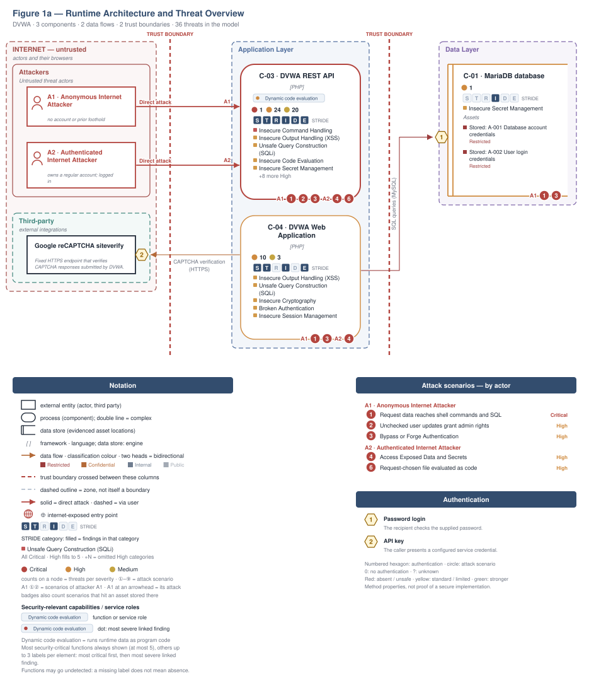</picture>

**Build pipeline**, not drawn in this runtime view: GitHub Actions. ⑤ A3 · Supply-Chain / Build Attacker → [Figure 1b](#figure-1b).

Role access and finding assignments are listed in [Identified Actors](#identified-actors).

<a id="figure-1b"></a>

**Figure 1b - Supply Chain and Build**

The repository builds in GitHub Actions. Figure 1b shows the inputs, build systems and release artifacts the repository evidences, with 7 findings attached to them. The highlighted path follows 🟡 [F-042](#f-042) — GitHub Actions referenced by mutable tags instead of commit SHAs as far as the repository evidences it. The control assessment is in [§6.11](#611-operations-runtime-and-supply-chain-controls).

<picture><source media="(prefers-color-scheme: dark)" srcset="security-assessment-dvwa-standard-0.1.0.figure1b-dark.svg">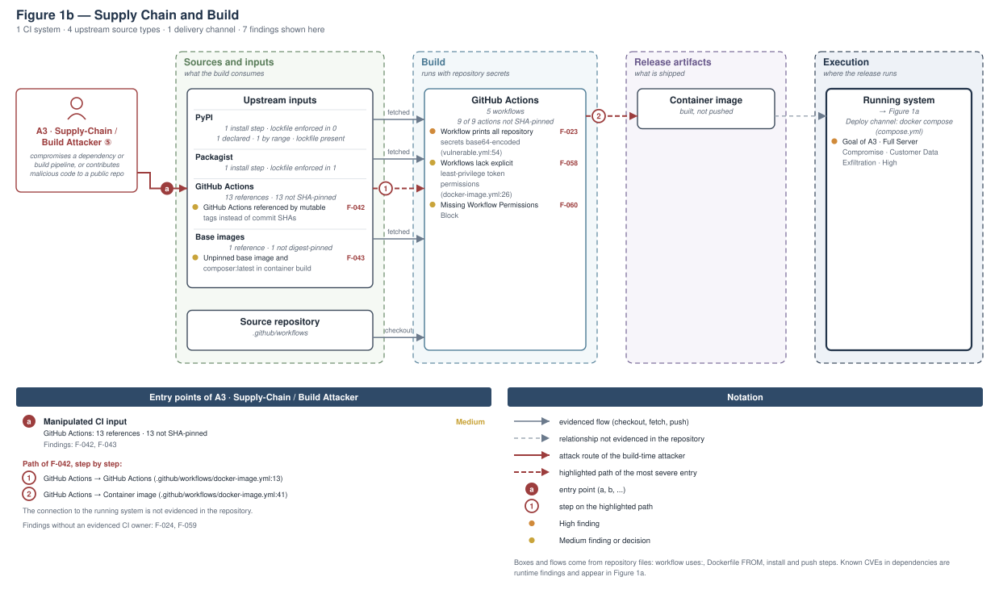</picture>

**Figure 2 - Attack Routes and Impact**

Each numbered route names one example finding from the corresponding Top Threats group with its access prerequisite, the register weakness it is linked to, and the group's potential business harm, which depends on deployment and affected assets. W-IDs in parentheses link the example to an existing weakness. The attack step, affected component and technical consequence are listed in the findings register. Red arrows indicate attacks; dashed red arrows involve a victim; grey arrows lead to potential harm.

<picture><source media="(prefers-color-scheme: dark)" srcset="security-assessment-dvwa-standard-0.1.0.figure2-dark.svg">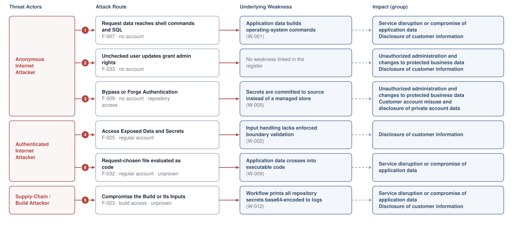</picture>

**Threat actors.** The actors below drive the numbered attack paths in the figures above.

- **Anonymous Internet Attacker** — no account or prior foothold; drives ① Insecure Query Construction & Data Access, ② Broken Authorization & Access Control, ③ Hardcoded Secrets & Weak Cryptography.
- **Authenticated Internet Attacker** — owns a regular account; logged in; drives ④ Sensitive File & Secret Exposure, ⑥ Remote Code Execution (unsafe eval).
- **Supply-Chain / Build Attacker** — compromises a dependency or build pipeline, or contributes malicious code to a public repo; drives ⑤ Build Pipeline & Dependency Integrity.

**6 structural threats**, grouped by weakness class - each row is one threat, not one finding. *Threat Description* states the general architectural weakness (STRIDE in brackets); *Findings* lists the concrete instances by severity under their component, each linked to the [§8 Findings Register](#8-findings-register), and on screen an ID shows its title when you point at it; *Risk & Impact* combines severity with business consequence; *Primary Measures* names the most important measures for this threat, most important first, one per root cause. All measures are in the [§10 Mitigation Register](#10-mitigation-register).

| # | Threat Description | Findings (→ Component) | Risk & Impact | Primary Measures |
|---|------------------------------------|-----------------------------------------------|------------------------------------|----------------------|
| <a id="path-injection"></a>① | **Insecure Query Construction & Data Access** _(T·I)_<br/>Untrusted request data is concatenated into operating-system commands and database queries, letting callers alter their behaviour. | → [C-03](#c-03) DVWA REST API<br/>🔴&nbsp;<span style="white-space:nowrap"><a href="#f-007" title="OS command injection in shell commands built from request input">F-007</a></span><br/>🟠&nbsp;<span style="white-space:nowrap"><a href="#f-002" title="SQL injection">F-002</a></span><br/>→ [C-04](#c-04) DVWA Web Application<br/>🟠&nbsp;<span style="white-space:nowrap"><a href="#f-022" title="SQL injection">F-022</a></span> | 🔴 Critical<br/>Full Server Compromise · Customer Data Exfiltration | <span style="white-space:nowrap">● [M-018](#m-018)</span> - Avoid shell exec; validate target as host<br/><span style="white-space:nowrap">● [M-013](#m-013)</span> - Use prepared statements and enforce authorization |
| <a id="path-privilege-escalation"></a>② | **Broken Authorization & Access Control** _(E·I)_<br/>Missing authentication and ownership checks let callers change privilege levels and read other users' profiles. | → [C-03](#c-03) DVWA REST API<br/>🟠&nbsp;<span style="white-space:nowrap"><a href="#f-033" title="Profile access gated by public constant token">F-033</a></span>, <span style="white-space:nowrap"><a href="#f-034" title="Profile access decided by client cookie">F-034</a></span>, <span style="white-space:nowrap"><a href="#f-035" title="Unauthenticated user endpoints allow mass assignment">F-035</a></span> | 🟠 High<br/>Full Admin Takeover · Customer Data Exfiltration | <span style="white-space:nowrap">● [M-045](#m-045)</span> - Allowlist client-controlled fields<br/><span style="white-space:nowrap">◕ [M-043](#m-043)</span> - Enforce server-side authorization |
| <a id="path-auth-bypass"></a>③ | **Hardcoded Secrets & Weak Cryptography** _(S·E)_<br/>Embedded credentials and weak token protection let callers obtain or forge valid authentication tokens. | → [C-03](#c-03) DVWA REST API<br/>🟠&nbsp;<span style="white-space:nowrap"><a href="#f-009" title="Hardcoded token encryption key allows token forgery">F-009</a></span>, <span style="white-space:nowrap"><a href="#f-011" title="Hardcoded login credentials with loose comparison">F-011</a></span>, <span style="white-space:nowrap"><a href="#f-027" title="Hardcoded encryption key and static IV in token">F-027</a></span>, <span style="white-space:nowrap"><a href="#f-028" title="ECB cipher with hardcoded key for session tokens">F-028</a></span>, <span style="white-space:nowrap"><a href="#f-003" title="Unsalted MD5 password hashing">F-003</a></span>, <span style="white-space:nowrap"><a href="#f-012" title="Hardcoded CAPTCHA bypass response value">F-012</a></span><br/>→ [C-04](#c-04) DVWA Web Application<br/>🟠&nbsp;<span style="white-space:nowrap"><a href="#f-015" title="Non-cryptographic RNG for a secret/token">F-015</a></span>, <span style="white-space:nowrap"><a href="#f-031" title="Passwords stored as unsalted MD5 hashes">F-031</a></span><br/><details><summary>6 Medium</summary>→ [C-03](#c-03) DVWA REST API<br/>🟡&nbsp;<span style="white-space:nowrap"><a href="#f-037" title="MD5 of counter used as session cookie">F-037</a></span>, <span style="white-space:nowrap"><a href="#f-038" title="Predictable sequential session cookie values">F-038</a></span>, <span style="white-space:nowrap"><a href="#f-039" title="API users created with fixed unsalted SHA-256 default">F-039</a></span>, <span style="white-space:nowrap"><a href="#f-053" title="Hardcoded XOR key for message encoding">F-053</a></span>, <span style="white-space:nowrap"><a href="#f-054" title="Broken hash primitive">F-054</a></span>, <span style="white-space:nowrap"><a href="#f-055" title="Hardcoded database credentials in test script">F-055</a></span></details> | 🟠 High<br/>Full Admin Takeover · Customer Session Hijack | <span style="white-space:nowrap">◕ [M-038](#m-038)</span> - Replace the weak cryptographic algorithm<br/><span style="white-space:nowrap">◕ [M-014](#m-014)</span> - Use modern cryptographic hash and KDF algorithms |
| <a id="path-sensitive-data-exposure"></a>④ | **Sensitive File & Secret Exposure** _(I)_<br/>Path traversal and unauthenticated user listings expose source files, configuration and password hashes. | → [C-03](#c-03) DVWA REST API<br/>🟠&nbsp;<span style="white-space:nowrap"><a href="#f-018" title="Non-recursive path filter on file inclusion parameter">F-018</a></span>, <span style="white-space:nowrap"><a href="#f-025" title="Path traversal reads arbitrary PHP files">F-025</a></span>, <span style="white-space:nowrap"><a href="#f-026" title="Password hashes exposed by unauthenticated v1 user API">F-026</a></span><br/><details><summary>3 Medium</summary>→ [C-03](#c-03) DVWA REST API<br/>🟡&nbsp;<span style="white-space:nowrap"><a href="#f-005" title="Open Redirect">F-005</a></span>, <span style="white-space:nowrap"><a href="#f-006" title="Database errors and PHP errors displayed to clients">F-006</a></span>, <span style="white-space:nowrap"><a href="#f-052" title="Compare-all source viewer reads files">F-052</a></span></details> | 🟠 High<br/>Customer Data Exfiltration | <span style="white-space:nowrap">◕ [M-029](#m-029)</span> - Use an allow-list of includable pages<br/><span style="white-space:nowrap">◕ [M-036](#m-036)</span> - Stop exposing internal information to clients |
| <a id="path-supply-chain"></a>⑤ | **Build Pipeline & Dependency Integrity** _(T·E)_<br/>Secrets printed by the build workflow or committed in deployment files are readable by anyone with repository or log access. | → [C-02](#c-02) CI/CD Pipeline<br/>🟠&nbsp;<span style="white-space:nowrap"><a href="#f-023" title="Workflow prints all repository secrets base64-encoded">F-023</a></span>, <span style="white-space:nowrap"><a href="#f-024" title="Hardcoded weak MariaDB root and user passwords in compose file">F-024</a></span><br/>🟡&nbsp;<span style="white-space:nowrap"><a href="#f-042" title="GitHub Actions referenced by mutable tags instead of commit SHAs">F-042</a></span><br/><details><summary>4 Medium</summary>→ [C-02](#c-02) CI/CD Pipeline<br/>🟡&nbsp;<span style="white-space:nowrap"><a href="#f-043" title="Unpinned base image and composer:latest in container build">F-043</a></span>, <span style="white-space:nowrap"><a href="#f-058" title="Workflows lack explicit least-privilege token permissions">F-058</a></span>, <span style="white-space:nowrap"><a href="#f-059" title="Container Runs as Root">F-059</a></span>, <span style="white-space:nowrap"><a href="#f-060" title="Missing Workflow Permissions Block">F-060</a></span></details> | 🟠 High<br/>Full Server Compromise · Customer Data Exfiltration | <span style="white-space:nowrap">◕ [M-034](#m-034)</span> - Delete the secret-dumping workflow and rotate secrets<br/><span style="white-space:nowrap">◕ [M-009](#m-009)</span> - docker-compose secrets supplied by reference |
| <a id="path-remote-code-execution"></a>⑥ | **Remote Code Execution (unsafe eval)** _(E)_<br/>A request-controlled file path is evaluated as code, which can run attacker-supplied content on the server. | → [C-03](#c-03) DVWA REST API<br/>🟠&nbsp;<span style="white-space:nowrap"><a href="#f-032" title="Request-controlled file path evaluated as PHP">F-032</a></span> | 🟠 High<br/>Full Server Compromise | <span style="white-space:nowrap">◕ [M-042](#m-042)</span> - Remove server-side evaluation of untrusted input |

_STRIDE: S spoofing · T tampering · R repudiation · I information disclosure · D denial of service · E elevation of privilege. Risk, findings, components, impact and primary measures are derived deterministically; only the one-line weakness description is authored._

**Verified attack chains.** 2 fully viable ([AC-T-002](#ac-t-002), [AC-T-004](#ac-t-004)). These chains combine individual findings into end-to-end exploitation paths verified step-by-step against the code - see [§9 Abuse Cases](#9-abuse-cases) for the per-step breakdown and blocking mitigations.

### Operational Strengths

Operational controls rated Adequate or Partial - grouped into broad clusters (full per-control breakdown in [§6](#6-security-architecture)). Clusters demoted to Weak by open Critical/High findings appear in [§6](#6-security-architecture) instead, not here.

<table style="table-layout:fixed;width:100%;max-width:1240px">
<colgroup><col width="18%" style="width:18%"><col width="32%" style="width:32%"><col width="14%" style="width:14%"><col width="36%" style="width:36%"></colgroup>
<thead><tr><th>Strength</th><th>What's in Place</th><th>Effectiveness</th><th>Open gaps</th></tr></thead>
<tbody>
<tr><td style="overflow-wrap:break-word"><strong>Authentication &amp; Session Management</strong></td><td style="overflow-wrap:break-word"><em>Identity issuance, route-level authorisation, and second-factor handling for this codebase.</em><br/>Page authentication gate for API vulnerability page<br/>Anti-CSRF token on login form<br/>Database credential management<br/>Login SQL query construction</td><td style="overflow-wrap:break-word">⚠️ Partial</td><td style="overflow-wrap:break-word">6 High and 3 Medium findings remain open:<br/>🟠 <a href="#f-008">F-008</a> — CAPTCHA bypass by posting step 2 directly<br/>🟠 <a href="#f-020">F-020</a> — State-changing password change without CSRF protection<br/>🟠 <a href="#f-033">F-033</a> — Profile access gated by public constant token<br/>🟠 <a href="#f-034">F-034</a> — Profile access decided by client cookie<br/>🟠 <a href="#f-035">F-035</a> — Unauthenticated user endpoints allow mass assignment<br/>🟠 <a href="#f-036">F-036</a> — Unauthenticated database reset in setup page<br/><details><summary>3 Medium</summary>🟡 <a href="#f-041">F-041</a> — No brute-force protection on login<br/>🟡 <a href="#f-057">F-057</a> — Brute force login without lockout<br/>🟡 <a href="#f-060">F-060</a> — Missing Workflow Permissions Block</details></td></tr>
<tr><td style="overflow-wrap:break-word"><strong>Container &amp; Supply-Chain Hardening</strong></td><td style="overflow-wrap:break-word"><em>Build-time and runtime hardening - minimal base image, non-root execution, dependency inventory.</em><br/>Database network isolation and persistence<br/>CI workflow action pinning and permissions<br/>Container image build hardening</td><td style="overflow-wrap:break-word">⚠️ Partial</td><td style="overflow-wrap:break-word">-</td></tr>
</tbody>
</table>


**Bottom line:** These controls narrow specific attack surfaces but none eliminates a Critical finding on its own.

---

## 1. System Overview

Damn Vulnerable Web Application (DVWA) is a PHP/MariaDB web application that is damn vulnerable. Its main goal is to be an aid for security professionals to test their skills and tools in a legal environment, help web developers better understand…

**Repository:** `https://github.com/digininja/DVWA`

### Scope

This threat model covers 4 components of DVWA:

- MariaDB database
- CI/CD Pipeline
- DVWA REST API
- DVWA Web Application

**Not individually examined:** 26 source files in 3 components had no route, lead or security signal (CI/CD Pipeline 1, DVWA REST API 22, DVWA Web Application 3).

**Not assessed:** 2 security-relevant code locations were read but could not be judged (DVWA REST API 2); `security-assessment.yaml` records each with its reason under `meta.undecided_targets`.

**Out of scope:** third-party hosted dependencies, browser runtime, operating-system kernel, and the underlying network infrastructure.

**Basis:** An automated, AI-assisted threat model built from the repository's source code and configuration - static analysis only, no dynamic or penetration testing. It describes the system as built, not as designed.

---

<a id="identified-actors"></a>
### Identified Actors

Figure 1a draws **Anonymous Internet Attacker** and **Authenticated Internet Attacker** as attackers of DVWA. [Figure 1b](#figure-1b) draws **Supply-Chain / Build Attacker** and the build it attacks. Each row gives that actor's access and the findings attributed to it.

| Actor | Type | Access | Findings |
|----------------------|--------|----------------------|----------------|
| A1 · Anonymous Internet Attacker | Attacker | No account or prior foothold | - |
| A2 · Authenticated Internet Attacker | Attacker | Owns a regular account; logged in | - |
| A3 · Supply-Chain / Build Attacker | Attacker | Compromises a dependency or build pipeline,<br/>or contributes malicious code to a public<br/>repo | 🟠 2 · 🟡 5 |

53 findings (1 Critical, 31 High, 21 Medium) have no assigned actor. That does not mean they are out of reach.

---

### Trust Boundaries

Each row names a crossing and the condition it relies on. A modelled crossing does not prove that its control works.

<table style="table-layout:fixed;width:100%;max-width:1240px">
<colgroup><col width="20%" style="width:20%"><col width="25%" style="width:25%"><col width="21%" style="width:21%"><col width="34%" style="width:34%"></colgroup>
<thead><tr><th>Crossing</th><th>Required condition</th><th>Control</th><th>Status and findings</th></tr></thead>
<tbody>
<tr><td style="overflow-wrap:break-word"><a id="tb-1"></a>tb-1 · DVWA Web Application → MariaDB database</td><td style="overflow-wrap:break-word">Every query built from request input reaches MariaDB only through escaping or parameter binding.</td><td style="overflow-wrap:break-word"><code>mysqli_connect</code> configured DB credentials</td><td style="overflow-wrap:break-word"><strong>Gap:</strong> <em>Authentication</em><br/>🟡 <a href="#f-041">F-041</a> — No brute-force protection on login</td></tr>
<tr><td style="overflow-wrap:break-word"><a id="tb-2"></a>tb-2 · DVWA Web Application → external</td><td style="overflow-wrap:break-word">Only the CAPTCHA secret, response token and client IP are sent to the fixed Google siteverify endpoint.</td><td style="overflow-wrap:break-word">Not identified</td><td style="overflow-wrap:break-word"><strong>No gap shown,</strong> control not confirmed</td></tr>
</tbody>
</table>

Crossing types, source evidence and provenance are retained in `security-assessment.yaml`.

---

### Platform Security Settings

Settings of the hosting platform at check time, not of the examined source revision. `set` means configured, not effective. `not checkable` means unknown, not missing protection.

Repository selection 1: skipped (local repository; supply a GitHub or GitLab URL to check its platform settings).

---

## 2. Architecture Diagrams

### 2.1 System Context

Who uses and attacks DVWA, and which external systems it exchanges data with. Solid arrows name the data a flow carries; dashed red arrows are attack routes. Actors carry the names Figure 1 uses (C4 Level 1).

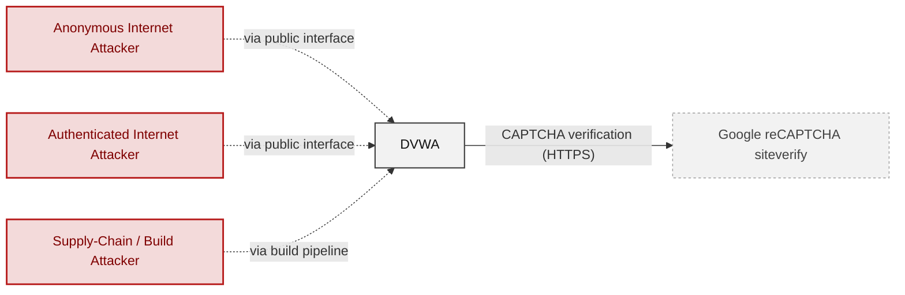

**Key takeaway:** DVWA has no modelled user role and depends on Google `reCAPTCHA` siteverify; Anonymous Internet Attacker, Authenticated Internet Attacker and Supply-Chain / Build Attacker attack it.

### 2.2 Container Architecture

How the system decomposes into deployable units. Each box is a separate runtime process or service container; arrows show synchronous request paths between them. Components with ≥3 Critical findings carry a red border, ≥2 High amber (C4 Level 2).

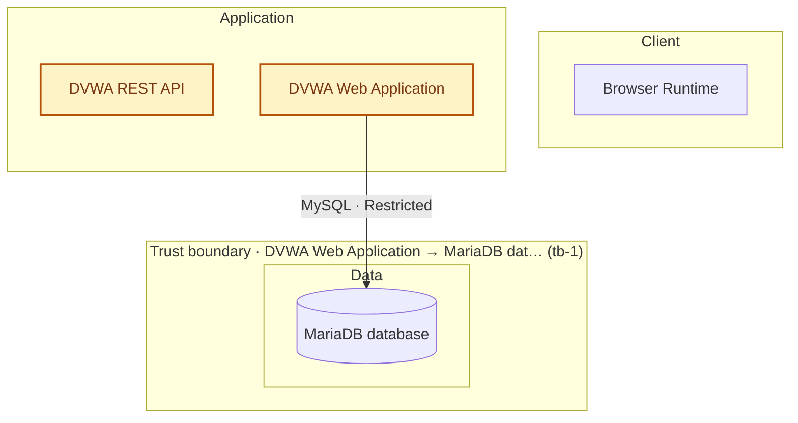

*Trust boundaries not drawn above: DVWA Web Application → external (tb-2) - every boundary is listed in [§1 Trust Boundaries](#trust-boundaries).*

**Key takeaway:** The system decomposes into 0 client, 2 application and 1 data unit(s); DVWA REST API carries the most Critical findings (1) and bounds the worst-case blast radius. The build plane (CI/CD Pipeline) is shown in [Figure 1b](#figure-1b).

### 2.3 Components

How many findings hit each component, which of its controls are weakest, and which findings matter most. Evidence is in the [§8 Findings Register](#8-findings-register).

<!-- detail-table -->
<table style="table-layout:fixed;width:100%;max-width:1240px">
<colgroup><col width="43%" style="width:43%"><col width="7%" style="width:7%"><col width="7%" style="width:7%"><col width="7%" style="width:7%"><col width="36%" style="width:36%"></colgroup>
<thead><tr><th>Component</th><th>🔴</th><th>🟠</th><th>🟡</th><th>Weakest controls and top findings</th></tr></thead>
<tbody>
<tr><td style="overflow-wrap:break-word"><a id="c-03"></a><a id="component-9433446fc4243c3e"></a><strong>C-03 · DVWA REST API</strong><br/>Mostly in <code>vulnerabilities/</code></td><td style="overflow-wrap:break-word">1</td><td style="overflow-wrap:break-word">24</td><td style="overflow-wrap:break-word">20</td><td style="overflow-wrap:break-word">Top findings: <span style="white-space:nowrap"><a href="#f-007">F-007</a></span> · <span style="white-space:nowrap"><a href="#f-002">F-002</a></span> · <span style="white-space:nowrap"><a href="#f-035">F-035</a></span></td></tr>
<tr><td style="overflow-wrap:break-word"><a id="c-04"></a><a id="component-bc0b0b82b94908ba"></a><strong>C-04 · DVWA Web Application</strong></td><td style="overflow-wrap:break-word">–</td><td style="overflow-wrap:break-word">10</td><td style="overflow-wrap:break-word">3</td><td style="overflow-wrap:break-word">Top findings: <span style="white-space:nowrap"><a href="#f-036">F-036</a></span> · <span style="white-space:nowrap"><a href="#f-022">F-022</a></span> · <span style="white-space:nowrap"><a href="#f-015">F-015</a></span></td></tr>
<tr><td style="overflow-wrap:break-word"><a id="c-02"></a><a id="component-8e8c82f91b0e01fb"></a><strong>C-02 · CI/CD Pipeline</strong></td><td style="overflow-wrap:break-word">–</td><td style="overflow-wrap:break-word">2</td><td style="overflow-wrap:break-word">5</td><td style="overflow-wrap:break-word">Top findings: <span style="white-space:nowrap"><a href="#f-023">F-023</a></span> · <span style="white-space:nowrap"><a href="#f-024">F-024</a></span> · <span style="white-space:nowrap"><a href="#f-058">F-058</a></span></td></tr>
<tr><td style="overflow-wrap:break-word"><a id="c-01"></a><a id="component-1b84dba2f3e10e46"></a><strong>C-01 · MariaDB database</strong></td><td style="overflow-wrap:break-word">–</td><td style="overflow-wrap:break-word">1</td><td style="overflow-wrap:break-word">–</td><td style="overflow-wrap:break-word">Top findings: <span style="white-space:nowrap"><a href="#f-024">F-024</a></span></td></tr>
<tr><td style="overflow-wrap:break-word">System-wide: evidence not tied to one component</td><td style="overflow-wrap:break-word">–</td><td style="overflow-wrap:break-word">–</td><td style="overflow-wrap:break-word">–</td><td style="overflow-wrap:break-word">🔴 Unsafe: AuthN, Session, Secrets / crypto<br/>🔴 Missing: Supply chain<br/>🟠 Weak: Input / query</td></tr>
</tbody>
</table>

*🔴 **Unsafe**: relied upon but defeated or trivially bypassable - fix it · 🔴 **Missing**: never built - add it · 🟠 **Weak**: present, with exploitable gaps · 🟡 **Partial**: covers some surfaces, meaningful gaps remain · 🟢 **Adequate**: present and sound. A control counts for the component whose paths hold its implementation evidence. A finding counts for every component it affects, so the columns can add up to more than the register. [§6](#6-security-architecture) holds the full assessment.*

**Key takeaway:** No component has a control rated Unsafe or Missing; 4 components have no component-specific control (C-01, C-02, C-03, C-04); 16 controls apply system-wide.

> **Legend:** `-->` synchronous request/response (REST, HTTPS, gRPC) · **red border** ≥ 3 Critical threats on the component · **amber border** ≥ 2 High threats

---

## 3. Attack Walkthroughs

This section walks through how the highest-risk findings are exploited - one short walkthrough per Critical, each with attack steps, a focused sequence diagram, and the primary mitigation. Full per-finding context (severity rationale, assets, detection signals) is in the [§8 Findings Register](#8-findings-register).

### 3.1 OS command injection in shell commands built from request input

**Source:** 🔴 [F-007](#f-007) — `vulnerabilities/api/src/HealthController.php:88`

Severity 🔴 Critical ([CWE-78](https://cwe.mitre.org/data/definitions/78.html)). STRIDE: Tampering. See [§8 F-007](#f-007) for the full register row.

**Attack Steps**

1. Send POST `/vulnerabilities/api/v2/health/connectivity` with JSON target containing a shell metacharacter and command.
2. The controller concatenates the value into `exec('ping -c 4 ' . $target)` with no authentication or escaping.
3. Injected command runs as the web server user, enabling code execution and data theft.

**Sequence Diagram**

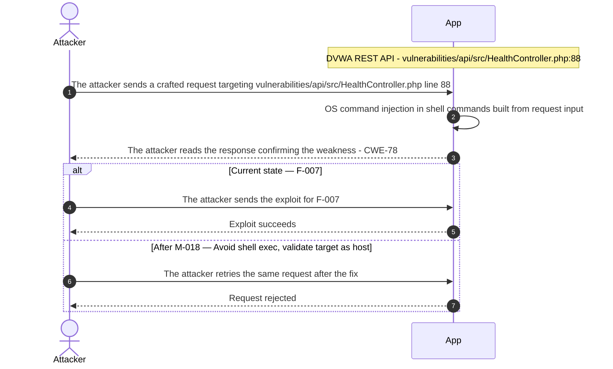

**Key takeaway:** Until ● [M-018](#m-018) (Avoid shell exec; validate target as host) lands, 🔴 [F-007](#f-007) — OS command injection in shell commands built from request input is exploitable at `vulnerabilities/api/src/HealthController.php:88` (Critical-severity, [CWE-78](https://cwe.mitre.org/data/definitions/78.html)).

**Defense in Depth**

- Primary mitigation: ● [M-018](#m-018) (Avoid shell exec; validate target as host)

### 3.2 Unauthenticated user endpoints allow mass assignment of level

**Source:** 🟠 [F-035](#f-035) — `vulnerabilities/api/src/UserController.php:224`

Severity 🟠 High ([CWE-915](https://cwe.mitre.org/data/definitions/915.html)). STRIDE: Elevation of Privilege. See [§8 F-035](#f-035) for the full register row.

**Attack Steps**

1. An attacker crafts a request that reaches the code at `vulnerabilities/api/src/UserController.php:224`.
2. UserController has no authentication or ownership check.
3. Any caller can PUT `/user/{id}` with a level of 0 to grant admin, or POST/DELETE users.

**Sequence Diagram**

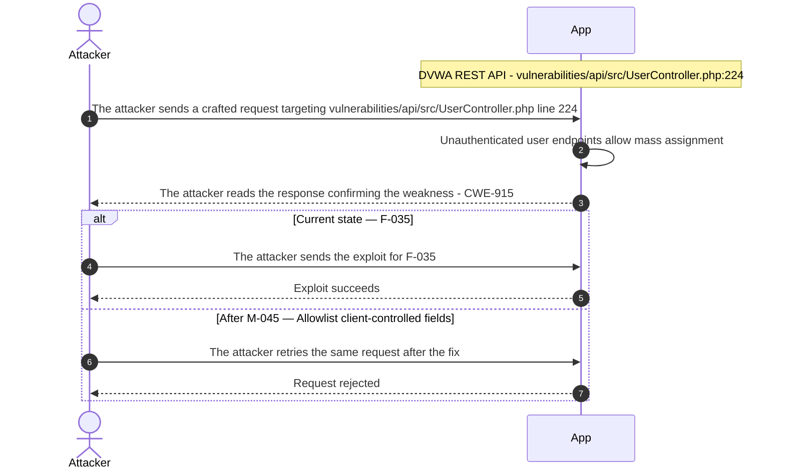

**Key takeaway:** Until ● [M-045](#m-045) (Allowlist client-controlled fields) lands, 🟠 [F-035](#f-035) — Unauthenticated user endpoints allow mass assignment is exploitable at `vulnerabilities/api/src/UserController.php:224` (High-severity, [CWE-915](https://cwe.mitre.org/data/definitions/915.html)).

**Defense in Depth**

- Primary mitigation: ● [M-045](#m-045) (Allowlist client-controlled fields)

### 3.3 SQL injection in DVWA REST API

**Source:** 🟠 [F-002](#f-002) — `vulnerabilities/authbypass/change_user_details.php:47`

Severity 🟠 High ([CWE-89](https://cwe.mitre.org/data/definitions/89.html)). STRIDE: Tampering. See [§8 F-002](#f-002) for the full register row.

**Attack Steps**

1. Request data is concatenated into SQL in several places.
2. At `vulnerabilities/authbypass/change_user_details.php:47`, `first_name`, surname and id from the JSON body are concatenated into an UPDATE.
3. At non-impossible levels no authentication or authorization check applies, so any caller can alter arbitrary rows or inject SQL.

**Sequence Diagram**

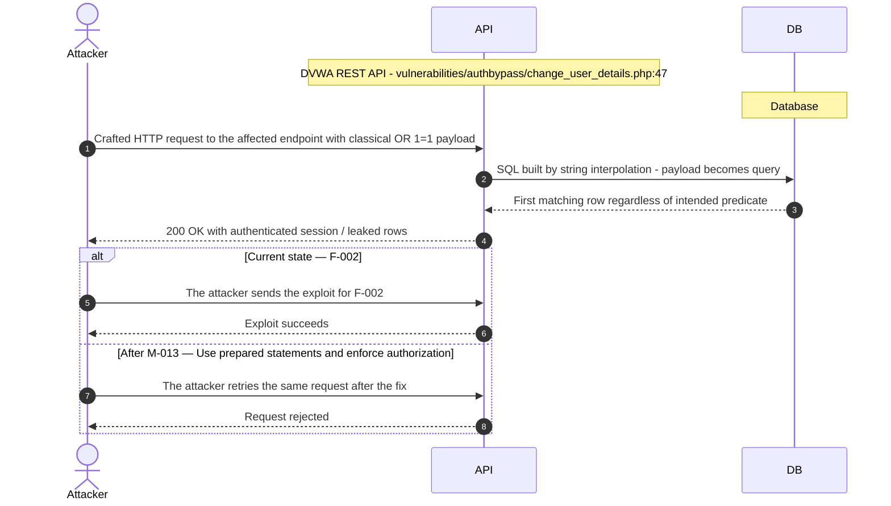

**Key takeaway:** Until ● [M-013](#m-013) (Use prepared statements and enforce authorization) lands, 🟠 [F-002](#f-002) — SQL injection is exploitable at `vulnerabilities/authbypass/change_user_details.php:47` (High-severity, [CWE-89](https://cwe.mitre.org/data/definitions/89.html)).

**Defense in Depth**

- Primary mitigation: ● [M-013](#m-013) (Use prepared statements and enforce authorization)

### 3.4 Unauthenticated database reset in setup page

**Source:** 🟠 [F-036](#f-036) — `setup.php:12`

Severity 🟠 High ([CWE-306](https://cwe.mitre.org/data/definitions/306.html)). STRIDE: Elevation of Privilege. See [§8 F-036](#f-036) for the full register row.

**Attack Steps**

1. An attacker crafts a request that reaches the code at `setup.php:12`.
2. An anonymous visitor loads `setup.php` to obtain a session CSRF token, then POSTs `create_db`.
3. The included `MySQL.php` drops and recreates the database and reseeds admin/password, destroying data and resetting admin credentials.

**Sequence Diagram**

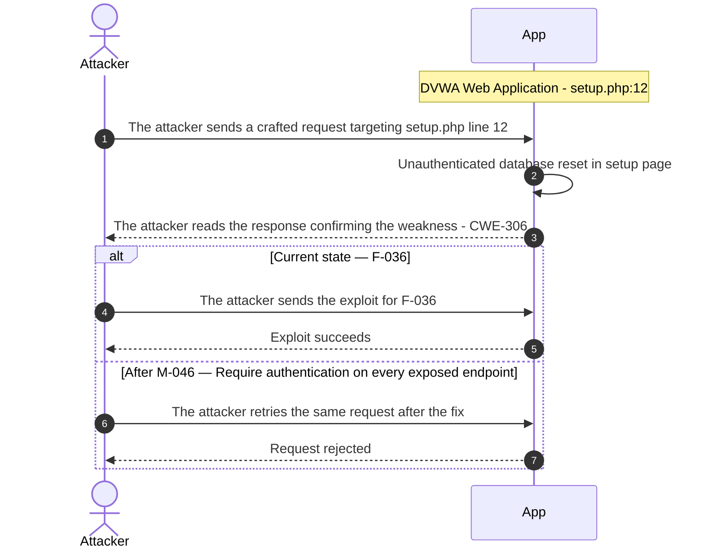

**Key takeaway:** Until ● [M-046](#m-046) (Require authentication on every exposed endpoint) lands, 🟠 [F-036](#f-036) — Unauthenticated database reset in setup page is exploitable at `setup.php:12` (High-severity, [CWE-306](https://cwe.mitre.org/data/definitions/306.html)).

**Defense in Depth**

- Primary mitigation: ● [M-046](#m-046) (Require authentication on every exposed endpoint)

<!-- generated:walkthrough_renderer -->

---

## 4. Assets

What needs protecting, how sensitive it is, and which findings are tied to it.

<table style="table-layout:fixed;width:100%;max-width:1240px">
<colgroup><col width="46%" style="width:46%"><col width="16%" style="width:16%"><col width="38%" style="width:38%"></colgroup>
<thead><tr><th>Asset</th><th>Sensitivity (assumed)</th><th>Findings</th></tr></thead>
<tbody>
<tr><td style="overflow-wrap:break-word"><strong>Database account credentials</strong><br/>Database root and application user passwords configured in the compose definition.</td><td style="overflow-wrap:break-word">High</td><td style="overflow-wrap:break-word">🟠&nbsp;<span style="white-space:nowrap"><a href="#f-001">F-001</a></span>, <span style="white-space:nowrap"><a href="#f-002">F-002</a></span>, <span style="white-space:nowrap"><a href="#f-017">F-017</a></span>, <span style="white-space:nowrap"><a href="#f-019">F-019</a></span>, <span style="white-space:nowrap"><a href="#f-022">F-022</a></span>, <span style="white-space:nowrap"><a href="#f-024">F-024</a></span>, <span style="white-space:nowrap"><a href="#f-031">F-031</a></span><br/><details><summary>11 Medium</summary>🟡 <a href="#f-039">F-039</a> - API users created with fixed unsalted SHA-256 default<br/>🟡 <a href="#f-041">F-041</a> - No brute-force protection on login<br/>🟡 <a href="#f-044">F-044</a> - Stored DOM XSS<br/>🟡 <a href="#f-045">F-045</a> - Stored DOM XSS in authbypass user table<br/>🟡 <a href="#f-046">F-046</a> - Script source injection<br/>🟡 <a href="#f-047">F-047</a> - Reflected HTML injection with static CSP nonce<br/>🟡 <a href="#f-048">F-048</a> - Unescaped POST id reflected in session-input page<br/>🟡 <a href="#f-049">F-049</a> - DOM XSS<br/>🟡 <a href="#f-050">F-050</a> - Stored XSS risk from unescaped guestbook fields<br/>🟡 <a href="#f-055">F-055</a> - Hardcoded database credentials in test script<br/>🟡 <a href="#f-057">F-057</a> - Brute force login without lockout</details></td></tr>
<tr><td style="overflow-wrap:break-word"><strong>User login credentials</strong><br/>Usernames and MD5-hashed passwords submitted at login and compared against the users table.</td><td style="overflow-wrap:break-word">High</td><td style="overflow-wrap:break-word">🟠&nbsp;<span style="white-space:nowrap"><a href="#f-001">F-001</a></span>, <span style="white-space:nowrap"><a href="#f-002">F-002</a></span>, <span style="white-space:nowrap"><a href="#f-011">F-011</a></span>, <span style="white-space:nowrap"><a href="#f-019">F-019</a></span>, <span style="white-space:nowrap"><a href="#f-022">F-022</a></span>, <span style="white-space:nowrap"><a href="#f-029">F-029</a></span>, <span style="white-space:nowrap"><a href="#f-031">F-031</a></span><br/><details><summary>10 Medium</summary>🟡 <a href="#f-039">F-039</a> - API users created with fixed unsalted SHA-256 default<br/>🟡 <a href="#f-041">F-041</a> - No brute-force protection on login<br/>🟡 <a href="#f-044">F-044</a> - Stored DOM XSS<br/>🟡 <a href="#f-045">F-045</a> - Stored DOM XSS in authbypass user table<br/>🟡 <a href="#f-046">F-046</a> - Script source injection<br/>🟡 <a href="#f-047">F-047</a> - Reflected HTML injection with static CSP nonce<br/>🟡 <a href="#f-048">F-048</a> - Unescaped POST id reflected in session-input page<br/>🟡 <a href="#f-049">F-049</a> - DOM XSS<br/>🟡 <a href="#f-050">F-050</a> - Stored XSS risk from unescaped guestbook fields<br/>🟡 <a href="#f-057">F-057</a> - Brute force login without lockout</details></td></tr>
</tbody>
</table>

*Sensitivity is assumed from the code, not set by your organization. No finding linked means that no finding is tied to this asset yet. It does not mean the asset is safe.*

---

## 5. Attack Surface

Network-reachable entry points by authentication requirement. Routes with the same findings share a row, worst first. Entry points without Critical or High findings are collapsed.

### 5.1 Unauthenticated Entry Points (0)

_None enumerated._

### 5.2 Authenticated Entry Points (0)

_None enumerated._

---

## 6. Security Architecture

This chapter is organized by security-control category. Findings are listed only where the affected control is described.

_Cataloged controls: 17 total - 1 adequate, 4 partial, 5 weak, 4 unsafe, 3 missing._

**How to read the verdicts.** Every control category (and every sub-control below it) carries exactly one status. The two red verdicts do **not** mean the same thing - this is the distinction that decides what you have to do about a finding:

| Status | Meaning | What to do |
|----------|------------------------------------|----------------------|
| 🔴 Unsafe | Present and relied upon, but defeated or<br/>trivially bypassable | Fix the existing control |
| 🔴 Missing | Control was never built | Add the control |
| 🟠 Weak | Present, but has exploitable gaps | Strengthen it |
| 🟡 Partial | Present, but with meaningful gaps | Close the gap |
| 🟢 Adequate | Control is present and sound | Nothing, keep it |

So "🔴 Unsafe" on a control category does *not* mean the control is absent - it means the control exists but does not hold (e.g. an `MD5` password hash, a raw-SQL query path, a hardcoded signing key). "🔴 Missing" is reserved for controls that were never built (e.g. no `Content-Security-Policy` header).

### 6.1 Security Control Overview

<!-- §6.1 MECHANICAL-FROZEN — DO NOT EDIT (overview table is pregenerator-owned) -->

| Control category | Verdict | Findings | Weakest controls |
|----------------------|--------|----------------|----------------------|
| [6.9 Cryptography Secrets and Data Protection](#69-cryptography-secrets-and-data-protection) | 🔴 Unsafe | 10 | API token encryption key management,<br/>Password hashing |
| [6.11 Operations Runtime and Supply Chain Controls](#611-operations-runtime-and-supply-chain-controls) | 🔴 Unsafe | 8 | Secret handling in workflows, Build pipeline<br/>and dependency controls |
| [6.2 Identity and Authentication Controls](#62-identity-and-authentication-controls) | 🔴 Unsafe | 5 | API login credential verification, User<br/>Registration |
| [6.7 Output Encoding and Rendering Controls](#67-output-encoding-and-rendering-controls) | 🟠 Weak | 9 | None catalogued |
| [6.10 File Parser and Outbound Request Controls](#610-file-parser-and-outbound-request-controls) | 🟠 Weak | 7 | `reCAPTCHA` verification outbound call |
| [6.4 Authorization Controls](#64-authorization-controls) | 🟠 Weak | 3 | Page authentication gate for API<br/>vulnerability page |
| [6.3 Session and Token Controls](#63-session-and-token-controls) | 🟠 Weak | 2 | Anti-CSRF token on login form |
| [6.5 Query Construction and Data Access Controls](#65-query-construction-and-data-access-controls) | 🟠 Weak | 2 | Login SQL query construction |
| [6.8 Browser and Cross-Origin Controls](#68-browser-and-cross-origin-controls) | 🟠 Weak | 1 | None catalogued |
| [6.6 Input Boundary Validation Controls](#66-input-boundary-validation-controls) | 🟠 Weak | – | User add/update input validation |

<!-- §6.1 MECHANICAL-FROZEN END -->

### 6.2 Identity and Authentication Controls

<a id="ctrl-identity-and-authentication-controls"></a>


**Systemic weaknesses:** [W-007](#w-007), [W-008](#w-008)
**Verdict:** 🔴 Unsafe - login exists but relies on hardcoded credentials and unsalted `MD5`, while registration and password reset were never built.

<!-- The line below is mechanically derived from the controls table — LLM must not re-author it. -->
**Controls covered:**

- [6.2.1 User Registration](#621-user-registration)
- [6.2.2 Password Reset](#622-password-reset)

**Implemented controls:** API login credential verification.

**Assessment:** Password login is defeated by embedded credentials, loose comparison and missing lockout (🟠 [F-011](#f-011), 🟡 [F-041](#f-041), 🟡 [F-057](#f-057)). Registration and reset have no dedicated control, and the federated grant is weak (🟡 [F-040](#f-040)). Each successful flow ends in the server issuing a token; its handling is described in [§6.3 Session and Token Controls](#63-session-and-token-controls).

<!-- §6.2 AUTH-MECHANISMS-FROZEN — deterministic inventory, pregenerator-owned. DO NOT EDIT. -->
**Authentication mechanisms.** Each name links to the section that assesses it.

<table style="table-layout:fixed;width:100%;max-width:1240px">
<colgroup><col width="40%" style="width:40%"><col width="16%" style="width:16%"><col width="44%" style="width:44%"></colgroup>
<thead><tr><th>Mechanism</th><th>Status</th><th>Findings</th></tr></thead>
<tbody>
<tr><td style="overflow-wrap:break-word"><a href="#69-cryptography-secrets-and-data-protection">Password storage (hashing)</a></td><td style="overflow-wrap:break-word"><span style="white-space:nowrap">🔴 Unsafe</span></td><td style="overflow-wrap:break-word">🟠&nbsp;<span style="white-space:nowrap"><a href="#f-003">F-003</a></span>, <span style="white-space:nowrap"><a href="#f-031">F-031</a></span><br/>🟡&nbsp;<span style="white-space:nowrap"><a href="#f-037">F-037</a></span>, <span style="white-space:nowrap"><a href="#f-039">F-039</a></span></td></tr>
<tr><td style="overflow-wrap:break-word"><a href="#62-identity-and-authentication-controls">Password login</a></td><td style="overflow-wrap:break-word"><span style="white-space:nowrap">🔴 Unsafe</span></td><td style="overflow-wrap:break-word">🟡&nbsp;<span style="white-space:nowrap"><a href="#f-041">F-041</a></span>, <span style="white-space:nowrap"><a href="#f-057">F-057</a></span></td></tr>
<tr><td style="overflow-wrap:break-word"><a href="#62-identity-and-authentication-controls">User registration</a></td><td style="overflow-wrap:break-word"><span style="white-space:nowrap">🔴 Missing</span></td><td style="overflow-wrap:break-word">🟠&nbsp;<span style="white-space:nowrap"><a href="#f-035">F-035</a></span></td></tr>
<tr><td style="overflow-wrap:break-word"><a href="#62-identity-and-authentication-controls">Password reset / change</a></td><td style="overflow-wrap:break-word"><span style="white-space:nowrap">🔴 Missing</span></td><td style="overflow-wrap:break-word">🟠&nbsp;<span style="white-space:nowrap"><a href="#f-020">F-020</a></span></td></tr>
<tr><td style="overflow-wrap:break-word"><a href="#63-session-and-token-controls">JWT / bearer-token session</a></td><td style="overflow-wrap:break-word"><span style="white-space:nowrap">🟠 At risk</span></td><td style="overflow-wrap:break-word">🟠&nbsp;<span style="white-space:nowrap"><a href="#f-009">F-009</a></span></td></tr>
<tr><td style="overflow-wrap:break-word"><a href="#62-identity-and-authentication-controls">OAuth / OIDC federated login</a></td><td style="overflow-wrap:break-word"><span style="white-space:nowrap">🟡 At risk</span></td><td style="overflow-wrap:break-word">🟡&nbsp;<span style="white-space:nowrap"><a href="#f-040">F-040</a></span></td></tr>
</tbody>
</table>

_Also checked, not detected on this codebase: Session-token storage, Multi-factor authentication (TOTP / 2FA)._

<!-- §6.2 AUTH-MECHANISMS-FROZEN END -->

**Findings in this category without a control:**

- 🟠 [F-031](#f-031) — Passwords stored as unsalted MD5 hashes
- 🟠 [F-036](#f-036) — Unauthenticated database reset in setup page
- 🟡 [F-039](#f-039) — API users created with fixed unsalted SHA-256 default
- 🟡 [F-041](#f-041) — No brute-force protection on login
- 🟡 [F-057](#f-057) — Brute force login without lockout

<a id="api-login-credential-verification"></a>
**API login credential verification.**


**Status:** 🔴 Unsafe - credentials are compared with loose `==` against literals committed in source, so anyone who reads the repository can authenticate.

<!-- Model implementation note (facts for the intro): LoginController::loginJSON and ::login -->
`LoginController::loginJSON` and `::login` in the DVWA REST API verify a username and password, or an OAuth client id and secret, and then issue an API token.

The diagram shows the intended API login path from credential check to token issuance:
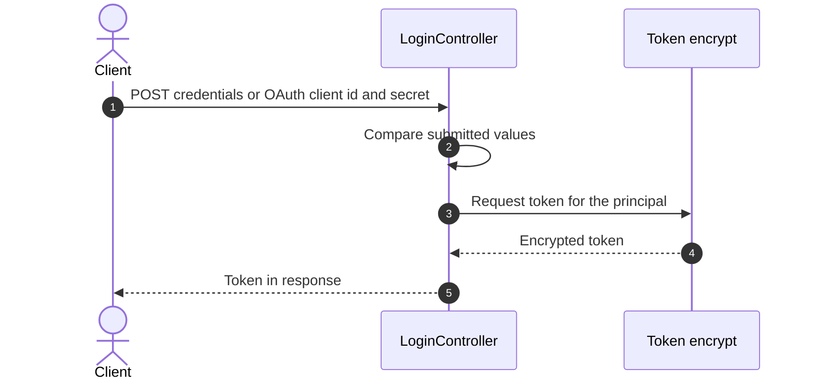

**Security assessment**

<!-- Model assessment (facts the narrative must not contradict): Login compares username/password and OAuth client id/secret against hardcoded literals using loose == comparison, with no lockout or rate limiting visible. The mechanism is relied upon to issue tokens but is defeated by publicly embedded credentials. This is an intentionally vulnerable training app. -->
The credential check holds up only as long as the source stays private, and it is public:

- Username, password and OAuth client secret are compared against hardcoded literals (🟠 [F-011](#f-011)).
- The OAuth password grant is accepted by the API login (🟡 [F-040](#f-040)).
- Neither the API login nor the web login throttles guessing (🟡 [F-057](#f-057), 🟡 [F-041](#f-041)).
- Password hashing behind the web login is unsalted `MD5`, covered in [§6.9](#69-cryptography-secrets-and-data-protection) (🟠 [F-031](#f-031) — Passwords stored as unsalted MD5 hashes (Passwords stored as unsalted `MD5` hashes)).


**Relevant findings**

- None linked to this control; see the other findings of this category.

<a id="user-registration"></a>
#### 6.2.1 User Registration

**Status:** 🔴 Missing - no self-service registration flow exists, yet user records can be created by unauthenticated API calls.

This control is not evidenced in the repository.

The diagram shows the only user-creation path found, an API call without an authentication step:
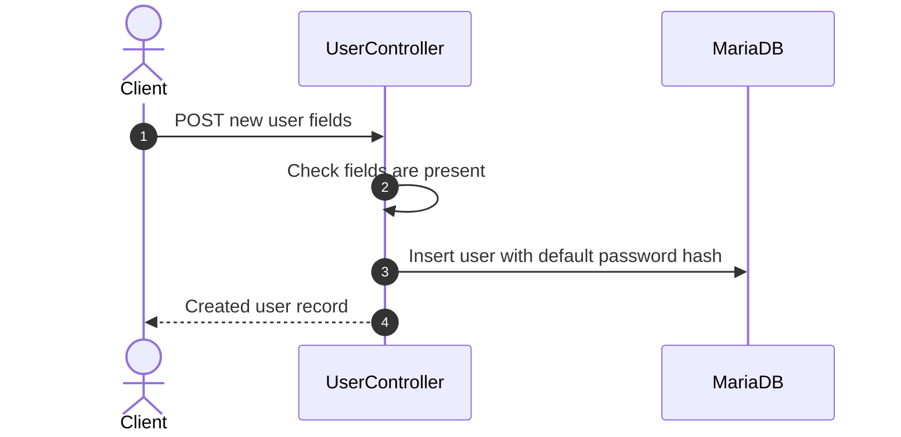

**Security assessment**

Account creation was not built as a controlled flow. What exists is an open management endpoint:

- User endpoints accept requests without authentication and allow mass assignment of fields (🟠 [F-035](#f-035)).
- New API users get a fixed, unsalted `SHA-256` default password (🟡 [F-039](#f-039) — API users created with fixed unsalted SHA-256 default (API users created with fixed unsalted `SHA-256` default)).
- Input checks are limited to field presence, see [§6.6.2](#662-user-addupdate-input-validation).


**Relevant findings**

- None linked to this control; see the other findings of this category.

<a id="password-reset"></a>
#### 6.2.2 Password Reset

**Status:** 🔴 Missing - no password reset flow exists, and the one password-changing action found carries no CSRF protection.

This control is not evidenced in the repository.

The diagram shows the password change action as observed, since no reset flow with an emailed token was found:
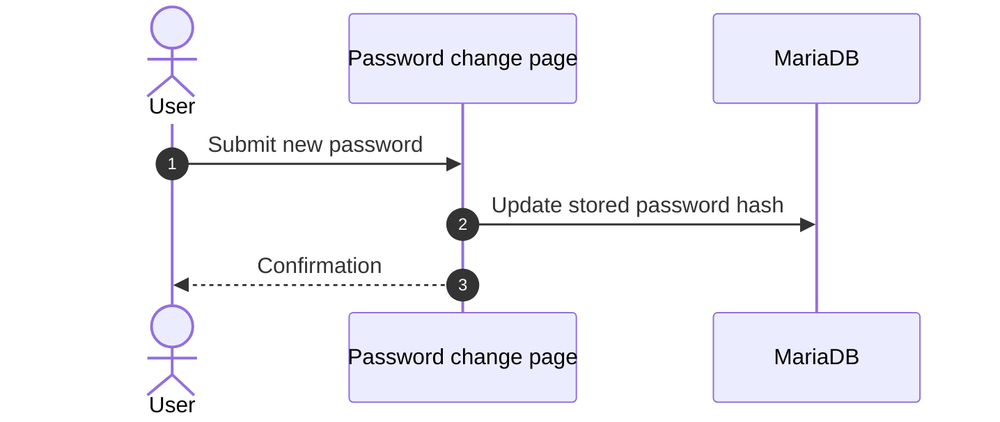

**Security assessment**

Recovery and rotation lack the checks a reset flow would add:

- The password change can be triggered cross-site because it carries no anti-CSRF token (🟠 [F-020](#f-020)).
- No reset token, out-of-band verification or expiry exists to evaluate.
- The new password is stored with unsalted `MD5`, see [§6.9.3](#693-password-hashing-and-credential-storage) (🟠 [F-031](#f-031) — Passwords stored as unsalted MD5 hashes (Passwords stored as unsalted `MD5` hashes)).


**Relevant findings**

- None linked to this control; see the other findings of this category.

### 6.3 Session and Token Controls

<a id="ctrl-session-and-token-controls"></a>

**Verdict:** 🟠 Weak - one anti-CSRF check is present, while the token itself is predictable, fixed across login, and not revoked.

<!-- The line below is mechanically derived from the controls table — LLM must not re-author it. -->
**Controls covered:**

- [6.3.1 Anti-CSRF token on login form](#631-anti-csrf-token-on-login-form)

**Implemented controls:** Anti-CSRF token on login form.

**Assessment:** This application issues its own session and API tokens regardless of the login flow in [§6.2](#62-identity-and-authentication-controls). Session ID handling keeps the pre-login ID (🟠 [F-016](#f-016)), and tokens are not invalidated when rights are withdrawn (🟡 [F-068](#f-068)). Only the login form anti-CSRF token is catalogued as an implemented control.

**Findings in this category without a control:**

- 🟠 [F-016](#f-016) — Login keeps the pre-authentication session ID at lower
- 🟡 [F-068](#f-068) — User keeps using a withdrawn right

<a id="anti-csrf-token-on-login-form"></a>
#### 6.3.1 Anti-CSRF token on login form

**Status:** 🟡 Partial - a token check exists on the login POST, but its implementation was not inspected.

The login form generates a session token on page load and verifies it with `checkToken` when the form is posted.

The diagram shows the token round trip on the login form:
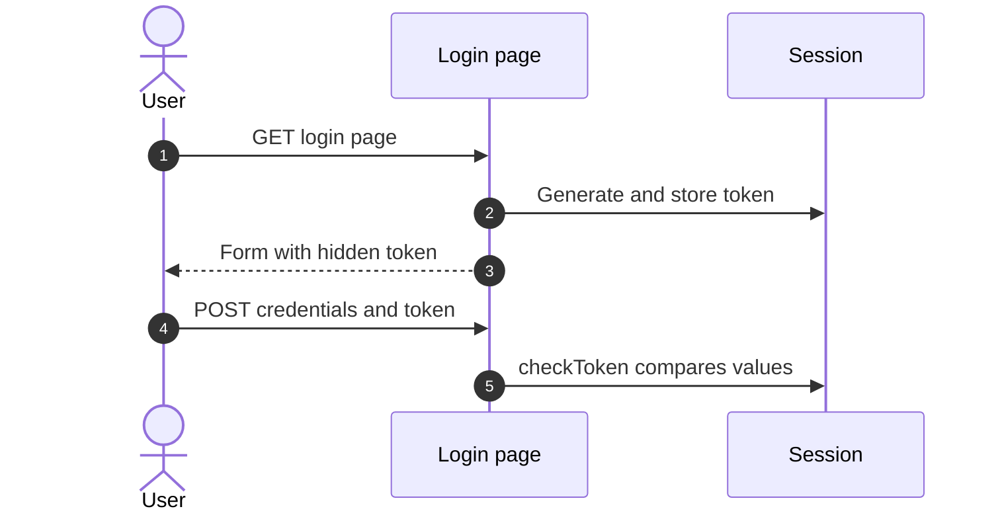

**Security assessment**

<!-- Model assessment (facts the narrative must not contradict): The login form generates a session token and checks it with checkToken on POST. The checkToken implementation was not inspected, so the rating is partial. -->
The rating is capped because the verification code was not read:

- `checkToken` behaviour is unverified, so the control is rated Partial rather than Adequate.
- The login keeps the pre-authentication session ID, so a fixed session survives login (🟠 [F-016](#f-016)).
- A token stays usable after the user's rights are withdrawn (🟡 [F-068](#f-068)).


**Relevant findings**

- None linked to this control; see the other findings of this category.

### 6.4 Authorization Controls

<a id="ctrl-authorization-controls"></a>


**Systemic weaknesses:** [W-010](#w-010)
**Verdict:** 🟠 Weak - pages require a session, but the API and several profile checks rely on client-controlled values.

<!-- The line below is mechanically derived from the controls table — LLM must not re-author it. -->
**Controls covered:**

- [6.4.1 Page authentication gate for API vulnerability page](#641-page-authentication-gate-for-api-vulnerability-page)

**Implemented controls:** Page authentication gate for API vulnerability page.

**Assessment:** Authorization is a page-level login gate. Object and role checks are absent or `client-driven: profile` access follows a public constant (🟠 [F-033](#f-033)) or a cookie (🟠 [F-034](#f-034)), and the user endpoints take unauthenticated writes (🟠 [F-035](#f-035)).

**Findings in this category without a control:**

- 🟠 [F-033](#f-033) — Profile access gated by public constant token
- 🟠 [F-034](#f-034) — Profile access decided by client cookie
- 🟠 [F-035](#f-035) — Unauthenticated user endpoints allow mass assignment

<a id="page-authentication-gate-for-api-vulnerability-page"></a>
#### 6.4.1 Page authentication gate for API vulnerability page

**Status:** 🟡 Partial - the HTML page requires a session, but the separately routed API endpoints show no per-user check.

<!-- Model implementation note (facts for the intro): dvwaPageStartup(['authenticated']) in index.php -->
`dvwaPageStartup(['authenticated'])` in `index.php` redirects visitors without a session before the page renders.

**Security assessment**

<!-- Model assessment (facts the narrative must not contradict): The DVWA page wrapper requires an authenticated session for the HTML page. The /v2 API endpoints are routed separately and the inspected slices show no per-user authorization on them. -->
The gate covers page rendering only:

- Profile access is decided by a public constant token (🟠 [F-033](#f-033)).
- Profile access is decided by a client-set cookie (🟠 [F-034](#f-034)).
- Unauthenticated user endpoints permit mass assignment (🟠 [F-035](#f-035)).
- The `/v2` API routes show no per-user authorization in the inspected slices.

**Relevant findings**

- None linked to this control; see the other findings of this category.

### 6.5 Query Construction and Data Access Controls

<a id="ctrl-query-construction-and-data-access-controls"></a>


**Systemic weaknesses:** [W-003](#w-003)
**Verdict:** 🟠 Weak - escaping is the only defense on string-built queries, and injection findings exist on two paths.

<!-- The line below is mechanically derived from the controls table — LLM must not re-author it. -->
**Controls covered:**

- [6.5.1 Login SQL query construction](#651-login-sql-query-construction)

**Implemented controls:** Login SQL query construction.

**Assessment:** Queries are assembled as strings and rely on escaping. SQL injection is confirmed in the generic query path (🟠 [F-002](#f-002)) and in the PostgreSQL driver (🟠 [F-022](#f-022)).

**Findings in this category without a control:**

- 🟠 [F-002](#f-002) — SQL injection
- 🟠 [F-022](#f-022) — SQL injection

<a id="login-sql-query-construction"></a>
#### 6.5.1 Login SQL query construction

**Status:** 🟠 Weak - escaping with `mysqli_real_escape_string` is the only defense, with no parameter binding.

The login handler escapes input with `mysqli_real_escape_string` and interpolates the result into a SQL string sent to MariaDB.

The diagram shows the login lookup as built today:
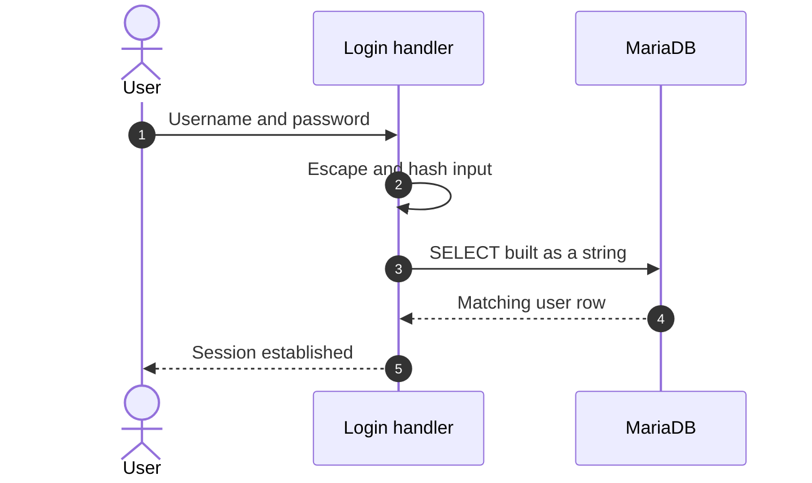

**Security assessment**

<!-- Model assessment (facts the narrative must not contradict): Login input is escaped with mysqli_real_escape_string and interpolated into a string-built query rather than parameterized. Escaping is the only defense, so the control is weak. If the connection object is not set, the fallback triggers an error. -->
Query structure is not separated from data:

- String-built SQL is exploitable (🟠 [F-002](#f-002)).
- The PostgreSQL code path has the same injection weakness (🟠 [F-022](#f-022)).
- If the connection object is unset, the fallback raises an error instead of failing closed.


**Relevant findings**

- None linked to this control; see the other findings of this category.

### 6.6 Input Boundary Validation Controls

<a id="ctrl-input-boundary-validation-controls"></a>

**Verdict:** 🟠 Weak - validation checks presence and one numeric field, with no range, length or type limits.

<!-- The line below is mechanically derived from the controls table — LLM must not re-author it. -->
**Controls covered:**

- [6.6.1 Validation Approach](#661-validation-approach)
- [6.6.2 User add/update input validation](#662-user-addupdate-input-validation)

**Implemented controls:** User add/update input validation.

**Assessment:** Input validation is per handler and minimal. Unvalidated user fields feed the mass-assignment weakness (🟠 [F-035](#f-035)), and request-controlled paths are only partly filtered (🟠 [F-018](#f-018)).

<a id="validation-approach"></a>
#### 6.6.1 Validation Approach

**Status:** 🟠 Weak - validation is handler-local with no shared schema.

Each handler checks its own inputs. Evidence of a shared schema or limits layer was not found in the inspected slices.

**Security assessment**

Gaps follow from checks living in each handler:

- Path inputs are filtered once, non-recursively (🟠 [F-018](#f-018)).
- Request-controlled values reach file reads and evaluation in view helpers (🟠 [F-032](#f-032)).
- User fields are accepted without allow-lists (🟠 [F-035](#f-035)).

**Relevant findings**

- None.

<a id="user-addupdate-input-validation"></a>
#### 6.6.2 User add/update input validation

**Status:** 🟠 Weak - only presence and a numeric `level` are checked; `name` has no length or type limit.

<!-- Model implementation note (facts for the intro): UserController::validateAdd and ::validateUpdate -->
`UserController::validateAdd` and `::validateUpdate` confirm required fields exist and that `level` is numeric before the user is written.

**Security assessment**

<!-- Model assessment (facts the narrative must not contradict): Validation only checks that fields are present and that level is numeric. There is no range, length or type enforcement on name or level. -->
The checks stop at presence:

- No range limit exists on `level`, so any numeric value is accepted.
- `name` has no length or type enforcement.
- The endpoints are unauthenticated, so the checks do not constrain who writes (🟠 [F-035](#f-035)).

**Relevant findings**

- None.

### 6.7 Output Encoding and Rendering Controls


**Systemic weaknesses:** [W-004](#w-004)
**Verdict:** 🟠 Weak - output is written unescaped on many pages, giving reflected, stored and DOM XSS.

<!-- The line below is mechanically derived from the section's default mechanism — LLM must not re-author it. -->
**Controls covered:**

- [6.7.1 Output Encoding and Client-Side Rendering](#671-output-encoding-and-client-side-rendering)

**Implemented controls:** `Content-Security-Policy` nonce on some pages, escaping on selected outputs

**Assessment:** Nine XSS findings show output encoding is applied inconsistently: reflected (🟠 [F-001](#f-001), 🟡 [F-047](#f-047), 🟡 [F-048](#f-048)), stored (🟠 [F-019](#f-019), 🟡 [F-050](#f-050)) and DOM-based (🟡 [F-044](#f-044), 🟡 [F-045](#f-045), 🟡 [F-049](#f-049)), plus script source injection (🟡 [F-046](#f-046)).

**Findings in this category without a control:**

- 🟡 [F-047](#f-047) — Reflected HTML injection with static CSP nonce
- 🟡 [F-048](#f-048) — Unescaped POST id reflected in session-input page
- 🟡 [F-049](#f-049) — DOM XSS
- 🟡 [F-050](#f-050) — Stored XSS risk from unescaped guestbook fields

<a id="output-encoding-and-client-side-rendering"></a>
#### 6.7.1 Output Encoding and Client-Side Rendering

**Status:** 🟠 Weak - escaping is applied only on some outputs.

Pages show user-supplied values such as names, messages and request parameters back to the browser. Rendering happens in server templates and in client scripts that write into the page.

**Security assessment**

Rendering paths write user data into HTML without escaping. Stored DOM XSS appears in the low-level page output (`low.php:94`) and in the authbypass user table (`authbypass.js:45`), and a DOM sink sits in `index.php:53`. The reflected page in `medium.php:16` carries a static CSP nonce, so the policy does not stop injected script, and `session-input.php:14` reflects a POST id.

**Relevant findings**

- 🟠 [F-001](#f-001) — Reflected XSS from Unescaped Output
- 🟠 [F-019](#f-019) — Stored XSS
- 🟡 [F-044](#f-044) — Stored DOM XSS
- 🟡 [F-045](#f-045) — Stored DOM XSS in authbypass user table
- 🟡 [F-046](#f-046) — Script source injection

### 6.8 Browser and Cross-Origin Controls

**Verdict:** 🟠 Weak - a CSP nonce and a login token exist, but the nonce is static and state-changing actions lack CSRF protection.

<!-- The line below is mechanically derived from the section's default mechanism — LLM must not re-author it. -->
**Controls covered:**

- [6.8.1 Browser Security Headers and CORS/CSRF Posture](#681-browser-security-headers-and-corscsrf-posture)

**Implemented controls:** `Content-Security-Policy` nonce on medium-level pages, anti-CSRF token on the login form

**Assessment:** Browser-side policy is thin. Password change has no CSRF token (🟠 [F-020](#f-020)), and the CSP nonce is a fixed value (🟡 [F-047](#f-047)).

<a id="browser-security-headers-and-corscsrf-posture"></a>
#### 6.8.1 Browser Security Headers and CORS/CSRF Posture

**Status:** 🟠 Weak - policy headers are present only in places and the CSRF token is missing on key actions.

Browser policy limits where scripts load from and whether a cross-site request can act for a signed-in user. The login form carries an anti-CSRF token and some pages send a CSP nonce.

**Security assessment**

Cross-site protection is not applied to account changes. The password change accepts a forged request without a token (🟠 [F-020](#f-020)). The CSP nonce on the reflected page is static, which lets injected markup reuse it (🟡 [F-047](#f-047)). No CORS policy evidence was found in the inspected slices.

**Relevant findings**

- 🟠 [F-020](#f-020) — State-changing password change without CSRF protection

### 6.9 Cryptography Secrets and Data Protection


**Systemic weaknesses:** [W-005](#w-005), [W-006](#w-006)
**Verdict:** 🔴 Unsafe - keys and passwords are committed to source, and password hashes use unsalted `MD5`.

<!-- The line below is mechanically derived from the controls table — LLM must not re-author it. -->
**Controls covered:**

- [6.9.1 Database credential management](#691-database-credential-management)
- [6.9.2 API token encryption key management](#692-api-token-encryption-key-management)
- [6.9.3 Password Hashing and Credential Storage](#693-password-hashing-and-credential-storage)

**Implemented controls:** Database credential management, API token encryption key management, Password hashing.

**Assessment:** Secrets live in source and compose files, not a secret store. Token keys are hardcoded (🟠 [F-009](#f-009), 🟠 [F-027](#f-027), 🟡 [F-053](#f-053)), cipher choices are weak (🟠 [F-028](#f-028)), random values are predictable (🟠 [F-015](#f-015), 🟡 [F-037](#f-037) (`MD5` of counter used as session cookie), 🟡 [F-038](#f-038) — Predictable sequential session cookie values), and credentials are embedded (🟠 [F-011](#f-011), 🟠 [F-012](#f-012), 🟡 [F-055](#f-055)).

**Findings in this category without a control:**

- 🟠 [F-009](#f-009) — Hardcoded token encryption key allows token forgery
- 🟠 [F-011](#f-011) — Hardcoded login credentials with loose comparison
- 🟠 [F-012](#f-012) — Hardcoded CAPTCHA bypass response value
- 🟠 [F-015](#f-015) — Non-cryptographic RNG for a secret/token
- 🟠 [F-027](#f-027) — Hardcoded encryption key and static IV in token
- 🟠 [F-028](#f-028) — ECB cipher with hardcoded key for session tokens
- 🟡 [F-037](#f-037) — MD5 of counter used as session cookie
- 🟡 [F-038](#f-038) — Predictable sequential session cookie values
- 🟡 [F-053](#f-053) — Hardcoded XOR key for message encoding
- 🟡 [F-055](#f-055) — Hardcoded database credentials in test script

<a id="database-credential-management"></a>
#### 6.9.1 Database credential management

**Status:** 🟠 Weak - the database passwords are inline in the compose file and guessable.

<!-- Model implementation note (facts for the intro): compose.yml db service environment: MYSQL_ROOT_PASSWORD, MYSQL_USER, MYSQL_PASSWORD -->
The `db` service in `compose.yml` receives `MYSQL_ROOT_PASSWORD`, `MYSQL_USER` and `MYSQL_PASSWORD` through its environment block.

**Security assessment**

<!-- Model assessment (facts the narrative must not contradict): The MariaDB container's root password is hardcoded in compose.yml as a weak, guessable value (dvwa), and the application user password is also set inline in the environment block. Secrets are not injected from a secret store or an external env file. Those values are committed to source. This is a deliberately vulnerable training app, but the credential handling is weak. -->
Database secrets are plain text in source:

- The MariaDB root and user passwords are weak and committed (🟠 [F-024](#f-024)).
- A test script embeds database credentials (🟡 [F-055](#f-055)).
- No secret store or external env file is used.

**Relevant findings**

- None linked to this control; see the other findings of this category.

<a id="api-token-encryption-key-management"></a>
#### 6.9.2 API token encryption key management

**Status:** 🔴 Unsafe - AES-128-GCM is an authenticated mode, but the key is a short hardcoded passphrase in source, so anyone can forge tokens.

<!-- Model implementation note (facts for the intro): Token::encrypt and Token::decrypt -->
`Token::encrypt` and `Token::decrypt` seal API tokens with AES-128-GCM using a key defined in `Token.php`.

**Security assessment**

<!-- Model assessment (facts the narrative must not contradict): Tokens use AES-128-GCM, which is an authenticated mode, but the key is the hardcoded string 'Paintbrush' in source. It is a short, low-entropy passphrase used directly as the key. Anyone with the source can forge tokens. -->
The cipher is sound and the key is not:

- The key is the literal string `Paintbrush`, used directly (🟠 [F-009](#f-009)).
- Other token libraries use a hardcoded key with a static IV (🟠 [F-027](#f-027)).
- Session tokens use ECB with a hardcoded key (🟠 [F-028](#f-028)).
- Message encoding uses a hardcoded XOR key (🟡 [F-053](#f-053)).

**Relevant findings**

- None linked to this control; see the other findings of this category.

<a id="password-hashing"></a><a id="password-hashing-and-credential-storage"></a>
#### 6.9.3 Password Hashing and Credential Storage

**Status:** 🔴 Unsafe - passwords are stored as unsalted `MD5`, which is fast to brute force and used for both login comparison and seeded users.

`MySQL.php` hashes passwords with `MD5` when seeding users, and the login code compares the same unsalted digest.

**Security assessment**

<!-- Model assessment (facts the narrative must not contradict): Passwords are hashed with unsalted MD5 for both login comparison and seeded users. The seeded accounts use weak, well-known passwords. This is relied on for authentication and is easily broken. -->
Credential storage offers no work factor or per-user salt:

- Passwords are stored as unsalted `MD5` (🟠 [F-031](#f-031) — Passwords stored as unsalted MD5 hashes (Passwords stored as unsalted `MD5` hashes)), a broken primitive (🟡 [F-054](#f-054)).
- Web-created users get a fixed unsalted `SHA-256` default (🟡 [F-039](#f-039) — API users created with fixed unsalted SHA-256 default (API users created with fixed unsalted `SHA-256` default)).
- Seeded accounts use well-known passwords (🟠 [F-017](#f-017)).
- The v1 user API exposes the hashes without authentication (🟠 [F-026](#f-026)).

**Relevant findings**

- None linked to this control; see the other findings of this category.

### 6.10 File Parser and Outbound Request Controls

<a id="ctrl-file-parser-and-outbound-request-controls"></a>


**Systemic weaknesses:** [W-001](#w-001), [W-002](#w-002), [W-013](#w-013)
**Verdict:** 🟠 Weak - the one outbound call is fixed, but file reads, includes and redirects take request-controlled input.

<!-- The line below is mechanically derived from the controls table — LLM must not re-author it. -->
**Controls covered:**

- [6.10.1 reCAPTCHA verification outbound call](#6101-recaptcha-verification-outbound-call)

**Implemented controls:** `reCAPTCHA` verification outbound call.

**Assessment:** Request-controlled targets reach files, commands and redirects: OS command injection (🔴 [F-007](#f-007)), path traversal (🟠 [F-025](#f-025), 🟡 [F-052](#f-052)), a weak include filter (🟠 [F-018](#f-018)), file evaluation (🟠 [F-032](#f-032)), open redirect (🟡 [F-005](#f-005)) and exposed user data (🟠 [F-026](#f-026)).

**Findings in this category without a control:**

- 🟡 [F-005](#f-005) — Open Redirect
- 🔴 [F-007](#f-007) — OS command injection in shell commands built from request input
- 🟠 [F-018](#f-018) — Non-recursive path filter on file inclusion parameter
- 🟠 [F-025](#f-025) — Path traversal reads arbitrary PHP files
- 🟠 [F-026](#f-026) — Password hashes exposed by unauthenticated v1 user API
- 🟠 [F-032](#f-032) — Request-controlled file path evaluated as PHP
- 🟡 [F-052](#f-052) — Compare-all source viewer reads files

<a id="recaptcha-verification-outbound-call"></a>
#### 6.10.1 reCAPTCHA verification outbound call

**Status:** 🟡 Partial - the target URL is fixed HTTPS, but the response is not checked for failure.

The `reCAPTCHA` helper posts the site secret and the user's response to a fixed Google verification URL, then reads the `success` field.

The diagram shows the verification call during a CAPTCHA step:
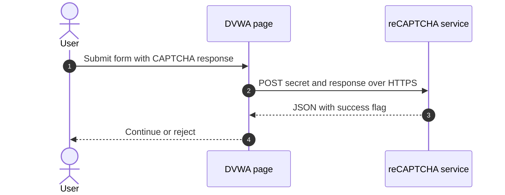

**Security assessment**

<!-- Model assessment (facts the narrative must not contradict): The verification call goes to a fixed HTTPS URL, with the secret sent in the POST body. The response is not checked for errors. A failed request makes json_decode(false)->success warn or return null, which a caller may not treat as a failure. -->
The fixed URL is sound, but result handling is not:

- A failed request makes the decode return null or warn, which a caller may not treat as failure.
- The CAPTCHA step can be skipped by posting step 2 directly (🟠 [F-008](#f-008)).
- A hardcoded response value bypasses it at another level (🟠 [F-012](#f-012)).


**Relevant findings**

- None linked to this control; see the other findings of this category.

### 6.11 Operations Runtime and Supply Chain Controls

**Build path.** [Figure 1b](#figure-1b) shows the inputs, build systems and release artifacts that the repository evidences.

Highlighted path of 🟡 [F-042](#f-042) — GitHub Actions referenced by mutable tags instead of commit SHAs: GitHub Actions → GitHub Actions → Container image. The path stops where the evidence ends.

**Attack entries:**

- **Manipulated CI input**
  - 🟡 [F-042](#f-042) — GitHub Actions referenced by mutable tags instead of commit SHAs
  - 🟡 [F-043](#f-043) — Unpinned base image and composer:latest in container build

**Not attributable to a build step:**

- 🟠 [F-024](#f-024) — Hardcoded weak MariaDB root and user passwords in compose file
- 🟡 [F-059](#f-059) — Container Runs as Root


**Systemic weaknesses:** [W-011](#w-011), [W-014](#w-014)
**Verdict:** 🔴 Unsafe - a workflow prints every repository secret to build logs, and images and actions are unpinned.

<!-- The line below is mechanically derived from the controls table — LLM must not re-author it. -->
**Controls covered:**

- [6.11.1 Database network isolation and persistence](#6111-database-network-isolation-and-persistence)
- [6.11.2 CI workflow action pinning and permissions](#6112-ci-workflow-action-pinning-and-permissions)
- [6.11.3 Static analysis (CodeQL) in CI](#6113-static-analysis-codeql-in-ci)
- [6.11.4 Secret handling in workflows](#6114-secret-handling-in-workflows)
- [6.11.5 Container image build hardening](#6115-container-image-build-hardening)
- [6.11.6 Build pipeline and dependency controls](#6116-build-pipeline-and-dependency-controls)

**Implemented controls:** Database network isolation and persistence, CI workflow action pinning and permissions, Static analysis (CodeQL) in CI, Secret handling in workflows, Container image build hardening.

**Assessment:** CodeQL runs in CI and the database is network-isolated, but secrets leak through a workflow (🟠 [F-023](#f-023)), the container runs as root (🟡 [F-059](#f-059)), actions and images float (🟡 [F-042](#f-042), 🟡 [F-043](#f-043)), token permissions are unscoped (🟡 [F-058](#f-058), 🟡 [F-060](#f-060)), and errors reach clients (🟡 [F-006](#f-006)).

**Findings in this category without a control:**

- 🟡 [F-006](#f-006) — Database errors and PHP errors displayed to clients
- 🟠 [F-023](#f-023) — Workflow prints all repository secrets base64-encoded
- 🟠 [F-024](#f-024) — Hardcoded weak MariaDB root and user passwords in compose file
- 🟡 [F-058](#f-058) — Workflows lack explicit least-privilege token permissions
- 🟡 [F-059](#f-059) — Container Runs as Root
- 🟡 [F-060](#f-060) — Missing Workflow Permissions Block

<a id="database-network-isolation-and-persistence"></a>
#### 6.11.1 Database network isolation and persistence

**Status:** 🟡 Partial - the database is reachable only from the compose network, but its image floats and encryption and TLS are not evidenced.

<!-- Model implementation note (facts for the intro): compose.yml db service: networks, volumes, image -->
The `db` service in `compose.yml` publishes no host ports, joins the dedicated `dvwa` network and stores data on a persistent volume. The web service binds to `127.0.0.1`.

**Security assessment**

<!-- Model assessment (facts the narrative must not contradict): The db service publishes no host ports and joins only the dedicated dvwa compose network, so it is reachable only from containers on that network. The web service is bound to 127.0.0.1. The data volume is persistent with no encryption configured in this file. The image uses a floating tag (mariadb:10), so it is not pinned to a digest. TLS for the app-to-DB connection is not evidenced. -->
Network exposure is limited, and the rest is open:

- The image uses the floating tag `mariadb:10`, not a digest.
- The data volume has no encryption configured in this file.
- TLS for the application-to-database connection is not evidenced.
- The database root password is weak (🟠 [F-024](#f-024)).

**Relevant findings**

- None linked to this control; see the other findings of this category.

<a id="ci-workflow-action-pinning-and-permissions"></a>
#### 6.11.2 CI workflow action pinning and permissions

**Status:** 🟠 Weak - actions are pinned to tags and no least-privilege token scope is declared.

<!-- Model implementation note (facts for the intro): docker-image.yml lines 13-26; codeql-analysis.yml lines 37-70 -->
`docker-image.yml` logs in to `ghcr.io` and pushes with `GITHUB_TOKEN`, and `codeql-analysis.yml` uses the CodeQL actions.

**Security assessment**

<!-- Model assessment (facts the narrative must not contradict): Actions are referenced by version tags (e.g. docker/login-action@v3, codeql-action@v4.33.0), not commit SHAs, and the inspected workflows declare no explicit permissions block, so GITHUB_TOKEN scope depends on repository defaults. The docker-image workflow pushes to ghcr.io using GITHUB_TOKEN. -->
Workflow supply chain trust is loose:

- Actions use version tags, not commit SHAs (🟡 [F-042](#f-042)).
- Workflows have no explicit token permissions, so scope follows repository defaults (🟡 [F-058](#f-058), 🟡 [F-060](#f-060)).

**Relevant findings**

- None linked to this control; see the other findings of this category.

<a id="static-analysis-codeql-in-ci"></a>
#### 6.11.3 Static analysis (CodeQL) in CI

**Status:** 🟢 Adequate - CodeQL scans on push, pull request and a weekly schedule, though PHP is outside its language matrix.

<!-- Model implementation note (facts for the intro): codeql-analysis.yml lines 8-70 -->
`codeql-analysis.yml` runs CodeQL for javascript and python on pushes and pull requests to master and on a weekly schedule.

**Security assessment**

<!-- Model assessment (facts the narrative must not contradict): CodeQL runs for javascript and python on push and PR to master and on a weekly schedule. PHP, the main application language, is not in the matrix. -->
The scan is real, with one coverage gap:

- PHP, the main application language, is not in the matrix, so most findings here fall outside it.
- The action references themselves float (🟡 [F-042](#f-042)).

**Relevant findings**

- None linked to this control; see the other findings of this category.

<a id="secret-handling-in-workflows"></a>
#### 6.11.4 Secret handling in workflows

**Status:** 🔴 Unsafe - a workflow exports all secrets and prints them base64-encoded, which defeats GitHub log masking.

<!-- Model implementation note (facts for the intro): vulnerable.yml lines 29-54 -->
`vulnerable.yml` runs on push to master and relies on GitHub log masking to keep repository secrets out of build output.

**Security assessment**

<!-- Model assessment (facts the narrative must not contradict): Log masking of secrets is defeated by a workflow that exports toJSON(secrets) and prints secrets base64-encoded, which bypasses GitHub masking. The workflow runs on push to master. It appears to be a deliberate demonstration, but it leaks every repository secret to the build logs. -->
Masking is bypassed by encoding:

- The workflow dumps `toJSON(secrets)` and prints every secret base64-encoded (🟠 [F-023](#f-023)).
- It looks like a deliberate demonstration, but it leaks each repository secret to anyone who can read the logs.

**Relevant findings**

- None linked to this control; see the other findings of this category.

<a id="container-image-build-hardening"></a>
#### 6.11.5 Container image build hardening

**Status:** 🟠 Weak - base images float and the inspected lines show no non-root user.

<!-- Model implementation note (facts for the intro): Dockerfile lines 1, 19-25 -->
The `Dockerfile` starts from `php:8-apache`, copies in `composer:latest`, copies the whole build context and installs the example config as `config.inc.php`.

**Security assessment**

<!-- Model assessment (facts the narrative must not contradict): The base image uses a floating tag (php:8-apache) and composer:latest is copied in, so both are unpinned and builds are not reproducible. The whole build context is copied in, and the example config is installed as config.inc.php. The inspected lines show no USER directive. -->
The image build is not reproducible or minimal:

- The base image and composer image use floating tags (🟡 [F-043](#f-043)).
- No `USER` directive appears, so the container runs as root (🟡 [F-059](#f-059)).
- The full build context is copied into the image.

**Relevant findings**

- None linked to this control; see the other findings of this category.

<a id="build-pipeline-and-dependency-controls"></a>
#### 6.11.6 Build pipeline and dependency controls

**Status:** 🔴 Missing - gaps in CI install integrity, Action pinning, Base image pinning

<!-- Model implementation note (facts for the intro): In place: Lockfile hygiene, Base image pinning, Install scripts, Static analysis (SAST) -->
Dependency and build integrity run through `.github/workflows`, the `Dockerfile`, and the locked `vulnerabilities/api/composer.lock`. CodeQL covers static analysis.

- **Automated SCA scanning** — Not evidenced in the repository; it may run outside it (GitHub App, default setup, organization policy, agent).
- **Automated dependency updates** — Not evidenced in the repository; it may run outside it (GitHub App, default setup, organization policy, agent).
- **Lockfile hygiene** — 🟢 Adequate. Lockfile hygiene present: `vulnerabilities/api/composer.lock:1`.
- **CI install integrity** — 🔴 Missing. CI installs dependencies by resolving versions at install time: `.github/workflows/pytest.yml:26`.
- **Action pinning** — 🔴 Missing. CI action and image references use mutable tags or branches: `.github/workflows/codeql-analysis.yml:37`, `.github/workflows/codeql-analysis.yml:45`, `.github/workflows/codeql-analysis.yml:56`. → 🟡 [F-042](#f-042) — GitHub Actions referenced by mutable tags instead of commit SHAs
- **Base image pinning** — 🟡 Partial. Some base images use a version tag instead of a digest: `Dockerfile:1`. → 🟡 [F-043](#f-043) — Unpinned base image and composer:latest in container build
- **Install scripts** — 🟢 Adequate. No install-time hook runs unreviewed code.
- **Static analysis (SAST)** — 🟢 Adequate. Static analysis runs in CI: `.github/workflows/codeql-analysis.yml:70`.

**Security assessment**

Gaps: CI install integrity (Missing), Action pinning (Missing), Base image pinning (Partial). Not evidenced in the repository: Automated SCA scanning, Automated dependency updates.

**Relevant findings**

- 🟡 [F-042](#f-042) — GitHub Actions referenced by mutable tags instead of commit SHAs
- 🟡 [F-043](#f-043) — Unpinned base image and composer:latest in container build

### 6.12 Real-time and Not Applicable Controls

<!-- §6.12 LOCKED — mechanically derived: no routed finding and no real-time, LLM, GraphQL, or gRPC component in the model. Renderer must not rewrite the line below. -->
_Not applicable - no finding routed to this category, and the architecture model contains no real-time / WebSocket, AI/LLM, GraphQL, or gRPC component. Controls catalogued elsewhere (container hardening, dependency determinism) are covered in their primary [§6](#6-security-architecture) sections._

### 6.13 Defense-in-Depth Summary

<!-- §6.13 FORMAT — NEVER a table, at most 120 words, no file:line. Two short bullet lists: **What holds** (the individual positive controls that exist, strongest first, e.g. distroless runtime image, RS256 algorithm choice) and **Repair first** (the control-boundary repairs that would restore layered defense, each with its mitigation link [M-NNN](#m-nnn)). Do NOT emit a Markdown table — `| header |` lines under §6.13 are a contract violation. -->

**What holds**

- The database has no published host port and sits on its own network.
- CodeQL runs on push, pull request and weekly.
- The API token cipher is an authenticated mode.
- A lockfile is committed.

**Repair first**

- Remove committed keys and passwords, including the token key (🟠 [F-009](#f-009)).
- Parameterize SQL (🟠 [F-002](#f-002)) and replace `MD5` (🟠 [F-031](#f-031) — Passwords stored as unsalted MD5 hashes (Passwords stored as unsalted `MD5` hashes)).
- Require authentication on user endpoints (🟠 [F-035](#f-035)).
- Stop the secrets-printing workflow (🟠 [F-023](#f-023)).

---

<a id="weakness-register"></a>
## 7. Weakness Register

Systemic control gaps behind the findings, ordered by severity (W-001 = most severe). Each weakness names the missing, home-grown, or misused control, the findings that evidence it, the components it spans, and its remediation. A weakness may also rest on observed unsafe practice or an absent architectural control with no confirmed exploit - only confirmed findings carry a CVSS score.

- 🔴 Critical · [W-001](#w-001) - Application data builds operating-system commands · confirmed · 1 finding · 1 component
- 🟠 High · [W-002](#w-002) - Input handling lacks enforced boundary validation · confirmed · 3 findings · 1 component
- 🟠 High · [W-003](#w-003) - Database access relies on concatenated queries · confirmed · 2 findings · 2 components
- 🟠 High · [W-004](#w-004) - Frontend rendering lacks enforced output encoding · confirmed · 9 findings · 1 component
- 🟠 High · [W-005](#w-005) - Secrets are committed to source instead of a managed store · confirmed · 7 findings · 2 components
- 🟠 High · [W-006](#w-006) - Security-sensitive data uses weak cryptographic primitives · confirmed · 8 findings · 2 components
- 🟡 Medium · [W-007](#w-007) - No brute-force protection on login (`login.php:39`) · observed-practice · 1 finding · 1 component
- 🟡 Medium · [W-008](#w-008) - Brute force login without lockout (`medium.php:28`) · observed-practice · 1 finding · 1 component
- 🟡 Medium · [W-009](#w-009) - Application data crosses into executable code · observed-practice · 1 finding · 1 component
- 🟡 Medium · [W-010](#w-010) - Missing Workflow Permissions Block · observed-practice · 1 finding · 1 component
- 🟡 Medium · [W-011](#w-011) - Missing SBOM Generation · observed-practice · 0 findings · 1 component
- 🟡 Medium · [W-012](#w-012) - Workflow prints all repository secrets base64-encoded to logs · observed-practice · 1 finding · 1 component
- 🟡 Medium · [W-013](#w-013) - Upload type check relies on client-declared content type (`medium.php:10`) · observed-practice · 1 finding · 1 component
- 🟡 Medium · [W-014](#w-014) - Build pipeline trusts mutable third-party references · design-risk · 2 findings · 1 component

<a id="w-001"></a>
### W-001 — Application data builds operating-system commands

🔴 Critical · implementation weakness · confirmed · 1 finding

A command line is assembled from application values and handed to a shell. Shell syntax in those values runs as further commands with the privileges of the service.

**Confirmed findings:**

- 🔴 [F-007](#f-007) — OS command injection in shell commands built from request input

**Affected components:** [C-03](#c-03)

**Remediation:**

- **Structural** — call a fixed executable with an argument list and no shell, and accept only allowlisted argument values from callers
- **Tactical** — ● [M-018](#m-018) — Avoid shell exec; validate target as host

<a id="w-002"></a>
### W-002 — Input handling lacks enforced boundary validation

🟠 High · design weakness · confirmed · 3 findings

Request handlers do not validate input against one enforced server-side schema or allowlist at the boundary - validation is either absent on the vulnerable parameters or limited to rejecting selected bad patterns (a blacklist). New encodings and unanticipated input forms can therefore reach downstream parsers or interpreters.

**Confirmed findings:**

- 🟠 [F-025](#f-025) — Path traversal reads arbitrary PHP files

**Practice sites:**

- 🟠 [F-018](#f-018) — Non-recursive path filter on file inclusion parameter
- 🟡 [F-052](#f-052) — Compare-all source viewer reads files

**Architecture evidence:** Schema Validation, Allowlist Validation, Source evidence (`vulnerabilities/javascript/source/low.php:13`), Source evidence (`vulnerabilities/exec/source/high.php:7`), Source evidence (`vulnerabilities/exec/source/high.php:20`), Source evidence (`vulnerabilities/exec/source/medium.php:7`) (+1 more)

**Affected components:** [C-03](#c-03)

**Remediation:**

- **Structural** — enforce server-side schemas and domain-specific allowlists before input reaches parsing, persistence, or command construction
- **Tactical** — ◕ [M-035](#m-035) — Allow-list id and security values in source viewer, ◑ [M-001](#m-001) — Manual review: verify Non-recursive path filter on file inclusion parameter, ◕ [M-029](#m-029) — Use an allow-list of includable pages, ◑ [M-062](#m-062) — Constrain file paths to a safe base directory (F-052)

<a id="w-003"></a>
### W-003 — Database access relies on concatenated queries

🟠 High · implementation weakness · confirmed · 2 findings

Database queries are assembled from application values instead of passing those values through an enforced parameterised data-access path. This leaves every call site responsible for preserving query structure.

**Architectural anti-pattern - Raw SQL string interpolation.** Queries are assembled by concatenating request data across several routes instead of through prepared statements, so each new query repeats the flaw.

**Confirmed findings:**

- 🟠 [F-002](#f-002) — SQL injection

**Practice sites:**

- 🟠 [F-022](#f-022) — SQL injection

**Affected components:** [C-03](#c-03), [C-04](#c-04)

**Remediation:**

- **Structural** — provide one parameterised repository or query-builder path and prohibit application-value interpolation in database queries
- **Tactical** — ● [M-013](#m-013) — Use prepared statements and enforce authorization, ◑ [M-002](#m-002) — Manual review: verify SQL injection via interpolated/concatenated query PHP…, ◕ [M-033](#m-033) — Use prepared statements

<a id="w-004"></a>
### W-004 — Frontend rendering lacks enforced output encoding

🟠 High · design weakness · confirmed · 9 findings

Browser rendering paths write HTML or DOM content directly without one enforced contextual-encoding or sanitisation boundary. Safety depends on each individual component using the right API.

**Confirmed findings:**

- 🟠 [F-001](#f-001) — Reflected XSS from Unescaped Output
- 🟠 [F-019](#f-019) — Stored XSS
- 🟡 [F-044](#f-044) — Stored DOM XSS
- 🟡 [F-046](#f-046) — Script source injection
- 🟡 [F-047](#f-047) — Reflected HTML injection with static CSP nonce
- 🟡 [F-049](#f-049) — DOM XSS

**Practice sites:**

- 🟡 [F-045](#f-045) — Stored DOM XSS in authbypass user table
- 🟡 [F-048](#f-048) — Unescaped POST id reflected in session-input page
- 🟡 [F-050](#f-050) — Stored XSS risk from unescaped guestbook fields

**Architecture evidence:** Template Autoescape, Output Encoding, Content Security Policy, Source evidence (`vulnerabilities/authbypass/authbypass.js:43`)

**Affected components:** [C-03](#c-03)

**Remediation:**

- **Structural** — use framework-safe rendering by default and isolate any required raw HTML behind one reviewed sanitisation and Trusted Types policy
- **Tactical** — ◕ [M-012](#m-012) — Encode name with htmlspecialchars on output, ◕ [M-030](#m-030) — HTML-escape logged values on output, ◑ [M-054](#m-054) — Use textContent and validate name server-side, ◑ [M-056](#m-056) — Encode output and tighten CSP allow-list, ◑ [M-057](#m-057) — HTML-encode output and use per-response nonces, ◑ [M-059](#m-059) — Encode output instead of bypassing the framework sanitizer (F-049), ◑ [M-055](#m-055) — Encode output instead of bypassing the framework sanitizer (F-045), ◑ [M-005](#m-005) — Manual review: verify Unescaped POST id reflected in session-input page, ◑ [M-058](#m-058) — Encode session id output and add CSRF token, ◑ [M-006](#m-006) — Manual review: verify Stored XSS risk from unescaped guestbook fields, ◑ [M-060](#m-060) — Encode guestbook fields on output and input

<a id="w-005"></a>
### W-005 — Secrets are committed to source instead of a managed store

🟠 High · design weakness · confirmed · 7 findings

Cryptographic keys, credentials, and other high-entropy secrets are embedded as literals in source or config rather than resolved at runtime from a managed secret store, so anyone with repository read access obtains reusable signing material and credentials.

**Architectural anti-pattern - Secrets hardcoded in source.** Token keys, login credentials and database passwords are literals in source and deployment files, so repository access yields working credentials with no managed store to rotate them.

**Confirmed findings:**

- 🟠 [F-009](#f-009) — Hardcoded token encryption key allows token forgery
- 🟠 [F-011](#f-011) — Hardcoded login credentials with loose comparison
- 🟠 [F-012](#f-012) — Hardcoded CAPTCHA bypass response value

**Practice sites:**

- 🟠 [F-024](#f-024) — Hardcoded weak MariaDB root and user passwords in compose file
- 🟠 [F-027](#f-027) — Hardcoded encryption key and static IV in token
- 🟡 [F-053](#f-053) — Hardcoded XOR key for message encoding
- 🟡 [F-055](#f-055) — Hardcoded database credentials in test script

**Architecture evidence:** Managed Secret Store, Runtime Secret Injection

**Affected components:** [C-02](#c-02), [C-03](#c-03)

**Remediation:**

- **Structural** — move every secret to a managed secret store or injected environment configuration, rotate the exposed values, and add secret-scanning to CI
- **Tactical** — ◕ [M-020](#m-020) — Load random token key from secret storage, ◕ [M-022](#m-022) — Replace hardcoded credentials with hashed store, ◕ [M-023](#m-023) — Remove hardcoded CAPTCHA backdoor condition, ◕ [M-009](#m-009) — docker-compose secrets supplied by reference, ◕ [M-037](#m-037) — Move cryptographic keys to a managed secret store (F-027), ◕ [M-038](#m-038) — Replace the weak cryptographic algorithm, ◑ [M-063](#m-063) — Remove embedded credentials from test script

<a id="w-006"></a>
### W-006 — Security-sensitive data uses weak cryptographic primitives

🟠 High · implementation weakness · confirmed · 8 findings

Password, token, or integrity protection uses a weak hash, predictable random source, or insufficient work factor. The application may use a standard library, but the selected primitive does not provide the required security property.

**Confirmed findings:**

- 🟠 [F-028](#f-028) — ECB cipher with hardcoded key for session tokens

**Practice sites:**

- 🟠 [F-003](#f-003) — Unsalted MD5 password hashing
- 🟠 [F-015](#f-015) — Non-cryptographic RNG for a secret/token
- 🟠 [F-031](#f-031) — Passwords stored as unsalted MD5 hashes
- 🟡 [F-037](#f-037) — MD5 of counter used as session cookie
- 🟡 [F-038](#f-038) — Predictable sequential session cookie values
- 🟡 [F-039](#f-039) — API users created with fixed unsalted SHA-256 default
- 🟡 [F-054](#f-054) — Broken hash primitive
- `dvwa/includes/dvwaPage.inc.php:651`

**Affected components:** [C-03](#c-03), [C-04](#c-04)

**Remediation:**

- **Structural** — standardise on a password KDF, a CSPRNG for secrets, and modern authenticated cryptographic primitives with centrally reviewed parameters
- **Tactical** — ◕ [M-038](#m-038) — Replace the weak cryptographic algorithm, ◕ [M-014](#m-014) — Use modern cryptographic hash and KDF algorithms, ◕ [M-026](#m-026) — Use cryptographically secure random values (F-015), ◕ [M-041](#m-041) — Use an adaptive password hash such as Argon2id, ◑ [M-047](#m-047) — Use CSPRNG tokens and set cookie flags, ◑ [M-004](#m-004) — Manual review: verify Predictable sequential session cookie values, ◑ [M-048](#m-048) — Generate session IDs with random_bytes, ◑ [M-049](#m-049) — Hash supplied passwords with an adaptive algorithm, ◑ [M-007](#m-007) — Manual review: verify Broken hash primitive PHP

<a id="w-007"></a>
### W-007 — No brute-force protection on login (login.php:39)

🟡 Medium · implementation weakness · observed-practice · 1 finding

**Practice sites:**

- 🟡 [F-041](#f-041) — No brute-force protection on login

**Affected components:** [C-04](#c-04)

**Remediation:**

- **Tactical** — ◑ [M-051](#m-051) — Add login throttling and lockout

<a id="w-008"></a>
### W-008 — Brute force login without lockout (medium.php:28)

🟡 Medium · implementation weakness · observed-practice · 1 finding

**Practice sites:**

- 🟡 [F-057](#f-057) — Brute force login without lockout

**Affected components:** [C-03](#c-03)

**Remediation:**

- **Tactical** — ◑ [M-064](#m-064) — Add per-account lockout and rate limiting

<a id="w-009"></a>
### W-009 — Application data crosses into executable code

🟡 Medium · implementation weakness · observed-practice · 1 finding

An interpreter evaluates application values as code. The affected path mixes data processing with executable program construction instead of constraining callers to predefined operations.

**Practice sites:**

- 🟠 [F-032](#f-032) — Request-controlled file path evaluated as PHP

**Affected components:** [C-03](#c-03)

**Remediation:**

- **Structural** — replace evaluation of application values with a data parser or a fixed set of operations whose arguments remain data
- **Tactical** — ◑ [M-003](#m-003) — Manual review: verify Request-controlled file path evaluated as PHP in help viewer, ◕ [M-042](#m-042) — Remove server-side evaluation of untrusted input

<a id="w-010"></a>
### W-010 — Missing Workflow Permissions Block

🟡 Medium · implementation weakness · observed-practice · 1 finding

**Practice sites:**

- 🟡 [F-060](#f-060) — Missing Workflow Permissions Block

**Affected components:** [C-02](#c-02)

**Remediation:**

- **Tactical** — ◑ [M-011](#m-011) — Apply least-privilege permissions

<a id="w-011"></a>
### W-011 — Missing SBOM Generation

🟡 Medium · implementation weakness · observed-practice

**Practice sites:**

- `.github/workflows/codeql-analysis.yml:1`

**Affected components:** [C-02](#c-02)

<a id="w-012"></a>
### W-012 — Workflow prints all repository secrets base64-encoded to logs

🟡 Medium · implementation weakness · observed-practice · 1 finding

**Practice sites:**

- 🟠 [F-023](#f-023) — Workflow prints all repository secrets base64-encoded

**Affected components:** [C-02](#c-02)

**Remediation:**

- **Tactical** — ◕ [M-034](#m-034) — Delete the secret-dumping workflow and rotate secrets

<a id="w-013"></a>
### W-013 — Upload type check relies on client-declared content type (medium.php:10)

🟡 Medium · implementation weakness · observed-practice · 1 finding

**Practice sites:**

- 🟠 [F-021](#f-021) — Upload type check relies on client-declared content type

**Affected components:** [C-03](#c-03)

**Remediation:**

- **Tactical** — ◕ [M-032](#m-032) — Verify uploaded content and extension server-side

<a id="w-014"></a>
### W-014 — Build pipeline trusts mutable third-party references

🟡 Medium · design weakness · design-risk · 2 findings

CI/CD workflows resolve third-party actions and other build dependencies to mutable tags or branches instead of immutable commit digests, so a retagged or compromised upstream runs inside the pipeline with its token and secret scope.

**Practice sites:**

- 🟡 [F-042](#f-042) — GitHub Actions referenced by mutable tags instead of commit SHAs
- 🟡 [F-043](#f-043) — Unpinned base image and composer:latest in container build
- `.github/workflows/pytest.yml:26`

**Architecture evidence:** Commit-SHA Action Pinning, Dependency Provenance Verification, Source evidence (`.github/workflows/shiftleft-analysis.yml:24`), Source evidence (`.github/workflows/docker-image.yml:16`), Source evidence (`.github/workflows/docker-image.yml:19`), Source evidence (`.github/workflows/docker-image.yml:22`)

**Affected components:** [C-02](#c-02)

**Remediation:**

- **Structural** — pin every third-party action and build dependency to an immutable commit SHA (or a vetted internal mirror) and enforce SHA-pinning in CI
- **Tactical** — ◑ [M-052](#m-052) — Pin third-party actions to full commit SHAs, ◑ [M-053](#m-053) — Pin base images and composer by digest

---

## 8. Findings Register

Findings are grouped by severity (Critical → High → Medium → Low); within a tier they are ordered by attack vektor (Repo-Read → Internet-Anon → Internet-User → Victim-Required). Every finding card shows **Severity · Component · Location**, **Issue**, **Fix**, and **Classification** (with external CWE / OWASP links). **Evidence**, **Root cause**, violated requirements, the weakness, and the trust boundary gap appear when they apply.

**Risk Distribution:** 🔴 Critical: 1 · 🟠 High: 33 · 🟡 Medium: 26 · 🟢 Low: n/a · **Total findings: 60**
*This register counts every finding card below. The Management Summary's risk distribution (Total: 36) counts folded insecure-practice sites under their weakness and adds each design risk once.*
**STRIDE Coverage:** Spoofing: 16 · Tampering: 17 · Repudiation: 1 · Information Disclosure: 15 · Denial of Service: 1 · Elevation of Privilege: 10

The root causes and the fixes to do first are summarized in **Remediation Priorities** in the Management Summary; evidence-backed weaknesses are documented in the [Weakness Register](#weakness-register).

**Findings index:**<br/>🔴 [F-007](#f-007) — OS command injection in shell commands built from request input<br/>🟠 [F-001](#f-001) — Reflected XSS from Unescaped Output<br/>🟠 [F-002](#f-002) — SQL injection<br/>🟠 [F-003](#f-003) — Unsalted MD5 password hashing<br/>🟠 [F-004](#f-004) — Unrestricted file upload to web-accessible directory<br/>🟠 [F-008](#f-008) — CAPTCHA bypass by posting step 2 directly<br/>🟠 [F-009](#f-009) — Hardcoded token encryption key allows token forgery<br/>🟠 [F-010](#f-010) — Unauthenticated CBC token<br/>🟠 [F-011](#f-011) — Hardcoded login credentials with loose comparison<br/>🟠 [F-012](#f-012) — Hardcoded CAPTCHA bypass response value<br/>🟠 [F-013](#f-013) — Client-controlled CAPTCHA completion flag<br/>🟠 [F-014](#f-014) — Static public token in URL accepted as authentication<br/>🟠 [F-015](#f-015) — Non-cryptographic RNG for a secret/token<br/>🟠 [F-016](#f-016) — Login keeps the pre-authentication session ID at lower<br/>🟠 [F-017](#f-017) — Well-known seeded account credentials<br/>🟠 [F-018](#f-018) — Non-recursive path filter on file inclusion parameter<br/>🟠 [F-019](#f-019) — Stored XSS<br/>🟠 [F-020](#f-020) — State-changing password change without CSRF protection<br/>🟠 [F-021](#f-021) — Upload type check relies on client-declared content type<br/>🟠 [F-022](#f-022) — SQL injection<br/>🟠 [F-023](#f-023) — Workflow prints all repository secrets base64-encoded<br/>🟠 [F-024](#f-024) — Hardcoded weak MariaDB root and user passwords in compose file<br/>🟠 [F-025](#f-025) — Path traversal reads arbitrary PHP files<br/>🟠 [F-026](#f-026) — Password hashes exposed by unauthenticated v1 user API<br/>🟠 [F-027](#f-027) — Hardcoded encryption key and static IV in token<br/>🟠 [F-028](#f-028) — ECB cipher with hardcoded key for session tokens<br/>🟠 [F-029](#f-029) — Login passwords sent in GET query string<br/>🟠 [F-030](#f-030) — Config backup copied into web root<br/>🟠 [F-031](#f-031) — Passwords stored as unsalted MD5 hashes<br/>🟠 [F-032](#f-032) — Request-controlled file path evaluated as PHP<br/>🟠 [F-033](#f-033) — Profile access gated by public constant token<br/>🟠 [F-034](#f-034) — Profile access decided by client cookie<br/>🟠 [F-035](#f-035) — Unauthenticated user endpoints allow mass assignment<br/>🟠 [F-036](#f-036) — Unauthenticated database reset in setup page<br/>🟡 [F-005](#f-005) — Open Redirect<br/>🟡 [F-006](#f-006) — Database errors and PHP errors displayed to clients<br/>🟡 [F-037](#f-037) — MD5 of counter used as session cookie<br/>🟡 [F-038](#f-038) — Predictable sequential session cookie values<br/>🟡 [F-039](#f-039) — API users created with fixed unsalted SHA-256 default<br/>🟡 [F-040](#f-040) — OAuth password grant accepted by API login<br/>🟡 [F-041](#f-041) — No brute-force protection on login<br/>🟡 [F-042](#f-042) — GitHub Actions referenced by mutable tags instead of commit SHAs<br/>🟡 [F-043](#f-043) — Unpinned base image and composer:latest in container build<br/>🟡 [F-044](#f-044) — Stored DOM XSS<br/>🟡 [F-045](#f-045) — Stored DOM XSS in authbypass user table<br/>🟡 [F-046](#f-046) — Script source injection<br/>🟡 [F-047](#f-047) — Reflected HTML injection with static CSP nonce<br/>🟡 [F-048](#f-048) — Unescaped POST id reflected in session-input page<br/>🟡 [F-049](#f-049) — DOM XSS<br/>🟡 [F-050](#f-050) — Stored XSS risk from unescaped guestbook fields<br/>🟡 [F-051](#f-051) — Spoofable client IP in access audit log<br/>🟡 [F-052](#f-052) — Compare-all source viewer reads files<br/>🟡 [F-053](#f-053) — Hardcoded XOR key for message encoding<br/>🟡 [F-054](#f-054) — Broken hash primitive<br/>🟡 [F-055](#f-055) — Hardcoded database credentials in test script<br/>🟡 [F-057](#f-057) — Brute force login without lockout<br/>🟡 [F-058](#f-058) — Workflows lack explicit least-privilege token permissions<br/>🟡 [F-059](#f-059) — Container Runs as Root<br/>🟡 [F-060](#f-060) — Missing Workflow Permissions Block<br/>🟡 [F-068](#f-068) — User keeps using a withdrawn right

<a id="th-01"></a><a id="th-02"></a><a id="th-03"></a><a id="th-05"></a><a id="th-06"></a><a id="th-07"></a><a id="th-09"></a><a id="th-11"></a><a id="th-15"></a><a id="th-16"></a><a id="th-17"></a><a id="th-10"></a><a id="th-14"></a><a id="th-18"></a>

### 🔴 Critical (1)

<a id="t-007"></a><a id="f-007"></a>
#### F-007 · OS command injection in shell commands built from request input

**Severity:** 🔴 Critical  ·  **Component:** [C-03](#c-03) - DVWA REST API  ·  **Location:** Multiple locations (7)

**Found by:** survey, scanners and verification ([TC-INPUT-03](#tc-input-03))

**Reliability:** High. Probably real: a model review confirmed it, and the survey and verification each found it.

**Weakness:** [W-001](#w-001) - Application data builds operating-system commands

**Instances (7):** `vulnerabilities/api/src/HealthController.php`: 88; `vulnerabilities/exec/source/low.php`: 14, 10; `vulnerabilities/exec/source/high.php`: 30, 26; `vulnerabilities/exec/source/medium.php`: 19, 23

**Issue:** Request data is concatenated into shell commands in several places. At `vulnerabilities/api/src/HealthController.php:88`, an unauthenticated attacker POSTs JSON to `/vulnerabilities/api/v2/health/connectivity` with a target such as '`127.0.0.1`; id'.

The value is concatenated into exec('ping -c 4 ' . The finding holds further places beyond the three cited, with `location_count` 7.

**Evidence:** ✓ verified

```
vulnerabilities/api/src/HealthController.php
  85 │ 		if (array_key_exists ("target", $input)) {
  86 │ 			$target = $input['target'];
  87 │
→ 88 │ 			exec ("ping -c 4 " . $target, $output, $ret_var);
  89 │
  90 │ 			if ($ret_var == 0) {
  91 │ 				$response['status_code_header'] = 'HTTP/1.1 200 OK';
```

**Fix:** Replace shell invocations with an argv-list API and validate every input → ● [M-018](#m-018) — Avoid shell exec; validate target as host

**Classification:** Injection · STRIDE: Tampering · [CWE-78](https://cwe.mitre.org/data/definitions/78.html) · [OWASP A05:2025](https://owasp.org/Top10/2025/A05_2025-Injection/) · Verification items: [TC-INPUT-03](#tc-input-03) · Rules: INJ-PHP-002 · walkthrough [Walkthrough §3.1](#31-os-command-injection-in-shell-commands-built-from-request-input)

### 🟠 High (33)

<a id="t-009"></a><a id="f-009"></a>
#### F-009 · Hardcoded token encryption key allows token forgery

**Severity:** 🟠 High  ·  **Component:** [C-03](#c-03) - DVWA REST API  ·  **Location:** `vulnerabilities/api/src/Token.php:10`

**Reliability:** Medium. A model review confirmed it, but the survey and verification did not both find it.

**Weakness:** [W-005](#w-005) - Secrets are committed to source instead of a managed store

**Issue:** Access and refresh tokens are AES-128-GCM encrypted with the literal key 'Paintbrush', and the plaintext secrets ('12345', '98765') are also in source. An attacker with the source can craft a token with a far-future expiry that passes `check_access_token` and use the order API.

**Evidence:** ✓ verified - A signing key is embedded as a literal constant in source.

**Fix:** Move the cryptographic key out of source control into a managed secret store and rotate it → ◕ [M-020](#m-020) — Load random token key from secret storage

**Classification:** Cryptographic Failures · STRIDE: Spoofing · [CWE-321](https://cwe.mitre.org/data/definitions/321.html) · [OWASP A04:2025](https://owasp.org/Top10/2025/A04_2025-Cryptographic_Failures/)

<a id="t-011"></a><a id="f-011"></a>
#### F-011 · Hardcoded login credentials with loose comparison

**Severity:** 🟠 High  ·  **Component:** [C-03](#c-03) - DVWA REST API  ·  **Location:** `vulnerabilities/api/src/LoginController.php:60`

**Reliability:** Medium. A model review confirmed it, but the survey and verification did not both find it.

**Weakness:** [W-005](#w-005) - Secrets are committed to source instead of a managed store

**Issue:** The username/password and OAuth client id/secret are literals in source and compared with ==. Anyone reading the public source can log in to `/login/login` and obtain valid access and refresh tokens.

**Evidence:** ✓ verified

```
  58 │ 			$password = $input['password'];
  59 │
→ 60 │ 			if ($username == "mrbennett" && $password == "becareful") {
  61 │ 				$response['status_code_header'] = 'HTTP/1.1 200 OK';
  62 │ 				$response['body'] = json_encode (array ("token" => Login::create_token()));
```

**Fix:** Move the credential out of source control into a secret store and rotate it → ◕ [M-022](#m-022) — Replace hardcoded credentials with hashed store

**Classification:** Cryptographic Failures · STRIDE: Spoofing · [CWE-798](https://cwe.mitre.org/data/definitions/798.html) · [OWASP A04:2025](https://owasp.org/Top10/2025/A04_2025-Cryptographic_Failures/)

<a id="t-012"></a><a id="f-012"></a>
#### F-012 · Hardcoded CAPTCHA bypass response value

**Severity:** 🟠 High  ·  **Component:** [C-03](#c-03) - DVWA REST API  ·  **Location:** `vulnerabilities/captcha/source/high.php:20`

**Reliability:** Medium. A model review confirmed it, but the survey and verification did not both find it.

**Weakness:** [W-005](#w-005) - Secrets are committed to source instead of a managed store

**Issue:** The code accepts g-recaptcha-response `hidd**** (12 chars)` with User-Agent `reCAPTCHA` as valid, both attacker-controlled and disclosed in an HTML dev note.

**Evidence:** ✓ verified

```
  18 │ 		$resp ||
  19 │ 		(
→ 20 │ 			$_POST[ 'g-recaptcha-response' ] == 'hidd**** (12 chars)'
  21 │ 			&& $_SERVER[ 'HTTP_USER_AGENT' ] == 'reCAPTCHA'
  22 │ 		)
```

**Fix:** Move the credential out of source control into a secret store and rotate it → ◕ [M-023](#m-023) — Remove hardcoded CAPTCHA backdoor condition

**Classification:** Cryptographic Failures · STRIDE: Spoofing · [CWE-798](https://cwe.mitre.org/data/definitions/798.html) · [OWASP A04:2025](https://owasp.org/Top10/2025/A04_2025-Cryptographic_Failures/)

<a id="t-024"></a><a id="f-024"></a>
#### F-024 · Hardcoded weak MariaDB root and user passwords in compose file

**Severity:** 🟠 High  ·  **Component:** [C-02](#c-02) - CI/CD Pipeline  ·  **Location:** `compose.yml:31`

**Found by:** survey and scanners

**Reliability:** Medium. A model review confirmed it, but the survey and verification did not both find it.

**Weakness:** [W-005](#w-005) - Secrets are committed to source instead of a managed store

**Issue:** `compose.yml:31` sets the MariaDB root password to the guessable value 'dvwa' and the application user password inline, as literals in the service environment. They are readable by anyone with repository access and run unchanged wherever the file is deployed.

The db service publishes no host ports and joins only the dedicated dvwa network, which limits reachability.

**Evidence:** ✓ verified

```yaml
  29 │     image: docker.io/library/mariadb:10
  30 │     environment:
→ 31 │       - MYSQL_ROOT_PASSWORD=dvwa
  32 │       - MYSQL_DATABASE=dvwa
  33 │       - MYSQL_USER=dvwa
```

**Fix:** Move the credential out of source control into a secret store and rotate it → ◕ [M-009](#m-009) — docker-compose secrets supplied by reference

**Classification:** Cryptographic Failures · STRIDE: Information Disclosure · [CWE-798](https://cwe.mitre.org/data/definitions/798.html) · [OWASP A04:2025](https://owasp.org/Top10/2025/A04_2025-Cryptographic_Failures/) · Verification items: [TC-DATA-03](#tc-data-03) · Rules: IAC-023

<a id="t-027"></a><a id="f-027"></a>
#### F-027 · Hardcoded encryption key and static IV in token

**Severity:** 🟠 High  ·  **Component:** [C-03](#c-03) - DVWA REST API  ·  **Location:** `vulnerabilities/cryptography/source/token_library_high.php:3`

**Reliability:** Medium. A model review confirmed it, but the survey and verification did not both find it.

**Weakness:** [W-005](#w-005) - Secrets are committed to source instead of a managed store

**Issue:** Anyone with source access knows the key and constant IV and can generate valid tokens offline for any user id.

**Evidence:** ✓ verified - A signing key is embedded as a literal constant in source.

**Fix:** Move the cryptographic key out of source control into a managed secret store and rotate it → ◕ [M-037](#m-037) — Move cryptographic keys to a managed secret store (🟠 [F-027](#f-027))

**Classification:** Cryptographic Failures · STRIDE: Information Disclosure · [CWE-321](https://cwe.mitre.org/data/definitions/321.html) · [OWASP A04:2025](https://owasp.org/Top10/2025/A04_2025-Cryptographic_Failures/)

<a id="t-002"></a><a id="f-002"></a>
#### F-002 · SQL injection

**Severity:** 🟠 High - elevated to Critical by the always-critical rule for CWE-89  ·  **Component:** [C-03](#c-03) - DVWA REST API  ·  **Location:** Multiple locations (16)

**Found by:** survey and scanners

**Reliability:** Medium. A model review confirmed it, but the survey and verification did not both find it.

**Weakness:** [W-003](#w-003) - Database access relies on concatenated queries

**Instances (16):** `vulnerabilities/authbypass/change_user_details.php`: 47; `vulnerabilities/brute/source/low.php`: 13; `vulnerabilities/bac/source/low.php`: 81; `vulnerabilities/bac/source/medium.php`: 73; `vulnerabilities/sqli/source/low.php`: 11; `vulnerabilities/sqli/source/medium.php`: 12; `vulnerabilities/sqli/source/high.php`: 11; `vulnerabilities/sqli_blind/source/low.php`: 13 … (+8 more)

**Issue:** Request data is concatenated into SQL in several places. At `vulnerabilities/authbypass/change_user_details.php:47`, `first_name`, surname and id from the JSON body are concatenated into an UPDATE. The finding holds further places beyond those cited, with `location_count` 16.

**Evidence:** ✓ verified

```
vulnerabilities/authbypass/change_user_details.php
  45 │ }
  46 │
→ 47 │ $query = "UPDATE users SET first_name = '" . $data->first_name . "', last_name = '" .  $data->surname . "' where user_id = " . $data->id . "";
  48 │ $result = mysqli_query($GLOBALS["___mysqli_ston"],  $query ) or die( '<pre>' . ((is_object($GLOBALS["___mysqli_ston"])) ? mysqli_error($GLOBALS["___mysqli_ston"]) : (($___mysqli_res = mysqli_connect_error()) ? $___mysqli_res : false)) . '</pre>' );
  49 │
```

**Fix:** Switch all SQL execution to parameterised queries or ORM-bound parameters → ● [M-013](#m-013) — Use prepared statements and enforce authorization

**Classification:** Injection · STRIDE: Tampering · [CWE-89](https://cwe.mitre.org/data/definitions/89.html) · [OWASP A05:2025](https://owasp.org/Top10/2025/A05_2025-Injection/) · Verification items: [TC-INPUT-01](#tc-input-01) · Rules: INJ-PHP-001 · walkthrough [Walkthrough §3.3](#33-sql-injection-in-dvwa-rest-api)

<a id="t-003"></a><a id="f-003"></a>
#### F-003 · Unsalted MD5 password hashing

**Severity:** 🟠 High  ·  **Component:** [C-03](#c-03) - DVWA REST API  ·  **Location:** Multiple locations (4)

**Found by:** survey, scanners and verification ([TC-AUTHN-04](#tc-authn-04))

**Reliability:** High. Probably real: a model review confirmed it, and the survey and verification each found it.

**Weakness:** [W-006](#w-006) - Security-sensitive data uses weak cryptographic primitives

**Instances (4):** `login.php`: 27; `vulnerabilities/captcha/source/impossible.php`: 14, 19; `vulnerabilities/csrf/test_credentials.php`: 19

**Issue:** Passwords are hashed with unsalted `MD5`, which is collision-broken and unsafe for passwords. This appears at `login.php:27`, where passwords are compared and stored as unsalted `MD5`, and `vulnerabilities/captcha/source/impossible.php:19`, where the password change handler hashes the new password with `MD5` and stores it in the users table, and at `vulnerabilities/csrf/test_credentials.php:19`.

The password change handler requires the current password, and no strength policy was observed.

**Evidence:** ✓ verified

```
vulnerabilities/captcha/source/impossible.php
  12 │ 	$pass_new  = stripslashes( $pass_new );
  13 │ 	$pass_new  = ((isset($GLOBALS["___mysqli_ston"]) && is_object($GLOBALS["___mysqli_ston"])) ? mysqli_real_escape_string($GLOBALS["___mysqli_ston"],  $pass_new ) : ((trigger_error("[MySQLConverterToo] Fix the mysql_escape_string() call! This code does not work.", E_USER_ERROR)) ? "" : ""));
→ 14 │ 	$pass_new  = md5( $pass_new );
  15 │
  16 │ 	$pass_conf = $_POST[ 'password_conf' ];
```

**Fix:** Replace the broken hash with a salted password-hashing function (bcrypt/Argon2id) → ◕ [M-014](#m-014) — Use modern cryptographic hash and KDF algorithms

**Classification:** Cryptographic Failures · STRIDE: Information Disclosure · [CWE-328](https://cwe.mitre.org/data/definitions/328.html) · [OWASP A04:2025](https://owasp.org/Top10/2025/A04_2025-Cryptographic_Failures/) · Verification items: [TC-AUTHN-04](#tc-authn-04), [TC-CRYPTO-01](#tc-crypto-01) · Rules: CRYPTO-PHP-001

<a id="t-004"></a><a id="f-004"></a>
#### F-004 · Unrestricted file upload to web-accessible directory

**Severity:** 🟠 High  ·  **Component:** [C-03](#c-03) - DVWA REST API  ·  **Location:** Multiple locations (3)

**Found by:** survey and verification ([TC-FILE-02](#tc-file-02))

**Reliability:** High. Probably real: a model review confirmed it, and the survey and verification each found it.

**Instances (3):** `vulnerabilities/upload/source/low.php`: 9; `vulnerabilities/upload/source/medium.php`: 18; `vulnerabilities/upload/source/high.php`: 20

**Issue:** At `vulnerabilities/upload/source/low.php:9`, an authenticated user posts any file with the Upload form field. It is moved to hackable/uploads under its original name with no type, extension, content or size check. The finding holds further places beyond the one cited, with `location_count` 3.

**Evidence:** ✓ verified

```
vulnerabilities/upload/source/low.php
   7 │
   8 │ 	// Can we move the file to the upload folder?
→  9 │ 	if( !move_uploaded_file( $_FILES[ 'uploaded' ][ 'tmp_name' ], $target_path ) ) {
  10 │ 		// No
  11 │ 		$html .= '<pre>Your image was not uploaded.</pre>';
```

**Fix:** Validate uploaded file type, size, and storage path; never execute uploaded content → ◕ [M-015](#m-015) — Validate, rename and store uploads outside web root

**Classification:** Insecure File Handling · STRIDE: Elevation of Privilege · [CWE-434](https://cwe.mitre.org/data/definitions/434.html) · [OWASP A06:2025](https://owasp.org/Top10/2025/A06_2025-Insecure_Design/) · Verification items: [TC-FILE-02](#tc-file-02)

<a id="t-008"></a><a id="f-008"></a>
#### F-008 · CAPTCHA bypass by posting step 2 directly

**Severity:** 🟠 High  ·  **Component:** [C-03](#c-03) - DVWA REST API  ·  **Location:** `vulnerabilities/captcha/source/low.php:45`

**Reliability:** Medium. A model review confirmed it, but the survey and verification did not both find it.

**Issue:** The password-change handler for `step=2` never checks that the CAPTCHA was solved; an attacker posts `step=2` with new passwords directly and changes the victim's password.

**Evidence:** ✓ verified

```
  43 │ }
  44 │
→ 45 │ if( isset( $_POST[ 'Change' ] ) && ( $_POST[ 'step' ] == '2' ) ) {
  46 │ 	// Hide the CAPTCHA form
  47 │ 	$hide_form = true;
```

**Fix:** ◕ [M-019](#m-019) — Verify CAPTCHA

**Classification:** Broken Authentication · STRIDE: Spoofing · [CWE-288](https://cwe.mitre.org/data/definitions/288.html) · [OWASP A07:2025](https://owasp.org/Top10/2025/A07_2025-Authentication_Failures/)

<a id="t-010"></a><a id="f-010"></a>
#### F-010 · Unauthenticated CBC token

**Severity:** 🟠 High  ·  **Component:** [C-03](#c-03) - DVWA REST API  ·  **Location:** `vulnerabilities/cryptography/source/token_library_high.php:101`

**Reliability:** Medium. A model review confirmed it, but the survey and verification did not both find it.

**Issue:** `check_token` takes the IV from the request and decrypts without a MAC, and returns distinguishable status 526 on padding failure; an attacker runs a padding oracle and flips IV bytes to turn userid:2 into userid:1 (admin).

**Evidence:** ✓ verified

```
   99 │ 					);
  100 │ 		try {
→ 101 │ 			$d = decrypt ($ciphertext, $iv);
  102 │ 			if (preg_match ("/^userid:(\d+)$/", $d, $matches)) {
  103 │ 				$id = $matches[1];
```

**Fix:** ◕ [M-021](#m-021) — Use AEAD and uniform decryption errors

**Classification:** Broken Authentication · STRIDE: Spoofing · [CWE-649](https://cwe.mitre.org/data/definitions/649.html) · [OWASP A07:2025](https://owasp.org/Top10/2025/A07_2025-Authentication_Failures/)

<a id="t-013"></a><a id="f-013"></a>
#### F-013 · Client-controlled CAPTCHA completion flag

**Severity:** 🟠 High  ·  **Component:** [C-03](#c-03) - DVWA REST API  ·  **Location:** `vulnerabilities/captcha/source/medium.php:55`

**Reliability:** Medium. A model review confirmed it, but the survey and verification did not both find it.

**Issue:** Step 2 trusts the `passed_captcha` POST field; an attacker supplies `passed_captcha=true` to skip the CAPTCHA and change the password.

**Evidence:** ✓ verified

```
  53 │
  54 │ 	// Check to see if they did stage 1
→ 55 │ 	if( !$_POST[ 'passed_captcha' ] ) {
  56 │ 		$html     .= "<pre><br />You have not passed the CAPTCHA.</pre>";
  57 │ 		$hide_form = false;
```

**Fix:** ◕ [M-024](#m-024) — Use trusted client IPs for rate limiting

**Classification:** Broken Authentication · STRIDE: Spoofing · [CWE-807](https://cwe.mitre.org/data/definitions/807.html) · [OWASP A07:2025](https://owasp.org/Top10/2025/A07_2025-Authentication_Failures/)

<a id="t-014"></a><a id="f-014"></a>
#### F-014 · Static public token in URL accepted as authentication

**Severity:** 🟠 High  ·  **Component:** [C-03](#c-03) - DVWA REST API  ·  **Location:** `vulnerabilities/bac/source/medium.php:26`

**Found by:** verification ([TC-AUTHN-07](#tc-authn-07))

**Reliability:** Medium. A model review confirmed it, but the survey and verification did not both find it.

**Issue:** The profile lookup accepts a token query parameter equal to the fixed string `user_token`. Anyone can supply it in the URL and read other users' profiles; it also appears in URLs and logs.

**Evidence:** ✓ verified

```
  24 │
  25 │         // "Secure" check that's easily bypassed
→ 26 │         if (isset($_GET['token']) && $_GET['token'] == 'user_token') {
  27 │             if ($user_exists) {
  28 │                 $query = "SELECT first_name, last_name, user_id, avatar FROM users WHERE user_id = '$id';";
```

**Fix:** ◕ [M-025](#m-025) — Replace static URL token with session-bound credentials

**Classification:** Broken Authentication · STRIDE: Spoofing · [CWE-1390](https://cwe.mitre.org/data/definitions/1390.html) · [OWASP A07:2025](https://owasp.org/Top10/2025/A07_2025-Authentication_Failures/) · Verification items: [TC-AUTHN-07](#tc-authn-07)

<a id="t-015"></a><a id="f-015"></a>
#### F-015 · Non-cryptographic RNG for a secret/token

**Severity:** 🟠 High  ·  **Component:** [C-04](#c-04) - DVWA Web Application  ·  **Location:** `dvwa/includes/dvwaPage.inc.php:651`

**Reliability:** Medium. A model review confirmed it, but the survey and verification did not both find it.

**Weakness:** [W-006](#w-006) - Security-sensitive data uses weak cryptographic primitives

**Issue:** A predictable token/secret lets an attacker guess session ids, reset links, or OTPs.

**Evidence:** ✓ verified

```
  649 │ 		destroySessionToken();
  650 │ 	}
→ 651 │ 	$_SESSION[ 'session_token' ] = md5( uniqid() );
  652 │ }
  653 │
```

**Fix:** Switch to a cryptographically secure RNG (`crypto.randomBytes` / OS `/dev/urandom`) → ◕ [M-026](#m-026) — Use cryptographically secure random values (🟠 [F-015](#f-015))

**Classification:** Cryptographic Failures · STRIDE: Spoofing · [CWE-330](https://cwe.mitre.org/data/definitions/330.html) · [OWASP A04:2025](https://owasp.org/Top10/2025/A04_2025-Cryptographic_Failures/) · Verification items: [TC-CRYPTO-02](#tc-crypto-02) · Rules: CRYPTO-PHP-002

<a id="t-016"></a><a id="f-016"></a>
#### F-016 · Login keeps the pre-authentication session ID at lower

**Severity:** 🟠 High  ·  **Component:** [C-04](#c-04) - DVWA Web Application  ·  **Location:** `dvwa/includes/dvwaPage.inc.php:103`

**Found by:** verification ([TC-SESSION-01](#tc-session-01))

**Reliability:** Medium. A model review confirmed it, but the survey and verification did not both find it.

**Issue:** At non-impossible security levels, login reuses the session cookie the browser sent. An attacker who plants a known session ID in a victim's browser waits for the victim to log in, then uses the same ID to act as the victim.

**Evidence:** ✓ verified

```
  101 │ 	else {
  102 │ 		if (isset($_COOKIE[session_name()])) // if a session id already exists
→ 103 │ 			session_id($_COOKIE[session_name()]); // we keep the same id
  104 │ 		session_start(); // otherwise a new one will be generated here
  105 │ 	}
```

**Fix:** ◕ [M-027](#m-027) — Rotate the session identifier on authentication

**Classification:** Broken Authentication · STRIDE: Spoofing · [CWE-384](https://cwe.mitre.org/data/definitions/384.html) · [OWASP A07:2025](https://owasp.org/Top10/2025/A07_2025-Authentication_Failures/) · Verification items: [TC-SESSION-01](#tc-session-01)

<a id="t-017"></a><a id="f-017"></a>
#### F-017 · Well-known seeded account credentials

**Severity:** 🟠 High  ·  **Component:** [C-04](#c-04) - DVWA Web Application  ·  **Location:** `dvwa/includes/DBMS/MySQL.php:55`

**Reliability:** Medium. A model review confirmed it, but the survey and verification did not both find it.

**Issue:** The setup script creates admin/password and other accounts with weak, publicly known passwords. An attacker logs in at `login.php` as admin and gains full application access.

**Evidence:** ✓ verified

```
  53 │
  54 │ $insert = "INSERT INTO users VALUES
→ 55 │ 	('1','admin','admin','admin',MD5('password'),'{$avatarUrl}admin.jpg', NOW(), '0'),
  56 │ 	('2','Gordon','Brown','gordonb',MD5('abc123'),'{$avatarUrl}gordonb.jpg', NOW(), '0'),
  57 │ 	('3','Hack','Me','1337',MD5('charley'),'{$avatarUrl}1337.jpg', NOW(), '0'),
```

**Fix:** ◕ [M-028](#m-028) — Generate random initial credentials

**Classification:** Broken Authentication · STRIDE: Spoofing · [CWE-1391](https://cwe.mitre.org/data/definitions/1391.html) · [OWASP A07:2025](https://owasp.org/Top10/2025/A07_2025-Authentication_Failures/)

<a id="t-018"></a><a id="f-018"></a>
#### F-018 · Non-recursive path filter on file inclusion parameter

**Severity:** 🟠 High  ·  **Component:** [C-03](#c-03) - DVWA REST API  ·  **Location:** `vulnerabilities/fi/source/medium.php:8`

**Reliability:** Low. Not confirmed, this may be a false positive: The single-pass '../' strip is bypassable with '....//', but the including sink is not in the supplied window, so exploitation is unproven.

**Weakness:** [W-002](#w-002) - Input handling lacks enforced boundary validation

**Issue:** The page parameter is stripped of '../' once; an attacker sends '....//`' sequences to traverse to arbitrary files, and http:// stripping can be bypassed with '`hthttp://tp://'.

**Evidence:** ◌ ambiguous

```
   6 │ // Input validation
   7 │ $file = str_replace( array( "http://", "https://" ), "", $file );
→  8 │ $file = str_replace( array( "../", "..\\" ), "", $file );
   9 │
  10 │ ?>
```

**Fix:** Resolve and normalise every constructed path and reject anything that escapes the intended base directory → ◑ [M-001](#m-001) — Manual review: verify Non-recursive path filter on file inclusion parameter · ◕ [M-029](#m-029) — Use an allow-list of includable pages

**Classification:** Insecure File Handling · STRIDE: Tampering · [CWE-22](https://cwe.mitre.org/data/definitions/22.html) · [OWASP A06:2025](https://owasp.org/Top10/2025/A06_2025-Insecure_Design/)

<a id="t-021"></a><a id="f-021"></a>
#### F-021 · Upload type check relies on client-declared content type

**Severity:** 🟠 High  ·  **Component:** [C-03](#c-03) - DVWA REST API  ·  **Location:** `vulnerabilities/upload/source/medium.php:10`

**Found by:** verification ([TC-FILE-02](#tc-file-02))

**Reliability:** Medium. An automatic check confirmed part of the claim.

**Weakness:** [W-013](#w-013) - Upload type check relies on client-declared content type (`medium.php:10`)

**Issue:** At medium level only the multipart `Content-Type` value, which the client sets, is compared to image/jpeg or image/png. An attacker uploads a PHP file with a forged type and it is moved to hackable/uploads under the original name.

**Evidence:** ✓ verified - The type check at line 14 uses client-supplied \$_FILES type; extension and content are not checked; execution of the upload directory is not shown.

```
   8 │ 	// File information
   9 │ 	$uploaded_name = $_FILES[ 'uploaded' ][ 'name' ];
→ 10 │ 	$uploaded_type = $_FILES[ 'uploaded' ][ 'type' ];
  11 │ 	$uploaded_size = $_FILES[ 'uploaded' ][ 'size' ];
  12 │
```

**Fix:** Validate uploaded file type, size, and storage path; never execute uploaded content → ◕ [M-032](#m-032) — Verify uploaded content and extension server-side

**Classification:** Insecure File Handling · STRIDE: Tampering · [CWE-434](https://cwe.mitre.org/data/definitions/434.html) · [OWASP A06:2025](https://owasp.org/Top10/2025/A06_2025-Insecure_Design/) · Verification items: [TC-FILE-02](#tc-file-02)

<a id="t-022"></a><a id="f-022"></a>
#### F-022 · SQL injection

**Severity:** 🟠 High  ·  **Component:** [C-04](#c-04) - DVWA Web Application  ·  **Location:** `dvwa/includes/DBMS/PGSQL.php:66`

**Reliability:** Low. Not confirmed, this may be a false positive: `PGSQL.php` interpolates SERVER_NAME/PHP_SELF into SQL, but `setup.php` line 26 has the PGSQL include commented out; no other caller is shown.

**Weakness:** [W-003](#w-003) - Database access relies on concatenated queries

**Issue:** Interpolated/concatenated request data in SQL lets an attacker alter the query. Request input read reaches this call; whether an attacker can reach the code path requires verification.

**Evidence:** ◌ ambiguous

```
  64 │ 	('4','Pablo','Picasso','pablo',MD5('letmein'),'{$baseUrl}pablo.jpg'),
  65 │ 	('5','bob','smith','smithy',MD5('password'),'{$baseUrl}smithy.jpg');";
→ 66 │ if( !pg_query( $insert ) ) {
  67 │ 	dvwaMessagePush( "Data could not be inserted into 'users' table<br />SQL: " . pg_last_error() );
  68 │ 	dvwaPageReload();
```

**Fix:** Switch all SQL execution to parameterised queries or ORM-bound parameters → ◑ [M-002](#m-002) — Manual review: verify SQL injection via interpolated/concatenated query PHP… · ◕ [M-033](#m-033) — Use prepared statements

**Classification:** Injection · STRIDE: Tampering · [CWE-89](https://cwe.mitre.org/data/definitions/89.html) · [OWASP A05:2025](https://owasp.org/Top10/2025/A05_2025-Injection/) · Verification items: [TC-INPUT-01](#tc-input-01) · Rules: INJ-PHP-001

<a id="t-025"></a><a id="f-025"></a>
#### F-025 · Path traversal reads arbitrary PHP files

**Severity:** 🟠 High  ·  **Component:** [C-03](#c-03) - DVWA REST API  ·  **Location:** `vulnerabilities/view_source.php:63`

**Found by:** survey and verification ([TC-FILE-01](#tc-file-01))

**Reliability:** High. Probably real: a model review confirmed it, and the survey and verification each found it.

**Weakness:** [W-002](#w-002) - Input handling lacks enforced boundary validation

**Issue:** At `vulnerabilities/view_source.php:63`, an authenticated user sends id and security values containing traversal sequences, for example `id=sqli` and `security=`../../..`/config/config.inc`. The values are interpolated into `file_get_contents`, and the content of any readable .php file is returned highlighted in the page.

The appended .php suffix is the only restriction.

**Evidence:** ✓ verified

```
  61 │ 	}
  62 │
→ 63 │ 	$source = @file_get_contents( DVWA_WEB_PAGE_TO_ROOT . "vulnerabilities/{$id}/source/{$security}.php" );
  64 │ 	$source = str_replace( array( '$html .=' ), array( 'echo' ), $source );
  65 │
```

**Fix:** Resolve and normalise every constructed path and reject anything that escapes the intended base directory → ◕ [M-035](#m-035) — Allow-list id and security values in source viewer

**Classification:** Insecure File Handling · STRIDE: Information Disclosure · [CWE-22](https://cwe.mitre.org/data/definitions/22.html) · [OWASP A06:2025](https://owasp.org/Top10/2025/A06_2025-Insecure_Design/) · Verification items: [TC-FILE-01](#tc-file-01)

<a id="t-026"></a><a id="f-026"></a>
#### F-026 · Password hashes exposed by unauthenticated v1 user API

**Severity:** 🟠 High  ·  **Component:** [C-03](#c-03) - DVWA REST API  ·  **Location:** `vulnerabilities/api/src/User.php:45`

**Reliability:** Medium. A model review confirmed it, but the survey and verification did not both find it.

**Issue:** For version 1, User::`toArray` includes password hashes and `getAllUsers` has no authentication. Requesting `/api/v1/user/` returns hashes for offline cracking.

**Evidence:** ✓ verified - Sensitive runtime values are served unauthenticated to any caller.

**Fix:** Restrict the response to the minimum fields needed and never echo secrets → ◕ [M-036](#m-036) — Stop exposing internal information to clients

**Classification:** Error Information Disclosure · STRIDE: Information Disclosure · [CWE-200](https://cwe.mitre.org/data/definitions/200.html) · [OWASP A02:2025](https://owasp.org/Top10/2025/A02_2025-Security_Misconfiguration/)

<a id="t-028"></a><a id="f-028"></a>
#### F-028 · ECB cipher with hardcoded key for session tokens

**Severity:** 🟠 High  ·  **Component:** [C-03](#c-03) - DVWA REST API  ·  **Location:** `vulnerabilities/cryptography/source/medium.php:3`

**Reliability:** Medium. A model review confirmed it, but the survey and verification did not both find it.

**Weakness:** [W-006](#w-006) - Security-sensitive data uses weak cryptographic primitives

**Issue:** Tokens are AES-128-ECB with a key embedded in source; ECB block-swapping lets an attacker recombine captured tokens to forge admin tokens.

**Evidence:** ✓ verified - A broken or non-password cryptographic primitive is configured on this path.

**Fix:** Replace the broken algorithm with a vetted modern primitive (AES-GCM / Argon2id / Ed25519) → ◕ [M-038](#m-038) — Replace the weak cryptographic algorithm

**Classification:** Cryptographic Failures · STRIDE: Information Disclosure · [CWE-327](https://cwe.mitre.org/data/definitions/327.html) · [OWASP A04:2025](https://owasp.org/Top10/2025/A04_2025-Cryptographic_Failures/)

<a id="t-029"></a><a id="f-029"></a>
#### F-029 · Login passwords sent in GET query string

**Severity:** 🟠 High  ·  **Component:** [C-03](#c-03) - DVWA REST API  ·  **Location:** `vulnerabilities/brute/source/low.php:8`

**Found by:** verification ([TC-AUTHN-07](#tc-authn-07))

**Reliability:** Medium. A model review confirmed it, but the survey and verification did not both find it.

**Issue:** The brute force login reads username and password from the GET query string, exposing credentials in browser history, proxy and server logs, and `Referer` headers.

**Evidence:** ✓ verified

```
   6 │
   7 │ 	// Get password
→  8 │ 	$pass = $_GET[ 'password' ];
   9 │ 	$pass = md5( $pass );
  10 │
```

**Fix:** ◕ [M-039](#m-039) — Submit credentials via POST body over TLS

**Classification:** Cryptographic Failures · STRIDE: Information Disclosure · [CWE-598](https://cwe.mitre.org/data/definitions/598.html) · [OWASP A04:2025](https://owasp.org/Top10/2025/A04_2025-Cryptographic_Failures/) · Verification items: [TC-AUTHN-07](#tc-authn-07)

<a id="t-030"></a><a id="f-030"></a>
#### F-030 · Config backup copied into web root

**Severity:** 🟠 High  ·  **Component:** [C-04](#c-04) - DVWA Web Application  ·  **Location:** `dvwa/includes/DBMS/MySQL.php:138`

**Reliability:** Medium. A model review confirmed it, but the survey and verification did not both find it.

**Issue:** Setup copies `config.inc.php` to `config.inc.php.bak` under the web tree. A visitor requesting the .bak file may read it as plain text, exposing DB credentials.

**Evidence:** ✓ verified

```
  136 │ if (file_exists($conf)) {
  137 │     // Who cares if it fails. Suppress.
→ 138 │     @copy($conf, $bakconf);
  139 │ }
  140 │
```

**Fix:** ◕ [M-040](#m-040) — Stop creating web-served config backups

**Classification:** Unauthenticated Management Plane · STRIDE: Information Disclosure · [CWE-530](https://cwe.mitre.org/data/definitions/530.html) · [OWASP A01:2025](https://owasp.org/Top10/2025/A01_2025-Broken_Access_Control/)

<a id="t-031"></a><a id="f-031"></a>
#### F-031 · Passwords stored as unsalted MD5 hashes

**Severity:** 🟠 High  ·  **Component:** [C-04](#c-04) - DVWA Web Application  ·  **Location:** `dvwa/includes/DBMS/MySQL.php:55`

**Found by:** verification ([TC-AUTHN-04](#tc-authn-04))

**Reliability:** Medium. A model review confirmed it, but the survey and verification did not both find it.

**Weakness:** [W-006](#w-006) - Security-sensitive data uses weak cryptographic primitives

**Issue:** An attacker who obtains the users table (for example through SQL injection elsewhere or a database backup) recovers passwords from unsalted `MD5` digests with rainbow tables or fast brute force, then logs in as those users. Login and seeding both use `MD5` with no salt or cost, and no password strength policy is shown.

**Evidence:** ✓ verified - A non-iterating hash is used for password storage.

**Fix:** Replace the broken hash with a salted password-hashing function (bcrypt/Argon2id) → ◕ [M-041](#m-041) — Use an adaptive password hash such as Argon2id

**Classification:** Cryptographic Failures · STRIDE: Information Disclosure · [CWE-916](https://cwe.mitre.org/data/definitions/916.html) · [OWASP A04:2025](https://owasp.org/Top10/2025/A04_2025-Cryptographic_Failures/) · Verification items: [TC-AUTHN-04](#tc-authn-04)

<a id="t-032"></a><a id="f-032"></a>
#### F-032 · Request-controlled file path evaluated as PHP

**Severity:** 🟠 High  ·  **Component:** [C-03](#c-03) - DVWA REST API  ·  **Location:** `vulnerabilities/view_help.php:20`

**Found by:** survey and verification ([TC-INPUT-03](#tc-input-03), [TC-FILE-01](#tc-file-01))

**Reliability:** Low. Not confirmed, this may be a false positive: GET id reaches eval via `file_get_contents` with no allow-list, but exploitation needs an attacker-writable file at a matching `help/help.php` path, which is not shown.

**Weakness:** [W-009](#w-009) - Application data crosses into executable code

**Issue:** At `vulnerabilities/view_help.php:20`, the id and locale GET values build a path whose file contents are passed to `eval()` as PHP. An authenticated user chooses which file is read because path segments are not validated. The served source does not show whether such a file can be placed.

**Evidence:** ◌ ambiguous - id and locale reach `file_get_contents` and eval without allow-list; the file that can be forced to contain attacker PHP is not shown.

```
  18 │ 	ob_start();
  19 │ 	if ($locale == 'en') {
→ 20 │ 		eval( '?>' . file_get_contents( DVWA_WEB_PAGE_TO_ROOT . "vulnerabilities/{$id}/help/help.php" ) . '<?php ' );
  21 │ 	} else {
  22 │ 		eval( '?>' . file_get_contents( DVWA_WEB_PAGE_TO_ROOT . "vulnerabilities/{$id}/help/help.{$locale}.php" ) . '<?php ' );
```

**Fix:** Replace runtime code generation (eval/Function/template render) with a data-only execution path → ◑ [M-003](#m-003) — Manual review: verify Request-controlled file path evaluated as PHP in help viewer · ◕ [M-042](#m-042) — Remove server-side evaluation of untrusted input

**Classification:** Code Execution via Unsafe Deserialization or Eval · STRIDE: Elevation of Privilege · [CWE-94](https://cwe.mitre.org/data/definitions/94.html) · [OWASP A08:2025](https://owasp.org/Top10/2025/A08_2025-Software_or_Data_Integrity_Failures/) · Verification items: [TC-INPUT-03](#tc-input-03), [TC-FILE-01](#tc-file-01)

<a id="t-033"></a><a id="f-033"></a>
#### F-033 · Profile access gated by public constant token

**Severity:** 🟠 High  ·  **Component:** [C-03](#c-03) - DVWA REST API  ·  **Location:** `vulnerabilities/bac/source/medium.php:26`

**Reliability:** Medium. A model review confirmed it, but the survey and verification did not both find it.

**Issue:** Access requires `token=user_token`, a constant disclosed in an HTML comment; any authenticated user can read any profile by adding it.

**Evidence:** ✓ verified

```
  24 │
  25 │         // "Secure" check that's easily bypassed
→ 26 │         if (isset($_GET['token']) && $_GET['token'] == 'user_token') {
  27 │             if ($user_exists) {
  28 │                 $query = "SELECT first_name, last_name, user_id, avatar FROM users WHERE user_id = '$id';";
```

**Fix:** Add explicit server-side authorisation checks on every protected route → ◕ [M-043](#m-043) — Enforce server-side authorization

**Classification:** Broken Access Control · STRIDE: Elevation of Privilege · [CWE-285](https://cwe.mitre.org/data/definitions/285.html) · [OWASP A01:2025](https://owasp.org/Top10/2025/A01_2025-Broken_Access_Control/)

<a id="t-034"></a><a id="f-034"></a>
#### F-034 · Profile access decided by client cookie

**Severity:** 🟠 High - verified attack-chain keystone in AC-T-002 (Bulk Data Exfiltration via Broken Object Authorization); see [§9](#9-abuse-cases)  ·  **Component:** [C-03](#c-03) - DVWA REST API  ·  **Location:** `vulnerabilities/bac/source/low.php:33`

**Reliability:** Medium. A model review confirmed it, but the survey and verification did not both find it.

**Issue:** The profile is shown when the `user_id` parameter equals a `user_id` cookie, both attacker-controlled; setting both to another user's ID discloses that user's profile.

**Evidence:** ✓ verified

```
  31 │                 $cookie_id = intval($_COOKIE['user_id']);
  32 │
→ 33 │                 if ($id == $cookie_id) {
  34 │                     // Access granted
  35 │                     $query = "SELECT first_name, last_name, user_id, avatar FROM users WHERE user_id = $id;";
```

**Fix:** Tie every object lookup to the requesting user's identity and reject cross-tenant references → ◕ [M-044](#m-044) — Enforce object-level (ownership) authorization

**Classification:** Broken Access Control · STRIDE: Elevation of Privilege · [CWE-639](https://cwe.mitre.org/data/definitions/639.html) · [OWASP A01:2025](https://owasp.org/Top10/2025/A01_2025-Broken_Access_Control/)

<a id="t-035"></a><a id="f-035"></a>
#### F-035 · Unauthenticated user endpoints allow mass assignment

**Severity:** 🟠 High - reaches a privileged operation on an unauthenticated endpoint; elevated to Critical as a verified attack-chain keystone in AC-T-002 (Bulk Data Exfiltration via Broken Object Authorization), AC-T-004 (Privilege Escalation via Mass-Assignment on Registration); see [§9](#9-abuse-cases)  ·  **Component:** [C-03](#c-03) - DVWA REST API  ·  **Location:** `vulnerabilities/api/src/UserController.php:224`

**Reliability:** Medium. A model review confirmed it, but the survey and verification did not both find it.

**Issue:** UserController has no authentication or ownership check. Any caller can PUT `/user/{id}` with a level of 0 to grant admin, or POST/DELETE users.

**Evidence:** ✓ verified

```
  222 │ 			$this->data[$id]->name = $input['name'];
  223 │ 		}
→ 224 │ 		if (array_key_exists ("level", $input)) {
  225 │ 			$this->data[$id]->level = intval ($input['level']);
  226 │ 		}
```

**Fix:** ● [M-045](#m-045) — Allowlist client-controlled fields

**Classification:** Broken Access Control · STRIDE: Elevation of Privilege · [CWE-915](https://cwe.mitre.org/data/definitions/915.html) · [OWASP A01:2025](https://owasp.org/Top10/2025/A01_2025-Broken_Access_Control/) · walkthrough [Walkthrough §3.2](#32-unauthenticated-user-endpoints-allow-mass-assignment-of-level)

<a id="t-036"></a><a id="f-036"></a>
#### F-036 · Unauthenticated database reset in setup page

**Severity:** 🟠 High - elevated to Critical: reaches a privileged operation on an unauthenticated endpoint  ·  **Component:** [C-04](#c-04) - DVWA Web Application  ·  **Location:** `setup.php:12`

**Reliability:** Medium. A model review confirmed it, but the survey and verification did not both find it.

**Issue:** An anonymous visitor loads `setup.php` to obtain a session CSRF token, then POSTs `create_db`. The included `MySQL.php` drops and recreates the database and reseeds admin/password, destroying data and resetting admin credentials.

**Evidence:** ✓ verified

```
  10 │ $page[ 'page_id' ] = 'setup';
  11 │
→ 12 │ if( isset( $_POST[ 'create_db' ] ) ) {
  13 │ 	// Anti-CSRF
  14 │ 	if (array_key_exists ("session_token", $_SESSION)) {
```

**Fix:** ● [M-046](#m-046) — Require authentication on every exposed endpoint

**Classification:** Unauthenticated Management Plane · STRIDE: Elevation of Privilege · [CWE-306](https://cwe.mitre.org/data/definitions/306.html) · [OWASP A01:2025](https://owasp.org/Top10/2025/A01_2025-Broken_Access_Control/) · walkthrough [Walkthrough §3.4](#34-unauthenticated-database-reset-in-setup-page)

<a id="t-001"></a><a id="f-001"></a>
#### F-001 · Reflected XSS from Unescaped Output

**Severity:** 🟠 High  ·  **Component:** [C-03](#c-03) - DVWA REST API  ·  **Location:** Multiple locations (6)

**Reliability:** Medium. A model review confirmed it, but the survey and verification did not both find it.

**Weakness:** [W-004](#w-004) - Frontend rendering lacks enforced output encoding

**Instances (6):** `vulnerabilities/api/source/low.php`: 47; `vulnerabilities/cryptography/source/low.php`: 56; `vulnerabilities/view_source.php`: 85; `vulnerabilities/xss_r/source/low.php`: 8; `vulnerabilities/xss_r/source/medium.php`: 11; `vulnerabilities/csrf/test_credentials.php`: 27

**Issue:** An attacker crafts a link with a script payload in the name GET parameter; when an authenticated victim opens it, the script runs in the DVWA origin and can steal the session cookie.

**Evidence:** ✓ verified

```
vulnerabilities/xss_r/source/low.php
   6 │ if( array_key_exists( "name", $_GET ) && $_GET[ 'name' ] != NULL ) {
   7 │ 	// Feedback for end user
→  8 │ 	$html .= '<pre>Hello ' . $_GET[ 'name' ] . '</pre>';
   9 │ }
  10 │
```

**Fix:** Output-encode untrusted strings at every sink and remove all `bypassSecurityTrustHtml` calls → ◕ [M-012](#m-012) — Encode name with htmlspecialchars on output

**Classification:** Cross-Site Scripting (XSS) · STRIDE: Tampering · [CWE-79](https://cwe.mitre.org/data/definitions/79.html) · [OWASP A05:2025](https://owasp.org/Top10/2025/A05_2025-Injection/)

<a id="t-019"></a><a id="f-019"></a>
#### F-019 · Stored XSS

**Severity:** 🟠 High  ·  **Component:** [C-03](#c-03) - DVWA REST API  ·  **Location:** Multiple locations (2)

**Reliability:** Medium. A model review confirmed it, but the survey and verification did not both find it.

**Weakness:** [W-004](#w-004) - Frontend rendering lacks enforced output encoding

**Instances (2):** `vulnerabilities/bac/index.php`: 71; `dvwa/includes/dvwaPage.inc.php`: 626

**Issue:** An attacker stores markup in the `bac_log` `ip_address` via X-Forwarded-For; the log table renders `ip_address` unescaped for every user viewing the page, executing script.

**Evidence:** ✓ verified

```
vulnerabilities/bac/index.php
  69 │         $html .= "<td>{$log['accessor_user']} (ID: {$log['user_id']})</td>";
  70 │         $html .= "<td>{$target_user}</td>";
→ 71 │         $html .= "<td>{$log['ip_address']}</td>";
  72 │         $html .= "<td>{$log['timestamp']}</td>";
  73 │         $html .= "</tr>";
```

**Fix:** Output-encode untrusted strings at every sink and remove all `bypassSecurityTrustHtml` calls → ◕ [M-030](#m-030) — HTML-escape logged values on output

**Classification:** Cross-Site Scripting (XSS) · STRIDE: Tampering · [CWE-79](https://cwe.mitre.org/data/definitions/79.html) · [OWASP A05:2025](https://owasp.org/Top10/2025/A05_2025-Injection/)

<a id="t-020"></a><a id="f-020"></a>
#### F-020 · State-changing password change without CSRF protection

**Severity:** 🟠 High  ·  **Component:** [C-03](#c-03) - DVWA REST API  ·  **Location:** Multiple locations (2)

**Reliability:** Medium. A model review confirmed it, but the survey and verification did not both find it.

**Instances (2):** `vulnerabilities/csrf/source/low.php`: 3; `vulnerabilities/xss_s/index.php`: 17

**Issue:** The password change accepts GET parameters with no token (low) or a bypassable Referer substring check (medium); an attacker page triggers the victim's browser to change their password.

**Evidence:** ✓ verified - A state-changing request can be triggered cross-origin without a synchroniser token.

**Fix:** Enforce a same-origin or signed CSRF token on every state-changing endpoint → ◕ [M-031](#m-031) — Add anti-CSRF protection to state-changing requests

**Classification:** Cross-Site Request Forgery (CSRF) · STRIDE: Tampering · [CWE-352](https://cwe.mitre.org/data/definitions/352.html) · [OWASP A01:2025](https://owasp.org/Top10/2025/A01_2025-Broken_Access_Control/)

<a id="t-023"></a><a id="f-023"></a>
#### F-023 · Workflow prints all repository secrets base64-encoded

**Severity:** 🟠 High  ·  **Component:** [C-02](#c-02) - CI/CD Pipeline  ·  **Location:** `.github/workflows/vulnerable.yml:54`

**Reliability:** Medium. A model review confirmed it, but the survey and verification did not both find it.

**Weakness:** [W-012](#w-012) - Workflow prints all repository secrets base64-encoded to logs

**Issue:** The `vulnerable.yml` workflow runs on every push to master and exports `toJSON(secrets)` then echoes it through base64, which defeats GitHub log masking. Anyone who can read the Actions logs (public to all on a public repo) can decode every repository secret.

**Evidence:** ✓ verified

```yaml
  52 │
  53 │           # Same for all the tokens.
→ 54 │           echo "$ALLMYSECRETS" | base64
```

**Fix:** Strip secrets and PII from every log sink and rotate any token that already leaked → ◕ [M-034](#m-034) — Delete the secret-dumping workflow and rotate secrets

**Classification:** Missing Audit Logging & Accountability · STRIDE: Information Disclosure · [CWE-532](https://cwe.mitre.org/data/definitions/532.html) · [OWASP A09:2025](https://owasp.org/Top10/2025/A09_2025-Security_Logging_and_Alerting_Failures/)

### 🟡 Medium (26)

<a id="t-053"></a><a id="f-053"></a>
#### F-053 · Hardcoded XOR key for message encoding

**Severity:** 🟡 Medium  ·  **Component:** [C-03](#c-03) - DVWA REST API  ·  **Location:** `vulnerabilities/cryptography/source/low.php:16`

**Reliability:** Medium. A model review confirmed it, but the survey and verification did not both find it.

**Weakness:** [W-005](#w-005) - Secrets are committed to source instead of a managed store

**Issue:** Messages are XOR-encoded with the constant key wachtwoord in source; the key is recoverable from known plaintext, exposing protected content such as the password.

**Evidence:** ✓ verified

**Fix:** Move the cryptographic key out of source control into a managed secret store and rotate it → ◕ [M-038](#m-038) — Replace the weak cryptographic algorithm

**Classification:** Cryptographic Failures · STRIDE: Information Disclosure · [CWE-321](https://cwe.mitre.org/data/definitions/321.html) · [OWASP A04:2025](https://owasp.org/Top10/2025/A04_2025-Cryptographic_Failures/)

<a id="t-055"></a><a id="f-055"></a>
#### F-055 · Hardcoded database credentials in test script

**Severity:** 🟡 Medium  ·  **Component:** [C-03](#c-03) - DVWA REST API  ·  **Location:** `vulnerabilities/sqli/test.php:4`

**Reliability:** Medium. A model review confirmed it, but the survey and verification did not both find it.

**Weakness:** [W-005](#w-005) - Secrets are committed to source instead of a managed store

**Issue:** The test script embeds a database host, user and password; anyone with repository or web access to the file obtains reusable credentials.

**Evidence:** ✓ verified

**Fix:** Move the credential out of source control into a secret store and rotate it → ◑ [M-063](#m-063) — Remove embedded credentials from test script

**Classification:** Cryptographic Failures · STRIDE: Information Disclosure · [CWE-798](https://cwe.mitre.org/data/definitions/798.html) · [OWASP A04:2025](https://owasp.org/Top10/2025/A04_2025-Cryptographic_Failures/)

<a id="t-006"></a><a id="f-006"></a>
#### F-006 · Database errors and PHP errors displayed to clients

**Severity:** 🟡 Medium  ·  **Component:** [C-03](#c-03) - DVWA REST API  ·  **Location:** Multiple locations (3)

**Found by:** survey and scanners

**Reliability:** Medium. A model review confirmed it, but the survey and verification did not both find it.

**Instances (3):** `vulnerabilities/bac/source/impossible.php`: 6; `vulnerabilities/sqli/source/low.php`: 11; `login.php`: 40

**Issue:** Error details are returned to the browser in three places. At `vulnerabilities/bac/source/impossible.php:6`, `display_errors` is enabled and `mysqli_error` text is echoed, leaking SQL details and file paths to any authenticated user.

Escaped input there makes errors hard to trigger, and prepared statements at the first location limit injection impact.

**Evidence:** ✓ verified

**Fix:** Replace developer error pages with a generic message in production responses → ◑ [M-017](#m-017) — Return generic error messages to clients

**Classification:** Error Information Disclosure · STRIDE: Information Disclosure · [CWE-209](https://cwe.mitre.org/data/definitions/209.html) · [OWASP A02:2025](https://owasp.org/Top10/2025/A02_2025-Security_Misconfiguration/) · Verification items: [TC-AUDIT-01](#tc-audit-01) · Rules: DEBUG-PHP-001

<a id="t-037"></a><a id="f-037"></a>
#### F-037 · MD5 of counter used as session cookie

**Severity:** 🟡 Medium  ·  **Component:** [C-03](#c-03) - DVWA REST API  ·  **Location:** `vulnerabilities/weak_id/source/high.php:10`

**Reliability:** Medium. A model review confirmed it, but the survey and verification did not both find it.

**Weakness:** [W-006](#w-006) - Security-sensitive data uses weak cryptographic primitives

**Issue:** The high level hashes an incrementing counter with `MD5` and sets the cookie without HttpOnly or Secure flags; the hashed sequence is trivially enumerable and the cookie is script-readable.

**Evidence:** ✓ verified

**Fix:** Switch to a cryptographically secure RNG (`crypto.randomBytes` / OS `/dev/urandom`) → ◑ [M-047](#m-047) — Use CSPRNG tokens and set cookie flags

**Classification:** Cryptographic Failures · STRIDE: Spoofing · [CWE-330](https://cwe.mitre.org/data/definitions/330.html) · [OWASP A04:2025](https://owasp.org/Top10/2025/A04_2025-Cryptographic_Failures/)

<a id="t-038"></a><a id="f-038"></a>
#### F-038 · Predictable sequential session cookie values

**Severity:** 🟡 Medium  ·  **Component:** [C-03](#c-03) - DVWA REST API  ·  **Location:** `vulnerabilities/weak_id/source/low.php:10`

**Reliability:** Low. Not confirmed, this may be a false positive: Cookie is a sequential counter (predictable), but no consumer using `dvwaSession` for authentication was served, so hijack is unproven.

**Weakness:** [W-006](#w-006) - Security-sensitive data uses weak cryptographic primitives

**Issue:** The `dvwaSession` cookie is a per-session incrementing counter (low) or the current time (medium), so an attacker can guess other users' identifiers and hijack sessions.

**Evidence:** ◌ ambiguous

**Fix:** Switch to a cryptographically secure RNG (`crypto.randomBytes` / OS `/dev/urandom`) → ◑ [M-004](#m-004) — Manual review: verify Predictable sequential session cookie values · ◑ [M-048](#m-048) — Generate session IDs with random_bytes

**Classification:** Cryptographic Failures · STRIDE: Spoofing · [CWE-330](https://cwe.mitre.org/data/definitions/330.html) · [OWASP A04:2025](https://owasp.org/Top10/2025/A04_2025-Cryptographic_Failures/)

<a id="t-039"></a><a id="f-039"></a>
#### F-039 · API users created with fixed unsalted SHA-256 default

**Severity:** 🟡 Medium  ·  **Component:** [C-03](#c-03) - DVWA REST API  ·  **Location:** `vulnerabilities/api/src/UserController.php:167`

**Found by:** verification ([TC-AUTHN-04](#tc-authn-04))

**Reliability:** Medium. A model review confirmed it, but the survey and verification did not both find it.

**Weakness:** [W-006](#w-006) - Security-sensitive data uses weak cryptographic primitives

**Issue:** Users created via the API receive the hash of the constant string password using unsalted `SHA-256`, so every new account shares a known, guessable credential stored with a fast hash.

**Evidence:** ✓ verified

**Fix:** Replace the broken hash with a salted password-hashing function (bcrypt/Argon2id) → ◑ [M-049](#m-049) — Hash supplied passwords with an adaptive algorithm

**Classification:** Cryptographic Failures · STRIDE: Spoofing · [CWE-916](https://cwe.mitre.org/data/definitions/916.html) · [OWASP A04:2025](https://owasp.org/Top10/2025/A04_2025-Cryptographic_Failures/) · Verification items: [TC-AUTHN-04](#tc-authn-04)

<a id="t-040"></a><a id="f-040"></a>
#### F-040 · OAuth password grant accepted by API login

**Severity:** 🟡 Medium  ·  **Component:** [C-03](#c-03) - DVWA REST API  ·  **Location:** `vulnerabilities/api/src/LoginController.php:90`

**Found by:** verification ([TC-AUTHN-07](#tc-authn-07))

**Reliability:** Medium. A model review confirmed it, but the survey and verification did not both find it.

**Issue:** The API login endpoint supports the deprecated resource owner password credentials grant, so clients handle raw user passwords and, with the embedded client secret, can mint tokens.

**Evidence:** ✓ verified

**Fix:** ◑ [M-050](#m-050) — Replace password grant with authorization code and PKCE

**Classification:** OAuth / OIDC Misconfiguration · STRIDE: Spoofing · [CWE-1390](https://cwe.mitre.org/data/definitions/1390.html) · [OWASP A07:2025](https://owasp.org/Top10/2025/A07_2025-Authentication_Failures/) · Verification items: [TC-AUTHN-07](#tc-authn-07)

<a id="t-041"></a><a id="f-041"></a>
#### F-041 · No brute-force protection on login

**Severity:** 🟡 Medium  ·  **Component:** [C-04](#c-04) - DVWA Web Application  ·  **Location:** `login.php:39`

**Found by:** survey and verification ([TC-AUTHN-05](#tc-authn-05))

**Reliability:** High. Probably real: a model review confirmed it, and the survey and verification each found it.

**Weakness:** [W-007](#w-007) - No brute-force protection on login (`login.php:39`)

**Trust boundary gap:** [tb-1](#tb-1) - DVWA Web Application → MariaDB database · Authentication: The finding's evidence line is the interface this boundary cites; CWE-307 breaks its authentication condition.

**Issue:** `login.php:39` has no attempt counter, lockout, delay or per-account or per-client limit. An attacker can script unlimited password guesses against known accounts such as admin. Limits outside the examined sources are not evidenced.

**Evidence:** ✓ verified

**Fix:** Apply rate limiting and lock-out thresholds on authentication endpoints → ◑ [M-051](#m-051) — Add login throttling and lockout

**Classification:** Broken Authentication · STRIDE: Spoofing · [CWE-307](https://cwe.mitre.org/data/definitions/307.html) · [OWASP A07:2025](https://owasp.org/Top10/2025/A07_2025-Authentication_Failures/) · Verification items: [TC-AUTHN-05](#tc-authn-05)

<a id="t-051"></a><a id="f-051"></a>
#### F-051 · Spoofable client IP in access audit log

**Severity:** 🟡 Medium  ·  **Component:** [C-03](#c-03) - DVWA REST API  ·  **Location:** `vulnerabilities/bac/source/high.php:92`

**Reliability:** Medium. A model review confirmed it, but the survey and verification did not both find it.

**Issue:** The audit log records X-Forwarded-For when present; an attacker forges any source IP, so access attempts cannot be reliably attributed.

**Evidence:** ✓ verified

**Fix:** ◑ [M-061](#m-061) — Log REMOTE_ADDR unless proxy is trusted

**Classification:** Missing Audit Logging & Accountability · STRIDE: Repudiation · [CWE-348](https://cwe.mitre.org/data/definitions/348.html) · [OWASP A09:2025](https://owasp.org/Top10/2025/A09_2025-Security_Logging_and_Alerting_Failures/)

<a id="t-052"></a><a id="f-052"></a>
#### F-052 · Compare-all source viewer reads files

**Severity:** 🟡 Medium  ·  **Component:** [C-03](#c-03) - DVWA REST API  ·  **Location:** `vulnerabilities/view_source_all.php:14`

**Found by:** verification ([TC-FILE-01](#tc-file-01))

**Reliability:** Medium. An automatic check confirmed part of the claim.

**Weakness:** [W-002](#w-002) - Input handling lacks enforced boundary validation

**Issue:** An authenticated user passes a traversal value in id to `view_source_all.php`. It is interpolated into four `file_get_contents` paths ending in source/`<level>`.php, so the attacker can read PHP files of any directory that has such a source subfolder.

**Evidence:** ✓ verified - id is used unchecked in the path; the fixed source/`<level>`.php suffix limits which files can be read.

**Fix:** Resolve and normalise every constructed path and reject anything that escapes the intended base directory → ◑ [M-062](#m-062) — Constrain file paths to a safe base directory (🟡 [F-052](#f-052))

**Classification:** Insecure File Handling · STRIDE: Information Disclosure · [CWE-22](https://cwe.mitre.org/data/definitions/22.html) · [OWASP A06:2025](https://owasp.org/Top10/2025/A06_2025-Insecure_Design/) · Verification items: [TC-FILE-01](#tc-file-01)

<a id="t-054"></a><a id="f-054"></a>
#### F-054 · Broken hash primitive

**Severity:** 🟡 Medium  ·  **Component:** [C-03](#c-03) - DVWA REST API  ·  **Location:** Multiple locations (2)

**Reliability:** Low. Not confirmed, this may be a false positive: md5 is used to compute a fixed challenge token compared with user input. It is not a password or integrity use, so the claimed collision risk is not shown.

**Weakness:** [W-006](#w-006) - Security-sensitive data uses weak cryptographic primitives

**Instances (2):** `vulnerabilities/javascript/index.php`: 43; `vulnerabilities/javascript/source/low.php`: 18

**Issue:** `MD5`/SHA-1 are collision-broken; unsafe for passwords or integrity of untrusted data.

**Evidence:** ◌ ambiguous

**Fix:** Replace the broken hash with a salted password-hashing function (bcrypt/Argon2id) → ◑ [M-007](#m-007) — Manual review: verify Broken hash primitive PHP · ◕ [M-014](#m-014) — Use modern cryptographic hash and KDF algorithms

**Classification:** Cryptographic Failures · STRIDE: Information Disclosure · [CWE-328](https://cwe.mitre.org/data/definitions/328.html) · [OWASP A04:2025](https://owasp.org/Top10/2025/A04_2025-Cryptographic_Failures/) · Verification items: [TC-AUTHN-04](#tc-authn-04), [TC-CRYPTO-01](#tc-crypto-01) · Rules: CRYPTO-PHP-001

<a id="t-057"></a><a id="f-057"></a>
#### F-057 · Brute force login without lockout

**Severity:** 🟡 Medium  ·  **Component:** [C-03](#c-03) - DVWA REST API  ·  **Location:** `vulnerabilities/brute/source/medium.php:28`

**Reliability:** Medium. A model review confirmed it, but the survey and verification did not both find it.

**Weakness:** [W-008](#w-008) - Brute force login without lockout (`medium.php:28`)

**Issue:** Failed logins incur only a fixed 2-second sleep and no lockout or rate limit, so an attacker can guess passwords at scale and hold server workers.

**Evidence:** ✓ verified

**Fix:** Apply rate limiting and lock-out thresholds on authentication endpoints → ◑ [M-064](#m-064) — Add per-account lockout and rate limiting

**Classification:** Broken Authentication · STRIDE: Denial of Service · [CWE-307](https://cwe.mitre.org/data/definitions/307.html) · [OWASP A07:2025](https://owasp.org/Top10/2025/A07_2025-Authentication_Failures/)

<a id="t-068"></a><a id="f-068"></a>
#### F-068 · User keeps using a withdrawn right

**Severity:** 🟡 Medium  ·  **Component:** [C-03](#c-03) - DVWA REST API  ·  **Location:** `vulnerabilities/api/src/Token.php:57`

**Reliability:** Low. Not confirmed, this may be a false positive.

**Issue:** Tokens are stateless (encrypted JSON, no revocation store or per-request account re-check in `Token.php` or the CBC library), so a withdrawn right likely persists until expiry. The required revocation delay is a policy fact the code can't show, and the order API consumer was not read.

**Evidence:** ◌ ambiguous

**Fix:** ◑ [M-008](#m-008) — Manual review: verify User keeps using a withdrawn right · ◑ [M-066](#m-066) — Re-check current roles and account status when a session or token is used

**Classification:** Broken Authentication · STRIDE: Elevation of Privilege · [CWE-613](https://cwe.mitre.org/data/definitions/613.html) · [OWASP A07:2025](https://owasp.org/Top10/2025/A07_2025-Authentication_Failures/)

<a id="t-005"></a><a id="f-005"></a>
#### F-005 · Open Redirect

**Severity:** 🟡 Medium  ·  **Component:** [C-03](#c-03) - DVWA REST API  ·  **Location:** Multiple locations (3)

**Reliability:** Medium. A model review confirmed it, but the survey and verification did not both find it.

**Instances (3):** `vulnerabilities/open_redirect/source/low.php`: 4; `vulnerabilities/open_redirect/source/medium.php`: 11; `vulnerabilities/open_redirect/source/high.php`: 5

**Issue:** An attacker sends a victim a link whose redirect parameter points to a phishing site; the server issues a Location header to it.

**Evidence:** ✓ verified

**Fix:** ◑ [M-016](#m-016) — Validate redirect targets against an allowlist

**Classification:** Open Redirect · STRIDE: Spoofing · [CWE-601](https://cwe.mitre.org/data/definitions/601.html) · [OWASP A01:2025](https://owasp.org/Top10/2025/A01_2025-Broken_Access_Control/)

<a id="t-044"></a><a id="f-044"></a>
#### F-044 · Stored DOM XSS

**Severity:** 🟡 Medium  ·  **Component:** [C-03](#c-03) - DVWA REST API  ·  **Location:** `vulnerabilities/api/source/low.php:94`

**Found by:** verification ([TC-INPUT-04](#tc-input-04))

**Reliability:** Medium. An automatic check confirmed part of the claim.

**Weakness:** [W-004](#w-004) - Frontend rendering lacks enforced output encoding

**Issue:** An attacker updates a user's name through the user API with an HTML payload. The page later inserts that name with `innerHTML` in the table and user details, so the script runs in a viewer's browser.

**Evidence:** ✓ verified

**Fix:** Output-encode untrusted strings at every sink and remove all `bypassSecurityTrustHtml` calls → ◑ [M-054](#m-054) — Use textContent and validate name server-side

**Classification:** Cross-Site Scripting (XSS) · STRIDE: Tampering · [CWE-79](https://cwe.mitre.org/data/definitions/79.html) · [OWASP A05:2025](https://owasp.org/Top10/2025/A05_2025-Injection/) · Verification items: [TC-INPUT-04](#tc-input-04)

<a id="t-045"></a><a id="f-045"></a>
#### F-045 · Stored DOM XSS in authbypass user table

**Severity:** 🟡 Medium  ·  **Component:** [C-03](#c-03) - DVWA REST API  ·  **Location:** `vulnerabilities/authbypass/authbypass.js:45`

**Found by:** verification ([TC-INPUT-04](#tc-input-04))

**Reliability:** Medium. An automatic check confirmed part of the claim.

**Weakness:** [W-004](#w-004) - Frontend rendering lacks enforced output encoding

**Issue:** An attacker saves a `first_name` or surname containing a quote and markup through the change-details endpoint. The table builder concatenates those values into HTML assigned to `innerHTML`, so the markup runs when the table loads.

**Evidence:** ✓ verified

**Fix:** Output-encode untrusted strings at every sink and remove all `bypassSecurityTrustHtml` calls → ◑ [M-055](#m-055) — Encode output instead of bypassing the framework sanitizer (🟡 [F-045](#f-045))

**Classification:** Cross-Site Scripting (XSS) · STRIDE: Tampering · [CWE-79](https://cwe.mitre.org/data/definitions/79.html) · [OWASP A05:2025](https://owasp.org/Top10/2025/A05_2025-Injection/) · Verification items: [TC-INPUT-04](#tc-input-04)

<a id="t-046"></a><a id="f-046"></a>
#### F-046 · Script source injection

**Severity:** 🟡 Medium  ·  **Component:** [C-03](#c-03) - DVWA REST API  ·  **Location:** `vulnerabilities/csp/source/low.php:15`

**Reliability:** Medium. A model review confirmed it, but the survey and verification did not both find it.

**Weakness:** [W-004](#w-004) - Frontend rendering lacks enforced output encoding

**Issue:** An attacker gets a victim to submit include=`https://cdn.jsdelivr.net/`... ; the value is placed into a script src, executing attacker JavaScript from an allow-listed CDN.

**Evidence:** ✓ verified

**Fix:** Output-encode untrusted strings at every sink and remove all `bypassSecurityTrustHtml` calls → ◑ [M-056](#m-056) — Encode output and tighten CSP allow-list

**Classification:** Cross-Site Scripting (XSS) · STRIDE: Tampering · [CWE-79](https://cwe.mitre.org/data/definitions/79.html) · [OWASP A05:2025](https://owasp.org/Top10/2025/A05_2025-Injection/)

<a id="t-047"></a><a id="f-047"></a>
#### F-047 · Reflected HTML injection with static CSP nonce

**Severity:** 🟡 Medium  ·  **Component:** [C-03](#c-03) - DVWA REST API  ·  **Location:** `vulnerabilities/csp/source/medium.php:16`

**Reliability:** Medium. A model review confirmed it, but the survey and verification did not both find it.

**Weakness:** [W-004](#w-004) - Frontend rendering lacks enforced output encoding

**Issue:** At medium/high levels the include POST value is echoed raw. The medium CSP uses a fixed public nonce plus unsafe-inline, so an attacker injects a script tag carrying that nonce.

**Evidence:** ✓ verified

**Fix:** Output-encode untrusted strings at every sink and remove all `bypassSecurityTrustHtml` calls → ◑ [M-057](#m-057) — HTML-encode output and use per-response nonces

**Classification:** Cross-Site Scripting (XSS) · STRIDE: Tampering · [CWE-79](https://cwe.mitre.org/data/definitions/79.html) · [OWASP A05:2025](https://owasp.org/Top10/2025/A05_2025-Injection/)

<a id="t-048"></a><a id="f-048"></a>
#### F-048 · Unescaped POST id reflected in session-input page

**Severity:** 🟡 Medium  ·  **Component:** [C-03](#c-03) - DVWA REST API  ·  **Location:** `vulnerabilities/sqli/session-input.php:14`

**Reliability:** Low. Not confirmed, this may be a false positive: POST id is appended unescaped to the page body, but `dvwaSourceHtmlEcho` rendering and CSRF absence are outside the supplied source.

**Weakness:** [W-004](#w-004) - Frontend rendering lacks enforced output encoding

**Issue:** A cross-site auto-submitted POST to `session-input.php` with markup in id gets reflected unescaped into the response of an authenticated victim.

**Evidence:** ◌ ambiguous

**Fix:** Output-encode untrusted strings at every sink and remove all `bypassSecurityTrustHtml` calls → ◑ [M-005](#m-005) — Manual review: verify Unescaped POST id reflected in session-input page · ◑ [M-058](#m-058) — Encode session id output and add CSRF token

**Classification:** Cross-Site Scripting (XSS) · STRIDE: Tampering · [CWE-79](https://cwe.mitre.org/data/definitions/79.html) · [OWASP A05:2025](https://owasp.org/Top10/2025/A05_2025-Injection/)

<a id="t-049"></a><a id="f-049"></a>
#### F-049 · DOM XSS

**Severity:** 🟡 Medium  ·  **Component:** [C-03](#c-03) - DVWA REST API  ·  **Location:** `vulnerabilities/xss_d/index.php:53`

**Found by:** survey and verification ([TC-INPUT-04](#tc-input-04))

**Reliability:** High. Probably real: a model review confirmed it, and the survey and verification each found it.

**Weakness:** [W-004](#w-004) - Frontend rendering lacks enforced output encoding

**Issue:** At `vulnerabilities/xss_d/index.php:53`, the inline script takes the default value from `document.location.href` and writes it into the page with `document.write` without encoding. An attacker sends an authenticated victim a link whose default value contains HTML, or a fragment, and the markup runs script in the victim's session.

Any such filter would apply to the query string, not the fragment.

**Evidence:** ✓ verified

**Fix:** Output-encode untrusted strings at every sink and remove all `bypassSecurityTrustHtml` calls → ◑ [M-059](#m-059) — Encode output instead of bypassing the framework sanitizer (🟡 [F-049](#f-049))

**Classification:** Cross-Site Scripting (XSS) · STRIDE: Tampering · [CWE-79](https://cwe.mitre.org/data/definitions/79.html) · [OWASP A05:2025](https://owasp.org/Top10/2025/A05_2025-Injection/) · Verification items: [TC-INPUT-04](#tc-input-04)

<a id="t-050"></a><a id="f-050"></a>
#### F-050 · Stored XSS risk from unescaped guestbook fields

**Severity:** 🟡 Medium  ·  **Component:** [C-03](#c-03) - DVWA REST API  ·  **Location:** `vulnerabilities/xss_s/source/low.php:16`

**Reliability:** Low. Not confirmed, this may be a false positive: Fields are stored without HTML encoding, but `dvwaGuestbook()` rendering code was not served, so output encoding is unknown.

**Weakness:** [W-004](#w-004) - Frontend rendering lacks enforced output encoding

**Issue:** At low level the guestbook message is only slash- and SQL-escaped and the name is only SQL-escaped before storage; a payload saved by an attacker would execute for every viewer if the guestbook renderer does not encode.

**Evidence:** ◌ ambiguous

**Fix:** Output-encode untrusted strings at every sink and remove all `bypassSecurityTrustHtml` calls → ◑ [M-006](#m-006) — Manual review: verify Stored XSS risk from unescaped guestbook fields · ◑ [M-060](#m-060) — Encode guestbook fields on output and input

**Classification:** Cross-Site Scripting (XSS) · STRIDE: Tampering · [CWE-79](https://cwe.mitre.org/data/definitions/79.html) · [OWASP A05:2025](https://owasp.org/Top10/2025/A05_2025-Injection/)

<a id="t-042"></a><a id="f-042"></a>
#### F-042 · GitHub Actions referenced by mutable tags instead of commit SHAs

**Severity:** 🟡 Medium  ·  **Component:** [C-02](#c-02) - CI/CD Pipeline  ·  **Location:** Multiple locations (4)

**Found by:** survey and scanners

**Reliability:** Medium. A model review confirmed it, but the survey and verification did not both find it.

**Weakness:** [W-014](#w-014) - Build pipeline trusts mutable third-party references

**Instances (4):** `.github/workflows/docker-image.yml`: 22, 16; `.github/workflows/codeql-analysis.yml`: 45; `.github/workflows/shiftleft-analysis.yml`: 24

**Issue:** Third-party actions are referenced by mutable tags instead of commit SHAs, and `.github/workflows/codeql-analysis.yml:45`. Examples named are docker/login-action@v3, ShiftLeftSecurity/scan-action@v1.3.0 and github/codeql-action@v4.33.0.

The finding holds further places beyond the two cited, with `location_count` 4.

**Evidence:** ✓ verified

**Fix:** ◑ [M-052](#m-052) — Pin third-party actions to full commit SHAs

**Classification:** Supply-Chain Integrity · STRIDE: Tampering · [CWE-829](https://cwe.mitre.org/data/definitions/829.html) · [OWASP A03:2025](https://owasp.org/Top10/2025/A03_2025-Software_Supply_Chain_Failures/) · Verification items: [TC-SUPPLY-01](#tc-supply-01) · Rules: IAC-011

<a id="t-043"></a><a id="f-043"></a>
#### F-043 · Unpinned base image and composer:latest in container build

**Severity:** 🟡 Medium  ·  **Component:** [C-02](#c-02) - CI/CD Pipeline  ·  **Location:** Multiple locations (2)

**Found by:** survey and scanners

**Reliability:** Medium. A model review confirmed it, but the survey and verification did not both find it.

**Weakness:** [W-014](#w-014) - Build pipeline trusts mutable third-party references

**Instances (2):** `Dockerfile`: 19, 1

**Issue:** The `Dockerfile` uses tag-only images, and `Dockerfile:1`. It builds FROM the floating php:8-apache tag and copies composer from composer:latest. No digest pinning was seen.

**Evidence:** ✓ verified

**Fix:** ◑ [M-053](#m-053) — Pin base images and composer by digest

**Classification:** Supply-Chain Integrity · STRIDE: Tampering · [CWE-829](https://cwe.mitre.org/data/definitions/829.html) · [OWASP A03:2025](https://owasp.org/Top10/2025/A03_2025-Software_Supply_Chain_Failures/) · Verification items: [TC-SUPPLY-01](#tc-supply-01) · Rules: IAC-001

<a id="t-058"></a><a id="f-058"></a>
#### F-058 · Workflows lack explicit least-privilege token permissions

**Severity:** 🟡 Medium  ·  **Component:** [C-02](#c-02) - CI/CD Pipeline  ·  **Location:** `.github/workflows/docker-image.yml:26`

**Reliability:** Medium. A model review confirmed it, but the survey and verification did not both find it.

**Issue:** None of the workflows declare a permissions block, so `GITHUB_TOKEN` gets the repository default scope, which may be read-write. A compromised action or step (e.g. in the docker-image job that logs in to `ghcr.io`, or the ShiftLeft scan receiving the token) could push code or packages.

**Evidence:** ✓ verified

**Fix:** ◑ [M-065](#m-065) — Declare minimal permissions

**Classification:** Broken Access Control · STRIDE: Elevation of Privilege · [CWE-250](https://cwe.mitre.org/data/definitions/250.html) · [OWASP A01:2025](https://owasp.org/Top10/2025/A01_2025-Broken_Access_Control/)

<a id="t-059"></a><a id="f-059"></a>
#### F-059 · Container Runs as Root

**Severity:** 🟡 Medium  ·  **Component:** [C-02](#c-02) - CI/CD Pipeline  ·  **Location:** `Dockerfile:1`

**Reliability:** Medium. A model review confirmed it, but the survey and verification did not both find it.

**Issue:** Container Runs as Root: Containers running as root expand container-escape blast radius.

**Evidence:** ✓ verified

**Fix:** ◑ [M-010](#m-010) — `Dockerfile` USER directive

**Classification:** Supply-Chain Integrity · STRIDE: Elevation of Privilege · [CWE-250](https://cwe.mitre.org/data/definitions/250.html) · [OWASP A03:2025](https://owasp.org/Top10/2025/A03_2025-Software_Supply_Chain_Failures/) · Verification items: [TC-INFRA-01](#tc-infra-01) · Rules: IAC-002

<a id="t-060"></a><a id="f-060"></a>
#### F-060 · Missing Workflow Permissions Block

**Severity:** 🟡 Medium  ·  **Component:** [C-02](#c-02) - CI/CD Pipeline  ·  **Location:** Multiple locations (5)

**Reliability:** Medium. A model review confirmed it, but the survey and verification did not both find it.

**Weakness:** [W-010](#w-010) - Missing Workflow Permissions Block

**Instances (5):** `.github/workflows/codeql-analysis.yml`: 20; `.github/workflows/docker-image.yml`: 10; `.github/workflows/pytest.yml`: 15; `.github/workflows/shiftleft-analysis.yml`: 16; `.github/workflows/vulnerable.yml`: 9

**Issue:** Missing Workflow Permissions Block: Without an explicit permissions block at workflow or job level, the job inherits the repository default (commonly write-all) for `GITHUB_TOKEN` - any compromised step can push code, create releases, or approve PRs.

**Evidence:** ✓ verified

**Fix:** ◑ [M-011](#m-011) — Apply least-privilege permissions

**Classification:** Supply-Chain Integrity · STRIDE: Elevation of Privilege · [CWE-732](https://cwe.mitre.org/data/definitions/732.html) · [OWASP A03:2025](https://owasp.org/Top10/2025/A03_2025-Software_Supply_Chain_Failures/) · Verification items: [TC-CI-01](#tc-ci-01) · Rules: IAC-010

_**Reliability** says how sure this report is that a finding is real, not how severe it is. It is a judgement, not a probability._

---

## 9. Abuse Cases

_Abuse cases connect findings into attack scenarios, worst first. The verdict records whether repository evidence confirms the path. Risk is the highest risk among the linked findings; verification adds none._

<table style="table-layout:fixed;width:100%;max-width:1240px">
<colgroup><col width="58%" style="width:58%"><col width="18%" style="width:18%"><col width="24%" style="width:24%"></colgroup>
<thead><tr><th>Scenario</th><th>Risk</th><th>Verdict</th></tr></thead>
<tbody>
<tr><td style="overflow-wrap:break-word"><a href="#ac-t-004">AC-T-004</a> · Privilege Escalation via Mass-Assignment on Registration</td><td style="overflow-wrap:break-word"><span style="white-space:nowrap">🔴 Critical</span></td><td style="overflow-wrap:break-word"><span style="white-space:nowrap">⚠ Fully viable</span></td></tr>
<tr><td style="overflow-wrap:break-word"><a href="#ac-t-002">AC-T-002</a> · Bulk Data Exfiltration via Broken Object Authorization</td><td style="overflow-wrap:break-word"><span style="white-space:nowrap">🟠 High</span></td><td style="overflow-wrap:break-word"><span style="white-space:nowrap">⚠ Fully viable</span></td></tr>
<tr><td style="overflow-wrap:break-word"><a href="#ac-t-006">AC-T-006</a> · Remote Code Execution via Server-Side Injection</td><td style="overflow-wrap:break-word"><span style="white-space:nowrap">🟠 High</span></td><td style="overflow-wrap:break-word"><span style="white-space:nowrap">? Inconclusive</span></td></tr>
<tr><td style="overflow-wrap:break-word"><a href="#ac-t-005">AC-T-005</a> · Authentication Bypass via Exposed Secret Material</td><td style="overflow-wrap:break-word"><span style="white-space:nowrap">🟠 High</span></td><td style="overflow-wrap:break-word"><span style="white-space:nowrap">? Inconclusive</span></td></tr>
<tr><td style="overflow-wrap:break-word"><a href="#ac-t-001">AC-T-001</a> · Account Takeover via XSS + Token Hijacking</td><td style="overflow-wrap:break-word"><span style="white-space:nowrap">🟡 Medium</span></td><td style="overflow-wrap:break-word"><span style="white-space:nowrap">? Inconclusive</span></td></tr>
<tr><td style="overflow-wrap:break-word"><a href="#ac-b-006">AC-B-006</a> · User keeps using a withdrawn right</td><td style="overflow-wrap:break-word"><span style="white-space:nowrap">🟡 Medium</span></td><td style="overflow-wrap:break-word"><span style="white-space:nowrap">? Inconclusive</span></td></tr>
<tr><td style="overflow-wrap:break-word"><a href="#ac-b-001">AC-B-001</a> · User reads or changes data of another user or tenant</td><td style="overflow-wrap:break-word"><span style="white-space:nowrap">not rated (no linked finding)</span></td><td style="overflow-wrap:break-word"><span style="white-space:nowrap">? Inconclusive</span></td></tr>
</tbody>
</table>

**Unresolved scenarios**

<table style="table-layout:fixed;width:100%;max-width:1240px">
<colgroup><col width="26%" style="width:26%"><col width="16%" style="width:16%"><col width="58%" style="width:58%"></colgroup>
<thead><tr><th>Case</th><th>Findings</th><th>Where it stands</th></tr></thead>
<tbody>
<tr><td style="overflow-wrap:break-word"><a id="ac-t-006"></a>AC-T-006 · Remote Code Execution via Server-Side Injection</td><td style="overflow-wrap:break-word">🟠&nbsp;<span style="white-space:nowrap"><a href="#f-032">F-032</a></span></td><td style="overflow-wrap:break-word">? Step 1 inconclusive<br/><details><summary>Reasons</summary>Step 1: GET id/locale are unvalidated and reach eval() via file&#95;get&#95;contents (path traversal). The page also requires authentication. Code execution needs attacker-written PHP at a path ending in help/help.php or help.&lt;locale&gt;.php. (vulnerabilities/view&#95;help.php:20)</details></td></tr>
<tr><td style="overflow-wrap:break-word"><a id="ac-t-005"></a>AC-T-005 · Authentication Bypass via Exposed Secret Material</td><td style="overflow-wrap:break-word">🟠&nbsp;<span style="white-space:nowrap"><a href="#f-009">F-009</a></span></td><td style="overflow-wrap:break-word">✓ Step 1 confirmed<br/>? Step 2 inconclusive<br/><details><summary>Reasons</summary>Step 2: decrypt&#95;token uses the same hardcoded key, so forged ciphertext decrypts. The caller that validates secret and expiry (check&#95;access&#95;token) is not in the served sources, so acceptance can't be confirmed. (vulnerabilities/api/src/Token.php:39)</details></td></tr>
<tr><td style="overflow-wrap:break-word"><a id="ac-t-001"></a>AC-T-001 · Account Takeover via XSS + Token Hijacking</td><td style="overflow-wrap:break-word">🟡&nbsp;<span style="white-space:nowrap"><a href="#f-044">F-044</a></span></td><td style="overflow-wrap:break-word">✓ Step 1 confirmed<br/>✗ Step 2 refuted<br/>? Step 3 inconclusive<br/><details><summary>Reasons</summary>Step 2: The matched document.cookie write sets only a non-sensitive 'theme' cookie. It is not a session token, so Step 1 script gains no stolen session token from it. (dvwa/js/dvwaPage.js:44)<br/>Step 3: The login endpoint issues tokens via grant&#95;type password or refresh&#95;token with no PKCE or binding. Nothing read shows a stolen token being replayed, because Login::check&#95;refresh&#95;token and the access-token validation were not read.</details></td></tr>
<tr><td style="overflow-wrap:break-word"><a id="ac-b-006"></a>AC-B-006 · User keeps using a withdrawn right</td><td style="overflow-wrap:break-word">🟡&nbsp;<span style="white-space:nowrap"><a href="#f-068">F-068</a></span></td><td style="overflow-wrap:break-word">? Step 1 inconclusive<br/>Open question: How quickly must a revocation take effect?<br/><details><summary>Reasons</summary>Step 1: Tokens are stateless (encrypted JSON, no revocation store or per-request account re-check in Token.php or the CBC library), so a withdrawn right likely persists until expiry. (vulnerabilities/api/src/Token.php:57)</details></td></tr>
<tr><td style="overflow-wrap:break-word"><a id="ac-b-001"></a>AC-B-001 · User reads or changes data of another user or tenant</td><td style="overflow-wrap:break-word">No matched finding</td><td style="overflow-wrap:break-word">? Step 1 inconclusive<br/><details><summary>Reasons</summary>Step 1: evidence not admitted (no evidence): Both download scripts serve a fixed, hardcoded server-side file (the lab's own attack source) with no user input or per-user/tenant data; nothing belongs to another user.</details></td></tr>
</tbody>
</table>

_⚠ Fully viable: no effective control blocks the chain · ◐ Partially blocked: at least one step has a compensating control · ✓ Mitigated: the chain is broken at a verified step · ? Inconclusive: could not be verified end to end. Steps: ✓ confirmed · ✗ refuted · ? inconclusive._

_Proposed fixes address confirmed steps; their effectiveness still requires validation._

---

<a id="ac-t-002"></a>
### AC-T-002 — Bulk Data Exfiltration via Broken Object Authorization

> **Source:** technical abuse case · **Actor:** Authenticated Internet Attacker - authenticated low-privilege user · **Combined Risk:** 🟠 High · **Verdict:** ⚠ Fully viable

**Goal:** Enumerate and exfiltrate other users' records, then escalate own permissions via unguarded mass assignment.

**Prerequisite:** Attacker holds a valid, non-privileged user account.

**Attack chain**

| Step | Finding | Outcome |
|--------|------------------------------------------------|----------------------|
| 1 | 🟠 [F-034](#f-034) — Profile access decided by client cookie | Attacker enumerates and retrieves records<br/>for arbitrary object IDs; no ownership<br/>comparison is performed. |
| 2 | 🟠 [F-035](#f-035) — Unauthenticated user endpoints allow mass assignment | Update endpoint persists an unfiltered `role`<br/>(or equivalent) field supplied in the<br/>request body. |

**Scenario impact**

The ownership gap exposes every record, and the mass-assignment gap lets the same low-privilege actor self-elevate - together they turn a single compromised account into full tenant data access and role escalation.

**Proposed fixes for confirmed steps**

- ◕ [M-044](#m-044) — Enforce object-level (ownership) authorization (**P2**): addresses 🟠 [F-034](#f-034) — Profile access decided by client cookie at **Step 1**. Validate the fix against this step before treating the chain as blocked.
- ● [M-045](#m-045) — Allowlist client-controlled fields (**P1**): addresses 🟠 [F-035](#f-035) — Unauthenticated user endpoints allow mass assignment at **Step 2**. Validate the fix against this step before treating the chain as blocked.

---

<a id="ac-t-004"></a>
### AC-T-004 — Privilege Escalation via Mass-Assignment on Registration

> **Source:** technical abuse case · **Actor:** Anonymous Internet Attacker - unauthenticated external attacker · **Combined Risk:** 🔴 Critical · **Verdict:** ⚠ Fully viable

**Goal:** Obtain an administrator account without any existing privilege.

**Prerequisite:** Self-registration is open (one unauthenticated POST).

**Attack chain**

| Step | Finding | Outcome |
|--------|------------------------------------------------|----------------------|
| 1 | 🟠 [F-035](#f-035) — Unauthenticated user endpoints allow mass assignment | The account-creation handler persists the<br/>request body wholesale, so a client-supplied<br/>`role` (or `isAdmin`) field is written verbatim. |

**Scenario impact**

A single unauthenticated request mints an admin account when the registration handler trusts a client-supplied role field - the most direct full-compromise path in role-based apps with open sign-up.

**Proposed fixes for confirmed steps**

- ● [M-045](#m-045) — Allowlist client-controlled fields (**P1**): addresses 🟠 [F-035](#f-035) — Unauthenticated user endpoints allow mass assignment at **Step 1**. Validate the fix against this step before treating the chain as blocked.

---

### Technical abuse cases — evaluated, not applicable

_These common abuse-case scenarios from the standard library were checked against this codebase and did not apply. They are listed so the assessment's abuse-case coverage is explicit, not silent._

| Scenario | Source | Why not applicable |
|------------------------------------|---------|----------------------|
| Privilege Escalation to Admin via JWT<br/>Algorithm Confusion | mandatory | no finding matched the required chain<br/>step(s) for this scenario |
| Privileged Action via Prompt Injection into<br/>a Tool-Calling Model | mandatory | no finding matched the required chain<br/>step(s) for this scenario |

---

### Business-case coverage

- 5 business abuse case(s) did not apply: preselection found no matching runtime code or signal.

---

## 10. Mitigation Register

Changes are ordered by priority: P1 before deployment, P2 this sprint, P3 next quarter, P4 backlog. Each entry links its findings and gives the available implementation steps and checks.

### P1 — Immediate

<a id="m-013"></a>
#### M-013 — Use prepared statements and enforce authorization

**Addresses:**

- 🟠 [F-002](#f-002) — SQL injection

**Weaknesses addressed:** [W-003](#w-003)

**Prevents CWEs:**

- [CWE-89](https://cwe.mitre.org/data/definitions/89.html) - SQL Injection

**Priority:** P1 - Immediate · **Effort:** Low · **File:** `vulnerabilities/authbypass/change_user_details.php:47`

**How:**

1. Use mysqli prepared statements (`mysqli_prepare`) with bound parameters in all these queries, and cast id to int.
2. Check admin authorization on `change_user_details.php` at every security level.
3. Compare password hashes with a modern password hashing API instead of md5.
4. Do not trust X-Forwarded-For unless set by a known proxy, and validate it with `filter_var(FILTER_VALIDATE_IP)` before storing.

**Verification:** Submit a single quote in `first_name`, in the brute force username, and in X-Forwarded-For, and confirm query structure is unchanged, the value is stored literally with no SQL error, and non-admins receive an access denied result on `change_user_details.php`.

**Reference:** [CWE-89: Improper Neutralization of Special Elements used in an SQL Command (SQL Injection)](https://cwe.mitre.org/data/definitions/89.html)

---

<a id="m-018"></a>
#### M-018 — Avoid shell exec; validate target as host

**Addresses:**

- 🔴 [F-007](#f-007) — OS command injection in shell commands built from request input

**Weaknesses addressed:** [W-001](#w-001)

**Prevents CWEs:**

- [CWE-78](https://cwe.mitre.org/data/definitions/78.html)

**Priority:** P1 - Immediate · **Effort:** Low · **File:** `vulnerabilities/api/src/HealthController.php:88`

**How:**

1. Validate target and ip with `filter_var(FILTER_VALIDATE_IP)` or a strict hostname regex.
2. Drop the blacklist `str_replace` filtering in `exec/source/high.php`.
3. Wrap the value with `escapeshellarg()` or avoid the shell by using a socket-based check or a non-shell API.
4. Require authentication for health operations that touch the OS.

**Verification:** Submit '`127.0.0.1`; id' and '`127.0.0.1`|id' to the health connectivity endpoint and the exec pages, and confirm each is rejected with no command output or side effect, while a valid IP still succeeds.

**Reference:** [CWE-78: Improper Neutralization of Special Elements used in an OS Command (OS Command Injection)](https://cwe.mitre.org/data/definitions/78.html)

---

<a id="m-045"></a>
#### M-045 — Allowlist client-controlled fields

**Addresses:**

- 🟠 [F-035](#f-035) — Unauthenticated user endpoints allow mass assignment

**Prevents CWEs:**

- [CWE-915](https://cwe.mitre.org/data/definitions/915.html)

**Priority:** P1 - Immediate · **Effort:** Medium · **File:** `vulnerabilities/api/src/UserController.php:224`

**How:**

1. Authenticate callers and authorize by ownership or admin role.
2. Accept only allow-listed fields (name) on update; restrict level changes to admins.

**Verification:** A PUT with level and no valid credentials returns 401/403 and the level is unchanged.

**Reference:** [CWE-915: Improperly Controlled Modification of Dynamically-Determined Object Attributes (Mass Assignment)](https://cwe.mitre.org/data/definitions/915.html)

---

<a id="m-046"></a>
#### M-046 — Require authentication on every exposed endpoint

**Addresses:**

- 🟠 [F-036](#f-036) — Unauthenticated database reset in setup page

**Prevents CWEs:**

- [CWE-306](https://cwe.mitre.org/data/definitions/306.html)

**Priority:** P1 - Immediate · **Effort:** Low · **File:** `setup.php:12`

**How:**

1. Call `dvwaPageStartup` with 'authenticated' and an admin role check in `setup.php`, or disable `setup.php` after installation.
2. Remove or block `setup.php` in the production container once the database exists.

**Verification:** Send an unauthenticated POST with `create_db` to `setup.php` and confirm it is rejected and the database is unchanged.

---

### P2 — This Sprint

<a id="m-009"></a>
#### M-009 — docker-compose secrets supplied by reference

**Addresses:**

- 🟠 [F-024](#f-024) — Hardcoded weak MariaDB root and user passwords in compose file

**Weaknesses addressed:** [W-005](#w-005)

**Prevents CWEs:**

- [CWE-798](https://cwe.mitre.org/data/definitions/798.html) - Use of Hard-coded Credentials

**Priority:** P2 - This Sprint · **Effort:** Low · **File:** `compose.yml:31`

**How:** Move the value to Compose `secrets` or an untracked env file and reference it as `${VAR}`; rotate the committed value - A credential written as a literal in a service's `environment` is readable by everyone with repository access and runs unchanged wherever the file is deployed.

1. Remove inline `MYSQL_ROOT_PASSWORD` and `MYSQL_PASSWORD` from `compose.yml` and load them from Docker secrets or an untracked env file.
2. Use strong random values for the root and application passwords and rotate the existing ones.

**Verification:** Confirm `compose.yml` contains no literal passwords and that logging into MariaDB as root with the old value 'dvwa' fails.

**Reference:** [CWE-798: Use of Hard-coded Credentials](https://cwe.mitre.org/data/definitions/798.html)

---

<a id="m-012"></a>
#### M-012 — Encode name with htmlspecialchars on output

**Addresses:**

- 🟠 [F-001](#f-001) — Reflected XSS from Unescaped Output

**Weaknesses addressed:** [W-004](#w-004)

**Prevents CWEs:**

- [CWE-79](https://cwe.mitre.org/data/definitions/79.html) - Cross-site Scripting

**Priority:** P2 - This Sprint · **Effort:** Low · **File:** `vulnerabilities/xss_r/source/low.php:8`

**How:**

1. Apply `htmlspecialchars($_GET['name'], ENT_QUOTES, 'UTF-8')` before building the HTML.
2. Add a restrictive `Content-Security-Policy` and remove the X-XSS-Protection override.

**Verification:** Request ?name=&lt;script&gt;`alert(1)`&lt;`/script`&gt; and confirm the response contains encoded entities, not executable markup.

**Reference:** [CWE-79: Improper Neutralization of Input During Web Page Generation (XSS)](https://cwe.mitre.org/data/definitions/79.html)

---

<a id="m-014"></a>
#### M-014 — Use modern cryptographic hash and KDF algorithms

**Addresses:**

- 🟠 [F-003](#f-003) — Unsalted MD5 password hashing
- 🟡 [F-054](#f-054) — Broken hash primitive

**Weaknesses addressed:** [W-006](#w-006)

**Prevents CWEs:**

- [CWE-328](https://cwe.mitre.org/data/definitions/328.html)

**Priority:** P2 - This Sprint · **Effort:** Medium · **File:** `vulnerabilities/captcha/source/impossible.php:14`

**How:**

1. Store hashes from `password_hash` (bcrypt or Argon2id) and verify with `password_verify`.
2. Replace md5 in the password change handler and `csrf/test_credentials.php` with the same API.
3. Migrate existing `MD5` hashes on next successful login.
4. Use `password_hash()` (bcrypt/argon2) for credentials and `hash('sha256', …)` for integrity.
5. Add a regression test (or CI check) that fails on the vulnerable pattern and passes once the fix is in place.

**Verification:** Confirm new and changed password rows are bcrypt or Argon2 strings with unique salts, not 32-hex `MD5` values, and that login still works via `password_verify`.

---

<a id="m-015"></a>
#### M-015 — Validate, rename and store uploads outside web root

**Addresses:**

- 🟠 [F-004](#f-004) — Unrestricted file upload to web-accessible directory

**Prevents CWEs:**

- [CWE-434](https://cwe.mitre.org/data/definitions/434.html) - Unrestricted Upload of File with Dangerous Type

**Priority:** P2 - This Sprint · **Effort:** Medium · **File:** `vulnerabilities/upload/source/low.php:9`

**How:**

1. Allow only image extensions by allow-list, verify content, then re-encode the image.
2. Store files outside the web root under random names, or disable script execution in the upload directory.

**Verification:** Upload a .php file and confirm it is rejected and cannot be executed.

---

<a id="m-019"></a>
#### M-019 — Verify CAPTCHA

**Addresses:**

- 🟠 [F-008](#f-008) — CAPTCHA bypass by posting step 2 directly

**Prevents CWEs:**

- [CWE-288](https://cwe.mitre.org/data/definitions/288.html)

**Priority:** P2 - This Sprint · **Effort:** Low · **File:** `vulnerabilities/captcha/source/low.php:45`

**How:**

1. Perform CAPTCHA verification and password update in one request.
2. Require the current password and an anti-CSRF token.

**Verification:** POST `step=2` without a CAPTCHA response and confirm the password is not changed.

---

<a id="m-020"></a>
#### M-020 — Load random token key from secret storage

**Addresses:**

- 🟠 [F-009](#f-009) — Hardcoded token encryption key allows token forgery

**Weaknesses addressed:** [W-005](#w-005)

**Prevents CWEs:**

- [CWE-321](https://cwe.mitre.org/data/definitions/321.html) - Use of Hard-coded Cryptographic Key

**Priority:** P2 - This Sprint · **Effort:** Medium · **File:** `vulnerabilities/api/src/Token.php:10`

**How:**

1. Generate a random 16/32-byte key and load it from environment or secret store.
2. Prefer signed server-side-verified tokens with random identifiers over static secret fields.

**Verification:** Tokens crafted with the old key and secrets are rejected by `/login/check_token` and order endpoints.

**Reference:** [CWE-321: Use of Hard-coded Cryptographic Key](https://cwe.mitre.org/data/definitions/321.html)

---

<a id="m-021"></a>
#### M-021 — Use AEAD and uniform decryption errors

**Addresses:**

- 🟠 [F-010](#f-010) — Unauthenticated CBC token

**Prevents CWEs:**

- [CWE-649](https://cwe.mitre.org/data/definitions/649.html)

**Priority:** P2 - This Sprint · **Effort:** Medium · **File:** `vulnerabilities/cryptography/source/token_library_high.php:101`

**How:**

1. Switch to AES-GCM and verify the tag before trusting the plaintext.
2. Return one generic error for all decrypt failures.

**Verification:** Modify IV bytes and confirm the server returns the same generic failure.

**Reference:** [CWE-649](https://cwe.mitre.org/data/definitions/649.html)

---

<a id="m-022"></a>
#### M-022 — Replace hardcoded credentials with hashed store

**Addresses:**

- 🟠 [F-011](#f-011) — Hardcoded login credentials with loose comparison

**Weaknesses addressed:** [W-005](#w-005)

**Prevents CWEs:**

- [CWE-798](https://cwe.mitre.org/data/definitions/798.html) - Use of Hard-coded Credentials

**Priority:** P2 - This Sprint · **Effort:** Medium · **File:** `vulnerabilities/api/src/LoginController.php:60`

**How:**

1. Store credentials hashed (`password_hash`) outside source and verify with `password_verify` and `hash_equals`.
2. Add lockout or rate limiting on login endpoints.

**Verification:** Confirm the previously embedded credentials are rejected and repeated failures are throttled.

**Reference:** [CWE-798: Use of Hard-coded Credentials](https://cwe.mitre.org/data/definitions/798.html)

---

<a id="m-023"></a>
#### M-023 — Remove hardcoded CAPTCHA backdoor condition

**Addresses:**

- 🟠 [F-012](#f-012) — Hardcoded CAPTCHA bypass response value

**Weaknesses addressed:** [W-005](#w-005)

**Prevents CWEs:**

- [CWE-798](https://cwe.mitre.org/data/definitions/798.html) - Use of Hard-coded Credentials

**Priority:** P2 - This Sprint · **Effort:** Low · **File:** `vulnerabilities/captcha/source/high.php:20`

**How:**

1. Delete the debug bypass branch.
2. Rely only on the CAPTCHA provider verdict.

**Verification:** Send the hardcoded value and User-Agent and confirm the CAPTCHA is rejected.

---

<a id="m-024"></a>
#### M-024 — Use trusted client IPs for rate limiting

**Addresses:**

- 🟠 [F-013](#f-013) — Client-controlled CAPTCHA completion flag

**Prevents CWEs:**

- [CWE-807](https://cwe.mitre.org/data/definitions/807.html)

**Priority:** P2 - This Sprint · **Effort:** Low · **File:** `vulnerabilities/captcha/source/medium.php:55`

**How:**

1. Record CAPTCHA success in the server session.
2. Check that session flag in step 2 instead of POST data.

**Verification:** POST `step=2` with `passed_captcha=true` and no prior solve; confirm rejection.

---

<a id="m-025"></a>
#### M-025 — Replace static URL token with session-bound credentials

**Addresses:**

- 🟠 [F-014](#f-014) — Static public token in URL accepted as authentication

**Prevents CWEs:**

- [CWE-1390](https://cwe.mitre.org/data/definitions/1390.html)

**Priority:** P2 - This Sprint · **Effort:** Low · **File:** `vulnerabilities/bac/source/medium.php:26`

**How:**

1. Remove the constant token and rely on authenticated session identity.
2. Never accept credentials in query strings.

**Verification:** Request with `token=user_token` must be rejected for unauthorized users.

---

<a id="m-026"></a>
#### M-026 — Use cryptographically secure random values (F-015)

**Addresses:**

- 🟠 [F-015](#f-015) — Non-cryptographic RNG for a secret/token

**Weaknesses addressed:** [W-006](#w-006)

**Prevents CWEs:**

- [CWE-330](https://cwe.mitre.org/data/definitions/330.html)

**Priority:** P2 - This Sprint · **Effort:** Medium · **File:** `dvwa/includes/dvwaPage.inc.php:651`

**How:** Use `random_bytes()` / `random_int()` for any security value.

1. Add a regression test (or CI check) that fails on the vulnerable pattern and passes once the fix is in place.

**Verification:** Re-run the CRYPTO-PHP-002 scanner check; it reports no match at `dvwa/includes/dvwaPage.inc.php:651`, and the regression test passes.

---

<a id="m-027"></a>
#### M-027 — Rotate the session identifier on authentication

**Addresses:**

- 🟠 [F-016](#f-016) — Login keeps the pre-authentication session ID at lower

**Prevents CWEs:**

- [CWE-384](https://cwe.mitre.org/data/definitions/384.html)

**Priority:** P2 - This Sprint · **Effort:** Low · **File:** `dvwa/includes/dvwaPage.inc.php:103`

**How:**

1. Call `session_regenerate_id(true)` after successful authentication at every security level.
2. Remove the code that restores a client-supplied session ID with `session_id()`.

**Verification:** Log in with a preset session cookie and confirm the server issues a different session ID afterwards.

---

<a id="m-028"></a>
#### M-028 — Generate random initial credentials

**Addresses:**

- 🟠 [F-017](#f-017) — Well-known seeded account credentials

**Prevents CWEs:**

- [CWE-1391](https://cwe.mitre.org/data/definitions/1391.html)

**Priority:** P2 - This Sprint · **Effort:** Low · **File:** `dvwa/includes/DBMS/MySQL.php:55`

**How:**

1. Generate a random admin password at setup and display it once.
2. Force a password change on first login.

**Verification:** Attempt login with admin/password after setup and confirm it fails.

---

<a id="m-029"></a>
#### M-029 — Use an allow-list of includable pages

**Addresses:**

- 🟠 [F-018](#f-018) — Non-recursive path filter on file inclusion parameter

**Weaknesses addressed:** [W-002](#w-002)

**Prevents CWEs:**

- [CWE-22](https://cwe.mitre.org/data/definitions/22.html)

**Priority:** P2 - This Sprint · **Effort:** Low · **File:** `vulnerabilities/fi/source/medium.php:8`

**How:**

1. Map page identifiers to a fixed array of permitted filenames.
2. Reject any value not in the list instead of sanitising.

**Verification:** Request `page=`....//....//etc/passwd and confirm an error with no file content.

**Reference:** [CWE-22: Path Traversal](https://cwe.mitre.org/data/definitions/22.html)

---

<a id="m-030"></a>
#### M-030 — HTML-escape logged values on output

**Addresses:**

- 🟠 [F-019](#f-019) — Stored XSS

**Weaknesses addressed:** [W-004](#w-004)

**Prevents CWEs:**

- [CWE-79](https://cwe.mitre.org/data/definitions/79.html) - Cross-site Scripting

**Priority:** P2 - This Sprint · **Effort:** Low · **File:** `vulnerabilities/bac/index.php:71`

**How:**

1. Wrap every log field in htmlspecialchars with `ENT_QUOTES`.
2. Validate IPs before storage.

**Verification:** Store an angle-bracket header value and confirm the log page shows it as escaped text.

---

<a id="m-031"></a>
#### M-031 — Add anti-CSRF protection to state-changing requests

**Addresses:**

- 🟠 [F-020](#f-020) — State-changing password change without CSRF protection

**Prevents CWEs:**

- [CWE-352](https://cwe.mitre.org/data/definitions/352.html) - Cross-Site Request Forgery (CSRF)

**Priority:** P2 - This Sprint · **Effort:** Low · **File:** `vulnerabilities/csrf/source/low.php:3`

**How:**

1. Use POST with a per-session anti-CSRF token checked server-side.
2. Require the current password as the impossible level does.

**Verification:** Submit the change from a cross-origin page without token and confirm rejection.

**Reference:** [CWE-352: Cross-Site Request Forgery (CSRF)](https://cwe.mitre.org/data/definitions/352.html)

---

<a id="m-032"></a>
#### M-032 — Verify uploaded content and extension server-side

**Addresses:**

- 🟠 [F-021](#f-021) — Upload type check relies on client-declared content type

**Weaknesses addressed:** [W-013](#w-013)

**Prevents CWEs:**

- [CWE-434](https://cwe.mitre.org/data/definitions/434.html) - Unrestricted Upload of File with Dangerous Type

**Priority:** P2 - This Sprint · **Effort:** Medium · **File:** `vulnerabilities/upload/source/medium.php:10`

**How:**

1. Check the extension against an allow-list and the content with getimagesize, not the client type.
2. Re-encode the image and store it under a random name.

**Verification:** Upload a PHP file with `Content-Type` image/png and confirm it is rejected.

---

<a id="m-033"></a>
#### M-033 — Use prepared statements

**Addresses:**

- 🟠 [F-022](#f-022) — SQL injection

**Weaknesses addressed:** [W-003](#w-003)

**Prevents CWEs:**

- [CWE-89](https://cwe.mitre.org/data/definitions/89.html) - SQL Injection

**Priority:** P2 - This Sprint · **Effort:** Medium · **File:** `dvwa/includes/DBMS/PGSQL.php:66`

**How:** Use prepared statements (PDO `bindParam` / mysqli placeholders / Eloquent bindings).

1. Add a regression test (or CI check) that fails on the vulnerable pattern and passes once the fix is in place.

**Verification:** Re-run the INJ-PHP-001 scanner check; it reports no match at `dvwa/includes/DBMS/PGSQL.php:66`, and the regression test passes.

---

<a id="m-034"></a>
#### M-034 — Delete the secret-dumping workflow and rotate secrets

**Addresses:**

- 🟠 [F-023](#f-023) — Workflow prints all repository secrets base64-encoded

**Weaknesses addressed:** [W-012](#w-012)

**Prevents CWEs:**

- [CWE-532](https://cwe.mitre.org/data/definitions/532.html)

**Priority:** P2 - This Sprint · **Effort:** Low · **File:** `.github/workflows/vulnerable.yml:54`

**How:**

1. Remove `.github/workflows/vulnerable.yml` or restrict it to a non-secret-bearing demo repository.
2. Rotate every repository and organization secret that this workflow could have printed.
3. Never expose `toJSON(secrets)` to a step environment; pass only the single secret a step needs.

**Verification:** Confirm the workflow file is gone and that no Actions run output contains base64 of secrets after rotation.

---

<a id="m-035"></a>
#### M-035 — Allow-list id and security values in source viewer

**Addresses:**

- 🟠 [F-025](#f-025) — Path traversal reads arbitrary PHP files

**Weaknesses addressed:** [W-002](#w-002)

**Prevents CWEs:**

- [CWE-22](https://cwe.mitre.org/data/definitions/22.html)

**Priority:** P2 - This Sprint · **Effort:** Low · **File:** `vulnerabilities/view_source.php:63`

**How:**

1. Accept only known id values and the four security levels from a fixed allow-list.
2. Reject any value containing path separators or dots.
3. Resolve the final path with realpath and verify it stays under the vulnerabilities directory.

**Verification:** Request `view_source.php` with `security=`../../..`/config/config.inc` and confirm no file content is returned, while valid ids and levels still display.

---

<a id="m-036"></a>
#### M-036 — Stop exposing internal information to clients

**Addresses:**

- 🟠 [F-026](#f-026) — Password hashes exposed by unauthenticated v1 user API

**Prevents CWEs:**

- [CWE-200](https://cwe.mitre.org/data/definitions/200.html) - Exposure of Sensitive Information

**Priority:** P2 - This Sprint · **Effort:** Low · **File:** `vulnerabilities/api/src/User.php:45`

**How:**

1. Never serialize password hashes in API responses.
2. Disable deprecated API versions or require authentication.

**Verification:** GET `/api/v1/user/` returns no password field or is not routable.

**Reference:** [CWE-200: Exposure of Sensitive Information to an Unauthorized Actor](https://cwe.mitre.org/data/definitions/200.html)

---

<a id="m-037"></a>
#### M-037 — Move cryptographic keys to a managed secret store (F-027)

**Addresses:**

- 🟠 [F-027](#f-027) — Hardcoded encryption key and static IV in token

**Weaknesses addressed:** [W-005](#w-005)

**Prevents CWEs:**

- [CWE-321](https://cwe.mitre.org/data/definitions/321.html) - Use of Hard-coded Cryptographic Key

**Priority:** P2 - This Sprint · **Effort:** Medium · **File:** `vulnerabilities/cryptography/source/token_library_high.php:3`

**How:**

1. Load the key from environment or a secret manager and rotate it.
2. Generate a random IV per token.

**Verification:** Confirm no key literal remains in source and tokens differ for identical plaintext.

**Reference:** [CWE-321: Use of Hard-coded Cryptographic Key](https://cwe.mitre.org/data/definitions/321.html)

---

<a id="m-038"></a>
#### M-038 — Replace the weak cryptographic algorithm

**Addresses:**

- 🟠 [F-028](#f-028) — ECB cipher with hardcoded key for session tokens
- 🟡 [F-053](#f-053) — Hardcoded XOR key for message encoding

**Weaknesses addressed:** [W-006](#w-006), [W-005](#w-005)

**Prevents CWEs:**

- [CWE-327](https://cwe.mitre.org/data/definitions/327.html) - Use of a Broken or Risky Cryptographic Algorithm
- [CWE-321](https://cwe.mitre.org/data/definitions/321.html) - Use of Hard-coded Cryptographic Key

**Priority:** P2 - This Sprint · **Effort:** Medium · **File:** `vulnerabilities/cryptography/source/medium.php:3`

**How:**

1. Replace ECB with AES-256-GCM using random nonces.
2. Load the key from a secret store, not source.
3. Replace XOR with AES-GCM using a random key from secret storage.
4. Do not embed secrets in source.

**Verification:** Swap ciphertext blocks between tokens and confirm decryption/authentication fails.

**Reference:** [CWE-327: Use of a Broken or Risky Cryptographic Algorithm](https://cwe.mitre.org/data/definitions/327.html)

---

<a id="m-039"></a>
#### M-039 — Submit credentials via POST body over TLS

**Addresses:**

- 🟠 [F-029](#f-029) — Login passwords sent in GET query string

**Prevents CWEs:**

- [CWE-598](https://cwe.mitre.org/data/definitions/598.html)

**Priority:** P2 - This Sprint · **Effort:** Low · **File:** `vulnerabilities/brute/source/low.php:8`

**How:**

1. Read credentials from \$_POST on a POST-only handler.
2. Enforce TLS and avoid logging request bodies.

**Verification:** Confirm credentials no longer appear in access logs or URLs.

---

<a id="m-040"></a>
#### M-040 — Stop creating web-served config backups

**Addresses:**

- 🟠 [F-030](#f-030) — Config backup copied into web root

**Prevents CWEs:**

- [CWE-530](https://cwe.mitre.org/data/definitions/530.html)

**Priority:** P2 - This Sprint · **Effort:** Low · **File:** `dvwa/includes/DBMS/MySQL.php:138`

**How:**

1. Remove the copy of the config file.
2. Deny web access to the config directory.

**Verification:** Request `/config/config.inc.php.bak` and confirm 403/404.

---

<a id="m-041"></a>
#### M-041 — Use an adaptive password hash such as Argon2id

**Addresses:**

- 🟠 [F-031](#f-031) — Passwords stored as unsalted MD5 hashes

**Weaknesses addressed:** [W-006](#w-006)

**Prevents CWEs:**

- [CWE-916](https://cwe.mitre.org/data/definitions/916.html)

**Priority:** P2 - This Sprint · **Effort:** Medium · **File:** `dvwa/includes/DBMS/MySQL.php:55`

**How:**

1. Replace `md5()` and SQL `MD5()` with `password_hash()` using Argon2id or bcrypt with an adequate cost.
2. Verify with `password_verify()` at login and rehash legacy digests on successful login.
3. Add a minimum password strength check wherever passwords are set.

**Verification:** Inspect the stored password column: values must be adaptive hashes with salt and cost, not 32-char `MD5` hex.

---

<a id="m-042"></a>
#### M-042 — Remove server-side evaluation of untrusted input

**Addresses:**

- 🟠 [F-032](#f-032) — Request-controlled file path evaluated as PHP

**Weaknesses addressed:** [W-009](#w-009)

**Prevents CWEs:**

- [CWE-94](https://cwe.mitre.org/data/definitions/94.html) - Code Injection

**Priority:** P2 - This Sprint · **Effort:** Low · **File:** `vulnerabilities/view_help.php:20`

**How:**

1. Map id and locale to a fixed allow-list of known vulnerability names and locales.
2. Replace eval of file contents with include of the validated path, or render static help.
3. Reject path separators and dots in id and locale.

**Verification:** Request `view_help.php` with id set to a traversal value such as ../x and confirm it is rejected and nothing is evaluated, while valid ids still render.

---

<a id="m-043"></a>
#### M-043 — Enforce server-side authorization

**Addresses:**

- 🟠 [F-033](#f-033) — Profile access gated by public constant token

**Prevents CWEs:**

- [CWE-285](https://cwe.mitre.org/data/definitions/285.html)

**Priority:** P2 - This Sprint · **Effort:** Low · **File:** `vulnerabilities/bac/source/medium.php:26`

**How:**

1. Remove the constant token and compare the target ID to the session user.
2. Do not leak hints in HTML responses.

**Verification:** Request another user's profile with `token=user_token` and confirm access is denied.

---

<a id="m-044"></a>
#### M-044 — Enforce object-level (ownership) authorization

**Addresses:**

- 🟠 [F-034](#f-034) — Profile access decided by client cookie

**Prevents CWEs:**

- [CWE-639](https://cwe.mitre.org/data/definitions/639.html) - Authorization Bypass Through User-Controlled Key (IDOR)

**Priority:** P2 - This Sprint · **Effort:** Low · **File:** `vulnerabilities/bac/source/low.php:33`

**How:**

1. Compare the requested ID with the server-side session user ID.
2. Remove the `user_id` cookie as an authorization input.

**Verification:** As a normal user, request another `user_id` with a matching cookie and confirm access is denied.

---

### P3 — Next Quarter

<a id="m-001"></a>
#### M-001 — Manual review: verify Non-recursive path filter on file inclusion parameter

**Addresses:**

- 🟠 [F-018](#f-018) — Non-recursive path filter on file inclusion parameter

**Weaknesses addressed:** [W-002](#w-002)

**Priority:** P3 - Next Quarter · **Effort:** Medium · **File:** `vulnerabilities/fi/source/medium.php:8`

**How:** The evidence-verifier sample could not confirm or refute the claim from the cited snippet alone. Have a developer familiar with this code path read ±20 lines around the cited location (`vulnerabilities/fi/source/medium.php:8`) and decide whether to keep, downgrade, or remove this finding.

---

<a id="m-002"></a>
#### M-002 — Manual review: verify SQL injection via interpolated/concatenated query PHP…

**Addresses:**

- 🟠 [F-022](#f-022) — SQL injection

**Weaknesses addressed:** [W-003](#w-003)

**Priority:** P3 - Next Quarter · **Effort:** Medium · **File:** `dvwa/includes/DBMS/PGSQL.php:66`

**How:** The evidence-verifier sample could not confirm or refute the claim from the cited snippet alone. Have a developer familiar with this code path read ±20 lines around the cited location (`dvwa/includes/DBMS/PGSQL.php:66`) and decide whether to keep, downgrade, or remove this finding.

---

<a id="m-003"></a>
#### M-003 — Manual review: verify Request-controlled file path evaluated as PHP in help viewer

**Addresses:**

- 🟠 [F-032](#f-032) — Request-controlled file path evaluated as PHP

**Weaknesses addressed:** [W-009](#w-009)

**Priority:** P3 - Next Quarter · **Effort:** Medium · **File:** `vulnerabilities/view_help.php:20`

**How:** The evidence-verifier sample could not confirm or refute the claim from the cited snippet alone. Have a developer familiar with this code path read ±20 lines around the cited location (`vulnerabilities/view_help.php:20`) and decide whether to keep, downgrade, or remove this finding.

---

<a id="m-004"></a>
#### M-004 — Manual review: verify Predictable sequential session cookie values at low.php:10

**Addresses:**

- 🟡 [F-038](#f-038) — Predictable sequential session cookie values

**Weaknesses addressed:** [W-006](#w-006)

**Priority:** P3 - Next Quarter · **Effort:** Medium · **File:** `vulnerabilities/weak_id/source/low.php:10`

**How:** The evidence-verifier sample could not confirm or refute the claim from the cited snippet alone. Have a developer familiar with this code path read ±20 lines around the cited location (`vulnerabilities/weak_id/source/low.php:10`) and decide whether to keep, downgrade, or remove this finding.

---

<a id="m-005"></a>
#### M-005 — Manual review: verify Unescaped POST id reflected in session-input page

**Addresses:**

- 🟡 [F-048](#f-048) — Unescaped POST id reflected in session-input page

**Weaknesses addressed:** [W-004](#w-004)

**Priority:** P3 - Next Quarter · **Effort:** Medium · **File:** `vulnerabilities/sqli/session-input.php:14`

**How:** The evidence-verifier sample could not confirm or refute the claim from the cited snippet alone. Have a developer familiar with this code path read ±20 lines around the cited location (`vulnerabilities/sqli/session-input.php:14`) and decide whether to keep, downgrade, or remove this finding.

---

<a id="m-006"></a>
#### M-006 — Manual review: verify Stored XSS risk from unescaped guestbook fields

**Addresses:**

- 🟡 [F-050](#f-050) — Stored XSS risk from unescaped guestbook fields

**Weaknesses addressed:** [W-004](#w-004)

**Priority:** P3 - Next Quarter · **Effort:** Medium · **File:** `vulnerabilities/xss_s/source/low.php:16`

**How:** The evidence-verifier sample could not confirm or refute the claim from the cited snippet alone. Have a developer familiar with this code path read ±20 lines around the cited location (`vulnerabilities/xss_s/source/low.php:16`) and decide whether to keep, downgrade, or remove this finding.

---

<a id="m-007"></a>
#### M-007 — Manual review: verify Broken hash primitive PHP at index.php:43

**Addresses:**

- 🟡 [F-054](#f-054) — Broken hash primitive

**Weaknesses addressed:** [W-006](#w-006)

**Priority:** P3 - Next Quarter · **Effort:** Medium · **File:** `vulnerabilities/javascript/index.php:43`

**How:** The evidence-verifier sample could not confirm or refute the claim from the cited snippet alone. Have a developer familiar with this code path read ±20 lines around the cited location (`vulnerabilities/javascript/index.php:43`) and decide whether to keep, downgrade, or remove this finding.

---

<a id="m-008"></a>
#### M-008 — Manual review: verify User keeps using a withdrawn right at Token.php:57

**Addresses:**

- 🟡 [F-068](#f-068) — User keeps using a withdrawn right

**Priority:** P3 - Next Quarter · **Effort:** Medium · **File:** `vulnerabilities/api/src/Token.php:57`

**How:** The evidence-verifier sample could not confirm or refute the claim from the cited snippet alone. Have a developer familiar with this code path read ±20 lines around the cited location (`vulnerabilities/api/src/Token.php:57`) and decide whether to keep, downgrade, or remove this finding.

---

<a id="m-010"></a>
#### M-010 — Dockerfile USER directive

**Addresses:**

- 🟡 [F-059](#f-059) — Container Runs as Root

**Prevents CWEs:**

- [CWE-250](https://cwe.mitre.org/data/definitions/250.html)

**Priority:** P3 - Next Quarter · **Effort:** Low · **File:** `Dockerfile:1`

**How:** Add USER `<non-root-uid>` - Containers running as root expand container-escape blast radius.

1. Add USER `<non-root-uid>`
2. Add a regression test (or CI check) that fails on the vulnerable pattern and passes once the fix is in place.

**Verification:** Re-run the IAC-002 scanner check; it reports no match at `Dockerfile:1`, and the regression test passes.

---

<a id="m-011"></a>
#### M-011 — Apply least-privilege permissions

**Addresses:**

- 🟡 [F-060](#f-060) — Missing Workflow Permissions Block

**Weaknesses addressed:** [W-010](#w-010)

**Prevents CWEs:**

- [CWE-732](https://cwe.mitre.org/data/definitions/732.html)

**Priority:** P3 - Next Quarter · **Effort:** Low · **File:** `.github/workflows/codeql-analysis.yml:20`

**How:** Add `permissions: { contents: read }` at workflow root; elevate per-job only where needed - Without an explicit permissions block at workflow or job level, the job inherits the repository default (commonly write-all) for `GITHUB_TOKEN` - any compromised step can push code, create releases, or approve PRs.

1. Add `permissions: { contents: read }` at workflow root; elevate per-job only where needed
2. Add a regression test (or CI check) that fails on the vulnerable pattern and passes once the fix is in place.

**Verification:** Re-run the IAC-010 scanner check; it reports no match at `.github/workflows/codeql-analysis.yml:20`, and the regression test passes.

---

<a id="m-016"></a>
#### M-016 — Validate redirect targets against an allowlist

**Addresses:**

- 🟡 [F-005](#f-005) — Open Redirect

**Prevents CWEs:**

- [CWE-601](https://cwe.mitre.org/data/definitions/601.html)

**Priority:** P3 - Next Quarter · **Effort:** Low · **File:** `vulnerabilities/open_redirect/source/low.php:4`

**How:**

1. Map numeric ids to fixed targets as `impossible.php` does.
2. Reject any user-supplied URL.

**Verification:** Request with redirect=`https://example.org` and confirm no Location to that host.

---

<a id="m-017"></a>
#### M-017 — Return generic error messages to clients

**Addresses:**

- 🟡 [F-006](#f-006) — Database errors and PHP errors displayed to clients

**Prevents CWEs:**

- [CWE-209](https://cwe.mitre.org/data/definitions/209.html)

**Priority:** P3 - Next Quarter · **Effort:** Low · **File:** `vulnerabilities/bac/source/impossible.php:6`

**How:**

1. Remove `ini_set` `display_errors` and log errors server-side.
2. Return generic messages instead of `mysqli_error` output.
3. Replace `die(mysqli_error())` in `sqli/source/low.php` and `login.php` with a generic message.
4. Write the detailed error to the server error log.

**Verification:** Trigger a database failure at each location (malformed id, forced login query error) and confirm no SQL or path details appear in the response.

---

<a id="m-047"></a>
#### M-047 — Use CSPRNG tokens and set cookie flags

**Addresses:**

- 🟡 [F-037](#f-037) — MD5 of counter used as session cookie

**Weaknesses addressed:** [W-006](#w-006)

**Prevents CWEs:**

- [CWE-330](https://cwe.mitre.org/data/definitions/330.html)

**Priority:** P3 - Next Quarter · **Effort:** Low · **File:** `vulnerabilities/weak_id/source/high.php:10`

**How:**

1. Replace md5 of the counter with `bin2hex(random_bytes(20))`.
2. Pass `secure=true` and `httponly=true` to setcookie.

**Verification:** Confirm generated values are unrelated to md5 of small integers and cookies carry HttpOnly/Secure.

**Reference:** [CWE-330: Use of Insufficiently Random Values](https://cwe.mitre.org/data/definitions/330.html)

---

<a id="m-048"></a>
#### M-048 — Generate session IDs with random_bytes

**Addresses:**

- 🟡 [F-038](#f-038) — Predictable sequential session cookie values

**Weaknesses addressed:** [W-006](#w-006)

**Prevents CWEs:**

- [CWE-330](https://cwe.mitre.org/data/definitions/330.html)

**Priority:** P3 - Next Quarter · **Effort:** Low · **File:** `vulnerabilities/weak_id/source/low.php:10`

**How:**

1. Use `bin2hex(random_bytes(20))` for identifiers as the impossible level does.
2. Set HttpOnly, Secure and SameSite on the cookie.

**Verification:** Issue several cookies and confirm values are unpredictable and flagged HttpOnly/Secure.

**Reference:** [CWE-330: Use of Insufficiently Random Values](https://cwe.mitre.org/data/definitions/330.html)

---

<a id="m-049"></a>
#### M-049 — Hash supplied passwords with an adaptive algorithm

**Addresses:**

- 🟡 [F-039](#f-039) — API users created with fixed unsalted SHA-256 default

**Weaknesses addressed:** [W-006](#w-006)

**Prevents CWEs:**

- [CWE-916](https://cwe.mitre.org/data/definitions/916.html)

**Priority:** P3 - Next Quarter · **Effort:** Low · **File:** `vulnerabilities/api/src/UserController.php:167`

**How:**

1. Accept a password in the request and enforce a minimum strength policy.
2. Store `password_hash` output instead of sha256 of a constant.

**Verification:** Create two users and confirm their stored hashes differ and are not a fast hash.

---

<a id="m-050"></a>
#### M-050 — Replace password grant with authorization code and PKCE

**Addresses:**

- 🟡 [F-040](#f-040) — OAuth password grant accepted by API login

**Prevents CWEs:**

- [CWE-1390](https://cwe.mitre.org/data/definitions/1390.html)

**Priority:** P3 - Next Quarter · **Effort:** High · **File:** `vulnerabilities/api/src/LoginController.php:90`

**How:**

1. Remove the password grant case from the token endpoint.
2. Adopt authorization code flow with PKCE.

**Verification:** POST `grant_type=password` must return an `unsupported_grant_type` error.

---

<a id="m-051"></a>
#### M-051 — Add login throttling and lockout

**Addresses:**

- 🟡 [F-041](#f-041) — No brute-force protection on login

**Weaknesses addressed:** [W-007](#w-007)

**Prevents CWEs:**

- [CWE-307](https://cwe.mitre.org/data/definitions/307.html) - Improper Restriction of Excessive Authentication Attempts

**Priority:** P3 - Next Quarter · **Effort:** Medium · **File:** `login.php:39`

**How:**

1. Count failed logins per account and per client IP, using the existing `failed_login` column, and lock or delay after a threshold.
2. Add exponential backoff or CAPTCHA after repeated failures.
3. Log failures for alerting.

**Verification:** Submit repeated wrong passwords for one account and confirm lockout or throttling is enforced after the threshold.

---

<a id="m-052"></a>
#### M-052 — Pin third-party actions to full commit SHAs

**Addresses:**

- 🟡 [F-042](#f-042) — GitHub Actions referenced by mutable tags instead of commit SHAs

**Weaknesses addressed:** [W-014](#w-014)

**Prevents CWEs:**

- [CWE-829](https://cwe.mitre.org/data/definitions/829.html)

**Priority:** P3 - Next Quarter · **Effort:** Low · **File:** `.github/workflows/docker-image.yml:22`

**How:**

1. Replace each uses: tag reference with the full 40-character commit SHA and a version comment.
2. Enable Dependabot or Renovate for github-actions to update pins.

**Verification:** Grep all workflows for uses: entries and confirm each third-party reference is a 40-hex commit SHA.

---

<a id="m-053"></a>
#### M-053 — Pin base images and composer by digest

**Addresses:**

- 🟡 [F-043](#f-043) — Unpinned base image and composer:latest in container build

**Weaknesses addressed:** [W-014](#w-014)

**Prevents CWEs:**

- [CWE-829](https://cwe.mitre.org/data/definitions/829.html)

**Priority:** P3 - Next Quarter · **Effort:** Low · **File:** `Dockerfile:19`

**How:**

1. Pin php and composer images to specific version tags plus @sha256 digests.
2. Use Renovate or Dependabot to refresh digests.

**Verification:** Confirm every FROM and COPY `--from` reference in the `Dockerfile` includes a sha256 digest.

---

<a id="m-054"></a>
#### M-054 — Use textContent and validate name server-side

**Addresses:**

- 🟡 [F-044](#f-044) — Stored DOM XSS

**Weaknesses addressed:** [W-004](#w-004)

**Prevents CWEs:**

- [CWE-79](https://cwe.mitre.org/data/definitions/79.html) - Cross-site Scripting

**Priority:** P3 - Next Quarter · **Effort:** Low · **File:** `vulnerabilities/api/source/low.php:94`

**How:**

1. Replace `innerHTML` with `textContent` when rendering values.
2. Validate length and character set of name in the API.

**Verification:** Store a name with markup and confirm it renders as text without running script.

---

<a id="m-055"></a>
#### M-055 — Encode output instead of bypassing the framework sanitizer (F-045)

**Addresses:**

- 🟡 [F-045](#f-045) — Stored DOM XSS in authbypass user table

**Weaknesses addressed:** [W-004](#w-004)

**Prevents CWEs:**

- [CWE-79](https://cwe.mitre.org/data/definitions/79.html) - Cross-site Scripting

**Priority:** P3 - Next Quarter · **Effort:** Low · **File:** `vulnerabilities/authbypass/authbypass.js:45`

**How:**

1. Create elements with `createElement` and set value or `textContent`.
2. Encode the values on the server when producing the JSON.

**Verification:** Store a `first_name` with markup and confirm it is displayed as text without running script.

---

<a id="m-056"></a>
#### M-056 — Encode output and tighten CSP allow-list

**Addresses:**

- 🟡 [F-046](#f-046) — Script source injection

**Weaknesses addressed:** [W-004](#w-004)

**Prevents CWEs:**

- [CWE-79](https://cwe.mitre.org/data/definitions/79.html) - Cross-site Scripting

**Priority:** P3 - Next Quarter · **Effort:** Low · **File:** `vulnerabilities/csp/source/low.php:15`

**How:**

1. Do not emit user input into script tags; remove the include feature or allow-list exact URLs.
2. Restrict CSP to 'self' and use nonces with strict-dynamic.

**Verification:** Submit an arbitrary script URL and confirm no script tag is rendered.

**Reference:** [CWE-79: Improper Neutralization of Input During Web Page Generation (XSS)](https://cwe.mitre.org/data/definitions/79.html)

---

<a id="m-057"></a>
#### M-057 — HTML-encode output and use per-response nonces

**Addresses:**

- 🟡 [F-047](#f-047) — Reflected HTML injection with static CSP nonce

**Weaknesses addressed:** [W-004](#w-004)

**Prevents CWEs:**

- [CWE-79](https://cwe.mitre.org/data/definitions/79.html) - Cross-site Scripting

**Priority:** P3 - Next Quarter · **Effort:** Low · **File:** `vulnerabilities/csp/source/medium.php:16`

**How:**

1. Apply htmlspecialchars to the value before output.
2. Generate a random nonce per response and remove unsafe-inline.

**Verification:** Post a script tag with the old nonce and confirm it is encoded and not executed.

**Reference:** [CWE-79: Improper Neutralization of Input During Web Page Generation (XSS)](https://cwe.mitre.org/data/definitions/79.html)

---

<a id="m-058"></a>
#### M-058 — Encode session id output and add CSRF token

**Addresses:**

- 🟡 [F-048](#f-048) — Unescaped POST id reflected in session-input page

**Weaknesses addressed:** [W-004](#w-004)

**Prevents CWEs:**

- [CWE-79](https://cwe.mitre.org/data/definitions/79.html) - Cross-site Scripting

**Priority:** P3 - Next Quarter · **Effort:** Low · **File:** `vulnerabilities/sqli/session-input.php:14`

**How:**

1. HTML-encode the session id when rendering.
2. Add an anti-CSRF token to the form.

**Verification:** Submit markup as id and confirm it is displayed encoded.

---

<a id="m-059"></a>
#### M-059 — Encode output instead of bypassing the framework sanitizer (F-049)

**Addresses:**

- 🟡 [F-049](#f-049) — DOM XSS

**Weaknesses addressed:** [W-004](#w-004)

**Prevents CWEs:**

- [CWE-79](https://cwe.mitre.org/data/definitions/79.html) - Cross-site Scripting

**Priority:** P3 - Next Quarter · **Effort:** Low · **File:** `vulnerabilities/xss_d/index.php:53`

**How:**

1. Build option elements with `createElement` and set `textContent` and value.
2. Validate the default value against the fixed language allow-list before use.
3. Add a `Content-Security-Policy`.

**Verification:** Load the page with a markup payload in default and confirm it appears as text and no element or script is injected.

**Reference:** [CWE-79: Improper Neutralization of Input During Web Page Generation (XSS)](https://cwe.mitre.org/data/definitions/79.html)

---

<a id="m-060"></a>
#### M-060 — Encode guestbook fields on output and input

**Addresses:**

- 🟡 [F-050](#f-050) — Stored XSS risk from unescaped guestbook fields

**Weaknesses addressed:** [W-004](#w-004)

**Prevents CWEs:**

- [CWE-79](https://cwe.mitre.org/data/definitions/79.html) - Cross-site Scripting

**Priority:** P3 - Next Quarter · **Effort:** Low · **File:** `vulnerabilities/xss_s/source/low.php:16`

**How:**

1. Apply htmlspecialchars with `ENT_QUOTES` to name and message when rendering in `dvwaGuestbook`.
2. Use prepared statements for storage as in the impossible level.

**Verification:** Store a markup marker in both fields and confirm the guestbook page shows it encoded.

**Reference:** [CWE-79: Improper Neutralization of Input During Web Page Generation (XSS)](https://cwe.mitre.org/data/definitions/79.html)

---

<a id="m-061"></a>
#### M-061 — Log REMOTE_ADDR unless proxy is trusted

**Addresses:**

- 🟡 [F-051](#f-051) — Spoofable client IP in access audit log

**Prevents CWEs:**

- [CWE-348](https://cwe.mitre.org/data/definitions/348.html)

**Priority:** P3 - Next Quarter · **Effort:** Low · **File:** `vulnerabilities/bac/source/high.php:92`

**How:**

1. Use `REMOTE_ADDR`, honouring forwarded headers only from configured proxies.
2. Validate the value as an IP address before logging.

**Verification:** Send a forged X-Forwarded-For and confirm the log shows the real peer address.

---

<a id="m-062"></a>
#### M-062 — Constrain file paths to a safe base directory (F-052)

**Addresses:**

- 🟡 [F-052](#f-052) — Compare-all source viewer reads files

**Weaknesses addressed:** [W-002](#w-002)

**Prevents CWEs:**

- [CWE-22](https://cwe.mitre.org/data/definitions/22.html)

**Priority:** P3 - Next Quarter · **Effort:** Low · **File:** `vulnerabilities/view_source_all.php:14`

**How:**

1. Validate id against the list of known vulnerability names before use.
2. Check the resolved path stays inside the vulnerabilities directory.

**Verification:** Request `view_source_all.php` with a traversal id and confirm no content is returned.

---

<a id="m-063"></a>
#### M-063 — Remove embedded credentials from test script

**Addresses:**

- 🟡 [F-055](#f-055) — Hardcoded database credentials in test script

**Weaknesses addressed:** [W-005](#w-005)

**Prevents CWEs:**

- [CWE-798](https://cwe.mitre.org/data/definitions/798.html) - Use of Hard-coded Credentials

**Priority:** P3 - Next Quarter · **Effort:** Low · **File:** `vulnerabilities/sqli/test.php:4`

**How:**

1. Delete the unused script and rotate the exposed password.
2. Load credentials from environment or a secrets store.

**Verification:** Search the repository to confirm no credential literals remain.

---

<a id="m-064"></a>
#### M-064 — Add per-account lockout and rate limiting

**Addresses:**

- 🟡 [F-057](#f-057) — Brute force login without lockout

**Weaknesses addressed:** [W-008](#w-008)

**Prevents CWEs:**

- [CWE-307](https://cwe.mitre.org/data/definitions/307.html) - Improper Restriction of Excessive Authentication Attempts

**Priority:** P3 - Next Quarter · **Effort:** Medium · **File:** `vulnerabilities/brute/source/medium.php:28`

**How:**

1. Track failed attempts and lock accounts temporarily.
2. Add per-IP rate limiting and use POST for credentials.

**Verification:** Submit many failed logins in parallel and confirm throttling or lockout engages.

---

<a id="m-065"></a>
#### M-065 — Declare minimal permissions

**Addresses:**

- 🟡 [F-058](#f-058) — Workflows lack explicit least-privilege token permissions

**Prevents CWEs:**

- [CWE-250](https://cwe.mitre.org/data/definitions/250.html)

**Priority:** P3 - Next Quarter · **Effort:** Low · **File:** `.github/workflows/docker-image.yml:26`

**How:**

1. Add top-level permissions: contents: read to each workflow.
2. Grant packages: write only to the docker-image job and `security-events: write` only to scanning jobs.

**Verification:** Inspect each workflow for an explicit permissions key and confirm runs succeed with the reduced scope.

---

<a id="m-066"></a>
#### M-066 — Re-check current roles and account status when a session or token is used

**Addresses:**

- 🟡 [F-068](#f-068) — User keeps using a withdrawn right

**Prevents CWEs:**

- [CWE-613](https://cwe.mitre.org/data/definitions/613.html)

**Priority:** P3 - Next Quarter · **Effort:** Medium · **File:** `vulnerabilities/api/src/Token.php:57`

**How:** Re-check current roles and account status when a session or token is used

1. Add a regression test (or CI check) that fails on the vulnerable pattern and passes once the fix is in place.

**Verification:** Re-run the security scan; the CWE-613 finding at `vulnerabilities/api/src/Token.php:57` is cleared, and the regression test passes.

---

### P4 — Backlog

_No P4 mitigations._

---

## 11. Out of Scope

### Not Covered by This Method

An automated, AI-assisted threat model built from the repository's source code and configuration - static analysis only, no dynamic or penetration testing. It models the system as built rather than as designed. It does not replace a threat-modeling session with the team: business context, design intent, runtime behaviour and production configuration are not covered, and each finding still needs confirmation in the deployed system.

- Design intent and the reasoning behind it - no design documents, ADRs or workshop context are read.
- Business processes and user journeys that leave the code.
- Runtime behaviour, deployment topology and production-only configuration.
- External and organizational controls.

Treat this report as review input, not sign-off.

### Excluded from This Assessment

The following items are **explicitly excluded** from this threat model. Findings against these areas should be tracked separately.

- Third-party hosted dependencies and SaaS endpoints
- Browser runtime vulnerabilities and end-user device security
- Operating system kernel and container runtime
- Underlying network infrastructure (DNS, BGP, ISP)
- Physical security of hosting facilities
- Opt-in threat actors, not assessed: malicious insiders with repository or pipeline access; malicious insiders with production access; attackers holding a user's device. Enable them with `enable:` in `.appsec/actors.yaml`.

---

<a id="appendix-verification-items"></a>
## Appendix: Verification Items

Verification checks fixed security properties item by item (catalog version 7). Results per item and component in this run: 13 findings · 3 controls · 3 no finding · 5 undecidable · 101 not applicable. A control means that the examined code enforces the property at every place it applies; a partial, undecidable or no-finding result is never a control, and neither is an item this run did not examine.

### Results that need attention

<table style="table-layout:fixed;width:100%;max-width:1240px">
<colgroup><col width="34%" style="width:34%"><col width="20%" style="width:20%"><col width="17%" style="width:17%"><col width="29%" style="width:29%"></colgroup>
<thead><tr><th>Verification item</th><th>Where</th><th>Result</th><th>Findings</th></tr></thead>
<tbody>
<tr><td rowspan="1" style="overflow-wrap:break-word;background:none"><a id="tc-input-03"></a><a href="#tc-input-03">TC-INPUT-03</a> Input cannot reach OS commands, code evaluation, or template compilation</td><td style="overflow-wrap:break-word;background:none">DVWA REST API</td><td style="overflow-wrap:break-word;background:none">Fails at 9 of 12 locations<br/>Protection found at 3 locations (model review only)</td><td style="overflow-wrap:break-word;background:none">🔴&nbsp;<span style="white-space:nowrap"><a href="#f-007">F-007</a></span><br/>🟠&nbsp;<span style="white-space:nowrap"><a href="#f-032">F-032</a></span></td></tr>
<tr><td rowspan="2" style="overflow-wrap:break-word;background:none"><a id="tc-authn-04"></a><a href="#tc-authn-04">TC-AUTHN-04</a> Passwords are strong and stored with an adaptive hash</td><td style="overflow-wrap:break-word;background:none">DVWA REST API</td><td style="overflow-wrap:break-word;background:none">Fails at 2 of 2 locations</td><td style="overflow-wrap:break-word;background:none">🟠&nbsp;<span style="white-space:nowrap"><a href="#f-003">F-003</a></span><br/>🟡&nbsp;<span style="white-space:nowrap"><a href="#f-039">F-039</a></span></td></tr>
<tr><td style="overflow-wrap:break-word;background:none">DVWA Web Application</td><td style="overflow-wrap:break-word;background:none">Fails at 5 of 5 locations</td><td style="overflow-wrap:break-word;background:none">🟠&nbsp;<span style="white-space:nowrap"><a href="#f-031">F-031</a></span></td></tr>
<tr><td rowspan="1" style="overflow-wrap:break-word;background:none"><a id="tc-authn-07"></a><a href="#tc-authn-07">TC-AUTHN-07</a> Credentials and tokens travel only by secure authentication methods</td><td style="overflow-wrap:break-word;background:none">DVWA REST API</td><td style="overflow-wrap:break-word;background:none">Fails at 5 of 6 locations<br/>1 location unresolved</td><td style="overflow-wrap:break-word;background:none">🟠&nbsp;<span style="white-space:nowrap"><a href="#f-014">F-014</a></span>, <span style="white-space:nowrap"><a href="#f-029">F-029</a></span><br/>🟡&nbsp;<span style="white-space:nowrap"><a href="#f-040">F-040</a></span></td></tr>
<tr><td rowspan="1" style="overflow-wrap:break-word;background:none"><a id="tc-file-01"></a><a href="#tc-file-01">TC-FILE-01</a> File paths stay within intended directories and files are served only as intended</td><td style="overflow-wrap:break-word;background:none">DVWA REST API</td><td style="overflow-wrap:break-word;background:none">Fails at 8 of 11 locations<br/>Protection found at 3 locations (model review only)</td><td style="overflow-wrap:break-word;background:none">🟠&nbsp;<span style="white-space:nowrap"><a href="#f-025">F-025</a></span>, <span style="white-space:nowrap"><a href="#f-032">F-032</a></span><br/>🟡&nbsp;<span style="white-space:nowrap"><a href="#f-052">F-052</a></span></td></tr>
<tr><td rowspan="1" style="overflow-wrap:break-word;background:none"><a id="tc-file-02"></a><a href="#tc-file-02">TC-FILE-02</a> Uploads and archives are type-checked, size-limited, and extracted safely</td><td style="overflow-wrap:break-word;background:none">DVWA REST API</td><td style="overflow-wrap:break-word;background:none">Fails at 3 of 15 locations<br/>Protection found at 8 locations (model review only)</td><td style="overflow-wrap:break-word;background:none">🟠&nbsp;<span style="white-space:nowrap"><a href="#f-004">F-004</a></span>, <span style="white-space:nowrap"><a href="#f-021">F-021</a></span></td></tr>
<tr><td rowspan="1" style="overflow-wrap:break-word;background:none"><a id="tc-session-01"></a><a href="#tc-session-01">TC-SESSION-01</a> Session tokens are renewed at login and protected in storage, transport, lifetime, and logout</td><td style="overflow-wrap:break-word;background:none">DVWA Web Application</td><td style="overflow-wrap:break-word;background:none">Fails at 2 of 4 locations<br/>Protection found at 1 location (model review only)</td><td style="overflow-wrap:break-word;background:none">🟠&nbsp;<span style="white-space:nowrap"><a href="#f-016">F-016</a></span><br/>🟢&nbsp;1 not reported</td></tr>
</tbody>
</table>

<details><summary>6 more results without Critical or High findings</summary>
<table style="table-layout:fixed;width:100%;max-width:1240px">
<colgroup><col width="34%" style="width:34%"><col width="20%" style="width:20%"><col width="17%" style="width:17%"><col width="29%" style="width:29%"></colgroup>
<thead><tr><th>Verification item</th><th>Where</th><th>Result</th><th>Findings</th></tr></thead>
<tbody>
<tr><td rowspan="1" style="overflow-wrap:break-word;background:none"><a id="tc-input-04"></a><a href="#tc-input-04">TC-INPUT-04</a> Output is encoded for its context, including DOM sinks</td><td style="overflow-wrap:break-word;background:none">DVWA REST API</td><td style="overflow-wrap:break-word;background:none">Fails at 6 of 8 locations<br/>2 locations unresolved</td><td style="overflow-wrap:break-word;background:none">🟡&nbsp;<span style="white-space:nowrap"><a href="#f-044">F-044</a></span>, <span style="white-space:nowrap"><a href="#f-045">F-045</a></span>, <span style="white-space:nowrap"><a href="#f-049">F-049</a></span></td></tr>
<tr><td rowspan="1" style="overflow-wrap:break-word;background:none"><a id="tc-supply-01"></a><a href="#tc-supply-01">TC-SUPPLY-01</a> Build inputs are pinned and locked</td><td style="overflow-wrap:break-word;background:none">Repository</td><td style="overflow-wrap:break-word;background:none">Fails 3 of 3 rules</td><td style="overflow-wrap:break-word;background:none">🟡&nbsp;<span style="white-space:nowrap"><a href="#f-042">F-042</a></span>, <span style="white-space:nowrap"><a href="#f-043">F-043</a></span></td></tr>
<tr><td rowspan="1" style="overflow-wrap:break-word;background:none"><a id="tc-authn-05"></a><a href="#tc-authn-05">TC-AUTHN-05</a> Recovery, re-authentication, and login resist takeover, guessing, and enumeration</td><td style="overflow-wrap:break-word;background:none">DVWA Web Application</td><td style="overflow-wrap:break-word;background:none">Fails at 1 of 1 location</td><td style="overflow-wrap:break-word;background:none">🟡&nbsp;<span style="white-space:nowrap"><a href="#f-041">F-041</a></span></td></tr>
<tr><td rowspan="1" style="overflow-wrap:break-word;background:none"><a id="tc-infra-01"></a><a href="#tc-infra-01">TC-INFRA-01</a> Containers and pods run with least privilege</td><td style="overflow-wrap:break-word;background:none">Repository</td><td style="overflow-wrap:break-word;background:none">Fails 1 of 5 rules</td><td style="overflow-wrap:break-word;background:none">🟡&nbsp;<span style="white-space:nowrap"><a href="#f-059">F-059</a></span></td></tr>
<tr><td rowspan="1" style="overflow-wrap:break-word;background:none"><a id="tc-ci-01"></a><a href="#tc-ci-01">TC-CI-01</a> Workflows run with least-privilege tokens</td><td style="overflow-wrap:break-word;background:none">Repository</td><td style="overflow-wrap:break-word;background:none">Fails 1 of 2 rules</td><td style="overflow-wrap:break-word;background:none">🟡&nbsp;<span style="white-space:nowrap"><a href="#f-060">F-060</a></span></td></tr>
<tr><td rowspan="1" style="overflow-wrap:break-word;background:none"><a id="tc-supply-04"></a><a href="#tc-supply-04">TC-SUPPLY-04</a> Released artifacts are signed and described by an SBOM</td><td style="overflow-wrap:break-word;background:none">Repository</td><td style="overflow-wrap:break-word;background:none">Fails 1 of 1 rule</td><td style="overflow-wrap:break-word;background:none">–</td></tr>
</tbody>
</table>
</details>

*🟢 not reported: findings below the report threshold, see [§11](#11-out-of-scope).*

### Not decided

These items have no result for the named component. They are neither findings nor controls.

<table style="table-layout:fixed;width:100%;max-width:1240px">
<colgroup><col width="40%" style="width:40%"><col width="28%" style="width:28%"><col width="32%" style="width:32%"></colgroup>
<thead><tr><th>Verification item</th><th>Where</th><th>Why it stayed open</th></tr></thead>
<tbody>
<tr><td rowspan="1" style="overflow-wrap:break-word;background:none"><a id="tc-session-02"></a><a href="#tc-session-02">TC-SESSION-02</a> Requests that a session cookie authenticates are protected against cross-site request forgery</td><td style="overflow-wrap:break-word;background:none">DVWA Web Application</td><td style="overflow-wrap:break-word;background:none">3 of 3 locations: the examined sources cannot settle the question</td></tr>
<tr><td rowspan="1" style="overflow-wrap:break-word;background:none"><a id="tc-authz-05"></a><a href="#tc-authz-05">TC-AUTHZ-05</a> Authorization the client interface implies is enforced on the server</td><td style="overflow-wrap:break-word;background:none">DVWA REST API<br/>DVWA Web Application</td><td style="overflow-wrap:break-word;background:none">No location found, model not run</td></tr>
<tr><td rowspan="1" style="overflow-wrap:break-word;background:none"><a href="#tc-input-04">TC-INPUT-04</a> Output is encoded for its context, including DOM sinks</td><td style="overflow-wrap:break-word;background:none">DVWA Web Application</td><td style="overflow-wrap:break-word;background:none">Model found no location to check</td></tr>
<tr><td rowspan="1" style="overflow-wrap:break-word;background:none"><a id="tc-input-05"></a><a href="#tc-input-05">TC-INPUT-05</a> Outbound requests cannot be steered to unintended destinations</td><td style="overflow-wrap:break-word;background:none">DVWA REST API</td><td style="overflow-wrap:break-word;background:none">Model found no location to check</td></tr>
</tbody>
</table>

### Controls evidenced

<table style="table-layout:fixed;width:100%;max-width:1240px">
<colgroup><col width="58%" style="width:58%"><col width="20%" style="width:20%"><col width="22%" style="width:22%"></colgroup>
<thead><tr><th>Verification item</th><th>Where</th><th>Result</th></tr></thead>
<tbody>
<tr><td style="overflow-wrap:break-word"><a href="#tc-authn-05">TC-AUTHN-05</a> Recovery, re-authentication, and login resist takeover, guessing, and enumeration</td><td style="overflow-wrap:break-word">DVWA REST API</td><td style="overflow-wrap:break-word">Holds at 1 of 1 location<br/><em>model review only</em></td></tr>
<tr><td style="overflow-wrap:break-word"><a href="#tc-input-03">TC-INPUT-03</a> Input cannot reach OS commands, code evaluation, or template compilation</td><td style="overflow-wrap:break-word">DVWA Web Application</td><td style="overflow-wrap:break-word">Holds at 3 of 3 locations<br/><em>model review only</em></td></tr>
<tr><td style="overflow-wrap:break-word"><a href="#tc-file-01">TC-FILE-01</a> File paths stay within intended directories and files are served only as intended</td><td style="overflow-wrap:break-word">DVWA Web Application</td><td style="overflow-wrap:break-word">Holds at 1 of 1 location<br/><em>model review only</em></td></tr>
</tbody>
</table>

### Other items

Other outcomes by component, plus items this run did not examine. No finding does not prove a control.

- **AuthNRoutes** — Not examined: <a id="tc-authn-01"></a>TC-AUTHN-01 Sensitive routes, operations, and channels require authentication
- **AuthN** — Not applicable for all components: <a id="tc-authn-02"></a>TC-AUTHN-02 Tokens are verified with a pinned algorithm and a server-held key, <a id="tc-authn-03"></a>TC-AUTHN-03 Token expiry, issuer, and audience are validated, <a id="tc-authn-06"></a>TC-AUTHN-06 SSO and OAuth sign-in binds each response to its request and validates the identity it receives, <a id="tc-authn-08"></a>TC-AUTHN-08 Inbound webhooks verify the sender's signature; Not applicable: TC-AUTHN-04 (MariaDB database, CI/CD Pipeline), TC-AUTHN-05 (MariaDB database, CI/CD Pipeline), TC-AUTHN-07 (MariaDB database, CI/CD Pipeline, DVWA Web Application)
- **SessionMgmt** — Not applicable: TC-SESSION-01 (MariaDB database, CI/CD Pipeline, DVWA REST API), TC-SESSION-02 (MariaDB database, CI/CD Pipeline, DVWA REST API)
- **AuthZ** — Not applicable for all components: <a id="tc-authz-01"></a>TC-AUTHZ-01 Object access checks the owner, <a id="tc-authz-02"></a>TC-AUTHZ-02 Privileged operations check the role or permission, <a id="tc-authz-03"></a>TC-AUTHZ-03 Request bodies cannot set privileged fields, <a id="tc-authz-04"></a>TC-AUTHZ-04 Tenant data stays isolated, <a id="tc-authz-06"></a>TC-AUTHZ-06 Callers cannot read or change data beyond their rights; Not applicable: TC-AUTHZ-05 (MariaDB database, CI/CD Pipeline)
- **InputVal** — Not applicable for all components: <a id="tc-input-01"></a>TC-INPUT-01 Database queries are parameterized, <a id="tc-input-02"></a>TC-INPUT-02 NoSQL predicates are not built from input, <a id="tc-input-06"></a>TC-INPUT-06 Parsers reject external entities and unsafe deserialization, <a id="tc-input-07"></a>TC-INPUT-07 Input cannot take control of what the server executes, stores, or reaches; Not applicable: TC-INPUT-03 (MariaDB database, CI/CD Pipeline), TC-INPUT-04 (MariaDB database, CI/CD Pipeline), TC-INPUT-05 (MariaDB database, CI/CD Pipeline, DVWA Web Application), TC-FILE-01 (MariaDB database, CI/CD Pipeline), TC-FILE-02 (MariaDB database, CI/CD Pipeline, DVWA Web Application)
- **DataProt** — Not examined: <a id="tc-data-01"></a>TC-DATA-01 Responses contain only intended fields, <a id="tc-data-02"></a>TC-DATA-02 Sensitive data is protected at rest, <a id="tc-data-03"></a>TC-DATA-03 Secrets are not embedded in code, client bundles, or deployment files, <a id="tc-data-04"></a>TC-DATA-04 Data in transit is encrypted and kept out of URLs, <a id="tc-data-05"></a>TC-DATA-05 Sensitive data cannot reach anyone not entitled to it
- **Crypto** — Not examined: <a id="tc-crypto-01"></a>TC-CRYPTO-01 Cryptographic primitives are current and not hand-rolled, <a id="tc-crypto-02"></a>TC-CRYPTO-02 Secrets and tokens use cryptographic randomness and are not derived from public data
- **FrontendSec** — Not examined: <a id="tc-front-01"></a>TC-FRONT-01 Browser protections are configured: CSP, framing, CORS, subresource integrity, message origins, <a id="tc-mobile-01"></a>TC-MOBILE-01 Mobile WebViews and inter-process interfaces do not expose privileged functions
- **Audit** — Not examined: <a id="tc-audit-01"></a>TC-AUDIT-01 Security-relevant actions are logged, and logs and errors do not leak data
- **Availability** — Not examined: <a id="tc-avail-01"></a>TC-AVAIL-01 Expensive and authentication endpoints are rate-limited and input-driven work is bounded
- **BusinessLogic** — Not examined: <a id="tc-logic-01"></a>TC-LOGIC-01 Business values and workflow order are decided on the server
- **AI** — Not applicable for all components: <a id="tc-ai-01"></a>TC-AI-01 Untrusted content cannot steer the model into privileged actions, <a id="tc-ai-02"></a>TC-AI-02 Model output is validated before it reaches interpreters, browsers, or structured sinks, <a id="tc-ai-03"></a>TC-AI-03 Model-selected tools, objects, and destinations are authorized and restricted, <a id="tc-ai-04"></a>TC-AI-04 Retrieval and memory respect the caller's access, <a id="tc-ai-05"></a>TC-AI-05 The model cannot be made to act or disclose beyond what the caller may
- **Infra** — No finding, no control: <a id="tc-infra-02"></a>TC-INFRA-02 Data and admin services are not publicly exposed; Not examined: <a id="tc-infra-03"></a>TC-INFRA-03 Service identities and cloud permissions follow least privilege
- **SupplyChain** — Not applicable: <a id="tc-supply-02"></a>TC-SUPPLY-02 Dependencies are updated automatically; No finding, no control: <a id="tc-supply-03"></a>TC-SUPPLY-03 Install and build scripts cannot run untrusted code; Not examined: <a id="tc-ci-02"></a>TC-CI-02 Untrusted event data and forks cannot execute in privileged workflows
- **DevTooling** — No finding, no control: <a id="tc-devagent-01"></a>TC-DEVAGENT-01 Coding agents run sandboxed and with approvals; Not applicable: <a id="tc-devagent-02"></a>TC-DEVAGENT-02 Agent tools, MCP servers, hooks, and permission rules are not auto-trusted or over-broad

---

## Appendix: Run Statistics

| Field | Value |
|----------|----------------------|
| Command | `appsec-analyzer assess --hard-budget 30.0 --assessment-depth standard --trust-mode untrusted` |
| Code | `d45ba3c4e` with local changes on `master` |
| Duration | 16m 54s |
| Model time | 30m 14s across parallel calls |

### Per-Stage Breakdown

| Stage | Calls | Tokens | Cost (≈ USD) | Model time |
|----------------|--------:|--------:|------------:|----------:|
| Reconnaissance | 2 | 30k | 0.06 | 0m 15s |
| Architecture | 3 | 77k | 0.15 | 0m 32s |
| Trust Boundaries | 1 | 21k | 0.07 | 0m 15s |
| Controls | 7 | 99k | 0.22 | 1m 11s |
| Survey | 8 | 657k | 1.98 | 13m 34s |
| Verify | 8 | 360k | 0.98 | 5m 15s |
| Evidence review | 16 | 391k | 1.07 | 5m 32s |
| Scan Synthesis | 4 | 100k | 0.30 | 1m 01s |
| Finalization | 12 | 268k | 0.72 | 2m 35s |
| **Total** | **61** | **2.0M** | **5.53** | **30m 14s** |

### Tokens by model

| Model | Calls | Uncached | Cache write | Cache read | Output | Cost (≈ USD) |
|-----------------|--------:|--------:|-----------:|----------:|--------:|------------:|
| claude-sonnet-5-5 | 61 | 72k | 1.3M | 439k | 215k | 5.53 |
| **Total** | **61** | **72k** | **1.3M** | **439k** | **215k** | **5.53** |

*Costs are estimates at API list prices. A subscription bills differently.*

### Contribution of analysis steps

Source anchors count locations, not independent weaknesses. Different anchors can describe the same problem. Semantic novelty and missing measurements are shown as unknown. Review confirmations do not establish an executed attack.

| Step | Additional locations | Repeated locations | New distinct problems | Stronger evidence | Contradictions | Recorded cost (USD) |
|---------------|--------------------:|------------------:|---------------------:|-----------------:|--------------:|-------------------:|
| Survey | 71 | unknown | unknown | unknown | unknown | 0.62 |
| Verification | 10 | 9 | unknown | unknown | unknown | 0.98 |
| Evidence review | unknown | unknown | 0 | 115 | 1 | 1.07 |
| Abuse cases | 1 | unknown | unknown | 0 | 0 | 0.33 |

Verification is compared with the original survey, including locations preserved inside consolidated findings. Abuse cases are compared with the findings immediately before their checks. Evidence review counts its recorded decisions. Costs include charged failed attempts when the run can attribute them; subscription use or unavailable accounting is unknown.

---

<a id="appendix-a-vektor-taxonomy"></a>
## Appendix A — Attack Vector Taxonomy

This appendix defines the attacker-starting-position labels used in the Top Threats table and throughout [§8 Findings Register](#8-findings-register). Each label answers the question *what does the attacker need before the exploit begins?*

<a id="vektor-internet-anon"></a>
### Internet Anon

**Attacker position:** Unauthenticated attacker from the public internet · **Breach distance:** 1

**Preconditions:**

- Endpoint is reachable from the internet (no IP allowlist, no VPN)
- No authentication middleware blocks the request

**Typical CWEs:** [CWE-89](https://cwe.mitre.org/data/definitions/89.html) · [CWE-79](https://cwe.mitre.org/data/definitions/79.html) · [CWE-306](https://cwe.mitre.org/data/definitions/306.html) · [CWE-327](https://cwe.mitre.org/data/definitions/327.html) · [CWE-611](https://cwe.mitre.org/data/definitions/611.html) · [CWE-918](https://cwe.mitre.org/data/definitions/918.html)

**Typical OWASP Top 10:** A01:2025, A05:2025, A07:2025

<a id="vektor-internet-user"></a>
### Internet User

**Attacker position:** Any authenticated low-privilege user (valid JWT / session) · **Breach distance:** 2

**Preconditions:**

- Attacker has signed up or otherwise obtained a valid user session
- Endpoint is behind auth but not behind role/admin checks

**Typical CWEs:** [CWE-434](https://cwe.mitre.org/data/definitions/434.html) · [CWE-611](https://cwe.mitre.org/data/definitions/611.html) · [CWE-918](https://cwe.mitre.org/data/definitions/918.html) · [CWE-352](https://cwe.mitre.org/data/definitions/352.html) · [CWE-287](https://cwe.mitre.org/data/definitions/287.html)

**Typical OWASP Top 10:** A01:2025, A06:2025, A02:2025

<a id="vektor-internet-priv-user"></a>
### Internet Priv User

**Attacker position:** Authenticated admin-level user (JWT with admin role or equivalent) · **Breach distance:** 2

**Preconditions:**

- Attacker holds admin credentials or has elevated privileges
- Endpoint gated on admin role but still exploitable once reached

**Typical CWEs:** [CWE-862](https://cwe.mitre.org/data/definitions/862.html) · [CWE-79](https://cwe.mitre.org/data/definitions/79.html) · [CWE-94](https://cwe.mitre.org/data/definitions/94.html)

**Typical OWASP Top 10:** A01:2025

<a id="vektor-victim-required"></a>
### Victim-Required

**Attacker position:** Attacker needs victim interaction - social engineering, crafted link, or live session · **Breach distance:** 2

**Preconditions:**

- Victim must click a link, load a page, or have an active session
- Applies to XSS, CSRF, click-jacking, open redirect

**Typical CWEs:** [CWE-79](https://cwe.mitre.org/data/definitions/79.html) · [CWE-352](https://cwe.mitre.org/data/definitions/352.html) · [CWE-601](https://cwe.mitre.org/data/definitions/601.html) · [CWE-1021](https://cwe.mitre.org/data/definitions/1021.html)

**Typical OWASP Top 10:** A01:2025, A05:2025

<a id="vektor-build-time"></a>
### Build-Time

**Attacker position:** Attacker controls a build input - CI runner, dependency, base image, or external data fetched during build · **Breach distance:** 3

**Preconditions:**

- Compromise of a dependency, registry, or base image
- OR compromise of a CI runner with write access to artifacts

**Typical CWEs:** [CWE-506](https://cwe.mitre.org/data/definitions/506.html) · [CWE-829](https://cwe.mitre.org/data/definitions/829.html) · [CWE-1039](https://cwe.mitre.org/data/definitions/1039.html) · [CWE-1104](https://cwe.mitre.org/data/definitions/1104.html)

**Typical OWASP Top 10:** A08:2025

<a id="vektor-repo-read"></a>
### Repo-Read

**Attacker position:** Attacker gains read access to source repository (leaked clone, forked fork, insider, compromised developer workstation) · **Breach distance:** 3

**Preconditions:**

- Read access to the source tree at or after commit time
- No runtime exploit needed - the vulnerability is the content of the repo

**Typical CWEs:** [CWE-798](https://cwe.mitre.org/data/definitions/798.html) · [CWE-312](https://cwe.mitre.org/data/definitions/312.html) · [CWE-540](https://cwe.mitre.org/data/definitions/540.html)

**Typical OWASP Top 10:** A04:2025, A07:2025

<a id="vektor-n-a"></a>
### Architectural (no runtime entry point)

**Attacker position:** Architectural / meta-finding - no runtime entry point, the finding describes a design defect aggregating multiple code-level findings

**Preconditions:**

- Finding is AF-NNN (architectural) rather than F-NNN (code-level)